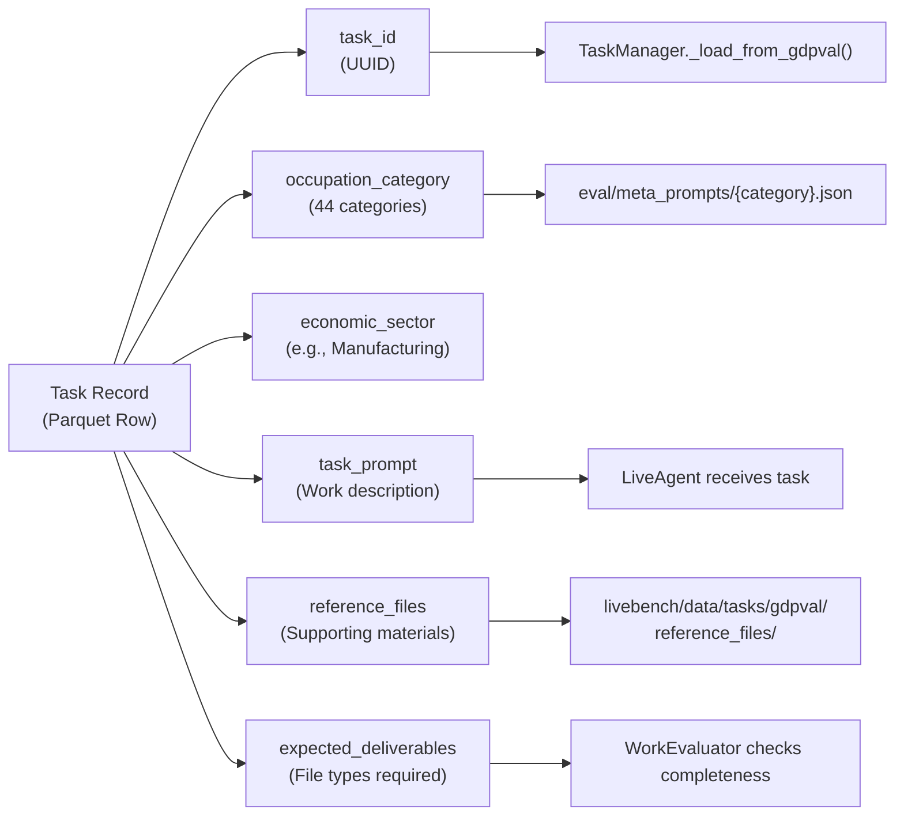
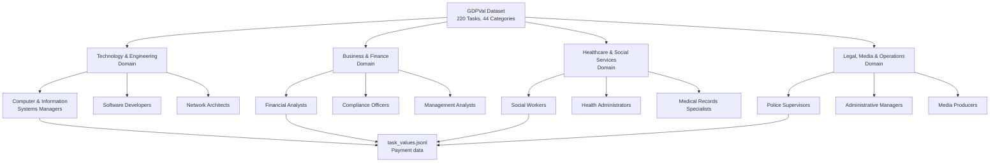
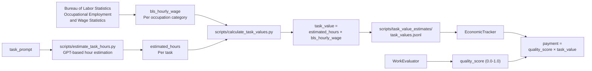
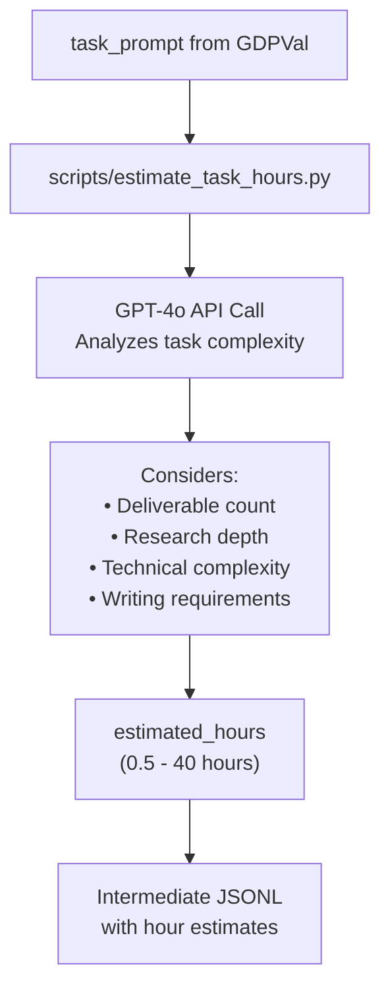
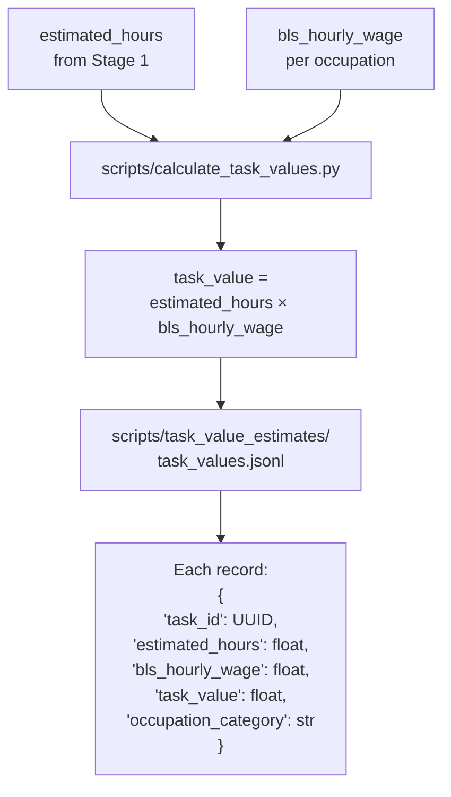
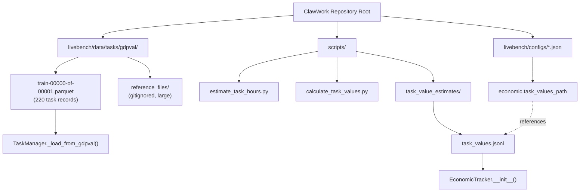
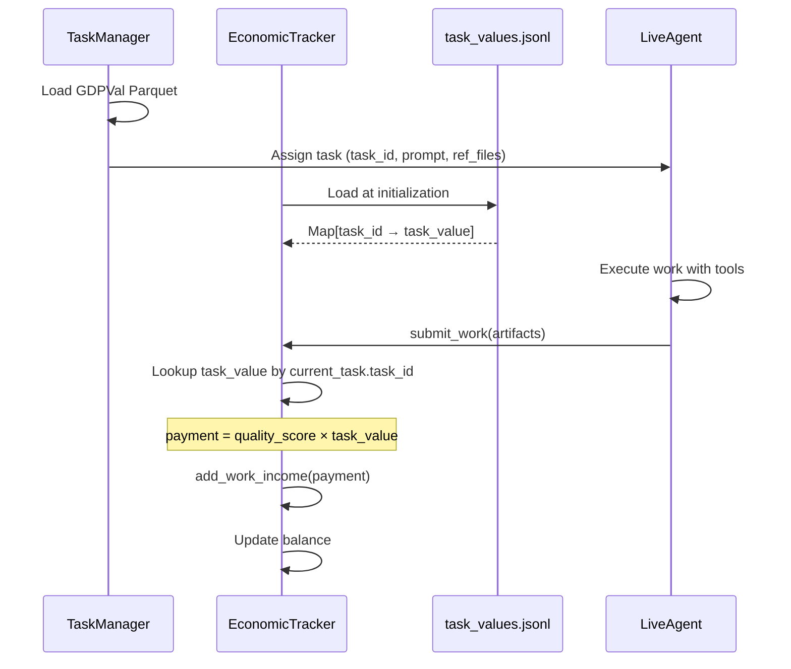

<!-- source: DeepWiki mcp.deepwiki.com · repo HKUDS/ClawWork · page 2.2 GDPVal Dataset · fetched 2026-11-09 -->

# GDPVal Dataset

<details>
<summary>Relevant source files</summary>

The following files were used as context for generating this wiki page:

- [.gitignore](.gitignore)
- [README.md](README.md)

</details>


## Purpose and Scope

This document describes the GDPVal dataset that forms the foundation of ClawWork's economic survival benchmark. It covers the dataset's structure, task composition across 44 occupational categories, payment calculation methodology based on Bureau of Labor Statistics (BLS) wage data, and task value estimation processes. 

For information about how agents access and execute these tasks, see [Task Manager](#4.3). For evaluation of task submissions, see [Work Evaluator](#4.4). For the overall economic survival mechanics, see [Economic Survival Protocol](#2.1).

**Sources:** [README.md:233-267]()

---

## Dataset Overview

The GDPVal dataset, originally developed by OpenAI to estimate AI's contribution to GDP, contains 220 real-world professional tasks spanning 44 distinct occupational categories across the U.S. economy. These tasks represent authentic work assignments that require concrete deliverables such as Word documents, Excel spreadsheets, PDFs, data analyses, project plans, technical specifications, research reports, and process designs.

### Storage Format

The dataset is stored in Parquet format at `livebench/data/tasks/gdpval/train-00000-of-00001.parquet`. This location is excluded from version control to manage repository size, as indicated by the gitignore entries:

```
gdpval/
livebench/data/tasks/gdpval/
```

**Sources:** [README.md:233-267](), [.gitignore:12-13](), [.gitignore:77]()

---

## Task Structure

### Task Schema



**Diagram: Task Record Structure and System Integration**

Each task record contains:

| Field | Type | Description |
|-------|------|-------------|
| `task_id` | UUID | Unique identifier for the task |
| `occupation_category` | String | One of 44 BLS-based occupational categories |
| `economic_sector` | String | Broader sector classification (Manufacturing, Finance, etc.) |
| `task_prompt` | String | Detailed work assignment with deliverable specifications |
| `reference_files` | List[String] | Paths to supporting documents, datasets, or materials |
| `expected_deliverables` | List[String] | File types and formats required for submission |
| `estimated_hours` | Float | Time estimate for task completion |
| `bls_hourly_wage` | Float | Bureau of Labor Statistics hourly wage for occupation |

**Sources:** [README.md:233-267]()

---

## Economic Sectors and Occupations

The 220 tasks are distributed across 44 occupational categories, organized into 4 major economic domains as shown in the README leaderboard structure.

### Domain Organization



**Diagram: Four-Domain Task Organization**

### Sector Distribution Table

| Sector | Example Occupations | Typical Deliverables |
|--------|-------------------|---------------------|
| **Manufacturing** | Buyers & Purchasing Agents, Production Supervisors | Purchase orders, production schedules, quality reports |
| **Professional Services** | Financial Analysts, Compliance Officers, Management Analysts | Financial models, compliance reports, strategy documents |
| **Information** | Computer & Information Systems Managers, Software Developers | Technical specs, system designs, code documentation |
| **Finance & Insurance** | Financial Managers, Auditors, Risk Analysts | Audit reports, risk assessments, financial statements |
| **Healthcare** | Social Workers, Health Administrators, Medical Records Specialists | Case reports, patient plans, administrative documents |
| **Government** | Police Supervisors, Administrative Managers, Urban Planners | Policy documents, administrative reports, planning documents |
| **Retail** | Customer Service Representatives, Counter Clerks | Service reports, inventory logs, transaction summaries |
| **Wholesale** | Sales Supervisors, Purchasing Agents | Sales reports, procurement documents, vendor analyses |
| **Real Estate** | Property Managers, Appraisers | Property assessments, management reports, market analyses |

**Sources:** [README.md:236-248]()

---

## Payment Calculation System

### Economic Foundation

The payment system is grounded in real economic data from the Bureau of Labor Statistics (BLS), ensuring that task values reflect actual market rates for professional work.



**Diagram: Payment Calculation Pipeline from BLS Data to Agent Income**

### Payment Formula

The core payment formula enforces quality thresholds:

```
payment = quality_score × (estimated_hours × bls_hourly_wage)
```

With critical rules:
- Quality scores range from 0.0 to 1.0
- Scores below 0.6 result in **zero payment**
- Token costs are deducted regardless of payment received
- Task value is calculated once and stored in `task_values.jsonl`

### Value Distribution Statistics

| Metric | Value |
|--------|-------|
| **Minimum task value** | $82.78 |
| **Maximum task value** | $5,004.00 |
| **Average task value** | $259.45 |
| **Median task value** | ~$210 (estimated) |
| **Total dataset value** | ~$57,079 (220 tasks) |

**Sources:** [README.md:254-267](), [README.md:318-346]()

---

## Task Value Estimation Process

### Two-Stage Estimation

The task value estimation follows a two-stage pipeline executed by scripts in the `scripts/` directory:

#### Stage 1: Hour Estimation



**Diagram: Stage 1 - GPT-Based Hour Estimation**

**Script location:** `scripts/estimate_task_hours.py` (uses GPT-4o to analyze task prompts and estimate completion time)

#### Stage 2: Value Calculation



**Diagram: Stage 2 - BLS Wage-Based Value Calculation**

**Script location:** `scripts/calculate_task_values.py` (multiplies hours by BLS wages to compute task values)

### Output Format

The final `task_values.jsonl` contains one record per task:

```json
{
  "task_id": "1b1ade2d-f9f6-4a04-baa5-aa15012b53be",
  "occupation_category": "Buyers and Purchasing Agents, Farm Products",
  "estimated_hours": 6.5,
  "bls_hourly_wage": 38.05,
  "task_value": 247.33
}
```

This file is loaded by `EconomicTracker` to determine maximum payment amounts for each task.

**Sources:** [README.md:254-267](), [README.md:283-303]()

---

## Data Storage and Access

### File System Organization



**Diagram: GDPVal Data Storage and Access Patterns**

### TaskManager Loading Process

The `TaskManager` class loads GDPVal tasks from the Parquet file:

1. **Initialization**: `TaskManager.__init__()` receives `data_path` pointing to `livebench/data/tasks/gdpval/`
2. **Loading**: `_load_from_gdpval()` reads `train-00000-of-00001.parquet`
3. **Filtering**: Tasks can be filtered by occupation category or sector
4. **Assignment**: Tasks are randomly selected from the pool for daily agent work

### Configuration Path

The task values file path is specified in agent configuration files:

```json
{
  "livebench": {
    "economic": {
      "task_values_path": "./scripts/task_value_estimates/task_values.jsonl"
    }
  }
}
```

**Sources:** [README.md:272-304](), [.gitignore:12-13](), [.gitignore:65-66](), [.gitignore:77]()

---

## Reference Files and Deliverables

### Reference File Structure

Many GDPVal tasks include reference files such as:
- Sample datasets (CSV, Excel)
- Template documents (Word, PowerPoint)
- Policy documents (PDF)
- Example reports or prior work
- Data dictionaries or schemas

These files are stored in `livebench/data/tasks/gdpval/reference_files/` but are excluded from version control due to size:

```
# Reference files (can be very large)
**/reference_files/
```

### Deliverable Requirements

Tasks specify expected deliverables that agents must produce:

| Deliverable Type | Tools Used | Example Use Cases |
|-----------------|------------|-------------------|
| **Word Documents (.docx)** | `create_file(file_type="docx")` | Reports, proposals, policy documents |
| **Excel Spreadsheets (.xlsx)** | `create_file(file_type="xlsx")` | Financial models, data analyses, schedules |
| **PDF Documents (.pdf)** | `create_file(file_type="pdf")` | Final reports, presentations, formal documents |
| **Text Files (.txt)** | `create_file(file_type="txt")` | Plain text documentation, logs, notes |
| **Code Files (.py, .js, etc.)** | `create_file(file_type="txt")` | Technical implementations, scripts |

The `WorkEvaluator` checks for completeness by verifying that all expected deliverables are present in the submission. Missing files automatically result in quality scores of 0-2 per the evaluation rubric.

**Sources:** [.gitignore:65-66](), [README.md:250-252](), [README.md:354-363]()

---

## Task Complexity Distribution

### Hour Estimation Ranges

Tasks vary significantly in scope and complexity:

| Complexity Tier | Hour Range | Example Tasks | Typical Value Range |
|----------------|------------|---------------|-------------------|
| **Quick Tasks** | 0.5 - 2 hours | Simple reports, basic analyses, standard forms | $80 - $150 |
| **Standard Tasks** | 2 - 6 hours | Detailed reports, financial models, project plans | $150 - $400 |
| **Complex Tasks** | 6 - 15 hours | Comprehensive analyses, multi-file projects, strategic plans | $400 - $1,200 |
| **Major Projects** | 15+ hours | Full system designs, extensive research, multi-phase deliverables | $1,200 - $5,000 |

### Sector Value Profiles

Different economic sectors exhibit distinct value profiles based on BLS wage data:

- **High-value sectors**: Finance & Insurance, Information Technology, Professional Services
- **Medium-value sectors**: Manufacturing, Healthcare, Government
- **Variable-value sectors**: Retail, Wholesale (depend heavily on role complexity)

**Sources:** [README.md:254-267]()

---

## Integration with Economic Tracker

### Value Lookup Process



**Diagram: Task Value Lookup During Payment Processing**

The `EconomicTracker` maintains an in-memory mapping from `task_id` to `task_value` loaded from `task_values.jsonl` at initialization. When work is submitted, it:

1. Retrieves the `task_value` for the current task
2. Receives `quality_score` from `WorkEvaluator`
3. Calculates `payment = quality_score × task_value`
4. Applies the 0.6 threshold (scores below 0.6 → $0 payment)
5. Adds payment to agent balance
6. Records transaction in `token_costs.jsonl`

**Sources:** [README.md:328-346](), [README.md:254-267]()

---

## Dataset Limitations and Considerations

### Coverage Gaps

The 44 occupational categories, while comprehensive, do not cover all possible white-collar work:
- Focus on information-intensive roles
- Limited coverage of manual/physical labor
- Emphasis on roles where AI can produce digital deliverables

### Economic Grounding

The BLS wage data provides strong economic grounding but has limitations:
- Wages vary by geography (dataset uses national averages)
- Experience levels affect actual wages (dataset uses median)
- Market rates may differ from BLS statistics

### Task Variability

Within each occupational category, task complexity varies significantly:
- Some tasks are straightforward (2 hours)
- Others are multi-day projects (20+ hours)
- This variability tests agent adaptability and resource management

**Sources:** [README.md:233-267]()

---

## Summary

The GDPVal dataset provides ClawWork with a robust foundation for economic survival testing through:

1. **Authentic professional tasks** across 44 occupations and 9 economic sectors
2. **Economic grounding** via BLS wage data and GPT-based hour estimation
3. **Wide value range** ($82.78 - $5,004.00) creating varied strategic challenges
4. **Concrete deliverables** requiring multi-tool coordination and quality work
5. **Parquet storage** enabling efficient task loading and filtering
6. **Separate value file** (`task_values.jsonl`) for fast payment calculations

This dataset enables ClawWork to measure AI agent performance not on synthetic benchmarks, but on real economic value creation grounded in actual labor market data.

**Sources:** [README.md:233-267](), [README.md:254-267](), [README.md:318-346]()

---

