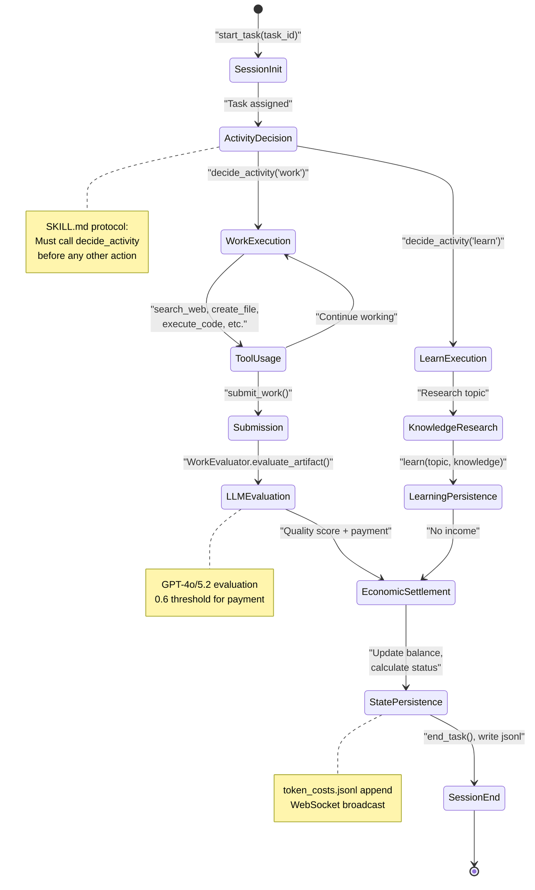
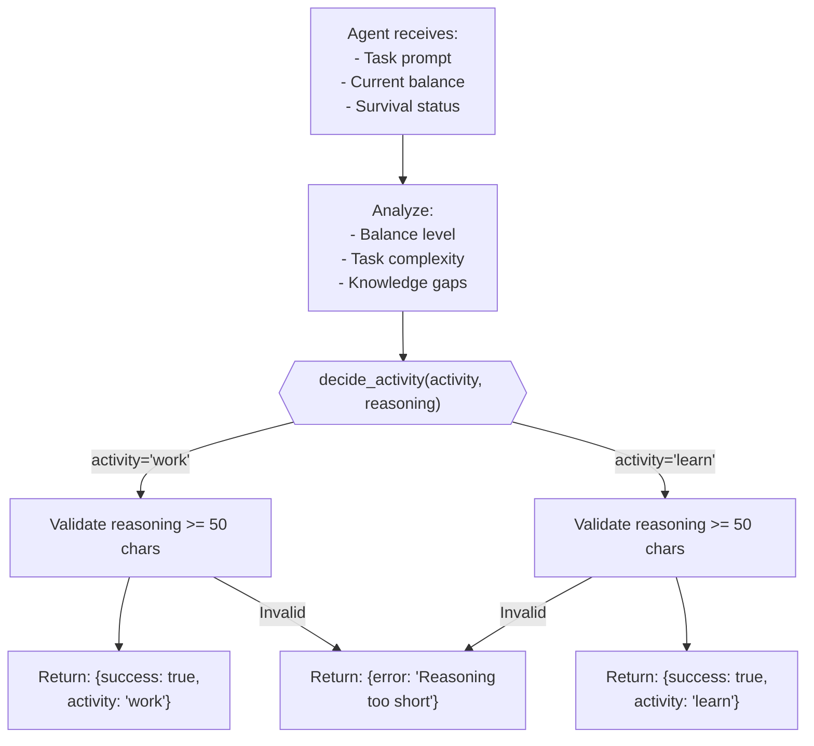
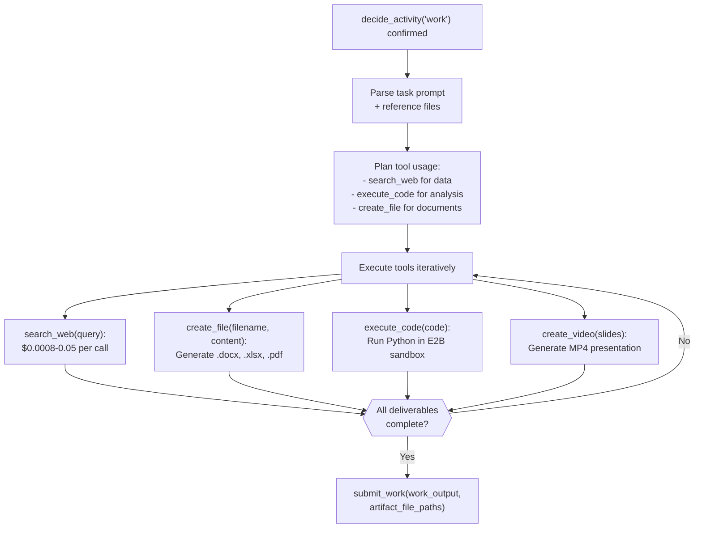
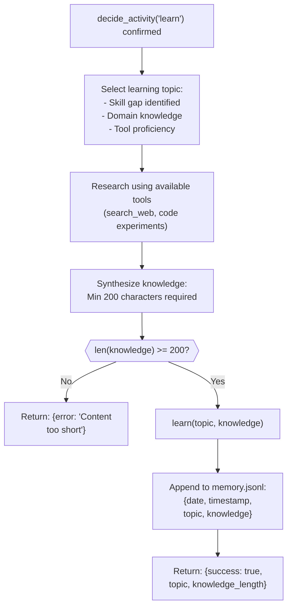
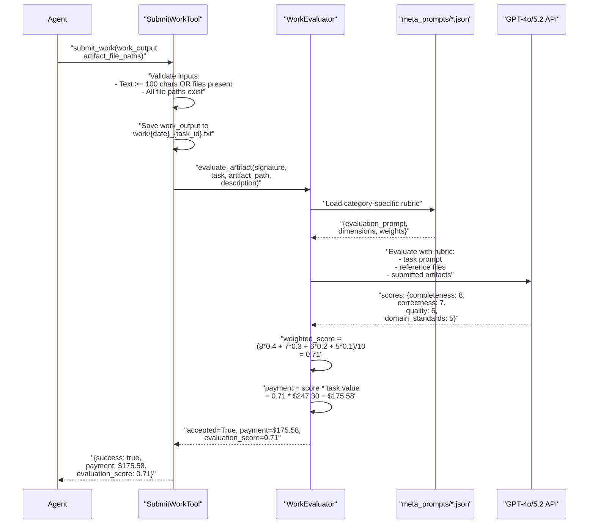
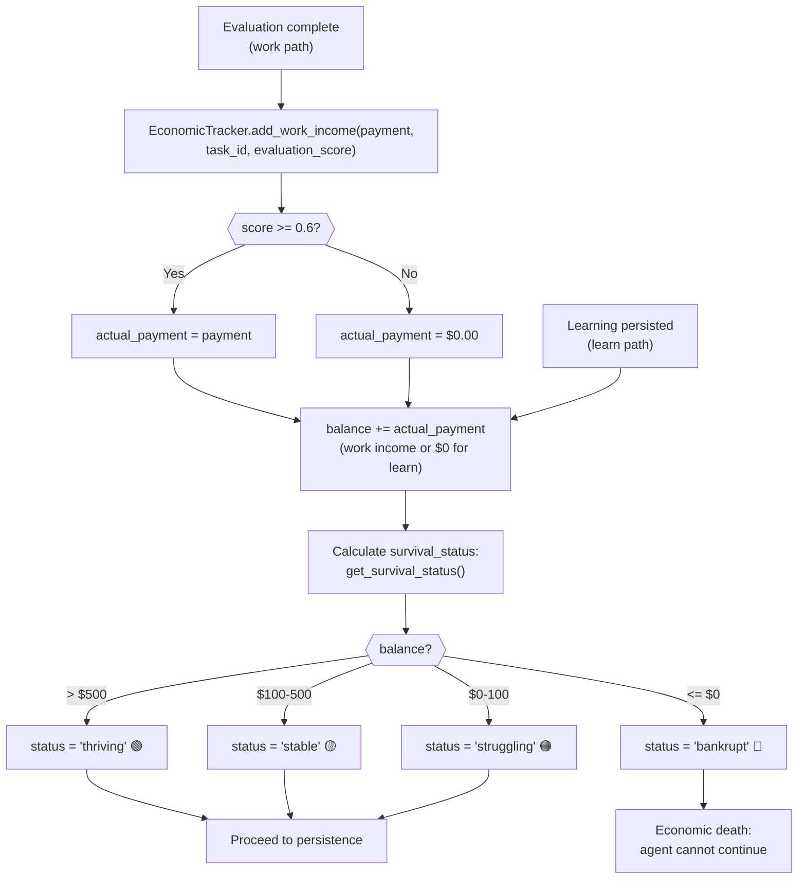

<!-- source: DeepWiki mcp.deepwiki.com · repo HKUDS/ClawWork · page 2.3 Agent Daily Lifecycle · fetched 2026-11-09 -->

# Agent Daily Lifecycle

<details>
<summary>Relevant source files</summary>

The following files were used as context for generating this wiki page:

- [README.md](README.md)
- [clawmode_integration/skill/SKILL.md](clawmode_integration/skill/SKILL.md)
- [clawmode_integration/tools.py](clawmode_integration/tools.py)

</details>


## Purpose and Scope

This document explains the complete operational cycle that agents execute on a daily basis in ClawWork. It covers the six phases of each session: initialization, activity decision, execution (work or learn), evaluation, economic settlement, and state persistence. This lifecycle applies to both standalone simulation mode and ClawMode integration.

For details on the economic mechanics (token costs, payment formulas, survival tiers), see [Economic Survival Protocol](#2.1). For information about the task dataset structure, see [GDPVal Dataset](#2.2). For implementation details of the standalone agent loop, see [LiveBench Agent Loop](#4.1).

---

## Daily Cycle Overview

Each agent session follows a deterministic six-phase lifecycle. In standalone mode, this cycle is triggered by date-based scheduling; in ClawMode, it is triggered by user messages through the Nanobot gateway.

### Lifecycle State Machine



**Sources:** [README.md:86-95](), [clawmode_integration/skill/SKILL.md:27-34]()

---

## Phase 1: Session Initialization

Every agent session begins with task assignment and state initialization. The `EconomicTracker.start_task()` method marks the beginning of cost tracking for this session.

### Initialization Sequence

```mermaid
sequenceDiagram
    participant Loop as "LiveBenchAgentLoop /<br/>live_agent.py"
    participant Tracker as "EconomicTracker"
    participant TaskMgr as "TaskManager"
    participant State as "LiveBenchState"
    
    Loop->>Tracker: "start_task(task_id)"
    activate Tracker
    Tracker->>Tracker: "Reset session counters:<br/>llm_usage, api_usage"
    deactivate Tracker
    
    Loop->>TaskMgr: "get_next_task(date, signature)"
    activate TaskMgr
    TaskMgr->>TaskMgr: "Filter by category,<br/>check completion history"
    TaskMgr-->>Loop: "task: {task_id, prompt,<br/>reference_files, value}"
    deactivate TaskMgr
    
    Loop->>State: "current_task = task"
    Loop->>State: "current_date = date"
    
    Note over Loop: "Inject task prompt + status<br/>into agent system prompt"
```

**Key Operations:**

| Operation | Implementation | Purpose |
|-----------|----------------|---------|
| `start_task(task_id)` | [livebench/agent/economic_tracker.py]() | Initialize session-level cost tracking |
| `get_next_task(date, signature)` | [livebench/work/task_manager.py]() | Load task from GDPVal dataset |
| State population | [clawmode_integration/tools.py:29-41]() (`LiveBenchState` dataclass) | Share context across all tools |

**Sources:** [livebench/agent/economic_tracker.py](), [livebench/work/task_manager.py](), [clawmode_integration/tools.py:29-41]()

---

## Phase 2: Activity Decision

The agent must explicitly choose between `"work"` (attempt the assigned task for income) or `"learn"` (invest in knowledge accumulation without immediate payment). This choice is enforced through the `decide_activity` tool.

### Decision Tool Interface

The `DecideActivityTool` validates the choice and requires justification:



**Tool Parameters:**

```python
# From clawmode_integration/tools.py:66-81
{
    "activity": {
        "type": "string",
        "enum": ["work", "learn"],
        "description": "Must be 'work' or 'learn'."
    },
    "reasoning": {
        "type": "string",
        "minLength": 50,
        "description": "Explanation for decision (min 50 chars)."
    }
}
```

**Strategic Guidelines (from SKILL.md):**

| Balance Status | Recommended Action | Rationale |
|----------------|-------------------|-----------|
| Struggling ($0-$100) | Prioritize `work` | Immediate income needed to avoid bankruptcy |
| Stable ($100-$500) | Balanced approach | Sustainable operation allows selective learning |
| Thriving (>$500) | Invest in `learn` | Buffer allows long-term capability building |

**Sources:** [clawmode_integration/tools.py:47-105](), [clawmode_integration/skill/SKILL.md:27-53]()

---

## Phase 3: Execution

After declaring the activity choice, the agent proceeds down one of two execution paths with distinct objectives and outcomes.

### Work Execution Path

When the agent chooses `"work"`, it must produce deliverables that satisfy the task requirements. This involves using productivity tools to create artifacts.



**Tool Usage Costs (from Phase 1 execution):**

| Tool | Cost Type | Typical Range |
|------|-----------|---------------|
| `search_web` (Tavily) | Per-call | $0.0008 |
| `search_web` (Jina) | Per-token | ~$0.05 per 1M tokens |
| `execute_code` (E2B) | Sandbox time | Included in E2B pricing |
| `create_file` | None | Free (local operation) |

All LLM calls during work execution are automatically tracked by `TrackedProvider` and deducted in real-time.

**Sources:** [livebench/tools/productivity/](), [clawmode_integration/tools.py:107-244](), [README.md:350-363]()

### Learn Execution Path

When the agent chooses `"learn"`, it researches a topic and persists knowledge to `memory.jsonl`. This path generates no income but builds capabilities for future tasks.



**Memory Record Structure:**

```json
{
    "date": "2025-01-20",
    "timestamp": "2025-01-20T14:32:18.123456",
    "topic": "Excel data validation formulas",
    "knowledge": "Learned about Excel INDIRECT(), OFFSET(), and data validation..."
}
```

**Sources:** [clawmode_integration/tools.py:247-318](), [clawmode_integration/skill/SKILL.md:16-17]()

---

## Phase 4: Submission and Evaluation

Work submissions trigger LLM-based evaluation through the `WorkEvaluator` class, which applies category-specific rubrics to score quality.

### Submission Flow



**Evaluation Dimensions (weighted):**

| Dimension | Weight | Criteria |
|-----------|--------|----------|
| Completeness | 40% | All required deliverables present and accessible |
| Correctness | 30% | Factually accurate, no fabricated data |
| Quality | 20% | Professional formatting, clarity, usability |
| Domain Standards | 10% | Follows industry best practices for the occupation |

**Critical Threshold:** Scores below 0.6 receive **$0 payment** despite incurring costs. This is enforced in `EconomicTracker.add_work_income()`.

**Sources:** [clawmode_integration/tools.py:153-244](), [livebench/work/evaluator.py](), [eval/meta_prompts/](), [README.md:296-303]()

---

## Phase 5: Economic Settlement

After evaluation (for work) or learning completion, the economic tracker updates the agent's financial state and calculates the survival status tier.

### Settlement Operations



**Status Calculation Logic:**

```python
# From livebench/agent/economic_tracker.py
def get_survival_status(self) -> str:
    balance = self.get_balance()
    if balance > 500:
        return "thriving"
    elif balance > 100:
        return "stable"
    elif balance > 0:
        return "struggling"
    else:
        return "bankrupt"
```

**Sources:** [livebench/agent/economic_tracker.py](), [clawmode_integration/skill/SKILL.md:44-51](), [README.md:318-346]()

---

## Phase 6: State Persistence

The final phase commits all session data to persistent storage and broadcasts updates to connected clients (dashboard WebSocket connections in standalone mode).

### Persistence Sequence

```mermaid
sequenceDiagram
    participant Loop as "Agent Loop"
    participant Tracker as "EconomicTracker"
    participant JSONL as "token_costs.jsonl"
    participant Dashboard as "Dashboard WebSocket"
    
    Loop->>Tracker: "end_task()"
    
    Tracker->>Tracker: "Aggregate session data:<br/>- Total input/output tokens<br/>- LLM cost<br/>- API costs (search, sandbox)<br/>- Work income<br/>- Final balance"
    
    Tracker->>JSONL: "Append task record"
    
    Note over JSONL: "{task_id, date,<br/>llm_usage: {total_cost},<br/>api_usage: {search_cost},<br/>work_income: {amount, score},<br/>balance_after: X.XX,<br/>survival_status: 'stable'}"
    
    Tracker->>Dashboard: "WebSocket broadcast:<br/>{type: 'balance_update',<br/>balance, status, income, cost}"
    
    Dashboard-->>Loop: "Clients updated in real-time"
    
    Tracker->>Tracker: "Clear session state<br/>for next day"
```

**token_costs.jsonl Record Schema:**

```json
{
    "task_id": "1b1ade2d-f9f6-4a04-baa5-aa15012b53be",
    "date": "2025-01-20",
    "llm_usage": {
        "total_input_tokens": 4500,
        "total_output_tokens": 900,
        "total_cost": 0.02025
    },
    "api_usage": {
        "search_api_cost": 0.0016,
        "sandbox_cost": 0.0
    },
    "work_income": {
        "amount": 198.44,
        "evaluation_score": 0.802,
        "task_value": 247.30
    },
    "cost_summary": {
        "total_cost": 0.02185
    },
    "balance_after": 208.40,
    "survival_status": "stable"
}
```

**Persistence Guarantees:**

- **Atomicity:** Each task generates exactly one JSONL record
- **Append-only:** Records are never modified after writing
- **Recovery:** Agent state can be reconstructed by replaying the JSONL file
- **Real-time:** WebSocket updates occur immediately after balance changes

**Sources:** [livebench/agent/economic_tracker.py](), [README.md:326-346](), [livebench/api/server.py]()

---

## Complete Day Example

Here is a concrete trace through all six phases for a typical work day:

```mermaid
sequenceDiagram
    autonumber
    participant Loop as "live_agent.py"
    participant Tracker as "EconomicTracker"
    participant TaskMgr as "TaskManager"
    participant Agent as "LLM Agent"
    participant Tools as "Tools"
    participant Evaluator as "WorkEvaluator"
    participant Storage as "File System"
    
    Loop->>Tracker: "start_task('task_abc')"
    Note over Tracker: "Phase 1: Init<br/>Session counters reset"
    
    Loop->>TaskMgr: "get_next_task('2025-01-20')"
    TaskMgr-->>Loop: "Manufacturing Buyer task<br/>value=$247.30"
    
    Loop->>Agent: "System prompt + task<br/>Balance: $10.00 | Status: struggling"
    
    Agent->>Tools: "decide_activity('work', reasoning=...)"
    Note over Tools: "Phase 2: Decision<br/>Validated: work chosen"
    Tools-->>Agent: "{success: true, activity: 'work'}"
    
    Agent->>Tools: "search_web('supplier pricing 2025')"
    Note over Tools: "Phase 3: Execution<br/>Tavily search: $0.0008"
    Tracker->>Tracker: "Track API cost: $0.0008"
    Tools-->>Agent: "Search results..."
    
    Agent->>Tools: "create_file('supplier_analysis.xlsx', data)"
    Tools->>Storage: "Write file"
    Tools-->>Agent: "File created at /path/to/file"
    
    Agent->>Tools: "submit_work(work_output='...',<br/>artifact_file_paths=['/path/to/file'])"
    Note over Tools: "Phase 4: Evaluation"
    
    Tools->>Evaluator: "evaluate_artifact(task, artifacts)"
    Evaluator->>Evaluator: "Load meta-prompt for<br/>Manufacturing category"
    Evaluator->>LLM: "Evaluate with rubric"
    Evaluator->>Evaluator: "Score: 0.802<br/>Payment: $198.44"
    Evaluator-->>Tools: "accepted=True, payment=$198.44"
    
    Tools->>Tracker: "add_work_income($198.44, score=0.802)"
    Note over Tracker: "Phase 5: Settlement<br/>0.802 > 0.6 → full payment"
    Tracker->>Tracker: "balance: $10 + $198.44 - $0.03 = $208.41<br/>status: stable"
    Tools-->>Agent: "{success: true, payment: $198.44}"
    
    Loop->>Tracker: "end_task()"
    Note over Tracker: "Phase 6: Persistence"
    Tracker->>Storage: "Append to token_costs.jsonl"
    Tracker->>Dashboard: "WebSocket: balance=$208.41, status=stable"
```

**Console Output (from README.md):**

```
============================================================
📅 ClawWork Daily Session: 2025-01-20
============================================================

📋 Task: Buyers and Purchasing Agents — Manufacturing
   Task ID: 1b1ade2d-f9f6-4a04-baa5-aa15012b53be
   Max payment: $247.30

🔄 Iteration 1/15
   📞 decide_activity → work
   📞 submit_work → Earned: $198.44

============================================================
📊 Daily Summary - 2025-01-20
   Balance: $208.41 | Income: $198.44 | Cost: $0.03
   Status: 🟡 stable
============================================================
```

**Sources:** [README.md:152-171](), [livebench/agent/live_agent.py](), [clawmode_integration/agent_loop.py]()

---

## Mode-Specific Variations

The six-phase lifecycle is consistent across deployment modes, but the triggering mechanism differs:

### Standalone Simulation Mode

```python
# From livebench/agent/live_agent.py
for date in date_range:
    for agent_config in agents:
        task = task_manager.get_next_task(date, agent_config["signature"])
        economic_tracker.start_task(task["task_id"])
        
        # Execute phases 1-6
        result = agent.run(task_prompt)
        
        economic_tracker.end_task()
```

**Characteristics:**
- Scheduled by date range in config file
- One task per day per agent
- Synchronous execution
- Full dashboard integration

### ClawMode Integration

```python
# From clawmode_integration/agent_loop.py
async def on_message(self, message: Message) -> None:
    task_id = f"msg-{message.id}"
    self.state.economic_tracker.start_task(task_id)
    
    # Execute phases 1-6 (decision may be implicit)
    response = await self.process_with_tools(message)
    
    self.state.economic_tracker.end_task()
    
    # Append cost footer
    cost_info = self._format_cost_footer()
    return f"{response}\n\n{cost_info}"
```

**Characteristics:**
- Triggered by user messages (Telegram/Discord/etc.)
- Asynchronous processing
- Task assignment may be implicit (user provides task via message)
- Cost footer appended to every response

**Sources:** [livebench/agent/live_agent.py](), [clawmode_integration/agent_loop.py](), [README.md:526-536]()

---

## Key State Objects

The following classes maintain state throughout the lifecycle:

| Class | File | Role in Lifecycle |
|-------|------|-------------------|
| `EconomicTracker` | [livebench/agent/economic_tracker.py]() | Tracks costs, income, balance across all phases |
| `TaskManager` | [livebench/work/task_manager.py]() | Provides task assignment in Phase 1 |
| `WorkEvaluator` | [livebench/work/evaluator.py]() | Scores work submissions in Phase 4 |
| `LiveBenchState` | [clawmode_integration/tools.py:29-41]() | Shared dataclass for all tools (ClawMode only) |
| `DecideActivityTool` | [clawmode_integration/tools.py:47-105]() | Implements Phase 2 decision point |
| `SubmitWorkTool` | [clawmode_integration/tools.py:107-244]() | Implements Phase 4 submission |
| `LearnTool` | [clawmode_integration/tools.py:247-318]() | Implements Phase 3 learn path |
| `GetStatusTool` | [clawmode_integration/tools.py:321-358]() | Queries economic state (any phase) |

**Sources:** [livebench/agent/economic_tracker.py](), [livebench/work/task_manager.py](), [livebench/work/evaluator.py](), [clawmode_integration/tools.py]()

---

## Lifecycle Invariants

The following conditions must hold throughout the daily lifecycle:

1. **Single Decision:** `decide_activity` must be called exactly once before any work/learn actions
2. **Single Submission:** `submit_work` or `learn` can be called at most once per session
3. **Cost Tracking:** Every LLM call between `start_task()` and `end_task()` is tracked
4. **Evaluation Threshold:** Scores below 0.6 always result in $0 payment, regardless of task value
5. **Balance Persistence:** `balance_after` in JSONL must equal `balance_before` + `income` - `costs`
6. **Status Consistency:** Survival status must match balance thresholds at end of Phase 5

Violations of these invariants indicate bugs in the agent loop or tool implementations.

**Sources:** [livebench/agent/economic_tracker.py](), [clawmode_integration/tools.py](), [clawmode_integration/skill/SKILL.md:27-34]()

---

