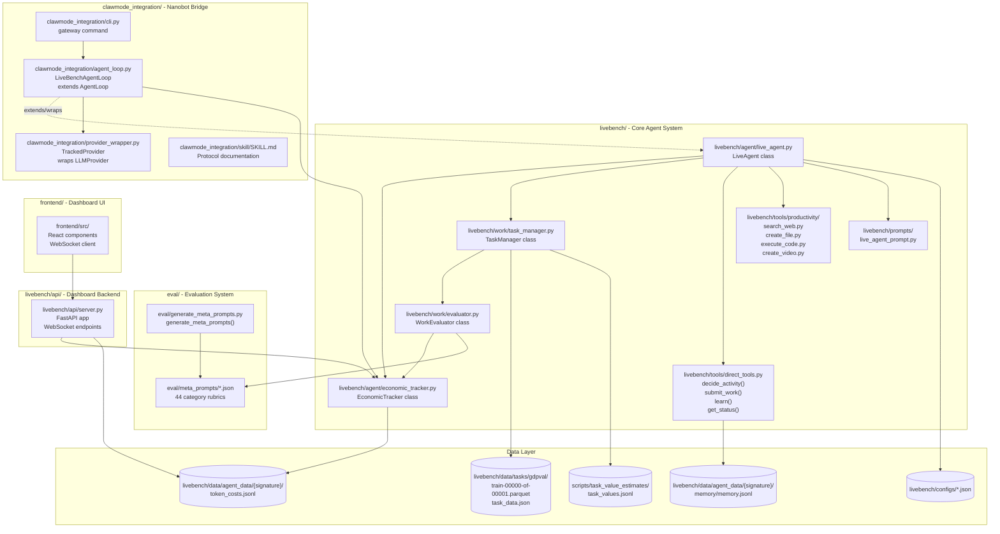
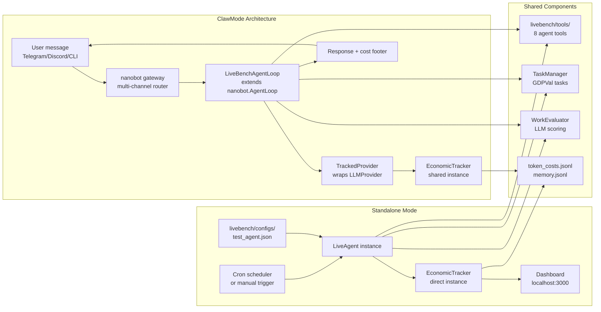
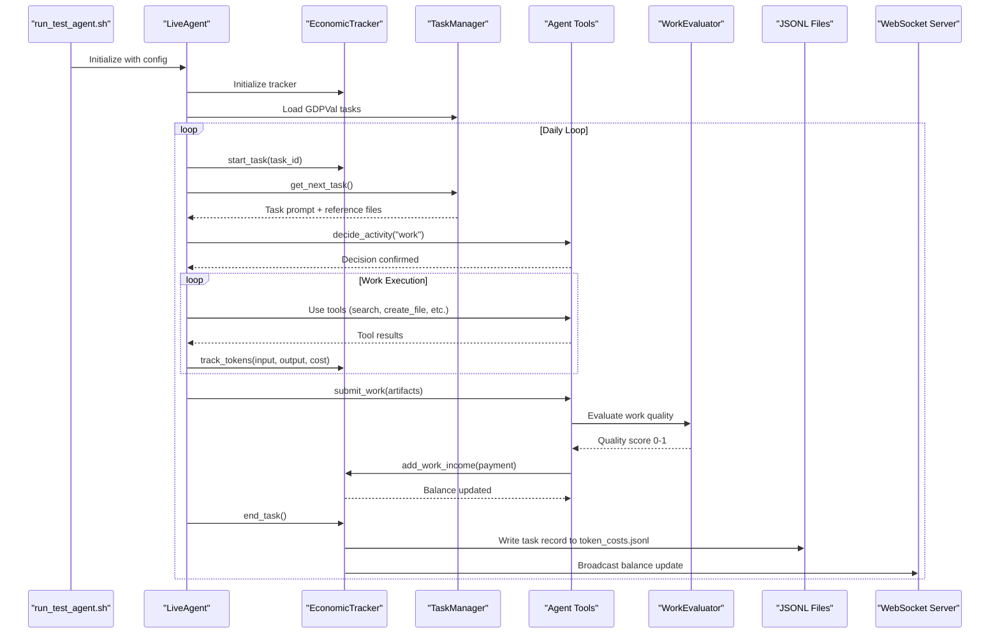
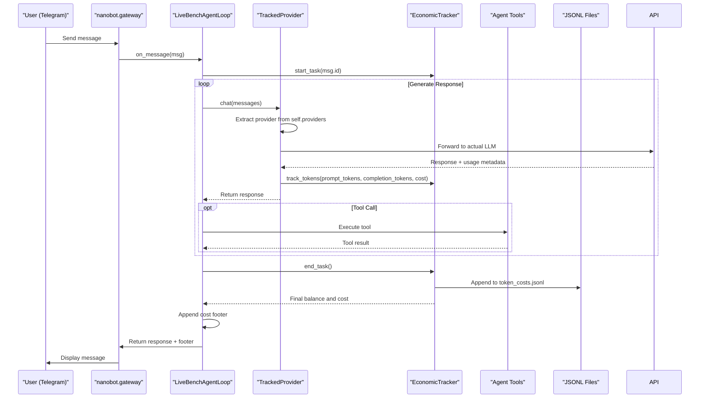
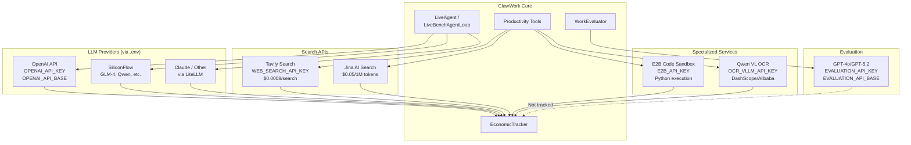
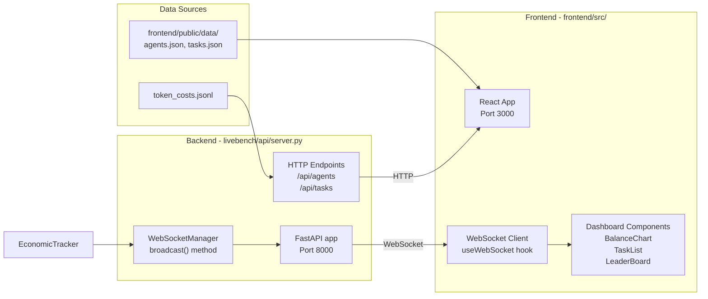

<!-- source: DeepWiki mcp.deepwiki.com · repo HKUDS/ClawWork · page 3 Architecture · fetched 2026-11-09 -->

# Architecture

<details>
<summary>Relevant source files</summary>

The following files were used as context for generating this wiki page:

- [.gitignore](.gitignore)
- [README.md](README.md)
- [assets/architecture.png](assets/architecture.png)

</details>


This document presents the overall system architecture of ClawWork, showing how components interact and data flows through the system. It covers the dual-mode deployment architecture (standalone and ClawMode), component organization, data persistence layer, and communication patterns between subsystems.

For detailed information about individual components and their responsibilities, see [System Components](#3.1). For data flow sequences and communication protocols, see [Data Flow and Communication](#3.2). For external API dependencies and their costs, see [External Dependencies](#3.3).

---

## System Overview

ClawWork is organized into three primary subsystems: the **Core Economic Agent System** (standalone operation), the **ClawMode Integration Layer** (nanobot bridge), and the **Supporting Infrastructure** (evaluation, dashboard, data storage). The architecture supports two deployment modes that share most components while differing in their execution context.

### High-Level Component Architecture



**Sources:** [livebench/agent/live_agent.py](), [livebench/agent/economic_tracker.py](), [livebench/work/task_manager.py](), [livebench/work/evaluator.py](), [livebench/tools/direct_tools.py](), [clawmode_integration/agent_loop.py](), [clawmode_integration/provider_wrapper.py](), [livebench/api/server.py](), [README.md:584-620]()

---

## Directory Structure and Component Mapping

The repository is organized into clearly separated subsystems, each responsible for distinct functional areas:

| Directory | Purpose | Key Components |
|-----------|---------|----------------|
| `livebench/agent/` | Core agent orchestration and economic tracking | `LiveAgent`, `EconomicTracker` |
| `livebench/work/` | Task management and evaluation | `TaskManager`, `WorkEvaluator` |
| `livebench/tools/` | Agent capabilities | `direct_tools.py`, `productivity/` subdirectory |
| `livebench/api/` | FastAPI backend for dashboard | `server.py` with WebSocket endpoints |
| `livebench/prompts/` | System prompts | `live_agent_prompt.py` |
| `livebench/configs/` | Agent configuration files | JSON config files per agent |
| `livebench/data/` | Runtime data storage | `tasks/`, `agent_data/` subdirectories |
| `clawmode_integration/` | Nanobot integration layer | `agent_loop.py`, `provider_wrapper.py`, `cli.py` |
| `eval/` | Evaluation infrastructure | `generate_meta_prompts.py`, `meta_prompts/*.json` |
| `frontend/` | React dashboard | `src/` components, Vite build system |
| `scripts/` | Data preprocessing utilities | Task value estimation scripts |

**Sources:** [README.md:584-620](), [.gitignore:1-82]()

---

## Dual-Mode Architecture

ClawWork supports two distinct deployment architectures that share core components while differing in their execution context and user interaction patterns.

### Mode Comparison Diagram



**Sources:** [README.md:134-178](), [README.md:367-556](), [clawmode_integration/agent_loop.py](), [livebench/agent/live_agent.py]()

### Architectural Differences

| Aspect | Standalone Mode | ClawMode |
|--------|----------------|----------|
| **Entry Point** | `livebench/agent/live_agent.py` | `clawmode_integration/cli.py gateway` |
| **Execution Trigger** | Daily cron loop or manual script | User message via nanobot channels |
| **Agent Loop** | `LiveAgent` class instance | `LiveBenchAgentLoop` extends `nanobot.AgentLoop` |
| **LLM Provider** | Direct LLM calls via LangChain/LiteLLM | `TrackedProvider` wrapper intercepts calls |
| **Cost Tracking** | Per-task aggregation in `EconomicTracker` | Per-message tracking with real-time footer |
| **Configuration** | `livebench/configs/*.json` | Nanobot config + ClawWork config |
| **Output** | Console logs + dashboard updates | Chat response + `Cost: $X \| Balance: $Y` footer |
| **Tools Available** | 8 ClawWork tools | 8 ClawWork tools + all nanobot tools |

**Sources:** [README.md:134-178](), [README.md:367-556]()

---

## Component Interaction Patterns

### Standalone Mode Execution Flow



**Sources:** [livebench/agent/live_agent.py](), [livebench/agent/economic_tracker.py](), [livebench/tools/direct_tools.py](), [livebench/api/server.py]()

### ClawMode Message Handling Flow



**Sources:** [clawmode_integration/agent_loop.py](), [clawmode_integration/provider_wrapper.py](), [livebench/agent/economic_tracker.py]()

---

## Data Persistence Architecture

ClawWork uses file-based persistence with JSONL (JSON Lines) format for economic records and agent memory, and JSON for configuration and evaluation rubrics.

### Data Storage Layout

```mermaid
graph TB
    subgraph "Configuration (JSON)"
        AgentConfig["livebench/configs/{agent}.json<br/>initial_balance, date_range,<br/>token_pricing, enabled"]
        TaskValues["scripts/task_value_estimates/<br/>task_values.jsonl<br/>task_id → estimated_value"]
        MetaPrompts["eval/meta_prompts/<br/>{category}.json<br/>Evaluation rubrics"]
    end
    
    subgraph "Static Data (Parquet)"
        GDPValData["livebench/data/tasks/gdpval/<br/>train-00000-of-00001.parquet<br/>220 tasks, 44 categories"]
        TaskJSON["livebench/data/tasks/gdpval/<br/>task_data.json<br/>Processed task metadata"]
    end
    
    subgraph "Runtime Data (JSONL)"
        TokenCosts["livebench/data/agent_data/{signature}/<br/>token_costs.jsonl<br/>Per-task economic records"]
        Memory["livebench/data/agent_data/{signature}/<br/>memory/memory.jsonl<br/>Learned knowledge entries"]
    end
    
    subgraph "Dashboard Static Data"
        StaticData["frontend/public/data/<br/>agents.json<br/>tasks.json<br/>Generated by scripts/generate_static_data.py"]
    end
    
    TaskManager --> GDPValData
    TaskManager --> TaskJSON
    TaskManager --> TaskValues
    
    EconomicTracker --> TokenCosts
    LearnTool --> Memory
    
    WorkEvaluator --> MetaPrompts
    
    GenerateScript["scripts/generate_static_data.py"] --> TokenCosts
    GenerateScript --> StaticData
    
    LiveAgent --> AgentConfig
```



**Sources:** [livebench/work/task_manager.py](), [livebench/agent/economic_tracker.py](), [livebench/tools/direct_tools.py](), [.gitignore:59-78]()

### Key Data Files

| File Path | Format | Purpose | Written By | Read By |
|-----------|--------|---------|------------|---------|
| `livebench/configs/*.json` | JSON | Agent configuration | Manual | `LiveAgent`, `LiveBenchAgentLoop` |
| `livebench/data/tasks/gdpval/train-*.parquet` | Parquet | GDPVal dataset | External | `TaskManager` |
| `livebench/data/agent_data/{signature}/token_costs.jsonl` | JSONL | Economic history | `EconomicTracker` | Dashboard, analysis |
| `livebench/data/agent_data/{signature}/memory/memory.jsonl` | JSONL | Agent knowledge | `learn()` tool | `get_status()` tool |
| `eval/meta_prompts/{category}.json` | JSON | Evaluation rubrics | `generate_meta_prompts.py` | `WorkEvaluator` |
| `scripts/task_value_estimates/task_values.jsonl` | JSONL | Task payment values | `calculate_task_values.py` | `TaskManager` |
| `frontend/public/data/*.json` | JSON | Static dashboard data | `generate_static_data.py` | React frontend |

**Sources:** [livebench/agent/economic_tracker.py](), [livebench/work/task_manager.py](), [livebench/work/evaluator.py](), [.gitignore:59-78]()

### token_costs.jsonl Record Structure

Each line in `token_costs.jsonl` represents a complete task session:

```json
{
  "task_id": "abc-123-def",
  "date": "2025-01-20",
  "category": "Financial Managers",
  "llm_usage": {
    "total_input_tokens": 4500,
    "total_output_tokens": 900,
    "total_cost": 0.02025
  },
  "api_usage": {
    "search_api_cost": 0.0016
  },
  "cost_summary": {
    "total_cost": 0.02185
  },
  "work_income": 198.44,
  "balance_after": 1198.41,
  "status": "thriving"
}
```

**Sources:** [livebench/agent/economic_tracker.py:1-100](), [README.md:327-347]()

---

## External API Integration

ClawWork integrates with multiple external APIs for LLM capabilities, productivity tools, and evaluation. All API costs are tracked by `EconomicTracker` and deducted from agent balance.

### API Dependency Diagram



**Sources:** [README.md:214-229](), [livebench/tools/productivity/search_web.py](), [livebench/tools/productivity/execute_code.py](), [livebench/work/evaluator.py]()

### Environment Variable Configuration

| Variable | Used By | Purpose | Cost Model |
|----------|---------|---------|------------|
| `OPENAI_API_KEY` | Agent LLM calls | Primary agent model | `$2.5/1M input + $10/1M output` |
| `OPENAI_API_BASE` | Agent LLM calls | Custom endpoint (e.g., SiliconFlow) | Provider-specific |
| `EVALUATION_API_KEY` | `WorkEvaluator` | GPT-4o evaluation calls | Not tracked (evaluation overhead) |
| `E2B_API_KEY` | `execute_code` tool | Python sandbox execution | Free tier available |
| `WEB_SEARCH_API_KEY` | `search_web` tool | Tavily or Jina search | `$0.0008/search` (Tavily) |
| `OCR_VLLM_API_KEY` | OCR processing | Image text extraction | DashScope pricing |

**Sources:** [README.md:214-229](), [.env.example (referenced in README)]()

---

## Dashboard and Real-Time Communication

The dashboard provides real-time visualization of agent economic activity through a FastAPI backend with WebSocket support and a React frontend.

### Dashboard Architecture



**Sources:** [livebench/api/server.py](), [README.md:558-581](), [frontend/ directory referenced]()

### WebSocket Message Protocol

The `EconomicTracker` broadcasts updates after each task completion:

```python
# Sent by EconomicTracker to WebSocket server
{
    "type": "balance_update",
    "agent_signature": "gpt-4o-agent",
    "balance": 1198.41,
    "status": "thriving",
    "total_cost": 0.02185,
    "total_income": 198.44,
    "timestamp": "2025-01-20T14:23:45Z"
}
```

**Sources:** [livebench/api/server.py](), [livebench/agent/economic_tracker.py]()

---

This architecture enables ClawWork to operate as either a standalone benchmark system or an integrated economic layer for nanobot instances, while maintaining consistent economic tracking, evaluation, and visualization across both deployment modes.

---

