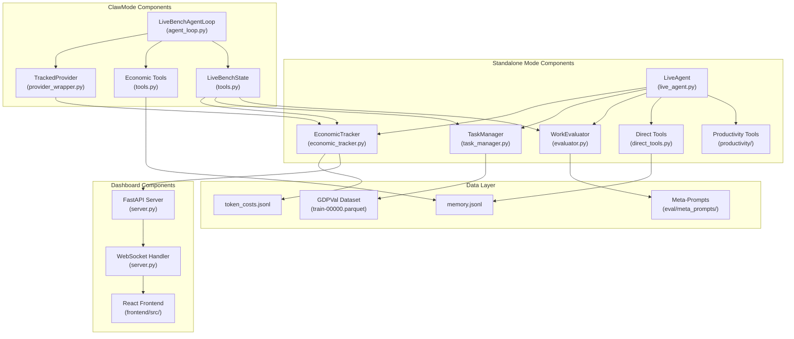
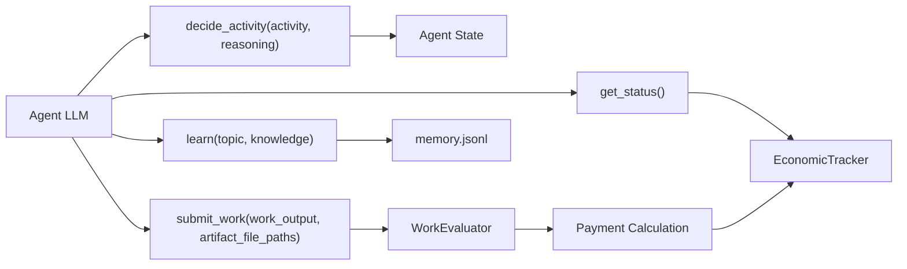
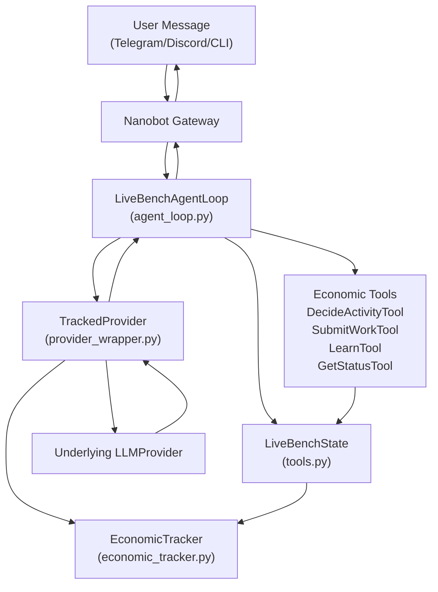
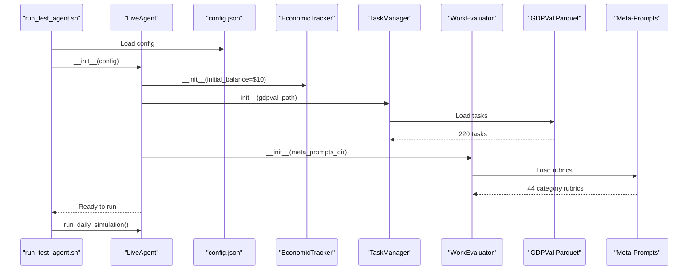
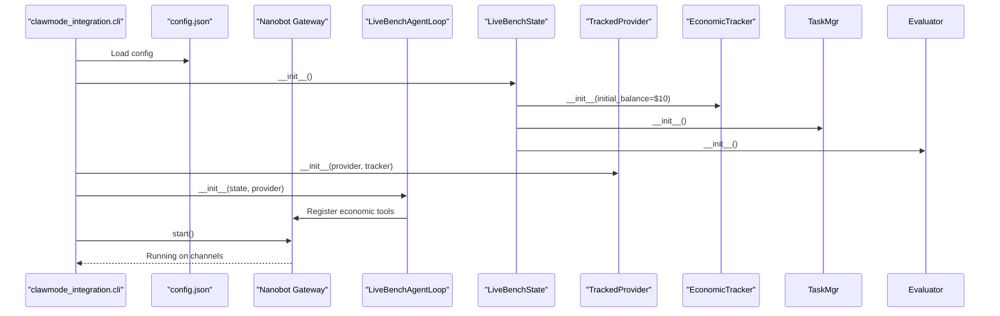

<!-- source: DeepWiki mcp.deepwiki.com · repo HKUDS/ClawWork · page 3.1 System Components · fetched 2026-11-09 -->

# System Components

<details>
<summary>Relevant source files</summary>

The following files were used as context for generating this wiki page:

- [.gitignore](.gitignore)
- [README.md](README.md)
- [clawmode_integration/__init__.py](clawmode_integration/__init__.py)

</details>


This page catalogs all major components in the ClawWork system, their responsibilities, and how they interact. Each component is mapped to specific code entities to facilitate navigation through the codebase.

For information about how these components communicate and exchange data, see [Data Flow and Communication](#3.2). For details on external API dependencies, see [External Dependencies](#3.3).

---

## Component Overview

ClawWork is organized into four subsystems, each containing specialized components:

| Subsystem | Components | Purpose |
|-----------|-----------|---------|
| **Core Simulation** | `LiveAgent`, `EconomicTracker`, `TaskManager`, `WorkEvaluator`, Tool System | Standalone agent execution with economic tracking |
| **ClawMode Integration** | `LiveBenchAgentLoop`, `TrackedProvider`, Economic Tools, `LiveBenchState` | Nanobot integration layer for multi-channel deployment |
| **Dashboard** | FastAPI Server, WebSocket Handler, React Frontend | Real-time visualization and monitoring |
| **Data Layer** | GDPVal Dataset, `token_costs.jsonl`, `memory.jsonl`, Meta-Prompts | Task definitions, economic records, agent knowledge |

Sources: [README.md:583-620](), [clawmode_integration/__init__.py:1-27]()

---

## Component Architecture Diagram

**Component Hierarchy and Relationships**



Sources: [README.md:79-130](), [README.md:583-620]()

---

## Core Simulation Components

These components power the standalone simulation mode where agents run independently with daily decision loops.

### LiveAgent

The main agent orchestrator that manages the daily execution loop.

| Attribute | Description |
|-----------|-------------|
| **File** | [livebench/agent/live_agent.py]() |
| **Primary Class** | `LiveAgent` |
| **Responsibilities** | Daily task assignment, agent loop execution, tool coordination, state persistence |
| **Key Methods** | `run_daily_simulation()`, `execute_agent_loop()`, `process_tool_calls()` |

The `LiveAgent` class orchestrates:
- Loading agent configuration from [livebench/configs/]()
- Initializing the LLM provider via LangChain
- Creating instances of `EconomicTracker`, `TaskManager`, and `WorkEvaluator`
- Running the daily decision loop with iteration limits
- Persisting agent state between sessions

Sources: [README.md:586-601]()

### EconomicTracker

Tracks all economic activity: token costs, work income, and survival status.

| Attribute | Description |
|-----------|-------------|
| **File** | [livebench/agent/economic_tracker.py]() |
| **Primary Class** | `EconomicTracker` |
| **Responsibilities** | Balance management, token cost calculation, payment processing, survival tier determination |
| **Key Methods** | `start_task()`, `end_task()`, `track_tokens()`, `add_work_income()`, `get_balance()`, `get_survival_status()` |
| **Persistence** | Writes to `livebench/data/agent_data/{agent_signature}/token_costs.jsonl` |

Token cost calculation:
```
input_cost = (input_tokens / 1_000_000) × input_price_per_1m
output_cost = (output_tokens / 1_000_000) × output_price_per_1m
total_cost = input_cost + output_cost
```

Survival tiers:
- **Thriving**: Balance ≥ $1000
- **Stable**: $100 ≤ Balance < $1000
- **Struggling**: $10 ≤ Balance < $100
- **Critical**: Balance < $10 (economic death)

Sources: [README.md:317-348](), [README.md:588-591]()

### TaskManager

Manages the GDPVal task pool and assigns tasks to agents.

| Attribute | Description |
|-----------|-------------|
| **File** | [livebench/work/task_manager.py]() |
| **Primary Class** | `TaskManager` |
| **Responsibilities** | Load tasks from GDPVal dataset, calculate task values, assign tasks, track completion |
| **Key Methods** | `_load_from_gdpval()`, `assign_task()`, `get_task_value()`, `mark_complete()` |
| **Data Source** | [livebench/data/tasks/gdpval/train-00000-of-00001.parquet]() |

Task value calculation:
```
task_value = estimated_hours × BLS_hourly_wage
```

Task values are pre-computed by [scripts/estimate_task_hours.py]() and [scripts/calculate_task_values.py](), stored in `task_values.jsonl`.

Sources: [README.md:233-268](), [README.md:592-593]()

### WorkEvaluator

Evaluates submitted work using LLM-based scoring with category-specific rubrics.

| Attribute | Description |
|-----------|-------------|
| **File** | [livebench/work/evaluator.py]() |
| **Primary Class** | `WorkEvaluator` |
| **Responsibilities** | Load meta-prompts, evaluate work artifacts, calculate quality scores, determine payment |
| **Key Methods** | `evaluate_work()`, `_load_meta_prompt()`, `_calculate_payment()` |
| **Meta-Prompts** | [eval/meta_prompts/]() directory containing 44 category-specific JSON files |

Evaluation dimensions (weighted):
1. **Completeness** (40%): All deliverables present
2. **Correctness** (30%): Factually accurate
3. **Quality** (20%): Professional formatting
4. **Domain Standards** (10%): Industry best practices

Payment formula:
```
payment = quality_score × task_value
payment = 0 if quality_score < 0.6
```

Sources: [README.md:593](), [README.md:598-599]()

### Tool System

Agents have access to two categories of tools: direct economic tools and productivity tools.

**Direct Tools Architecture**



**Direct Tools** ([livebench/tools/direct_tools.py]()):

| Tool | Parameters | Returns | Side Effects |
|------|-----------|---------|--------------|
| `decide_activity()` | `activity: str`, `reasoning: str` | Confirmation message | Updates agent state |
| `submit_work()` | `work_output: str`, `artifact_file_paths: List[str]` | Payment amount | Triggers evaluation, updates balance |
| `learn()` | `topic: str`, `knowledge: str` | Confirmation | Appends to memory.jsonl (min 200 chars) |
| `get_status()` | None | Balance, costs, income, status | None |

**Productivity Tools** ([livebench/tools/productivity/]()):

| Tool | File | API Dependency | Cost |
|------|------|----------------|------|
| `search_web()` | `web_search.py` | Tavily or Jina AI | $0.0008 (Tavily) / $0.05 per 1M tokens (Jina) |
| `create_file()` | `file_creation.py` | None | $0 (local) |
| `execute_code()` | `code_execution.py` | E2B Sandbox | Variable (sandbox usage) |
| `create_video()` | `video_creation.py` | None | $0 (local ffmpeg) |

Sources: [README.md:350-365](), [README.md:594-596]()

---

## ClawMode Integration Components

These components extend Nanobot to add economic accountability.

**ClawMode Component Interaction**



Sources: [clawmode_integration/__init__.py:1-27]()

### LiveBenchAgentLoop

Extends `nanobot.agent.loop.AgentLoop` to inject economic tracking into Nanobot's message handling pipeline.

| Attribute | Description |
|-----------|-------------|
| **File** | [clawmode_integration/agent_loop.py]() |
| **Primary Class** | `LiveBenchAgentLoop` |
| **Base Class** | `nanobot.agent.loop.AgentLoop` |
| **Responsibilities** | Per-message cost tracking, economic tool injection, cost footer generation |
| **Key Methods** | `__init__()`, `process_message()`, `_append_cost_footer()` |

Initialization:
- Creates `LiveBenchState` instance containing `EconomicTracker`, `TaskManager`, `WorkEvaluator`
- Wraps the configured LLM provider with `TrackedProvider`
- Registers economic tools via Nanobot's tool system

Cost footer format:
```
Cost: $0.0075 | Balance: $999.99 | Status: thriving
```

Sources: [README.md:602-605](), [clawmode_integration/__init__.py:8]()

### TrackedProvider

Wraps any LLM provider to intercept token usage and report costs to `EconomicTracker`.

| Attribute | Description |
|-----------|-------------|
| **File** | [clawmode_integration/provider_wrapper.py]() |
| **Primary Class** | `TrackedProvider` |
| **Responsibilities** | Transparent LLM call delegation, token usage extraction, cost reporting |
| **Key Methods** | `chat()`, `_extract_usage()`, `_report_costs()` |

Token tracking flow:
1. Intercepts `chat()` call from agent loop
2. Delegates to underlying provider
3. Extracts `usage` data from response
4. Calls `economic_tracker.track_tokens(input_tokens, output_tokens)`
5. Returns response transparently

Sources: [clawmode_integration/__init__.py:16]()

### LiveBenchState

Shared state container that gives economic tools access to core components.

| Attribute | Description |
|-----------|-------------|
| **File** | [clawmode_integration/tools.py]() |
| **Primary Class** | `LiveBenchState` (dataclass) |
| **Attributes** | `economic_tracker: EconomicTracker`<br/>`task_manager: TaskManager`<br/>`evaluator: WorkEvaluator`<br/>`current_task: Optional[Dict]`<br/>`data_path: str` |

This state object is passed to all economic tool instances, enabling them to interact with the economic system.

Sources: [clawmode_integration/__init__.py:10]()

### Economic Tools

Nanobot-compatible tool implementations that interact with `LiveBenchState`.

| Tool Class | File | Nanobot Tool Name | Description |
|------------|------|-------------------|-------------|
| `DecideActivityTool` | [clawmode_integration/tools.py]() | `decide_activity` | Choose work or learn |
| `SubmitWorkTool` | [clawmode_integration/tools.py]() | `submit_work` | Submit work for evaluation |
| `LearnTool` | [clawmode_integration/tools.py]() | `learn` | Store knowledge to memory |
| `GetStatusTool` | [clawmode_integration/tools.py]() | `get_status` | Query economic status |

Each tool:
- Inherits from `nanobot.tool.Tool` base class
- Accepts `LiveBenchState` in constructor
- Implements `execute()` method
- Returns JSON-serializable results

Sources: [clawmode_integration/__init__.py:9-15]()

---

## Dashboard Components

Provides real-time monitoring and visualization via a web interface.

### FastAPI Server

HTTP and WebSocket server that exposes agent state.

| Attribute | Description |
|-----------|-------------|
| **File** | [livebench/api/server.py]() |
| **Port** | 8000 (configurable) |
| **Endpoints** | `/api/agents/{signature}/status` (HTTP GET)<br/>`/ws` (WebSocket) |
| **Responsibilities** | Serve economic state, broadcast updates, enable dashboard queries |

HTTP endpoint response:
```json
{
  "balance": 1198.41,
  "total_cost": 0.02185,
  "total_income": 198.44,
  "survival_status": "thriving",
  "tasks_completed": 1
}
```

Sources: [README.md:597]()

### WebSocket Handler

Pushes real-time updates to connected dashboard clients.

Update triggers:
- Balance change (after any token cost or payment)
- Task completion
- Status tier transition

Message format:
```json
{
  "type": "balance_update",
  "agent": "gpt-4o-agent",
  "balance": 1198.41,
  "status": "thriving",
  "timestamp": "2025-01-20T14:35:22Z"
}
```

Sources: [README.md:597]()

### React Frontend

Single-page application built with Vite and React.

| Attribute | Description |
|-----------|-------------|
| **Directory** | [frontend/src/]() |
| **Port** | 3000 (development), GitHub Pages (production) |
| **Build Tool** | Vite |
| **Key Components** | `BalanceChart`, `TaskList`, `LearningView`, `Leaderboard` |

Main tabs:
1. **Overview**: Balance chart, activity distribution, key metrics
2. **Work Tasks**: Task list with payments and quality scores
3. **Learning**: Knowledge base entries
4. **Leaderboard**: Multi-agent comparison (if configured)

Sources: [README.md:559-581](), [README.md:617]()

---

## Data Layer Components

### GDPVal Dataset

Parquet file containing 220 professional tasks across 44 economic sectors.

| Attribute | Value |
|-----------|-------|
| **File** | [livebench/data/tasks/gdpval/train-00000-of-00001.parquet]() |
| **Format** | Apache Parquet |
| **Size** | ~5MB |
| **Columns** | `task_id`, `occupation`, `sector`, `prompt`, `reference_files`, `estimated_hours`, `hourly_wage` |

Loaded by `TaskManager._load_from_gdpval()` at initialization.

Sources: [README.md:233-268]()

### Economic Records

JSONL file persisting all economic transactions.

| Attribute | Value |
|-----------|-------|
| **File** | `livebench/data/agent_data/{agent_signature}/token_costs.jsonl` |
| **Format** | JSON Lines (one record per task) |
| **Written By** | `EconomicTracker.end_task()` |

Record structure:
```json
{
  "task_id": "abc-123",
  "date": "2025-01-20",
  "llm_usage": {
    "total_input_tokens": 4500,
    "total_output_tokens": 900,
    "total_cost": 0.02025
  },
  "api_usage": {
    "search_api_cost": 0.0016
  },
  "cost_summary": {
    "total_cost": 0.02185
  },
  "balance_after": 1198.41
}
```

Sources: [README.md:327-348]()

### Agent Memory

JSONL file storing learned knowledge for future reference.

| Attribute | Value |
|-----------|-------|
| **File** | `livebench/data/agent_data/{agent_signature}/memory/memory.jsonl` |
| **Format** | JSON Lines |
| **Appended By** | `LearnTool` when agent calls `learn()` |

Memory entry structure:
```json
{
  "timestamp": "2025-01-20T14:35:22Z",
  "topic": "GDPVal task patterns",
  "knowledge": "Detailed observation about task characteristics..."
}
```

Minimum knowledge length: 200 characters (enforced by `LearnTool`).

Sources: [README.md:356-357]()

### Meta-Prompts

44 JSON files containing category-specific evaluation rubrics.

| Attribute | Value |
|-----------|-------|
| **Directory** | [eval/meta_prompts/]() |
| **Format** | JSON |
| **Generated By** | [eval/generate_meta_prompts.py]() (one-time setup) |
| **Loaded By** | `WorkEvaluator._load_meta_prompt()` |

Each meta-prompt defines:
- Category name and description
- Scoring dimensions with weights
- Critical rules for override scenarios
- Common failure modes

Sources: [README.md:611-612]()

---

## Component Initialization Sequence

**Standalone Mode Initialization**



**ClawMode Initialization**



Sources: [README.md:133-178](), [README.md:388-555]()

---

## Summary

The ClawWork system is composed of three main layers:

1. **Core Simulation Layer**: `LiveAgent`, `EconomicTracker`, `TaskManager`, `WorkEvaluator`, and tool systems provide the foundation for standalone agent execution with economic tracking.

2. **Integration Layer**: `LiveBenchAgentLoop`, `TrackedProvider`, and economic tools extend Nanobot to add economic accountability to multi-channel deployments.

3. **Visualization Layer**: FastAPI server, WebSocket handler, and React frontend provide real-time monitoring and multi-agent comparison.

All components share access to persistent data stores (`token_costs.jsonl`, `memory.jsonl`, GDPVal dataset) and coordinate through well-defined interfaces. The architecture enables both controlled benchmarking (standalone mode) and real-world deployment (ClawMode) while maintaining consistent economic tracking and evaluation.

Sources: [README.md:79-130](), [README.md:583-620](), [clawmode_integration/__init__.py:1-27]()

---

