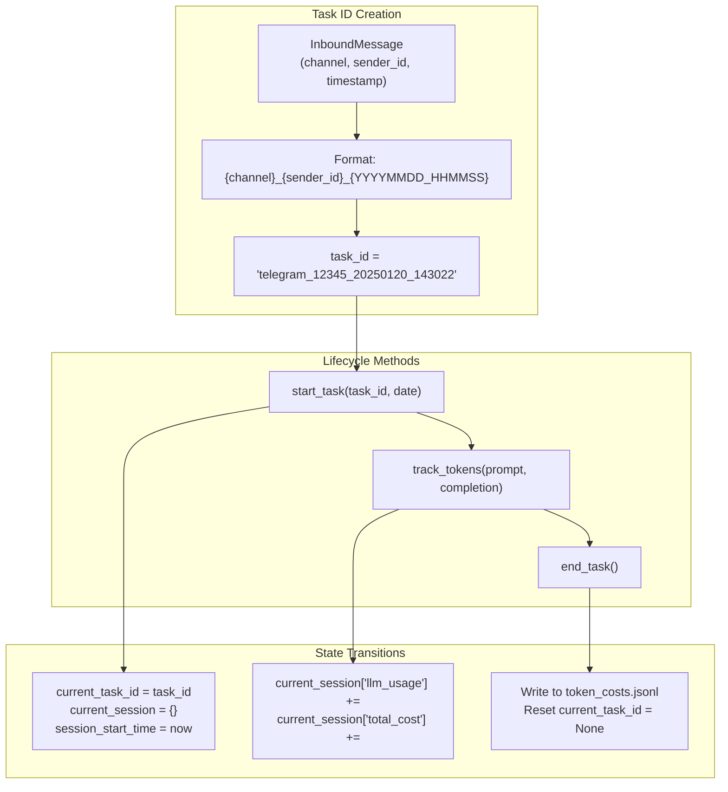
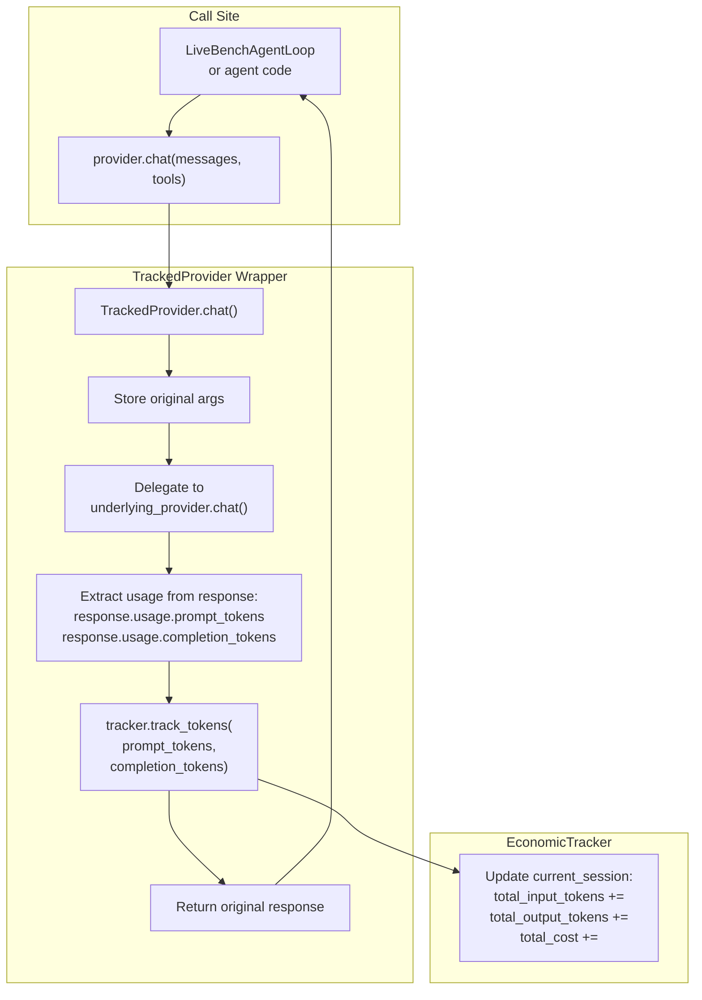
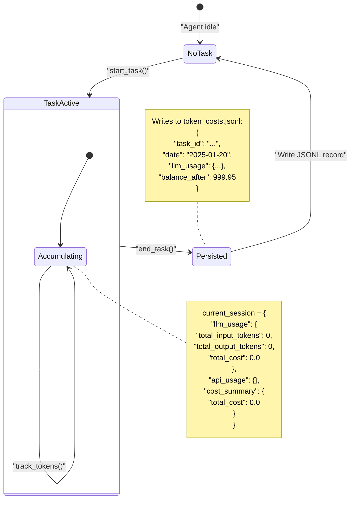
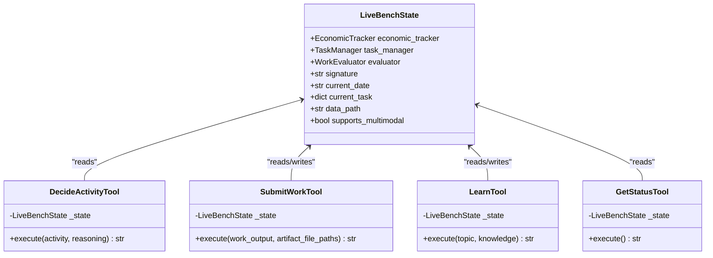
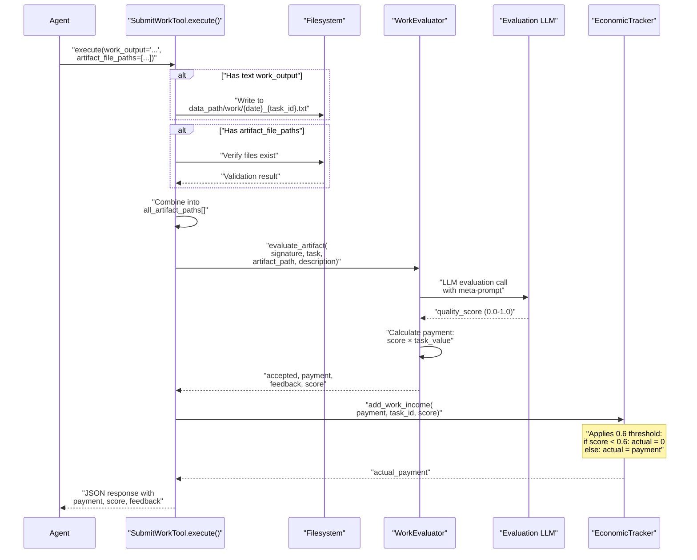
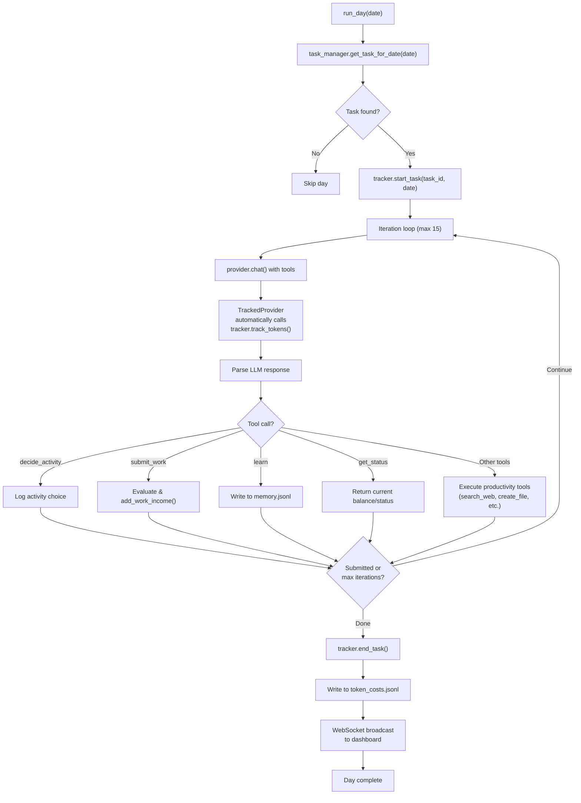
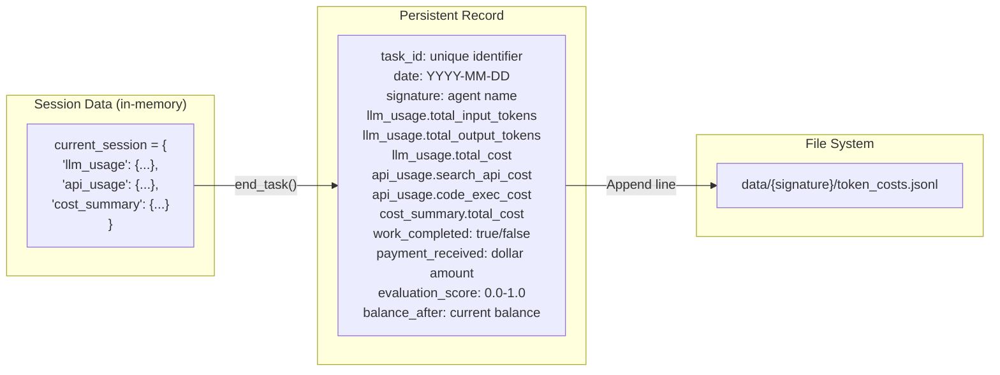
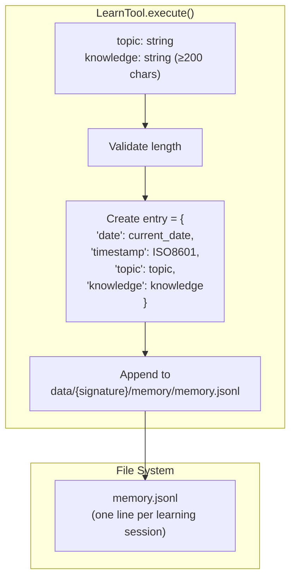
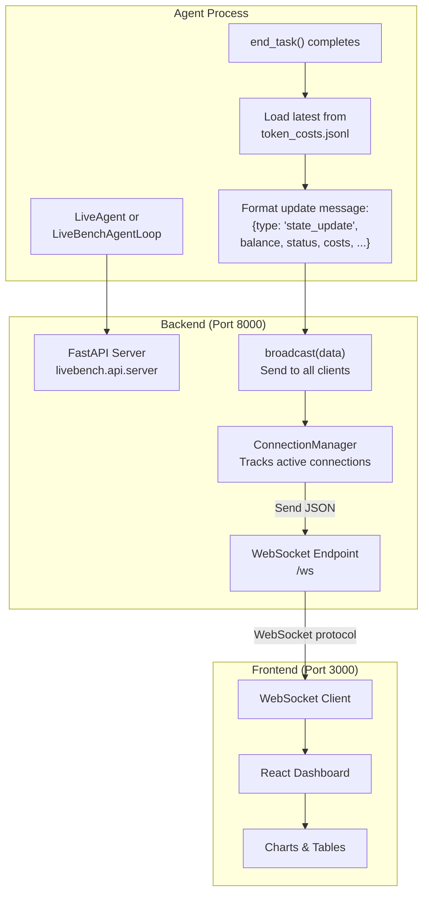
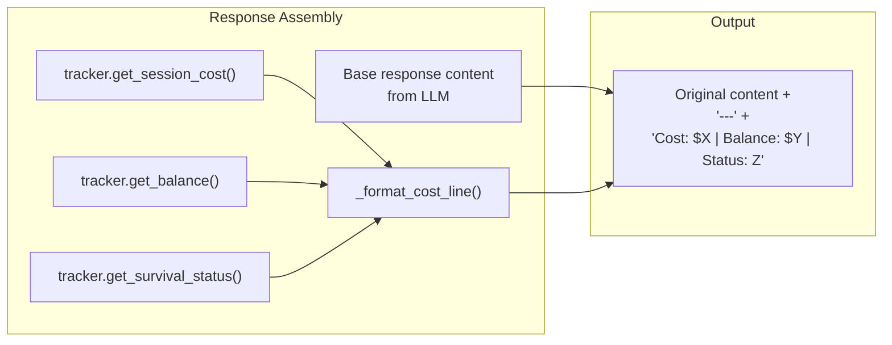

<!-- source: DeepWiki mcp.deepwiki.com · repo HKUDS/ClawWork · page 3.2 Data Flow and Communication · fetched 2026-11-09 -->

# Data Flow and Communication

<details>
<summary>Relevant source files</summary>

The following files were used as context for generating this wiki page:

- [README.md](README.md)
- [clawmode_integration/agent_loop.py](clawmode_integration/agent_loop.py)
- [clawmode_integration/tools.py](clawmode_integration/tools.py)

</details>


This document traces the flow of data through the ClawWork system, from input (user messages or scheduled tasks) through execution, evaluation, and persistence. It covers both operational modes: standalone simulation and ClawMode integration with Nanobot.

For details on individual component implementations, see [System Components](#3.1). For external API integration patterns, see [External Dependencies](#3.3). For the economic tracking implementation, see [Economic Tracker](#4.2). For ClawMode-specific integration, see [LiveBenchAgentLoop Extension](#5.2) and [TrackedProvider Wrapper](#5.3).

---

## Overview: Two Distinct Flow Patterns

ClawWork operates in two modes with different data flow patterns:

| Mode | Trigger | Entry Point | Response Path |
|------|---------|-------------|---------------|
| **Standalone** | Cron scheduler | `livebench.agent.live_agent.LiveAgent.run_day()` | Console output + WebSocket broadcast |
| **ClawMode** | User message | `clawmode_integration.agent_loop.LiveBenchAgentLoop._process_message()` | Message response + cost footer |

Both modes share the same core flow: task execution → token tracking → evaluation → economic state persistence. They differ only in how they're triggered and how results are returned.

**Sources:** [README.md:133-178](), [clawmode_integration/agent_loop.py:1-112]()

---

## ClawMode Message Processing Flow

### Complete Request-Response Cycle

```mermaid
sequenceDiagram
    participant User
    participant Gateway as "Nanobot Gateway"
    participant Loop as "LiveBenchAgentLoop"
    participant Tracker as "EconomicTracker"
    participant Provider as "TrackedProvider"
    participant LLM as "LLM API"
    participant Tools as "Tool Functions"
    participant Storage as "token_costs.jsonl"
    
    User->>Gateway: "Send inbound message"
    Gateway->>Loop: "_process_message(msg)"
    
    Note over Loop: "Generate task_id from<br/>channel_sender_timestamp"
    
    Loop->>Tracker: "start_task(task_id, date)"
    Note over Tracker: "Creates session record<br/>in self.current_session"
    
    loop "LLM interaction loop"
        Loop->>Provider: "chat(messages, tools)"
        Provider->>LLM: "API request"
        LLM-->>Provider: "response + usage metadata"
        Provider->>Tracker: "track_tokens(prompt_tokens,<br/>completion_tokens)"
        Note over Tracker: "Accumulates in<br/>current_session"
        Provider-->>Loop: "response"
        
        opt "Tool call in response"
            Loop->>Tools: "execute tool (decide_activity,<br/>submit_work, etc.)"
            Tools->>Tracker: "May call tracker methods<br/>(add_work_income, etc.)"
            Tools-->>Loop: "tool result"
        end
    end
    
    Loop->>Loop: "_format_cost_line()"
    Note over Loop: "Reads session_cost,<br/>balance, status"
    Loop->>Gateway: "OutboundMessage +<br/>cost footer"
    Gateway->>User: "Response with:<br/>Cost: $X | Balance: $Y"
    
    Loop->>Tracker: "end_task()"
    Tracker->>Storage: "Write JSONL record"
```

**Key Data Structures:**

1. **InboundMessage** - Nanobot's message container with `channel`, `sender_id`, `timestamp`, `content`
2. **OutboundMessage** - Response container with `content`, `channel`, `chat_id`, `media`
3. **current_session** - Dictionary in `EconomicTracker` accumulating costs for current task
4. **token_costs.jsonl** - Persistent economic record written on task end

**Sources:** [clawmode_integration/agent_loop.py:66-93]()

---

### Task ID Generation and Lifecycle



**Implementation Details:**

- **Task ID format:** `{channel}_{sender_id}_{timestamp}` at [clawmode_integration/agent_loop.py:68-70]()
- **start_task():** Initializes `current_task_id` and `current_session` dictionary
- **track_tokens():** Accumulates token counts and costs in `current_session`
- **end_task():** Writes complete record to JSONL and resets state

**Sources:** [clawmode_integration/agent_loop.py:66-93]()

---

## Token Tracking Data Flow

### TrackedProvider Interception



**Token Cost Calculation:**

The `TrackedProvider` computes cost using pricing from the configuration:

```
input_cost = (prompt_tokens / 1_000_000) × token_pricing.input_per_1m
output_cost = (completion_tokens / 1_000_000) × token_pricing.output_per_1m
total_cost = input_cost + output_cost
```

**Default pricing:** $2.50 per 1M input tokens, $10.00 per 1M output tokens (configurable in `livebench/configs/*.json`)

**Sources:** [clawmode_integration/provider_wrapper.py]() (file not shown but referenced), [clawmode_integration/agent_loop.py:46-48]()

---

### Cost Accumulation Pattern



**Key Insight:** All token costs for a single task (which may involve multiple LLM calls) are accumulated in a single session dictionary before being written as one JSONL record at task completion.

**Sources:** [README.md:325-346](), [clawmode_integration/agent_loop.py:72-93]()

---

## Economic Tool Communication

### LiveBenchState Data Structure

All economic tools share access to a single `LiveBenchState` dataclass instance:



**State Sharing Pattern:**

- All tools receive the same `LiveBenchState` instance at initialization
- Tools read `current_task`, `current_date`, `data_path` to operate
- `SubmitWorkTool` writes to `economic_tracker` via `add_work_income()`
- `LearnTool` writes to filesystem using `data_path`

**Sources:** [clawmode_integration/tools.py:29-41]()

---

### SubmitWork Tool Data Flow



**Critical Quality Threshold:**

The economic tracker applies a strict 0.6 quality cliff:
- `score >= 0.6`: Full payment = `score × task_value`
- `score < 0.6`: Zero payment (all costs still deducted)

**Sources:** [clawmode_integration/tools.py:153-244]()

---

## Standalone Mode Task Flow

### Daily Execution Cycle



**Iteration Limit:** Maximum 15 LLM calls per task to prevent infinite loops and runaway costs.

**Sources:** [README.md:152-171]()

---

## State Persistence Mechanisms

### token_costs.jsonl Record Structure

Each task completion writes a single JSONL record:



**Example Record:**

```json
{
  "task_id": "abc123",
  "date": "2025-01-20",
  "signature": "gpt-4o-agent",
  "llm_usage": {
    "total_input_tokens": 4500,
    "total_output_tokens": 900,
    "total_cost": 0.02025
  },
  "api_usage": {
    "search_api_cost": 0.0016
  },
  "cost_summary": {
    "total_cost": 0.02185
  },
  "work_completed": true,
  "payment_received": 198.44,
  "evaluation_score": 0.85,
  "balance_after": 1198.41
}
```

**Sources:** [README.md:325-346]()

---

### memory.jsonl Learning Records

The `learn` tool writes to a separate JSONL file:



**Key Characteristics:**

- **Minimum length:** 200 characters enforced at [clawmode_integration/tools.py:290-294]()
- **No income:** Learning sessions deduct token costs but generate zero revenue
- **Future use:** Knowledge can be retrieved and used in future tasks (not currently implemented)

**Sources:** [clawmode_integration/tools.py:286-318]()

---

## WebSocket Real-Time Updates

### Dashboard Communication Architecture



**Update Trigger Points:**

1. **Task completion** in standalone mode triggers immediate broadcast
2. **Periodic polling** in frontend requests latest state
3. **On connection** sends full current state to new clients

**Message Format:**

```json
{
  "type": "state_update",
  "agent": "gpt-4o-agent",
  "balance": 1198.41,
  "status": "thriving",
  "total_income": 1200.00,
  "total_cost": 11.59,
  "tasks_completed": 6
}
```

**Sources:** [README.md:558-580]()

---

## Cost Footer Construction

### ClawMode Response Enhancement



**Implementation:**

The cost line is only appended if `session_cost > 0`, preventing empty footers on tasks with zero LLM calls. Format template at [clawmode_integration/agent_loop.py:99-111]():

```python
f"\n\n---\n"
f"Cost: ${session_cost:.4f} | "
f"Balance: ${balance:.2f} | "
f"Status: {tracker.get_survival_status()}"
```

**Survival Status Values:**
- `"thriving"` - Balance > $1000
- `"stable"` - Balance $100-1000  
- `"struggling"` - Balance $10-100
- `"critical"` - Balance < $10

**Sources:** [clawmode_integration/agent_loop.py:78-90](), [clawmode_integration/agent_loop.py:99-111]()

---

## Summary: Key Data Flows

| Flow Type | Start | Path | End | Frequency |
|-----------|-------|------|-----|-----------|
| **Message routing** | User input | Gateway → Loop → Provider → Tools | Response + footer | Per message |
| **Token tracking** | LLM API call | Response usage → TrackedProvider → Tracker | current_session accumulation | Per LLM call |
| **Economic persistence** | end_task() | current_session → format → append | token_costs.jsonl | Per task |
| **Learning persistence** | learn tool | Validate → format → append | memory.jsonl | Per learn call |
| **Work evaluation** | submit_work | Artifacts → Evaluator → LLM | Payment + score | Per submission |
| **WebSocket broadcast** | Task complete | Load state → format → broadcast | Dashboard update | Per task completion |

**Critical Insight:** All economic data flows through `EconomicTracker` as the single source of truth. The `TrackedProvider` wrapper ensures comprehensive tracking by intercepting every LLM call, while tools like `submit_work` report income. This centralized approach prevents double-counting and ensures accurate balance calculation.

**Sources:** [clawmode_integration/agent_loop.py:1-112](), [clawmode_integration/tools.py:1-358]()

---

