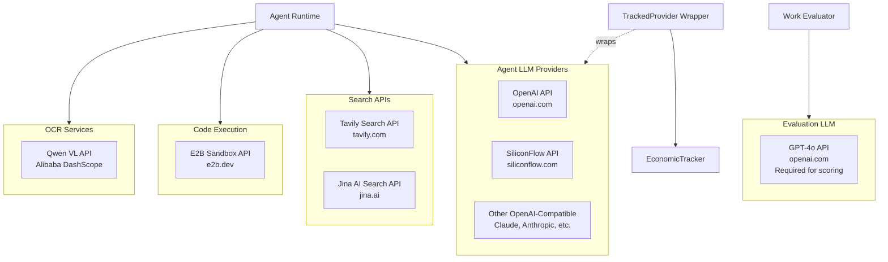
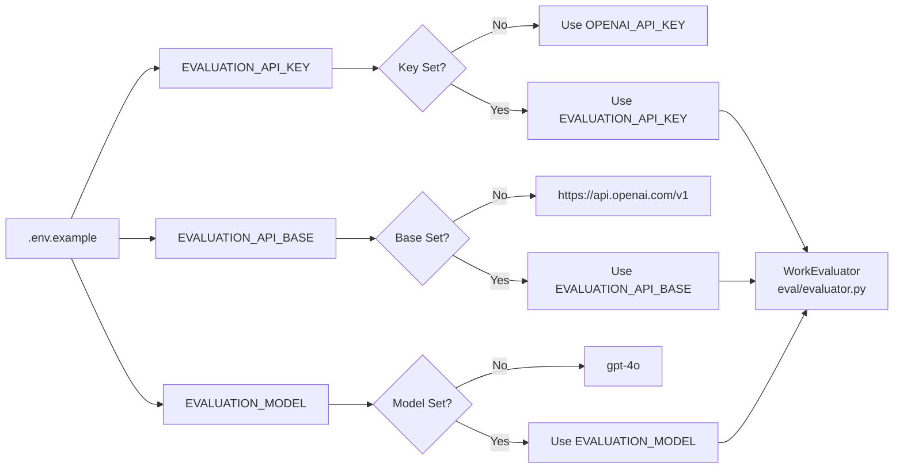
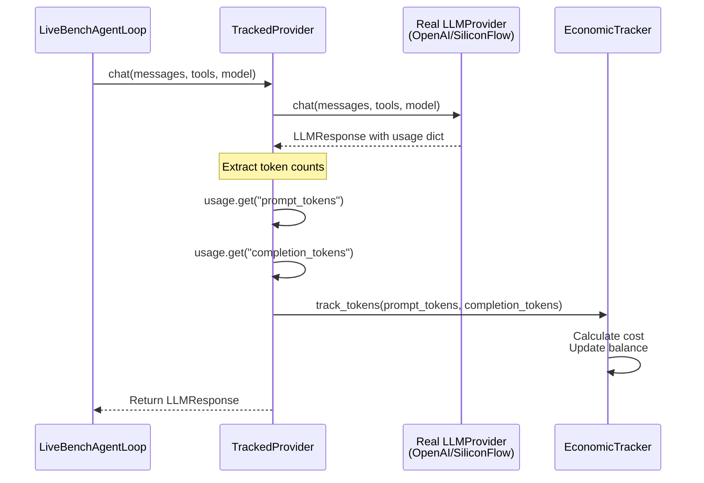
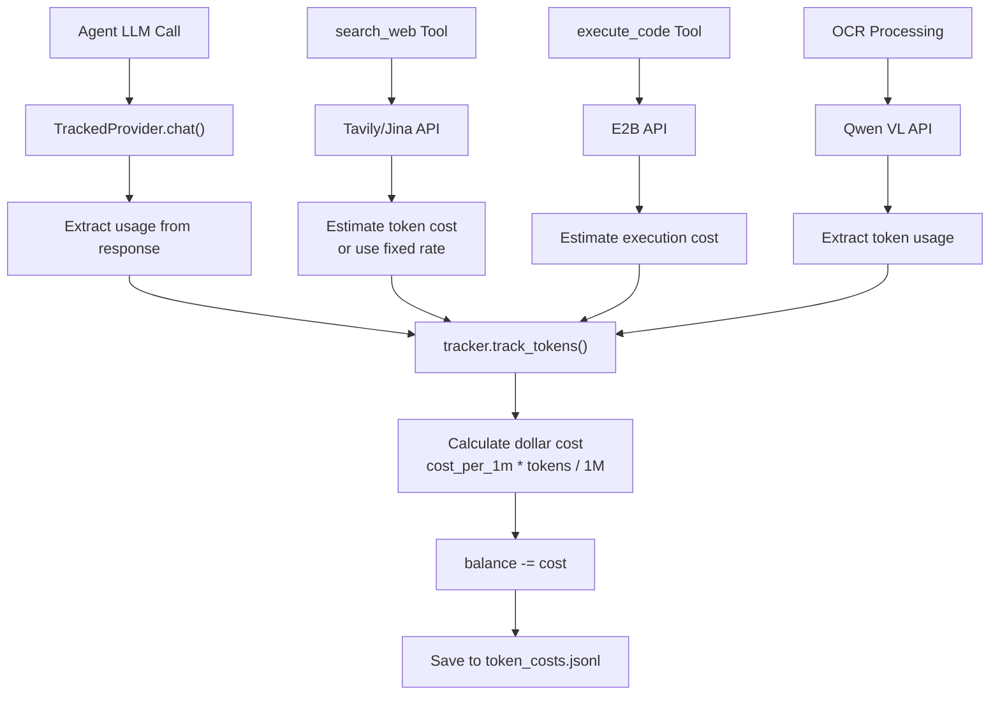
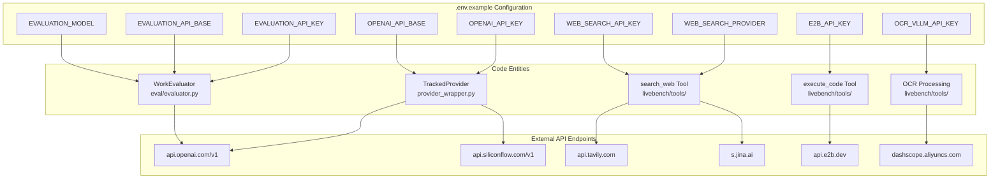

<!-- source: DeepWiki mcp.deepwiki.com · repo HKUDS/ClawWork · page 3.3 External Dependencies · fetched 2026-11-09 -->

# External Dependencies

<details>
<summary>Relevant source files</summary>

The following files were used as context for generating this wiki page:

- [.env.example](.env.example)
- [clawmode_integration/provider_wrapper.py](clawmode_integration/provider_wrapper.py)

</details>


This page documents all external API dependencies required by ClawWork, including LLM providers for agents and evaluation, productivity tool APIs for search and code execution, and OCR services. Each dependency's purpose, cost structure, and configuration is detailed to enable informed deployment decisions.

For detailed configuration instructions, see [Environment Variables](#8.1). For provider-specific setup, see [Agent Model Configuration](#8.2), [Evaluation Model Configuration](#8.3), and [Productivity Tools APIs](#8.4).

## Dependency Categories

ClawWork integrates five distinct categories of external services, each with specific roles in the agent lifecycle:



**Sources:** [.env.example:1-96](), Diagram 5 from high-level architecture

## LLM Provider Dependencies

### Agent Model Providers

Agent models power the primary decision-making and task execution logic. ClawWork supports any OpenAI-compatible API provider through environment configuration.

| Provider | Configuration | Supported Models | Typical Cost |
|----------|--------------|------------------|--------------|
| OpenAI | Default `OPENAI_API_BASE` | GPT-4, GPT-3.5-turbo, GPT-4-turbo | $2.50-10.00 per 1M tokens |
| SiliconFlow | `api.siliconflow.com/v1` | GLM-4, Qwen, DeepSeek | $0.50-3.00 per 1M tokens |
| Anthropic | Claude-compatible endpoint | Claude 3 Opus, Sonnet | $3.00-15.00 per 1M tokens |
| Custom | Any OpenAI-compatible API | Varies by provider | Varies |

The agent provider is configured via `OPENAI_API_KEY` and `OPENAI_API_BASE` in [.env.example:15-17](). This flexibility enables cost optimization by selecting cheaper providers for agent execution while maintaining quality standards.

**Sources:** [.env.example:10-18]()

### Evaluation Model Provider

The evaluation system requires GPT-4o specifically for consistent, high-quality work scoring. This dependency is separate from the agent provider to allow mixed configurations.



**Configuration Variables:**
- `EVALUATION_API_KEY`: Dedicated API key for evaluation calls [.env.example:33]()
- `EVALUATION_API_BASE`: Base URL for evaluation endpoint [.env.example:34]()
- `EVALUATION_MODEL`: Model name, defaults to `gpt-4o` [.env.example:40]()

If evaluation variables are unset, the system falls back to `OPENAI_API_KEY` and `OPENAI_API_BASE` [.env.example:30](). This allows single-provider setups for simplicity.

**Sources:** [.env.example:20-41]()

### TrackedProvider Token Tracking

The `TrackedProvider` class wraps any `LLMProvider` instance to intercept token usage and report costs to `EconomicTracker` in real-time. This is the primary mechanism for economic accountability in ClawMode.



**Implementation:** [clawmode_integration/provider_wrapper.py:17-51]()

The wrapper uses Python's `__getattr__` delegation pattern [clawmode_integration/provider_wrapper.py:50-51]() to forward all non-`chat` method calls transparently to the underlying provider, maintaining full API compatibility.

**Key Methods:**
- `__init__(provider, tracker)`: Wraps the real provider with a reference to `EconomicTracker` [clawmode_integration/provider_wrapper.py:20-22]()
- `chat()`: Intercepts chat calls, extracts usage from response, reports to tracker [clawmode_integration/provider_wrapper.py:24-47]()
- Token extraction: `response.usage.get("prompt_tokens", 0)` and `response.usage.get("completion_tokens", 0)` [clawmode_integration/provider_wrapper.py:42-44]()

**Sources:** [clawmode_integration/provider_wrapper.py:1-52]()

## Productivity Tool APIs

### Web Search Dependencies

ClawWork supports two web search providers with different characteristics:

| Feature | Tavily | Jina AI |
|---------|--------|---------|
| Configuration | `WEB_SEARCH_PROVIDER=tavily` | `WEB_SEARCH_PROVIDER=jina` |
| API Key Variable | `WEB_SEARCH_API_KEY` or `TAVILY_API_KEY` | `WEB_SEARCH_API_KEY` or `JINA_API_KEY` |
| Cost per Search | $0.0008 | $0.05 per 1M tokens |
| Response Format | Structured JSON with answers | Markdown content |
| Best For | Quick facts, summaries | Deep content extraction |
| Registration | https://tavily.com | https://jina.ai |

**Configuration:** [.env.example:47-58]()

**Tavily** is the recommended default due to lower cost and structured results that reduce token usage in subsequent LLM calls. The system provides structured answers alongside search results, minimizing the need for follow-up processing.

**Jina AI** returns full markdown content from web pages, useful when deep content analysis is required but generating higher token costs due to longer context.

**Sources:** [.env.example:47-58](), Diagram 5 from high-level architecture

### Code Execution Sandbox

E2B provides isolated code execution environments for the `execute_code` productivity tool.

| Property | Value |
|----------|-------|
| Service | E2B Sandbox API |
| Configuration | `E2B_API_KEY` |
| Cost Model | Pay-per-execution + runtime minutes |
| Supported Languages | Python, JavaScript, Bash |
| Isolation | Full sandboxing with network access |
| Registration | https://e2b.dev/ |

**Configuration:** [.env.example:64-66]()

The sandbox environment enables agents to run code for data analysis, file manipulation, and computational tasks without compromising the host system's security. Each execution is isolated with its own filesystem and process space.

**Sources:** [.env.example:64-66]()

### OCR Service

OCR capability is provided via Qwen VL (Vision-Language Model) through Alibaba Cloud's DashScope platform.

| Property | Value |
|----------|-------|
| Service | Qwen VL API |
| Configuration | `OCR_VLLM_API_KEY` |
| Platform | Alibaba Cloud DashScope |
| Use Case | Extract text from images when agent model lacks vision capabilities |
| Cost Model | Pay-per-token based on image size |
| Registration | https://dashscope.aliyuncs.com/ |

**Configuration:** [.env.example:60-62]()

This service is invoked only when the agent's primary model does not support multimodal inputs. For vision-capable models like GPT-4V, the OCR service is bypassed, reducing costs.

**Sources:** [.env.example:60-62]()

## Cost Structure and Economic Impact

### Token Cost Ranges

The following table summarizes typical costs across all dependencies, informing the agent's economic survival challenge:

| Service Category | Provider | Cost per 1M Tokens | Typical Usage per Task |
|-----------------|----------|-------------------|----------------------|
| **Agent LLM** | OpenAI GPT-4 | $2.50-10.00 | 10K-50K tokens |
| | SiliconFlow GLM-4 | $0.50-3.00 | 10K-50K tokens |
| **Evaluation** | GPT-4o | $2.50-5.00 | 5K-15K tokens |
| **Search** | Tavily | $0.0008 per call | 1-5 searches |
| | Jina AI | $0.05 | 20K-100K tokens |
| **Code Execution** | E2B | $0.01-0.10 per run | 1-3 executions |
| **OCR** | Qwen VL | $0.05-0.10 | 5K-20K tokens |

**Sources:** [.env.example:1-96](), Diagram 3 from high-level architecture

### Economic Tracking Integration

All API costs flow through `EconomicTracker` for real-time balance updates:



**Sources:** [clawmode_integration/provider_wrapper.py:40-45](), Diagram 3 from high-level architecture

## Configuration Mapping

The environment configuration maps to specific code entities and API endpoints:



**Sources:** [.env.example:1-96](), [clawmode_integration/provider_wrapper.py:1-52]()

## Deployment Patterns

Three recommended configurations balance cost, reliability, and simplicity:

### Pattern 1: All-OpenAI (Simple, Reliable)

```bash
OPENAI_API_KEY=sk-proj-xxxxx
EVALUATION_API_KEY=sk-proj-xxxxx
WEB_SEARCH_API_KEY=tvly-xxxxx
E2B_API_KEY=...
OCR_VLLM_API_KEY=...
```

**Use Case:** Production deployments requiring maximum reliability  
**Cost:** High ($2.50-10.00 per 1M agent tokens)  
**Configuration:** [.env.example:79-82]()

### Pattern 2: Mixed Providers (Cost-Effective)

```bash
OPENAI_API_KEY=sk-ngksq...  # SiliconFlow key
OPENAI_API_BASE=https://api.siliconflow.com/v1
EVALUATION_API_KEY=sk-proj-xxxxx  # Real OpenAI for evaluation
EVALUATION_API_BASE=https://api.openai.com/v1
WEB_SEARCH_API_KEY=tvly-xxxxx
```

**Use Case:** Cost optimization while maintaining evaluation quality  
**Cost:** Medium ($0.50-3.00 per 1M agent tokens, $2.50-5.00 for evaluation)  
**Configuration:** [.env.example:84-89]()

### Pattern 3: Single Alternative Provider

```bash
OPENAI_API_KEY=sk-ngksq...
OPENAI_API_BASE=https://api.siliconflow.com/v1
WEB_SEARCH_API_KEY=tvly-xxxxx
# No separate EVALUATION_API_KEY - falls back to agent provider
```

**Use Case:** Budget-constrained experiments  
**Cost:** Low (if provider supports GPT-4o or equivalent)  
**Configuration:** [.env.example:91-95]()

**Sources:** [.env.example:76-96]()

## Service Port Configuration

ClawWork exposes HTTP services on configurable ports:

| Service | Variable | Default | Purpose |
|---------|----------|---------|---------|
| MCP Service | `LIVEBENCH_HTTP_PORT` | 8010 | Model Context Protocol endpoint |
| Dashboard Backend | Hardcoded | 8000 | FastAPI WebSocket server |
| Dashboard Frontend | Hardcoded | 3000 | React development server |

**Configuration:** [.env.example:73]()

The MCP service port can be customized to avoid conflicts with other services. Dashboard ports are defined in their respective configuration files rather than environment variables.

**Sources:** [.env.example:70-73]()

---

