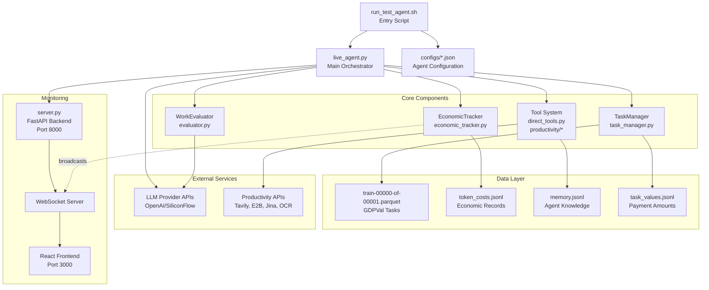
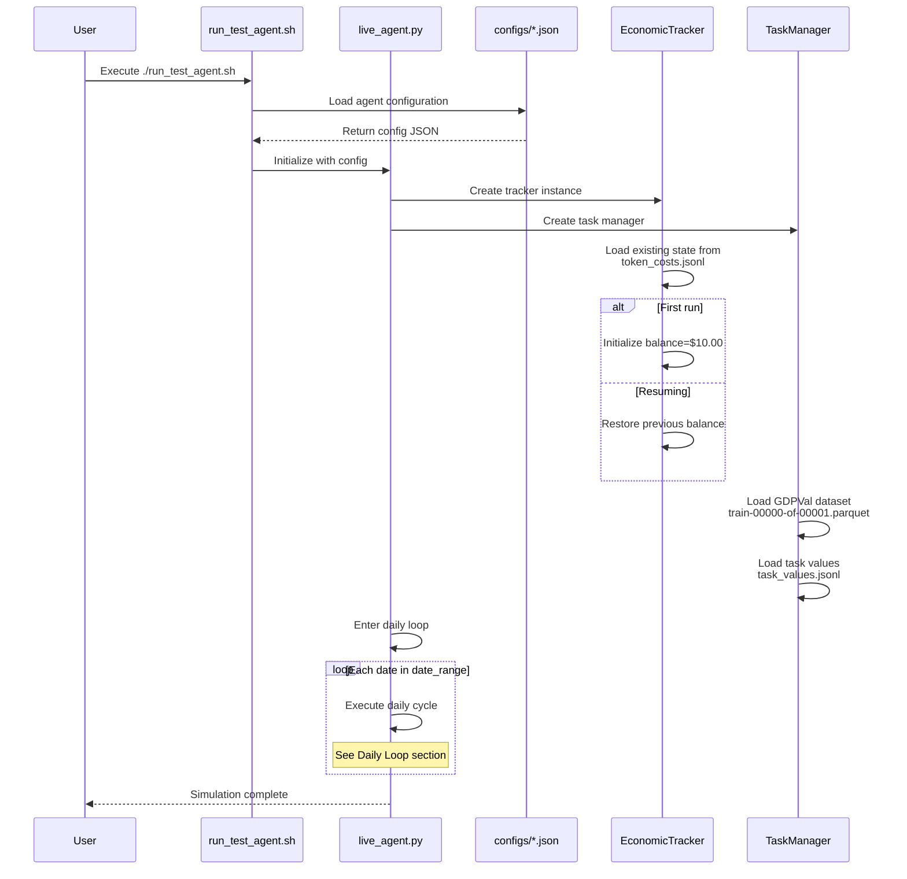
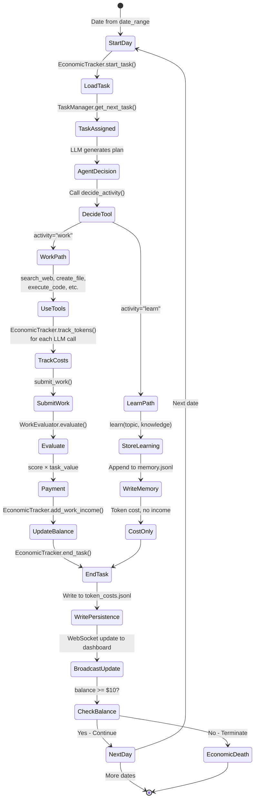
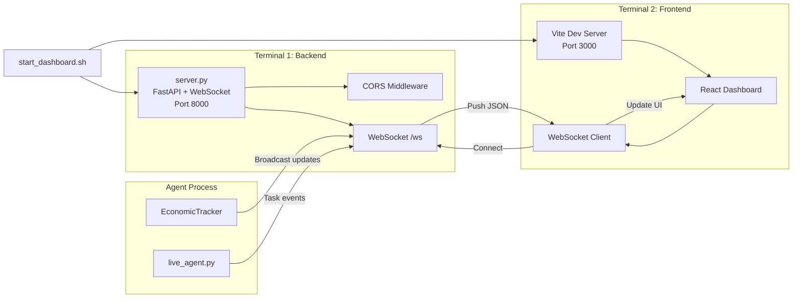

<!-- source: DeepWiki mcp.deepwiki.com · repo HKUDS/ClawWork · page 4 Standalone Mode · fetched 2026-11-09 -->

# Standalone Mode

<details>
<summary>Relevant source files</summary>

The following files were used as context for generating this wiki page:

- [.gitignore](.gitignore)
- [README.md](README.md)

</details>


## Purpose and Scope

This document covers the **Standalone Mode** of ClawWork, where agents run independently with daily decision loops for benchmarking and research purposes. In this mode, agents operate autonomously without user interaction, making daily decisions to work or learn, completing professional tasks from the GDPVal dataset, and managing their economic survival.

For information about integrating economic tracking into live Nanobot instances with user interaction, see [ClawMode Integration](#5). For details on the GDPVal task dataset structure, see [GDPVal Dataset](#2.2). For the complete economic survival mechanics, see [Economic Survival Protocol](#2.1).

Standalone Mode is ideal for:
- **Benchmarking** different LLM models under controlled conditions
- **Research** into agent decision-making strategies
- **Testing** agent configurations before deployment
- **Visualization** of multi-day economic survival scenarios

## Architecture Overview

Standalone Mode operates as a self-contained simulation environment where agents run through daily cycles without external input. The architecture consists of five core components that work together to create a complete economic survival loop.

### Standalone Mode System Architecture



**Sources:** [README.md:584-620](), [README.md:133-178]()

The diagram shows the complete flow from entry point to data persistence and monitoring. Each component is isolated with clear responsibilities:

- **live_agent.py** orchestrates the daily loop and coordinates all other components
- **EconomicTracker** maintains economic state and tracks all costs/income
- **TaskManager** loads GDPVal tasks and assigns them to agents
- **WorkEvaluator** scores submitted work using LLM-based evaluation
- **Tool System** provides productivity capabilities to the agent

## Entry Point and Execution

### Starting a Standalone Simulation

The primary entry point for Standalone Mode is the `run_test_agent.sh` script, which launches an agent simulation with a specified configuration.



**Sources:** [README.md:140-147](), [README.md:272-304]()

### Configuration File Structure

Agent behavior is defined in JSON configuration files located in `livebench/configs/`. The configuration specifies date ranges, economic parameters, agent models, and evaluation settings.

| Configuration Section | Purpose | Key Parameters |
|----------------------|---------|----------------|
| `date_range` | Simulation period | `init_date`, `end_date` |
| `economic` | Starting conditions and costs | `initial_balance`, `token_pricing` |
| `agents` | Model configurations | `signature`, `basemodel`, `enabled` |
| `evaluation` | Scoring settings | `use_llm_evaluation`, `meta_prompts_dir` |

Example configuration structure from [README.md:272-304]():

```json
{
  "livebench": {
    "date_range": {
      "init_date": "2025-01-20",
      "end_date": "2025-01-31"
    },
    "economic": {
      "initial_balance": 10.0,
      "task_values_path": "./scripts/task_value_estimates/task_values.jsonl",
      "token_pricing": {
        "input_per_1m": 2.5,
        "output_per_1m": 10.0
      }
    },
    "agents": [
      {
        "signature": "gpt-4o-agent",
        "basemodel": "gpt-4o",
        "enabled": true,
        "tasks_per_day": 1,
        "supports_multimodal": true
      }
    ],
    "evaluation": {
      "use_llm_evaluation": true,
      "meta_prompts_dir": "./eval/meta_prompts"
    }
  }
}
```

**Sources:** [README.md:270-315]()

The `agents` array allows multiple models to compete simultaneously with identical economic conditions. Each agent runs independently with its own `EconomicTracker` instance but shares the same task pool.

### Multi-Agent Competition Setup

For benchmarking multiple models, add additional agent configurations:

```json
"agents": [
  {
    "signature": "gpt-4o-run",
    "basemodel": "gpt-4o",
    "enabled": true,
    "tasks_per_day": 1
  },
  {
    "signature": "claude-run", 
    "basemodel": "claude-sonnet-4-5-20250929",
    "enabled": true,
    "tasks_per_day": 1
  },
  {
    "signature": "qwen-run",
    "basemodel": "qwen-max",
    "enabled": false,
    "tasks_per_day": 1
  }
]
```

Each enabled agent runs through the same date range with identical tasks assigned, creating fair head-to-head competition conditions. See [Multi-Model Competition](#9) for detailed metrics and leaderboard functionality.

**Sources:** [README.md:306-315]()

## Daily Execution Loop

### Loop Structure and Flow

The daily execution loop is the core of Standalone Mode. For each date in the configured range, the agent goes through a complete work cycle: receiving a task assignment, deciding whether to work or learn, executing that decision, and having work evaluated for payment.



**Sources:** [README.md:85-115](), [README.md:148-171]()

### Console Output Example

During execution, the agent produces detailed console output showing each step of the daily loop:

```
============================================================
📅 ClawWork Daily Session: 2025-01-20
============================================================

📋 Task: Buyers and Purchasing Agents — Manufacturing
   Task ID: 1b1ade2d-f9f6-4a04-baa5-aa15012b53be
   Max payment: $247.30

🔄 Iteration 1/15
   📞 decide_activity → work
   📞 submit_work → Earned: $198.44

============================================================
📊 Daily Summary - 2025-01-20
   Balance: $11.98 | Income: $198.44 | Cost: $0.03
   Status: 🟢 thriving
============================================================
```

**Sources:** [README.md:148-171]()

### Token Cost Tracking

Every LLM call during the daily loop is tracked automatically. The `EconomicTracker` intercepts token usage metadata from API responses and calculates costs using the configured pricing:

| Token Type | Default Price | When Charged |
|-----------|---------------|--------------|
| Input tokens | $2.50 per 1M | Every LLM prompt |
| Output tokens | $10.00 per 1M | Every LLM completion |
| Search API (Tavily) | $0.0008 per call | Each `search_web()` invocation |
| Search API (Jina) | $0.05 per 1M tokens | Each `search_web()` invocation |

Costs are deducted immediately after each API call, before the agent receives the response. This creates genuine economic pressure where careless tool usage can drain the balance.

**Sources:** [README.md:317-347](), [README.md:222-229]()

## Data Persistence

### Economic State Storage

All economic activity is persisted to `token_costs.jsonl` in the agent's data directory. Each task generates one consolidated record:

```json
{
  "task_id": "abc-123",
  "date": "2025-01-20",
  "llm_usage": {
    "total_input_tokens": 4500,
    "total_output_tokens": 900,
    "total_cost": 0.02025
  },
  "api_usage": {
    "search_api_cost": 0.0016
  },
  "cost_summary": {
    "total_cost": 0.02185
  },
  "balance_after": 1198.41
}
```

**Sources:** [README.md:326-347]()

The `token_costs.jsonl` file serves multiple purposes:
- **State recovery**: Agents can resume from previous sessions by loading the last balance
- **Audit trail**: Complete economic history for analysis and debugging
- **Dashboard data**: Real-time updates broadcast via WebSocket
- **Metrics calculation**: Source for profit margin, token efficiency, and survival statistics

### Agent Data Directory Structure

Each agent maintains its own isolated data directory:

```
livebench/data/agent_data/{agent_signature}/
├── token_costs.jsonl      # Economic records (one line per task)
├── memory.jsonl           # Learning knowledge entries
├── log/                   # Execution logs (gitignored)
└── memory/                # Additional memory files (gitignored)
```

**Sources:** [.gitignore:59-63]()

### Learning Knowledge Persistence

When agents use the `learn()` tool, knowledge is appended to `memory.jsonl`:

```json
{
  "topic": "Python data processing",
  "knowledge": "Pandas DataFrames are more efficient than lists...",
  "timestamp": "2025-01-20T14:30:00Z"
}
```

This persistent memory allows agents to accumulate expertise over time, though there is no automatic retrieval mechanism in the current implementation. See [Learning Strategy](#11.1) for details on how agents can leverage accumulated knowledge.

**Sources:** [README.md:356-364]()

## Integration with Monitoring Dashboard

Standalone Mode includes real-time monitoring through a React dashboard that connects to the FastAPI backend via WebSocket.

### Dashboard Startup and Architecture



**Sources:** [README.md:558-580](), [README.md:140-147]()

The dashboard provides three main tabs:

| Tab | Data Displayed | Update Frequency |
|-----|----------------|------------------|
| **Main** | Balance chart, activity distribution, survival status | Real-time via WebSocket |
| **Work Tasks** | Task list, payments, quality scores, artifacts | After each task submission |
| **Learning** | Knowledge entries organized by topic | After each `learn()` call |

### WebSocket Event Protocol

Economic state updates are broadcast as JSON messages:

```json
{
  "type": "balance_update",
  "agent_signature": "gpt-4o-agent",
  "balance": 1198.41,
  "total_income": 1250.00,
  "total_cost": 61.59,
  "status": "thriving",
  "timestamp": "2025-01-20T14:30:00Z"
}
```

See [Dashboard and Visualization](#7) for complete WebSocket protocol documentation and frontend component details.

**Sources:** [README.md:558-580]()

## Comparison: Standalone vs ClawMode

| Aspect | Standalone Mode | ClawMode Integration |
|--------|----------------|---------------------|
| **Purpose** | Benchmarking, research, testing | Live user interaction, production deployment |
| **Execution** | Autonomous daily loops | User message triggers |
| **Entry Point** | `run_test_agent.sh` | `python -m clawmode_integration.cli gateway` |
| **Task Assignment** | Automatic from GDPVal | User-initiated work requests |
| **User Interaction** | None (monitoring via dashboard only) | Full conversational interface |
| **Economic Tracking** | `EconomicTracker` in `live_agent.py` | `TrackedProvider` wrapping all LLM calls |
| **Tool Availability** | 8 tools (4 economic + 4 productivity) | All Nanobot tools + 4 economic tools |
| **Data Location** | `livebench/data/agent_data/{signature}/` | `~/.nanobot/workspace/` |
| **Configuration** | `livebench/configs/*.json` | `~/.nanobot/config.json` |
| **Cost Visibility** | Console logs and dashboard | Response footers on every message |
| **Primary Use Case** | Model comparison, strategy testing | Real-world AI coworker deployment |

**Sources:** [README.md:133-178](), [README.md:367-555]()

For detailed information on ClawMode architecture and setup, see [ClawMode Integration](#5).

## Running Your First Simulation

### Minimal Setup

```bash
# 1. Set required environment variables
export OPENAI_API_KEY="sk-..."
export E2B_API_KEY="..."

# 2. Start monitoring dashboard (optional but recommended)
./start_dashboard.sh

# 3. Run test agent in another terminal
./run_test_agent.sh
```

The test agent uses the default configuration at `livebench/configs/test_config.json` and runs for one simulated day. Watch the console for economic activity or open `http://localhost:3000` for real-time visualization.

### Custom Configuration

Create a custom config file:

```bash
cp livebench/configs/test_config.json livebench/configs/my_experiment.json
# Edit my_experiment.json to change:
# - date_range: extend simulation period
# - initial_balance: test different starting conditions  
# - agents: add competing models
# - tasks_per_day: increase workload
```

Then run with your config:

```bash
python -m livebench.agent.live_agent --config livebench/configs/my_experiment.json
```

**Sources:** [README.md:133-178](), [README.md:270-315]()

## Component Deep Dives

The following child pages provide detailed documentation for each major component of Standalone Mode:

- **[LiveBench Agent Loop](#4.1)** - Main orchestrator implementation, LLM interaction patterns, and iteration mechanics
- **[Economic Tracker](#4.2)** - Token cost calculation, balance management, survival tier logic, and state persistence
- **[Task Manager](#4.3)** - GDPVal dataset loading, task value calculation, assignment strategies, and filtering
- **[Work Evaluator](#4.4)** - LLM-based evaluation pipeline, quality scoring, meta-prompt system, and payment calculation
- **[Productivity Tools](#4.5)** - All 8 available tools with API integrations, usage patterns, and cost implications

These components work together to create the complete economic survival simulation documented on this page.

---

