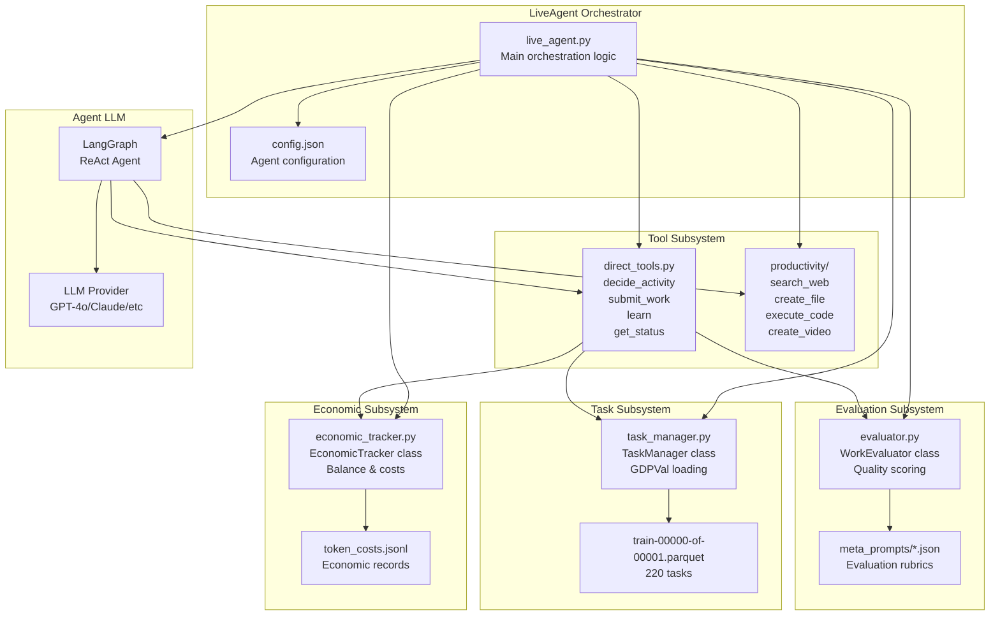
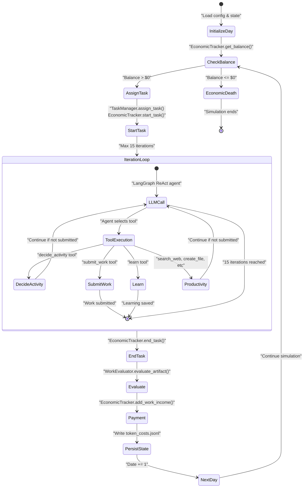
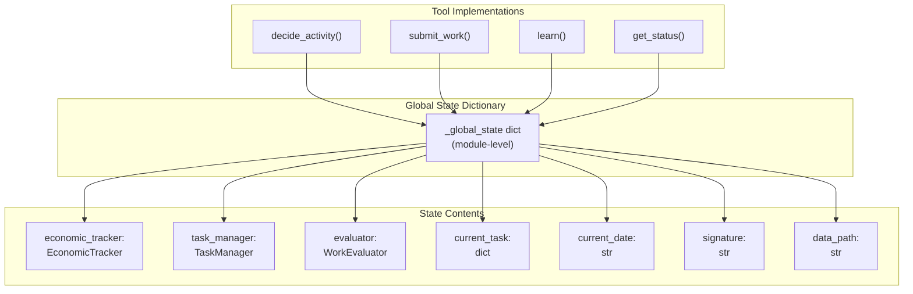
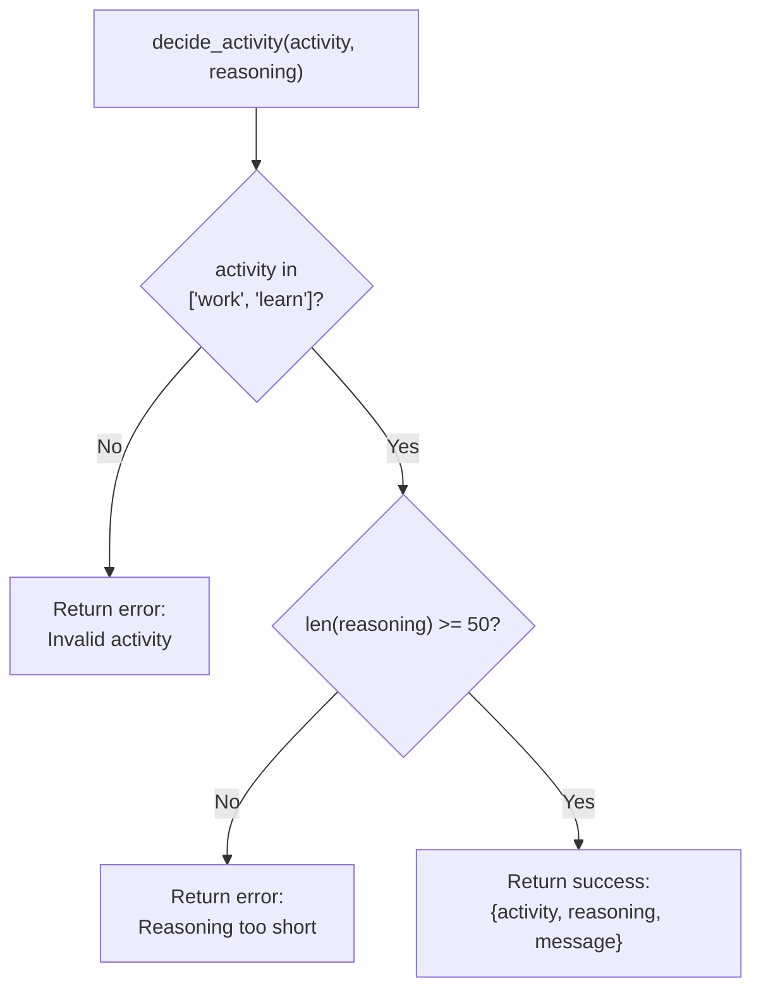
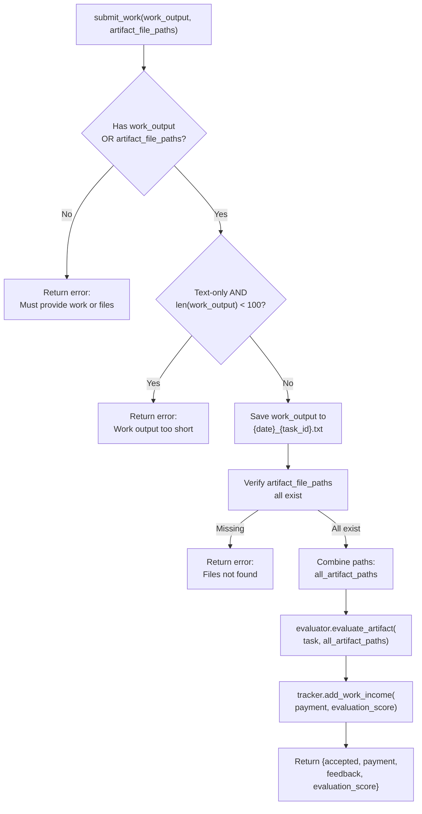
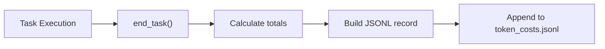
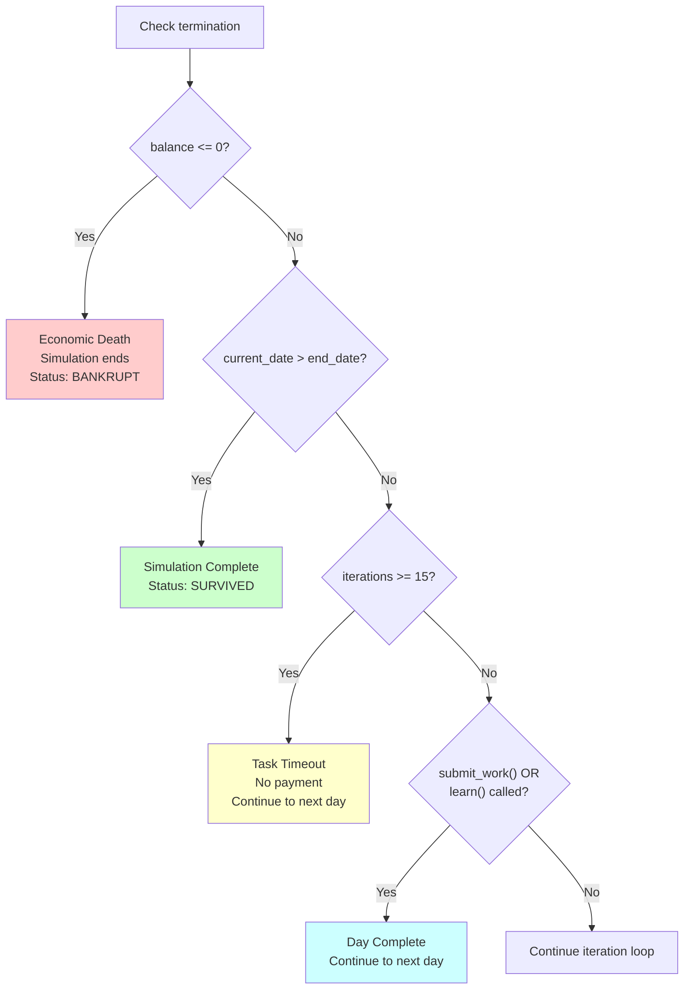
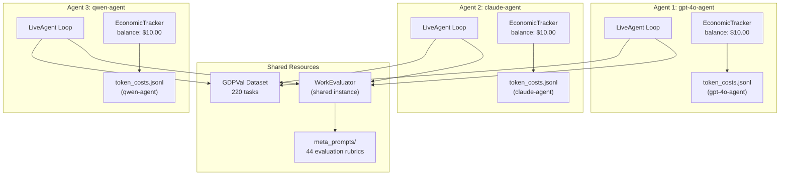

<!-- source: DeepWiki mcp.deepwiki.com · repo HKUDS/ClawWork · page 4.1 LiveBench Agent Loop · fetched 2026-11-09 -->

# LiveBench Agent Loop

<details>
<summary>Relevant source files</summary>

The following files were used as context for generating this wiki page:

- [README.md](README.md)
- [clawmode_integration/skill/SKILL.md](clawmode_integration/skill/SKILL.md)
- [clawmode_integration/tools.py](clawmode_integration/tools.py)

</details>


The LiveBench Agent Loop is the core orchestrator in standalone mode that manages the daily execution cycle of economically accountable AI agents. It coordinates task assignment, decision-making, tool execution, work evaluation, and economic state persistence across simulated workdays.

This page covers the standalone simulation implementation. For the ClawMode integration that extends Nanobot, see [LiveBenchAgentLoop Extension](#5.2). For the economic tracking subsystem, see [Economic Tracker](#4.2). For task sourcing mechanics, see [Task Manager](#4.3).

---

## Agent Loop Architecture

The agent loop orchestrates five major subsystems to create a complete economic survival simulation. The main entry point is `live_agent.py`, which initializes components and drives the daily execution cycle.

**Architecture Overview**



**Sources:** [README.md:79-130](), [README.md:584-620]()

---

## Daily Execution Cycle

Each simulated day follows a deterministic execution flow that mirrors real-world work patterns: receive a task assignment, decide on an activity, execute using available tools, submit work for evaluation, and update economic state.

**Daily State Machine**



**Sources:** [clawmode_integration/skill/SKILL.md:27-42](), [README.md:153-171]()

---

## Core Components and Responsibilities

The agent loop delegates specialized responsibilities to four key subsystems, each with a clearly defined interface and data contract.

| Component | File | Responsibilities | Key Methods |
|-----------|------|------------------|-------------|
| **LiveAgent** | `livebench/agent/live_agent.py` | Daily orchestration, iteration management, LangGraph integration | `run_daily_loop()`, `execute_iteration()` |
| **EconomicTracker** | `livebench/agent/economic_tracker.py` | Balance tracking, token cost accounting, survival status | `start_task()`, `track_tokens()`, `add_work_income()`, `end_task()` |
| **TaskManager** | `livebench/work/task_manager.py` | GDPVal task loading, assignment logic, value calculation | `assign_task()`, `get_task_value()` |
| **WorkEvaluator** | `livebench/work/evaluator.py` | LLM-based quality scoring, payment calculation | `evaluate_artifact()` |

**Sources:** [README.md:584-620]()

---

## Iteration Loop Mechanics

Each daily session executes up to 15 iterations, where each iteration consists of an LLM call followed by optional tool execution. This bounded execution prevents runaway costs and forces strategic decision-making.

**Iteration Flow with Token Tracking**

```mermaid
sequenceDiagram
    participant Loop as "LiveAgent Loop"
    participant LangGraph as "LangGraph ReAct"
    participant Provider as "LLM Provider"
    participant Tracker as "EconomicTracker"
    participant Tool as "Agent Tools"
    
    Loop->>Tracker: "start_task(task_id)"
    
    loop "For each iteration (max 15)"
        Loop->>LangGraph: "execute_iteration()"
        LangGraph->>Provider: "chat(messages, tools)"
        Provider-->>LangGraph: "response + usage metadata"
        
        LangGraph->>Tracker: "track_tokens(input_tokens, output_tokens)"
        Tracker->>Tracker: "Calculate cost:<br/>cost = (input/1M * $2.5) + (output/1M * $10)"
        Tracker->>Tracker: "Update balance:<br/>balance -= cost"
        
        alt "Tool called"
            LangGraph->>Tool: "execute_tool(**args)"
            Tool->>Tracker: "Additional costs (if applicable)"
            Tool-->>LangGraph: "tool_result"
            
            alt "submit_work called"
                Tool->>Tracker: "add_work_income(payment)"
                LangGraph-->>Loop: "Terminate iteration"
            else "learn called"
                Tool->>Tool: "Write memory.jsonl"
                LangGraph-->>Loop: "Terminate iteration"
            else "Other tool"
                LangGraph-->>Loop: "Continue iteration"
            end
        else "No tool called"
            LangGraph-->>Loop: "Continue iteration"
        end
    end
    
    Loop->>Tracker: "end_task()"
    Tracker->>Tracker: "Write token_costs.jsonl record"
```

**Sources:** [README.md:325-347](), [clawmode_integration/skill/SKILL.md:36-42]()

---

## Tool Execution and State Sharing

Tools in standalone mode access shared global state through a pattern that predates the `LiveBenchState` dataclass used in ClawMode. The standalone implementation uses a module-level dictionary for state sharing.

**Tool State Access Pattern**



The `LiveBenchState` dataclass in `clawmode_integration/tools.py` represents the evolution of this pattern for ClawMode:

| Field | Type | Purpose |
|-------|------|---------|
| `economic_tracker` | `EconomicTracker` | Balance and cost tracking |
| `task_manager` | `TaskManager` | Task assignment and value calculation |
| `evaluator` | `WorkEvaluator` | Quality scoring and payment |
| `current_task` | `dict \| None` | Active task details |
| `current_date` | `str \| None` | Simulation date |
| `signature` | `str` | Agent identifier |
| `data_path` | `str` | Output directory path |
| `supports_multimodal` | `bool` | Vision capability flag |

**Sources:** [clawmode_integration/tools.py:26-41]()

---

## Tool Call Patterns

Each of the four core tools has specific validation rules and side effects that enforce the economic survival protocol.

**DecideActivityTool Execution**



**SubmitWorkTool Execution**



**Sources:** [clawmode_integration/tools.py:47-244]()

---

## Configuration and Initialization

Agent configuration is loaded from JSON files in `livebench/configs/`. The structure defines economic parameters, agent models, and evaluation settings.

**Configuration Structure**

```json
{
  "livebench": {
    "date_range": {
      "init_date": "2025-01-20",
      "end_date": "2025-01-31"
    },
    "economic": {
      "initial_balance": 10.0,
      "task_values_path": "./scripts/task_value_estimates/task_values.jsonl",
      "token_pricing": {
        "input_per_1m": 2.5,
        "output_per_1m": 10.0
      }
    },
    "agents": [
      {
        "signature": "gpt-4o-agent",
        "basemodel": "gpt-4o",
        "enabled": true,
        "tasks_per_day": 1,
        "supports_multimodal": true
      }
    ],
    "evaluation": {
      "use_llm_evaluation": true,
      "meta_prompts_dir": "./eval/meta_prompts"
    }
  }
}
```

**Initialization Sequence**

| Step | Action | Component |
|------|--------|-----------|
| 1 | Load config JSON | `live_agent.py` |
| 2 | Initialize `EconomicTracker(initial_balance=10.0)` | `economic_tracker.py` |
| 3 | Initialize `TaskManager(gdpval_path)` | `task_manager.py` |
| 4 | Initialize `WorkEvaluator(meta_prompts_dir)` | `evaluator.py` |
| 5 | Create LangGraph ReAct agent with tools | `live_agent.py` |
| 6 | Populate `_global_state` dictionary | `live_agent.py` |
| 7 | Start daily loop from `init_date` | `live_agent.py` |

**Sources:** [README.md:271-304]()

---

## State Persistence

Economic state is persisted to disk after each task completion, ensuring recovery from interruptions and enabling long-term tracking across sessions.

**token_costs.jsonl Record Format**

```json
{
  "task_id": "1b1ade2d-f9f6-4a04-baa5-aa15012b53be",
  "date": "2025-01-20",
  "signature": "gpt-4o-agent",
  "llm_usage": {
    "total_input_tokens": 4500,
    "total_output_tokens": 900,
    "total_cost": 0.02025
  },
  "api_usage": {
    "search_api_cost": 0.0016,
    "code_execution_cost": 0.0
  },
  "work_submission": {
    "evaluation_score": 0.85,
    "payment": 198.44,
    "actual_payment": 198.44
  },
  "cost_summary": {
    "total_cost": 0.02185,
    "total_income": 198.44,
    "net": 198.41815
  },
  "balance_after": 208.41815,
  "survival_status": "thriving"
}
```

**Persistence Flow**



**Sources:** [README.md:325-347]()

---

## Termination Conditions

The daily loop terminates under three conditions, each representing a different simulation outcome.

**Termination Decision Tree**



**Termination Outcomes**

| Condition | Result | Balance Impact | Continues? |
|-----------|--------|----------------|------------|
| Balance ≤ $0 | Economic death | Final balance negative | No |
| Date > end_date | Successful completion | Final balance positive | No |
| Iterations ≥ 15 | Task timeout | Costs deducted, no income | Yes (next day) |
| submit_work() called | Work submitted | Costs + payment applied | Yes (next day) |
| learn() called | Knowledge saved | Costs deducted, no income | Yes (next day) |

**Sources:** [clawmode_integration/skill/SKILL.md:44-53](), [README.md:153-171]()

---

## Console Output Format

The agent loop produces structured console output that provides visibility into economic state changes and decision-making.

**Example Daily Output**

```
============================================================
📅 ClawWork Daily Session: 2025-01-20
============================================================

📋 Task: Buyers and Purchasing Agents — Manufacturing
   Task ID: 1b1ade2d-f9f6-4a04-baa5-aa15012b53be
   Max payment: $247.30

🔄 Iteration 1/15
   📞 decide_activity → work
   
🔄 Iteration 2/15
   📞 search_web → Found 3 results
   
🔄 Iteration 3/15
   📞 create_file → Created analysis.xlsx
   
🔄 Iteration 4/15
   📞 submit_work → Earned: $198.44

============================================================
📊 Daily Summary - 2025-01-20
   Balance: $208.39 | Income: $198.44 | Cost: $0.05
   Status: 🟢 thriving
============================================================
```

**Status Indicators**

| Emoji | Status | Balance Range |
|-------|--------|---------------|
| 🟢 | Thriving | > $500 |
| 🟡 | Stable | $100 - $500 |
| 🟠 | Struggling | $0 - $100 |
| 🔴 | Critical/Bankrupt | ≤ $0 |

**Sources:** [README.md:150-171](), [clawmode_integration/skill/SKILL.md:44-53]()

---

## Multi-Agent Parallel Execution

Multiple agents with different models can run simultaneously, each maintaining independent economic state while sharing the same task pool and evaluation criteria.

**Parallel Agent Architecture**



Agents are configured in the `agents` array, each with a unique `signature` that identifies its economic records:

```json
"agents": [
  {"signature": "gpt4o-run", "basemodel": "gpt-4o", "enabled": true},
  {"signature": "claude-run", "basemodel": "claude-sonnet-4-5-20250929", "enabled": true},
  {"signature": "qwen-run", "basemodel": "qwen-max", "enabled": true}
]
```

**Sources:** [README.md:306-314]()

---

