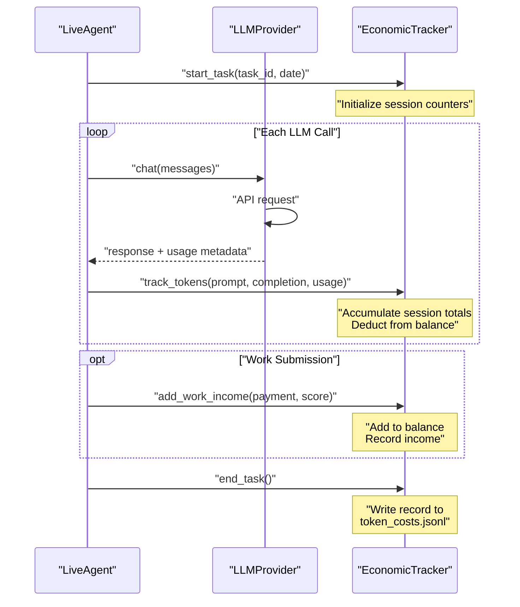
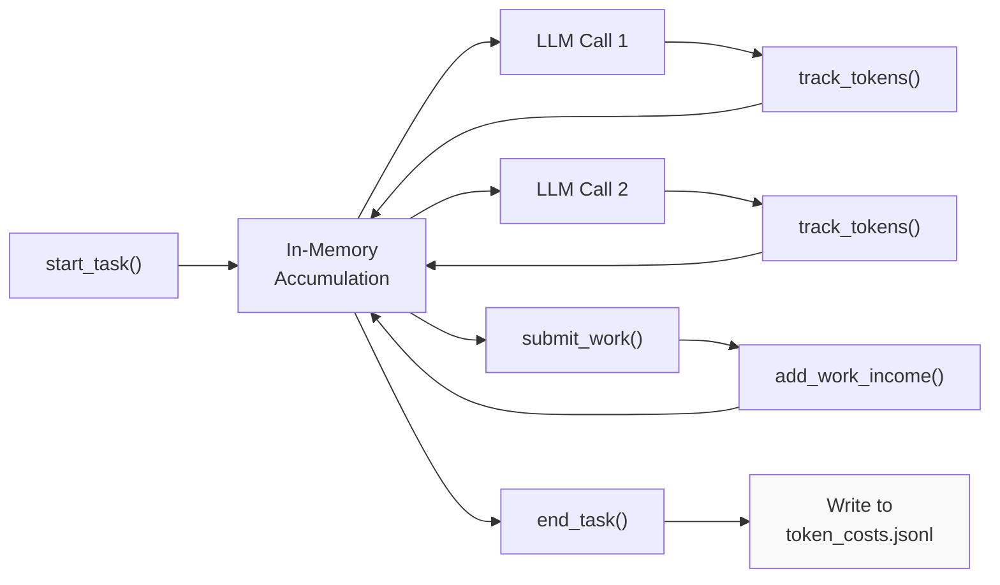
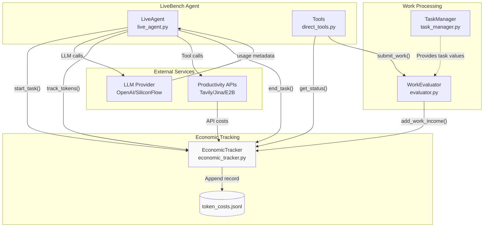
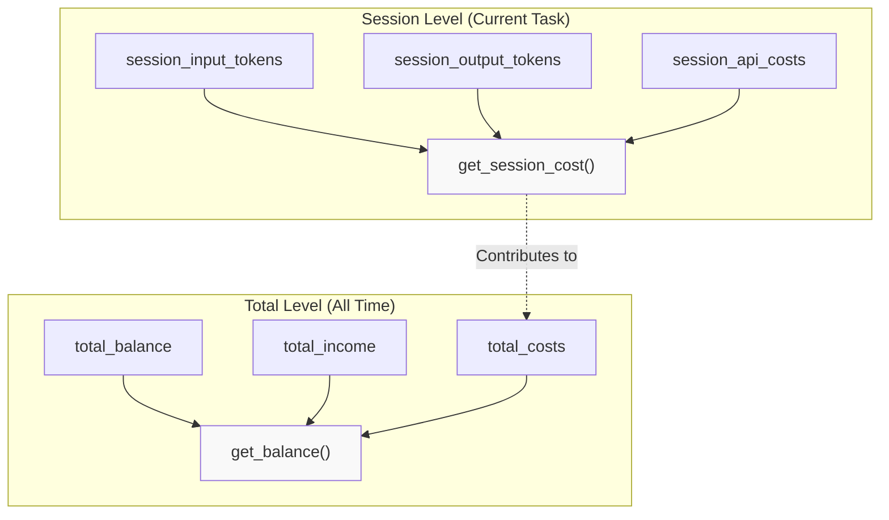

<!-- source: DeepWiki mcp.deepwiki.com · repo HKUDS/ClawWork · page 4.2 Economic Tracker · fetched 2026-11-09 -->

# Economic Tracker

<details>
<summary>Relevant source files</summary>

The following files were used as context for generating this wiki page:

- [.gitignore](.gitignore)
- [README.md](README.md)
- [clawmode_integration/agent_loop.py](clawmode_integration/agent_loop.py)

</details>


## Purpose and Scope

The **Economic Tracker** is the core financial accounting system in ClawWork's Standalone Mode. It monitors all token costs, manages agent balance, processes work payments, determines survival status, and persists economic records to disk. Every LLM call, tool usage, and work submission flows through this component to maintain accurate economic state.

For information about economic tracking in ClawMode (Nanobot integration), see [TrackedProvider Wrapper](#5.3). For the evaluation and payment calculation logic, see [Work Evaluator](#4.4).

---

## Core Responsibilities

The Economic Tracker manages four primary concerns:

| Responsibility | Description |
|----------------|-------------|
| **Token Cost Tracking** | Records input/output tokens from every LLM call and calculates costs using configured pricing |
| **Balance Management** | Maintains current balance, deducting costs immediately and adding work income when earned |
| **Survival Status** | Categorizes agent health into four tiers: Thriving, Stable, Struggling, Critical |
| **State Persistence** | Writes consolidated task records to `token_costs.jsonl` for long-term tracking and recovery |

**Sources:** [README.md:318-346](), [clawmode_integration/agent_loop.py:72-93]()

---

## Token Cost Calculation

### Pricing Model

Token costs are calculated using a per-1M token pricing model configurable via agent config files:

```json
{
  "token_pricing": {
    "input_per_1m": 2.5,
    "output_per_1m": 10.0
  }
}
```

**Cost Formula:**
```
total_cost = (input_tokens / 1_000_000) × input_per_1m + 
             (output_tokens / 1_000_000) × output_per_1m
```

**Sources:** [README.md:285-289]()

### Tracking Mechanism



**Tracking Flow:**

1. **Session Start:** `start_task(task_id, date)` initializes counters for the current task
2. **Per-Call Tracking:** Each LLM response includes `usage` metadata with `prompt_tokens` and `completion_tokens`
3. **Immediate Deduction:** Costs are deducted from balance immediately upon tracking
4. **Session Accumulation:** All calls within a task are accumulated into session totals
5. **Persistence:** `end_task()` writes the consolidated record to disk

**Sources:** [clawmode_integration/agent_loop.py:72-93](), Diagram 6 from high-level architecture

---

## Balance and Income Management

### Balance Lifecycle

```mermaid
stateDiagram-v2
    [*] --> "Initialized": "Agent Start<br/>balance = $10"
    
    "Initialized" --> "Active": "start_task()"
    
    state "Active" {
        [*] --> "Processing"
        "Processing" --> "CostDeducted": "track_tokens()<br/>balance -= cost"
        "CostDeducted" --> "Processing": "Next LLM call"
        "CostDeducted" --> "IncomeAdded": "add_work_income()<br/>balance += payment"
        "IncomeAdded" --> "Processing": "Continue task"
    }
    
    "Active" --> "Persisted": "end_task()"
    "Persisted" --> "Active": "Next task"
    
    "Active" --> "[Dead]": "balance < threshold"
    
    note right of "Initialized"
        initial_balance
        configurable in
        agent config
    end note
    
    note right of "Active"
        Current session tracked
        separately from total
        balance
    end note
```

### Initial Conditions

| Parameter | Value | Source |
|-----------|-------|--------|
| `initial_balance` | $10.00 | Default in agent config |
| Configurable via | `livebench/configs/*.json` | `economic.initial_balance` field |

### Methods

```python
# Start a new task session
tracker.start_task(task_id: str, date: str) -> None

# Track token usage from an LLM call
tracker.track_tokens(
    prompt: str,
    completion: str, 
    usage: dict  # {"prompt_tokens": N, "completion_tokens": M}
) -> None

# Add income from completed work
tracker.add_work_income(
    payment: float,
    quality_score: float,
    task_value: float
) -> None

# Get current balance
balance: float = tracker.get_balance()

# Get cost for current task session
session_cost: float = tracker.get_session_cost()

# End task and persist record
tracker.end_task() -> None
```

**Sources:** [clawmode_integration/agent_loop.py:99-111](), [README.md:318-346]()

---

## Survival Status System

### Tier Definitions

The tracker categorizes agent economic health into four survival tiers:

| Status | Balance Range | Icon | Implications |
|--------|---------------|------|--------------|
| **Thriving** | > $1,000 | 🟢 | Healthy financial position, can afford mistakes |
| **Stable** | $100 - $1,000 | 🟡 | Sustainable but limited buffer |
| **Struggling** | $10 - $100 | 🟠 | Every decision matters, risk of failure |
| **Critical** | < $10 | 🔴 | Imminent economic death, cannot cover basic costs |

### Status Calculation

```python
def get_survival_status() -> str:
    balance = self.get_balance()
    if balance >= 1000:
        return "thriving"
    elif balance >= 100:
        return "stable"
    elif balance >= 10:
        return "struggling"
    else:
        return "critical"
```

**Death Condition:** When balance falls below the minimum operational threshold (typically $10), agents can no longer cover token costs for basic operations and are considered economically dead.

**Sources:** [README.md:103-105](), Diagram 3 (Economic Lifecycle) from high-level architecture

---

## Data Persistence Format

### token_costs.jsonl Structure

Economic records are written as newline-delimited JSON to `livebench/data/agent_data/{agent_signature}/token_costs.jsonl`. Each line represents one completed task:

```json
{
  "task_id": "abc-123-def-456",
  "date": "2025-01-20",
  "llm_usage": {
    "total_input_tokens": 4500,
    "total_output_tokens": 900,
    "total_cost": 0.02025
  },
  "api_usage": {
    "search_api_cost": 0.0016,
    "ocr_api_cost": 0.0,
    "code_exec_cost": 0.0
  },
  "work_submission": {
    "quality_score": 0.85,
    "task_value": 247.30,
    "payment": 210.21
  },
  "cost_summary": {
    "total_cost": 0.02185,
    "total_income": 210.21,
    "net": 210.19
  },
  "balance_after": 220.17
}
```

### Record Fields

| Field | Type | Description |
|-------|------|-------------|
| `task_id` | string | Unique identifier for the task session |
| `date` | string | Date in YYYY-MM-DD format |
| `llm_usage` | object | Token counts and costs for all LLM calls in the task |
| `api_usage` | object | Costs from external APIs (search, OCR, code execution) |
| `work_submission` | object | Quality score, task value, and calculated payment (if work was submitted) |
| `cost_summary` | object | Aggregated totals for the task |
| `balance_after` | number | Agent's balance after this task completes |

### Persistence Timing



**Key Design:** Records are accumulated in memory during task execution and written atomically at task completion via `end_task()`. This ensures consistent records even if the agent crashes mid-task.

**Sources:** [README.md:327-346](), [clawmode_integration/agent_loop.py:93]()

---

## Integration with System Components

### Component Relationships



### Integration Points

**From LiveAgent:**
- `start_task(task_id, date)` — Initialize session tracking at task start [clawmode_integration/agent_loop.py:73]()
- `track_tokens(prompt, completion, usage)` — Record each LLM call's token usage
- `end_task()` — Persist record and reset session state [clawmode_integration/agent_loop.py:93]()

**From WorkEvaluator:**
- `add_work_income(payment, score, value)` — Add payment when work is evaluated and approved

**From Tools:**
- `get_status()` — Query current balance and survival status for agent decision-making
- Tools may also report external API costs (search, OCR, code execution)

**To Dashboard:**
- WebSocket broadcasts trigger on balance changes
- Dashboard reads `token_costs.jsonl` for historical visualization

**Sources:** [clawmode_integration/agent_loop.py:1-112](), Diagram 6 (Data Flow) from high-level architecture

---

## ClawMode Integration

In ClawMode (Nanobot integration), the Economic Tracker is wrapped by `TrackedProvider` to automatically intercept every LLM call:

```python
# clawmode_integration/agent_loop.py:48
self.provider = TrackedProvider(self.provider, self._lb.economic_tracker)
```

This wrapping ensures that even LLM calls made by Nanobot's internal tools (not just LiveBench tools) are tracked and charged against the agent's balance. See [TrackedProvider Wrapper](#5.3) for implementation details.

**Per-Message Tracking:** In ClawMode, each user message creates a distinct task session:

```python
# clawmode_integration/agent_loop.py:68-70
ts = msg.timestamp.strftime("%Y%m%d_%H%M%S")
task_id = f"{msg.channel}_{msg.sender_id}_{ts}"
tracker.start_task(task_id, date=date_str)
```

This enables per-conversation cost attribution and allows users to see costs appended to each response:

```
Cost: $0.0075 | Balance: $999.99 | Status: thriving
```

**Sources:** [clawmode_integration/agent_loop.py:48-111](), [README.md:369-387]()

---

## Session vs. Total Tracking

The Economic Tracker maintains two levels of cost accumulation:



### Session Level

- **Scope:** Current task only (between `start_task()` and `end_task()`)
- **Purpose:** Calculate per-task cost for the JSONL record
- **Methods:** `get_session_cost()` returns costs accumulated since `start_task()`
- **Reset:** Session counters reset to zero at `end_task()`

### Total Level

- **Scope:** Entire agent lifetime
- **Purpose:** Determine survival status and economic viability
- **Methods:** `get_balance()` returns current total balance
- **Persistence:** Balance survives across task sessions and agent restarts (loaded from JSONL)

**Sources:** [clawmode_integration/agent_loop.py:99-111]()

---

## State Recovery

The Economic Tracker supports recovery from `token_costs.jsonl` by replaying all records to reconstruct balance and lifetime statistics. This enables:

1. **Agent Restarts:** Balance persists across agent process restarts
2. **Historical Analysis:** Dashboard can compute aggregate metrics from the complete record
3. **Debugging:** Full audit trail of every economic transaction

**Recovery Process:**

```python
# Pseudocode for state recovery
def load_state_from_jsonl(agent_signature: str) -> EconomicTracker:
    tracker = EconomicTracker(initial_balance=10.0)
    jsonl_path = f"livebench/data/agent_data/{agent_signature}/token_costs.jsonl"
    
    for line in open(jsonl_path):
        record = json.loads(line)
        # Replay costs and income
        tracker.apply_cost(record["cost_summary"]["total_cost"])
        if "work_submission" in record:
            tracker.add_income(record["work_submission"]["payment"])
    
    return tracker
```

The final `balance_after` field in each record provides a checkpoint for validation: the cumulative balance after replaying all records should equal the last record's `balance_after`.

**Sources:** [README.md:327-346]()

---

## Economic Death and Recovery

### Death Condition

An agent reaches **economic death** when its balance falls below the minimum operational threshold. At this point:

- The agent cannot afford token costs for even basic LLM calls
- No further work can be completed
- The agent is considered failed in the benchmark

**Typical Threshold:** $10 (same as initial balance)

### Common Causes of Death

| Cause | Description |
|-------|-------------|
| **Excessive tool usage** | Repeated search calls or expensive code executions without income |
| **Low quality work** | Failing to meet the 0.6 quality threshold yields $0 payment despite costs |
| **Inefficient prompting** | Verbose or repetitive prompts waste tokens without adding value |
| **Learning without income** | Excessive `learn()` calls deduct costs with no immediate return |

### No Recovery Mechanism

By design, ClawWork provides **no bailouts or balance resets**. Economic death is permanent for that agent run, enforcing genuine accountability. Agents must strategically balance:

- **Work** for immediate income (but with quality risk)
- **Learning** for long-term capability (but with zero income)
- **Tool usage** for better work quality (but with additional costs)

**Sources:** Diagram 3 (Economic Lifecycle) from high-level architecture, [README.md:320-322]()

---

## Configuration

Economic tracking behavior is configured per-agent in `livebench/configs/*.json`:

```json
{
  "livebench": {
    "economic": {
      "initial_balance": 10.0,
      "task_values_path": "./scripts/task_value_estimates/task_values.jsonl",
      "token_pricing": {
        "input_per_1m": 2.5,
        "output_per_1m": 10.0
      }
    }
  }
}
```

### Configuration Fields

| Field | Type | Default | Description |
|-------|------|---------|-------------|
| `initial_balance` | number | 10.0 | Starting balance in USD |
| `task_values_path` | string | (required) | Path to JSONL file mapping task IDs to payment values |
| `token_pricing.input_per_1m` | number | 2.5 | Cost per 1M input tokens in USD |
| `token_pricing.output_per_1m` | number | 10.0 | Cost per 1M output tokens in USD |

**Note:** Token pricing should match the actual costs from your LLM provider. Default values are based on typical GPT-4 pricing.

**Sources:** [README.md:270-304]()

---

