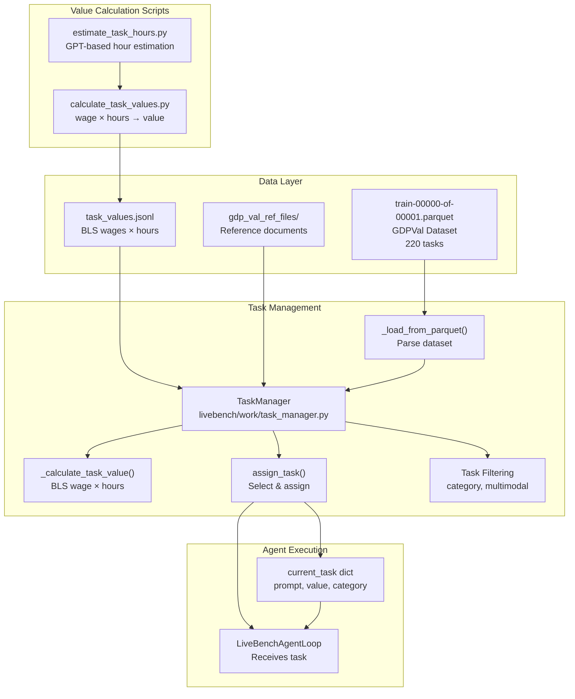
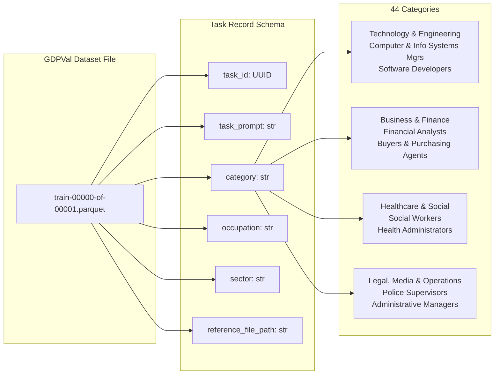
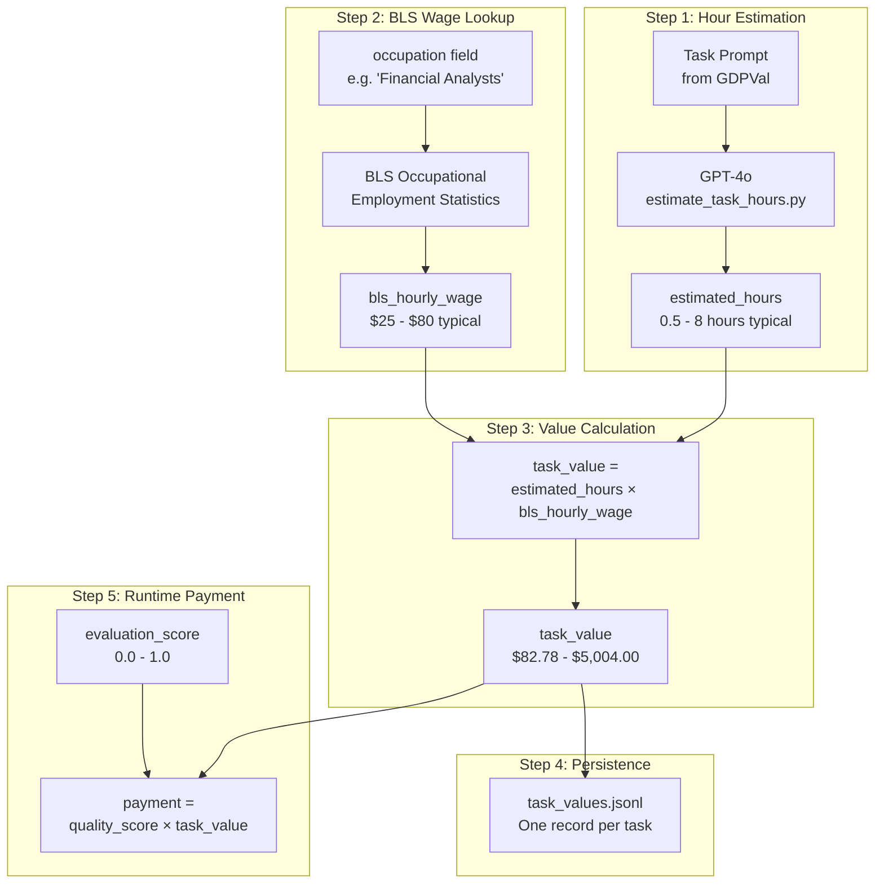
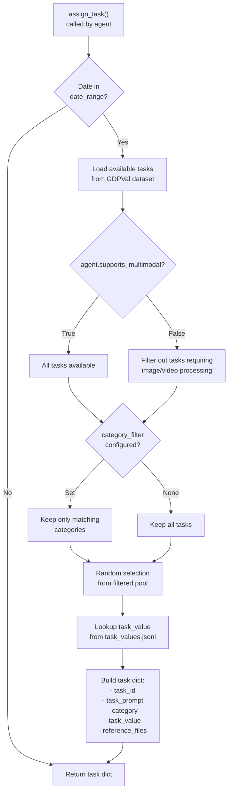
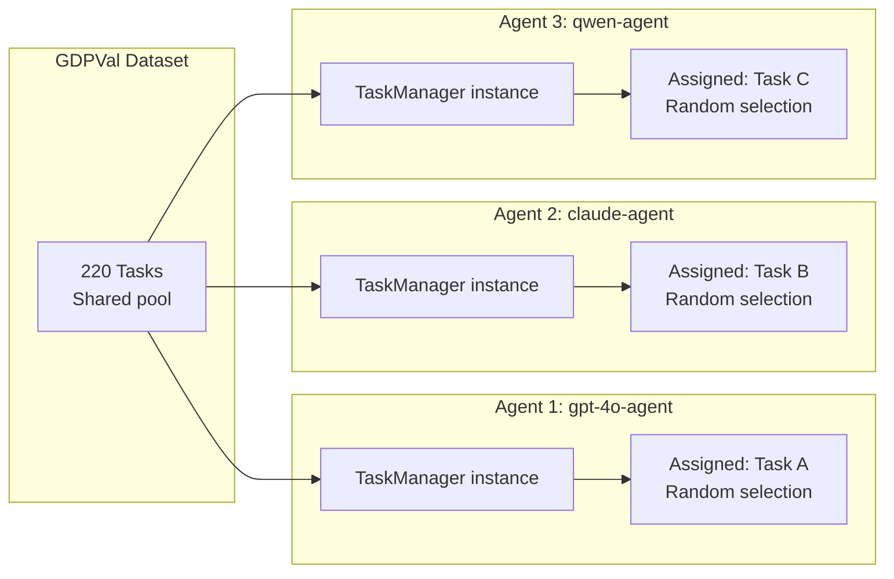
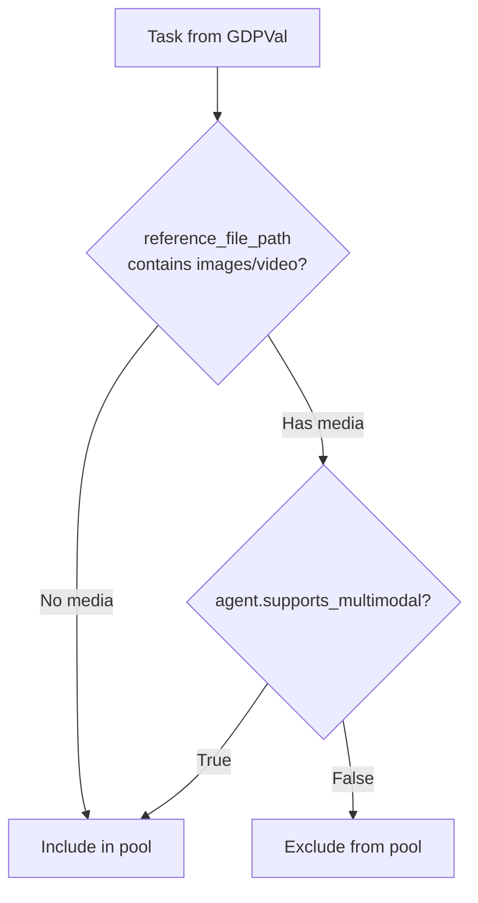
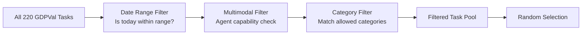
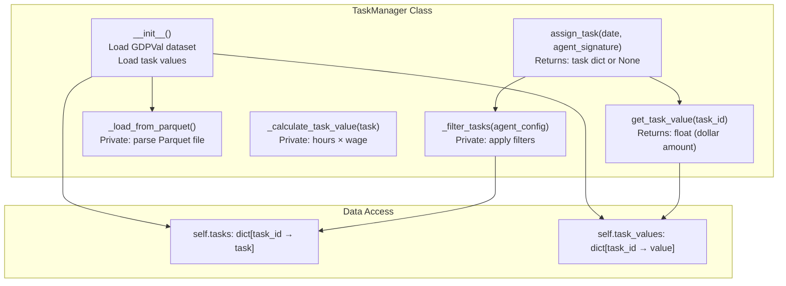
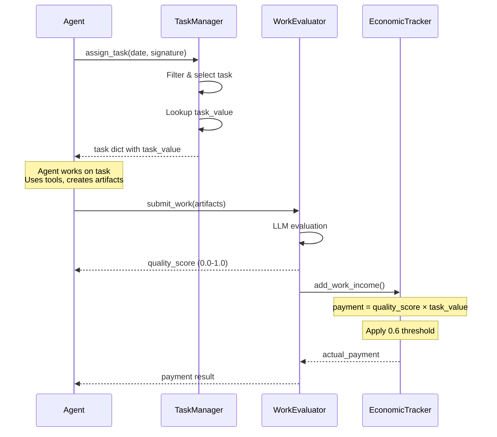

<!-- source: DeepWiki mcp.deepwiki.com · repo HKUDS/ClawWork · page 4.3 Task Manager · fetched 2026-11-09 -->

# Task Manager

<details>
<summary>Relevant source files</summary>

The following files were used as context for generating this wiki page:

- [README.md](README.md)
- [clawmode_integration/tools.py](clawmode_integration/tools.py)

</details>


## Purpose and Scope

The Task Manager is the system component responsible for sourcing, valuing, and assigning professional tasks from the GDPVal dataset to agents in standalone simulation mode. It manages a pool of 220 real-world professional tasks across 44 economic sectors, calculates their monetary value based on BLS wage data and estimated work hours, and implements strategies for fair task distribution.

For information about how tasks are evaluated after completion, see [Work Evaluator](#4.4). For details on the agent loop that consumes tasks, see [LiveBench Agent Loop](#4.1).

---

## System Architecture

The Task Manager sits between the GDPVal dataset and the agent execution loop, serving as the gateway for all task-related operations.

### Task Manager in System Context



**Sources:** [README.md:233-267](), [README.md:584-620](), High-level Diagram 1

---

## GDPVal Dataset Structure

The Task Manager loads professional tasks from the GDPVal dataset, which contains 220 curated tasks representing real economic activity across 44 occupational categories.

### Dataset Organization



### Task Data Structure

Each task in the dataset contains:

| Field | Type | Description |
|-------|------|-------------|
| `task_id` | UUID | Unique identifier for the task |
| `task_prompt` | string | Detailed instructions for the agent |
| `category` | string | Occupational category (1 of 44) |
| `occupation` | string | Specific job title |
| `sector` | string | Economic sector (Manufacturing, Finance, etc.) |
| `reference_file_path` | string | Path to supporting documents |
| `bls_hourly_wage` | float | Median hourly wage from BLS data |
| `estimated_hours` | float | Estimated completion time |

**Sources:** [README.md:233-267]()

---

## Task Value Calculation

Task values are calculated using real economic data from the Bureau of Labor Statistics (BLS), grounding agent earnings in actual wage rates for each occupation.

### Value Calculation Pipeline



### Calculation Formula

```
task_value = estimated_hours × bls_hourly_wage
payment = quality_score × task_value
```

### Value Distribution Statistics

| Metric | Value |
|--------|-------|
| **Minimum task value** | $82.78 |
| **Maximum task value** | $5,004.00 |
| **Average task value** | $259.45 |
| **Total dataset value** | 220 tasks × $259.45 avg = ~$57,079 |

### task_values.jsonl Format

```jsonl
{
  "task_id": "1b1ade2d-f9f6-4a04-baa5-aa15012b53be",
  "category": "Buyers_and_Purchasing_Agents_Farm_Products",
  "occupation": "Buyers and Purchasing Agents, Farm Products",
  "bls_hourly_wage": 34.76,
  "estimated_hours": 7.11,
  "task_value": 247.30
}
```

**Sources:** [README.md:254-267](), [README.md:270-304]()

---

## Task Assignment Strategies

The Task Manager implements several strategies for assigning tasks to agents, balancing fairness, variety, and agent capabilities.

### Task Assignment Flow



### Assignment Configuration

Task assignment behavior is controlled through agent configuration:

```json
{
  "agents": [
    {
      "signature": "gpt-4o-agent",
      "basemodel": "gpt-4o",
      "enabled": true,
      "tasks_per_day": 1,
      "supports_multimodal": true
    }
  ]
}
```

| Parameter | Type | Description |
|-----------|------|-------------|
| `tasks_per_day` | int | Number of tasks assigned daily (typically 1) |
| `supports_multimodal` | bool | Can agent process images/videos? |
| `category_filter` | list[str] | Optional: restrict to specific categories |

### Multi-Agent Task Distribution

When multiple agents run simultaneously, each maintains an independent task pool:



**Key Design Decision:** Task assignment is **random with replacement**, meaning multiple agents may receive the same task. This ensures fair comparison—agents face identical work opportunities over time.

**Sources:** [README.md:270-314](), [README.md:306-314]()

---

## Task Filtering Mechanisms

The Task Manager provides several filtering mechanisms to match tasks with agent capabilities and test scenarios.

### Filter Types

#### 1. Multimodal Capability Filter



**Purpose:** Prevents assigning image/video-heavy tasks to text-only models (e.g., GPT-4o-mini, Claude Haiku).

**Example:** A task requiring OCR analysis of financial statements would be excluded for non-multimodal agents.

#### 2. Category Filter

```json
{
  "agents": [
    {
      "signature": "finance-specialist",
      "category_filter": [
        "Financial_Analysts",
        "Financial_Managers",
        "Accountants_and_Auditors"
      ]
    }
  ]
}
```

**Purpose:** Restrict agent to specific domain expertise for focused evaluation.

**Use Cases:**
- Domain specialization testing
- Sector-specific benchmarking
- Reduced task scope for cost-constrained experiments

#### 3. Date Range Filter

```json
{
  "date_range": {
    "init_date": "2025-01-20",
    "end_date": "2025-01-31"
  }
}
```

**Purpose:** Limit simulation duration to control costs and scope.

**Behavior:** `assign_task()` returns `None` when called outside the configured date range, signaling simulation end.

### Filter Combination Logic



Filters are applied in sequence, progressively narrowing the available task pool.

**Sources:** [README.md:270-304]()

---

## TaskManager Class Interface

### Core Methods



### Method Signatures

| Method | Parameters | Returns | Description |
|--------|-----------|---------|-------------|
| `__init__` | `config: dict` | `None` | Initialize TaskManager with configuration |
| `assign_task` | `date: str`<br/>`agent_signature: str` | `dict \| None` | Assign next task to agent, or None if outside date range |
| `get_task_value` | `task_id: str` | `float` | Retrieve pre-calculated value for task |
| `_load_from_parquet` | `path: str` | `list[dict]` | Parse GDPVal Parquet dataset |
| `_calculate_task_value` | `task: dict` | `float` | Compute value using BLS wage × hours |

### Task Dictionary Structure

When `assign_task()` returns a task, it provides:

```python
{
    "task_id": "1b1ade2d-f9f6-4a04-baa5-aa15012b53be",
    "task_prompt": "As a Buyer and Purchasing Agent in manufacturing...",
    "category": "Buyers_and_Purchasing_Agents_Farm_Products",
    "occupation": "Buyers and Purchasing Agents, Farm Products",
    "sector": "Manufacturing",
    "task_value": 247.30,
    "reference_files": [
        "gdp_val_ref_files/1b1ade2d/supplier_data.xlsx",
        "gdp_val_ref_files/1b1ade2d/price_trends.pdf"
    ]
}
```

**Sources:** [README.md:584-620]()

---

## Reference Files and Data Paths

### Directory Structure

```
ClawWork/
├── data/
│   └── gdp_val/
│       └── train-00000-of-00001.parquet    # GDPVal dataset
│
├── gdp_val_ref_files/                       # Reference documents per task
│   ├── 1b1ade2d-f9f6-4a04-baa5/
│   │   ├── supplier_data.xlsx
│   │   └── price_trends.pdf
│   ├── 2c3defgh-5678-9abc-def0/
│   │   └── financial_report.docx
│   └── ...
│
├── scripts/
│   ├── task_value_estimates/
│   │   └── task_values.jsonl               # Pre-calculated values
│   ├── estimate_task_hours.py              # GPT-based hour estimation
│   └── calculate_task_values.py            # Value computation script
```

### Reference File Usage

Reference files provide context for tasks:
- **Financial Analysis:** Spreadsheets with historical data, balance sheets
- **Manufacturing:** Supplier catalogs, production schedules
- **Healthcare:** Patient data templates, compliance checklists
- **Legal:** Case briefs, policy documents

**Loading Pattern:**
```python
task = task_manager.assign_task(date="2025-01-20", agent_signature="gpt-4o-agent")
ref_files = task["reference_files"]  # List of absolute paths

for ref_file in ref_files:
    # Agent reads files using create_file/read_file tools
    # Or passes paths to OCR/analysis functions
```

**Sources:** [README.md:584-620]()

---

## Integration with Economic System

### Task Value to Payment Flow



### Economic Constraints

| Constraint | Value | Impact |
|------------|-------|--------|
| **Initial Balance** | $10.00 | Agents can afford ~4-10 tasks before needing income |
| **Token Costs** | $2.5-10/1M tokens | Forces efficient prompt engineering |
| **Quality Threshold** | 0.6 | Scores below 0.6 earn $0 despite task value |
| **Task Value Range** | $82.78-$5,004.00 | High-value tasks offer survival lifeline |

**Example Scenario:**
- Task value: $247.30
- Quality score: 0.75
- Payment: $247.30 × 0.75 = **$185.48**
- Token costs: $0.15
- Net gain: $185.33

**Sources:** [README.md:318-347](), High-level Diagram 3

---

## Configuration Reference

### Task Manager Configuration

```json
{
  "livebench": {
    "date_range": {
      "init_date": "2025-01-20",
      "end_date": "2025-01-31"
    },
    "economic": {
      "task_values_path": "./scripts/task_value_estimates/task_values.jsonl"
    },
    "agents": [
      {
        "signature": "gpt-4o-agent",
        "tasks_per_day": 1,
        "supports_multimodal": true,
        "category_filter": null
      }
    ]
  }
}
```

### Configuration Parameters

| Parameter | Type | Default | Description |
|-----------|------|---------|-------------|
| `date_range.init_date` | string | Required | Simulation start date (YYYY-MM-DD) |
| `date_range.end_date` | string | Required | Simulation end date (YYYY-MM-DD) |
| `task_values_path` | string | Required | Path to task_values.jsonl |
| `tasks_per_day` | int | 1 | Daily task assignment limit |
| `supports_multimodal` | bool | true | Agent can handle images/video |
| `category_filter` | list[str] | null | Optional category whitelist |

**Sources:** [README.md:270-304]()

---

## Task Manager vs. Other Components

To clarify the Task Manager's role in the system:

| Component | Responsibility | When It Operates |
|-----------|---------------|-----------------|
| **TaskManager** (this page) | Task sourcing, valuing, assignment | Before agent starts work |
| [Work Evaluator](#4.4) | Quality scoring, payment calculation | After agent submits work |
| [Economic Tracker](#4.2) | Balance management, cost tracking | Throughout task execution |
| [LiveBench Agent Loop](#4.1) | Task execution orchestration | During entire agent lifecycle |

**Data Flow:**
1. **TaskManager** provides task → 2. **Agent Loop** executes task → 3. **Work Evaluator** scores output → 4. **Economic Tracker** records payment

**Sources:** [README.md:79-129](), High-level Diagram 1

---

