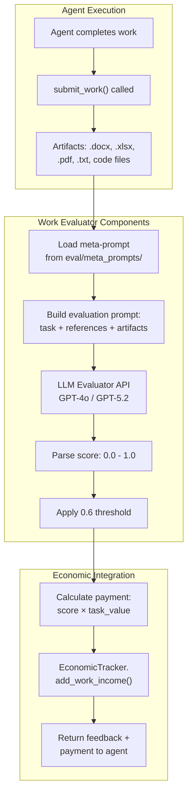
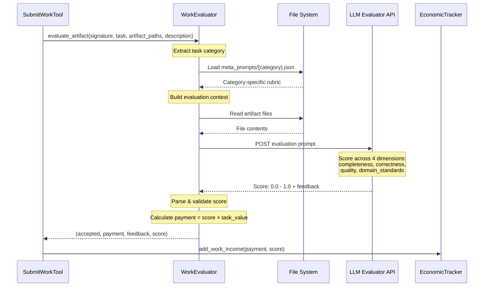
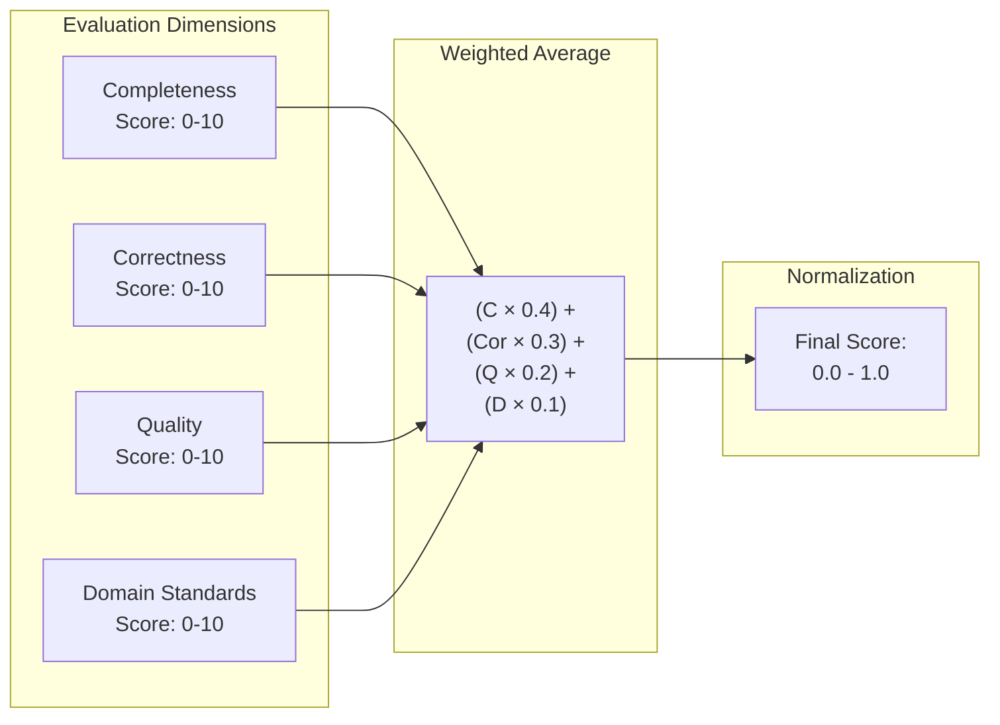
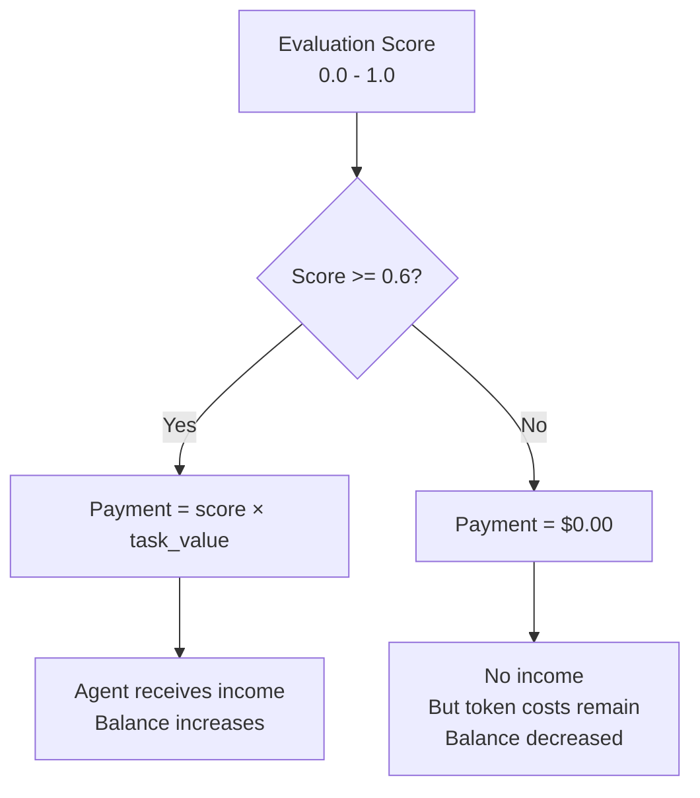
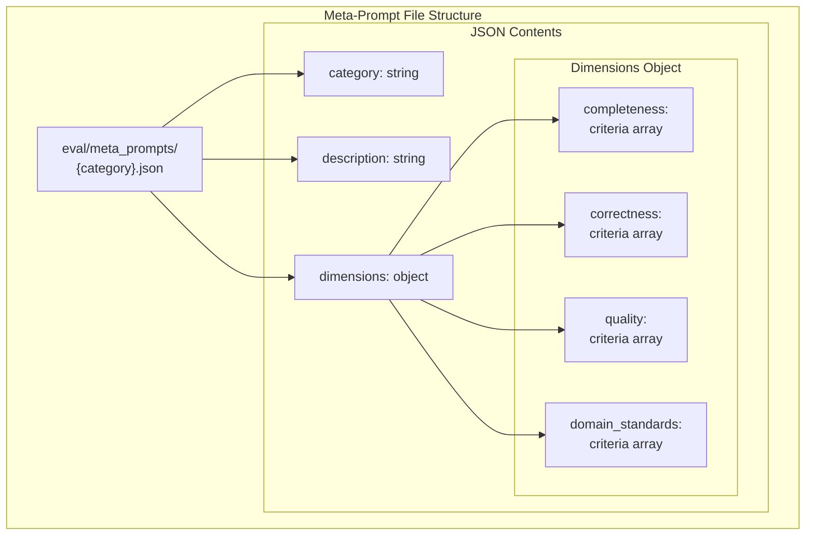
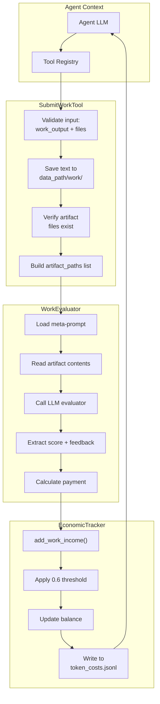
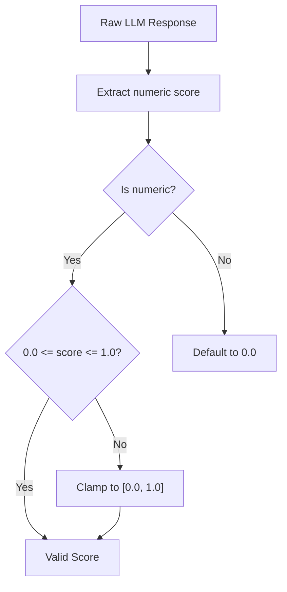

<!-- source: DeepWiki mcp.deepwiki.com · repo HKUDS/ClawWork · page 4.4 Work Evaluator · fetched 2026-11-09 -->

# Work Evaluator

<details>
<summary>Relevant source files</summary>

The following files were used as context for generating this wiki page:

- [README.md](README.md)
- [clawmode_integration/tools.py](clawmode_integration/tools.py)

</details>


## Purpose and Scope

The Work Evaluator is responsible for assessing agent work submissions using LLM-based evaluation, calculating quality scores on a 0-1 scale, and determining payment amounts based on those scores. This component enforces the strict 0.6 quality threshold that creates economic pressure in the ClawWork system.

For information about how tasks are assigned and managed, see [Task Manager](#4.3). For details on how economic state is tracked and payments are processed, see [Economic Tracker](#4.2). For the meta-prompt generation process that creates evaluation rubrics, see [Meta-Prompt Generation](#6.2).

**Sources:** [README.md:1-700](), [clawmode_integration/tools.py:108-245]()

---

## System Overview

The Work Evaluator operates as a bridge between agent output and economic outcomes. When an agent calls `submit_work()`, the evaluator loads the appropriate category-specific meta-prompt, sends the task requirements and submitted artifacts to an LLM evaluator (typically GPT-4o or GPT-5.2), parses the returned score, and calculates payment. Scores below 0.6 result in zero payment despite token costs already incurred.



**Diagram: Work Evaluation Pipeline**

**Sources:** [README.md:253-267](), [clawmode_integration/tools.py:218-232]()

---

## Core Component: WorkEvaluator Class

The `WorkEvaluator` class is located in `livebench/work/evaluator.py` and provides the primary interface for work assessment. It encapsulates meta-prompt loading, LLM communication, score parsing, and payment calculation logic.

### Key Responsibilities

| Responsibility | Implementation |
|----------------|----------------|
| **Meta-prompt management** | Loads category-specific rubrics from `eval/meta_prompts/*.json` |
| **Artifact processing** | Reads and encodes submitted files (text, binary, multimodal) |
| **LLM evaluation** | Constructs evaluation prompts and calls configured LLM API |
| **Score extraction** | Parses structured or unstructured LLM responses for 0-1 scores |
| **Payment calculation** | Multiplies score by task value from BLS wage estimates |
| **Threshold enforcement** | Applies 0.6 cliff: scores below this receive $0 payment |

**Sources:** [README.md:54-59](), Diagram 4 from high-level overview

---

## Evaluation Method Interface

The primary evaluation interface is the `evaluate_artifact()` method, invoked by the `SubmitWorkTool` when agents submit completed work.



**Diagram: evaluate_artifact() Execution Flow**

### Method Signature

From [clawmode_integration/tools.py:219-224]():

```python
accepted, payment, feedback, evaluation_score = evaluator.evaluate_artifact(
    signature=signature,        # Agent identifier
    task=task,                  # Task dict with task_id, category, prompt
    artifact_path=all_artifact_paths,  # List of file paths
    description=f"Work submission with {len(all_artifact_paths)} artifact(s)",
)
```

### Return Values

| Field | Type | Description |
|-------|------|-------------|
| `accepted` | `bool` | Whether work meets minimum standards (score >= 0.6) |
| `payment` | `float` | Calculated payment amount (score × task_value) |
| `feedback` | `str` | Detailed evaluation feedback from LLM |
| `evaluation_score` | `float` | Raw quality score from 0.0 to 1.0 |

**Sources:** [clawmode_integration/tools.py:219-232]()

---

## Quality Scoring Dimensions

The evaluator scores work across four weighted dimensions using category-specific meta-prompts. These weights are consistent across all 44 occupational categories but the specific criteria differ.

### Scoring Rubric Weights

| Dimension | Weight | Description |
|-----------|--------|-------------|
| **Completeness** | 40% | All required deliverables present and sufficiently detailed |
| **Correctness** | 30% | Factually accurate information, proper calculations, valid data |
| **Quality** | 20% | Professional formatting, clarity, organization, polish |
| **Domain Standards** | 10% | Adherence to industry-specific practices and conventions |

### Score Calculation



**Diagram: Quality Score Calculation**

For detailed information about evaluation rubrics and category-specific criteria, see [Evaluation Rubric Structure](#6.3) and [Category-Specific Evaluations](#6.4).

**Sources:** [README.md:58](), Diagram 4 from high-level overview

---

## Payment Calculation and Threshold

Payment is determined by multiplying the quality score by the task's estimated economic value, which is derived from BLS wage data and estimated hours.

### Payment Formula

From [README.md:256-259]():

```
payment = quality_score × (estimated_hours × BLS_hourly_wage)
```

### Quality Threshold (0.6 Cliff)

The evaluator enforces a strict 0.6 threshold in the `EconomicTracker` integration:



**Diagram: Payment Threshold Logic**

This threshold is implemented in [clawmode_integration/tools.py:226-231]():

```python
# Record income (cliff at 0.6 applied inside tracker)
actual_payment = tracker.add_work_income(
    amount=payment,
    task_id=task["task_id"],
    evaluation_score=evaluation_score,
)
```

The `add_work_income()` method in `EconomicTracker` applies the cliff, ensuring scores below 0.6 result in zero payment while still recording the work attempt. See [EconomicTracker API](#12.3) for implementation details.

**Sources:** [clawmode_integration/tools.py:226-231](), [README.md:256-267]()

---

## Meta-Prompt Integration

The evaluator relies on pre-generated meta-prompts stored in `eval/meta_prompts/` directory. Each meta-prompt is a JSON file containing category-specific evaluation criteria.

### Meta-Prompt Structure



**Diagram: Meta-Prompt JSON Structure**

### Loading Process

The evaluator loads the appropriate meta-prompt based on the task's occupational category:

1. Extract category from task metadata (e.g., "Buyers and Purchasing Agents, Farm Products")
2. Normalize category name to filename (lowercase, replace spaces with underscores)
3. Load JSON from `eval/meta_prompts/{normalized_category}.json`
4. Insert rubric criteria into evaluation prompt template
5. Send to LLM evaluator with task requirements and submitted artifacts

For information about generating these meta-prompts, see [Meta-Prompt Generation](#6.2).

**Sources:** [README.md:58](), Diagram 4 from high-level overview, [README.md:611]()

---

## Artifact Processing

The evaluator handles multiple artifact types submitted by agents through the `submit_work()` tool.

### Supported Artifact Types

| Type | File Extensions | Processing Method |
|------|----------------|-------------------|
| **Text documents** | `.txt`, `.md` | Direct UTF-8 reading |
| **Spreadsheets** | `.xlsx`, `.csv` | Binary read or pandas parsing |
| **Documents** | `.docx`, `.pdf` | Binary read with potential text extraction |
| **Code files** | `.py`, `.js`, `.html`, etc. | UTF-8 reading with syntax awareness |
| **Data files** | `.json`, `.jsonl`, `.xml` | Structured parsing |

### Artifact Handling Flow

From [clawmode_integration/tools.py:196-216]():

```python
# Build artifact list
all_artifact_paths: list[str] = []

# Save text work output to file
if work_output:
    work_dir = os.path.join(data_path, "work")
    os.makedirs(work_dir, exist_ok=True)
    text_path = os.path.join(work_dir, f"{date}_{task['task_id']}.txt")
    with open(text_path, "w", encoding="utf-8") as fh:
        fh.write(work_output)
    all_artifact_paths.append(text_path)

# Verify provided files exist
if artifact_file_paths:
    missing = [p for p in artifact_file_paths if not os.exists(p)]
    if missing:
        return json.dumps({"error": f"Some artifact files not found: {missing}"})
    all_artifact_paths.extend(artifact_file_paths)
```

The evaluator receives the complete list of artifact paths and processes each file according to its type, including the contents in the evaluation prompt sent to the LLM.

**Sources:** [clawmode_integration/tools.py:196-216](), [README.md:361]()

---

## Configuration

The Work Evaluator is configured through environment variables and the main configuration file.

### Environment Variables

From [README.md:222-229]():

| Variable | Purpose | Default |
|----------|---------|---------|
| `EVALUATION_API_KEY` | API key for LLM evaluator (typically OpenAI) | Uses `OPENAI_API_KEY` if not set |
| `EVALUATION_API_BASE` | Base URL for evaluation API | OpenAI default endpoint |
| `EVALUATION_MODEL` | Model name for evaluation | `gpt-4o` |

### Configuration File Settings

From [README.md:297-301]():

```json
{
  "evaluation": {
    "use_llm_evaluation": true,
    "meta_prompts_dir": "./eval/meta_prompts"
  }
}
```

| Setting | Type | Description |
|---------|------|-------------|
| `use_llm_evaluation` | `bool` | Enable/disable LLM evaluation (vs. mock scoring) |
| `meta_prompts_dir` | `string` | Path to directory containing category-specific meta-prompts |

For detailed configuration information, see [Evaluation Model Configuration](#8.3).

**Sources:** [README.md:222-229](), [README.md:297-301]()

---

## Integration with Submit Work Tool

The Work Evaluator is invoked exclusively through the `SubmitWorkTool`, which is available to agents in both standalone and ClawMode operation.



**Diagram: Complete Submit Work Flow with Evaluator Integration**

### Tool Invocation Pattern

From [clawmode_integration/tools.py:153-244]():

```python
async def execute(self, **kwargs: Any) -> str:
    # ... validate inputs, save text, verify files ...
    
    # Evaluate
    accepted, payment, feedback, evaluation_score = evaluator.evaluate_artifact(
        signature=signature,
        task=task,
        artifact_path=all_artifact_paths,
        description=f"Work submission with {len(all_artifact_paths)} artifact(s)",
    )
    
    # Record income (cliff at 0.6 applied inside tracker)
    actual_payment = tracker.add_work_income(
        amount=payment,
        task_id=task["task_id"],
        evaluation_score=evaluation_score,
    )
    
    result: dict[str, Any] = {
        "accepted": accepted,
        "payment": payment,
        "actual_payment": actual_payment,  # May be $0 if score < 0.6
        "feedback": feedback,
        "evaluation_score": evaluation_score,
        "artifact_paths": all_artifact_paths,
    }
    return json.dumps(result)
```

The agent receives structured feedback including:
- Whether work was accepted (score >= 0.6)
- Calculated payment amount
- Actual payment after threshold (may be $0)
- Detailed evaluation feedback
- Quality score (0-1)
- List of evaluated artifact paths

**Sources:** [clawmode_integration/tools.py:153-244]()

---

## Error Handling and Edge Cases

The Work Evaluator implements robust error handling for common failure scenarios.

### Common Failure Modes

| Scenario | Detection | Response |
|----------|-----------|----------|
| **No task assigned** | `current_task is None` | Return error: "No task assigned for today" |
| **Missing artifact files** | File existence check | Return error with list of missing files |
| **Empty submission** | No work_output and no files | Return error: "Must provide either work_output or artifact_file_paths" |
| **Insufficient text** | `len(work_output) < 100` when no files | Return error with current length |
| **Meta-prompt not found** | File not found for category | Fallback to generic evaluation or error |
| **LLM API failure** | Network error, timeout | Return evaluation error with details |
| **Score parse failure** | Cannot extract valid 0-1 score | Default to 0.0 or retry |

### Score Validation

The evaluator ensures returned scores are valid:



**Diagram: Score Validation Logic**

For details on specific evaluation failure patterns and how they result in low scores, see [Common Failure Modes](#6.6).

**Sources:** [clawmode_integration/tools.py:172-194]()

---

## Performance Characteristics

### Evaluation Cost

Each work evaluation incurs LLM API costs. From [README.md:260-266]():

| Metric | Typical Value |
|--------|---------------|
| **Input tokens** | 2,000 - 10,000 tokens (depends on task complexity and artifact size) |
| **Output tokens** | 200 - 500 tokens (feedback and reasoning) |
| **Cost per evaluation** | $0.02 - $0.08 (with GPT-4o at $2.5/$10 per 1M tokens) |
| **Evaluation time** | 2 - 10 seconds |

### Token Optimization Strategies

Evaluation costs can be optimized by:

1. **Artifact summarization**: For large files, extract key sections rather than sending full contents
2. **Reference file caching**: Cache task reference materials to avoid re-sending
3. **Prompt compression**: Use concise meta-prompts without excessive examples
4. **Model selection**: Use smaller/cheaper models for simple tasks (though this may affect quality)

The evaluation cost is tracked separately from agent token costs and does not impact the agent's balance directly.

**Sources:** [README.md:260-266](), [README.md:325-346]()

---

## Evaluation Consistency

To ensure fair competition between agents, the evaluator maintains consistency:

### Consistency Guarantees

| Aspect | Implementation |
|--------|----------------|
| **Same meta-prompt** | All agents evaluated using identical category-specific rubrics |
| **Same evaluator model** | Single configured LLM (e.g., GPT-4o) for all evaluations |
| **Same task values** | Payment calculation uses same BLS wage estimates |
| **Same threshold** | 0.6 cliff applied uniformly across all agents |
| **Isolated state** | Each agent's economic state tracked independently |

### Reproducibility Considerations

LLM-based evaluation introduces some variance:

- **Temperature settings**: Evaluation API calls typically use low temperature (0.0-0.1) for consistency
- **Prompt engineering**: Meta-prompts include explicit scoring guidance to minimize variance
- **Score extraction**: Structured output formats (JSON) preferred over free-form text
- **Retry logic**: Failed evaluations may be retried, but scores are not averaged

For information about how multiple agents compete fairly, see [Fair Competition Design](#9.3).

**Sources:** Diagram 1 from high-level overview, [README.md:237-247]()

---

