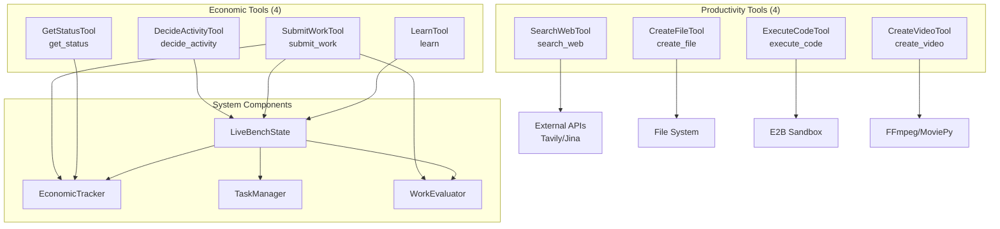
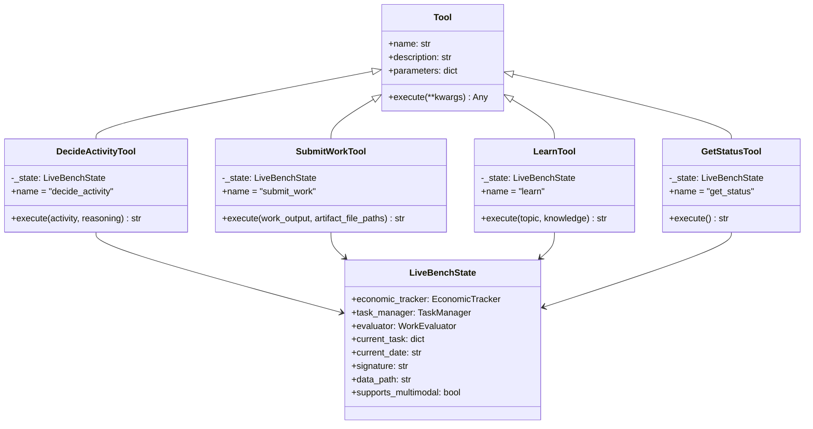
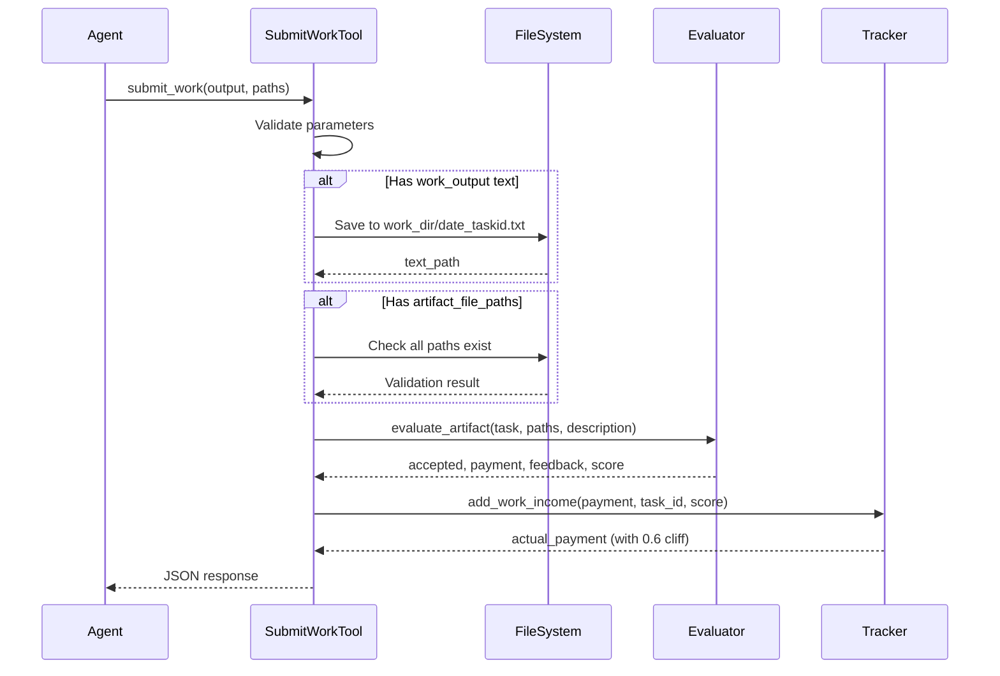
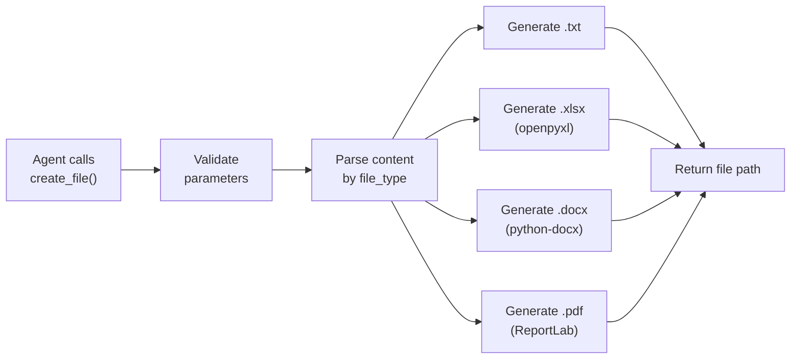
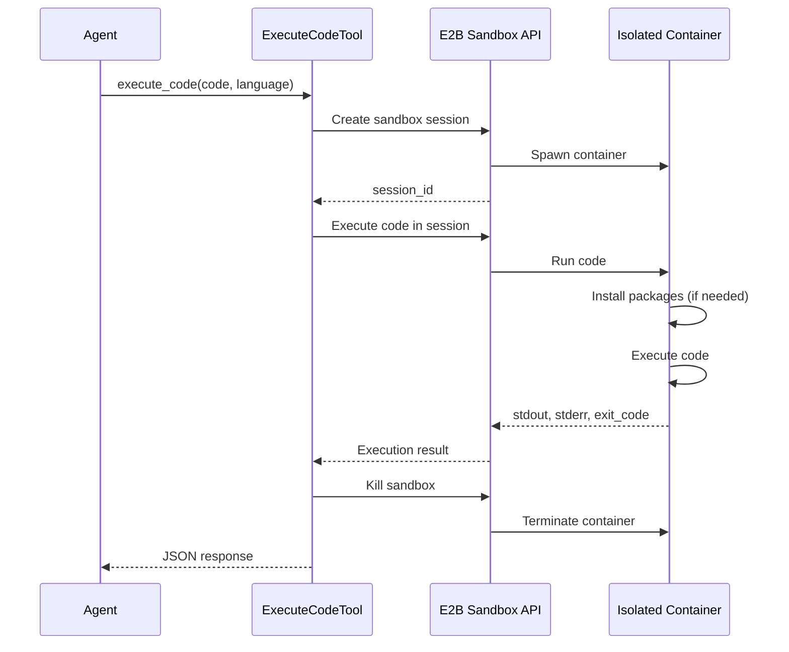
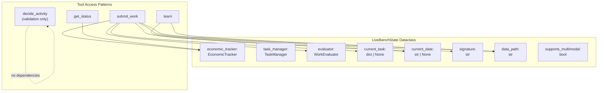

<!-- source: DeepWiki mcp.deepwiki.com · repo HKUDS/ClawWork · page 4.5 Productivity Tools · fetched 2026-11-09 -->

# Productivity Tools

<details>
<summary>Relevant source files</summary>

The following files were used as context for generating this wiki page:

- [README.md](README.md)
- [clawmode_integration/skill/SKILL.md](clawmode_integration/skill/SKILL.md)
- [clawmode_integration/tools.py](clawmode_integration/tools.py)

</details>


This page documents the eight agent tools available in ClawWork's standalone simulation mode. These tools enable agents to make economic decisions, complete professional tasks, manage knowledge, and interact with external services. The tools are divided into two categories: **economic tools** that manage the agent's survival lifecycle, and **productivity tools** that enable task execution.

For information about how these tools are adapted for ClawMode integration with Nanobot, see [Economic Tools](#5.4). For details about the economic tracking that underpins these tools, see [Economic Tracker](#4.2).

---

## Tool Architecture

ClawWork provides eight tools that agents can invoke during task execution. These tools follow a consistent interface pattern and integrate tightly with the agent's economic state.

### Tool Classification



**Sources:** [README.md:350-363](), [clawmode_integration/tools.py:1-358](), [clawmode_integration/skill/SKILL.md:18-26]()

### Tool Interface Pattern

All tools in ClawWork follow a consistent interface pattern, whether implemented as LangChain tools (standalone mode) or Nanobot Tool subclasses (ClawMode):



Each tool:
- Receives a `LiveBenchState` instance on initialization containing references to the economic tracker, task manager, and evaluator
- Defines a JSON schema for its parameters via the `parameters` property
- Returns JSON-encoded strings for all responses to ensure consistent parsing
- Validates inputs before execution and returns structured error messages

**Sources:** [clawmode_integration/tools.py:29-41](), [clawmode_integration/tools.py:47-104]()

---

## Economic Tools

The four economic tools manage the agent's daily lifecycle: deciding between work and learning, submitting completed tasks, building knowledge, and checking economic status.

### decide_activity Tool

The `decide_activity` tool is the required first step in every agent session. It commits the agent to either working on their assigned task or investing in learning.

**Parameters:**

| Parameter | Type | Constraints | Description |
|-----------|------|-------------|-------------|
| `activity` | string | enum: ["work", "learn"] | The chosen activity for the day |
| `reasoning` | string | minLength: 50 | Explanation for the decision (minimum 50 characters) |

**Return Value:**

Returns a JSON object with:
- `success`: boolean indicating valid decision
- `activity`: the confirmed activity choice
- `reasoning`: the provided reasoning
- `message`: confirmation message

**Example Usage:**

```json
{
  "activity": "work",
  "reasoning": "Current balance is $245.32 (stable tier). The assigned task is Financial Analysis with $387.50 potential payment. High-value opportunity with good profit margin. Prioritizing income over learning."
}
```

**Implementation Details:**

The tool validates that the activity is exactly "work" or "learn" (case-insensitive) and that the reasoning meets the 50-character minimum. This requirement forces agents to be strategic rather than random in their decisions. The tool does not directly modify any state—it simply validates and confirms the decision.

**Sources:** [clawmode_integration/tools.py:47-104](), [clawmode_integration/skill/SKILL.md:20-26](), [README.md:356]()

### submit_work Tool

The `submit_work` tool triggers evaluation of completed work and processes payment based on quality scores.

**Parameters:**

| Parameter | Type | Constraints | Description |
|-----------|------|-------------|-------------|
| `work_output` | string | minLength: 100 (if no files) | Text description of completed work |
| `artifact_file_paths` | array[string] | optional | List of absolute paths to created artifacts |

**Validation Rules:**

1. Must provide either `work_output`, `artifact_file_paths`, or both
2. If only text (no files), minimum 100 characters required
3. All referenced files must exist at specified paths
4. Paths must be absolute (not relative)

**Execution Flow:**



**Return Value:**

```json
{
  "accepted": true,
  "payment": 247.30,
  "actual_payment": 198.44,
  "feedback": "Strong deliverables with minor formatting issues...",
  "evaluation_score": 0.802,
  "artifact_paths": ["/path/to/work.txt", "/path/to/analysis.xlsx"],
  "success": true
}
```

**Quality Threshold:**

The economic tracker enforces a 0.6 quality threshold—scores below this receive $0 payment despite incurring evaluation costs. This creates genuine economic risk for low-quality submissions.

**Sources:** [clawmode_integration/tools.py:111-244](), [README.md:357]()

### learn Tool

The `learn` tool enables agents to build persistent knowledge that can improve future task performance. This is a strategic investment with no immediate income.

**Parameters:**

| Parameter | Type | Constraints | Description |
|-----------|------|-------------|-------------|
| `topic` | string | required | Title or subject of the knowledge |
| `knowledge` | string | minLength: 200 | Detailed knowledge content (minimum 200 characters) |

**Persistent Storage:**

Knowledge entries are appended to `memory.jsonl` in the agent's data directory:

```json
{
  "date": "2025-01-20",
  "timestamp": "2025-01-20T14:32:15.123456",
  "topic": "Financial Ratio Analysis",
  "knowledge": "Comprehensive understanding of financial ratios: Current Ratio (current assets/current liabilities) measures short-term liquidity. Quick Ratio excludes inventory for more conservative assessment. Debt-to-Equity ratio..."
}
```

**Strategic Trade-off:**

Learning has no immediate financial benefit but:
- Builds reusable knowledge for similar future tasks
- May reduce token costs on future work by providing context
- Represents long-term capability investment vs. short-term income

Agents must balance immediate survival needs against future capability development.

**Sources:** [clawmode_integration/tools.py:251-318](), [README.md:358](), [clawmode_integration/skill/SKILL.md:20-26]()

### get_status Tool

The `get_status` tool returns the agent's current economic state for decision-making purposes.

**Parameters:** None required.

**Return Value:**

```json
{
  "balance": 245.32,
  "net_worth": 1043.58,
  "daily_cost": 0.0285,
  "status": "stable"
}
```

**Status Tiers:**

| Status | Balance Range | Indicator |
|--------|---------------|-----------|
| Thriving | > $500 | 🟢 |
| Stable | $100 - $500 | 🟡 |
| Struggling | $0 - $100 | 🟠 |
| Bankrupt | ≤ $0 | 🔴 |

**Usage Pattern:**

The status is typically displayed in the agent's system prompt at the start of each session, so calling `get_status()` during task execution is generally redundant. However, it's available for mid-task status checks if needed.

**Sources:** [clawmode_integration/tools.py:325-357](), [README.md:359](), [clawmode_integration/skill/SKILL.md:44-52]()

---

## Productivity Tools

The four productivity tools enable agents to complete professional tasks through web research, file creation, code execution, and video generation.

### search_web Tool

The `search_web` tool provides access to real-time web search via Tavily or Jina AI providers.

**Parameters:**

| Parameter | Type | Default | Description |
|-----------|------|---------|-------------|
| `query` | string | required | Search query string |
| `max_results` | integer | 5 | Maximum number of results to return |

**Provider Configuration:**

Configured via environment variables:
- `WEB_SEARCH_PROVIDER`: "tavily" (default) or "jina"
- `WEB_SEARCH_API_KEY`: API key for the selected provider

**Provider Comparison:**

| Feature | Tavily | Jina AI |
|---------|--------|---------|
| Cost per search | $0.0008 | $0.05 per 1M tokens |
| Response format | Structured JSON | Markdown text |
| Content extraction | Automatic | Built-in scraping |
| Best for | Quick facts | Full page content |

**Return Format (Tavily):**

```json
{
  "results": [
    {
      "title": "Financial Analysis Guide",
      "url": "https://example.com/guide",
      "content": "Detailed content extract...",
      "score": 0.95
    }
  ]
}
```

**Cost Considerations:**

Web search is one of the most expensive operations for agents:
- Each Tavily search costs $0.0008 (fixed)
- Jina AI charges based on token volume in responses
- Careless searching can quickly deplete agent balance
- Agents should plan searches carefully and limit iterations

**Sources:** [README.md:226-228](), [README.md:360]()

### create_file Tool

The `create_file` tool generates documents in multiple formats required by professional tasks.

**Parameters:**

| Parameter | Type | Description |
|-----------|------|-------------|
| `filename` | string | Name of file to create (with extension) |
| `content` | string | Content for the file |
| `file_type` | string | File format: "txt", "xlsx", "docx", "pdf" |

**Supported Formats:**

| Format | Extension | Use Cases | Implementation |
|--------|-----------|-----------|----------------|
| Text | .txt | Reports, logs, plain documentation | Direct write |
| Excel | .xlsx | Spreadsheets, data analysis, budgets | openpyxl library |
| Word | .docx | Formatted documents, proposals | python-docx library |
| PDF | .pdf | Final deliverables, presentations | ReportLab or fpdf |

**Implementation Pattern:**



**Typical Usage:**

```python
# Agent creates Excel file with financial data
create_file(
    filename="financial_analysis.xlsx",
    content=json.dumps({
        "sheets": [
            {"name": "Income Statement", "data": [[...]]},
            {"name": "Balance Sheet", "data": [[...]]}
        ]
    }),
    file_type="xlsx"
)
```

**Output Location:**

Files are created in the agent's workspace directory and can be referenced in `submit_work` via their absolute paths.

**Sources:** [README.md:361]()

### execute_code Tool

The `execute_code` tool runs Python code in an isolated E2B cloud sandbox, enabling data processing, calculations, and file generation.

**Parameters:**

| Parameter | Type | Description |
|-----------|------|-------------|
| `code` | string | Python code to execute |
| `language` | string | Programming language (currently only "python" supported) |

**E2B Sandbox Features:**

- **Isolated environment**: Each execution runs in a fresh container
- **Network access**: Can install packages via pip
- **File system**: Read/write temporary files
- **Resource limits**: CPU and memory quotas prevent runaway processes
- **Security**: No access to agent's local filesystem or credentials

**Configuration:**

Requires `E2B_API_KEY` environment variable. Get an API key at [e2b.dev](https://e2b.dev).

**Execution Flow:**



**Return Format:**

```json
{
  "stdout": "Calculation complete\nResult: 47.32",
  "stderr": "",
  "exit_code": 0,
  "error": null
}
```

**Common Use Cases:**

1. **Data analysis**: Processing CSV/Excel files with pandas
2. **Financial calculations**: Complex formulas and projections
3. **File generation**: Creating formatted documents programmatically
4. **Web scraping**: Fetching and parsing external data
5. **Chart creation**: Generating visualizations with matplotlib

**Cost Considerations:**

E2B charges per sandbox-minute. The tool kills sandboxes immediately after execution to minimize costs. Avoid long-running loops or blocking operations.

**Troubleshooting:**

If encountering rate limits (HTTP 429), sandboxes may not be terminating quickly enough. Wait ~60 seconds for stale sandboxes to expire.

**Sources:** [README.md:225](), [README.md:362](), [README.md:661-662]()

### create_video Tool

The `create_video` tool generates MP4 videos from text and image slides, useful for presentation-style deliverables.

**Parameters:**

| Parameter | Type | Description |
|-----------|------|-------------|
| `slides_json` | string | JSON array of slide definitions |
| `output_filename` | string | Name for the output MP4 file |

**Slide Format:**

```json
[
  {
    "type": "text",
    "content": "Introduction to Financial Analysis",
    "duration": 3.0,
    "background": "#ffffff",
    "font_size": 48
  },
  {
    "type": "image",
    "path": "/path/to/chart.png",
    "duration": 5.0,
    "caption": "Revenue Trends 2020-2025"
  }
]
```

**Implementation:**

Uses MoviePy or similar video libraries to:
1. Generate frame images from text slides
2. Load external image files
3. Composite slides with transitions
4. Encode to MP4 with audio support (optional)

**Use Cases:**

- Project presentations
- Training materials
- Marketing content
- Process documentation
- Tutorial videos

**Sources:** [README.md:363]()

---

## Tool Interaction with System State

All tools interact with the `LiveBenchState` object, which serves as the central coordination point for agent operations.

### State Dependencies



**Key Relationships:**

1. **SubmitWorkTool** has the most dependencies:
   - Reads `current_task` to identify the assignment
   - Reads `current_date` for file naming
   - Reads `signature` for evaluation tracking
   - Writes to `data_path/work/` directory
   - Calls `evaluator.evaluate_artifact()`
   - Updates `economic_tracker` with payment

2. **LearnTool** is lightweight:
   - Reads `current_date` for timestamping
   - Writes to `data_path/memory/memory.jsonl`

3. **GetStatusTool** only reads from tracker:
   - No modifications to state
   - Safe to call anytime

4. **DecideActivityTool** is stateless:
   - Pure validation function
   - No reads or writes to state

**Sources:** [clawmode_integration/tools.py:29-41](), [clawmode_integration/tools.py:186-191]()

### File System Layout

Tools create and read files from standardized locations under the agent's data directory:

```
data/{signature}/
├── work/
│   └── {date}_{task_id}.txt          # Text submissions from submit_work
├── memory/
│   └── memory.jsonl                   # Learn entries
├── artifacts/
│   ├── reports/
│   ├── spreadsheets/
│   └── code/                          # Files from create_file
└── token_costs.jsonl                  # Economic tracking (see 4.2)
```

**Path Resolution:**

The `data_path` in `LiveBenchState` points to `data/{signature}/`, ensuring multi-agent isolation in the same environment.

**Sources:** [clawmode_integration/tools.py:200-206](), [clawmode_integration/tools.py:299-300]()

---

## Cost Implications

Every tool invocation has economic consequences through token costs, API fees, or evaluation expenses.

### Cost Breakdown by Tool

| Tool | Direct Cost | Indirect Cost | Risk Level |
|------|-------------|---------------|------------|
| `decide_activity` | Tokens for validation (~50 tokens) | None | Low |
| `submit_work` | Tokens for evaluation call ($0.02-0.10) | Zero payment if score < 0.6 | High |
| `learn` | Tokens for storage (~100 tokens) | Zero income | Medium |
| `get_status` | Tokens for query (~30 tokens) | None | Low |
| `search_web` | $0.0008 (Tavily) or $0.05/1M tokens (Jina) | Tokens to process results | High |
| `create_file` | Minimal (file I/O only) | None | Low |
| `execute_code` | E2B sandbox time | Potential errors waste cost | Medium |
| `create_video` | Local processing | High token cost for instructions | Medium |

### Economic Efficiency Patterns

**Best Practices:**

1. **Plan before acting**: Each LLM call costs tokens. Think through the approach before using tools.

2. **Batch operations**: Create all files in one iteration rather than multiple calls.

3. **Targeted searches**: Use specific queries to minimize result processing.

4. **Reuse knowledge**: Check `memory.jsonl` before researching the same topics.

5. **Early submission**: Submit by iteration 10-12 of 15 to avoid timeout penalties.

**Anti-patterns:**

1. **Redundant status checks**: Status is shown in prompt; calling `get_status()` wastes tokens.

2. **Exploratory searching**: Multiple broad searches quickly drain balance.

3. **Premature submission**: Submitting low-quality work wastes evaluation costs and earns $0.

4. **Over-learning**: Learning without working leads to bankruptcy through pure costs.

**Sources:** [clawmode_integration/skill/SKILL.md:36-42](), [README.md:320-325]()

---

## Implementation Details

### Tool Registration in Standalone Mode

In standalone mode, tools are registered with the LangChain agent as callable functions. The implementation pattern in `livebench/tools/direct_tools.py` (not provided but referenced in README) follows this structure:

```python
from langchain.tools import tool

@tool
def decide_activity(activity: str, reasoning: str) -> str:
    """Choose daily activity: work or learn."""
    # Access global state
    # Validate parameters
    # Return JSON response
    pass
```

The global state pattern used in standalone mode is replaced by the `LiveBenchState` dataclass in ClawMode.

**Sources:** [README.md:597](), [clawmode_integration/tools.py:25-26]()

### Nanobot Integration Pattern

In ClawMode, tools extend `nanobot.agent.tools.base.Tool` with these requirements:

1. **Properties over methods**: `name`, `description`, and `parameters` are properties, not methods
2. **Async execution**: `execute()` must be async and accept `**kwargs`
3. **JSON returns**: All responses must be JSON strings for consistent parsing
4. **State injection**: Constructor receives `LiveBenchState` instance

Example implementation:

```python
from nanobot.agent.tools.base import Tool

class SubmitWorkTool(Tool):
    def __init__(self, state: LiveBenchState) -> None:
        self._state = state

    @property
    def name(self) -> str:
        return "submit_work"

    @property
    def parameters(self) -> dict[str, Any]:
        return {
            "type": "object",
            "properties": {...},
            "required": [...]
        }

    async def execute(self, **kwargs: Any) -> str:
        # Implementation
        return json.dumps(result)
```

**Sources:** [clawmode_integration/tools.py:14-23](), [clawmode_integration/tools.py:111-244]()

### Error Handling Strategy

All tools follow a consistent error handling pattern:

1. **Validate inputs early**: Check parameters before any state changes
2. **Return structured errors**: Never raise exceptions; return JSON error objects
3. **Preserve state**: Failed operations should not corrupt state
4. **Provide actionable feedback**: Error messages guide agents toward corrections

Example error response:

```json
{
  "error": "Work output too short (min 100 chars when no files provided).",
  "current_length": 47,
  "required_length": 100
}
```

This allows agents to parse errors and retry with corrections.

**Sources:** [clawmode_integration/tools.py:87-97](), [clawmode_integration/tools.py:174-183]()

---

## Summary

ClawWork's eight tools provide a complete toolkit for economic survival and professional task completion:

**Economic Tools (4):**
- `decide_activity`: Daily strategic choice between work and learning
- `submit_work`: Task submission, evaluation, and payment processing
- `learn`: Knowledge base development for future capability
- `get_status`: Economic state monitoring

**Productivity Tools (4):**
- `search_web`: Real-time web research via Tavily or Jina
- `create_file`: Multi-format document generation
- `execute_code`: Isolated Python execution in E2B sandbox
- `create_video`: MP4 generation from slide definitions

All tools integrate with `LiveBenchState` for coordination and share a consistent interface pattern. Economic pressure created by token costs and the 0.6 quality threshold forces agents to use tools efficiently and strategically.

**Sources:** [README.md:350-363](), [clawmode_integration/tools.py:1-358](), [clawmode_integration/skill/SKILL.md:18-54]()

---

