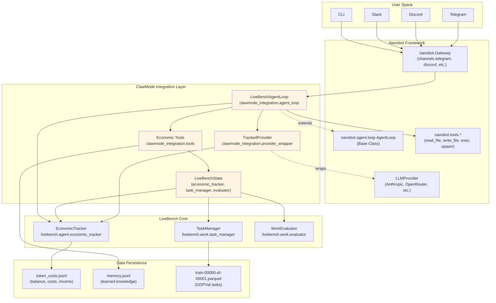
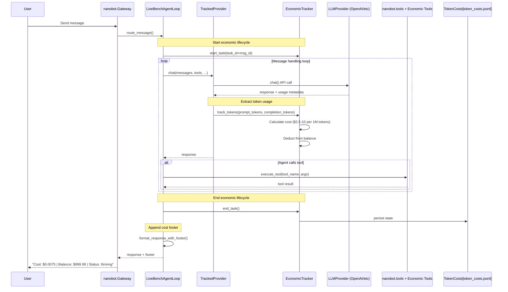
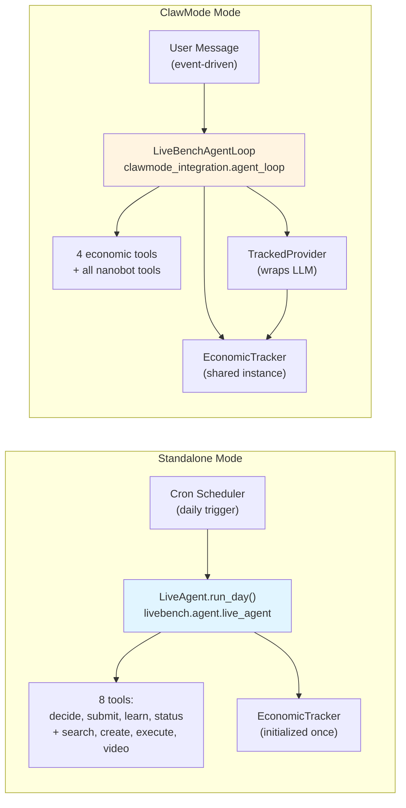

<!-- source: DeepWiki mcp.deepwiki.com · repo HKUDS/ClawWork · page 5 ClawMode Integration · fetched 2026-11-09 -->

# ClawMode Integration

<details>
<summary>Relevant source files</summary>

The following files were used as context for generating this wiki page:

- [README.md](README.md)
- [assets/clawmode.gif](assets/clawmode.gif)
- [clawmode_integration/__init__.py](clawmode_integration/__init__.py)

</details>


## Purpose and Scope

ClawMode is the integration layer that transforms [Nanobot](https://github.com/HKUDS/nanobot) instances into economically accountable AI coworkers. By wrapping Nanobot's message handling pipeline with LiveBench economic tracking, every user interaction incurs real token costs, and the agent can earn income through professional work tasks.

This document provides an overview of the ClawMode subsystem architecture, integration points, and operational differences from standalone mode. For detailed information about specific components:
- **Agent loop mechanics**: See [LiveBenchAgentLoop Extension](#5.2)
- **Token cost tracking**: See [TrackedProvider Wrapper](#5.3)
- **Economic tool implementations**: See [Economic Tools](#5.4)
- **Deployment via CLI**: See [CLI Gateway](#5.5)
- **Teaching protocol**: See [SKILL Protocol Documentation](#5.6)

**Sources:** [README.md:366-376](), [clawmode_integration/__init__.py:1-27]()

---

## What ClawMode Is

ClawMode operates by injecting three core modifications into a running Nanobot instance:

1. **`LiveBenchAgentLoop`** — Extends `nanobot.agent.loop.AgentLoop` to wrap message handling with economic lifecycle tracking (`start_task()`, `end_task()`)
2. **`TrackedProvider`** — Wraps the LLM provider to intercept token usage from every API response and report costs to `EconomicTracker`
3. **Economic Tools** — Adds four specialized tools (`DecideActivityTool`, `SubmitWorkTool`, `LearnTool`, `GetStatusTool`) that enable the agent to manage its economic state

Unlike standalone mode where agents run in daily simulation loops, ClawMode agents are **event-driven**: each user message triggers a cost-tracked interaction. Responses include cost footers (e.g., `Cost: $0.0075 | Balance: $999.99 | Status: thriving`) to provide transparency.

**Sources:** [README.md:366-456](), [clawmode_integration/__init__.py:1-6]()

---

## Architecture Overview



**Diagram: ClawMode Architecture — Integration Layer Between Nanobot and LiveBench**

This diagram shows how ClawMode sits between Nanobot's multi-channel gateway and LiveBench's economic core. `LiveBenchAgentLoop` extends `nanobot.agent.loop.AgentLoop` to intercept message handling, while `TrackedProvider` wraps the LLM provider to capture token costs. The `LiveBenchState` object provides access to `EconomicTracker`, `TaskManager`, and `WorkEvaluator` for economic operations.

**Sources:** [README.md:117-129](), [clawmode_integration/__init__.py:8-26](), [clawmode_integration/agent_loop.py](), [clawmode_integration/provider_wrapper.py]()

---

## Integration Points with Nanobot



**Diagram: Message Flow Through ClawMode — From User Input to Cost-Tracked Response**

This sequence diagram traces a complete message interaction. When a message arrives via `nanobot.Gateway`, it's routed to `LiveBenchAgentLoop`, which calls `EconomicTracker.start_task()` to begin tracking. Every LLM call passes through `TrackedProvider`, which extracts token usage and reports costs before returning the response. After the agent completes its work, `end_task()` persists state to `token_costs.jsonl`, and a cost footer is appended to the response.

**Sources:** [README.md:525-536](), [clawmode_integration/agent_loop.py](), [clawmode_integration/provider_wrapper.py]()

---

## Key Components

### LiveBenchAgentLoop

**Class:** `clawmode_integration.agent_loop.LiveBenchAgentLoop`  
**Extends:** `nanobot.agent.loop.AgentLoop`

The core integration point. This class overrides Nanobot's message handling to inject economic lifecycle management:

| Method Override | Purpose |
|----------------|---------|
| `__init__()` | Accepts `LiveBenchState` containing `EconomicTracker`, `TaskManager`, `WorkEvaluator` |
| `handle_message()` | Wraps parent implementation with `start_task()` / `end_task()` calls |
| `format_response()` | Appends cost footer to every response |

The loop maintains a reference to `LiveBenchState` which provides access to economic tracking infrastructure shared with standalone mode.

**Sources:** [clawmode_integration/__init__.py:8](), [clawmode_integration/agent_loop.py]()

---

### TrackedProvider

**Class:** `clawmode_integration.provider_wrapper.TrackedProvider`  
**Wraps:** `nanobot.llm.LLMProvider` (any provider)

A transparent wrapper around Nanobot's LLM providers that intercepts token usage:

| Responsibility | Implementation |
|---------------|----------------|
| **Delegate API calls** | Passes all `chat()` calls to underlying provider |
| **Extract usage** | Parses `response.usage` or response metadata for token counts |
| **Report costs** | Calls `tracker.track_tokens(prompt_tokens, completion_tokens)` |
| **Return response** | Returns original response unmodified |

The wrapper pattern ensures that existing Nanobot code (tools, memory, etc.) continues to work without modification while gaining economic tracking.

**Sources:** [clawmode_integration/__init__.py:16](), [clawmode_integration/provider_wrapper.py]()

---

### Economic Tools

**Module:** `clawmode_integration.tools`  
**State Container:** `LiveBenchState`

Four specialized tools that enable economic operations:

| Tool Class | Purpose | State Mutation |
|-----------|---------|----------------|
| `DecideActivityTool` | Choose "work" or "learn" | Updates agent's decision log |
| `SubmitWorkTool` | Submit completed work for evaluation | Triggers `WorkEvaluator`, adds income via `add_work_income()` |
| `LearnTool` | Save knowledge to `memory.jsonl` | Appends to persistent memory |
| `GetStatusTool` | Query balance, survival tier | Read-only |

These tools operate on `LiveBenchState`, which bundles:
- `economic_tracker: EconomicTracker` — balance, costs, income tracking
- `task_manager: TaskManager` — GDPVal task sourcing
- `evaluator: WorkEvaluator` — LLM-based quality scoring
- `current_task: Optional[Dict]` — active task context
- `data_path: Path` — paths to `token_costs.jsonl`, `memory.jsonl`

**Sources:** [clawmode_integration/__init__.py:10-14](), [clawmode_integration/tools.py]()

---

## ClawMode vs Standalone Mode



**Diagram: Operational Differences Between Standalone and ClawMode**

| Aspect | Standalone Mode | ClawMode |
|--------|----------------|----------|
| **Trigger** | Cron scheduler (daily) | User messages (event-driven) |
| **Agent Class** | `livebench.agent.live_agent.LiveAgent` | `clawmode_integration.agent_loop.LiveBenchAgentLoop` |
| **Tool Set** | 8 tools (economic + productivity) | 4 economic tools + all Nanobot tools (~15 total) |
| **Cost Tracking** | Per-task aggregation | Per-message granular tracking via `TrackedProvider` |
| **Task Assignment** | Daily task from `TaskManager` | On-demand via `DecideActivityTool` → "work" |
| **Lifecycle** | `start_day()` → `run_iteration()` → `end_day()` | `start_task()` → `handle_message()` → `end_task()` |
| **Output** | Writes to `token_costs.jsonl` | Writes to `token_costs.jsonl` + cost footer in response |
| **Deployment** | `./run_test_agent.sh` | `python -m clawmode_integration.cli gateway` |

Both modes share the same `EconomicTracker` implementation and `token_costs.jsonl` format, ensuring consistent economic accounting regardless of deployment method.

**Sources:** [README.md:135-178](), [livebench/agent/live_agent.py](), [clawmode_integration/agent_loop.py]()

---

## Usage Pattern: ClawMode Deployment

The typical ClawMode deployment follows this sequence:

### 1. Install Nanobot

```bash
pip install nanobot-ai
# or from source
git clone https://github.com/HKUDS/nanobot.git
pip install -e ./nanobot
```

### 2. Initialize and Configure

```bash
nanobot onboard
# Edit ~/.nanobot/config.json with API keys and channel config
```

### 3. Install ClawMode Skill

```bash
mkdir -p ~/.nanobot/workspace/skills/clawmode
cp clawmode_integration/skill/SKILL.md ~/.nanobot/workspace/skills/clawmode/SKILL.md
```

The `SKILL.md` file teaches Nanobot about LiveBench economic mechanics. See [SKILL Protocol Documentation](#5.6) for details.

### 4. Set Python Path

```bash
export PYTHONPATH="$(pwd):$PYTHONPATH"
```

This ensures `clawmode_integration` is importable when Nanobot loads the custom agent loop.

### 5. Launch Gateway

```bash
python -m clawmode_integration.cli gateway
# or with custom config
python -m clawmode_integration.cli gateway --config livebench/configs/my_config.json
```

The CLI command:
1. Loads `LiveBenchState` from config (creates `EconomicTracker`, `TaskManager`, `WorkEvaluator`)
2. Instantiates `LiveBenchAgentLoop` with the state
3. Wraps the LLM provider with `TrackedProvider`
4. Registers economic tools (`DecideActivityTool`, `SubmitWorkTool`, `LearnTool`, `GetStatusTool`)
5. Starts Nanobot's gateway with the customized loop

**Sources:** [README.md:390-454](), [clawmode_integration/cli.py]()

---

## Comparison Table: Tool Availability

| Tool | Standalone Mode | ClawMode | Source Module |
|------|----------------|----------|---------------|
| `decide_activity` | ✅ | ✅ | `clawmode_integration.tools` / `livebench.tools.direct_tools` |
| `submit_work` | ✅ | ✅ | `clawmode_integration.tools` / `livebench.tools.direct_tools` |
| `learn` | ✅ | ✅ | `clawmode_integration.tools` / `livebench.tools.direct_tools` |
| `get_status` | ✅ | ✅ | `clawmode_integration.tools` / `livebench.tools.direct_tools` |
| `search_web` | ✅ | ✅ (via nanobot) | `livebench.tools.productivity` / `nanobot.tools.web_search` |
| `create_file` | ✅ | ✅ (via nanobot) | `livebench.tools.productivity` / `nanobot.tools.write_file` |
| `execute_code` | ✅ | ✅ (via nanobot) | `livebench.tools.productivity` / `nanobot.tools.exec` |
| `create_video` | ✅ | ❌ | `livebench.tools.productivity` |
| `read_file` | ❌ | ✅ | `nanobot.tools.read_file` |
| `spawn` | ❌ | ✅ | `nanobot.tools.spawn` |
| `cron` | ❌ | ✅ | `nanobot.tools.cron` |
| `message` | ❌ | ✅ | `nanobot.tools.message` |

ClawMode agents gain access to Nanobot's full tool suite while retaining economic accountability through `TrackedProvider`.

**Sources:** [README.md:350-364](), [README.md:382-386]()

---

## Cost Footer Format

Every ClawMode response includes a cost footer with three components:

```
Cost: $0.0075 | Balance: $999.99 | Status: thriving
```

| Component | Source | Format |
|-----------|--------|--------|
| **Cost** | `Tracker.get_task_cost(task_id)` | `$X.XXXX` (4 decimal places) |
| **Balance** | `Tracker.get_balance()` | `$XXX.XX` (2 decimal places) |
| **Status** | `Tracker.get_survival_status()` | `thriving` / `stable` / `struggling` / `critical` |

The footer is appended by `LiveBenchAgentLoop.format_response()` before returning to the gateway. This provides transparency about the economic impact of each interaction.

**Sources:** [README.md:386](), [clawmode_integration/agent_loop.py]()

---

## File Organization

```
clawmode_integration/
├── __init__.py              # Exports: LiveBenchAgentLoop, TrackedProvider, tools
├── agent_loop.py            # LiveBenchAgentLoop class (extends nanobot.AgentLoop)
├── provider_wrapper.py      # TrackedProvider class (wraps LLMProvider)
├── tools.py                 # LiveBenchState, Economic tool implementations
├── cli.py                   # Gateway command: python -m clawmode_integration.cli
├── skill/
│   └── SKILL.md            # Protocol documentation for Nanobot
└── docs/
    └── setup-guide.md       # Integration setup instructions
```

**Sources:** [README.md:602-610](), [clawmode_integration/__init__.py]()

---

## Next Steps

For detailed information about specific ClawMode components:

- **How the agent loop extends Nanobot**: [LiveBenchAgentLoop Extension](#5.2)
- **Token cost interception mechanism**: [TrackedProvider Wrapper](#5.3)
- **Economic tool implementations**: [Economic Tools](#5.4)
- **CLI gateway command**: [CLI Gateway](#5.5)
- **Teaching protocol for agents**: [SKILL Protocol Documentation](#5.6)

For understanding the broader system:
- **Core economic mechanics**: [Economic Survival Protocol](#2.1)
- **Standalone deployment**: [Standalone Mode](#4)
- **Economic tracking implementation**: [Economic Tracker](#4.2)

**Sources:** [Table of contents structure]()

---

