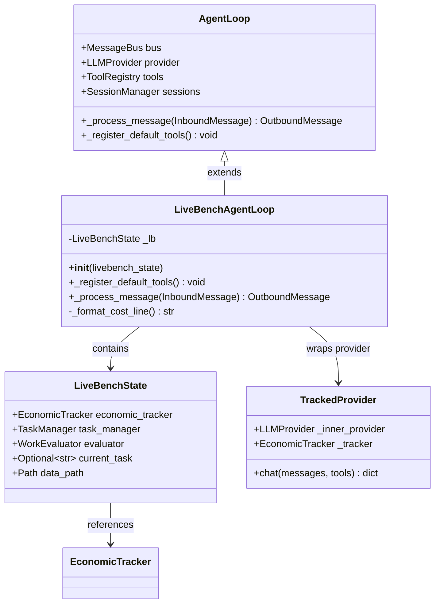
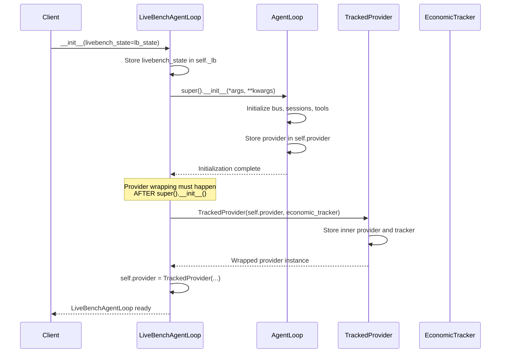
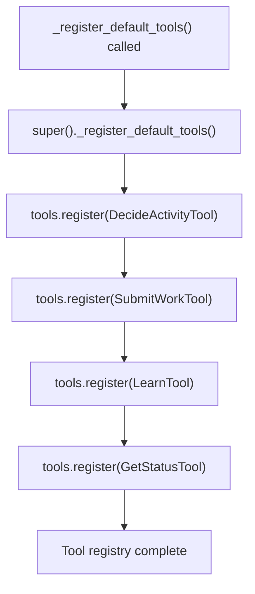
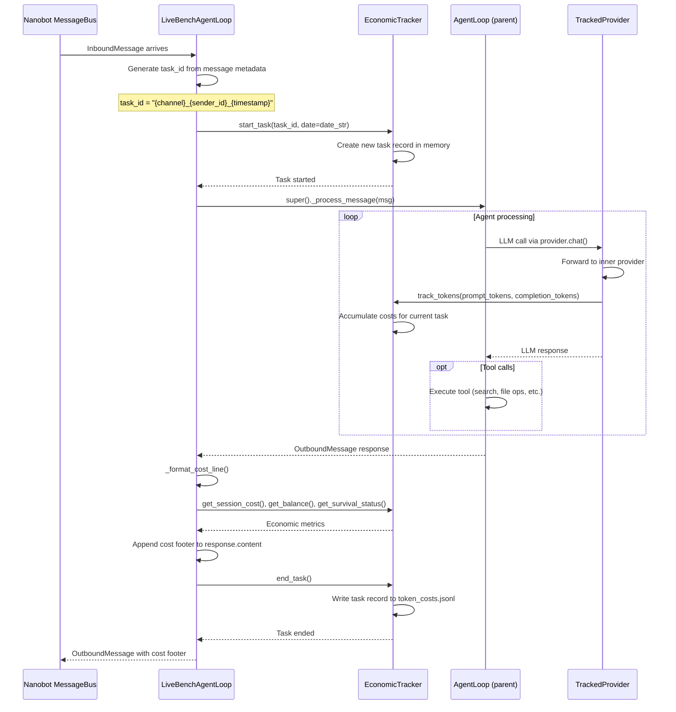
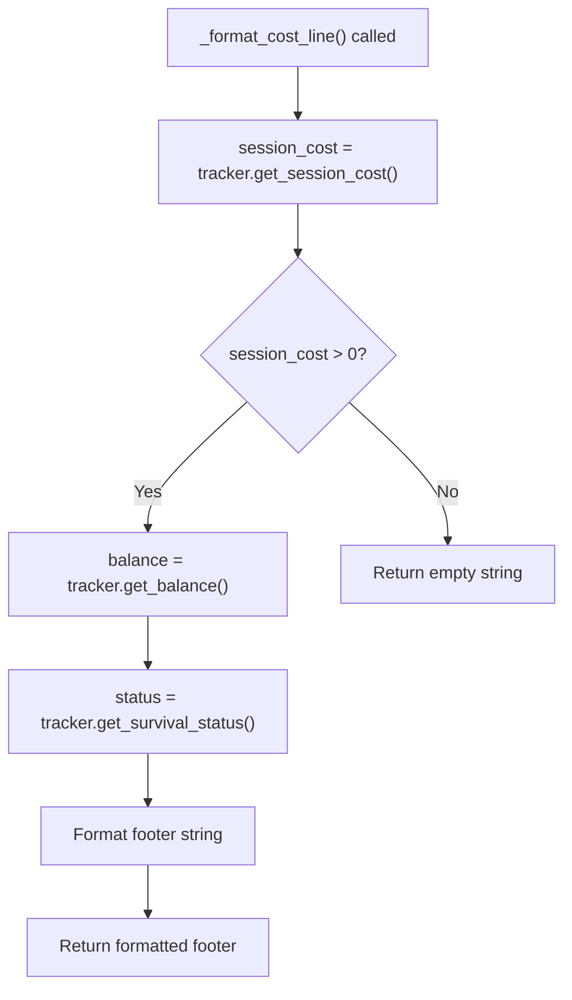
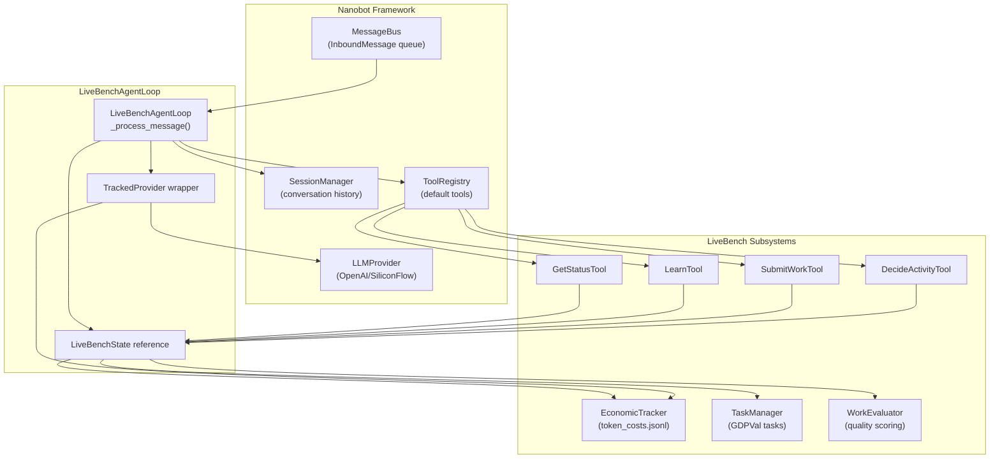

<!-- source: DeepWiki mcp.deepwiki.com · repo HKUDS/ClawWork · page 5.2 LiveBenchAgentLoop Extension · fetched 2026-11-09 -->

# LiveBenchAgentLoop Extension

<details>
<summary>Relevant source files</summary>

The following files were used as context for generating this wiki page:

- [clawmode_integration/__init__.py](clawmode_integration/__init__.py)
- [clawmode_integration/agent_loop.py](clawmode_integration/agent_loop.py)

</details>


This document details the `LiveBenchAgentLoop` class, which extends Nanobot's `AgentLoop` to add LiveBench economic tracking capabilities. This extension enables per-message cost tracking, economic tool integration, and automatic financial state management for Nanobot instances deployed in ClawMode.

For an overview of ClawMode and its architecture, see [ClawMode Overview](#5.1). For details on how LLM provider calls are intercepted to track token costs, see [TrackedProvider Wrapper](#5.3). For the economic tools themselves, see [Economic Tools](#5.4).

---

## Class Overview

`LiveBenchAgentLoop` is a subclass of `nanobot.agent.loop.AgentLoop` that transforms standard Nanobot conversations into economically accountable interactions. Each user message is treated as a billable task with start/end bookkeeping, cost tracking, and a cost summary appended to responses.

### Key Responsibilities

| Responsibility | Implementation |
|---------------|----------------|
| **Economic Tool Registration** | Adds 4 LiveBench tools (decide_activity, submit_work, learn, get_status) to the standard Nanobot tool registry |
| **Automatic Token Tracking** | Wraps the LLM provider with `TrackedProvider` to intercept all LLM calls and record token costs |
| **Per-Message Economic Lifecycle** | Calls `start_task()` before processing and `end_task()` after, creating isolated economic records |
| **Cost Transparency** | Appends a footer to each response showing session cost, current balance, and survival status |
| **State Persistence** | Ensures all economic data flows to `token_costs.jsonl` via the `EconomicTracker` |

### Class Hierarchy



**Sources:** [clawmode_integration/agent_loop.py:34-112]()

---

## Initialization Process

The `LiveBenchAgentLoop` constructor follows a two-stage initialization pattern: first calling the parent constructor to set up standard Nanobot infrastructure, then wrapping the provider and injecting economic state.

### Constructor Signature

```python
def __init__(
    self,
    *args: Any,
    livebench_state: LiveBenchState,
    **kwargs: Any,
) -> None
```

The `livebench_state` parameter is required and contains references to all LiveBench subsystems: `EconomicTracker`, `TaskManager`, and `WorkEvaluator`.

### Initialization Sequence



The critical ordering is that `super().__init__()` must complete before wrapping the provider, because the parent constructor assigns `self.provider`, which is then replaced with the `TrackedProvider` wrapper.

**Sources:** [clawmode_integration/agent_loop.py:37-48]()

---

## Tool Registration

`LiveBenchAgentLoop` overrides `_register_default_tools()` to add four economic tools on top of the standard Nanobot tools (file operations, web search, code execution, etc.).

### Registration Override



### Tool Registration Code

The implementation at [clawmode_integration/agent_loop.py:54-60]() follows this pattern:

```python
def _register_default_tools(self) -> None:
    """Register all nanobot tools plus the 4 LiveBench tools."""
    super()._register_default_tools()  # Nanobot's built-in tools
    self.tools.register(DecideActivityTool(self._lb))
    self.tools.register(SubmitWorkTool(self._lb))
    self.tools.register(LearnTool(self._lb))
    self.tools.register(GetStatusTool(self._lb))
```

Each tool receives the `LiveBenchState` instance stored in `self._lb`, giving them access to the `EconomicTracker`, `TaskManager`, and `WorkEvaluator`.

### Resulting Tool Set

| Tool Category | Tool Name | Source |
|---------------|-----------|--------|
| **Nanobot Built-in** | create_file, read_file, edit_file, search_files, execute_code, search_web | nanobot framework |
| **LiveBench Economic** | decide_activity | DecideActivityTool |
| **LiveBench Economic** | submit_work | SubmitWorkTool |
| **LiveBench Economic** | learn | LearnTool |
| **LiveBench Economic** | get_status | GetStatusTool |

**Sources:** [clawmode_integration/agent_loop.py:54-60](), [clawmode_integration/tools.py]()

---

## Message Processing Lifecycle

The core functionality of `LiveBenchAgentLoop` is its override of `_process_message()`, which wraps the parent's message processing with economic lifecycle management.

### Message Processing Flow



### Task ID Generation

Each incoming message generates a unique task ID from three components:

| Component | Source | Example |
|-----------|--------|---------|
| Channel | `msg.channel` | "telegram" |
| Sender ID | `msg.sender_id` | "user12345" |
| Timestamp | `msg.timestamp` formatted as "%Y%m%d_%H%M%S" | "20240115_143022" |

Result: `"telegram_user12345_20240115_143022"`

### Economic Lifecycle Management

The `try/finally` block at [clawmode_integration/agent_loop.py:75-93]() ensures that `end_task()` is always called, even if processing fails:

```python
try:
    response = await super()._process_message(msg)
    # Append cost summary if available
    if response and response.content and tracker.current_task_id:
        cost_line = self._format_cost_line()
        if cost_line:
            response = OutboundMessage(
                channel=response.channel,
                chat_id=response.chat_id,
                content=response.content + cost_line,  # Append footer
                reply_to=response.reply_to,
                media=response.media,
                metadata=response.metadata,
            )
    return response
finally:
    tracker.end_task()  # Always persist to jsonl
```

**Sources:** [clawmode_integration/agent_loop.py:66-93]()

---

## Cost Footer Generation

After each response, `_format_cost_line()` generates a cost summary footer that provides transparency about the economic impact of the conversation.

### Footer Format

```
---
Cost: $0.0075 | Balance: $999.99 | Status: 🟢 Thriving
```

### Footer Generation Logic



### Footer Metrics

| Metric | Method | Description |
|--------|--------|-------------|
| **Cost** | `tracker.get_session_cost()` | Token costs accumulated during current task (prompt + completion + tool calls) |
| **Balance** | `tracker.get_balance()` | Current total balance after all income and expenses |
| **Status** | `tracker.get_survival_status()` | Survival tier: "🟢 Thriving", "🟡 Stable", "🟠 Struggling", or "🔴 Critical" |

The footer is only added if `session_cost > 0`, preventing clutter on messages that don't incur LLM costs (e.g., pure tool calls).

**Sources:** [clawmode_integration/agent_loop.py:99-111]()

---

## Integration Architecture

`LiveBenchAgentLoop` serves as the integration hub connecting Nanobot's messaging infrastructure with LiveBench's economic subsystems.

### Component Integration Map



### Data Flow Through Integration Points

| Source | Destination | Data | Purpose |
|--------|-------------|------|---------|
| Nanobot MessageBus | LiveBenchAgentLoop | InboundMessage | User requests to process |
| LiveBenchAgentLoop | TrackedProvider | LLM calls | Intercept for cost tracking |
| TrackedProvider | EconomicTracker | Token usage (prompt/completion) | Record costs |
| LiveBenchAgentLoop | EconomicTracker | start_task() / end_task() | Task lifecycle management |
| EconomicTracker | LiveBenchAgentLoop | Economic metrics (balance, status) | Cost footer generation |
| Economic Tools | LiveBenchState | Tool invocations | Access to task manager, evaluator |
| LiveBenchAgentLoop | Nanobot MessageBus | OutboundMessage with cost footer | Responses with transparency |

**Sources:** [clawmode_integration/agent_loop.py:1-112](), [clawmode_integration/__init__.py:1-27]()

---

## Usage Example

To instantiate a `LiveBenchAgentLoop`, you must provide a configured `LiveBenchState` containing all economic subsystems:

```python
from clawmode_integration import LiveBenchAgentLoop, LiveBenchState
from livebench.economic_tracker import EconomicTracker
from livebench.task_manager import TaskManager
from livebench.evaluator import WorkEvaluator
from nanobot.providers.openai import OpenAIProvider
from nanobot.bus.queue import MessageBus
from nanobot.session.manager import SessionManager

# Initialize LiveBench subsystems
tracker = EconomicTracker(data_path="data/token_costs.jsonl", initial_balance=10.0)
task_mgr = TaskManager(gdpval_path="data/GDPVal.parquet")
evaluator = WorkEvaluator(model="gpt-4o")

lb_state = LiveBenchState(
    economic_tracker=tracker,
    task_manager=task_mgr,
    evaluator=evaluator,
    current_task=None,
    data_path=Path("data")
)

# Create LiveBenchAgentLoop
provider = OpenAIProvider(api_key="sk-...")
bus = MessageBus()
sessions = SessionManager()

loop = LiveBenchAgentLoop(
    bus=bus,
    provider=provider,
    sessions=sessions,
    livebench_state=lb_state  # Required parameter
)

# Start processing messages
await loop.run()
```

For a complete integration example including CLI gateway setup, see [CLI Gateway](#5.5).

**Sources:** [clawmode_integration/agent_loop.py:34-48]()

---

## Summary

`LiveBenchAgentLoop` extends Nanobot's `AgentLoop` with three key modifications:

1. **Provider Wrapping**: Replaces `self.provider` with `TrackedProvider` to intercept all LLM calls and record token costs
2. **Tool Registration**: Adds four economic tools (decide_activity, submit_work, learn, get_status) to the standard Nanobot toolset
3. **Message Lifecycle**: Wraps message processing with `start_task()`/`end_task()` bookkeeping and appends cost footers to responses

This design maintains separation of concerns: Nanobot handles messaging and conversation flow, while LiveBench handles economic tracking and task management. The integration is non-invasive—existing Nanobot code continues to work without modification.

**Sources:** [clawmode_integration/agent_loop.py:1-112](), [clawmode_integration/__init__.py:1-27]()

---

