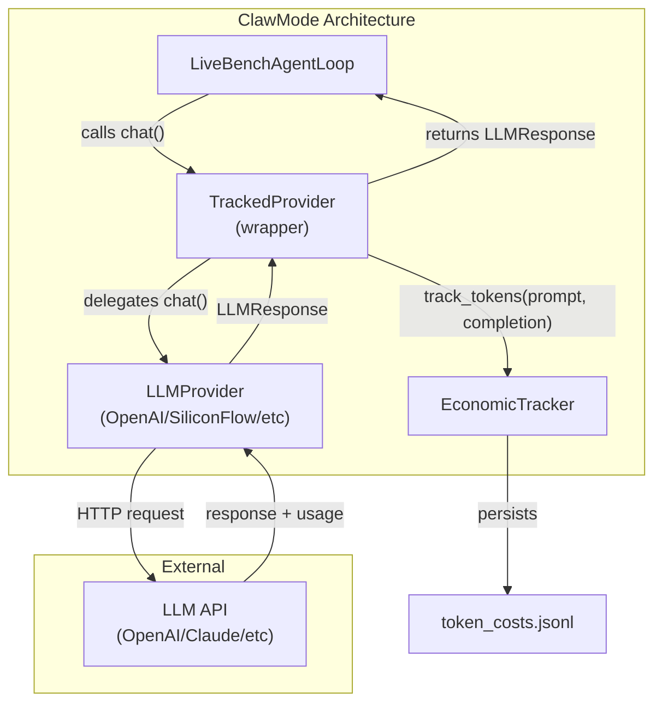
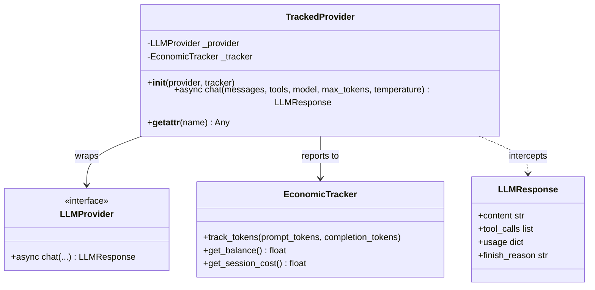
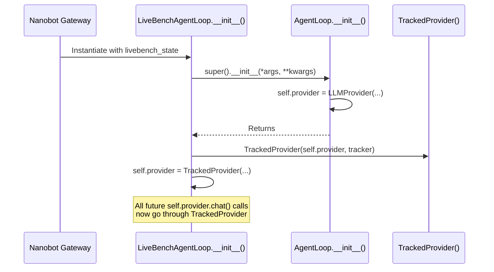
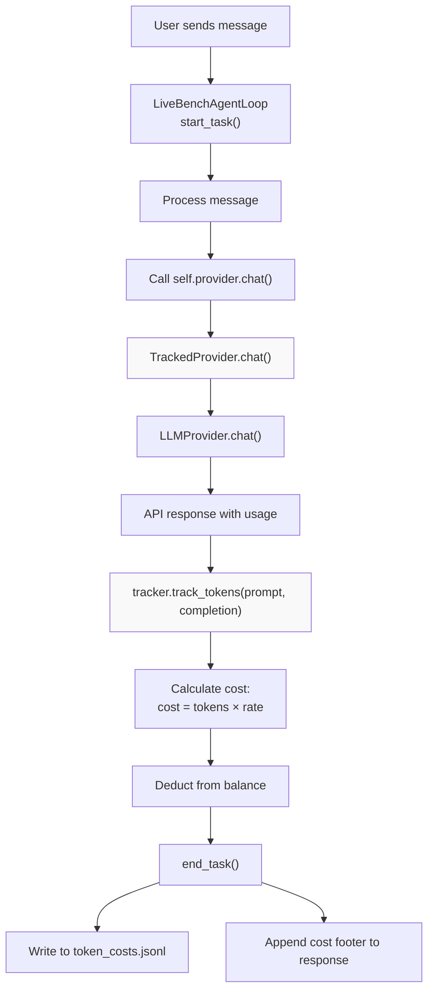

<!-- source: DeepWiki mcp.deepwiki.com · repo HKUDS/ClawWork · page 5.3 TrackedProvider Wrapper · fetched 2026-11-09 -->

# TrackedProvider Wrapper

<details>
<summary>Relevant source files</summary>

The following files were used as context for generating this wiki page:

- [clawmode_integration/agent_loop.py](clawmode_integration/agent_loop.py)
- [clawmode_integration/provider_wrapper.py](clawmode_integration/provider_wrapper.py)

</details>


## Purpose and Scope

`TrackedProvider` is a transparent wrapper class that intercepts all LLM API calls in ClawMode to extract token usage and report costs to the `EconomicTracker` in real-time. This component enables per-message economic accountability by ensuring every model invocation—whether for reasoning, tool calling, or response generation—has its token costs immediately tracked and deducted from the agent's balance.

For information about how `TrackedProvider` is integrated into the agent loop, see [LiveBenchAgentLoop Extension](#5.2). For details on how the tracked costs are persisted and used for economic calculations, see [Economic Tracker](#4.2).

**Sources:** [clawmode_integration/provider_wrapper.py:1-52]()

---

## Architecture Overview

### Wrapper Pattern Implementation

`TrackedProvider` implements the wrapper/decorator pattern to add cost tracking behavior to any nanobot `LLMProvider` without modifying its core functionality. The wrapper maintains a reference to both the underlying provider and the `EconomicTracker`, delegating all LLM operations to the provider while intercepting responses to extract token usage.



**Diagram 1: TrackedProvider in the request/response pipeline**

**Sources:** [clawmode_integration/provider_wrapper.py:17-52](), [clawmode_integration/agent_loop.py:46-48]()

---

## Class Structure

### TrackedProvider Definition

| Component | Type | Purpose |
|-----------|------|---------|
| `_provider` | `LLMProvider` | The underlying nanobot provider being wrapped |
| `_tracker` | `EconomicTracker` | Reference to the economic tracking system |
| `chat()` | async method | Intercepts LLM calls to extract and track token usage |
| `__getattr__()` | method | Delegates all other attributes/methods to `_provider` |



**Diagram 2: TrackedProvider class relationships**

**Sources:** [clawmode_integration/provider_wrapper.py:17-52]()

---

## Token Tracking Mechanism

### Intercepting Token Usage

The core functionality of `TrackedProvider` occurs in its `chat()` method, which wraps the underlying provider's `chat()` call. The wrapper leverages nanobot's `LLMResponse.usage` dictionary, which contains accurate token counts extracted from the LLM provider's API response via litellm.

```mermaid
sequenceDiagram
    participant Loop as LiveBenchAgentLoop
    participant Tracked as TrackedProvider
    participant Real as LLMProvider
    participant API as LLM API
    participant Tracker as EconomicTracker
    
    Loop->>Tracked: chat(messages, tools, model, ...)
    Tracked->>Real: chat(messages, tools, model, ...)
    Real->>API: HTTP POST /v1/chat/completions
    API-->>Real: {"choices": [...], "usage": {"prompt_tokens": 150, "completion_tokens": 75}}
    Real-->>Tracked: LLMResponse(usage={"prompt_tokens": 150, "completion_tokens": 75})
    
    alt usage dict present
        Tracked->>Tracker: track_tokens(150, 75)
        Tracker->>Tracker: calculate_cost(150, 75)
        Tracker->>Tracker: deduct from balance
    end
    
    Tracked-->>Loop: LLMResponse
```

**Diagram 3: Token tracking sequence during an LLM call**

**Sources:** [clawmode_integration/provider_wrapper.py:24-47]()

### Implementation Details

#### Constructor

The `TrackedProvider.__init__()` method [clawmode_integration/provider_wrapper.py:20-22]() accepts two arguments:

- `provider: LLMProvider` — The nanobot provider to wrap
- `tracker: Any` — An `EconomicTracker` instance (typed as `Any` to avoid circular imports)

#### Chat Method

The `chat()` method [clawmode_integration/provider_wrapper.py:24-47]() implements the interception logic:

1. **Delegate to real provider**: Calls `self._provider.chat()` with all parameters passed through unchanged
2. **Extract usage data**: Accesses `response.usage` dictionary from the returned `LLMResponse`
3. **Report to tracker**: If usage data exists, calls `self._tracker.track_tokens()` with `prompt_tokens` and `completion_tokens`
4. **Return response**: Returns the unmodified `LLMResponse` to the caller

The usage dictionary structure follows OpenAI's API format:

```python
{
    "prompt_tokens": 150,      # Tokens in input messages
    "completion_tokens": 75,   # Tokens in model's response
    "total_tokens": 225        # Sum (not used by tracker)
}
```

**Sources:** [clawmode_integration/provider_wrapper.py:24-47]()

---

## Transparent Delegation

### Attribute Forwarding

The `__getattr__()` method [clawmode_integration/provider_wrapper.py:50-51]() ensures that `TrackedProvider` behaves identically to the underlying provider for all attributes and methods not explicitly overridden. This allows the wrapper to support:

- Provider-specific configuration attributes
- Additional methods beyond `chat()` (e.g., `stream()`, if implemented)
- Model capabilities queries
- Authentication state

```python
# Example: These all delegate to the underlying provider
tracked_provider.model           # Forwards to _provider.model
tracked_provider.api_key         # Forwards to _provider.api_key
tracked_provider.some_method()   # Forwards to _provider.some_method()
```

This delegation pattern ensures that `TrackedProvider` can wrap any `LLMProvider` implementation without needing to know its specific interface beyond the `chat()` method.

**Sources:** [clawmode_integration/provider_wrapper.py:49-51]()

---

## Integration with LiveBenchAgentLoop

### Provider Wrapping

`TrackedProvider` is instantiated in `LiveBenchAgentLoop.__init__()` immediately after the parent class constructor completes. This ensures that all subsequent LLM calls in the agent's lifecycle are automatically tracked.



**Diagram 4: Provider wrapping during initialization**

The wrapping occurs at [clawmode_integration/agent_loop.py:46-48]():

```python
# Wrap the provider for automatic token cost tracking.
# Must happen *after* super().__init__() which stores self.provider.
self.provider = TrackedProvider(self.provider, self._lb.economic_tracker)
```

This timing is critical: the parent `AgentLoop` constructor sets `self.provider` to the configured `LLMProvider`, and then `LiveBenchAgentLoop` immediately replaces it with the wrapped version. From this point forward, all calls to `self.provider.chat()` throughout the agent's execution automatically track costs.

**Sources:** [clawmode_integration/agent_loop.py:37-48]()

---

## Advantages Over Original Estimation

### Accurate Token Counting

The original LiveBench implementation used a simple estimation formula: `len(text) // 4` to approximate token counts from string lengths. `TrackedProvider` leverages nanobot's integration with litellm, which extracts actual token counts directly from each provider's API response.

| Method | Accuracy | Source |
|--------|----------|--------|
| Original LiveBench | ~25% error | Character count heuristic |
| TrackedProvider | Exact | API response `usage` field |

This improvement is particularly important for:

- **Cost accuracy**: Real token costs match actual API charges
- **Economic simulation fidelity**: Agents face precise financial constraints
- **Multi-provider support**: Works correctly across providers with different tokenization schemes (GPT, Claude, Llama, etc.)

**Sources:** [clawmode_integration/provider_wrapper.py:1-8]()

---

## Cost Tracking Flow

### End-to-End Token Cost Tracking

The complete flow from user message to persisted cost record involves `TrackedProvider` as the critical interception point:



**Diagram 5: Complete token cost tracking flow**

**Sources:** [clawmode_integration/agent_loop.py:66-93](), [clawmode_integration/provider_wrapper.py:24-47]()

---

## Error Handling and Edge Cases

### Missing Usage Data

`TrackedProvider` safely handles cases where the LLM response lacks usage data:

```python
if response.usage and self._tracker:
    self._tracker.track_tokens(
        response.usage.get("prompt_tokens", 0),
        response.usage.get("completion_tokens", 0),
    )
```

This conditional ensures:
- No tracking occurs if `response.usage` is `None` or empty
- Missing individual fields default to 0 tokens via `.get()`
- No exceptions are raised for malformed responses

**Sources:** [clawmode_integration/provider_wrapper.py:41-45]()

### Multiple LLM Calls Per Message

When an agent makes multiple LLM calls during a single message processing (e.g., for tool calling loops), each call is independently tracked:

1. Initial reasoning call → tracked
2. Tool execution (if tool uses LLM) → tracked
3. Final response generation → tracked

All costs accumulate within the same task session, which is persisted when `end_task()` is called in the `finally` block of `_process_message()` [clawmode_integration/agent_loop.py:92-93]().

**Sources:** [clawmode_integration/agent_loop.py:66-93]()

---

## Thread Safety and Async Considerations

### Async-First Design

`TrackedProvider.chat()` is defined as an async method, matching nanobot's async provider interface. The token tracking call (`self._tracker.track_tokens()`) is synchronous, which is safe because:

- `EconomicTracker` operations are fast in-memory updates
- No async I/O occurs during tracking (persistence happens at `end_task()`)
- The agent loop processes messages sequentially

### State Consistency

`TrackedProvider` maintains no internal state—all economic state resides in `EconomicTracker`. This design ensures:

- No race conditions between concurrent calls
- No stale cached data
- Straightforward testing (no mocking of internal state)

**Sources:** [clawmode_integration/provider_wrapper.py:24-47]()

---

## Usage Example

### Typical Integration Pattern

```python
from nanobot.providers.base import LLMProvider
from clawmode_integration.provider_wrapper import TrackedProvider
from livebench.economic_tracker import EconomicTracker

# Setup
provider = LLMProvider(api_key="...", model="gpt-4o")
tracker = EconomicTracker(initial_balance=10.0, data_path="data/")

# Wrap
tracked_provider = TrackedProvider(provider, tracker)

# Use normally - costs are automatically tracked
response = await tracked_provider.chat(
    messages=[{"role": "user", "content": "Hello"}],
    model="gpt-4o"
)

# Cost has been deducted from tracker.balance
print(f"Balance: ${tracker.get_balance():.2f}")
print(f"Session cost: ${tracker.get_session_cost():.4f}")
```

**Sources:** [clawmode_integration/provider_wrapper.py:17-52]()

---

## Comparison with Nanobot's Native Provider

### Key Differences

| Aspect | Nanobot LLMProvider | TrackedProvider |
|--------|---------------------|-----------------|
| Purpose | General LLM access | Economic tracking |
| Response handling | Returns `LLMResponse` | Returns `LLMResponse` + tracks costs |
| Side effects | None | Updates `EconomicTracker` |
| Transparency | N/A | Full delegation via `__getattr__` |
| State | Provider configuration | Stateless (tracker is external) |

### Why Not Extend AgentLoop Directly?

Rather than overriding `AgentLoop.provider.chat()` or modifying the message processing logic, `TrackedProvider` uses composition to add tracking behavior. This design:

- **Preserves nanobot's interface**: `AgentLoop` sees a standard `LLMProvider`
- **Enables reusability**: `TrackedProvider` can wrap any provider, not just in `AgentLoop`
- **Simplifies testing**: Can test tracking logic independently
- **Avoids fragility**: No risk of breaking nanobot's internal logic

**Sources:** [clawmode_integration/agent_loop.py:46-48](), [clawmode_integration/provider_wrapper.py:17-52]()

---

## Related Components

### Upstream: LiveBenchAgentLoop

`LiveBenchAgentLoop` instantiates `TrackedProvider` during initialization and uses it for all LLM calls. See [LiveBenchAgentLoop Extension](#5.2) for details on message processing and task lifecycle management.

### Downstream: EconomicTracker

`EconomicTracker` receives `track_tokens()` calls from `TrackedProvider` and maintains the agent's economic state. See [Economic Tracker](#4.2) for details on balance management, cost calculation, and persistence.

### Sibling: Economic Tools

The economic tools (`DecideActivityTool`, `SubmitWorkTool`, etc.) also interact with `EconomicTracker` to record income and state changes. See [Economic Tools](#5.4) for their implementation.

**Sources:** [clawmode_integration/agent_loop.py:24-31]()

---

