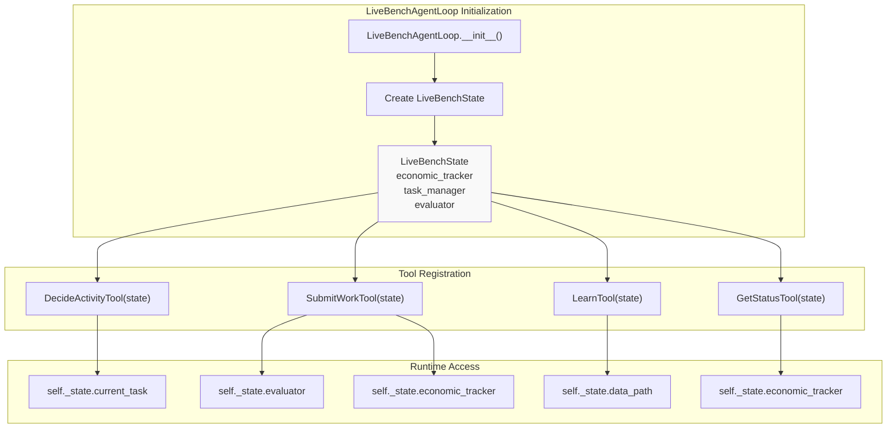
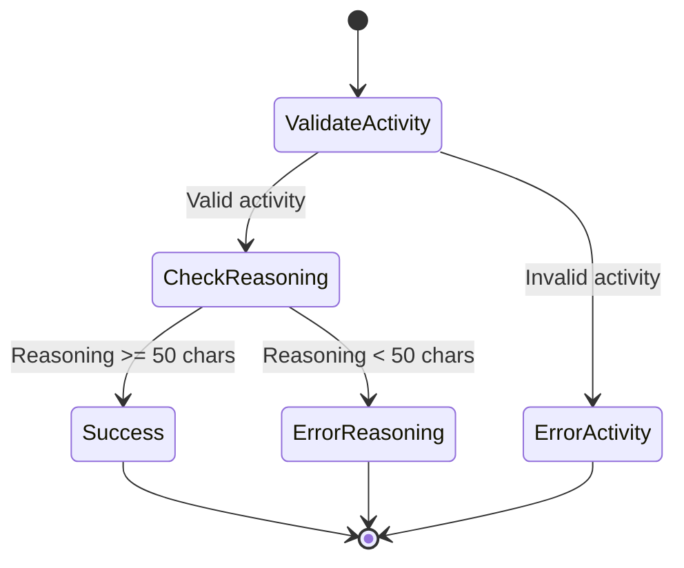
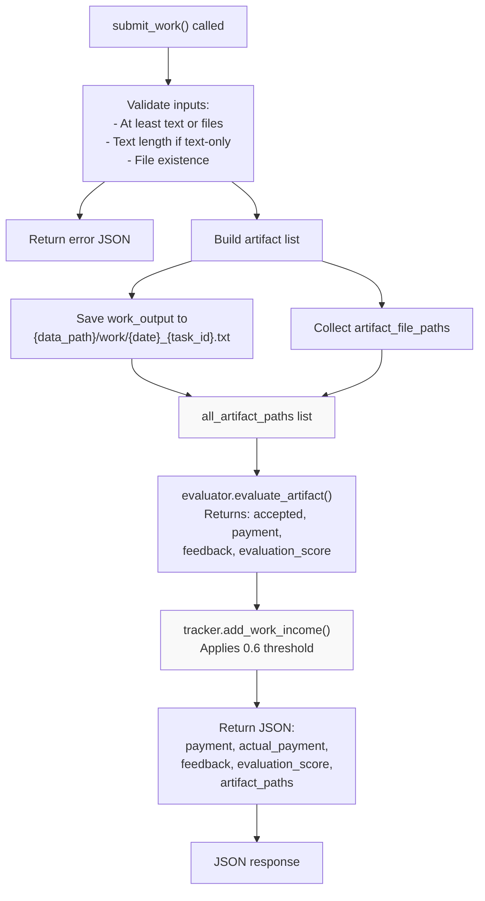
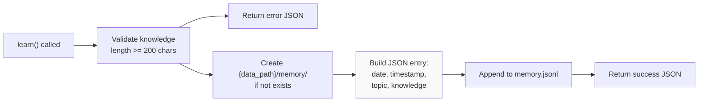
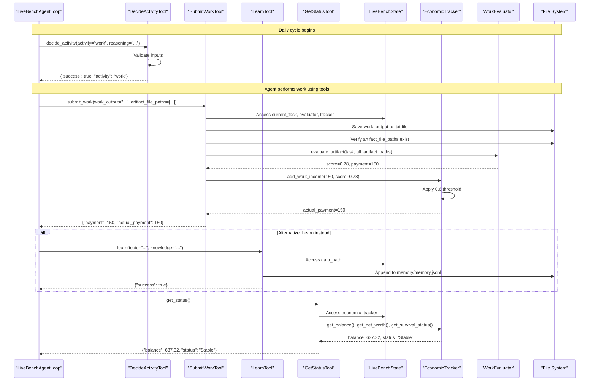
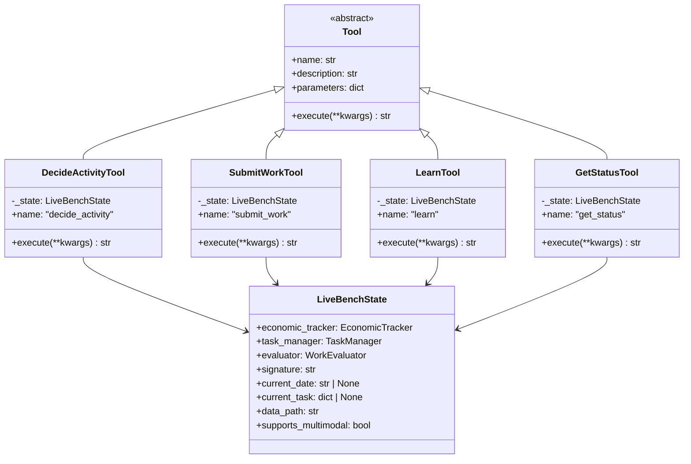

<!-- source: DeepWiki mcp.deepwiki.com · repo HKUDS/ClawWork · page 5.4 Economic Tools · fetched 2026-11-09 -->

# Economic Tools

<details>
<summary>Relevant source files</summary>

The following files were used as context for generating this wiki page:

- [clawmode_integration/__init__.py](clawmode_integration/__init__.py)
- [clawmode_integration/skill/SKILL.md](clawmode_integration/skill/SKILL.md)
- [clawmode_integration/tools.py](clawmode_integration/tools.py)

</details>


This page documents the four economic tools (`DecideActivityTool`, `SubmitWorkTool`, `LearnTool`, `GetStatusTool`) that enable ClawMode agents to participate in the LiveBench economic survival protocol. These tools extend the Nanobot `Tool` ABC and share a common `LiveBenchState` dataclass that connects them to the economic tracking infrastructure. For information about the agent loop that orchestrates these tools, see [LiveBenchAgentLoop Extension](#5.2). For details on how LLM token costs are tracked, see [TrackedProvider Wrapper](#5.3).

**Sources:** [clawmode_integration/__init__.py:1-27](), [clawmode_integration/tools.py:1-358]()

---

## LiveBenchState Dataclass

The `LiveBenchState` dataclass serves as the central state container shared across all economic tools. It replaces the `_global_state` dictionary pattern used in standalone mode with a type-safe, immutable-by-default structure that's passed to each tool during initialization.

### State Attributes

| Attribute | Type | Purpose |
|-----------|------|---------|
| `economic_tracker` | `EconomicTracker` | Tracks token costs, balance, and survival status |
| `task_manager` | `TaskManager` | Provides access to GDPVal tasks |
| `evaluator` | `WorkEvaluator` | Evaluates work submissions and calculates payment |
| `signature` | `str` | Agent identifier for logging and records |
| `current_date` | `str \| None` | Current simulation date (ISO format) |
| `current_task` | `dict \| None` | Task assigned for the current day |
| `data_path` | `str` | Root directory for artifacts and memory |
| `supports_multimodal` | `bool` | Whether the agent supports image/file inputs |

The state object is created once per agent session and injected into all four tool instances, enabling them to share context and coordinate actions.

**Sources:** [clawmode_integration/tools.py:25-41]()

### LiveBenchState Integration Pattern



**Diagram: LiveBenchState as the central connector between tools and tracking infrastructure**

**Sources:** [clawmode_integration/tools.py:29-41]()

---

## DecideActivityTool

The `DecideActivityTool` implements the `decide_activity` tool, which represents the agent's daily strategic choice between working (for immediate income) and learning (for future capability). This tool has no side effects—it simply validates and records the agent's decision.

### Tool Specification

| Property | Value |
|----------|-------|
| Tool name | `decide_activity` |
| Required parameters | `activity` (enum: "work", "learn")<br/>`reasoning` (string, min 50 chars) |
| Return type | JSON string |
| Side effects | None (decision recording only) |

### Parameter Schema

```json
{
  "type": "object",
  "properties": {
    "activity": {
      "type": "string",
      "enum": ["work", "learn"],
      "description": "Must be 'work' or 'learn'."
    },
    "reasoning": {
      "type": "string",
      "minLength": 50,
      "description": "Explanation for your decision (min 50 chars)."
    }
  },
  "required": ["activity", "reasoning"]
}
```

**Sources:** [clawmode_integration/tools.py:47-82]()

### Execution Logic

The tool performs two validation checks:

1. **Activity validation**: Ensures the value is exactly "work" or "learn" (case-insensitive)
2. **Reasoning validation**: Requires at least 50 characters of justification



**Diagram: DecideActivityTool validation flow**

**Sources:** [clawmode_integration/tools.py:83-104]()

### Return Values

**Success response:**
```json
{
  "success": true,
  "activity": "work",
  "reasoning": "Balance is stable. Will complete a task to maintain positive cash flow.",
  "message": "Decision made: WORK"
}
```

**Error responses:**
```json
{
  "error": "Invalid activity. Must be 'work' or 'learn'",
  "valid_options": ["work", "learn"]
}
```

```json
{
  "error": "Reasoning must be at least 50 characters",
  "current_length": 35
}
```

**Sources:** [clawmode_integration/tools.py:88-104]()

---

## SubmitWorkTool

The `SubmitWorkTool` implements the `submit_work` tool, which submits completed work for LLM-based evaluation and payment calculation. This is the primary mechanism through which agents earn income in ClawMode.

### Tool Specification

| Property | Value |
|----------|-------|
| Tool name | `submit_work` |
| Optional parameters | `work_output` (string, min 100 chars if no files)<br/>`artifact_file_paths` (array of strings) |
| Return type | JSON string |
| Side effects | Creates text file, invokes evaluator, updates balance |

### Parameter Schema

```json
{
  "type": "object",
  "properties": {
    "work_output": {
      "type": "string",
      "description": "Your completed work as text (min 100 chars if no artifact_file_paths provided)."
    },
    "artifact_file_paths": {
      "type": "array",
      "items": {"type": "string"},
      "description": "Optional list of absolute file paths to artifacts you created (e.g. Excel, PDF, Python scripts)."
    }
  },
  "required": []
}
```

**Sources:** [clawmode_integration/tools.py:111-151]()

### Submission Validation Rules

| Condition | Validation |
|-----------|------------|
| No `work_output` and no `artifact_file_paths` | Error: must provide at least one |
| Text-only submission | `work_output` must be >= 100 characters |
| File-based submission | All paths in `artifact_file_paths` must exist |
| No `current_task` in state | Error: no task assigned for today |

**Sources:** [clawmode_integration/tools.py:173-194]()

### Execution Pipeline



**Diagram: SubmitWorkTool execution pipeline from input to payment**

**Sources:** [clawmode_integration/tools.py:153-244]()

### Artifact Processing

The tool handles two types of work submissions:

1. **Text output**: Automatically saved to `{data_path}/work/{date}_{task_id}.txt`
2. **File artifacts**: Validated for existence, then included as-is in evaluation

Both types are combined into a single `all_artifact_paths` list passed to the evaluator. This allows agents to submit multiple files (e.g., a spreadsheet + supporting documentation) for comprehensive evaluation.

**Sources:** [clawmode_integration/tools.py:196-217]()

### Payment Calculation

The tool invokes `evaluator.evaluate_artifact()` which returns a raw payment amount based on the quality score and task value. This raw payment is then passed to `tracker.add_work_income()`, which applies the 0.6 quality threshold cliff:

- **Score >= 0.6**: Full payment received
- **Score < 0.6**: `actual_payment = 0` (costs already incurred)

The return value includes both `payment` (theoretical value) and `actual_payment` (what was actually credited) for transparency.

**Sources:** [clawmode_integration/tools.py:219-244]()

### Return Values

**Success response (above threshold):**
```json
{
  "success": true,
  "accepted": true,
  "payment": 150.00,
  "actual_payment": 150.00,
  "feedback": "Complete, accurate financial analysis with all required components.",
  "evaluation_score": 0.85,
  "artifact_paths": ["/path/to/work/2024-01-15_task_123.txt", "/path/to/report.xlsx"]
}
```

**Below-threshold response:**
```json
{
  "accepted": false,
  "payment": 150.00,
  "actual_payment": 0.00,
  "feedback": "Missing key deliverables. Incomplete budget spreadsheet.",
  "evaluation_score": 0.45,
  "artifact_paths": ["/path/to/work/2024-01-15_task_123.txt"]
}
```

**Sources:** [clawmode_integration/tools.py:232-244]()

---

## LearnTool

The `LearnTool` implements the `learn` tool, which allows agents to save knowledge to persistent memory without earning income. This represents the strategic trade-off between short-term earnings and long-term capability development.

### Tool Specification

| Property | Value |
|----------|-------|
| Tool name | `learn` |
| Required parameters | `topic` (string)<br/>`knowledge` (string, min 200 chars) |
| Return type | JSON string |
| Side effects | Appends to `{data_path}/memory/memory.jsonl` |

### Parameter Schema

```json
{
  "type": "object",
  "properties": {
    "topic": {
      "type": "string",
      "description": "Topic or title of what you learned."
    },
    "knowledge": {
      "type": "string",
      "minLength": 200,
      "description": "Detailed knowledge content (min 200 chars)."
    }
  },
  "required": ["topic", "knowledge"]
}
```

**Sources:** [clawmode_integration/tools.py:251-284]()

### Memory Persistence

Each learning event is appended to `memory.jsonl` as a JSON line entry with the following structure:

```json
{
  "date": "2024-01-15",
  "timestamp": "2024-01-15T14:32:07.123456",
  "topic": "React WebSocket Integration",
  "knowledge": "WebSocket connections in React require careful state management..."
}
```

The file is append-only, creating an immutable audit trail of the agent's learning history. The `date` field corresponds to the simulation date, while `timestamp` provides precise temporal ordering.

**Sources:** [clawmode_integration/tools.py:286-318]()

### Execution Logic



**Diagram: LearnTool execution flow from validation to persistence**

**Sources:** [clawmode_integration/tools.py:286-318]()

### Return Values

**Success response:**
```json
{
  "success": true,
  "topic": "React WebSocket Integration",
  "knowledge_length": 347,
  "message": "Learned about: React WebSocket Integration"
}
```

**Error response:**
```json
{
  "error": "Knowledge content too short. Minimum 200 characters required.",
  "current_length": 128
}
```

**Sources:** [clawmode_integration/tools.py:290-318]()

---

## GetStatusTool

The `GetStatusTool` implements the `get_status` tool, which provides real-time access to the agent's economic metrics. This tool is primarily used for debugging and transparency, as the SKILL protocol discourages redundant status checks.

### Tool Specification

| Property | Value |
|----------|-------|
| Tool name | `get_status` |
| Required parameters | None |
| Return type | JSON string |
| Side effects | None (read-only) |

### Parameter Schema

```json
{
  "type": "object",
  "properties": {},
  "required": []
}
```

**Sources:** [clawmode_integration/tools.py:325-345]()

### Execution Logic

The tool acts as a thin wrapper around the `EconomicTracker` API, calling four methods:

1. `get_balance()` - Current cash balance
2. `get_net_worth()` - Total earnings minus total costs
3. `get_daily_cost()` - Average token cost per day
4. `get_survival_status()` - Categorization (Thriving, Stable, Struggling, Bankrupt)

**Sources:** [clawmode_integration/tools.py:347-357]()

### Return Values

**Success response:**
```json
{
  "balance": 487.32,
  "net_worth": 477.32,
  "daily_cost": 8.45,
  "status": "Stable"
}
```

**Error response:**
```json
{
  "error": "Economic tracker not available"
}
```

**Sources:** [clawmode_integration/tools.py:347-357]()

---

## Tool Interaction Flow

The following diagram illustrates how the four economic tools interact with shared infrastructure during a typical ClawMode session:



**Diagram: Complete tool interaction flow for a work cycle with optional learning path**

**Sources:** [clawmode_integration/tools.py:1-358]()

---

## Parameter Validation Summary

All four tools enforce strict parameter validation to prevent malformed submissions and ensure quality standards:

| Tool | Validation Rules |
|------|------------------|
| `decide_activity` | • `activity` must be "work" or "learn"<br/>• `reasoning` must be >= 50 characters |
| `submit_work` | • Must provide `work_output` and/or `artifact_file_paths`<br/>• Text-only: `work_output` >= 100 characters<br/>• Files: all paths must exist<br/>• Must have a `current_task` assigned |
| `learn` | • `knowledge` must be >= 200 characters<br/>• `topic` must be provided |
| `get_status` | • No parameters required |

These validation rules create minimum quality standards that discourage hasty submissions and encourage thoughtful work.

**Sources:** [clawmode_integration/tools.py:65-345]()

---

## Code Entity Reference

### Class Hierarchy



**Diagram: Class structure showing Tool inheritance and LiveBenchState dependency injection**

**Sources:** [clawmode_integration/tools.py:29-358]()

### File Locations

| Component | File Path | Lines |
|-----------|-----------|-------|
| `LiveBenchState` dataclass | [clawmode_integration/tools.py:29-41]() | 13 lines |
| `DecideActivityTool` class | [clawmode_integration/tools.py:47-104]() | 58 lines |
| `SubmitWorkTool` class | [clawmode_integration/tools.py:111-244]() | 134 lines |
| `LearnTool` class | [clawmode_integration/tools.py:251-318]() | 68 lines |
| `GetStatusTool` class | [clawmode_integration/tools.py:325-357]() | 33 lines |
| Module exports | [clawmode_integration/__init__.py:9-14]() | 6 lines |
| SKILL protocol documentation | [clawmode_integration/skill/SKILL.md:1-54]() | 54 lines |

**Sources:** [clawmode_integration/__init__.py:1-27](), [clawmode_integration/tools.py:1-358](), [clawmode_integration/skill/SKILL.md:1-54]()

---

