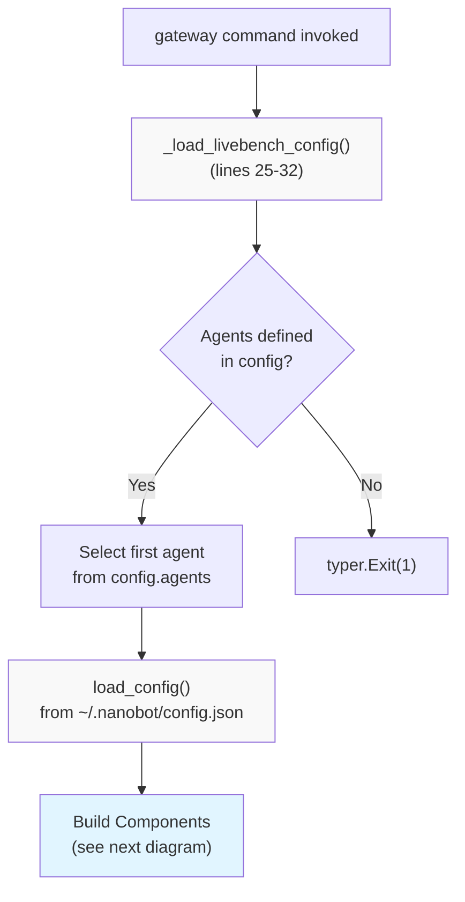
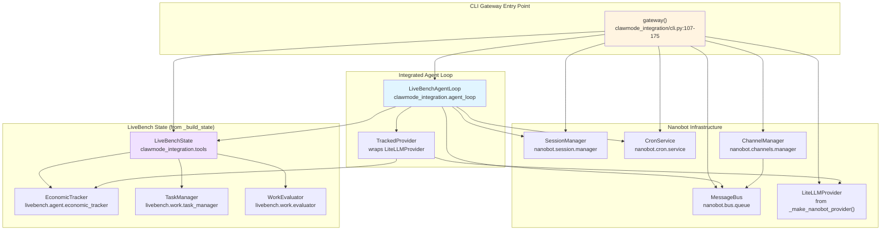
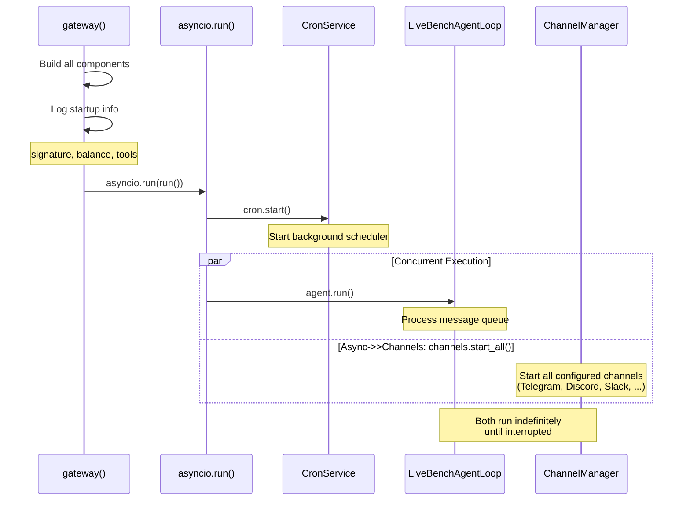
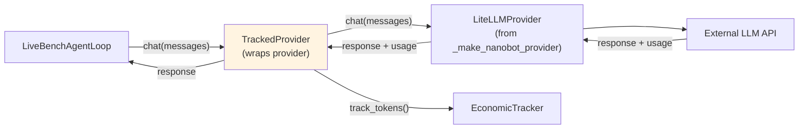

<!-- source: DeepWiki mcp.deepwiki.com · repo HKUDS/ClawWork · page 5.5 CLI Gateway · fetched 2026-11-09 -->

# CLI Gateway

<details>
<summary>Relevant source files</summary>

The following files were used as context for generating this wiki page:

- [clawmode_integration/__init__.py](clawmode_integration/__init__.py)
- [clawmode_integration/cli.py](clawmode_integration/cli.py)

</details>


## Purpose and Scope

The CLI Gateway provides the command-line entry point for launching ClawMode-enabled Nanobot instances. It initializes and orchestrates all components required to run an economically-tracked AI assistant accessible through multiple channels (Telegram, Discord, Slack, CLI).

This page documents the `gateway` command and its initialization pipeline. For details about the underlying agent loop implementation, see [LiveBenchAgentLoop Extension](#5.2). For information about the economic tools available to the agent, see [Economic Tools](#5.4).

**Sources:** [clawmode_integration/cli.py:1-184]()

---

## Command-Line Interface

### Gateway Command

The primary command is `gateway`, which starts the full multi-channel agent system with economic tracking:

```bash
python -m clawmode_integration.cli gateway
python -m clawmode_integration.cli gateway --config livebench/configs/test_gpt4o.json
python -m clawmode_integration.cli gateway --config custom_config.json --port 18790
```

### Command Options

| Option | Short | Default | Description |
|--------|-------|---------|-------------|
| `--config` | `-c` | `livebench/configs/test_gpt4o.json` | Path to LiveBench configuration JSON |
| `--port` | `-p` | `18790` | Gateway port for channel communication |

The command accepts a LiveBench configuration file that defines the agent's economic parameters, task sources, and evaluation settings. See section [Agent Configuration](#9.1) for config file structure.

**Sources:** [clawmode_integration/cli.py:107-115]()

---

## Initialization Pipeline

### Configuration Loading Flow



The gateway loads two distinct configuration sources:
1. **LiveBench config** (`--config` parameter): Defines economic parameters, task sources, agents
2. **Nanobot config** (`~/.nanobot/config.json`): Contains channel credentials, workspace path, default models

**Sources:** [clawmode_integration/cli.py:130-136]()

### Component Construction Sequence

```mermaid
sequenceDiagram
    participant CLI as gateway()
    participant Helpers as Helper Functions
    participant Nanobot as Nanobot Components
    participant LiveBench as LiveBench Components
    participant Loop as LiveBenchAgentLoop
    
    CLI->>Helpers: _load_livebench_config(config)
    Helpers-->>CLI: lb_cfg
    
    CLI->>Nanobot: load_config()
    Nanobot-->>CLI: nano_cfg
    
    CLI->>Nanobot: MessageBus()
    CLI->>Helpers: _make_nanobot_provider(nano_cfg)
    Helpers->>Nanobot: LiteLLMProvider(api_key, model)
    Helpers-->>CLI: provider
    
    CLI->>Nanobot: SessionManager(workspace_path)
    CLI->>Nanobot: CronService(cron_store)
    
    CLI->>Helpers: _build_state(lb_cfg, agent_cfg)
    Helpers->>LiveBench: EconomicTracker(signature, initial_balance)
    Helpers->>LiveBench: TaskManager(task_source, filters)
    Helpers->>LiveBench: WorkEvaluator(meta_prompts_dir)
    Helpers->>LiveBench: LiveBenchState(tracker, tm, evaluator)
    Helpers-->>CLI: state
    
    CLI->>Loop: LiveBenchAgentLoop(bus, provider, state, ...)
    Loop-->>CLI: agent
    
    CLI->>Nanobot: ChannelManager(nano_cfg, bus)
    Nanobot-->>CLI: channels
    
    CLI->>CLI: asyncio.run(agent.run(), channels.start_all())
```

The initialization follows a strict sequence to ensure all dependencies are available when needed:

1. **Configuration Loading** (lines 130-136): Load and validate both config files
2. **Nanobot Infrastructure** (lines 139-144): Create message bus, provider, session manager, cron service
3. **LiveBench State** (line 147): Build integrated economic state via `_build_state()`
4. **Agent Loop** (lines 150-162): Instantiate `LiveBenchAgentLoop` with both infrastructures
5. **Channel Manager** (line 164): Initialize multi-channel gateway
6. **Async Runtime** (lines 171-174): Launch concurrent services

**Sources:** [clawmode_integration/cli.py:130-175]()

---

## Component Integration Architecture

### Integrated System Topology



The gateway creates a unified architecture where:

- **Nanobot components** handle multi-channel I/O, session persistence, and scheduled tasks
- **LiveBench components** track economic state, manage tasks, and evaluate work
- **LiveBenchAgentLoop** bridges both systems, routing messages through economic tracking
- **TrackedProvider** wraps the LLM provider to intercept all token usage

**Sources:** [clawmode_integration/cli.py:139-169]()

---

## Helper Functions

### Configuration Loader

The `_load_livebench_config()` helper loads and validates the LiveBench configuration JSON:

```python
def _load_livebench_config(config_path: str) -> dict:
    """Load LiveBench-specific config (economic, agents, evaluation, etc.)."""
    path = Path(config_path)
    if not path.exists():
        logger.error(f"Config file not found: {path}")
        raise typer.Exit(1)
    with open(path) as fh:
        return json.load(fh)
```

Returns a dictionary containing `livebench`, `agents`, `economic`, `task_source`, and `evaluation` sections.

**Sources:** [clawmode_integration/cli.py:25-32]()

### Provider Factory

The `_make_nanobot_provider()` helper constructs a `LiteLLMProvider` from Nanobot's configuration:

```python
def _make_nanobot_provider(nanobot_config):
    """Create a LiteLLMProvider from nanobot config (mirrors nanobot CLI)."""
    from nanobot.providers.litellm_provider import LiteLLMProvider
    
    p = nanobot_config.get_provider()
    model = nanobot_config.agents.defaults.model
    # Validation and construction...
```

This mirrors Nanobot's own CLI initialization logic, ensuring compatibility with standard Nanobot provider configurations.

**Sources:** [clawmode_integration/cli.py:35-50]()

### State Builder

The `_build_state()` helper constructs the complete `LiveBenchState` from configuration:

| Component | Configuration Source | Purpose |
|-----------|---------------------|---------|
| `EconomicTracker` | `lb_cfg.economic` | Tracks token costs, balance, survival status |
| `TaskManager` | `lb_cfg.task_source`, `agent_cfg.task_filters` | Sources tasks from GDPVal dataset |
| `WorkEvaluator` | `lb_cfg.evaluation` | Evaluates work quality via LLM |
| `LiveBenchState` | Aggregates above | Unified state object for agent loop |

Key initialization steps:

1. Extract agent signature from config (line 60)
2. Create data directory structure: `{data_root}/{signature}/` (line 62)
3. Initialize `EconomicTracker` with pricing and initial balance (lines 66-73)
4. Create `TaskManager` with task filters and assignment strategy (lines 76-83)
5. Instantiate `WorkEvaluator` with meta-prompts directory (lines 86-90)
6. Assemble `LiveBenchState` with all components (lines 92-100)

**Sources:** [clawmode_integration/cli.py:53-100]()

---

## Startup Sequence

### Async Runtime Launch



The gateway launches two concurrent async tasks:

1. **Agent Loop** (`agent.run()`): Processes messages from the `MessageBus`, handling user interactions with economic tracking
2. **Channel Manager** (`channels.start_all()`): Starts all configured channels (Telegram, Discord, Slack), routing messages to the bus

The `CronService` starts first to enable scheduled background tasks.

**Sources:** [clawmode_integration/cli.py:171-175]()

### Startup Logging

The gateway logs critical initialization state:

```python
logger.info(
    f"ClawMode gateway starting | agent={state.signature} | "
    f"balance=${state.economic_tracker.get_balance():.2f} | "
    f"tools={agent.tools.tool_names}"
)
```

Example output:
```
ClawMode gateway starting | agent=gpt-4o | balance=$1000.00 | tools=['decide_activity', 'submit_work', 'learn', 'get_status', 'search_web', 'create_file', ...]
```

This confirms:
- Agent identity (`signature`)
- Initial economic balance
- Available tools (combination of Nanobot's default tools + LiveBench economic tools)

**Sources:** [clawmode_integration/cli.py:165-169]()

---

## Configuration Schema

### LiveBench Configuration Structure

The LiveBench config JSON follows this schema:

```json
{
  "livebench": {
    "economic": {
      "initial_balance": 1000.0,
      "token_pricing": {
        "input_per_1m": 2.5,
        "output_per_1m": 10.0
      },
      "task_values_path": "data/task_values.json"
    },
    "task_source": {
      "type": "parquet",
      "path": "data/train-00000-of-00001.parquet"
    },
    "evaluation": {
      "use_llm_evaluation": true,
      "meta_prompts_dir": "./eval/meta_prompts"
    },
    "agents": [
      {
        "signature": "gpt-4o",
        "model": "gpt-4o",
        "supports_multimodal": true,
        "task_filters": {...},
        "task_assignment": {...}
      }
    ]
  }
}
```

The gateway extracts:
- **Economic parameters** for `EconomicTracker` initialization
- **Task source** for `TaskManager` configuration
- **Evaluation settings** for `WorkEvaluator` setup
- **First agent** from the `agents` array (multi-agent not supported in gateway mode)

**Sources:** [clawmode_integration/cli.py:53-100]()

### Nanobot Configuration

The Nanobot config (`~/.nanobot/config.json`) provides:

- **Provider credentials**: API keys, base URLs, extra headers
- **Default model**: Used if not overridden by LiveBench config
- **Workspace path**: Directory for file operations
- **Channel settings**: Telegram bot token, Discord credentials, Slack token
- **Tool configuration**: Brave API key, execution settings, workspace restrictions

The gateway reads this via `nanobot.config.loader.load_config()`.

**Sources:** [clawmode_integration/cli.py:139]()

---

## Multi-Channel Support

### Channel Initialization

The `ChannelManager` starts all channels configured in `~/.nanobot/config.json`:

| Channel | Configuration Key | Required Credentials |
|---------|------------------|----------------------|
| Telegram | `channels.telegram.bot_token` | Telegram Bot API token |
| Discord | `channels.discord.token` | Discord bot token |
| Slack | `channels.slack.bot_token` | Slack app bot token |
| CLI | Always enabled | None (stdin/stdout) |

Each channel operates independently, routing messages through the shared `MessageBus`. The `LiveBenchAgentLoop` processes messages from all channels identically, applying economic tracking to every interaction.

**Sources:** [clawmode_integration/cli.py:164]()

### Cross-Channel Economic Consistency

All channels share the same `LiveBenchState`, ensuring:

- **Unified balance**: Token costs from any channel deduct from the same balance
- **Consistent status**: Survival tier applies across all channels
- **Shared memory**: Learning persists regardless of interaction channel

This enables true multi-channel deployment where the agent maintains a single economic identity.

**Sources:** [clawmode_integration/cli.py:147-162]()

---

## Error Handling

### Configuration Validation

The gateway exits early if critical configuration is missing:

| Condition | Error Message | Exit Code |
|-----------|--------------|-----------|
| Config file not found | `Config file not found: {path}` | 1 |
| No agents defined | `No agents defined in config` | 1 |
| No API key configured | `No API key configured in ~/.nanobot/config.json` | 1 |

These checks occur during initialization before any components are created.

**Sources:** [clawmode_integration/cli.py:29-30](), [clawmode_integration/cli.py:134-135](), [clawmode_integration/cli.py:42-43]()

### Runtime Error Handling

Once launched, the gateway relies on:

- **Nanobot's error handling** for channel connection failures and message processing errors
- **EconomicTracker's validation** for balance checks and survival status enforcement
- **LiveBenchAgentLoop's exception handling** for tool execution errors

See [LiveBenchAgentLoop Extension](#5.2) for details on per-message error handling.

**Sources:** [clawmode_integration/cli.py:171-175]()

---

## Usage Examples

### Basic Startup

Launch with default configuration:

```bash
python -m clawmode_integration.cli gateway
```

This uses the default config at `livebench/configs/test_gpt4o.json` and port `18790`.

### Custom Configuration

Launch with a custom agent configuration:

```bash
python -m clawmode_integration.cli gateway \
  --config livebench/configs/prod_claude.json \
  --port 8080
```

### Development Mode

For local testing without external channels:

```bash
# Disable channels in ~/.nanobot/config.json
python -m clawmode_integration.cli gateway --config livebench/configs/dev_config.json
```

The agent will only be accessible via CLI (stdin/stdout).

**Sources:** [clawmode_integration/cli.py:1-7](), [clawmode_integration/cli.py:107-122]()

---

## Integration with Nanobot Ecosystem

### Nanobot Compatibility

The gateway maintains full compatibility with Nanobot's ecosystem:

- **Standard tools**: `search_web`, `create_file`, `execute_code` remain available
- **Channel protocols**: All Nanobot channels work unchanged
- **Session persistence**: Conversation history persists across restarts
- **Cron scheduling**: Background tasks continue to function

The only difference is the addition of four economic tools and cost tracking on every LLM call.

**Sources:** [clawmode_integration/cli.py:150-162]()

### Provider Wrapping

The gateway wraps Nanobot's `LiteLLMProvider` with `TrackedProvider`:



This transparent wrapping ensures all token usage is tracked without modifying Nanobot's core code. See [TrackedProvider Wrapper](#5.3) for implementation details.

**Sources:** [clawmode_integration/cli.py:141-142](), [clawmode_integration/cli.py:152]()

---

## Summary

The CLI Gateway (`clawmode_integration/cli.py`) provides the entry point for deploying economically-tracked AI assistants across multiple channels. It orchestrates:

1. **Dual configuration loading** from LiveBench config and Nanobot config
2. **Component initialization** of both Nanobot and LiveBench infrastructures
3. **Agent loop instantiation** with economic tracking enabled
4. **Multi-channel deployment** via ChannelManager
5. **Concurrent async execution** of agent loop and channel listeners

The gateway's architecture enables seamless integration between Nanobot's multi-channel gateway capabilities and LiveBench's economic survival framework, creating AI assistants that are both accessible and accountable.

**Sources:** [clawmode_integration/cli.py:1-184]()

---

