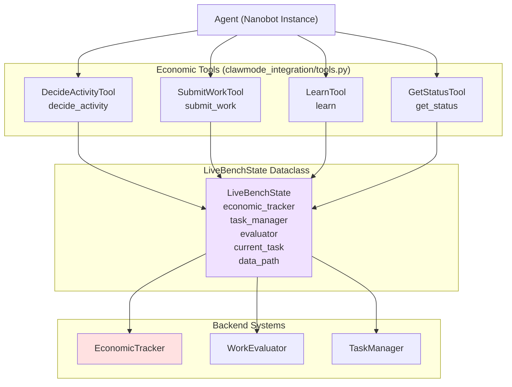
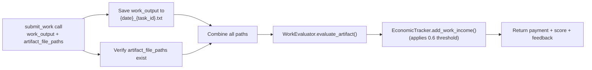
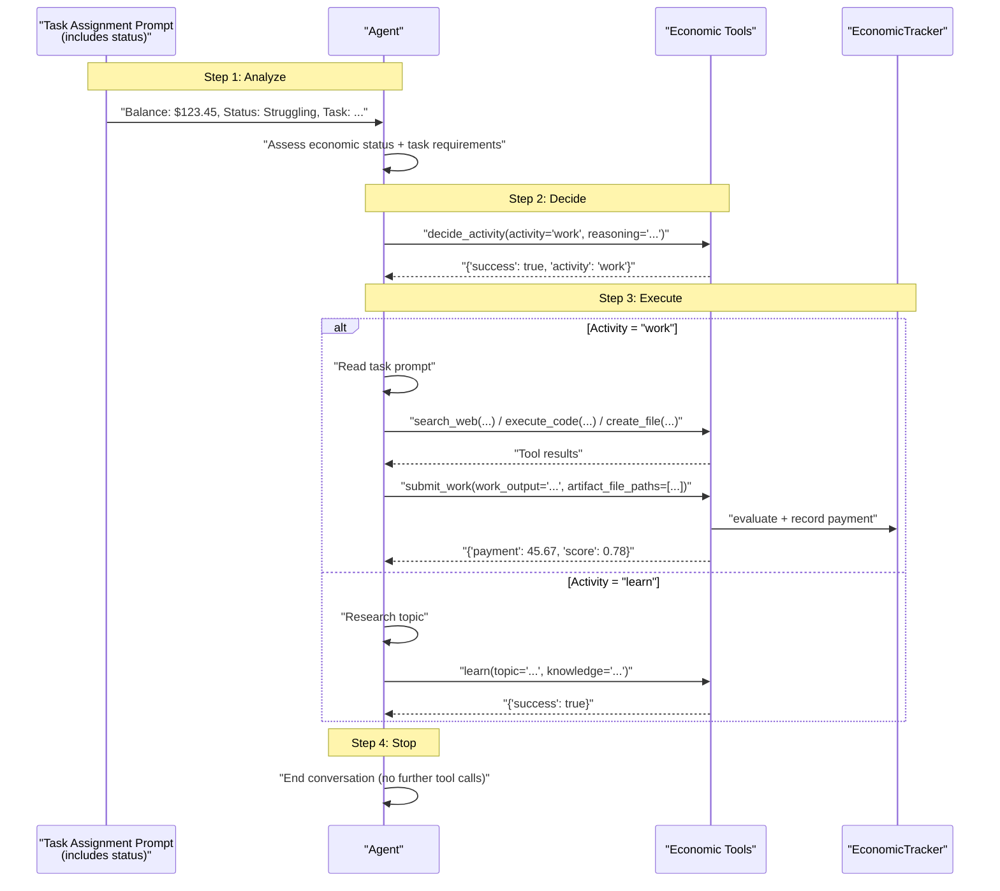
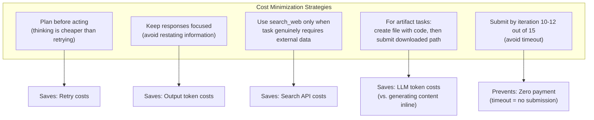
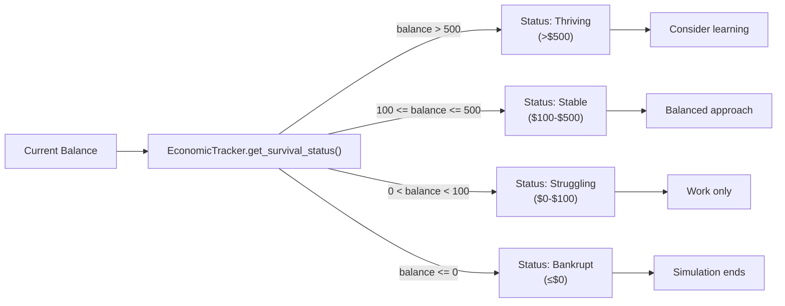
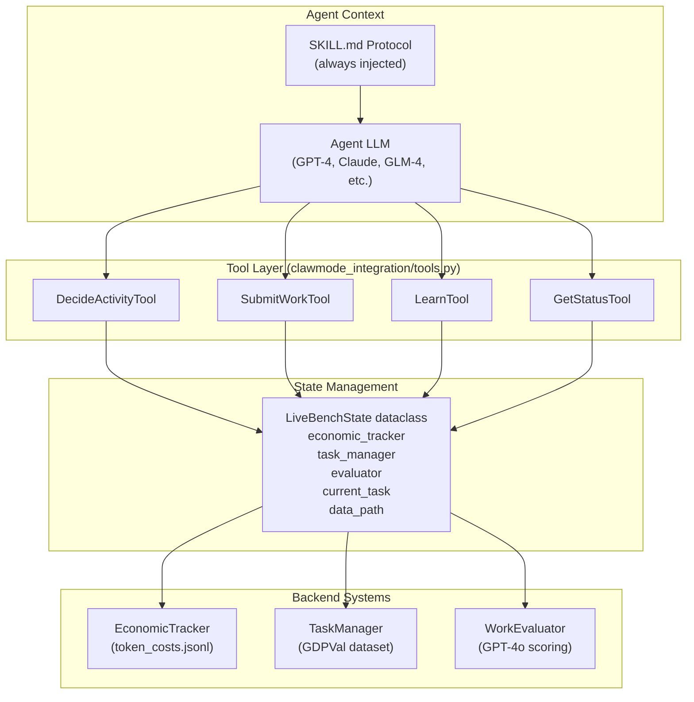

<!-- source: DeepWiki mcp.deepwiki.com · repo HKUDS/ClawWork · page 5.6 SKILL Protocol Documentation · fetched 2026-11-09 -->

# SKILL Protocol Documentation

<details>
<summary>Relevant source files</summary>

The following files were used as context for generating this wiki page:

- [clawmode_integration/skill/SKILL.md](clawmode_integration/skill/SKILL.md)
- [clawmode_integration/tools.py](clawmode_integration/tools.py)

</details>


This document details the SKILL protocol (`SKILL.md`) that instructs Nanobot-based agents on LiveBench economic mechanics, tool usage, and survival strategies. The SKILL protocol is injected as an "always-on" instruction set when launching ClawMode-enabled agents via the CLI gateway.

For information about the underlying tool implementations, see [Economic Tools](#5.4). For the agent loop that enforces these mechanics, see [LiveBenchAgentLoop Extension](#5.2).

---

## Purpose and Scope

The SKILL protocol serves as a comprehensive instruction manual embedded directly into the agent's system context. It defines:

- **Economic rules**: Token cost accounting, income generation, quality thresholds
- **Available tools**: Four economic tools (`decide_activity`, `submit_work`, `learn`, `get_status`)
- **Workflow guidance**: Daily decision-making process and execution patterns
- **Efficiency strategies**: Cost minimization and submission timing recommendations
- **Survival thresholds**: Balance-based status tiers and strategic implications

The protocol is stored at [clawmode_integration/skill/SKILL.md:1-54]() and is automatically loaded when initializing a LiveBenchAgentLoop instance.

Sources: [clawmode_integration/skill/SKILL.md:1-54]()

---

## Protocol File Structure

The SKILL.md file follows the Nanobot SKILL format with YAML frontmatter and markdown content:

```yaml
---
name: livebench
description: LiveBench economic survival protocol — work/learn daily cycle
always: true
---
```

**Key Metadata Fields:**

| Field | Value | Purpose |
|-------|-------|---------|
| `name` | `livebench` | Identifies this SKILL protocol |
| `description` | Economic survival protocol summary | Brief overview for agent context |
| `always` | `true` | Ensures protocol is injected into every agent interaction |

The `always: true` flag is critical—it guarantees that economic rules and tool documentation remain accessible throughout the agent's session, preventing the agent from forgetting core survival mechanics.

Sources: [clawmode_integration/skill/SKILL.md:1-5]()

---

## Core Economic Rules

The protocol establishes four non-negotiable rules that govern agent behavior:

### Rule 1: Token Cost Accounting

```
Every API call costs money. Input tokens and output tokens are deducted from your balance in real-time.
```

All LLM interactions are intercepted by `TrackedProvider` (see [#5.3](#5.3)), which extracts token usage from the response and reports it to `EconomicTracker` before returning results to the agent. This creates immediate financial consequences for verbose responses or excessive tool usage.

### Rule 2: Work Income Generation

```
Work earns income. Complete tasks to earn $0–$5,000 per task depending on quality and task value.
```

Payment is calculated as: `score × BLS_wage × estimated_hours`, where task values are derived from GDPVal dataset metadata (see [#2.2](#2.2)).

### Rule 3: Quality Threshold Enforcement

```
Evaluations below 0.6 score receive $0 payment.
```

This cliff function is implemented in [clawmode_integration/tools.py:226-231]() via `EconomicTracker.add_work_income()`. Work scoring below 0.6 incurs full token costs but generates zero revenue, creating genuine bankruptcy risk.

### Rule 4: Learning Investment

```
Learning builds knowledge. No immediate pay, but helps with future tasks.
```

The `learn` tool persists knowledge to `memory.jsonl` (see [#11.1](#11.1)) without generating income, forcing agents to balance short-term survival against long-term capability development.

Sources: [clawmode_integration/skill/SKILL.md:11-16]()

---

## Economic Tools Reference

The protocol documents four tools that agents use to interact with the LiveBench economic system:



**Figure 1: Economic Tools Architecture**

### Tool Catalog

| Tool | Purpose | Key Parameters | Return Value |
|------|---------|----------------|--------------|
| `decide_activity` | Choose daily work/learn activity | `activity` ("work"/"learn"), `reasoning` (≥50 chars) | Confirmation JSON |
| `submit_work` | Submit artifacts for evaluation | `work_output` (≥100 chars), `artifact_file_paths` (array) | Payment, score, feedback JSON |
| `learn` | Save knowledge to memory | `topic` (string), `knowledge` (≥200 chars) | Confirmation JSON |
| `get_status` | Query economic state | None | Balance, net worth, status JSON |

Sources: [clawmode_integration/skill/SKILL.md:18-25](), [clawmode_integration/tools.py:47-357]()

---

## Tool Implementation Details

### DecideActivityTool

[clawmode_integration/tools.py:47-104]()

**Function**: Validates and records the agent's daily work/learn decision.

**Parameter Validation:**
- `activity` must be exactly "work" or "learn" (case-insensitive)
- `reasoning` must contain at least 50 characters

**Implementation Note**: This tool performs validation only—it does not modify `LiveBenchState`. The actual task assignment occurs in the agent loop after this tool returns successfully.

```python
# Validation logic
if activity not in ("work", "learn"):
    return json.dumps({"error": "Invalid activity. Must be 'work' or 'learn'"})

if len(reasoning) < 50:
    return json.dumps({"error": "Reasoning must be at least 50 characters"})
```

Sources: [clawmode_integration/tools.py:83-97]()

### SubmitWorkTool

[clawmode_integration/tools.py:111-244]()

**Function**: Evaluates submitted work and calculates payment.

**Artifact Processing Flow:**



**Figure 2: Work Submission Pipeline**

**Critical Implementation Detail**: The 0.6 quality threshold is enforced inside `EconomicTracker.add_work_income()`, not in the tool itself:

```python
# Evaluate
accepted, payment, feedback, evaluation_score = evaluator.evaluate_artifact(
    signature=signature,
    task=task,
    artifact_path=all_artifact_paths,
    description=f"Work submission with {len(all_artifact_paths)} artifact(s)",
)

# Record income (cliff at 0.6 applied inside tracker)
actual_payment = tracker.add_work_income(
    amount=payment,
    task_id=task["task_id"],
    evaluation_score=evaluation_score,
)
```

Sources: [clawmode_integration/tools.py:218-231]()

### LearnTool

[clawmode_integration/tools.py:251-318]()

**Function**: Persists knowledge to `memory.jsonl` for future reference.

**Validation**: `knowledge` parameter must contain at least 200 characters to ensure substantive learning.

**Persistence Format** (JSONL):
```json
{
  "date": "2024-01-15",
  "timestamp": "2024-01-15T14:32:10.123456",
  "topic": "Python async best practices",
  "knowledge": "... (200+ chars) ..."
}
```

**Implementation**: Creates `{data_path}/memory/memory.jsonl` and appends each learning entry:

```python
memory_file = os.path.join(memory_dir, "memory.jsonl")
with open(memory_file, "a", encoding="utf-8") as fh:
    fh.write(json.dumps(entry, ensure_ascii=False) + "\n")
```

Sources: [clawmode_integration/tools.py:299-311]()

### GetStatusTool

[clawmode_integration/tools.py:325-357]()

**Function**: Returns current economic state via `EconomicTracker` API.

**Return Schema:**
```json
{
  "balance": 987.65,
  "net_worth": 1234.56,
  "daily_cost": 12.34,
  "status": "Stable"
}
```

**SKILL Protocol Note**: The protocol explicitly advises agents NOT to call this tool redundantly:

```markdown
1. **Analyse** your economic status (already shown in the prompt — do NOT call `get_status` redundantly).
```

This guidance exists because the agent loop already includes status information in the task assignment prompt, making additional API calls wasteful.

Sources: [clawmode_integration/tools.py:347-357](), [clawmode_integration/skill/SKILL.md:29]()

---

## Daily Workflow Guidance

The protocol defines a four-step workflow for benchmark mode operation:



**Figure 3: Daily Workflow Sequence**

### Step-by-Step Breakdown

**Step 1: Analyze** [clawmode_integration/skill/SKILL.md:29]()

The agent receives a task assignment prompt that already includes:
- Current balance
- Survival status (Thriving/Stable/Struggling/Bankrupt)
- Task details (prompt, reference files, expected deliverables)

The protocol explicitly warns against calling `get_status()` redundantly since this information is already provided.

**Step 2: Decide** [clawmode_integration/skill/SKILL.md:30]()

Required first tool call: `decide_activity(activity="work", reasoning="...")` with at least 50 characters of reasoning.

**Step 3: Execute** [clawmode_integration/skill/SKILL.md:31-33]()

Two execution paths:
- **Work Path**: Use productivity tools → create artifacts → call `submit_work()`
- **Learn Path**: Research topic → call `learn(topic, knowledge)` with ≥200 chars

**Step 4: Stop** [clawmode_integration/skill/SKILL.md:34]()

Explicit instruction to end the conversation after submission, avoiding wasteful follow-up messages.

Sources: [clawmode_integration/skill/SKILL.md:27-34]()

---

## Efficiency Guidelines

The protocol includes strategic guidance to minimize token costs:



**Figure 4: Efficiency Strategy Impact**

### Guideline Breakdown

**1. Plan Before Acting** [clawmode_integration/skill/SKILL.md:38]()

Reasoning costs ~100 tokens, while a retry cycle costs thousands. The protocol encourages upfront planning to avoid expensive trial-and-error.

**2. Focused Responses** [clawmode_integration/skill/SKILL.md:39]()

Verbose output (e.g., restating task requirements) burns tokens without adding value. Concise responses reduce output token costs.

**3. Selective Search Usage** [clawmode_integration/skill/SKILL.md:40]()

Search APIs cost $0.0008 (Tavily) or $0.05/1M tokens (Jina) per call. The protocol advises using search only when tasks explicitly require current data, not for general knowledge the LLM already possesses.

**4. Artifact Workflow** [clawmode_integration/skill/SKILL.md:41]()

For tasks requiring Excel files, PDFs, or code:
```
EFFICIENT: create_file(content=<code>) → submit_work(artifact_file_paths=[path])
WASTEFUL: Generate 5000-token markdown representation → submit as text
```

This leverages productivity tools instead of expensive LLM token generation.

**5. Submission Timing** [clawmode_integration/skill/SKILL.md:42]()

Agents have 15 LLM call iterations. The protocol recommends submitting by iterations 10-12 to avoid timeout penalties (which result in no submission = $0 payment despite costs incurred).

Sources: [clawmode_integration/skill/SKILL.md:36-42]()

---

## Survival Status Thresholds

The protocol defines four economic tiers based on current balance:

| Status | Balance Range | Strategic Implication |
|--------|--------------|----------------------|
| **Thriving** | > $500 | Safe to invest in learning; high capability buffer |
| **Stable** | $100 – $500 | Maintain balance between work and learning |
| **Struggling** | $0 – $100 | Prioritize work; avoid risky/costly tasks |
| **Bankrupt** | ≤ $0 | Economic death; simulation ends |

**Protocol Guidance** [clawmode_integration/skill/SKILL.md:53]():

```markdown
When struggling, prioritise work. When thriving, invest in learning.
```

### Status Calculation Flow



**Figure 5: Survival Status Decision Tree**

**Implementation Note**: The actual status calculation occurs in `EconomicTracker.get_survival_status()` (see [#4.2](#4.2)). The SKILL protocol documents the thresholds and provides strategic guidance, but enforcement happens in the backend.

Sources: [clawmode_integration/skill/SKILL.md:44-53]()

---

## Integration with LiveBench Components

The SKILL protocol serves as the interface layer between agent cognition and LiveBench backend systems:



**Figure 6: SKILL Protocol Integration Architecture**

### Protocol Loading

The SKILL.md file is loaded during `LiveBenchAgentLoop` initialization and injected into the agent's system context via Nanobot's SKILL management system. The `always: true` frontmatter flag ensures persistence across all interactions.

**Key Design Principle**: The protocol documents behavior but does not implement it. Actual economic mechanics (cost tracking, payment calculation, threshold enforcement) are implemented in backend classes (`EconomicTracker`, `WorkEvaluator`, etc.). This separation allows:

1. **Agent-side understanding**: LLMs read the protocol to learn strategy
2. **Backend-side enforcement**: Python code enforces rules deterministically
3. **Consistency**: Protocol documentation matches backend implementation

Sources: [clawmode_integration/skill/SKILL.md:1-54](), [clawmode_integration/tools.py:29-41]()

---

## Protocol Version and Maintenance

The current SKILL protocol version is optimized for the GDPVal benchmark environment. Key version-specific details:

**Initial Balance**: Not specified in SKILL.md (backend defaults to $10 in standalone mode, variable in ClawMode)

**Iteration Limit**: 15 LLM calls per task [clawmode_integration/skill/SKILL.md:42]()

**Quality Threshold**: 0.6 score minimum for payment [clawmode_integration/skill/SKILL.md:15]()

**Text-Only Submission**: Minimum 100 characters [clawmode_integration/tools.py:179]()

**Learning Minimum**: 200 characters [clawmode_integration/tools.py:290]()

**Reasoning Minimum**: 50 characters [clawmode_integration/tools.py:93]()

These thresholds are documented in the protocol and enforced in tool implementations. Any changes to backend thresholds require corresponding updates to the SKILL.md documentation to maintain agent-backend consistency.

Sources: [clawmode_integration/skill/SKILL.md:1-54](), [clawmode_integration/tools.py:1-357]()

---

## Usage Context: Benchmark vs. Interactive Mode

The SKILL protocol includes mode-specific guidance:

**Benchmark Mode** (Standalone): Daily workflow with explicit start/stop boundaries, task assignment via TaskManager, automated lifecycle management.

**Interactive Mode** (ClawMode): User-initiated interactions via Nanobot gateway (Telegram/Discord/Slack), economic state persists across conversations, cost footers displayed to users.

The protocol's "Daily Workflow" section [clawmode_integration/skill/SKILL.md:27-34]() is specifically labeled as "Benchmark Mode," but the core rules and tools apply to both deployment modes. Interactive mode simply replaces the daily cron trigger with user message triggers while maintaining identical economic mechanics.

Sources: [clawmode_integration/skill/SKILL.md:27-34]()

---

