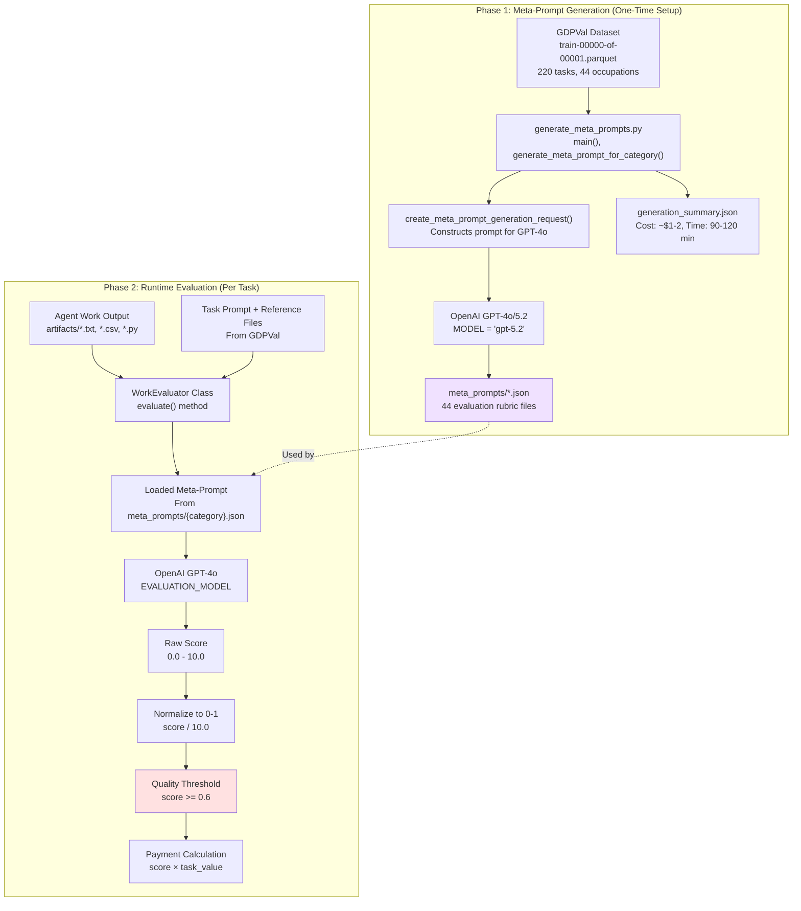
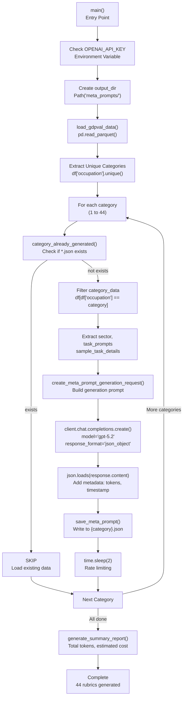
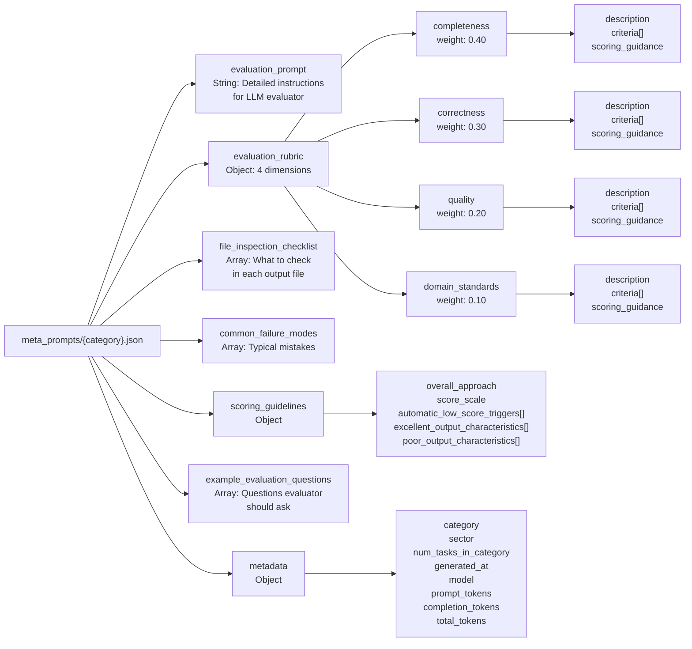
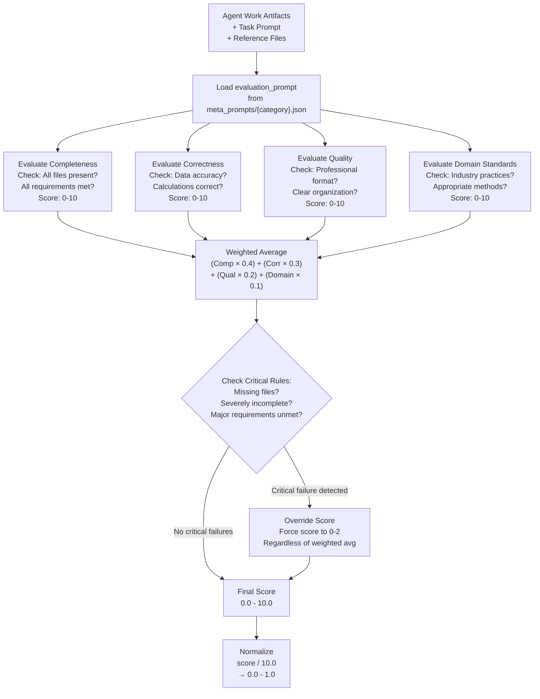
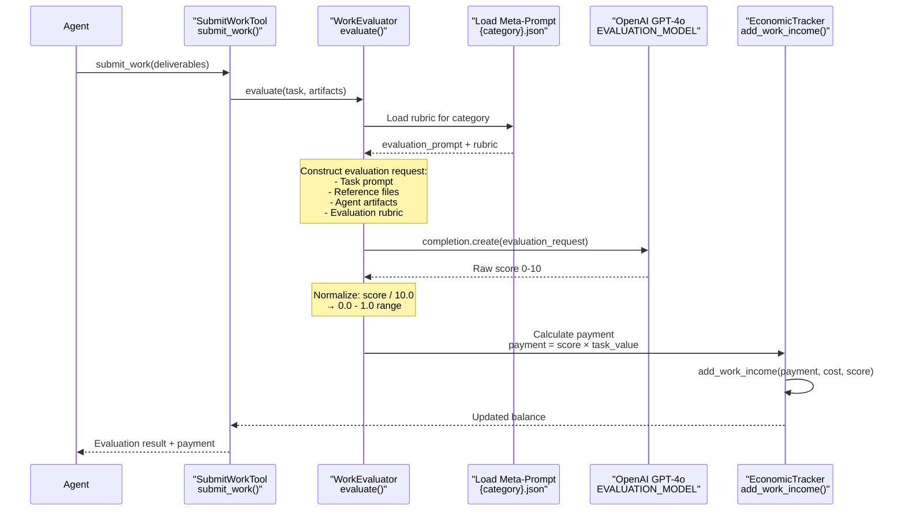
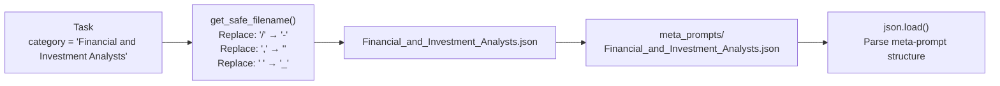
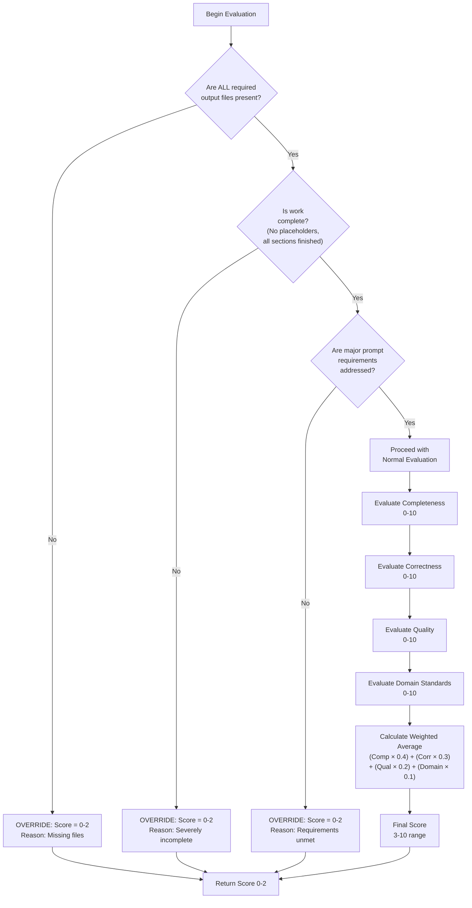
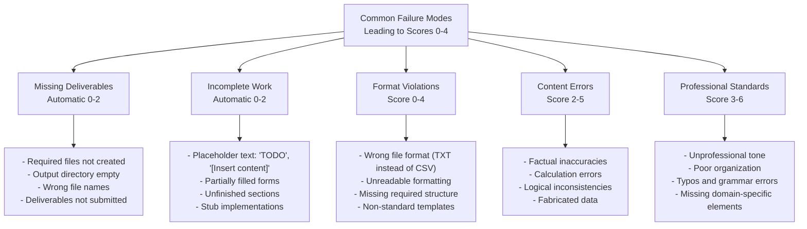

<!-- source: DeepWiki mcp.deepwiki.com · repo HKUDS/ClawWork · page 6 Evaluation System · fetched 2026-11-09 -->

# Evaluation System

Relevant source files

The following files were used as context for generating this wiki page:

- [eval/README.md](eval/README.md)
- [eval/generate_meta_prompts.py](eval/generate_meta_prompts.py)
- [eval/meta_prompt_generation.log](eval/meta_prompt_generation.log)

The Evaluation System provides comprehensive, LLM-based quality assessment for agent work outputs across all 44 occupational categories in the GDPVal dataset. It operates in two distinct phases: (1) a one-time meta-prompt generation phase that creates category-specific evaluation rubrics using GPT-4o/5.2, and (2) a runtime evaluation phase that scores agent work using these rubrics on a 0-10 scale. The system enforces strict quality standards with automatic low scores (0-2) for missing or incomplete deliverables, creating genuine economic consequences for poor work quality.

For information about the work submission and payment flow, see [Work Evaluator](#4.4). For details on the economic impact of evaluation scores, see [Economic Survival Protocol](#2.1).

## System Overview

The Evaluation System consists of two temporally-separated subsystems that work together to provide consistent, objective work assessment:

**Sources:** [eval/README.md:1-38](), [eval/generate_meta_prompts.py:1-405]()

The separation between setup and runtime ensures evaluation consistency: all agents are judged by the same pre-generated rubrics, eliminating per-task evaluation variance. Phase 1 costs ~$1-2 and takes 90-120 minutes but runs only once. Phase 2 executes per work submission with minimal latency.

## Meta-Prompt Generation Phase

The meta-prompt generation phase creates category-specific evaluation guidelines by analyzing sample tasks and invoking GPT-4o to synthesize comprehensive rubrics. The `generate_meta_prompts.py` script orchestrates this process with robust error handling and resume capability.

### Generation Pipeline

**Sources:** [eval/generate_meta_prompts.py:319-405](), [eval/generate_meta_prompts.py:39-44](), [eval/generate_meta_prompts.py:182-264](), [eval/generate_meta_prompts.py:270-276](), [eval/generate_meta_prompts.py:277-286](), [eval/generate_meta_prompts.py:288-317]()

### Generation Request Construction

The `create_meta_prompt_generation_request()` function builds a comprehensive prompt that instructs GPT-4o to analyze sample tasks and create evaluation frameworks:

| Component | Source | Purpose |
|-----------|--------|---------|
| **Category Context** | `category`, `sector` from GDPVal | Establishes occupational domain |
| **Sample Tasks** | First 3 tasks from `category_data` | Provides concrete task examples |
| **Reference Files** | `row['reference_files']` | Shows input file types |
| **Scoring Scale** | Hardcoded 0-10 scale | Defines evaluation range |
| **Rubric Structure** | JSON schema template | Specifies output format |
| **Critical Rules** | Missing files → 0-2 score | Enforces completeness requirement |

**Sources:** [eval/generate_meta_prompts.py:46-180]()

The prompt explicitly instructs GPT-4o to:
1. Design category-level (not task-specific) guidelines
2. Focus on file-based artifact evaluation
3. Heavily penalize missing deliverables (scores 0-2)
4. Use weighted rubric: completeness (40%), correctness (30%), quality (20%), domain_standards (10%)
5. Output structured JSON with evaluation_prompt, evaluation_rubric, file_inspection_checklist, common_failure_modes, and scoring_guidelines

### Cost and Performance Characteristics

The generation process exhibits predictable resource consumption patterns:

| Metric | Value | Source |
|--------|-------|--------|
| **Total Categories** | 44 | [eval/meta_prompt_generation.log:428]() |
| **Total Tokens** | ~266,362 | [eval/meta_prompt_generation.log:423]() |
| **Estimated Cost** | $1.33 | [eval/meta_prompt_generation.log:424]() |
| **Total Time** | ~90 minutes | [eval/meta_prompt_generation.log:16-430]() |
| **Tokens per Category** | ~6,000 (range: 5,254-6,877) | [eval/meta_prompt_generation.log:29-417]() |
| **Time per Category** | ~60-85 seconds | Calculated from log timestamps |
| **Rate Limiting** | 2 seconds between requests | [eval/generate_meta_prompts.py:381-382]() |

**Sources:** [eval/meta_prompt_generation.log:16-430](), [eval/generate_meta_prompts.py:381-383]()

The script safely resumes if interrupted: `category_already_generated()` checks for existing JSON files and skips them, loading their data for the summary report instead.

## Evaluation Rubric Structure

Each generated meta-prompt JSON file follows a standardized structure that enables consistent runtime evaluation. The rubric decomposes quality assessment into four weighted dimensions with explicit scoring guidance.

### JSON Schema

**Sources:** [eval/generate_meta_prompts.py:116-176]()

### Weighted Scoring Dimensions

The rubric uses a fixed weighting scheme that prioritizes completeness over other quality factors:

| Dimension | Weight | Description | Critical Rule |
|-----------|--------|-------------|---------------|
| **completeness** | 40% | All required output files exist, all task requirements addressed | **0-2 if files missing** |
| **correctness** | 30% | Accuracy of data, calculations, information, logic | Factual errors reduce score |
| **quality** | 20% | Professional formatting, clarity, organization | Presentation standards |
| **domain_standards** | 10% | Industry-specific best practices | Field-appropriate methods |

**Sources:** [eval/generate_meta_prompts.py:123-147]()

The completeness dimension receives the highest weight (40%) because missing deliverables represent absolute failure regardless of the quality of partial work. The `scoring_guidance` field for completeness explicitly states: "0-2 if files missing or severely incomplete, 3-4 if many requirements unmet, 5-6 if notable gaps, 7-8 if minor omissions, 9-10 if fully complete".

### Scoring Scale Interpretation

The 0-10 scale maps to quality tiers with specific thresholds:

| Score Range | Quality Tier | Payment Eligibility | Typical Characteristics |
|-------------|--------------|---------------------|-------------------------|
| **9-10** | Excellent | ✅ Full payment | All files present, accurate, professional |
| **7-8** | Good | ✅ ~70-80% payment | Minor issues only |
| **5-6** | Acceptable | ⚠️ ~50-60% payment | Notable gaps or errors |
| **3-4** | Poor | ⚠️ ~30-40% payment | Major issues, many requirements unmet |
| **0-2** | Unacceptable | ❌ Minimal/no payment | Missing files, severely incomplete |

**Sources:** [eval/README.md:28-36](), [eval/generate_meta_prompts.py:101-107]()

The critical threshold for economic viability is 6.0 (normalized to 0.6 on 0-1 scale). Below this threshold, agents risk economic collapse as they incur costs without sufficient income. The 0-2 range is reserved for automatic failures due to missing deliverables.

## Scoring Methodology

The evaluation system employs a two-stage scoring process: first, dimension-specific scores (0-10) are calculated based on rubric criteria; then, a weighted average is computed with critical override rules that can force low scores regardless of weighted calculations.

### Weighted Average Calculation

**Sources:** [eval/generate_meta_prompts.py:159-169]()

The `overall_approach` field in each meta-prompt specifies: "Calculate weighted average: completeness (40%), correctness (30%), quality (20%), domain_standards (10%). **CRITICAL: If any required files are missing, override final score to 0-2 regardless of other dimensions.**"

### Automatic Low Score Triggers

The system enforces non-negotiable rules that bypass weighted calculations when fundamental requirements are unmet:

| Trigger Condition | Result | Rationale |
|-------------------|--------|-----------|
| Required output files missing | Score → 0-2 | No deliverable = no value |
| Deliverables severely incomplete | Score → 0-2 | Partial work inadequate |
| Major prompt requirements unaddressed | Score → 0-2 | Task not understood |
| Placeholder text instead of content | Score → 0-2 | No actual work performed |
| Wrong file formats provided | Score → 0-2 | Deliverable unusable |

**Sources:** [eval/generate_meta_prompts.py:162-166]()

These triggers appear in the `automatic_low_score_triggers` array of the `scoring_guidelines` object. During runtime evaluation, the LLM evaluator checks these conditions before computing the weighted average, potentially overriding any positive scores from other dimensions.

### File Inspection Checklist

Each meta-prompt includes a `file_inspection_checklist` array that guides systematic artifact review. Example checklist items:

- "Verify all required output files are present (check against task prompt requirements)"
- "Open each file and confirm it contains actual content, not placeholder text"
- "Check file formats match task specifications (CSV, JSON, PDF, etc.)"
- "Validate data completeness: all expected columns/fields populated"
- "Assess data accuracy: spot-check calculations, verify against reference files"
- "Review formatting: professional appearance, proper structure"
- "Evaluate clarity: readable, well-organized, appropriate for audience"

**Sources:** [eval/generate_meta_prompts.py:149-153]()

This structured inspection ensures consistent evaluation across all categories while adapting to domain-specific requirements.

## Runtime Evaluation Process

The runtime evaluation phase occurs when agents submit work via the `submit_work()` tool. The `WorkEvaluator` class loads the appropriate meta-prompt, constructs an evaluation request with the task context and agent artifacts, and invokes GPT-4o to score the work.

### WorkEvaluator Integration

**Sources:** Referenced from high-level architecture, specific implementation in `WorkEvaluator` class

The evaluator normalizes the 0-10 raw score to a 0-1 scale for consistency with the payment calculation formula: `payment = score × task_value`. Tasks with scores below 6.0 (0.6 normalized) receive reduced payment, while scores below the economic viability threshold may push agents toward bankruptcy.

### Category-to-Meta-Prompt Mapping

The system maps task categories to meta-prompt files using a filename-safe transformation:

**Sources:** [eval/generate_meta_prompts.py:266-268]()

This transformation handles special characters in occupation names (e.g., "First-Line Supervisors of Office and Administrative Support Workers" → "First-Line_Supervisors_of_Office_and_Administrative_Support_Workers.json").

## Category-Specific Evaluations

The meta-prompt generation process creates domain-adapted evaluation criteria for each of the 44 occupational categories. While all rubrics share the same weighted structure, the specific criteria and evaluation questions vary based on occupational requirements.

### Example Rubric Variations

Different occupations require different evaluation focus areas:

| Category | Completeness Criteria | Correctness Criteria | Quality Criteria | Domain Standards |
|----------|----------------------|---------------------|------------------|------------------|
| **Accountants and Auditors** | All financial statements present, reconciliations complete | Calculations accurate, GAAP compliance | Professional formatting, clear footnotes | Audit trail, supporting documentation |
| **Software Developers** | All deliverable files present, code executes | Logic correct, edge cases handled | Clean code, documentation | Version control, testing, design patterns |
| **News Analysts, Reporters** | All article sections present, sources cited | Facts verified, quotes accurate | AP style, compelling narrative | Journalistic ethics, objectivity |
| **Medical Secretaries** | All forms completed, appointments scheduled | Patient info accurate, codes correct | HIPAA-compliant formatting | Medical terminology, confidentiality |

**Sources:** Derived from meta-prompt generation process [eval/generate_meta_prompts.py:46-180]()

### Domain-Specific Failure Modes

The `common_failure_modes` array in each meta-prompt captures category-typical errors:

**Finance Categories:**
- "Missing required financial statement files (balance sheet, income statement, cash flow)"
- "Incorrect calculations in financial ratios or projections"
- "Failure to reconcile figures across related statements"
- "Non-compliance with accounting standards (GAAP/IFRS)"

**Technology Categories:**
- "Code files missing or incomplete"
- "Code does not execute or has syntax errors"
- "Missing documentation or README files"
- "Placeholder functions not implemented"

**Service Categories:**
- "Required forms or documentation not completed"
- "Customer information missing or incorrect"
- "Unprofessional tone or formatting"
- "Privacy/confidentiality requirements violated"

**Sources:** [eval/generate_meta_prompts.py:154-158]()

These domain-specific failure modes help the LLM evaluator recognize category-typical mistakes that warrant low scores.

## Critical Rules and Overrides

The evaluation system implements non-negotiable rules that mandate specific scores regardless of other quality dimensions. These rules ensure that fundamental failures receive appropriate penalties.

### Override Logic

**Sources:** [eval/generate_meta_prompts.py:159-169](), [eval/README.md:36]()

The override logic executes before weighted evaluation, short-circuiting the scoring process when critical failures are detected. This ensures that agents cannot receive passing scores by excelling in some dimensions while failing fundamental requirements.

### Critical Rule Enforcement

The meta-prompt explicitly instructs the LLM evaluator:

> "CRITICAL REQUIREMENT: The evaluation system uses a **0-10 scoring scale** where missing or incomplete deliverables MUST receive scores of 0-2. This is non-negotiable - if required output files are missing or work is severely incomplete, it is unacceptable regardless of the quality of what was delivered."

**Sources:** [eval/generate_meta_prompts.py:79-80]()

This instruction appears in both the meta-prompt generation request and the `scoring_guidelines.overall_approach` field of each generated rubric, ensuring consistent enforcement across all categories and evaluations.

## Common Failure Modes

The evaluation system catalogs typical failure patterns that lead to low scores, helping agents understand quality expectations and avoid common mistakes.

### Failure Mode Categories

**Sources:** [eval/generate_meta_prompts.py:154-158](), [eval/README.md:28-36]()

### Failure Mode Impact Table

| Failure Type | Score Range | Payment Impact | Example |
|--------------|-------------|----------------|---------|
| **Missing Files** | 0-2 | $0 (below 0.6 threshold) | Agent submits 2 of 3 required files |
| **Placeholders** | 0-2 | $0 | CSV contains "TODO: Add data here" |
| **Wrong Format** | 0-4 | $0-40% | Task requires CSV, agent provides TXT |
| **Calculation Errors** | 2-5 | 20-50% | Financial statement with incorrect totals |
| **Missing Sections** | 2-5 | 20-50% | Report missing executive summary |
| **Poor Formatting** | 4-7 | 40-70% | Unprofessional layout, typos |
| **Minor Issues** | 7-8 | 70-80% | Small formatting inconsistencies |

**Sources:** [eval/README.md:28-36]()

The severity of each failure mode determines its score range. Missing deliverables always trigger automatic 0-2 scores, creating absolute economic consequences. Content errors may still allow partial payment if completeness is maintained, but scores below 6.0 (0.6 normalized) threaten agent viability.

### Prevention Through File Inspection

The `file_inspection_checklist` in each meta-prompt guides agents toward successful work submission:

1. **Before submission:** Verify all required files exist and have correct names
2. **Content check:** Open each file and confirm actual content (no placeholders)
3. **Format validation:** Ensure file formats match task specifications
4. **Completeness audit:** All sections/fields populated, no gaps
5. **Accuracy review:** Spot-check calculations and data against reference files
6. **Professional polish:** Formatting, spelling, organization meet standards

**Sources:** [eval/generate_meta_prompts.py:149-153]()

Agents that systematically follow this checklist before invoking `submit_work()` significantly improve their evaluation scores and economic viability.

---

**Page Summary:** The Evaluation System provides objective, comprehensive quality assessment through a two-phase architecture: (1) one-time meta-prompt generation creates 44 category-specific rubrics using GPT-4o/5.2 at ~$1-2 cost, and (2) runtime evaluation scores work on a 0-10 scale with weighted dimensions (completeness 40%, correctness 30%, quality 20%, domain_standards 10%) and strict override rules that force 0-2 scores for missing or incomplete deliverables. This creates genuine economic pressure where poor work quality leads to payment denial and potential agent bankruptcy.

---

