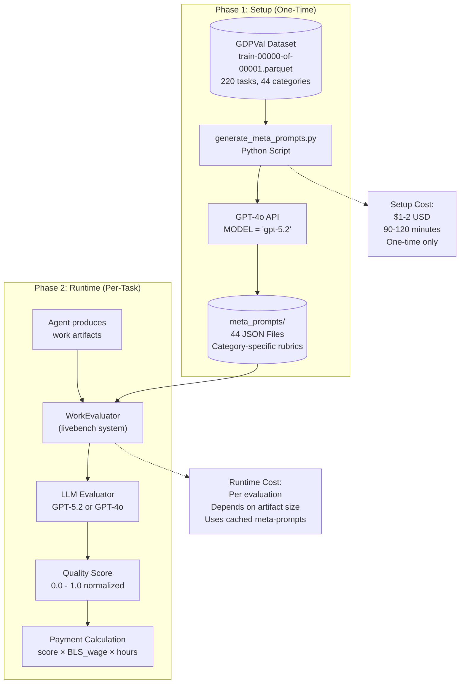
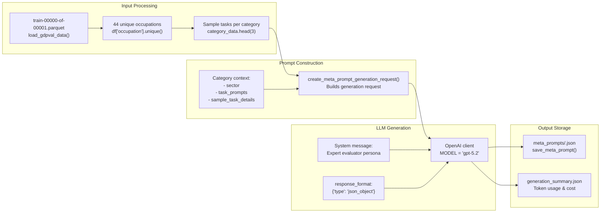
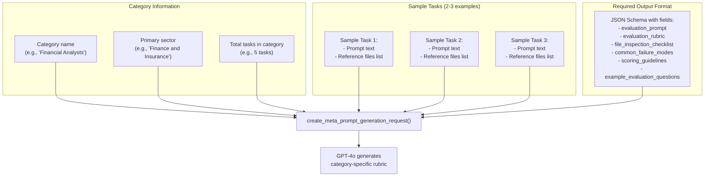
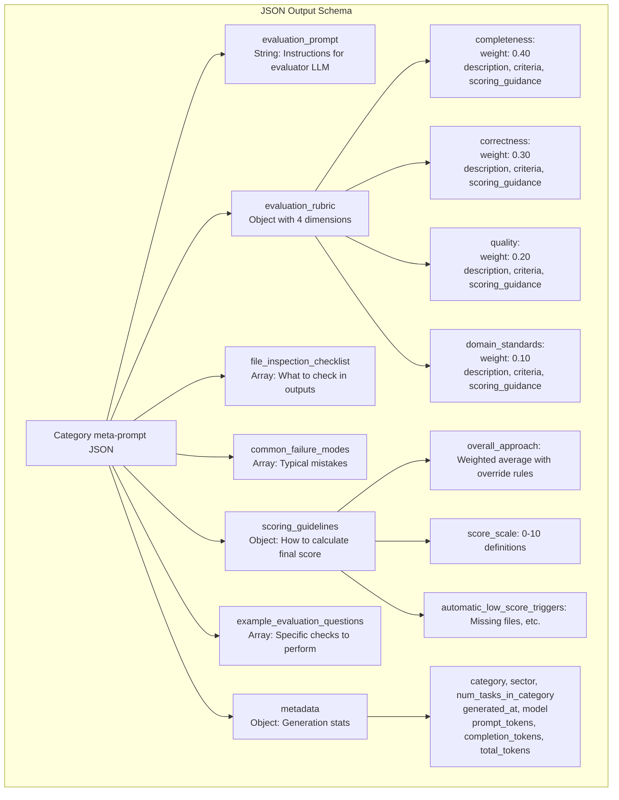
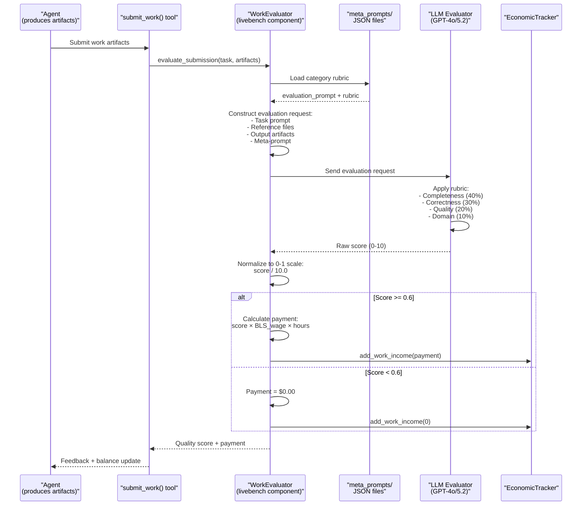
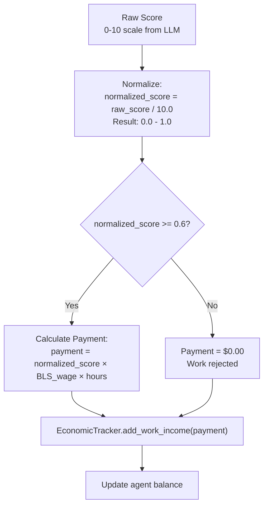
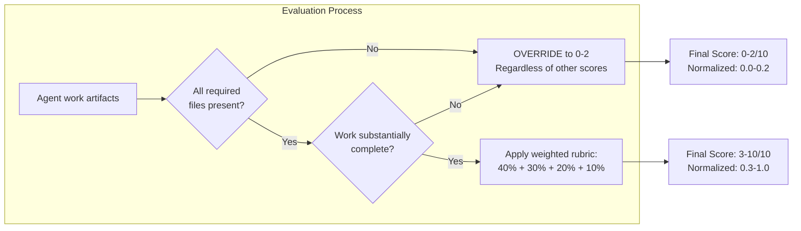
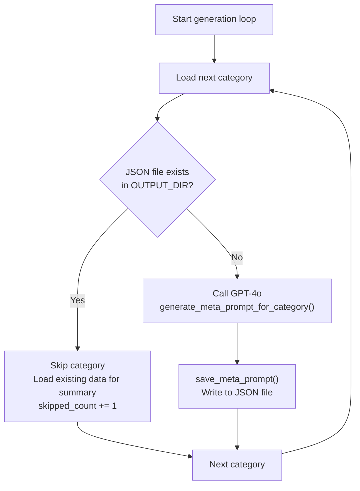

<!-- source: DeepWiki mcp.deepwiki.com · repo HKUDS/ClawWork · page 6.1 Evaluation Architecture · fetched 2026-11-09 -->

# Evaluation Architecture

<details>
<summary>Relevant source files</summary>

The following files were used as context for generating this wiki page:

- [eval/README.md](eval/README.md)
- [eval/generate_meta_prompts.py](eval/generate_meta_prompts.py)

</details>


## Purpose and Scope

This page documents the overall architecture of ClawWork's LLM-based evaluation system, which objectively scores agent work outputs using category-specific rubrics. The system operates in two distinct phases: **setup** (meta-prompt generation) and **runtime** (work evaluation). This page covers the high-level pipeline, phase separation, and scoring mechanisms. For details on the meta-prompt generation script, see [Meta-Prompt Generation](#6.2). For rubric structure and scoring dimensions, see [Evaluation Rubric Structure](#6.3).

---

## System Overview

The evaluation architecture is designed to provide consistent, objective quality assessment across 44 different occupational categories in the GDPVal dataset. Rather than using a single universal rubric, the system generates category-specific evaluation criteria that account for domain-specific standards and deliverable expectations.

**Key Design Principles:**

| Principle | Implementation |
|-----------|---------------|
| **Category-Specific Rubrics** | Each of 44 occupations has its own evaluation criteria generated by GPT-4o |
| **Two-Phase Architecture** | Setup phase (one-time, expensive) vs. Runtime phase (per-task, cost-effective) |
| **Strict Quality Threshold** | Missing or incomplete deliverables automatically score 0-2/10 |
| **Weighted Scoring** | Completeness (40%), Correctness (30%), Quality (20%), Domain Standards (10%) |
| **Economic Consequences** | Scores below 0.6 (on normalized 0-1 scale) result in zero payment |

Sources: [eval/README.md:1-38](), [eval/generate_meta_prompts.py:1-11]()

---

## Two-Phase Architecture



**Phase 1: Setup (One-Time)**
- Executes once to generate evaluation criteria for all 44 categories
- Cost: $1-2 USD, Time: 90-120 minutes
- Output: 44 JSON files with category-specific rubrics
- Safe to interrupt and resume (skips already-generated categories)

**Phase 2: Runtime (Per-Task)**
- Executes for each work submission
- Loads pre-generated meta-prompts from Phase 1
- Fast and cost-effective (no need to regenerate evaluation criteria)

Sources: [eval/README.md:12-20](), [eval/generate_meta_prompts.py:26-30]()

---

## Meta-Prompt Generation Pipeline

The setup phase uses a recursive LLM approach: GPT-4o generates evaluation prompts that will later be used by other LLMs to score agent work.

### Pipeline Components



Sources: [eval/generate_meta_prompts.py:39-44](), [eval/generate_meta_prompts.py:182-264]()

### Key Functions

| Function | Purpose | Location |
|----------|---------|----------|
| `load_gdpval_data()` | Loads GDPVal parquet file | [eval/generate_meta_prompts.py:39-44]() |
| `create_meta_prompt_generation_request()` | Constructs LLM prompt for generating evaluation criteria | [eval/generate_meta_prompts.py:46-180]() |
| `generate_meta_prompt_for_category()` | Calls GPT-4o to generate rubric for one category | [eval/generate_meta_prompts.py:182-264]() |
| `save_meta_prompt()` | Persists generated rubric to JSON file | [eval/generate_meta_prompts.py:277-286]() |
| `category_already_generated()` | Checks if category was already processed (resume capability) | [eval/generate_meta_prompts.py:270-275]() |

Sources: [eval/generate_meta_prompts.py:39-286]()

---

## Generation Request Structure

The `create_meta_prompt_generation_request()` function builds a comprehensive prompt that instructs GPT-4o to create evaluation guidelines. This meta-prompt includes:

### Context Provided to GPT-4o



Sources: [eval/generate_meta_prompts.py:46-180]()

### Critical Requirements Embedded in Meta-Prompt

The generation request explicitly instructs GPT-4o to enforce these non-negotiable rules:

| Requirement | Specification | Code Reference |
|-------------|---------------|----------------|
| **Scoring Scale** | 0-10 integer scale | [eval/generate_meta_prompts.py:101-106]() |
| **Missing Artifacts Rule** | Must score 0-2 if required files absent | [eval/generate_meta_prompts.py:93]() |
| **Weighted Dimensions** | Completeness 40%, Correctness 30%, Quality 20%, Domain 10% | [eval/generate_meta_prompts.py:123-147]() |
| **Category Generality** | Guidelines apply to all tasks in category, not task-specific | [eval/generate_meta_prompts.py:84]() |
| **File-Based Evaluation** | Focus on assessing output artifacts, not process | [eval/generate_meta_prompts.py:86-91]() |

Sources: [eval/generate_meta_prompts.py:79-113]()

---

## Output Structure

Each generated meta-prompt is saved as a JSON file with this structure:



Sources: [eval/generate_meta_prompts.py:119-175](), [eval/generate_meta_prompts.py:248-257]()

---

## Runtime Evaluation Flow

During agent operation, the evaluation system loads pre-generated meta-prompts and uses them to score work submissions.



Sources: [eval/generate_meta_prompts.py:66-178]() (meta-prompt structure that runtime system uses)

---

## Scoring System

### Raw Score Calculation (0-10 Scale)

The evaluator LLM assigns a 0-10 score for each of the four dimensions:

| Dimension | Weight | Focus | Score Range |
|-----------|--------|-------|-------------|
| **Completeness** | 40% | All required files exist, all requirements addressed | 0-2 if files missing, 3-10 based on coverage |
| **Correctness** | 30% | Accuracy of data, calculations, information | 0-10 based on factual accuracy |
| **Quality** | 20% | Professional formatting, clarity, organization | 0-10 based on presentation |
| **Domain Standards** | 10% | Industry-specific best practices | 0-10 based on professional norms |

**Final Raw Score** = (0.4 × completeness) + (0.3 × correctness) + (0.2 × quality) + (0.1 × domain_standards)

Sources: [eval/generate_meta_prompts.py:123-147]()

### Normalization and Threshold Enforcement



**Critical Threshold: 0.6**
- Scores below 0.6 (or 6/10 on raw scale) receive **zero payment**
- Agent still incurs token costs from work execution
- This creates genuine economic risk for low-quality work

Sources: [eval/README.md:28-36]() (describes scoring scale), [eval/generate_meta_prompts.py:101-106]() (scoring guidance)

---

## Automatic Low-Score Triggers

The evaluation system enforces strict rules that override weighted averaging:

### Override Rules



### Triggering Conditions

As specified in the meta-prompt generation request:

1. **Required output files are missing** - [eval/generate_meta_prompts.py:162]()
2. **Deliverables are severely incomplete** - [eval/generate_meta_prompts.py:163]()
3. **Major requirements from prompt are not addressed** - [eval/generate_meta_prompts.py:164]()

These triggers appear in the `automatic_low_score_triggers` field of each generated meta-prompt JSON.

Sources: [eval/generate_meta_prompts.py:159-168]()

---

## File Paths and Storage

### Directory Structure

```
eval/
├── generate_meta_prompts.py          # Meta-prompt generation script
├── test_single_category.py           # Test script for single category
├── README.md                          # Setup and usage documentation
└── meta_prompts/                     # Generated evaluation rubrics (gitignored)
    ├── Financial_Analysts.json       # Example: Finance category
    ├── Software_Developers.json      # Example: Tech category
    ├── Registered_Nurses.json        # Example: Healthcare category
    ├── ...                           # 41 more category files
    └── generation_summary.json       # Token usage summary
```

### Configuration Constants

| Constant | Value | Purpose | Location |
|----------|-------|---------|----------|
| `MODEL` | `"gpt-5.2"` | LLM used for meta-prompt generation | [eval/generate_meta_prompts.py:26]() |
| `DATA_PATH` | `"../gdpval/data/train-00000-of-00001.parquet"` | GDPVal dataset source | [eval/generate_meta_prompts.py:27]() |
| `OUTPUT_DIR` | `"./meta_prompts"` | Where to save generated rubrics | [eval/generate_meta_prompts.py:28]() |
| `LOG_FILE` | `"./meta_prompt_generation.log"` | Detailed generation log | [eval/generate_meta_prompts.py:29]() |

Sources: [eval/generate_meta_prompts.py:22-29]()

---

## Resume Capability

The generation script supports resumption if interrupted:



**Implementation:** The `category_already_generated()` function checks if a file exists before attempting generation, allowing safe interruption and restart.

Sources: [eval/generate_meta_prompts.py:270-275](), [eval/generate_meta_prompts.py:350-365]()

---

## Cost and Performance

### Setup Phase (One-Time)

| Metric | Value | Notes |
|--------|-------|-------|
| **Duration** | 90-120 minutes | For all 44 categories with rate limiting |
| **Total Cost** | $1-2 USD | Estimated for GPT-4o at $5/1M tokens |
| **API Calls** | 44 requests | One per category |
| **Rate Limiting** | 2 seconds between requests | Configurable via `sleep_time` |
| **Resume Support** | Yes | Safe to interrupt and restart |

### Runtime Phase (Per-Evaluation)

- **Cost:** Depends on artifact size and complexity
- **Latency:** Single LLM call per evaluation
- **Optimization:** Pre-generated meta-prompts eliminate re-generation cost
- **Caching:** Meta-prompts loaded from disk, not regenerated

Sources: [eval/README.md:13-16](), [eval/generate_meta_prompts.py:379-383]()

---

## Summary Report Generation

After processing all categories, the script generates a summary report:

### Summary Report Structure

```json
{
  "generation_date": "ISO 8601 timestamp",
  "total_categories": 44,
  "model_used": "gpt-5.2",
  "categories": [
    {
      "category": "Financial Analysts",
      "sector": "Finance and Insurance",
      "num_tasks": 5,
      "tokens_used": 12000
    },
    // ... 43 more entries
  ],
  "total_tokens_used": 500000,
  "estimated_cost_usd": 2.5
}
```

**Location:** `meta_prompts/generation_summary.json`

**Calculation:** `estimated_cost_usd = (total_tokens / 1000000) * 5.0`

Sources: [eval/generate_meta_prompts.py:288-317]()

---

## Integration with LiveBench

The evaluation architecture integrates with the broader LiveBench system:

1. **Task Assignment:** TaskManager selects a task from GDPVal and provides its category
2. **Work Execution:** Agent uses productivity tools to generate artifacts
3. **Submission:** Agent calls `submit_work()` tool with produced artifacts
4. **Evaluation:** WorkEvaluator loads meta-prompt for task's category
5. **Scoring:** LLM evaluator applies rubric and returns 0-10 score
6. **Normalization:** Score normalized to 0-1 scale
7. **Payment:** If score ≥ 0.6, payment = score × BLS_wage × hours; else $0
8. **Economic Update:** EconomicTracker adds income and deducts evaluation costs

For details on the WorkEvaluator component, see [Work Evaluator](#4.4). For payment calculation specifics, see [Economic Tracker](#4.2).

Sources: [eval/generate_meta_prompts.py:1-11]() (overall context), [eval/README.md:1-38]() (integration overview)

---

