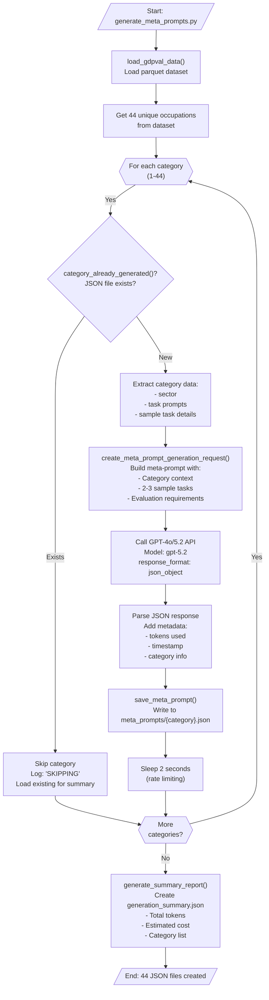
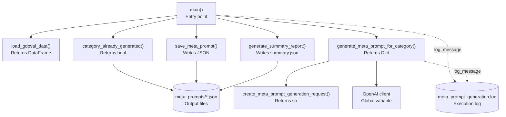
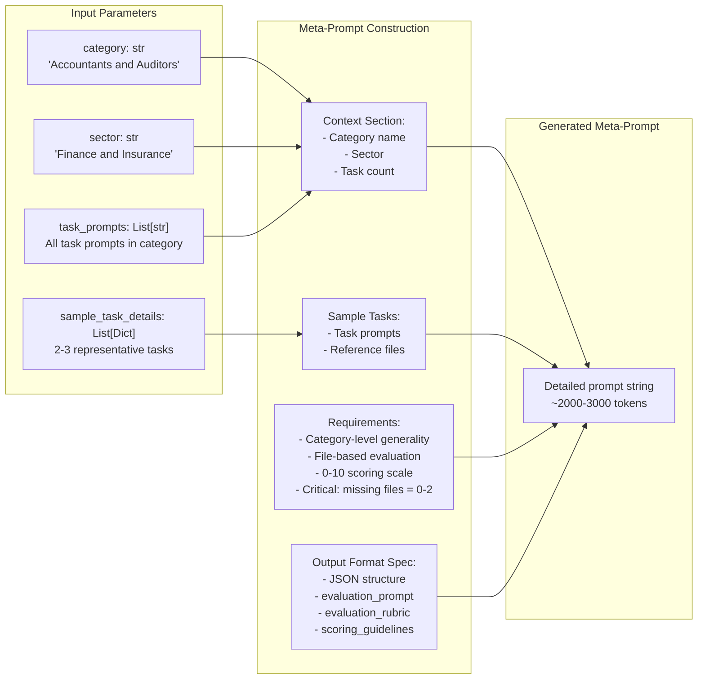
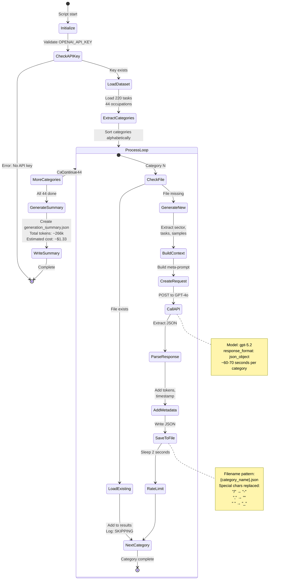
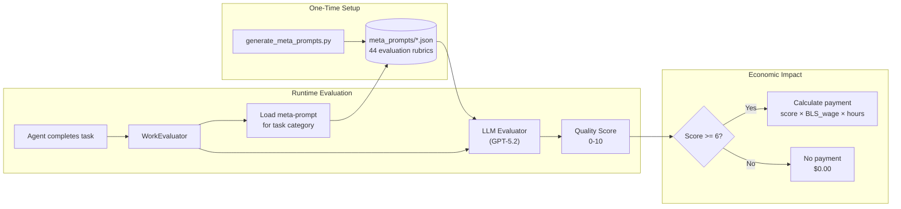

<!-- source: DeepWiki mcp.deepwiki.com · repo HKUDS/ClawWork · page 6.2 Meta-Prompt Generation · fetched 2026-11-09 -->

# Meta-Prompt Generation

<details>
<summary>Relevant source files</summary>

The following files were used as context for generating this wiki page:

- [eval/README.md](eval/README.md)
- [eval/generate_meta_prompts.py](eval/generate_meta_prompts.py)
- [eval/meta_prompt_generation.log](eval/meta_prompt_generation.log)

</details>


This page documents the one-time setup process that generates category-specific evaluation rubrics for the 44 occupational categories in the GDPVal dataset. These meta-prompts are consumed by the runtime evaluation system to score agent work outputs.

For information about how these meta-prompts are used during agent evaluation, see [Evaluation Architecture](#6.1). For details on the rubric structure itself, see [Evaluation Rubric Structure](#6.3).

---

## Purpose and Scope

The meta-prompt generation system creates domain-specific evaluation guidelines for each of the 44 occupational categories in GDPVal. Rather than manually crafting evaluation criteria for categories ranging from "Accountants and Auditors" to "Software Developers", the system uses GPT-4o to analyze sample tasks from each category and generate comprehensive evaluation frameworks.

This is a **one-time setup process** that produces 44 JSON files containing evaluation prompts, rubrics, checklists, and scoring guidelines. The generated meta-prompts are category-level (not task-specific) and designed to help LLM evaluators assess file-based outputs consistently across all tasks within a category.

**Key characteristics:**
- **One-time cost**: ~$1-2 USD and 90-120 minutes for all 44 categories
- **Resume capability**: Automatically skips already-generated categories
- **Structured output**: JSON format with evaluation_prompt, evaluation_rubric, scoring_guidelines, and more
- **0-10 scoring scale**: Emphasizes completeness with automatic low scores for missing deliverables

---

## Generation Workflow



**Diagram: Meta-Prompt Generation Pipeline**

Sources: [eval/generate_meta_prompts.py:319-403]()

---

## Script Components

The generation script is organized into several key functions that handle data loading, prompt construction, API interaction, and output management.

### Core Functions

| Function | Purpose | Returns |
|----------|---------|---------|
| `load_gdpval_data()` | Load GDPVal parquet dataset | `pd.DataFrame` |
| `create_meta_prompt_generation_request()` | Build the prompt sent to GPT-4o | `str` (meta-prompt) |
| `generate_meta_prompt_for_category()` | Orchestrate generation for one category | `Dict[str, Any]` (meta-prompt data) |
| `get_safe_filename()` | Convert category name to filesystem-safe name | `str` (filename) |
| `category_already_generated()` | Check if category JSON already exists | `bool` |
| `save_meta_prompt()` | Write meta-prompt JSON to disk | `None` |
| `generate_summary_report()` | Create overall generation summary | `None` |

### Function Interaction Diagram



**Diagram: Function Dependencies and Data Flow**

Sources: [eval/generate_meta_prompts.py:39-318]()

---

## Meta-Prompt Request Structure

The `create_meta_prompt_generation_request()` function constructs a detailed prompt that instructs GPT-4o to generate evaluation guidelines. The request includes category context, sample tasks, and comprehensive requirements.

### Request Components



**Diagram: Meta-Prompt Request Construction**

### Critical Requirements in Request

The meta-prompt request explicitly instructs GPT-4o to:

1. **0-10 Scoring Scale**: Use integer scores from 0-10, not 0-1 normalized scores
2. **Missing Artifacts = Low Score**: If required output files are missing, must assign 0-2 regardless of other factors
3. **Four Evaluation Dimensions**:
   - **Completeness (40%)**: All required files exist, all requirements addressed
   - **Correctness (30%)**: Accuracy of data, calculations, information
   - **Quality (20%)**: Professional formatting, clarity, organization
   - **Domain Standards (10%)**: Industry-specific best practices
4. **Category-Level Generality**: Guidelines apply to all tasks in category, not just specific examples
5. **File-Based Assessment**: Evaluator receives task prompt, reference files, and output artifacts

Sources: [eval/generate_meta_prompts.py:46-180]()

---

## Output Format

Each generated meta-prompt is saved as a JSON file in `meta_prompts/{safe_category_name}.json` with the following structure:

### JSON Schema

```json
{
  "category": "Accountants and Auditors",
  "evaluation_prompt": "Detailed instructions for LLM evaluator...",
  "evaluation_rubric": {
    "completeness": {
      "weight": 0.40,
      "description": "All required output files exist...",
      "criteria": ["criterion 1", "criterion 2", ...],
      "scoring_guidance": "0-2 if files missing..."
    },
    "correctness": { /* similar structure */ },
    "quality": { /* similar structure */ },
    "domain_standards": { /* similar structure */ }
  },
  "file_inspection_checklist": [
    "What to check in output file 1",
    "What to check in output file 2"
  ],
  "common_failure_modes": [
    "Common mistake 1",
    "Common mistake 2"
  ],
  "scoring_guidelines": {
    "overall_approach": "Calculate weighted average...",
    "score_scale": "0-10 where 0-2=Unacceptable...",
    "automatic_low_score_triggers": ["Missing files", ...],
    "excellent_output_characteristics": [...],
    "poor_output_characteristics": [...]
  },
  "example_evaluation_questions": [
    "Question evaluator should ask..."
  ],
  "metadata": {
    "category": "Accountants and Auditors",
    "sector": "Finance and Insurance",
    "num_tasks_in_category": 5,
    "generated_at": "2026-01-06T06:55:49.123456",
    "model": "gpt-5.2",
    "prompt_tokens": 3456,
    "completion_tokens": 3222,
    "total_tokens": 6678
  }
}
```

### Field Descriptions

| Field | Type | Purpose |
|-------|------|---------|
| `evaluation_prompt` | `str` | Main prompt given to evaluator LLM explaining evaluation process |
| `evaluation_rubric` | `dict` | Four weighted dimensions with criteria and scoring guidance |
| `file_inspection_checklist` | `list[str]` | Specific items to verify in output files |
| `common_failure_modes` | `list[str]` | Typical mistakes that lead to low scores |
| `scoring_guidelines` | `dict` | Overall approach, scale definition, triggers, characteristics |
| `example_evaluation_questions` | `list[str]` | Questions evaluator should consider |
| `metadata` | `dict` | Generation metadata including token counts |

Sources: [eval/generate_meta_prompts.py:117-176](), [eval/generate_meta_prompts.py:247-260]()

---

## Execution Flow and State Management



**Diagram: Execution State Machine**

### Resume Capability

The script implements automatic resume functionality to avoid re-generating categories:

1. **Check before generation**: `category_already_generated()` checks if `meta_prompts/{category}.json` exists [eval/generate_meta_prompts.py:270-275]()
2. **Skip existing**: If file exists, logs "SKIPPING" and loads existing data for summary [eval/generate_meta_prompts.py:351-365]()
3. **Continue from last**: Can safely Ctrl+C and restart - will resume from first missing category
4. **Summary includes all**: Final summary includes both newly generated and pre-existing categories [eval/generate_meta_prompts.py:288-318]()

Sources: [eval/generate_meta_prompts.py:319-403]()

---

## Performance Characteristics

### Execution Metrics

Based on log data from a complete generation run:

| Metric | Value |
|--------|-------|
| **Total Categories** | 44 |
| **Total Runtime** | ~107 minutes (6:54:38 - 7:45:59) |
| **Avg Time per Category** | ~145 seconds (~2.4 minutes) |
| **Total Tokens Used** | 266,362 |
| **Avg Tokens per Category** | ~6,054 |
| **Estimated Cost** | $1.33 USD |
| **Rate Limiting** | 2 seconds between requests |

### Token Distribution

The token usage per category varies based on category complexity:

```
Lowest:  5,254 tokens (General and Operations Managers)
Highest: 6,877 tokens (First-Line Supervisors of Production and Operating Workers)
Average: 6,054 tokens
```

### Cost Calculation

The script estimates cost using a rough formula [eval/generate_meta_prompts.py:309]():

```python
estimated_cost_usd = (total_tokens / 1000000) * 5.0  # $5 per 1M tokens
```

**Note**: This is a rough estimate. Actual costs depend on:
- Input tokens (typically 3,000-3,500)
- Output tokens (typically 3,000-3,500)  
- GPT-4o pricing tier
- Whether using GPT-4o or GPT-5.2 (script uses `MODEL = "gpt-5.2"`)

Sources: [eval/meta_prompt_generation.log:16-430](), [eval/generate_meta_prompts.py:26-29]()

---

## Usage

### Prerequisites

```bash
# Install dependencies
pip install pandas pyarrow openai

# Set API key
export OPENAI_API_KEY='your-openai-api-key'
```

### Running the Script

```bash
# Generate all 44 categories (90-120 minutes, $1-2)
cd eval
python generate_meta_prompts.py

# Output will be in:
# - meta_prompts/*.json (44 files)
# - meta_prompts/generation_summary.json (summary)
# - meta_prompt_generation.log (detailed log)
```

### Testing Single Category

For testing or development, use the test script:

```bash
# Test single category (30 seconds, ~$0.05)
python test_single_category.py
```

### Configuration

Key configuration constants in the script [eval/generate_meta_prompts.py:25-29]():

| Constant | Default Value | Purpose |
|----------|---------------|---------|
| `MODEL` | `"gpt-5.2"` | OpenAI model for generation |
| `DATA_PATH` | `"../gdpval/data/train-00000-of-00001.parquet"` | GDPVal dataset location |
| `OUTPUT_DIR` | `"./meta_prompts"` | Output directory for JSONs |
| `LOG_FILE` | `"./meta_prompt_generation.log"` | Execution log file |

### Interruption and Resume

The script is safe to interrupt and resume:

1. Press Ctrl+C to stop at any time
2. Already-generated categories are saved immediately after generation
3. Re-run the script - it will automatically skip completed categories
4. Progress is logged to `meta_prompt_generation.log` for tracking

Example log output showing resume behavior:

```
[2026-01-06 07:00:29] Processing category 6/44: Compliance Officers
[2026-01-06 07:00:29] Generating meta-prompt for category: Compliance Officers
[2026-01-06 07:01:31] Successfully generated meta-prompt for Compliance Officers (tokens: 5728)
[2026-01-06 07:01:31] Saved meta-prompt to meta_prompts/Compliance_Officers.json
```

Sources: [eval/README.md:1-38](), [eval/generate_meta_prompts.py:319-403]()

---

## Output Files

### Generated Files Structure

```
eval/
├── meta_prompts/
│   ├── Accountants_and_Auditors.json
│   ├── Administrative_Services_Managers.json
│   ├── Audio_and_Video_Technicians.json
│   ├── ... (44 total category files)
│   ├── Software_Developers.json
│   └── generation_summary.json
├── meta_prompt_generation.log
└── generate_meta_prompts.py
```

### Summary File Contents

The `generation_summary.json` provides an overview of the generation process:

```json
{
  "generation_date": "2026-01-06T07:45:59.123456",
  "total_categories": 44,
  "model_used": "gpt-5.2",
  "total_tokens_used": 266362,
  "estimated_cost_usd": 1.33,
  "categories": [
    {
      "category": "Accountants and Auditors",
      "sector": "Finance and Insurance",
      "num_tasks": 5,
      "tokens_used": 6678
    },
    // ... 43 more categories
  ]
}
```

### Filename Sanitization

Category names are converted to filesystem-safe filenames using `get_safe_filename()` [eval/generate_meta_prompts.py:266-268]():

| Original | Sanitized |
|----------|-----------|
| `"Accountants and Auditors"` | `"Accountants_and_Auditors"` |
| `"Child, Family, and School Social Workers"` | `"Child_Family_and_School_Social_Workers"` |
| `"First-Line Supervisors of Non-Retail Sales Workers"` | `"First-Line_Supervisors_of_Non-Retail_Sales_Workers"` |

**Transformation rules:**
- `/` → `-`
- `,` → (removed)
- ` ` (space) → `_`

Sources: [eval/generate_meta_prompts.py:266-318]()

---

## Integration with Evaluation System

The generated meta-prompts are consumed by the runtime evaluation system:



**Diagram: Meta-Prompt Lifecycle - Generation to Runtime Usage**

The meta-prompts serve as the bridge between the one-time setup phase and the continuous evaluation process. Each time an agent submits work, the `WorkEvaluator` loads the appropriate category-specific meta-prompt and uses it to guide the LLM evaluator in scoring the output.

For details on the runtime evaluation process, see [Work Evaluator](#4.4) and [Evaluation Architecture](#6.1).

Sources: [eval/generate_meta_prompts.py:1-11]()

---

