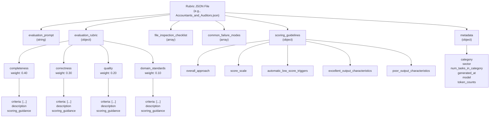
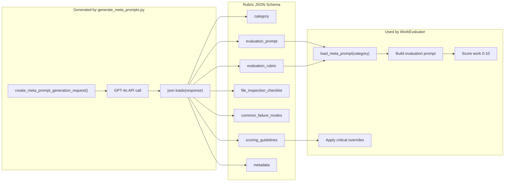
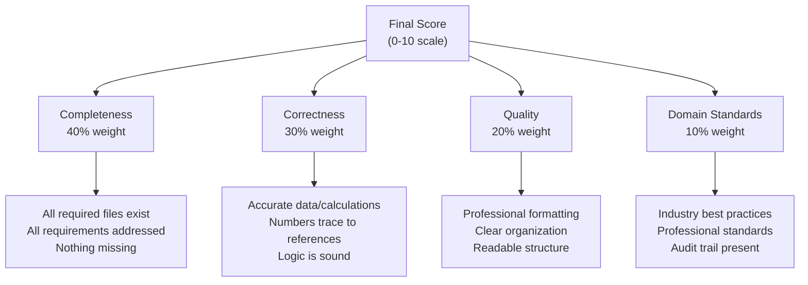
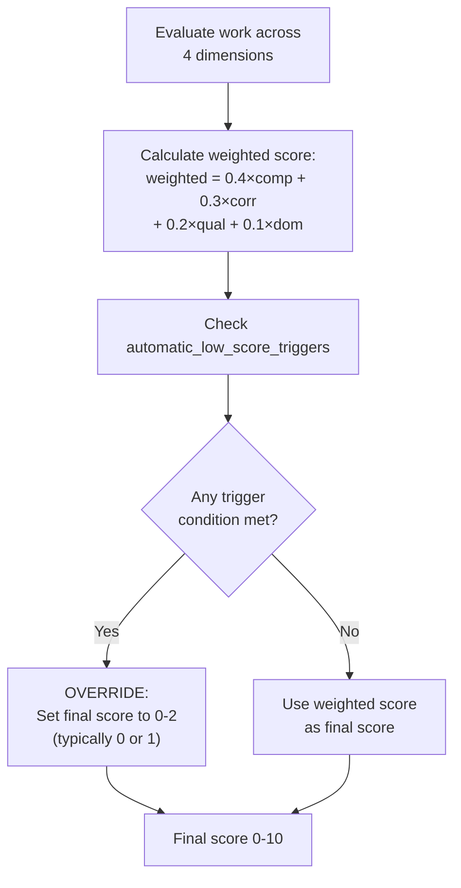
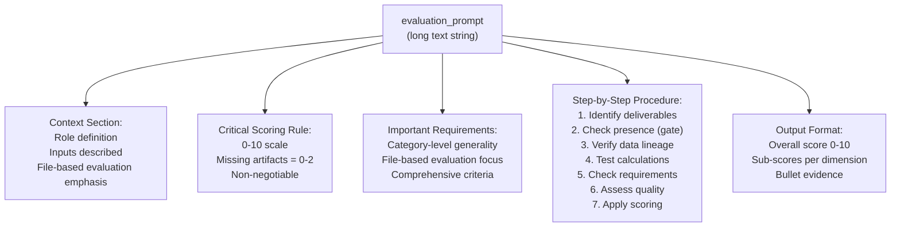
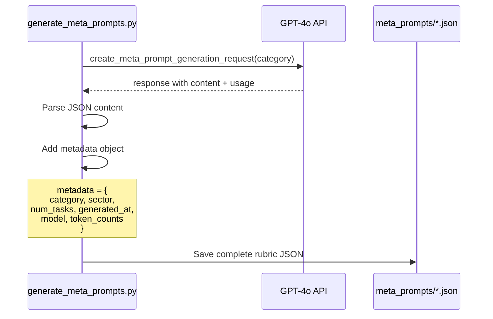

<!-- source: DeepWiki mcp.deepwiki.com · repo HKUDS/ClawWork · page 6.3 Evaluation Rubric Structure · fetched 2026-11-09 -->

# Evaluation Rubric Structure

<details>
<summary>Relevant source files</summary>

The following files were used as context for generating this wiki page:

- [eval/generate_meta_prompts.py](eval/generate_meta_prompts.py)
- [eval/meta_prompts/Accountants_and_Auditors.json](eval/meta_prompts/Accountants_and_Auditors.json)

</details>


This document describes the structure of category-specific evaluation rubrics used to score agent work in ClawWork. Each rubric is a JSON document defining weighted scoring dimensions, detailed criteria, and enforcement rules for a particular occupational category.

For information about the rubric generation process, see [Meta-Prompt Generation](#6.2). For examples of rubrics across different categories, see [Category-Specific Evaluations](#6.4). For details on the strict enforcement mechanisms, see [Critical Rules and Overrides](#6.5).

---

## JSON Schema Overview

Each evaluation rubric is stored as a JSON file in `eval/meta_prompts/` with a filename derived from the category name (e.g., `Accountants_and_Auditors.json`). The schema follows a standardized structure that enables consistent evaluation across all 44 occupational categories in the GDPVal dataset.

**Rubric JSON Structure**



Sources: [eval/meta_prompts/Accountants_and_Auditors.json:1-136](), [eval/generate_meta_prompts.py:116-176]()

---

## Top-Level Fields

The rubric JSON contains six top-level fields that collectively define how to evaluate work in a category:

| Field | Type | Purpose |
|-------|------|---------|
| `category` | string | The occupational category name (matches GDPVal dataset) |
| `evaluation_prompt` | string | Master instructions for the LLM evaluator describing the evaluation process |
| `evaluation_rubric` | object | Four weighted dimensions with criteria and scoring guidance |
| `file_inspection_checklist` | array | Step-by-step checklist for inspecting output artifacts |
| `common_failure_modes` | array | Typical mistakes that lead to low scores |
| `scoring_guidelines` | object | Overall scoring approach, scale, and override rules |

**Field Structure Mapping**



Sources: [eval/generate_meta_prompts.py:46-180](), [eval/meta_prompts/Accountants_and_Auditors.json:2-125]()

---

## Core Evaluation Dimensions

The `evaluation_rubric` object contains four weighted dimensions that combine to produce the final score. Each dimension has a fixed weight that sums to 1.0 (100%).

**Dimension Weight Distribution**



### Dimension Structure

Each dimension in `evaluation_rubric` follows this schema:

```json
{
  "dimension_name": {
    "weight": 0.40,
    "description": "Brief summary of what this dimension measures",
    "criteria": [
      "Specific criterion 1",
      "Specific criterion 2",
      "..."
    ],
    "scoring_guidance": "0-10 scale guidance for this dimension"
  }
}
```

Sources: [eval/generate_meta_prompts.py:123-147](), [eval/meta_prompts/Accountants_and_Auditors.json:4-58]()

### Completeness (40% weight)

The most heavily weighted dimension, focusing on whether all required deliverables are present and all task requirements are addressed. This dimension enforces the "missing artifacts = low score" principle.

**Typical Criteria:**
- All required output files/artifacts are present and openable
- All required worksheets/tabs/sections exist and are populated
- Every explicitly requested table/column/field is included
- All required computations are actually performed (not placeholders)
- All specified constraints are demonstrably satisfied
- Deliverable includes all required time periods
- Any required reconciliations are included

**Scoring Guidance Pattern:**
- 0-2: Any required file/tab/major section missing or substantially unpopulated
- 3-4: Multiple prompt requirements missing or only partially addressed
- 5-6: Most deliverables exist but several notable elements missing
- 7-8: Everything required present with only minor omissions
- 9-10: Fully complete with clear evidence each requirement met

Sources: [eval/meta_prompts/Accountants_and_Auditors.json:5-18]()

### Correctness (30% weight)

Evaluates the accuracy of data, calculations, and logic. This dimension verifies that outputs are factually correct and mathematically sound.

**Typical Criteria:**
- Numbers trace to reference files; no fabricated values
- Formulas are mathematically correct
- Correct definitions used for domain-specific calculations
- Proper handling of edge cases (zero values, negatives, division by zero)
- Rollforwards and reconciliations compute correctly
- No internal inconsistencies between related values
- Logic is consistent with stated methodologies

**Scoring Guidance Pattern:**
- 0-2: Calculations largely wrong/unverifiable or key outputs incorrect
- 3-4: Frequent errors materially affecting conclusions
- 5-6: Generally correct but with several notable errors
- 7-8: Mostly correct with only minor arithmetic issues
- 9-10: Accurate, recomputable, handles edge cases appropriately

Sources: [eval/meta_prompts/Accountants_and_Auditors.json:19-32]()

### Quality (20% weight)

Assesses professional formatting, clarity, and organization. This dimension ensures outputs are usable and readable by professionals.

**Typical Criteria:**
- Clear structure with logical organization
- Professional formatting (currency, alignment, readability)
- Clear documentation of assumptions/parameters
- Auditability (workings shown, formulas used appropriately)
- Minimal clutter and consistent conventions
- Error-avoidance (no broken formulas, no unresolved errors)

**Scoring Guidance Pattern:**
- 0-2: Messy/unreadable or unusable output
- 3-4: Significant clarity/formatting problems impede review
- 5-6: Usable but with several presentation issues
- 7-8: Clean and professional with minor improvements possible
- 9-10: Executive/audit-ready, highly readable

Sources: [eval/meta_prompts/Accountants_and_Auditors.json:33-45]()

### Domain Standards (10% weight)

Evaluates adherence to industry-specific best practices and professional conventions for the occupation.

**Typical Criteria:**
- Professional conventions for the domain
- Appropriate documentation and methodology
- Risk-based thinking and controls mindset
- Audit trail sufficient for re-performance
- Flags for anomalies and transparent handling

**Scoring Guidance Pattern:**
- 0-2: Ignores basic professional standards
- 3-4: Limited adherence and weak documentation
- 5-6: Acceptable standards but inconsistent
- 7-8: Strong adherence with minor gaps
- 9-10: Exemplary professional standard

Sources: [eval/meta_prompts/Accountants_and_Auditors.json:46-57]()

---

## Scoring Scale and Guidelines

The rubric uses a **0-10 integer scoring scale** with strict anchors at each level. The `scoring_guidelines` object defines how dimension scores combine and when override rules apply.

**Scoring Scale Anchors**

| Score Range | Label | Meaning |
|-------------|-------|---------|
| 0-2 | Unacceptable | Missing files/incomplete work, critical defects |
| 3-4 | Poor | Major issues, many requirements unmet |
| 5-6 | Acceptable | Notable gaps or errors, meets minimum bar |
| 7-8 | Good | Minor issues only, professional quality |
| 9-10 | Excellent | Complete, accurate, exemplary work |

**Overall Scoring Approach**

The `overall_approach` field specifies the calculation method:

```
weighted_score = (completeness_score × 0.40) +
                 (correctness_score × 0.30) +
                 (quality_score × 0.20) +
                 (domain_standards_score × 0.10)
```

However, this calculation is **subject to critical override rules** documented in `automatic_low_score_triggers`.

Sources: [eval/generate_meta_prompts.py:101-107](), [eval/generate_meta_prompts.py:159-169](), [eval/meta_prompts/Accountants_and_Auditors.json:88-97]()

---

## Critical Override Mechanism

The `automatic_low_score_triggers` array defines non-negotiable conditions that force an overall score of 0-2 regardless of the weighted calculation. This enforces ClawWork's strict "missing deliverables are unacceptable" principle.

**Override Logic Flow**



**Standard Automatic Triggers**

All rubrics include these triggers as defined in the generation template:

1. **Any required output file/artifact is missing**
2. **Output file cannot be opened or is corrupted/password-locked**
3. **Required worksheets/tabs/major sections are missing**
4. **Key required computations are not performed (blank/placeholder)**
5. **Work is substantially not responsive to the prompt**

These triggers appear in every rubric's `scoring_guidelines.automatic_low_score_triggers` array.

Sources: [eval/generate_meta_prompts.py:79-93](), [eval/generate_meta_prompts.py:162-166](), [eval/meta_prompts/Accountants_and_Auditors.json:91-97]()

---

## Supporting Components

Beyond the core scoring dimensions, rubrics include three supporting arrays that guide the evaluator through the inspection process and calibrate expectations.

### File Inspection Checklist

The `file_inspection_checklist` array provides a step-by-step procedure for inspecting output artifacts. This operationalizes the evaluation by specifying concrete checks.

**Typical Checklist Items:**
- Presence check: Confirm every required file exists and opens
- Structure check: Verify required tabs/sections exist and are populated
- Reference tie-out: Trace values back to reference files
- Arithmetic integrity: Check that totals foot and cross-tab totals tie
- Key calculation re-performance: Independently recompute core metrics
- Edge case handling: Inspect for DIV/0, N/A logic, zero periods
- Reconciliation: Confirm outputs reconcile to control totals
- Formatting/readability: Check professional formatting standards
- Audit trail: Confirm methodology is documented

Sources: [eval/meta_prompts/Accountants_and_Auditors.json:59-73]()

### Common Failure Modes

The `common_failure_modes` array catalogs typical mistakes that lead to low scores. This calibrates the evaluator's expectations and helps identify issues quickly.

**Typical Failure Modes:**
- Missing required output files
- Present but blank/placeholder outputs
- Incorrect calculations (wrong formulas, wrong base periods)
- Selection/filtering that doesn't satisfy requirements
- Totals that don't foot or tie
- Hardcoded values instead of formulas
- Poor formatting that impedes professional use
- Broken formulas left unresolved

Sources: [eval/meta_prompts/Accountants_and_Auditors.json:74-87]()

### Output Characteristics

The `scoring_guidelines` object includes two arrays that define the extremes:

**`excellent_output_characteristics`:**
- All required files and tabs present, correctly named
- Clear mapping to every prompt requirement
- Calculations re-perform exactly; totals foot
- Appropriate handling of edge cases
- Professional formatting
- Strong audit trail with documented methodology

**`poor_output_characteristics`:**
- Missing files/tabs or largely blank deliverables
- Major mismatches to reference data or fabricated numbers
- Material calculation errors and no reconciliation
- No workings or methodology
- Unprofessional, confusing layout

Sources: [eval/generate_meta_prompts.py:167-169](), [eval/meta_prompts/Accountants_and_Auditors.json:98-112]()

---

## Evaluation Prompt Structure

The `evaluation_prompt` field contains master instructions for the LLM evaluator. This is a detailed natural language prompt that synthesizes the rubric structure into actionable steps.

**Evaluation Prompt Components**



The evaluation prompt typically follows this structure:

1. **Role Definition**: "You are an expert evaluator for [category] deliverables..."
2. **Input Description**: "You will be given (1) task prompt, (2) reference files, (3) output artifacts..."
3. **Critical Rule Emphasis**: "CRITICAL: If ANY required file is missing or work is severely incomplete, you MUST assign 0-2..."
4. **Evaluation Procedure**: Step-by-step instructions (7-10 steps)
5. **Output Format**: "Provide (a) overall score, (b) sub-scores, (c) bullet evidence..."

Sources: [eval/meta_prompts/Accountants_and_Auditors.json:3](), [eval/generate_meta_prompts.py:66-178]()

---

## Metadata and Generation Tracking

Each rubric includes a `metadata` object tracking its generation provenance. This enables reproducibility and cost accounting.

**Metadata Fields**

| Field | Type | Description |
|-------|------|-------------|
| `category` | string | The occupational category this rubric covers |
| `sector` | string | The economic sector from GDPVal dataset |
| `num_tasks_in_category` | integer | Count of tasks in this category |
| `generated_at` | string | ISO 8601 timestamp of generation |
| `model` | string | LLM model used for generation (typically "gpt-5.2") |
| `prompt_tokens` | integer | Input tokens used in generation |
| `completion_tokens` | integer | Output tokens generated |
| `total_tokens` | integer | Sum of prompt and completion tokens |

**Metadata Generation Flow**



Sources: [eval/generate_meta_prompts.py:248-257](), [eval/meta_prompts/Accountants_and_Auditors.json:126-135]()

---

## Example Evaluation Questions

Each rubric includes an `example_evaluation_questions` array with 10-15 specific questions the evaluator should ask about the output. These operationalize the criteria into concrete inspection points.

**Question Categories:**

- **Presence checks**: "Are all required output artifacts present and do they open successfully?"
- **Structure checks**: "Does the workbook include every tab/section explicitly required?"
- **Calculation checks**: "Are key calculations correct when independently recomputed?"
- **Traceability checks**: "Can you trace values back to reference files with no discrepancies?"
- **Completeness checks**: "Are all required columns/fields included?"
- **Reconciliation checks**: "Do ending balances reconcile to targets?"
- **Documentation checks**: "Are assumptions and parameters documented for re-performance?"
- **Quality checks**: "Is the output professionally formatted and decision-usable?"

These questions bridge the abstract criteria in the rubric to concrete verification steps.

Sources: [eval/generate_meta_prompts.py:170-174](), [eval/meta_prompts/Accountants_and_Auditors.json:114-125]()

---

## Rubric Consistency Across Categories

While each rubric is tailored to its occupational category, all rubrics share the same structural template to ensure consistent evaluation mechanics:

**Universal Structural Elements**

| Element | Consistency Requirement |
|---------|------------------------|
| **Dimension weights** | Always 40-30-20-10 for completeness-correctness-quality-domain_standards |
| **Scoring scale** | Always 0-10 integer scale with defined anchors |
| **Override mechanism** | Always includes automatic_low_score_triggers array |
| **Critical rule** | Always enforces "missing artifacts = 0-2" |
| **JSON schema** | Always follows the same top-level field structure |

**Category-Specific Tailoring**

| Element | Varies By Category |
|---------|-------------------|
| **Criteria lists** | Specific to domain (accounting vs. legal vs. tech) |
| **Failure modes** | Common mistakes for that occupation |
| **Evaluation questions** | Domain-specific inspection points |
| **Domain standards** | Industry practices for that field |

This design ensures that all agents are evaluated on the same structural framework (weights, scale, override rules) while allowing criteria to adapt to domain-specific requirements.

Sources: [eval/generate_meta_prompts.py:123-147](), [eval/generate_meta_prompts.py:79-93]()

---

