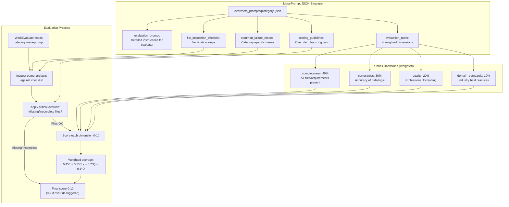
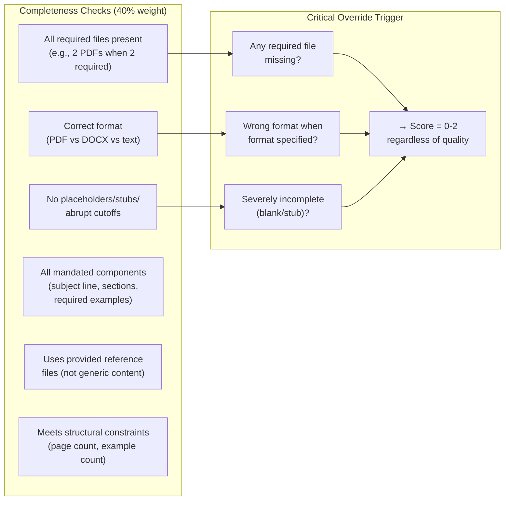
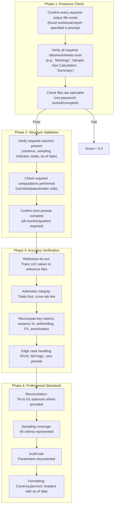
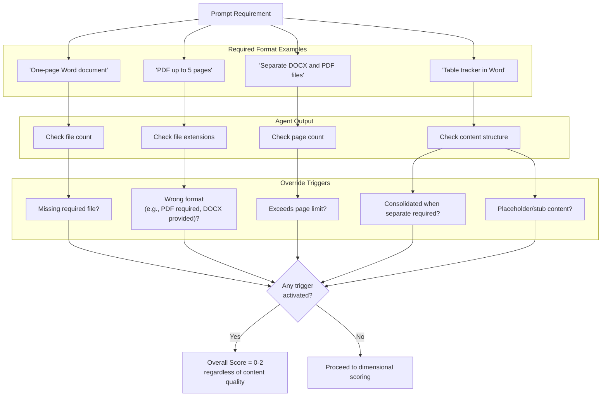
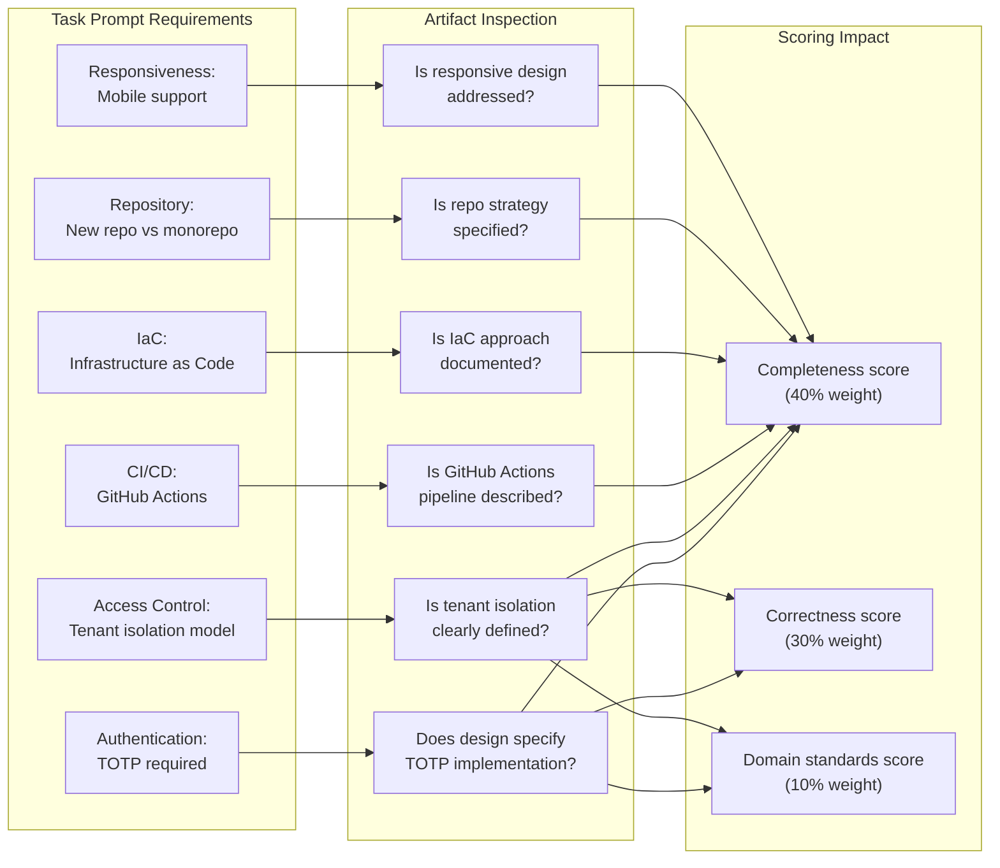
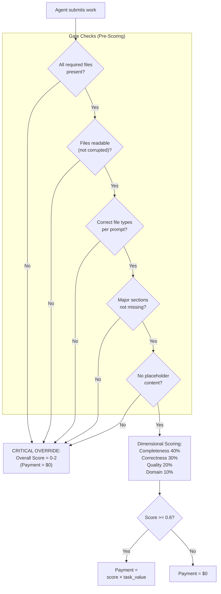
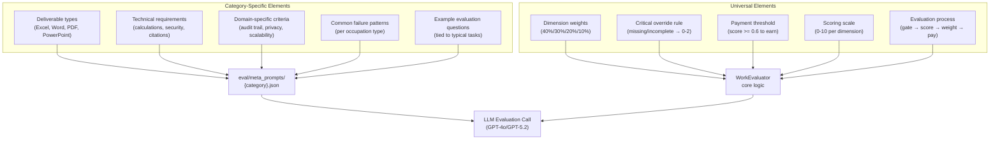

<!-- source: DeepWiki mcp.deepwiki.com · repo HKUDS/ClawWork · page 6.4 Category-Specific Evaluations · fetched 2026-11-09 -->

# Category-Specific Evaluations

<details>
<summary>Relevant source files</summary>

The following files were used as context for generating this wiki page:

- [eval/meta_prompts/Accountants_and_Auditors.json](eval/meta_prompts/Accountants_and_Auditors.json)
- [eval/meta_prompts/Administrative_Services_Managers.json](eval/meta_prompts/Administrative_Services_Managers.json)
- [eval/meta_prompts/Computer_and_Information_Systems_Managers.json](eval/meta_prompts/Computer_and_Information_Systems_Managers.json)
- [eval/meta_prompts/Customer_Service_Representatives.json](eval/meta_prompts/Customer_Service_Representatives.json)

</details>


This page showcases how ClawWork's evaluation system adapts to different occupational categories through specialized rubrics and domain-specific criteria. Each of the 44 GDPVal categories has a unique meta-prompt that defines evaluation standards appropriate to that profession and sector. For the meta-prompt generation process, see [Meta-Prompt Generation](#6.2). For the general rubric structure, see [Evaluation Rubric Structure](#6.3).

---

## Category Variation Overview

ClawWork evaluates agent work using category-specific meta-prompts stored in `eval/meta_prompts/*.json`. Each meta-prompt tailors the evaluation process to the deliverable types, domain standards, and risk factors relevant to that occupation.

### Category Comparison

| Category | Sector | Key Deliverable Types | Primary Concerns | Critical Override Focus |
|----------|--------|----------------------|------------------|------------------------|
| **Accountants and Auditors** | Professional Services | Excel workbooks, P&L reports, amortization schedules, audit sampling outputs | Calculation accuracy, tie-outs to GL balances, sampling methodology | Missing required tabs/worksheets, unpopulated schedules |
| **Administrative Services Managers** | Government | Policy documents (DOCX/PDF), procedure manuals, research summaries, trackers | Privacy compliance, auditability, page limits, publicly accessible sources | Missing deliverable files, wrong file format (PDF vs DOCX) |
| **Computer and Information Systems Managers** | Professional Services | Design documents (DOCX), PowerPoint presentations, architecture decisions, coding standards | Security/access control, CI/CD integration, scalability, technical correctness | Missing required slides/sections, missing charts/tables |
| **Customer Service Representatives** | Finance & Insurance | Email responses, training decks (PDF), call scripts, summary reports | Compliance-safe language, privacy protection, tone appropriateness, factual accuracy | Missing required PDF files, severely incomplete deliverables |

Sources: [eval/meta_prompts/Accountants_and_Auditors.json:127-135](), [eval/meta_prompts/Administrative_Services_Managers.json:127-136](), [eval/meta_prompts/Computer_and_Information_Systems_Managers.json:122-131](), [eval/meta_prompts/Customer_Service_Representatives.json:120-129]()

---

## Meta-Prompt Structure by Category

The following diagram shows how category-specific evaluation flows from the meta-prompt JSON structure through the evaluation process:



**Diagram 1: Category Meta-Prompt Evaluation Flow**

Sources: [eval/meta_prompts/Accountants_and_Auditors.json:1-135](), [eval/meta_prompts/Administrative_Services_Managers.json:4-60](), [eval/meta_prompts/Computer_and_Information_Systems_Managers.json:4-60]()

---

## Finance & Insurance: Customer Service Representatives

This category evaluates customer-facing deliverables with strict attention to compliance, privacy, and tone appropriateness.

### Evaluation Prompt Structure

The `evaluation_prompt` field provides detailed instructions for the LLM evaluator:

```python
# From eval/meta_prompts/Customer_Service_Representatives.json:3
{
  "evaluation_prompt": "You are an evaluator LLM scoring an agent's deliverables 
                        for a task in the occupation category 'Customer Service Representatives' 
                        (Finance & Insurance sector)..."
}
```

Key aspects:
- **Multi-artifact verification**: Tasks may require multiple PDFs, each must be checked separately
- **Reference file usage**: Must verify agent used provided Excel/CSV data, not fabricated summaries
- **Compliance language**: Evaluates whether responses avoid guarantees, legal advice beyond scope
- **Format strictness**: PDF required means PDF required, not plain text

Sources: [eval/meta_prompts/Customer_Service_Representatives.json:1-3]()

### Domain-Specific Completeness Criteria



**Diagram 2: Customer Service Representatives Completeness Evaluation Flow**

Sources: [eval/meta_prompts/Customer_Service_Representatives.json:4-16](), [eval/meta_prompts/Customer_Service_Representatives.json:82-90]()

### Domain Standards: Compliance & Privacy

The `domain_standards` dimension (10% weight) enforces finance-specific requirements:

| Criterion | Description | Example Failure |
|-----------|-------------|-----------------|
| **Privacy/Security** | Avoids exposing sensitive personal data; encourages authentication | Including full SSN/account numbers in training materials |
| **Compliance-safe language** | No guarantees; careful phrasing around regulated topics | "Your investment will definitely grow 10% annually" |
| **Appropriate disclaimers** | Clarifies general info vs. account-specific advice | Providing tax advice without "consult a tax professional" disclaimer |
| **Escalation guidance** | When/how to escalate suspected exploitation | No procedure for reporting elder financial abuse indicators |
| **Customer empathy** | Plain language, respectful to seniors/vulnerable adults | Using complex jargon when explaining benefit changes |

Sources: [eval/meta_prompts/Customer_Service_Representatives.json:44-56]()

### Common Failure Modes

From `common_failure_modes` field:

```json
// eval/meta_prompts/Customer_Service_Representatives.json:70-80
[
  "Missing one or more required files (e.g., only one PDF delivered when two are required)",
  "Wrong file type (text response instead of required PDF; combined documents when 
   prompt requires separate PDFs)",
  "Severely incomplete deliverable (stub, placeholder, abrupt cutoff, missing large sections)",
  "Generic content that ignores the provided reference file (e.g., summary not derived 
   from the attached Excel log)",
  "Fabricated numbers or summaries that do not match reference data; no evidence of cross-checking",
  "Omitting mandated named items (e.g., leaving out specific funds/rules/programs 
   explicitly requested)",
  "Inaccurate descriptions of finance/insurance rules/benefits or misleading statements 
   that could cause customer harm",
  "Privacy/compliance issues: includes sensitive personal info unnecessarily; instructs 
   actions that bypass authentication; guarantees returns or outcomes"
]
```

Sources: [eval/meta_prompts/Customer_Service_Representatives.json:70-80]()

---

## Professional Services: Accountants and Auditors

This category evaluates quantitative deliverables with emphasis on calculation accuracy and audit trail.

### File Inspection Checklist

The evaluation process follows a strict checklist defined in the meta-prompt:



**Diagram 3: Accountants and Auditors Inspection Checklist Flow**

Sources: [eval/meta_prompts/Accountants_and_Auditors.json:59-73]()

### Correctness Criteria: Calculation Validation

The `correctness` dimension (30% weight) requires rigorous validation:

```python
# Criteria from eval/meta_prompts/Accountants_and_Auditors.json:19-31

criteria = [
    "Numbers trace to reference files; no unexplained fabricated values",
    "Formulas are mathematically correct (totals, subtotals, variance %, variance $, 
     sample size math, amortization allocations, tax withholding, FX conversions)",
    "Correct definitions used (e.g., QoQ variance = Q3 - Q2 and/or % change = (Q3-Q2)/Q2 
     with appropriate handling of zero/negative denominators)",
    "Proper handling of edge cases (zero values both periods, Q2=0 variance %, 
     negative/credit amounts, rounding, partial months when applicable per prompt)",
    "Rollforwards/reconciliations compute correctly (beginning balance + additions - 
     amortization = ending balance) and tie to stated GL balances where required",
    "No internal inconsistencies: totals tie across tabs, combined columns match 
     component columns, net revenue equals gross minus withholding",
    "Sampling logic is consistent with stated criteria and sample size (if sample size 
     is required, selected sample count should match or be justified)"
]
```

**Scoring guidance**: 0-2 if calculations largely wrong/unverifiable; 3-4 if frequent errors materially affect conclusions; 5-6 if generally correct with several notable errors; 7-8 if mostly correct with minor arithmetic issues; 9-10 if accurate and handles edge cases appropriately.

Sources: [eval/meta_prompts/Accountants_and_Auditors.json:19-31]()

### Example Evaluation Questions

The meta-prompt includes specific validation questions:

| Question | Purpose | Evidence Location |
|----------|---------|-------------------|
| Are all required output artifacts present (Excel workbook/report) and do they open successfully? | Gate for critical override | File system check |
| Does the workbook include every tab/section explicitly required (summary + detailed schedules + workings)? | Completeness verification | Tab names in Excel file |
| Do totals and subtotals foot, and do summary numbers tie exactly to underlying detail schedules? | Arithmetic integrity | Cell formulas and cross-tab checks |
| Can you trace a sample of values back to reference files (pick at least 10 items) with no unexplained discrepancies? | Data lineage verification | Reference file vs output comparison |
| If the task includes sampling, does the selected sample satisfy every stated inclusion criterion? | Methodology correctness | Sampling indicator column inspection |
| Are assumptions and parameters documented (confidence level, tolerable error, tax/FX rates, amortization policy)? | Professional standards | Workings tab or notes section |

Sources: [eval/meta_prompts/Accountants_and_Auditors.json:114-125]()

---

## Government: Administrative Services Managers

This category evaluates policy and procedure documents with strict format requirements and compliance considerations.

### Critical Override Rules

Government deliverables have the strictest format enforcement:



**Diagram 4: Government Category Critical Override Decision Tree**

Sources: [eval/meta_prompts/Administrative_Services_Managers.json:91-98]()

### Source Compliance Requirements

Government research tasks enforce strict sourcing standards:

```json
// From eval/meta_prompts/Administrative_Services_Managers.json:66-69
{
  "checklist_item": "Source compliance (when research is required): 
                     Confirm each cited item meets date constraints, 
                     is publicly accessible via link, 
                     and is the correct type (academic article if specified).",
  "failure_mode": "Noncompliant sourcing (paywalled sources, pre-2021 sources when 
                   post-2020 is required, non-academic sources when academic 
                   articles are required)",
  "correctness_criterion": "If sources are required: sources meet constraints 
                            (e.g., publicly accessible, post-2020, academic when required), 
                            are correctly attributed, and key findings align with 
                            the cited work."
}
```

**Example constraints**:
- Post-2020 publication date when specified
- Publicly accessible (no paywalls)
- Academic articles when required (not blog posts/news)
- Exact count requirement (e.g., "exactly five studies" means five, not four or six)

Sources: [eval/meta_prompts/Administrative_Services_Managers.json:66-69](), [eval/meta_prompts/Administrative_Services_Managers.json:22-29]()

### Domain Standards: Governance & Privacy

Government-specific best practices enforced:

| Practice Area | Requirements | Evaluation Focus |
|--------------|--------------|------------------|
| **Role clarity & accountability** | Identifies responsible parties, escalation routes, approvals | Who receives calls, backup contacts, HR notification pathway |
| **Auditability/traceability** | Dates, version/owner, tracking fields, documentation expectations | When to document absence reports, action-item tracking |
| **Privacy & sensitivity** | Minimal-necessary principle; secure handling references | Avoids unnecessary medical details; uses secure channels |
| **Operational feasibility** | Timely notification, coverage planning, system fallbacks | Timeframe before/after start time, emergency procedures |
| **Compliance posture** | Cautious language; alignment with policy/collective agreements | No legal advice; suggests departmental policy consultation |

Sources: [eval/meta_prompts/Administrative_Services_Managers.json:46-59]()

---

## Technology: Computer and Information Systems Managers

This category evaluates technical design documents and architecture decisions with focus on security and scalability.

### Requirement-Specific Validation



**Diagram 5: Technology Manager Requirements Validation Flow**

Sources: [eval/meta_prompts/Computer_and_Information_Systems_Managers.json:8-15](), [eval/meta_prompts/Computer_and_Information_Systems_Managers.json:62-70]()

### Data-Driven Analysis Validation

For tasks involving quantitative analysis (e.g., PowerPoint from Excel time study):

```python
# Validation steps from eval/meta_prompts/Computer_and_Information_Systems_Managers.json:62-70

validation_checklist = {
    "reference_usage": {
        "check": "If reference files include datasets (Excel/CSV): confirm the output's 
                  figures are derived from those files",
        "action": "Spot-check totals, category groupings, and percentages against 
                   the reference"
    },
    "internal_consistency": {
        "check": "Check requirement-specific constraints: same terminology, same numbers 
                  across tables and charts",
        "action": "Verify recommendations do not conflict with constraints 
                   (timeline, team size, tech stack)"
    },
    "quantitative_match": {
        "criteria": "Tables reflect correct aggregations; charts reflect the same numbers; 
                     labels/percentages sum correctly",
        "failure_mode": "Does not use reference data file; numbers appear invented; 
                         charts don't match tables; percentages don't sum to 100%"
    }
}
```

**Example task**: Create 5-slide PowerPoint analyzing time study data from provided Excel file.

**Required elements**:
- Tables derived from Excel data
- Pie charts matching table percentages
- Multiple segmentation analyses (by category, time sensitivity, strategic level)
- Correct application of classification rules defined in prompt

Sources: [eval/meta_prompts/Computer_and_Information_Systems_Managers.json:62-70](), [eval/meta_prompts/Computer_and_Information_Systems_Managers.json:74-83]()

### Security & Operational Standards

The `domain_standards` dimension enforces IT management best practices:

```json
// eval/meta_prompts/Computer_and_Information_Systems_Managers.json:46-59
{
  "criteria": [
    "Security and compliance considerations are appropriate: authentication, authorization, 
     data protection, secrets management, auditability, least privilege.",
    "Operational readiness: monitoring/alerting, logging, incident response considerations, 
     backup/DR where relevant.",
    "Scalability and reliability: performance considerations, capacity assumptions, 
     failure modes, SLAs/SLOs if relevant.",
    "Maintainability: clear ownership, documentation expectations, coding standards 
     alignment, versioning/migration approach when applicable.",
    "Delivery practices: CI/CD, testing strategy, release management, environment 
     separation (dev/stage/prod), IaC approach when required.",
    "Risk management: identifies key risks, mitigations, dependencies, and open 
     questions to unblock execution.",
    "Stakeholder alignment: addresses business goals, constraints (time, budget, 
     team size), and phased roadmap where applicable."
  ]
}
```

**Scoring**: 0-2 if ignores critical standards (no access control for customer data, no risks); 3-4 if minimal coverage; 5-6 if acceptable with gaps; 7-8 if strong adherence; 9-10 if exemplary and pragmatic.

Sources: [eval/meta_prompts/Computer_and_Information_Systems_Managers.json:46-59]()

---

## Cross-Category Patterns

### Universal Critical Override Rule

All 44 categories enforce the same critical override logic:



**Diagram 6: Universal Critical Override Decision Flow**

This ensures that regardless of category, incomplete or missing deliverables result in agent economic failure.

Sources: [eval/meta_prompts/Accountants_and_Auditors.json:88-97](), [eval/meta_prompts/Administrative_Services_Managers.json:91-98](), [eval/meta_prompts/Computer_and_Information_Systems_Managers.json:86-94](), [eval/meta_prompts/Customer_Service_Representatives.json:82-90]()

### Weighted Scoring Formula

All categories use the same weights:

```python
# Universal across all 44 categories
overall_score = (
    0.40 * completeness_score +
    0.30 * correctness_score +
    0.20 * quality_score +
    0.10 * domain_standards_score
)

# But override applies if critical rules triggered
if any_required_file_missing or severely_incomplete:
    overall_score = min(overall_score, 2.0)  # Cap at 2/10
```

This prioritization reflects that **completeness matters most** (40%), followed by **correctness** (30%), then **presentation quality** (20%), with **domain-specific best practices** as a modifier (10%).

Sources: [eval/meta_prompts/Accountants_and_Auditors.json:88-89](), [eval/meta_prompts/Administrative_Services_Managers.json:91-92]()

### Common Failure Mode Categories

Across all 44 meta-prompts, failures cluster into five categories:

| Failure Category | Description | Examples |
|-----------------|-------------|----------|
| **Missing Deliverables** | Required files not produced | Only 1 PDF when 2 required; no Excel workbook when specified |
| **Wrong Format** | File type doesn't match requirement | Text response instead of required PDF; DOCX when PDF specified |
| **Incomplete Content** | Files exist but content is stub/partial | Missing required tabs; placeholder text ("TBD", "Lorem ipsum"); blank tables |
| **Incorrect Data** | Fabricated or wrong numbers/facts | Numbers don't match reference files; hallucinated citations; wrong calculations |
| **Non-Compliant Process** | Ignores mandatory constraints | Paywalled sources when public access required; exceeds page limits; wrong date ranges |

Sources: [eval/meta_prompts/Accountants_and_Auditors.json:74-87](), [eval/meta_prompts/Administrative_Services_Managers.json:77-90](), [eval/meta_prompts/Computer_and_Information_Systems_Managers.json:72-83](), [eval/meta_prompts/Customer_Service_Representatives.json:70-80]()

---

## Using Category Evaluations

### Loading Meta-Prompts in Code

The `WorkEvaluator` class loads category-specific meta-prompts:

```python
# Pseudocode based on eval system architecture
class WorkEvaluator:
    def __init__(self, meta_prompts_dir: str = "eval/meta_prompts"):
        self.meta_prompts_dir = meta_prompts_dir
    
    def load_meta_prompt(self, category: str) -> dict:
        """Load category-specific evaluation rubric"""
        file_path = f"{self.meta_prompts_dir}/{category}.json"
        with open(file_path) as f:
            return json.load(f)
    
    def evaluate_work(self, task: dict, artifacts: list, category: str) -> dict:
        """
        Evaluate agent work using category-specific rubric
        
        Returns:
            {
                "overall_score": float,  # 0-10
                "completeness": float,
                "correctness": float,
                "quality": float,
                "domain_standards": float,
                "critical_override_triggered": bool,
                "payment": float
            }
        """
        meta_prompt = self.load_meta_prompt(category)
        
        # Gate: Check for missing/incomplete deliverables
        if self._check_critical_override(task, artifacts, meta_prompt):
            return {
                "overall_score": 1.0,  # 0-2 range
                "critical_override_triggered": True,
                "payment": 0.0
            }
        
        # Score each dimension
        scores = self._score_dimensions(task, artifacts, meta_prompt)
        
        # Compute weighted average
        overall = (
            0.40 * scores["completeness"] +
            0.30 * scores["correctness"] +
            0.20 * scores["quality"] +
            0.10 * scores["domain_standards"]
        )
        
        # Apply 0.6 payment threshold
        payment = task["value"] * overall if overall >= 0.6 else 0.0
        
        return {
            "overall_score": overall,
            **scores,
            "payment": payment,
            "critical_override_triggered": False
        }
```

This structure ensures consistent application of category-specific criteria while maintaining the universal economic consequences defined in [Economic Survival Protocol](#2.1).

---

## Category-Specific vs. Common Evaluation

### What Varies by Category



**Diagram 7: Category-Specific vs. Universal Evaluation Elements**

This separation allows ClawWork to add new occupational categories by creating new meta-prompt JSON files without modifying evaluation logic.

Sources: [eval/meta_prompts/Accountants_and_Auditors.json:1-135](), [eval/meta_prompts/Administrative_Services_Managers.json:1-136](), [eval/meta_prompts/Computer_and_Information_Systems_Managers.json:1-131](), [eval/meta_prompts/Customer_Service_Representatives.json:1-129]()

---

