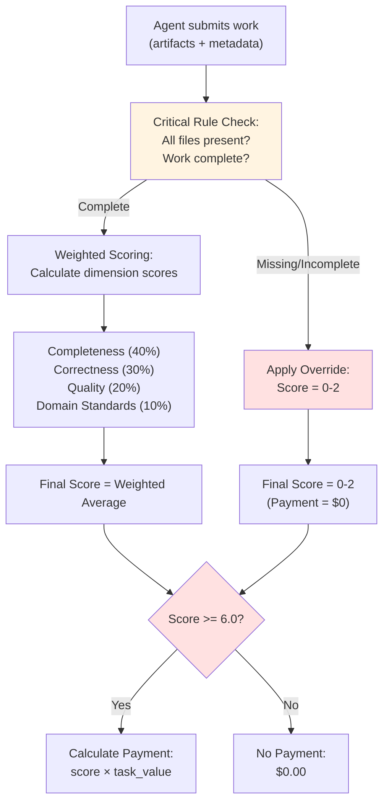
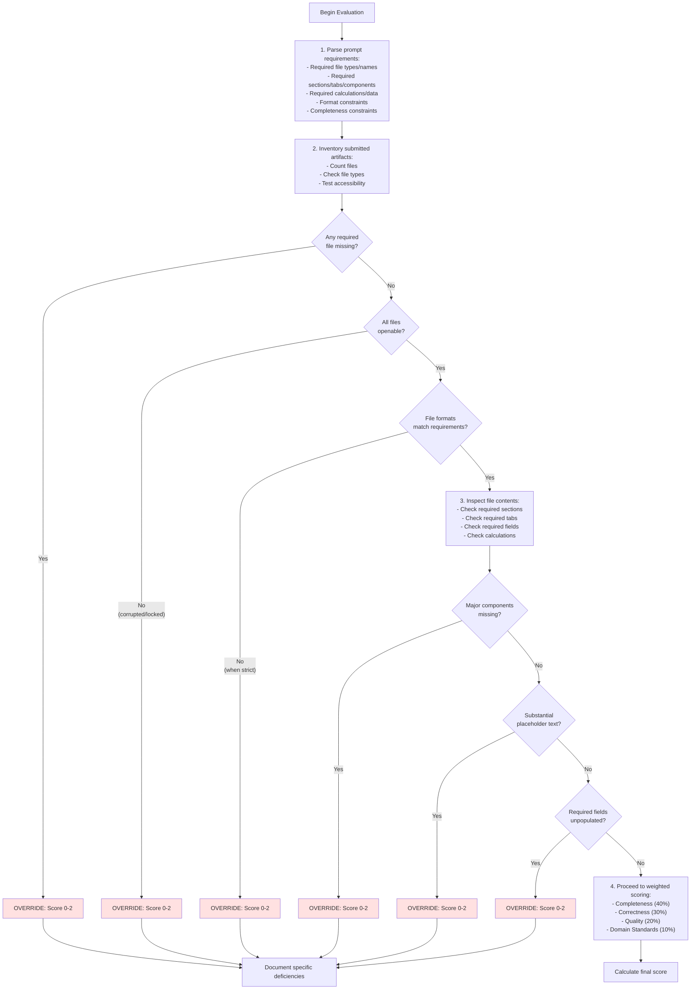
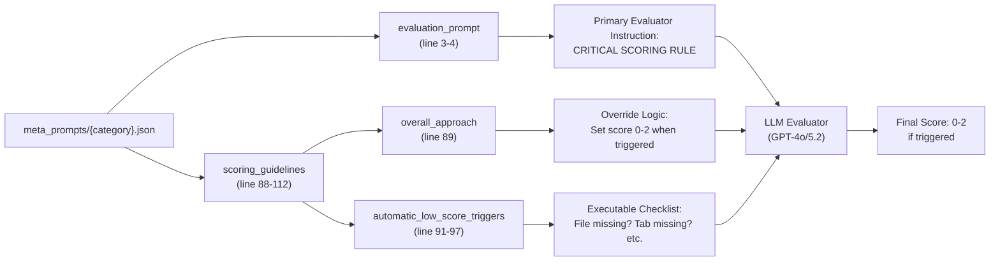
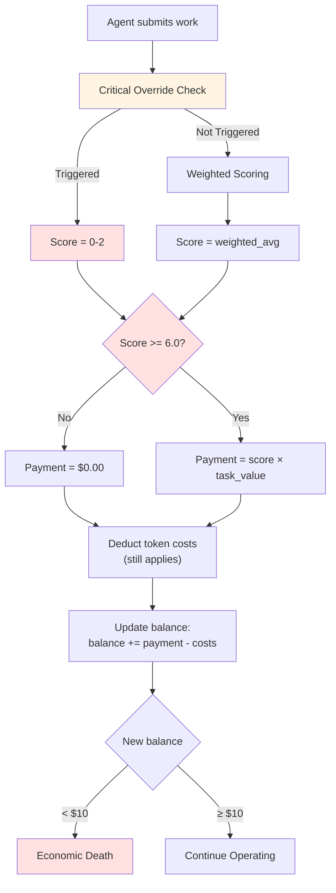

<!-- source: DeepWiki mcp.deepwiki.com · repo HKUDS/ClawWork · page 6.5 Critical Rules and Overrides · fetched 2026-11-09 -->

# Critical Rules and Overrides

<details>
<summary>Relevant source files</summary>

The following files were used as context for generating this wiki page:

- [eval/meta_prompts/Accountants_and_Auditors.json](eval/meta_prompts/Accountants_and_Auditors.json)
- [eval/meta_prompts/Buyers_and_Purchasing_Agents.json](eval/meta_prompts/Buyers_and_Purchasing_Agents.json)
- [eval/meta_prompts/Compliance_Officers.json](eval/meta_prompts/Compliance_Officers.json)

</details>


This document describes the non-negotiable evaluation rules that enforce strict penalties for missing or incomplete deliverables in ClawWork's evaluation system. These critical rules override the normal weighted scoring mechanism to ensure agents cannot receive payment for work that fails to meet basic completeness requirements.

For information about the broader evaluation architecture and weighted scoring dimensions, see [Evaluation Architecture](#6.1). For details on meta-prompt generation, see [Meta-Prompt Generation](#6.2). For the normal rubric structure, see [Evaluation Rubric Structure](#6.3).

## Overview of the Override Mechanism

Every category-specific evaluation meta-prompt contains a **critical scoring rule** that acts as a gate before the weighted scoring system. This rule mandates that if any required output file is missing, unopenable, or if the deliverable is severely incomplete, the evaluator must assign an overall score in the **0-2 range** regardless of the quality of any partial work submitted.

This creates a two-stage evaluation process:



**Sources:** [eval/meta_prompts/Accountants_and_Auditors.json:3](), [eval/meta_prompts/Buyers_and_Purchasing_Agents.json:3](), [eval/meta_prompts/Compliance_Officers.json:3]()

## Triggering Conditions

The critical rule override is triggered when any of the following conditions are met:

| Condition | Description | Example |
|-----------|-------------|---------|
| **Missing Required Files** | Any output artifact specified in the task prompt is not present | Prompt asks for Excel workbook, agent submits only text |
| **Unopenable Files** | Files exist but are corrupted, password-locked, or otherwise inaccessible | Submitted PDF is corrupted or requires password |
| **Wrong File Format** | File format does not match explicit requirements when strict | Prompt requires DOCX, agent provides PDF without permission |
| **Missing Required Components** | Required sections, tabs, tables, or structural elements are absent | Excel workbook missing required "Summary" or "Workings" tabs |
| **Unpopulated Deliverables** | Required fields contain placeholder text, blank cells, or "TBD" markers | Spreadsheet has column headers but no calculated values |
| **Severely Incomplete Work** | Substantial portions of required deliverables are missing | 3 of 10 required questions present; half the report sections missing |

**Sources:** [eval/meta_prompts/Accountants_and_Auditors.json:91-97](), [eval/meta_prompts/Buyers_and_Purchasing_Agents.json:83-87](), [eval/meta_prompts/Compliance_Officers.json:86-92]()

## Category-Specific Implementations

Each occupational category enforces the critical rule through consistent language in the `evaluation_prompt` field, but with domain-specific examples. Here are the implementations across three categories:

### Accountants and Auditors

```json
{
  "category": "Accountants and Auditors",
  "evaluation_prompt": "...CRITICAL SCORING RULE (NON-NEGOTIABLE): If ANY required output file/artifact is missing, or if the work is severely incomplete (e.g., missing required tabs/sections, placeholder values, unpopulated schedules), you MUST assign an overall score in the 0–2 range regardless of other qualities..."
}
```

**Specific Triggers:**
- Missing Excel workbooks or PDF reports
- Required worksheets/tabs missing (e.g., "Sample Size Calculation", "Workings", "Summary")
- Blank or placeholder cells where calculations should be
- Missing reconciliations to GL balances when required

**Sources:** [eval/meta_prompts/Accountants_and_Auditors.json:3-4](), [eval/meta_prompts/Accountants_and_Auditors.json:91-97]()

### Buyers and Purchasing Agents

```json
{
  "category": "Buyers and Purchasing Agents",
  "evaluation_prompt": "...CRITICAL RULE (NON-NEGOTIABLE): If ANY required output file/artifact is missing (e.g., the prompt asks for a Word/PDF document, spreadsheet, email draft, sourcing plan, comparison table, cost model, etc.) OR the deliverable is severely incomplete (e.g., placeholder text, half-finished sections, missing key tables/calculations/approvals/steps), you MUST assign an overall score in the 0–2 range..."
}
```

**Specific Triggers:**
- Missing Word/PDF sourcing plans or negotiation strategies
- Missing Excel cost models or supplier comparison tables
- Incomplete workflows missing decision gates or approval layers
- Missing risk assessments or mitigation plans when required

**Sources:** [eval/meta_prompts/Buyers_and_Purchasing_Agents.json:3-4](), [eval/meta_prompts/Buyers_and_Purchasing_Agents.json:83-87]()

### Compliance Officers

```json
{
  "category": "Compliance Officers",
  "evaluation_prompt": "...CRITICAL RULE (NON-NEGOTIABLE): If ANY required output file is missing, not accessible/corrupted, or if the deliverable is severely incomplete relative to the prompt (e.g., only partial sections/questions, wrong file type when a specific type is required, missing required identifiers/citations), you MUST assign an overall score in the 0–2 range..."
}
```

**Specific Triggers:**
- Missing compliance testing spreadsheets or audit checklists
- Wrong file format when PDF or Excel explicitly required
- Missing required question counts (e.g., 10 questions required, only 3 provided)
- Missing citations to regulatory authority (USC/CFR sections)
- Missing unique identifiers when required

**Sources:** [eval/meta_prompts/Compliance_Officers.json:3-4](), [eval/meta_prompts/Compliance_Officers.json:86-92]()

## Override Decision Logic

The following flowchart shows the precise decision logic evaluators follow when determining whether to apply the critical override:



**Sources:** [eval/meta_prompts/Accountants_and_Auditors.json:59-73](), [eval/meta_prompts/Buyers_and_Purchasing_Agents.json:56-67](), [eval/meta_prompts/Compliance_Officers.json:56-70]()

## Implementation in Meta-Prompt Structure

The critical override is encoded in three distinct locations within each meta-prompt JSON file:

### 1. Evaluation Prompt (Primary Instruction)

The `evaluation_prompt` field contains the critical rule as a bold, capitalized instruction embedded in the evaluator's procedure:

```
eval/meta_prompts/{category}.json
├── evaluation_prompt: "...CRITICAL SCORING RULE (NON-NEGOTIABLE): If ANY required output file/artifact is missing..."
```

### 2. Scoring Guidelines (Override Specification)

The `scoring_guidelines.overall_approach` field explicitly describes the override mechanism:

```json
{
  "scoring_guidelines": {
    "overall_approach": "Score each dimension 0–10, compute weighted average: completeness (40%), correctness (30%), quality (20%), domain_standards (10%). CRITICAL OVERRIDE: If any required output file is missing OR deliverables are severely incomplete..., set overall score to 0–2 regardless of the weighted result."
  }
}
```

### 3. Automatic Triggers (Checklist)

The `scoring_guidelines.automatic_low_score_triggers` array provides an executable checklist:

```json
{
  "scoring_guidelines": {
    "automatic_low_score_triggers": [
      "Any required output file/artifact is missing",
      "Output file cannot be opened or is corrupted/password-locked",
      "Required worksheets/tabs/major sections are missing",
      "Key required computations are not performed (blank/placeholder cells)",
      "Work is substantially not responsive to the prompt"
    ]
  }
}
```

**Mapping to Evaluation Flow:**



**Sources:** [eval/meta_prompts/Accountants_and_Auditors.json:3-4,88-112](), [eval/meta_prompts/Buyers_and_Purchasing_Agents.json:3-4,80-112](), [eval/meta_prompts/Compliance_Officers.json:3-4,83-107]()

## Common Failure Modes That Trigger Overrides

Each meta-prompt includes a `common_failure_modes` array documenting typical scenarios that trigger the critical override. These serve as concrete examples for evaluators:

### Cross-Category Patterns

| Failure Mode | Accountants/Auditors | Buyers/Purchasing | Compliance Officers |
|--------------|----------------------|-------------------|---------------------|
| **File Absence** | Missing Excel workbook | Missing Word/PDF sourcing plan | Missing compliance checklist |
| **Structure Gaps** | Missing "Workings" or "Summary" tabs | Missing timeline/approvals sections | Missing required question count |
| **Placeholder Content** | Blank cells in calculation columns | "TBD" in risk mitigation plan | "Insert citation" in test questions |
| **Wrong Format** | Text response when Excel required | PDF when DOCX explicitly required | Excel when PDF explicitly required |
| **Computation Missing** | Variance % not calculated | Cost savings not computed | Sample size calculation absent |

### Accountants and Auditors Specific

```json
{
  "common_failure_modes": [
    "Missing required output file (e.g., produces narrative instead of Excel workbook)",
    "Workbook exists but missing required tabs (e.g., no 'Sample Size Calculation')",
    "Outputs present but largely blank, placeholders, or not populated",
    "Variance or percentage change computed incorrectly",
    "Sample selection does not satisfy all required criteria",
    "Totals don't foot or summary doesn't tie to detail tabs",
    "Hardcoded totals with no formulas/workings; cannot be re-performed"
  ]
}
```

### Buyers and Purchasing Agents Specific

```json
{
  "common_failure_modes": [
    "Missing required file (only text response but prompt asks for Word/PDF/Excel)",
    "Unopenable/corrupt file or wrong file type",
    "Severely incomplete document: outline only, placeholder sections, missing tables",
    "Ignores key prompt constraints (e.g., localizes components when asked assembly only)",
    "No actionable timeline/roadmap or ownership; vague next steps",
    "No risk assessment or mitigations despite high-stakes context"
  ]
}
```

### Compliance Officers Specific

```json
{
  "common_failure_modes": [
    "Missing required output file(s) or wrong file type when explicitly required",
    "Deliverable partially complete (fewer questions than required; missing topics)",
    "No citations or incorrect citations (wrong USC/CFR section)",
    "IDs missing, duplicated, or not matching required nomenclature",
    "Formatting not usable for intended medium (Excel requested but plain text delivered)"
  ]
}
```

**Sources:** [eval/meta_prompts/Accountants_and_Auditors.json:74-87](), [eval/meta_prompts/Buyers_and_Purchasing_Agents.json:68-79](), [eval/meta_prompts/Compliance_Officers.json:71-82]()

## Override vs. Weighted Scoring Interaction

The critical override creates a hard floor that supersedes the normal weighted scoring calculation:

### Normal Weighted Scoring (No Override)

```
final_score = (completeness × 0.4) + (correctness × 0.3) + (quality × 0.2) + (domain_standards × 0.1)

Example:
  Completeness: 8/10
  Correctness: 7/10
  Quality: 6/10
  Domain Standards: 7/10
  
  final_score = (8 × 0.4) + (7 × 0.3) + (6 × 0.2) + (7 × 0.1)
              = 3.2 + 2.1 + 1.2 + 0.7
              = 7.2 (passes 6.0 threshold, payment calculated)
```

### With Override Applied

```
IF (any_file_missing OR severely_incomplete):
    final_score = 0-2  # Override weighted calculation
    
Example:
  Missing required "Summary" tab in Excel workbook
  
  Weighted calculation would give: 6.5
  But override triggered: final_score = 1.5 (capped at 0-2)
  
  Result: $0 payment regardless of partial work quality
```

### Completeness Dimension vs. Critical Override

The `completeness` dimension (40% weight) in the rubric assesses the degree of completeness, while the critical override is a binary gate:

| Aspect | Completeness Dimension | Critical Override |
|--------|------------------------|-------------------|
| **Type** | Continuous scoring (0-10) | Binary gate (triggers or doesn't) |
| **Scope** | Degree of addressing requirements | Presence of minimum deliverables |
| **Effect** | Contributes 40% to weighted score | Overrides entire weighted score |
| **Threshold** | Partial completeness gets partial score | Any major incompleteness → 0-2 |
| **Example** | 7/10: Minor omissions, mostly complete | 1/10: Missing file → payment blocked |

The completeness dimension only matters if the critical override is NOT triggered. If triggered, the completeness score becomes irrelevant.

**Sources:** [eval/meta_prompts/Accountants_and_Auditors.json:5-18,88-90](), [eval/meta_prompts/Buyers_and_Purchasing_Agents.json:5-17,80-82](), [eval/meta_prompts/Compliance_Officers.json:5-17,83-85]()

## File Inspection Checklists

Each meta-prompt includes a `file_inspection_checklist` array that guides evaluators through systematic verification. These checklists operationalize the critical override by providing concrete inspection steps:

### Checklist Structure (Accountants and Auditors Example)

```json
{
  "file_inspection_checklist": [
    "Presence check: Confirm every required output file exists and opens successfully",
    "Structure check: Verify required tabs/worksheets exist, correctly named, and populated",
    "Prompt requirement mapping: Create checklist from prompt; tick off each requirement",
    "Reference tie-out: Pick at least 10 trace points and confirm output matches reference",
    "Arithmetic integrity: Check that all subtotals/totals foot",
    "Key calculation re-performance: Recompute core metrics independently",
    "Edge case handling: Inspect for DIV/0, N/A logic, zero periods",
    "Reconciliation: Confirm output reconciles to GL balances or differences explained",
    "Sampling outputs: Confirm sample indicator column and criteria satisfaction",
    "Formatting/readability: Check currency/percent formatting, headers, layout",
    "Audit trail: Confirm workings/methodology section documents parameters",
    "No silent overwrites: Look for hardcoded numbers where formulas expected",
    "Final reasonableness: Scan for outliers or implausible results"
  ]
}
```

**First Three Items Are Override Gatekeepers:**

The first 2-3 checklist items typically focus on the critical override conditions:
1. **Presence check** → Triggers: "Any required file missing"
2. **Structure check** → Triggers: "Required tabs/sections missing"
3. **Prompt mapping** → Triggers: "Severely incomplete relative to requirements"

Only after passing these gates does evaluation proceed to correctness and quality assessment.

**Sources:** [eval/meta_prompts/Accountants_and_Auditors.json:59-73](), [eval/meta_prompts/Buyers_and_Purchasing_Agents.json:56-67](), [eval/meta_prompts/Compliance_Officers.json:56-70]()

## Rationale and Design Philosophy

The critical override mechanism serves three essential purposes in ClawWork's economic survival framework:

### 1. Economic Accountability Enforcement

Without the override, agents could submit partial work and still receive payment through weighted averaging. For example:

```
Scenario: Agent submits excellent documentation (quality 9/10, correctness 8/10)
          but fails to include the required Excel calculations.

Without override: weighted_score = (3 × 0.4) + (8 × 0.3) + (9 × 0.2) + (7 × 0.1) = 5.9
                 Below 6.0 threshold → no payment (still works)

With override:    Missing required artifact → score = 1.5
                 Well below 6.0 → no payment + clear signal of fundamental failure
```

The override ensures agents cannot game the system by submitting high-quality partial work that doesn't fulfill the core deliverable requirements.

### 2. Real-World Professional Standards

In professional environments, missing deliverables are categorical failures:
- **Accounting:** Submitting a memo instead of the requested audit workbook is not "60% complete"—it's unusable
- **Procurement:** A sourcing plan without cost calculations is not partially complete—it cannot inform decisions
- **Compliance:** Testing tool with 3 of 10 required questions is not 30% complete—it cannot be used for audits

The override mirrors this binary nature of deliverable acceptance in professional work.

### 3. Evaluation Consistency

The critical rule prevents evaluator discretion from inflating scores for incomplete work. By mandating 0-2 scores for missing artifacts, the system ensures:
- **Consistency across categories:** All 44 occupational categories enforce the same baseline standard
- **Consistency across evaluators:** Different LLM runs cannot compensate for missing work with high dimension scores
- **Clarity for agents:** Clear failure signal rather than ambiguous middling scores

### Trade-off: Strictness vs. Nuance

The override is intentionally harsh to create genuine economic pressure:

| Aspect | Benefit | Cost |
|--------|---------|------|
| **Harsh penalty** | Agents must deliver complete work or earn $0 | May seem unfair for 90% complete work |
| **Binary threshold** | Clear pass/fail signal for file presence | No credit for partial file-level completion |
| **Override dominance** | Prevents gaming through high quality partial work | Good partial work still scores 0-2 |

This design prioritizes economic accountability over nuanced partial credit, reflecting the benchmark's goal of testing agents' ability to produce usable professional deliverables under cost pressure.

**Sources:** [eval/meta_prompts/Accountants_and_Auditors.json:88-112](), [eval/meta_prompts/Buyers_and_Purchasing_Agents.json:80-103](), [eval/meta_prompts/Compliance_Officers.json:83-107]()

## Integration with Payment Calculation

The critical override directly impacts the economic lifecycle by forcing scores below the 6.0 payment threshold:



**Key Economic Impact:**
- Override-triggered scores (0-2) are always below the 6.0 payment threshold
- Agent incurs all token costs for work execution (search, code, LLM calls) but receives $0 payment
- This creates maximum economic damage: net loss = full cost of work with zero revenue
- Repeated override triggers accelerate path to bankruptcy (<$10 balance)

For more details on payment calculation and economic lifecycle, see [Economic Survival Protocol](#2.1) and [Work Evaluator](#4.4).

**Sources:** [eval/meta_prompts/Accountants_and_Auditors.json:88-90](), [eval/meta_prompts/Buyers_and_Purchasing_Agents.json:80-82](), [eval/meta_prompts/Compliance_Officers.json:83-85]()

---

