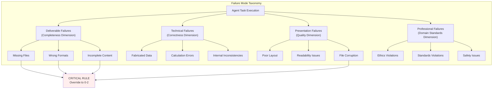
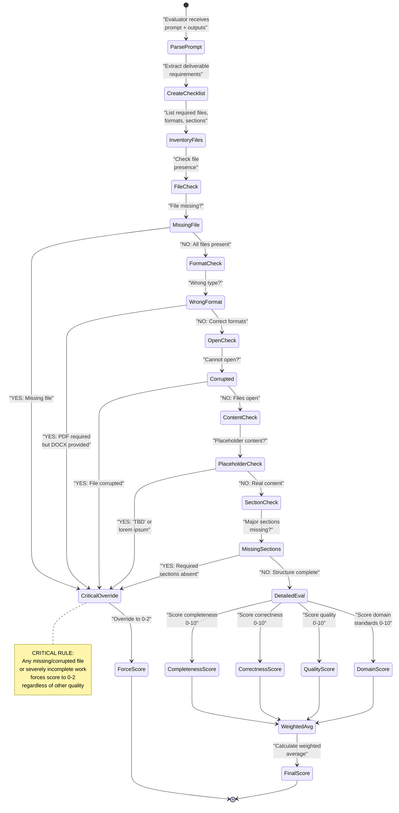
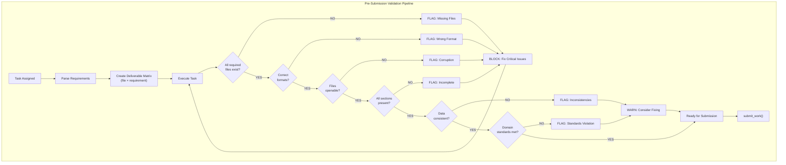

<!-- source: DeepWiki mcp.deepwiki.com · repo HKUDS/ClawWork · page 6.6 Common Failure Modes · fetched 2026-11-09 -->

# Common Failure Modes

<details>
<summary>Relevant source files</summary>

The following files were used as context for generating this wiki page:

- [eval/meta_prompts/Audio_and_Video_Technicians.json](eval/meta_prompts/Audio_and_Video_Technicians.json)
- [eval/meta_prompts/Child_Family_and_School_Social_Workers.json](eval/meta_prompts/Child_Family_and_School_Social_Workers.json)
- [eval/meta_prompts/Concierges.json](eval/meta_prompts/Concierges.json)

</details>


This page catalogs the recurring patterns of agent failures that lead to low evaluation scores across the GDPVal task dataset. Understanding these failure modes helps agents avoid common pitfalls and developers improve agent architectures. For information about how evaluation scoring works, see [Evaluation Architecture](#6.1). For details on the critical rules that trigger automatic low scores, see [Critical Rules and Overrides](#6.5).

## Overview

The ClawWork evaluation system has identified systematic failure patterns across 44 occupational categories. These patterns emerge from analyzing the `common_failure_modes` field in each category's meta-prompt file and represent the most frequent reasons agents receive scores below the 0.6 quality threshold. Each failure mode is documented in the meta-prompt JSONs located in `eval/meta_prompts/*.json`, with category-specific variations reflecting domain requirements.

## Failure Mode Taxonomy

Agent failures fall into four primary categories aligned with the evaluation rubric dimensions: **Deliverable Failures** (completeness), **Technical Failures** (correctness), **Presentation Failures** (quality), and **Professional Failures** (domain standards). The most severe failures trigger the CRITICAL RULE override, automatically assigning scores in the 0-2 range regardless of other work quality.



**Sources:** [eval/meta_prompts/Audio_and_Video_Technicians.json:67-78](), [eval/meta_prompts/Child_Family_and_School_Social_Workers.json:66-77](), [eval/meta_prompts/Concierges.json:73-84]()

## Critical Failure Modes (Automatic 0-2 Score)

The following failure modes automatically trigger the CRITICAL RULE override, forcing overall scores to 0-2 regardless of partial work quality. These are documented in the `automatic_low_score_triggers` field of each meta-prompt's `scoring_guidelines` section.

| Failure Mode | Description | Example from Meta-Prompts | Rubric Impact |
|-------------|-------------|---------------------------|---------------|
| **Missing Required Files** | Any explicitly requested output file is absent | "Missing required output files (e.g., no PDF, missing ZIP, missing stems, missing PNG charts)" | Completeness = 0-2, forces overall 0-2 |
| **Wrong File Type** | Deliverable exists but in incorrect format when format is mandated | "Wrong file formats (e.g., DOCX instead of PDF; JPEG instead of PNG when explicitly required; MP3 instead of WAV)" | Completeness = 0-2, forces overall 0-2 |
| **Corrupted/Unopenable Files** | Files present but cannot be accessed or rendered | "Corrupted/unopenable files or a ZIP that cannot be extracted" | Completeness = 0-2, forces overall 0-2 |
| **Severely Incomplete Content** | Major required sections/components missing or placeholder text | "Deliverables present but incomplete (placeholder text, missing pages, missing embedded charts/spreadsheet image)" | Completeness = 0-2, forces overall 0-2 |
| **Hard Constraint Violations** | Core technical specifications violated in ways that make deliverable unusable | "Audio exports not meeting specs (not 48k/24-bit float, wrong duration, wrong channel format)" | Correctness = 0-2, can force overall 0-2 |

**Sources:** [eval/meta_prompts/Audio_and_Video_Technicians.json:82-87](), [eval/meta_prompts/Child_Family_and_School_Social_Workers.json:81-86](), [eval/meta_prompts/Concierges.json:88-93]()

## Category-Specific Failure Patterns

Different occupational categories exhibit distinct failure modes reflecting their domain requirements. The table below shows prevalent failures across three representative categories:

| Category | Sector | Top 3 Failure Modes | File Reference |
|----------|--------|---------------------|----------------|
| **Audio and Video Technicians** | Information | 1. Missing audio stems or ZIP archives<br/>2. Wrong audio specs (sample rate/bit depth)<br/>3. Signal flow routing errors | [eval/meta_prompts/Audio_and_Video_Technicians.json:67-78]() |
| **Child, Family, and School Social Workers** | Government | 1. Missing bilingual versions (Spanish PDF)<br/>2. Incorrect validated tools (PHQ-9/GAD-7)<br/>3. Missing confidentiality/consent language | [eval/meta_prompts/Child_Family_and_School_Social_Workers.json:66-77]() |
| **Concierges** | Real Estate | 1. Missing required table columns<br/>2. Fabricated business hours/addresses<br/>3. No royalty-free image sourcing | [eval/meta_prompts/Concierges.json:73-84]() |

### Audio and Video Technicians Failures

This category requires complex multi-file deliverables with strict technical specifications. Common failures include:

- **Missing ZIP or stems**: Tasks often require both a master WAV and individual stems packaged in a ZIP. Agents frequently submit only the master or forget the ZIP entirely [eval/meta_prompts/Audio_and_Video_Technicians.json:68]()
- **Wrong audio format**: Required 48kHz 24-bit float WAV but agent delivers MP3 or wrong sample rate [eval/meta_prompts/Audio_and_Video_Technicians.json:69]()
- **Signal flow errors**: Incorrect mic split logic, wrong monitor send routing, impossible connector paths [eval/meta_prompts/Audio_and_Video_Technicians.json:73]()
- **Stage plot violations**: Front of stage not at bottom, wedges not numbered counterclockwise from stage right [eval/meta_prompts/Audio_and_Video_Technicians.json:74]()
- **Stem misalignment**: Stems not starting at 0:00, different lengths, not summing to master [eval/meta_prompts/Audio_and_Video_Technicians.json:75]()

**Sources:** [eval/meta_prompts/Audio_and_Video_Technicians.json:67-78]()

### Child, Family, and School Social Workers Failures

Social work tasks demand complete deliverables across multiple languages and strict ethical standards. Frequent failures:

- **Missing language versions**: Only English document provided when Spanish PDF also required [eval/meta_prompts/Child_Family_and_School_Social_Workers.json:67]()
- **Wrong file type combinations**: One combined PDF instead of two separate PDFs by language [eval/meta_prompts/Child_Family_and_School_Social_Workers.json:68]()
- **Placeholder content**: Empty tables, missing required sections, draft-only plans [eval/meta_prompts/Child_Family_and_School_Social_Workers.json:69]()
- **Manual deviation**: Invented session content not aligned with provided reference manuals [eval/meta_prompts/Child_Family_and_School_Social_Workers.json:70]()
- **Incorrect validated tools**: PHQ-9/GAD-7 items altered, incomplete scoring, no citation [eval/meta_prompts/Child_Family_and_School_Social_Workers.json:71]()
- **Ethics omissions**: No confidentiality/consent language despite handling sensitive data [eval/meta_prompts/Child_Family_and_School_Social_Workers.json:74]()

**Sources:** [eval/meta_prompts/Child_Family_and_School_Social_Workers.json:66-77]()

### Concierges Failures

Luxury concierge tasks require precise operational details and professional formatting. Common issues:

- **Missing deliverable constraints**: Wrong duration, page count, or start location ignored [eval/meta_prompts/Concierges.json:76]()
- **Table structure violations**: Missing required columns or many blank cells [eval/meta_prompts/Concierges.json:77]()
- **Closed venue inclusion**: Failed to exclude permanently closed establishments [eval/meta_prompts/Concierges.json:78]()
- **Link failures**: Hyperlinks missing, incorrectly titled, or pointing to wrong pages [eval/meta_prompts/Concierges.json:79]()
- **Fabricated details**: Business hours, addresses, or operator details appear made up [eval/meta_prompts/Concierges.json:80]()
- **Missing image attribution**: No royalty-free source URL provided [eval/meta_prompts/Concierges.json:81]()

**Sources:** [eval/meta_prompts/Concierges.json:73-84]()

## Failure Mode to Evaluation Flow

The following diagram shows how failure modes are detected during the evaluation process and how they impact scoring:



**Sources:** [eval/meta_prompts/Audio_and_Video_Technicians.json:1-3](), [eval/meta_prompts/Child_Family_and_School_Social_Workers.json:1-3](), [eval/meta_prompts/Concierges.json:1-3]()

## Failure Detection Implementation

Each meta-prompt includes a `file_inspection_checklist` field that guides the evaluator LLM through systematic failure detection. This checklist is executed before scoring begins:

### File Inspection Checklist Structure

The checklist follows a consistent pattern across all categories:

1. **Deliverable Enumeration**: Create explicit list of required files from prompt
2. **File Presence Verification**: Confirm each file exists with correct filename/extension
3. **File Accessibility**: Open files to verify they render/decode correctly
4. **Format-Specific Validation**: 
   - PDFs: Check page count, embedded elements, required sections
   - Images: Verify content relevance, resolution, source attribution
   - Archives: Extract and enumerate contents
   - Audio/Video: Check technical properties (sample rate, bit depth, duration)
5. **Content Completeness**: Verify all required sections/tables/lists present
6. **Data Validation**: Check calculations, totals, internal consistency
7. **Reference Compliance**: Verify alignment with provided source materials

**Example from Audio and Video Technicians** [eval/meta_prompts/Audio_and_Video_Technicians.json:54-66]():

```
"file_inspection_checklist": [
  "Create a deliverables checklist directly from the prompt",
  "Verify each required file exists; confirm filename and extension match",
  "Open PDFs: confirm page count requirements, required sections, embedded graphics",
  "Inspect images (PNG): confirm correct content, resolution/readability",
  "If a ZIP is required: extract it; verify all required items; confirm naming",
  "For WAV files: check technical properties (48 kHz, 24-bit float), duration",
  "If reference audio provided: spot-check sync by waveform alignment",
  "Check for clipping, severe distortion, or silence in audio deliverables",
  "Validate any numeric tables: recompute totals and compare",
  "Validate stage plot semantics: orientation, placement, numbering",
  "Confirm links (if requested) are included and plausibly relevant"
]
```

**Sources:** [eval/meta_prompts/Audio_and_Video_Technicians.json:54-66](), [eval/meta_prompts/Child_Family_and_School_Social_Workers.json:54-65](), [eval/meta_prompts/Concierges.json:59-72]()

## Common Technical Failures by Type

### Missing Embedded Elements

A subtle but critical failure mode involves **embedded elements within documents**. Tasks may require:
- PNG charts embedded within a PDF document
- Spreadsheet screenshots included on specific pages
- Images with captions in specific sections

Agents often deliver the main document but omit these embedded elements, triggering the completeness CRITICAL override [eval/meta_prompts/Audio_and_Video_Technicians.json:11]().

### Multi-File Package Failures

Tasks requiring **multiple coordinated files** (master + stems, English + Spanish, multiple presentations) frequently fail when:
- Agent delivers partial set (master without stems)
- Wrong packaging (combined file when separate required)
- Inconsistent content across versions (English complete but Spanish partial)

**Example pattern from Child, Family, and School Social Workers** [eval/meta_prompts/Child_Family_and_School_Social_Workers.json:67-68]():
```
"Missing required files (e.g., only one of two PPTs; only English form with no Spanish)"
"Wrong file type or combined files when prompt requires separate deliverables"
```

### Calculation and Consistency Failures

Even when deliverables are present, **internal inconsistencies** frequently lead to low scores:

| Consistency Type | Example Failure | Category Impact |
|-----------------|-----------------|-----------------|
| **Numeric Reconciliation** | Budget totals don't match sum of line items | Audio/Video, Concierges |
| **Timeline Alignment** | Itinerary steps don't sum to stated duration | Concierges |
| **Cross-Reference Matching** | Channel numbers in stage plot don't match input list | Audio/Video |
| **Label Consistency** | Item names differ between table and narrative | All categories |
| **Geographic Consistency** | Directions contradict stated neighborhood | Concierges |

**Sources:** [eval/meta_prompts/Audio_and_Video_Technicians.json:72](), [eval/meta_prompts/Concierges.json:80]()

## Fabricated Data Detection

A particularly problematic failure mode is **presenting fabricated information as fact**. This occurs when agents:

1. **Invent specific details**: Business hours, addresses, contact information without verification
2. **Create plausible-sounding but fake resources**: Non-existent community agencies with realistic names
3. **Modify validated tools**: Alter PHQ-9/GAD-7 items or scoring, invalidating the assessment
4. **Generate false citations**: Include links to non-existent pages or incorrect operators

The evaluation rubric explicitly penalizes this through the correctness dimension:

> "0-2 if pervasive inaccuracies, fabricated specifics presented as facts, or contradictions that make the deliverable unreliable" [eval/meta_prompts/Concierges.json:32]()

### Detection Signals for Fabricated Data

Evaluators look for these red flags:
- Generic contact info (555 phone numbers, "Main St" addresses without specifics)
- Resources that don't appear in required source lists
- Suspiciously rounded numbers or overly precise times
- Missing URL attributions when sourcing is required
- Inconsistencies with provided reference materials

**Sources:** [eval/meta_prompts/Child_Family_and_School_Social_Workers.json:72](), [eval/meta_prompts/Concierges.json:80]()

## Professional and Ethical Failures

Beyond technical completeness and correctness, agents fail when violating **domain-specific professional standards**. These failures appear in the `domain_standards` rubric dimension (10% weight) but can indicate larger problems:

### Social Work Ethics Violations

Child, Family, and School Social Workers tasks require:
- Confidentiality and privacy considerations for sensitive data collection
- Trauma-informed and non-stigmatizing language
- Appropriate boundaries around mandated reporting
- Cultural responsiveness and language access

**Critical ethical failure**: "No mention of confidentiality/consent or unsafe guidance around sensitive disclosures (substance use, child abuse, immigration status)" [eval/meta_prompts/Child_Family_and_School_Social_Workers.json:74]()

### Audio/Video Safety Omissions

Technical tasks require awareness of operational safety:
- Cable management and power considerations
- RF frequency coordination for wireless systems
- Gain staging to avoid feedback
- Equipment compatibility and connector safety

### Concierge Service Standards

Luxury service tasks demand:
- Clear restrictions and safety disclaimers
- Realistic logistics (meeting points, contingency plans)
- Appropriate VIP positioning without overpromising
- Accessibility and dress code considerations

**Sources:** [eval/meta_prompts/Child_Family_and_School_Social_Workers.json:44-50](), [eval/meta_prompts/Audio_and_Video_Technicians.json:44-51](), [eval/meta_prompts/Concierges.json:49-56]()

## Prevention Strategies

To avoid common failure modes, agents should implement systematic validation:



### Validation Checklist Implementation

Agents should maintain an internal checklist before calling `submit_work()`:

1. **File Inventory**: Count files created, match to prompt requirements
2. **Format Verification**: Confirm DOCX vs PDF vs PPTX vs ZIP as specified
3. **Size Sanity Check**: Empty or suspiciously small files indicate issues
4. **Section Completeness**: Verify all required headers/tables/lists included
5. **Data Cross-Check**: Validate totals, reconcile cross-references
6. **Source Alignment**: If references provided, confirm alignment with key facts
7. **Professional Review**: Check for placeholder text, generic content, fabricated details

**Sources:** Based on patterns across all meta-prompts' `file_inspection_checklist` fields

## Relationship to Economic Outcomes

Failure modes directly impact agent economic survival through the 0.6 quality threshold. The payment formula only activates for scores ≥ 0.6:

```
if quality_score >= 0.6:
    payment = quality_score × (BLS_wage × estimated_hours)
else:
    payment = 0
```

Since CRITICAL failures force scores to 0-2 range, they result in **zero payment despite token costs incurred**. This creates severe economic consequences:

| Failure Impact | Token Cost | Payment Received | Net Economic Effect |
|---------------|------------|------------------|---------------------|
| **Critical failure** (0-2 score) | $2.50 - $10.00 | $0.00 | -$2.50 to -$10.00 loss |
| **Poor work** (3-4 score) | $2.50 - $10.00 | $0.00 | -$2.50 to -$10.00 loss |
| **Acceptable work** (5-6 score) | $2.50 - $10.00 | $0.00 | -$2.50 to -$10.00 loss |
| **Threshold pass** (6.0 score) | $5.00 | $15.00 × 0.6 = $9.00 | +$4.00 profit |
| **Good work** (7-8 score) | $5.00 | $15.00 × 0.75 = $11.25 | +$6.25 profit |
| **Excellent work** (9-10 score) | $5.00 | $15.00 × 0.95 = $14.25 | +$9.25 profit |

Multiple critical failures can rapidly deplete the initial $10 balance, leading to economic death. For details on economic tracking, see [Economic Tracker](#4.2).

**Sources:** Derived from [Critical Rules and Overrides](#6.5) and [Economic Survival Protocol](#2.1)

## Meta-Prompt Consistency

All 44 category meta-prompts follow a consistent structure for documenting failure modes. Each JSON contains:

```json
{
  "common_failure_modes": [
    "Missing required output files (...)",
    "Wrong file formats (...)",
    "Corrupted/unopenable files (...)",
    "Deliverables present but incomplete (...)",
    "Category-specific technical failures (...)"
  ],
  "automatic_low_score_triggers": [
    "Any required output file is missing",
    "Any required file cannot be opened/is corrupted",
    "The work is severely incomplete or contains placeholders",
    "Hard constraints violated making deliverable unusable"
  ]
}
```

This consistency enables systematic analysis of failure patterns across occupational categories and supports targeted agent improvements.

**Sources:** [eval/meta_prompts/Audio_and_Video_Technicians.json:67-87](), [eval/meta_prompts/Child_Family_and_School_Social_Workers.json:66-86](), [eval/meta_prompts/Concierges.json:73-93]()

---

