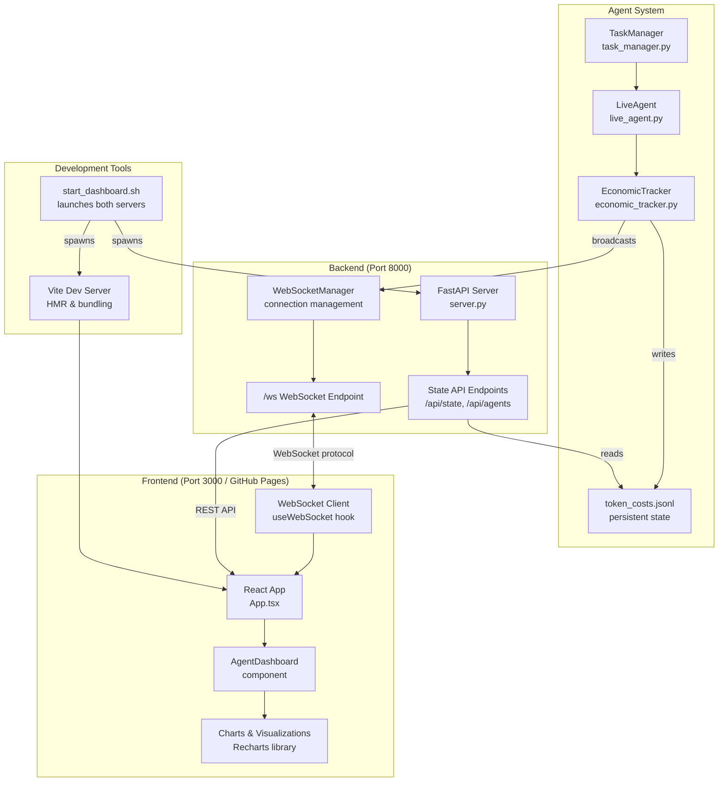
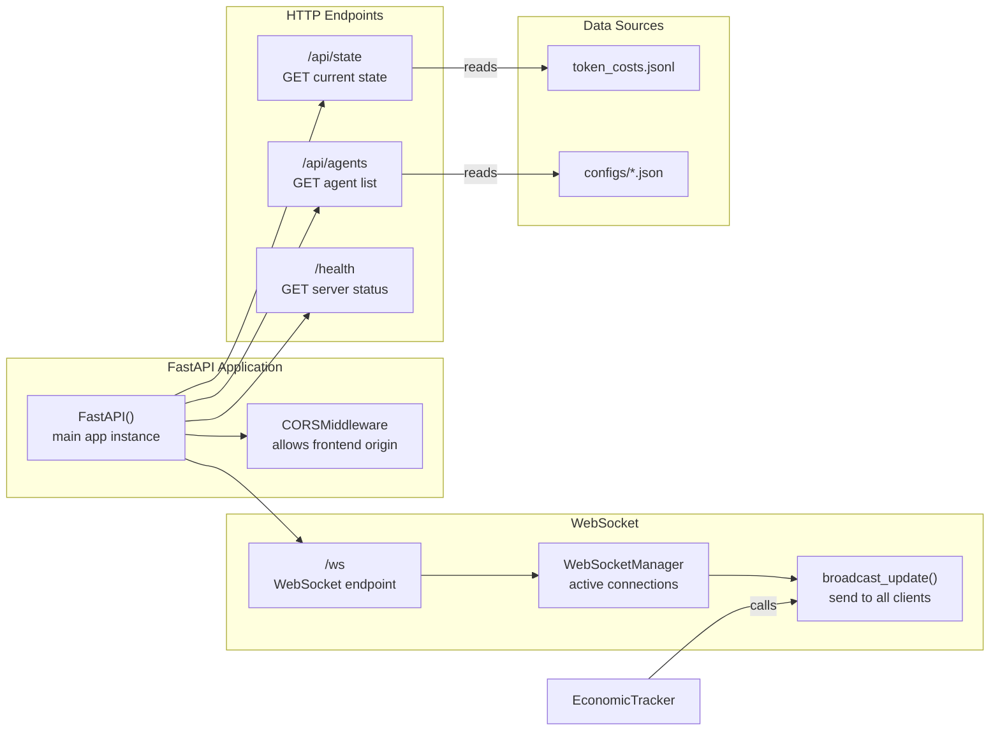
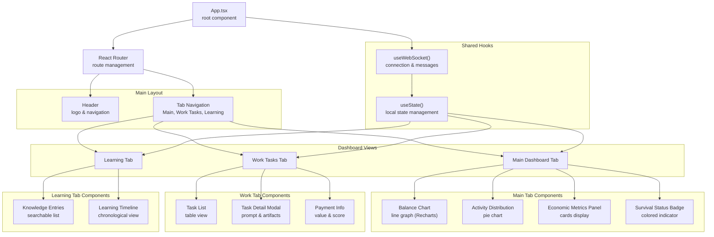
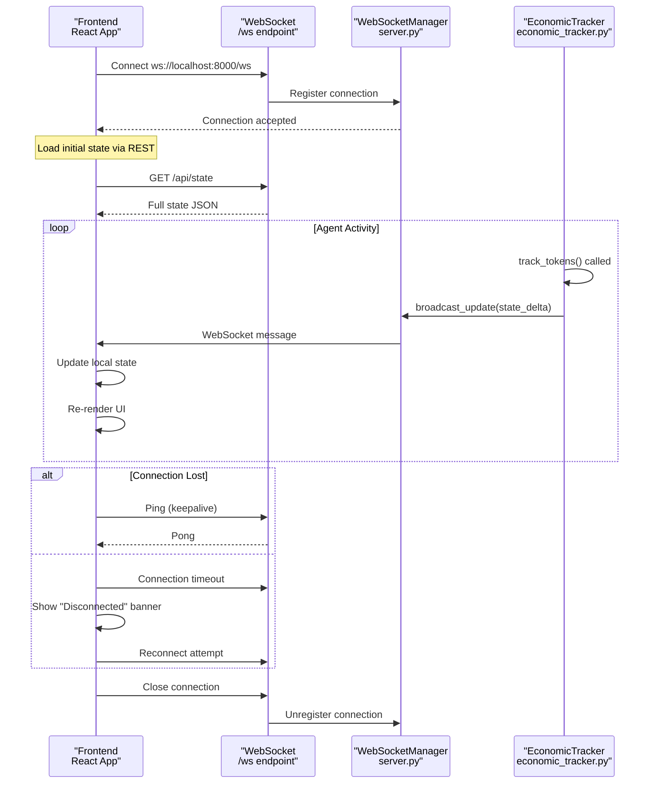
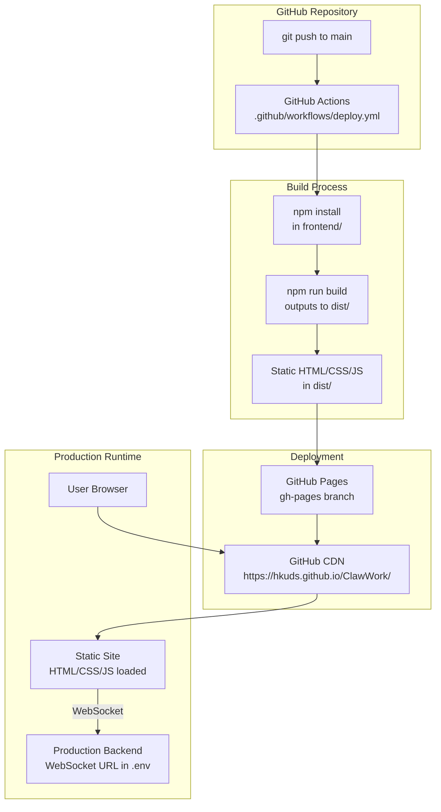

<!-- source: DeepWiki mcp.deepwiki.com · repo HKUDS/ClawWork · page 7 Dashboard and Visualization · fetched 2026-11-09 -->

# Dashboard and Visualization

<details>
<summary>Relevant source files</summary>

The following files were used as context for generating this wiki page:

- [README.md](README.md)
- [assets/dashboard_preview.png](assets/dashboard_preview.png)
- [assets/leaderboard.gif](assets/leaderboard.gif)

</details>


The Dashboard and Visualization system provides real-time monitoring of agent economic activity through a web interface. It consists of a FastAPI backend serving WebSocket updates and a React frontend displaying live metrics, task completions, learning progress, and survival status. This document covers the technical architecture, component structure, communication protocols, and deployment mechanisms.

For information about the economic tracking data that feeds into the dashboard, see [Economic Tracker](#4.2). For details on the agent loop that generates the events displayed in the dashboard, see [LiveBench Agent Loop](#4.1).

---

## Dashboard Architecture

The dashboard uses a decoupled client-server architecture with WebSocket-based real-time communication. The backend runs on port 8000 and broadcasts economic state changes, while the frontend runs on port 3000 during development and is deployed as a static site to GitHub Pages for production.

### System Architecture Diagram



**Sources:** [README.md:558-580](), [README.md:79-130]()

### Key Components

| Component | Location | Port | Purpose |
|-----------|----------|------|---------|
| FastAPI Backend | `livebench/api/server.py` | 8000 | HTTP API and WebSocket server |
| React Frontend | `frontend/src/` | 3000 (dev) | Web UI with real-time updates |
| WebSocket Manager | `livebench/api/server.py` | 8000 | Connection lifecycle management |
| Vite Build Tool | `frontend/` | 3000 | Development server and production bundler |
| Launch Script | `start_dashboard.sh` | - | Orchestrates backend and frontend startup |

**Sources:** [README.md:140-147](), [README.md:207-212]()

---

## Backend Implementation

The backend is implemented as a FastAPI application that serves both REST endpoints for initial state loading and a WebSocket endpoint for real-time updates. The `EconomicTracker` calls into the WebSocket manager whenever economic state changes occur.

### FastAPI Server Structure



**Sources:** [README.md:113-115](), [livebench/api/server.py]()

### WebSocket Manager Responsibilities

The WebSocket manager maintains a list of active connections and provides methods for broadcasting updates to all connected clients. When an economic event occurs (token costs incurred, work income received, balance updated), the `EconomicTracker` calls the broadcast method with the updated state.

Key methods:
- `connect(websocket)`: Adds a new client connection
- `disconnect(websocket)`: Removes a disconnected client
- `broadcast_update(data)`: Sends JSON data to all active clients
- `get_connection_count()`: Returns number of active connections

**Sources:** [livebench/api/server.py]()

### REST API Endpoints

| Endpoint | Method | Response | Purpose |
|----------|--------|----------|---------|
| `/api/state` | GET | Current economic state for all agents | Initial page load data |
| `/api/agents` | GET | List of configured agent signatures | Agent selector population |
| `/health` | GET | `{"status": "ok"}` | Health check for monitoring |
| `/ws` | WebSocket | Real-time state updates | Live data stream |

The `/api/state` endpoint reads `token_costs.jsonl` and aggregates the data into a structured response containing balance history, task completions, learning entries, and survival status for each agent.

**Sources:** [README.md:564-580]()

---

## Frontend Implementation

The frontend is a React application built with Vite that connects to the backend WebSocket and displays live agent metrics. It uses the Recharts library for visualizations and maintains local state that is updated in real-time as WebSocket messages arrive.

### React Component Hierarchy



**Sources:** [README.md:558-580](), [frontend/src/]()

### State Management

The frontend maintains local state that mirrors the backend economic data:

```typescript
interface AgentState {
  signature: string;
  balance: number;
  totalIncome: number;
  totalCost: number;
  survivalStatus: 'thriving' | 'stable' | 'struggling' | 'critical';
  balanceHistory: Array<{ date: string; balance: number }>;
  tasks: Array<TaskRecord>;
  learningEntries: Array<LearningEntry>;
}
```

This state is initialized via the `/api/state` REST endpoint on page load and updated incrementally via WebSocket messages. The component re-renders automatically when state changes using React's reactivity system.

**Sources:** [README.md:564-580]()

### Visualization Components

**Balance Chart:**
- Library: Recharts `LineChart`
- X-axis: Date/time
- Y-axis: Balance ($)
- Data points: Balance after each task
- Shows upward trend (earning) or downward trend (costs exceeding income)

**Activity Distribution:**
- Library: Recharts `PieChart`
- Segments: "Work" vs "Learn" activity counts
- Color coding: Work (blue), Learn (green)
- Displays percentage split

**Economic Metrics Panel:**
- Total Income: Sum of all payments received
- Total Costs: Sum of all token and API costs
- Net Worth: Balance (income - costs)
- Survival Status: Color-coded badge (🟢 thriving, 🟡 stable, 🟠 struggling, 🔴 critical)

**Sources:** [README.md:564-580]()

---

## WebSocket Communication Protocol

The WebSocket connection uses JSON messages to transmit state updates from backend to frontend. The protocol is stateless—each message contains a complete state snapshot or delta update for a specific agent.

### Connection Lifecycle



**Sources:** [README.md:113-115](), [livebench/api/server.py]()

### Message Types

The WebSocket transmits JSON objects with the following structure:

| Field | Type | Description |
|-------|------|-------------|
| `type` | string | Message type: `"state_update"`, `"task_complete"`, `"balance_change"` |
| `agent_signature` | string | Identifier for the agent (e.g., `"gpt-4o-agent"`) |
| `timestamp` | string | ISO 8601 timestamp of the event |
| `data` | object | Payload varies by message type |

**State Update Message:**
```json
{
  "type": "state_update",
  "agent_signature": "gpt-4o-agent",
  "timestamp": "2025-01-20T14:32:05Z",
  "data": {
    "balance": 1198.41,
    "total_cost": 1.59,
    "total_income": 1200.00,
    "survival_status": "thriving"
  }
}
```

**Task Complete Message:**
```json
{
  "type": "task_complete",
  "agent_signature": "gpt-4o-agent",
  "timestamp": "2025-01-20T14:32:05Z",
  "data": {
    "task_id": "abc-123",
    "quality_score": 0.85,
    "payment": 198.44,
    "occupation": "Financial Analyst"
  }
}
```

**Sources:** [README.md:113-115](), [livebench/api/server.py]()

### Reconnection Strategy

The frontend implements exponential backoff for reconnection:
1. First retry: Immediate
2. Second retry: 1 second delay
3. Third retry: 2 seconds delay
4. Fourth retry: 4 seconds delay
5. Max delay: 30 seconds

The `useWebSocket` hook manages this automatically. A banner appears at the top of the UI when disconnected, and it disappears once the connection is re-established.

**Sources:** [frontend/src/]()

---

## Deployment

The dashboard supports two deployment modes: local development and static site hosting on GitHub Pages. The local mode runs both backend and frontend locally for testing, while production deployment builds the frontend as static assets and hosts them on GitHub's CDN.

### Local Development Setup

```mermaid
graph LR
    Script["start_dashboard.sh"]
    
    subgraph "Backend Process"
        Uvicorn["uvicorn<br/>livebench.api.server:app"]
        Port8000["Listen on<br/>localhost:8000"]
    end
    
    subgraph "Frontend Process"
        NPM["npm run dev<br/>vite dev server"]
        Port3000["Listen on<br/>localhost:3000"]
        Proxy["Proxy /api & /ws<br/>to localhost:8000"]
    end
    
    subgraph "Browser"
        Browser["http://localhost:3000"]
    end
    
    Script -->|spawns| Uvicorn
    Script -->|spawns| NPM
    Uvicorn --> Port8000
    NPM --> Port3000
    NPM --> Proxy
    Proxy -->|forward| Port8000
    Browser --> Port3000
```

**Sources:** [README.md:140-147](), [start_dashboard.sh]()

The `start_dashboard.sh` script orchestrates both processes:
```bash
#!/bin/bash
# Start backend in background
uvicorn livebench.api.server:app --host 0.0.0.0 --port 8000 &
BACKEND_PID=$!

# Start frontend
cd frontend && npm run dev &
FRONTEND_PID=$!

# Wait for both processes
wait $BACKEND_PID $FRONTEND_PID
```

**Sources:** [start_dashboard.sh]()

### GitHub Pages Deployment

The production deployment uses GitHub Actions to build the frontend with Vite and deploy it to GitHub Pages. The WebSocket connection is configured to point to a production backend URL instead of localhost.



**Sources:** [README.md:12-13](), [README.md:63-64]()

### Environment Configuration

The frontend build process uses different WebSocket URLs based on the environment:

| Environment | WebSocket URL | Purpose |
|-------------|--------------|---------|
| Development | `ws://localhost:8000/ws` | Local testing with `npm run dev` |
| Production | Configured in `.env.production` | Points to deployed backend |

The Vite configuration reads these values at build time and injects them into the compiled JavaScript:

```javascript
// frontend/.env.development
VITE_WS_URL=ws://localhost:8000/ws

// frontend/.env.production
VITE_WS_URL=wss://your-backend.com/ws
```

**Sources:** [frontend/](), [README.md:207-212]()

### GitHub Actions Workflow

The CI/CD pipeline is triggered on push to the `main` branch:

```yaml
name: Deploy to GitHub Pages
on:
  push:
    branches: [ main ]
jobs:
  build-and-deploy:
    runs-on: ubuntu-latest
    steps:
      - uses: actions/checkout@v2
      - uses: actions/setup-node@v2
        with:
          node-version: '20'
      - run: cd frontend && npm install
      - run: cd frontend && npm run build
      - uses: peaceiris/actions-gh-pages@v3
        with:
          github_token: ${{ secrets.GITHUB_TOKEN }}
          publish_dir: ./frontend/dist
```

**Sources:** [README.md:12-13](), [.github/workflows/]()

### Port Configuration

| Service | Development Port | Production Port | Configurable Via |
|---------|-----------------|-----------------|------------------|
| Backend API | 8000 | Deployment-specific | `uvicorn --port` flag |
| Frontend Dev Server | 3000 | N/A (static hosting) | `vite.config.ts` |
| WebSocket | 8000 (same as API) | Deployment-specific | Environment variable |

The ports are hardcoded in `start_dashboard.sh` for local development but can be overridden via environment variables:

```bash
BACKEND_PORT=8000 FRONTEND_PORT=3000 ./start_dashboard.sh
```

**Sources:** [README.md:113-115](), [start_dashboard.sh]()

---

## Troubleshooting

Common issues and their resolutions:

| Issue | Cause | Solution |
|-------|-------|----------|
| Dashboard not updating | WebSocket disconnected or stale cache | Hard refresh with `Ctrl+Shift+R` |
| Port 8000 already in use | Previous backend process still running | `lsof -ti:8000 \| xargs kill -9` |
| Port 3000 already in use | Previous frontend process still running | `lsof -ti:3000 \| xargs kill -9` |
| CORS errors | Backend not allowing frontend origin | Check `CORSMiddleware` configuration in `server.py` |
| WebSocket connection failed | Backend not running or firewall blocking | Verify backend is running on port 8000 |
| Build fails on GitHub Actions | Node version mismatch | Ensure workflow uses Node.js 20 |

**Sources:** [README.md:643-669]()

### Manual Testing

To verify the WebSocket connection is working:

```bash
# Terminal 1: Start backend
uvicorn livebench.api.server:app --port 8000

# Terminal 2: Test WebSocket with wscat
npm install -g wscat
wscat -c ws://localhost:8000/ws

# Terminal 3: Trigger an update
python -m livebench.agent.live_agent

# Observe JSON messages in Terminal 2
```

**Sources:** [README.md:140-171]()

---

**Summary:** The Dashboard and Visualization system provides a real-time monitoring interface for ClawWork agents through a decoupled FastAPI + React architecture. The backend broadcasts economic state changes via WebSocket, while the frontend displays live metrics, task completions, and learning progress. Deployment supports both local development (dual processes on ports 3000/8000) and production static hosting on GitHub Pages with CI/CD automation.

---

