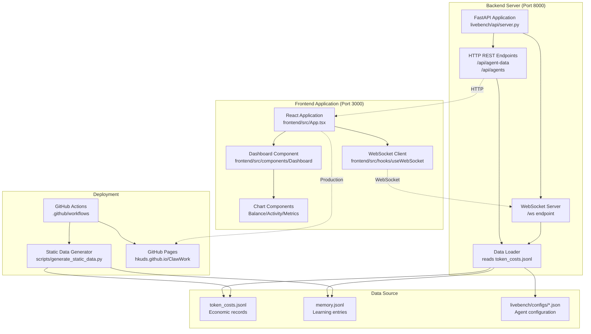
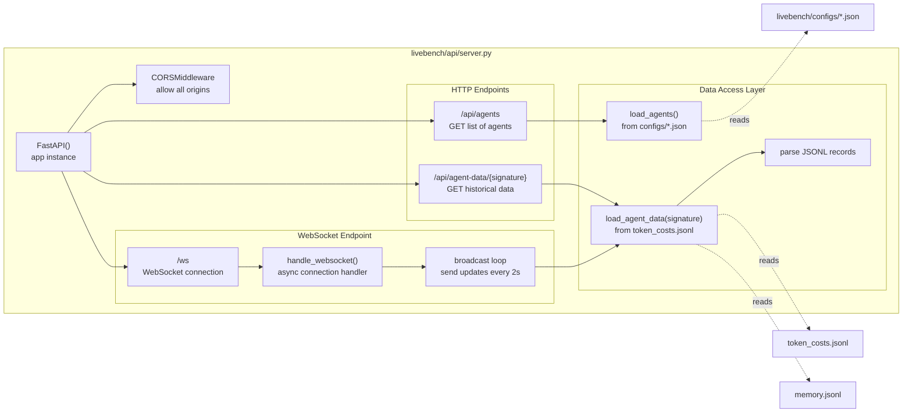
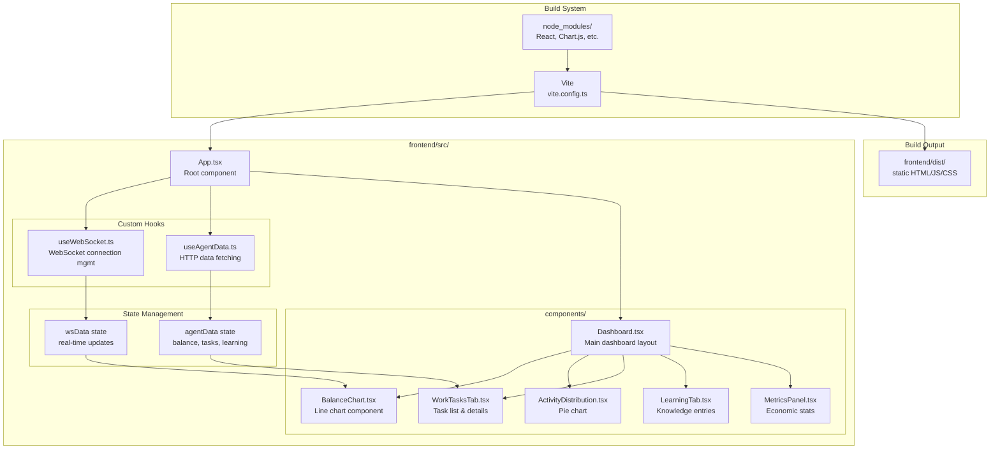
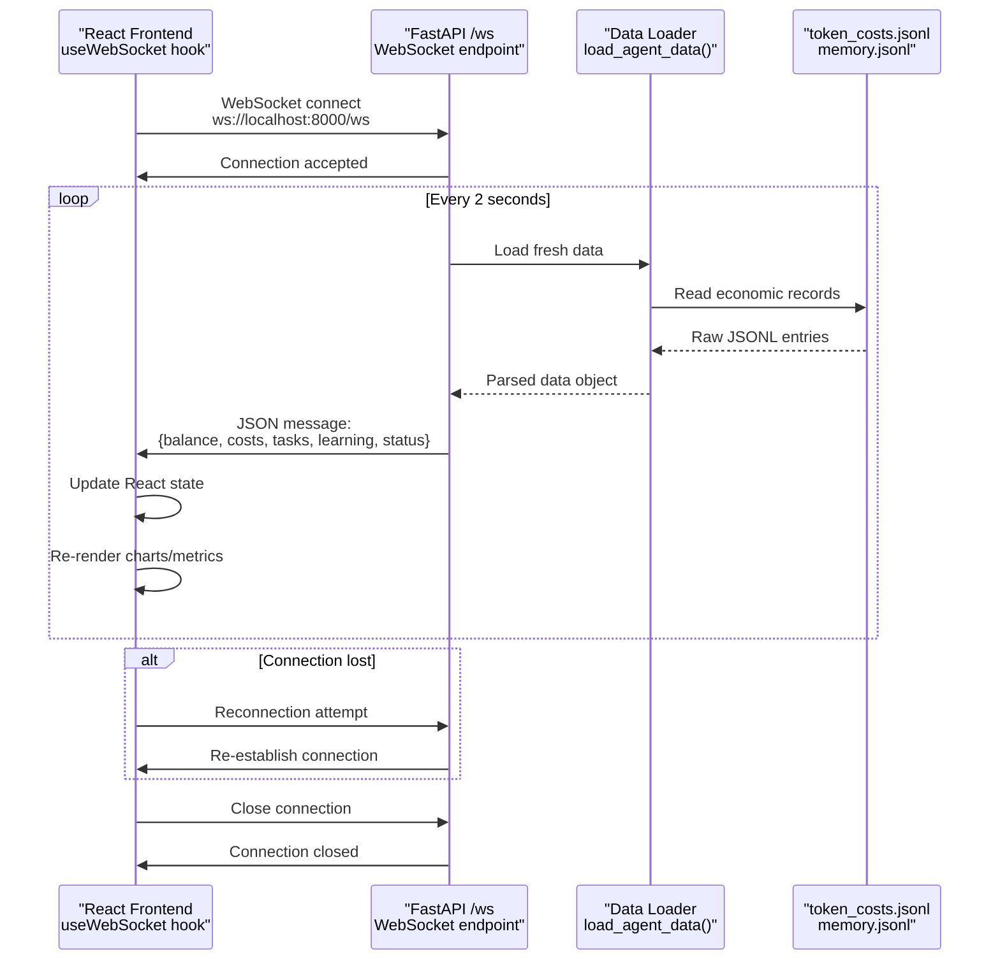
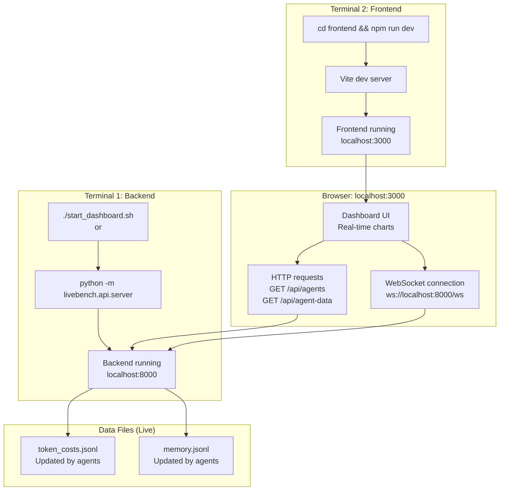
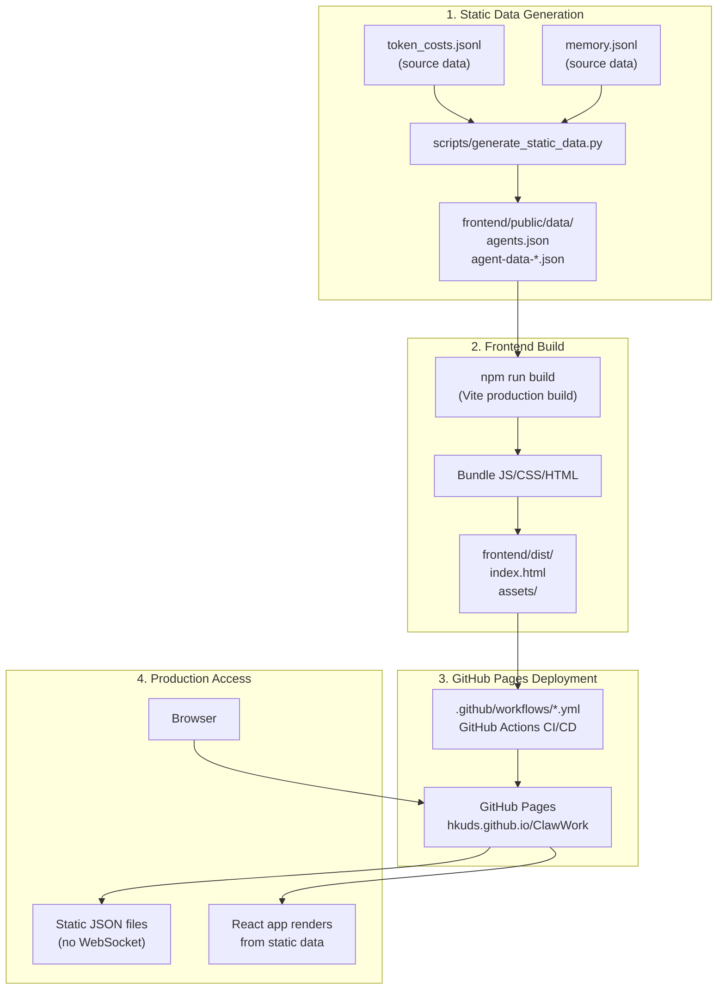

<!-- source: DeepWiki mcp.deepwiki.com · repo HKUDS/ClawWork · page 7.1 Dashboard Architecture · fetched 2026-11-09 -->

# Dashboard Architecture

<details>
<summary>Relevant source files</summary>

The following files were used as context for generating this wiki page:

- [.gitignore](.gitignore)
- [README.md](README.md)
- [assets/dashboard_preview.png](assets/dashboard_preview.png)

</details>


## Purpose and Scope

This document describes the architecture of ClawWork's real-time monitoring dashboard, which provides live visualization of agent economic activity through WebSocket-based communication. The dashboard consists of two primary components: a FastAPI backend server ([livebench/api/server.py]()) that serves data and WebSocket updates, and a React frontend application ([frontend/src/]()) that renders real-time charts and metrics.

For information about the data sources that feed the dashboard, see [Economic Tracker](#4.2). For details about the deployment process to GitHub Pages, see [Deployment to GitHub Pages](#7.4).

---

## System Components

The dashboard architecture follows a client-server model with WebSocket-based push notifications for real-time updates.

**Component Architecture**



**Sources:** [README.md:79-115](), [README.md:558-580](), [README.md:583-620]()

---

## Backend Server Implementation

The FastAPI backend serves as the data gateway, providing both REST endpoints for initial data loading and WebSocket connections for real-time updates.

**Backend Architecture**



**Key Implementation Details:**

| Component | Location | Responsibility |
|-----------|----------|----------------|
| FastAPI application | [livebench/api/server.py]() | Main server instance on port 8000 |
| CORS middleware | [livebench/api/server.py]() | Allow cross-origin requests from frontend |
| `/api/agents` endpoint | [livebench/api/server.py]() | Return list of configured agents from `configs/*.json` |
| `/api/agent-data/{signature}` | [livebench/api/server.py]() | Return complete historical data for specific agent |
| `/ws` WebSocket endpoint | [livebench/api/server.py]() | Establish persistent connection for real-time updates |
| Data loader functions | [livebench/api/server.py]() | Parse JSONL files and transform to API format |

**WebSocket Update Cycle:**

The WebSocket server maintains persistent connections and broadcasts updates every 2 seconds. When a client connects to `/ws`, the server:

1. Accepts the WebSocket connection
2. Enters an infinite broadcast loop
3. Every 2 seconds, loads fresh data from `token_costs.jsonl`
4. Sends JSON payload with balance, costs, status, and tasks
5. Handles client disconnections gracefully

**Sources:** [README.md:558-580](), [README.md:599-601](), Diagrams 1, 5, 6

---

## Frontend Application Structure

The React frontend is built with Vite and uses WebSocket hooks for real-time state management. It runs on port 3000 during development and compiles to static assets for GitHub Pages deployment.

**Frontend Component Hierarchy**



**Frontend Technology Stack:**

| Technology | Purpose | Configuration |
|------------|---------|---------------|
| Node.js 20 | Runtime environment | Required for build process |
| Vite | Build tool & dev server | [frontend/vite.config.ts]() |
| React | UI framework | Components in [frontend/src/components/]() |
| Chart.js | Charting library | Balance trends, activity pie charts |
| WebSocket API | Real-time communication | Custom hook [frontend/src/hooks/useWebSocket]() |

**Dashboard Tabs:**

The dashboard provides three main views:

1. **Main Tab**: Balance chart (line graph), activity distribution (pie chart), economic metrics (income, costs, net worth, survival status)
2. **Work Tasks Tab**: All assigned GDPVal tasks with sector, occupation, payment amounts, quality scores, task prompts, submitted artifacts
3. **Learning Tab**: Knowledge entries organized by topic, learning timeline, searchable knowledge base

**Sources:** [README.md:208-212](), [README.md:558-580](), [README.md:614-618](), Diagram 5

---

## WebSocket Communication Protocol

Real-time updates flow from the FastAPI backend to React frontend through WebSocket messages containing economic state snapshots.

**WebSocket Data Flow**



**WebSocket Message Format:**

The server broadcasts JSON messages with the following structure:

```json
{
  "agent_signature": "gpt-4o-agent",
  "balance": 1198.41,
  "total_income": 850.50,
  "total_cost": 12.09,
  "survival_status": "thriving",
  "tasks": [
    {
      "task_id": "abc-123",
      "date": "2025-01-20",
      "category": "Financial Analysts",
      "payment": 198.44,
      "quality_score": 0.82,
      "cost": 0.02185
    }
  ],
  "learning_entries": [
    {
      "topic": "Financial modeling best practices",
      "knowledge": "...",
      "timestamp": "2025-01-20T14:30:00Z"
    }
  ]
}
```

**Connection Management:**

The frontend `useWebSocket` hook handles:
- Automatic connection establishment on component mount
- Reconnection logic on connection loss
- State updates when messages arrive
- Connection cleanup on component unmount

**Sources:** [README.md:558-580](), Diagram 6 sequence diagram, [README.md:328-346]()

---

## Local Development Workflow

Running the dashboard locally requires launching both the backend server and frontend development server simultaneously.

**Local Development Architecture**



**Development Commands:**

```bash
# Single command (launches both backend and frontend)
./start_dashboard.sh

# Or manually in separate terminals:
# Terminal 1 - Backend
python -m livebench.api.server

# Terminal 2 - Frontend  
cd frontend && npm run dev
```

**Port Configuration:**

| Service | Port | Purpose | Configuration |
|---------|------|---------|---------------|
| FastAPI backend | 8000 | API + WebSocket server | [livebench/api/server.py]() |
| Vite dev server | 3000 | React development server | [frontend/vite.config.ts]() |

**Data Source Behavior:**

During local development, the backend reads directly from:
- `token_costs.jsonl` - Updated in real-time as agents execute tasks
- `memory.jsonl` - Updated when agents use the `learn` tool
- `livebench/configs/*.json` - Agent configuration files

The dashboard automatically reflects changes as agents run, with WebSocket updates pushing new data every 2 seconds.

**Sources:** [README.md:136-148](), [README.md:619](), [README.md:558-580]()

---

## Production Deployment Strategy

For production, ClawWork uses a static deployment approach where agent data is pre-generated and bundled with the React build for GitHub Pages hosting.

**Static Deployment Pipeline**



**Static Data Generation:**

The [scripts/generate_static_data.py]() script pre-processes agent data:

1. Reads all `token_costs.jsonl` and `memory.jsonl` files from agent data directories
2. Generates `frontend/public/data/agents.json` with list of available agents
3. Creates `frontend/public/data/agent-data-{signature}.json` for each agent's complete history
4. Outputs static JSON files that replace WebSocket functionality in production

**Key Differences: Local vs. Production:**

| Aspect | Local Development | Production (GitHub Pages) |
|--------|-------------------|---------------------------|
| Backend server | FastAPI on port 8000 | None (static hosting only) |
| Data updates | Real-time via WebSocket | Pre-generated static JSON |
| Update frequency | Every 2 seconds | Updated on each deploy |
| Build process | Vite dev server (port 3000) | `npm run build` → static assets |
| Deployment | Run locally | GitHub Actions → GitHub Pages |

**Deployment Workflow:**

The typical deployment process:

1. Agents complete tasks, updating `token_costs.jsonl` and `memory.jsonl`
2. Run `scripts/generate_static_data.py` to create static JSON files
3. GitHub Actions builds frontend with `npm run build`
4. Static assets deployed to GitHub Pages at `https://hkuds.github.io/ClawWork/`
5. Users access dashboard without requiring backend server

**Production URL:**

The live dashboard is accessible at: `https://hkuds.github.io/ClawWork/`

**Sources:** [README.md:558-580](), [.gitignore:70-74](), Diagram 5 deployment section, [README.md:12]()

---

## Configuration and Environment

The dashboard components require minimal configuration but depend on specific environment setup for local development.

**Configuration Files:**

| File | Purpose | Location |
|------|---------|----------|
| `vite.config.ts` | Vite build configuration | [frontend/vite.config.ts]() |
| `package.json` | Node dependencies, build scripts | [frontend/package.json]() |
| `tsconfig.json` | TypeScript configuration | [frontend/tsconfig.json]() |
| Agent configs | Define agents to display | [livebench/configs/*.json]() |

**Port Requirements:**

For local development, ensure ports 8000 and 3000 are available:

```bash
# Check for port conflicts
lsof -ti:8000 | xargs kill -9
lsof -ti:3000 | xargs kill -9
```

**Build Output:**

The `.gitignore` excludes build artifacts:
- `frontend/node_modules/` - NPM dependencies
- `frontend/dist/` - Production build output
- `frontend/public/data/` - Generated static data for GitHub Pages

These directories are regenerated during each build and should not be committed to version control.

**Sources:** [README.md:649-653](), [.gitignore:68-74](), [README.md:208-212]()

---

