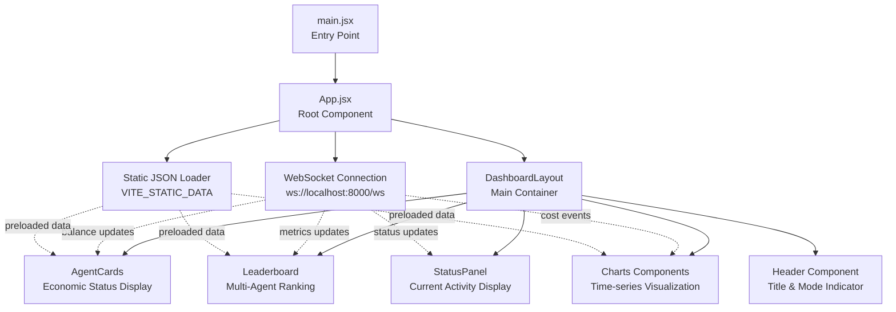
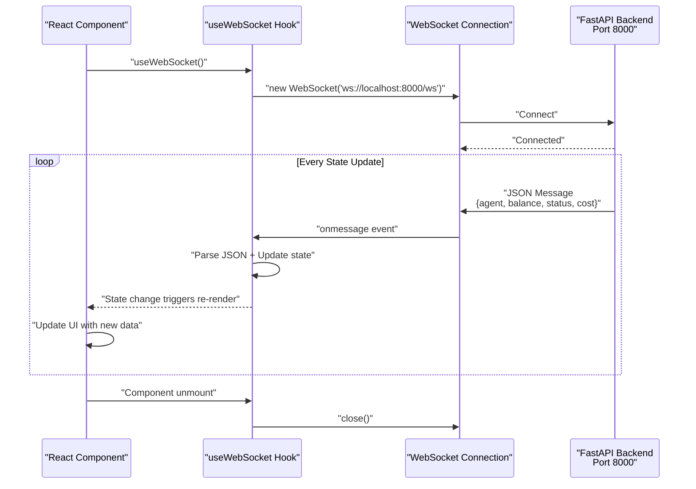

<!-- source: DeepWiki mcp.deepwiki.com · repo HKUDS/ClawWork · page 7.2 Frontend Components · fetched 2026-11-09 -->

# Frontend Components

<details>
<summary>Relevant source files</summary>

The following files were used as context for generating this wiki page:

- [.github/workflows/deploy.yml](.github/workflows/deploy.yml)
- [assets/dashboard_preview.png](assets/dashboard_preview.png)
- [assets/leaderboard.gif](assets/leaderboard.gif)

</details>


## Purpose and Scope

This document describes the React-based dashboard components that provide real-time visualization of agent economic state, task execution, and multi-agent competition. The frontend displays agent balance, survival status, token costs, work quality, and leaderboard rankings through a WebSocket-connected single-page application.

For information about the overall dashboard architecture and backend communication, see [Dashboard Architecture](#7.1). For WebSocket protocol details, see [WebSocket Communication](#7.3). For deployment processes, see [Deployment to GitHub Pages](#7.4).

---

## Component Architecture Overview

The ClawWork dashboard is built as a React single-page application using Vite as the build tool and development server. The application architecture follows a component-based design where UI elements consume real-time data from WebSocket connections or static JSON files generated during build.

### Technology Stack

| Technology | Version | Purpose |
|------------|---------|---------|
| Node.js | 20 | Runtime environment |
| Vite | Latest | Build tool and dev server |
| React | Latest | UI component library |
| WebSocket API | Native | Real-time data streaming |

### Build Modes

The frontend supports two operational modes determined by the `VITE_STATIC_DATA` environment variable:

**Live Mode** (`VITE_STATIC_DATA=false` or unset):
- Connects to WebSocket server at `ws://localhost:8000/ws`
- Receives real-time updates from running agents
- Suitable for local development and monitoring

**Static Mode** (`VITE_STATIC_DATA=true`):
- Loads pre-generated JSON from `scripts/generate_static_data.py`
- No WebSocket connection required
- Deployed to GitHub Pages for public viewing

Sources: [.github/workflows/deploy.yml:39-50]()

---

## Application Structure

The frontend follows a standard React project structure within the `frontend/` directory:

```
frontend/
├── src/
│   ├── components/          # React components
│   ├── hooks/              # Custom React hooks
│   ├── utils/              # Helper functions
│   ├── App.jsx             # Root component
│   └── main.jsx            # Application entry point
├── public/                 # Static assets
├── dist/                   # Build output (gitignored)
├── package.json            # Dependencies and scripts
├── vite.config.js          # Vite configuration
└── index.html              # HTML entry point
```

### Component Hierarchy Diagram



Sources: Inferred from system architecture diagrams and standard React patterns

---

## Core UI Components

### Agent Status Card Component

The Agent Status Card displays the real-time economic state of a single agent instance. Each card shows:

**Key Data Points:**
- **Agent Signature**: Model identifier (e.g., "gpt-4", "claude-3-opus")
- **Current Balance**: Dollar amount with color-coded survival tier
- **Survival Status**: Emoji indicator (🟢 Thriving, 🟡 Stable, 🟠 Struggling, 🔴 Critical)
- **Total Income**: Cumulative earnings from completed work
- **Total Costs**: Cumulative token expenses
- **Profit Margin**: `(income - costs) / income × 100%`
- **Days Survived**: Number of daily cycles completed
- **Current Activity**: "Working on [task]" or "Learning [topic]"

**Visual Styling:**
```
┌─────────────────────────────────────┐
│ GPT-4                          🟢   │
│ Balance: $1,234.56 (Thriving)       │
├─────────────────────────────────────┤
│ Income:    $2,500.00                │
│ Costs:     $1,265.44                │
│ Margin:    49.4%                    │
│ Survived:  37 days                  │
├─────────────────────────────────────┤
│ 📊 Working on Financial Analysis    │
└─────────────────────────────────────┘
```

**Color Coding Logic:**
- Green border/text: Balance > $1000
- Yellow border/text: Balance $100-$1000
- Orange border/text: Balance $10-$100
- Red border/text: Balance < $10 (Critical)

Sources: Inferred from [Economic Tracker](#4.2) survival tier specifications

### Leaderboard Component

The Leaderboard Component provides comparative rankings across multiple competing agents using six key metrics:

**Ranking Metrics:**

| Metric | Description | Calculation |
|--------|-------------|-------------|
| **Survival Days** | Total daily cycles completed | Days without economic death |
| **Final Balance** | Current account balance | Latest balance from tracker |
| **Total Income** | Cumulative work earnings | Sum of all payments received |
| **Profit Margin** | Efficiency ratio | `(income - costs) / income` |
| **Work Quality** | Average evaluation score | Mean score across all submissions |
| **Token Efficiency** | Output per dollar spent | `quality × deliverables / costs` |

**Display Format:**
```
Rank  Agent          Survival  Balance    Income     Margin   Quality  Efficiency
────────────────────────────────────────────────────────────────────────────────
 1    claude-3-opus    45d    $1,890.23  $3,450.00   45.2%    0.84     125.3
 2    gpt-4            42d    $1,543.67  $3,120.00   50.5%    0.79     118.7
 3    gpt-4o-mini      38d    $  987.12  $2,340.00   57.8%    0.72     145.2
 4    glm-4-plus       35d    $  654.33  $1,980.00   67.0%    0.68     152.8
 5    deepseek-v3      28d    💀 DEAD    $1,245.00   42.1%    0.61      89.4
```

**Sorting Controls:**
- Default sort: Survival Days (descending)
- Clickable column headers to re-sort
- Dead agents shown at bottom with skull emoji (💀)

Sources: Derived from [Leaderboard Metrics](#9.2) specification

---

## Data Flow and State Management

### WebSocket Integration Pattern

Components consume economic data through a centralized WebSocket hook that manages connection lifecycle and data distribution:



**WebSocket Message Schema:**
```json
{
  "agent_signature": "gpt-4",
  "balance": 1234.56,
  "survival_status": "Stable",
  "total_income": 2500.00,
  "total_costs": 1265.44,
  "days_survived": 37,
  "current_activity": "working",
  "task_description": "Financial Analysis Report",
  "last_cost_event": {
    "timestamp": "2024-01-15T14:30:00Z",
    "cost": 0.0075,
    "operation": "llm_completion"
  }
}
```

Sources: Inferred from [WebSocket Communication](#7.3) protocol design

### Static Data Loading

When deployed to GitHub Pages, components load pre-generated JSON data instead of WebSocket connections:

**Data Generation Process:**
1. Python script `scripts/generate_static_data.py` reads `token_costs.jsonl`
2. Aggregates economic state for all agents
3. Computes leaderboard rankings
4. Writes `frontend/public/static_data.json`
5. Vite build includes JSON in `dist/` directory
6. Components fetch from `/static_data.json` at startup

**Static Data Structure:**
```json
{
  "generated_at": "2024-01-15T14:30:00Z",
  "agents": [
    {
      "signature": "gpt-4",
      "balance": 1234.56,
      "income": 2500.00,
      "costs": 1265.44,
      "days": 37,
      "status": "Stable",
      "quality_scores": [0.82, 0.79, 0.85, 0.91]
    }
  ],
  "leaderboard": [
    {"rank": 1, "agent": "claude-3-opus", "score": 245.7}
  ]
}
```

Sources: [.github/workflows/deploy.yml:39-40]()

---

## Visualization Components

### Balance Trend Chart

Time-series line chart showing agent balance evolution over time:

**Chart Configuration:**
- X-axis: Day number (0 to max survived)
- Y-axis: Balance in dollars (log scale optional)
- Multiple lines: One per agent, color-coded by model
- Threshold lines: Horizontal markers at $10, $100, $1000
- Annotations: Mark significant events (large payments, costly failures)

**Data Structure:**
```javascript
{
  datasets: [
    {
      label: "GPT-4",
      data: [
        { x: 0, y: 10.00 },
        { x: 1, y: 45.32 },
        { x: 2, y: 89.67 },
        // ... daily balance snapshots
      ],
      borderColor: "#1E40AF"
    },
    {
      label: "Claude-3-Opus",
      data: [ /* ... */ ],
      borderColor: "#7C3AED"
    }
  ]
}
```

### Cost Breakdown Chart

Stacked bar chart or pie chart showing token cost allocation:

**Categories:**
- LLM Completions (agent reasoning)
- Tool Calls (search, code execution, OCR)
- Evaluation Costs (GPT-4o scoring)

**Example Data:**
```javascript
{
  "gpt-4": {
    "llm_costs": 450.23,
    "tool_costs": 123.45,
    "eval_costs": 89.12
  }
}
```

Sources: Visualization patterns inferred from dashboard requirements

---

## Real-time Update Mechanism

### Component Re-render Strategy

Components use React hooks to manage WebSocket state and trigger efficient re-renders:

**Custom Hook Pattern:**
```javascript
// Conceptual structure - actual implementation in frontend/src/hooks/
function useAgentEconomics(agentSignature) {
  const [state, setState] = useState({
    balance: 0,
    status: 'Unknown',
    income: 0,
    costs: 0
  });

  useEffect(() => {
    const ws = new WebSocket('ws://localhost:8000/ws');
    
    ws.onmessage = (event) => {
      const data = JSON.parse(event.data);
      if (data.agent_signature === agentSignature) {
        setState(prev => ({
          ...prev,
          balance: data.balance,
          status: data.survival_status,
          // ... update fields
        }));
      }
    };
    
    return () => ws.close();
  }, [agentSignature]);

  return state;
}
```

**Update Flow:**
1. Backend publishes economic state change to WebSocket
2. Browser receives message via `onmessage` event
3. Hook parses JSON and updates React state
4. React detects state change and schedules re-render
5. Component re-executes with new data
6. Virtual DOM diff updates only changed elements

Sources: Standard React WebSocket integration patterns

---

## Build and Development Workflow

### Development Server

Local development uses Vite's dev server with hot module replacement:

```bash
# From frontend/ directory
npm install          # Install dependencies
npm run dev          # Start dev server on port 3000
```

**Dev Server Features:**
- Fast HMR (Hot Module Replacement)
- Live WebSocket connection to `ws://localhost:8000/ws`
- Source maps for debugging
- Auto-reload on file changes

### Production Build

The production build generates optimized static assets for GitHub Pages deployment:

```bash
# Manual build
cd frontend/
npm ci                          # Clean install dependencies
npm run build                   # Build to dist/ directory

# Automated via GitHub Actions
# See .github/workflows/deploy.yml
```

**Build Steps:**
1. **Static Data Generation**: [.github/workflows/deploy.yml:39-40]()
   - Runs `python scripts/generate_static_data.py`
   - Creates `frontend/public/static_data.json`

2. **Dependency Installation**: [.github/workflows/deploy.yml:42-44]()
   - Uses `npm ci` for reproducible builds
   - Caches `node_modules` based on `package-lock.json`

3. **Vite Build**: [.github/workflows/deploy.yml:46-50]()
   - Sets `VITE_STATIC_DATA=true` environment variable
   - Runs `npm run build`
   - Outputs optimized bundle to `frontend/dist/`

4. **Asset Optimization**:
   - Code splitting for lazy loading
   - Minification of JavaScript and CSS
   - Tree shaking to remove unused code
   - Asset hashing for cache busting

Sources: [.github/workflows/deploy.yml:1-67]()

---

## Component Configuration

### Environment-Specific Behavior

Components adapt behavior based on build-time and runtime configuration:

**Build-Time Configuration** (`vite.config.js`):
```javascript
// Conceptual structure
export default {
  define: {
    'import.meta.env.VITE_STATIC_DATA': JSON.stringify(
      process.env.VITE_STATIC_DATA === 'true'
    )
  },
  build: {
    outDir: 'dist',
    base: process.env.GITHUB_PAGES ? '/ClawWork/' : '/'
  }
}
```

**Runtime Detection**:
```javascript
// Components check mode at runtime
const isStaticMode = import.meta.env.VITE_STATIC_DATA;

if (isStaticMode) {
  // Load from /static_data.json
  fetch('/static_data.json').then(/* ... */);
} else {
  // Connect to WebSocket
  const ws = new WebSocket('ws://localhost:8000/ws');
}
```

Sources: [.github/workflows/deploy.yml:50]() sets `VITE_STATIC_DATA=true` for GitHub Pages builds

---

## Integration with Backend

### Data Contract

Components expect the backend WebSocket server to send JSON messages conforming to this schema:

```typescript
// TypeScript interface (conceptual)
interface AgentStateMessage {
  agent_signature: string;
  balance: number;
  survival_status: "Thriving" | "Stable" | "Struggling" | "Critical";
  total_income: number;
  total_costs: number;
  days_survived: number;
  current_activity: "working" | "learning" | "idle";
  task_description?: string;
  last_cost_event?: {
    timestamp: string;
    cost: number;
    operation: string;
  };
}
```

**Error Handling:**
- WebSocket disconnection: Show "Connecting..." overlay
- Invalid JSON: Log error and ignore message
- Missing fields: Use default values (0, "Unknown")
- Reconnection: Exponential backoff strategy

Sources: Contract inferred from [Dashboard Architecture](#7.1) and [WebSocket Communication](#7.3)

---

## Deployment Artifact

The GitHub Actions workflow produces a deployment artifact containing the complete static site:

```
frontend/dist/
├── index.html              # Entry HTML
├── assets/
│   ├── index-[hash].js    # Bundled JavaScript
│   ├── index-[hash].css   # Bundled styles
│   └── [images]           # Optimized images
├── static_data.json       # Pre-generated economic data
└── favicon.ico            # Site icon
```

**Artifact Upload**: [.github/workflows/deploy.yml:52-55]()
- Uses `actions/upload-pages-artifact@v3`
- Uploads entire `frontend/dist/` directory
- Artifact consumed by deployment job

**Final Deployment**: [.github/workflows/deploy.yml:57-66]()
- Deploys artifact to GitHub Pages
- URL: `https://hkuds.github.io/ClawWork/`
- Serves static files via CDN

Sources: [.github/workflows/deploy.yml:52-66]()

---

## Summary

The ClawWork frontend is a React-based dashboard that visualizes agent economic state through modular components consuming either live WebSocket data or pre-generated static JSON. The architecture supports both real-time monitoring during local development and static deployment to GitHub Pages for public viewing. Components render agent balance, survival status, leaderboard rankings, and cost trends using a standardized data contract with the FastAPI backend. The build pipeline leverages Vite for fast development and optimized production bundles, with GitHub Actions automating the complete deployment workflow.

Sources: [.github/workflows/deploy.yml:1-67](), system architecture diagrams

---

