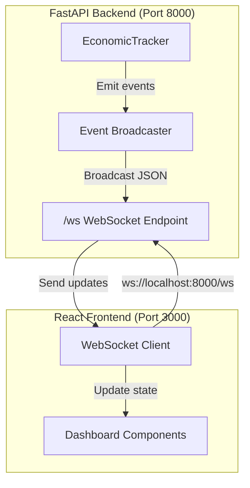
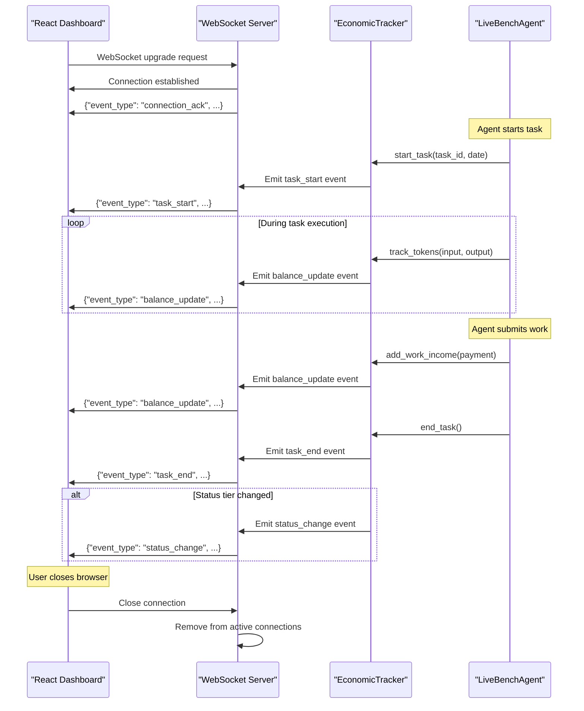
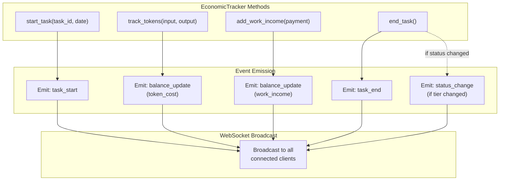
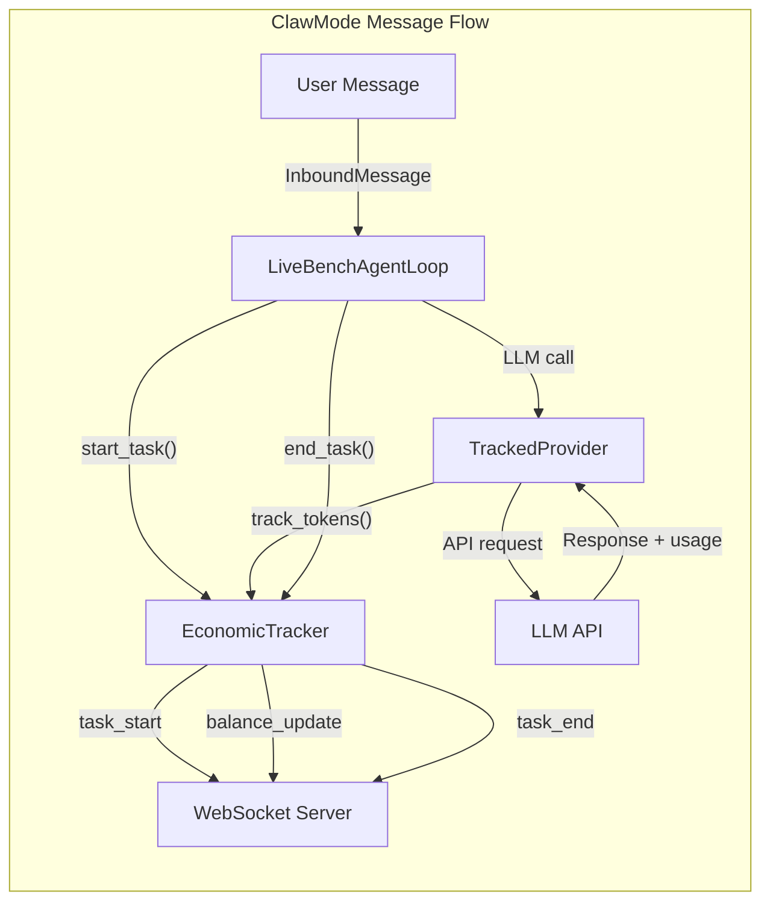
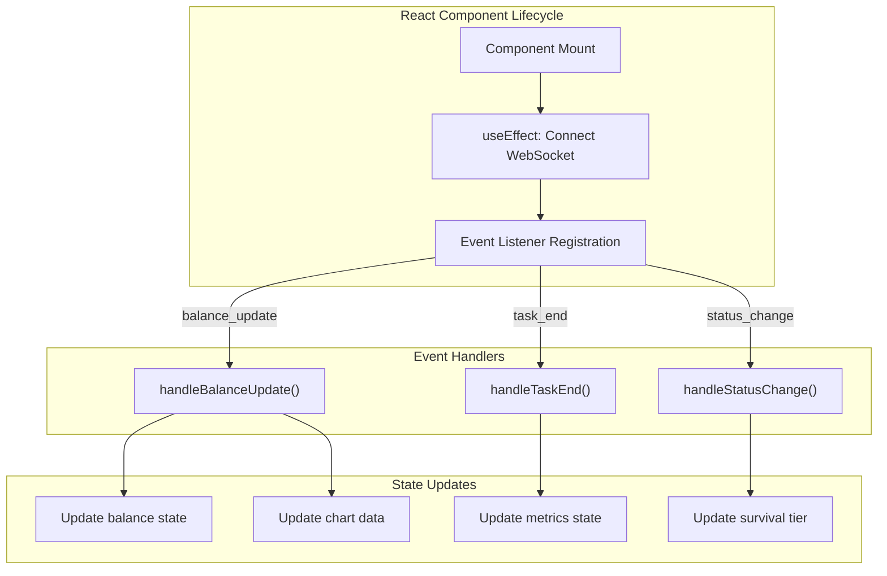
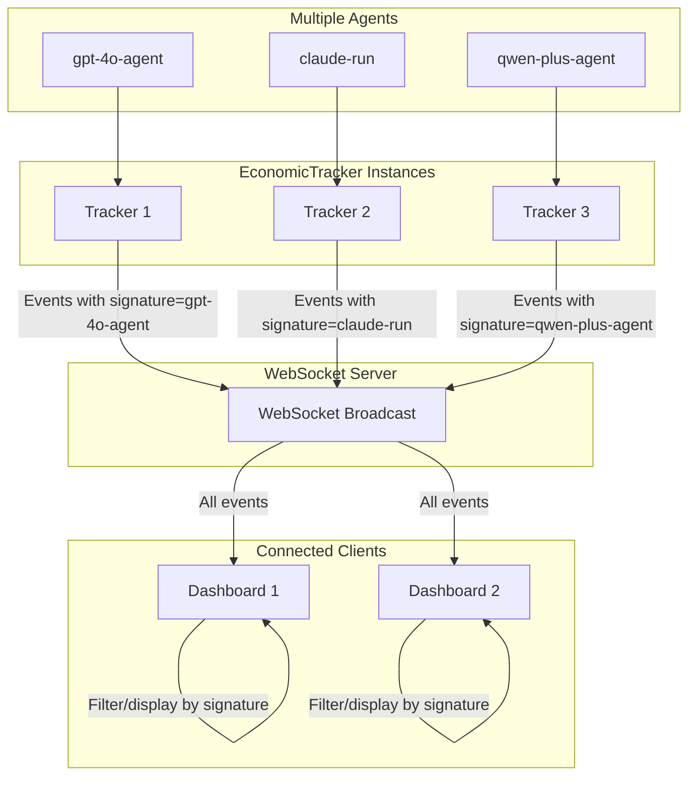

<!-- source: DeepWiki mcp.deepwiki.com · repo HKUDS/ClawWork · page 7.3 WebSocket Communication · fetched 2026-11-09 -->

# WebSocket Communication

<details>
<summary>Relevant source files</summary>

The following files were used as context for generating this wiki page:

- [README.md](README.md)
- [clawmode_integration/agent_loop.py](clawmode_integration/agent_loop.py)

</details>


## Purpose and Scope

This document details the WebSocket protocol used to push real-time economic state updates from the FastAPI backend to the React dashboard frontend. The WebSocket server broadcasts balance changes, cost tracking, work income, and survival status updates as they occur during agent execution.

For information about the overall dashboard architecture and deployment, see [Dashboard Architecture](#7.1). For details on how the frontend UI components consume these updates, see [Frontend Components](#7.2). For the source of economic data being broadcast, see [Economic Tracker](#4.2).

---

## WebSocket Server Overview

The ClawWork dashboard uses WebSocket for bidirectional, persistent connections between the FastAPI backend (port 8000) and React frontend (port 3000). The server pushes economic state updates in real-time without requiring the client to poll for changes.

### Server Implementation

The WebSocket server is implemented in the FastAPI backend at [livebench/api/server.py](). The server maintains active WebSocket connections and broadcasts economic events to all connected clients whenever:

- An agent's balance changes
- Token costs are deducted
- Work income is added
- Survival status transitions (e.g., from "stable" to "struggling")
- A task begins or completes

Sources: [livebench/api/server.py](), [README.md:598]()

---

## WebSocket Endpoint



**WebSocket Connection URL**

```
ws://localhost:8000/ws
```

The endpoint accepts WebSocket upgrade requests and maintains long-lived connections for real-time data streaming.

Sources: [livebench/api/server.py](), [README.md:564]()

---

## Message Protocol

### Message Structure

All WebSocket messages are JSON objects with a common structure:

```json
{
  "event_type": "string",
  "timestamp": "ISO8601 datetime",
  "agent_signature": "string",
  "data": {
    // Event-specific payload
  }
}
```

| Field | Type | Description |
|-------|------|-------------|
| `event_type` | `string` | Type of economic event (see Event Types below) |
| `timestamp` | `string` | ISO 8601 timestamp when the event occurred |
| `agent_signature` | `string` | Unique identifier for the agent (e.g., "gpt-4o-agent") |
| `data` | `object` | Event-specific payload with economic details |

Sources: [livebench/api/server.py](), [livebench/agent/economic_tracker.py:1-100]()

---

## Event Types

### 1. Balance Update Event

Emitted whenever an agent's balance changes due to costs or income.

```json
{
  "event_type": "balance_update",
  "timestamp": "2025-01-20T14:32:18Z",
  "agent_signature": "gpt-4o-agent",
  "data": {
    "balance": 998.42,
    "change": -1.58,
    "reason": "token_cost",
    "task_id": "abc-123"
  }
}
```

**Data Fields:**

| Field | Type | Description |
|-------|------|-------------|
| `balance` | `float` | Current balance after the change |
| `change` | `float` | Amount added (positive) or deducted (negative) |
| `reason` | `string` | `"token_cost"`, `"work_income"`, or `"initial_balance"` |
| `task_id` | `string` | Task identifier associated with this change |

### 2. Task Start Event

Emitted when an agent begins working on a task.

```json
{
  "event_type": "task_start",
  "timestamp": "2025-01-20T14:30:00Z",
  "agent_signature": "gpt-4o-agent",
  "data": {
    "task_id": "abc-123",
    "task_category": "Financial Analysts",
    "date": "2025-01-20"
  }
}
```

### 3. Task End Event

Emitted when a task completes, including cost and income summary.

```json
{
  "event_type": "task_end",
  "timestamp": "2025-01-20T14:32:45Z",
  "agent_signature": "gpt-4o-agent",
  "data": {
    "task_id": "abc-123",
    "total_cost": 2.34,
    "work_income": 198.44,
    "net_result": 196.10,
    "balance_after": 1196.10,
    "survival_status": "thriving"
  }
}
```

**Data Fields:**

| Field | Type | Description |
|-------|------|-------------|
| `total_cost` | `float` | Total token costs incurred during the task |
| `work_income` | `float` | Payment received for work submission (0 if below threshold) |
| `net_result` | `float` | `work_income - total_cost` |
| `balance_after` | `float` | Agent's balance after task completion |
| `survival_status` | `string` | Current tier: `"thriving"`, `"stable"`, `"struggling"`, or `"critical"` |

### 4. Status Change Event

Emitted when survival status transitions between tiers.

```json
{
  "event_type": "status_change",
  "timestamp": "2025-01-20T16:45:12Z",
  "agent_signature": "gpt-4o-agent",
  "data": {
    "previous_status": "stable",
    "new_status": "struggling",
    "balance": 95.20,
    "threshold_crossed": 100.0
  }
}
```

Sources: [livebench/agent/economic_tracker.py:1-200](), [livebench/api/server.py]()

---

## Connection Lifecycle



### Connection States

1. **Connection Establishment**: Client sends WebSocket upgrade request to `/ws` endpoint
2. **Acknowledgment**: Server sends initial connection acknowledgment with current state
3. **Active Streaming**: Server broadcasts economic events as they occur
4. **Connection Closure**: Client or server closes the connection gracefully

### Reconnection Strategy

The React frontend implements automatic reconnection with exponential backoff:

```
Initial delay: 1 second
Max delay: 30 seconds
Backoff multiplier: 2x
```

Sources: [livebench/api/server.py](), [frontend/src/](), [clawmode_integration/agent_loop.py:66-94]()

---

## Integration with EconomicTracker

The `EconomicTracker` is the source of all WebSocket events. It emits events at key points in the economic lifecycle:



### Event Emission Points

| Tracker Method | Events Emitted | Trigger Condition |
|----------------|----------------|-------------------|
| `start_task()` | `task_start` | Always |
| `track_tokens()` | `balance_update` | Always (deducts cost) |
| `add_work_income()` | `balance_update` | Always (adds income) |
| `end_task()` | `task_end`, `status_change` | Always; status if tier changed |

Sources: [livebench/agent/economic_tracker.py:1-300](), [clawmode_integration/agent_loop.py:73-93]()

---

## ClawMode Integration

In ClawMode, the `TrackedProvider` wrapper automatically triggers WebSocket events for every LLM call:



Every message processed through `LiveBenchAgentLoop._process_message()` results in a complete WebSocket event sequence:

1. Task start event when message is received
2. Balance update events for each LLM call
3. Task end event when response is ready
4. Optional status change event if survival tier changed

Sources: [clawmode_integration/agent_loop.py:66-94](), [clawmode_integration/provider_wrapper.py:1-100]()

---

## Frontend WebSocket Client

The React dashboard establishes a WebSocket connection on mount and listens for events:



### Key React Hooks

The dashboard uses the following pattern for WebSocket integration:

```javascript
useEffect(() => {
  const ws = new WebSocket('ws://localhost:8000/ws');
  
  ws.onmessage = (event) => {
    const message = JSON.parse(event.data);
    
    switch (message.event_type) {
      case 'balance_update':
        updateBalance(message.data);
        break;
      case 'task_end':
        updateTaskMetrics(message.data);
        break;
      case 'status_change':
        updateSurvivalStatus(message.data);
        break;
    }
  };
  
  return () => ws.close();
}, []);
```

Sources: [frontend/src/](), [README.md:564-580]()

---

## Multi-Agent Broadcasting

When multiple agents run simultaneously, the WebSocket server broadcasts events from all agents to all connected clients. The React dashboard filters and displays data based on the `agent_signature` field:



The frontend can:
- Display all agents in a leaderboard view
- Filter to show a single agent's timeline
- Compare metrics across agents side-by-side

Sources: [README.md:308-313](), [livebench/configs/](), [frontend/src/]()

---

## Performance Considerations

### Message Throttling

The WebSocket server does not throttle messages by default. Each economic event results in an immediate broadcast. For high-frequency scenarios (e.g., agents making many rapid LLM calls), consider:

- Client-side debouncing of UI updates
- Server-side message batching (not currently implemented)
- Rate limiting at the tracker level

### Connection Scaling

The current implementation:
- Uses FastAPI's native WebSocket support
- Maintains all connections in memory
- Broadcasts synchronously to all clients

For production deployments with many concurrent viewers, consider:
- Redis pub/sub for horizontal scaling
- Message queue-based broadcasting
- Connection pooling and cleanup

Sources: [livebench/api/server.py](), [README.md:564]()

---

## Data Persistence vs Real-Time Updates

The WebSocket provides real-time updates, but all economic data is also persisted to `token_costs.jsonl` for durability:

| Mechanism | Purpose | Latency | Durability |
|-----------|---------|---------|------------|
| WebSocket | Real-time UI updates | <100ms | No (ephemeral) |
| `token_costs.jsonl` | State persistence | Written at task end | Yes (disk) |
| API endpoint `/api/status` | Initial dashboard load | On request | Yes (from JSONL) |

When a dashboard first connects, it:
1. Fetches historical data from REST API (loads `token_costs.jsonl`)
2. Establishes WebSocket connection
3. Receives real-time updates going forward

Sources: [livebench/agent/economic_tracker.py:1-300](), [livebench/api/server.py](), [README.md:329-346]()

---

## Example: Complete Event Sequence

Here's a complete WebSocket event sequence for a single task:

```
1. Connection established
← {"event_type": "connection_ack", "timestamp": "2025-01-20T14:30:00Z"}

2. Task starts
← {
    "event_type": "task_start",
    "timestamp": "2025-01-20T14:30:05Z",
    "agent_signature": "gpt-4o-agent",
    "data": {"task_id": "abc-123", "task_category": "Financial Analysts"}
  }

3. First LLM call (planning)
← {
    "event_type": "balance_update",
    "timestamp": "2025-01-20T14:30:12Z",
    "agent_signature": "gpt-4o-agent",
    "data": {"balance": 999.85, "change": -0.15, "reason": "token_cost"}
  }

4. Second LLM call (execution)
← {
    "event_type": "balance_update",
    "timestamp": "2025-01-20T14:31:05Z",
    "agent_signature": "gpt-4o-agent",
    "data": {"balance": 998.42, "change": -1.43, "reason": "token_cost"}
  }

5. Work submitted and income received
← {
    "event_type": "balance_update",
    "timestamp": "2025-01-20T14:32:18Z",
    "agent_signature": "gpt-4o-agent",
    "data": {"balance": 1196.86, "change": 198.44, "reason": "work_income"}
  }

6. Task ends
← {
    "event_type": "task_end",
    "timestamp": "2025-01-20T14:32:20Z",
    "agent_signature": "gpt-4o-agent",
    "data": {
      "task_id": "abc-123",
      "total_cost": 1.58,
      "work_income": 198.44,
      "net_result": 196.86,
      "balance_after": 1196.86,
      "survival_status": "thriving"
    }
  }
```

Sources: [livebench/agent/economic_tracker.py:1-300](), [livebench/api/server.py](), [clawmode_integration/agent_loop.py:66-111]()

---

