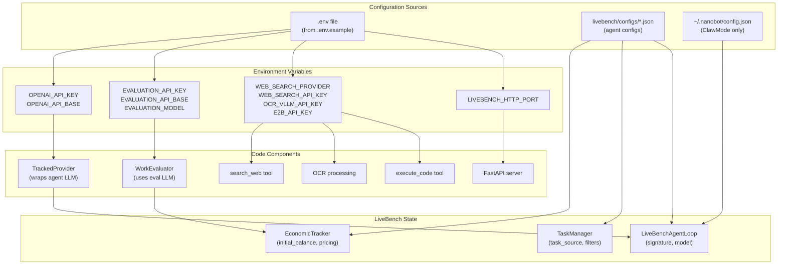
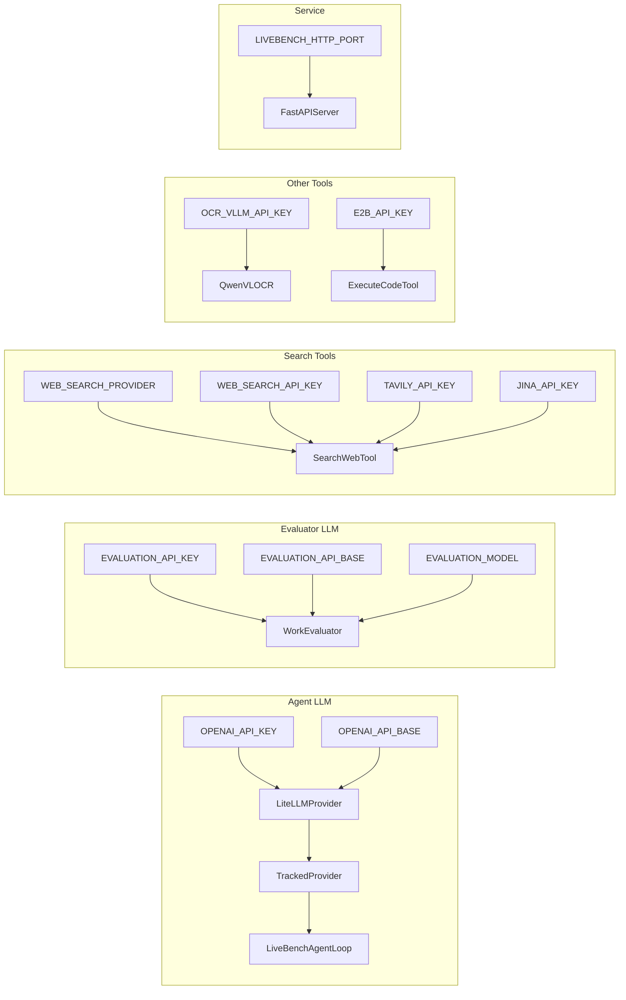

<!-- source: DeepWiki mcp.deepwiki.com · repo HKUDS/ClawWork · page 8 Configuration · fetched 2026-11-09 -->

# Configuration

<details>
<summary>Relevant source files</summary>

The following files were used as context for generating this wiki page:

- [.env.example](.env.example)
- [clawmode_integration/cli.py](clawmode_integration/cli.py)

</details>


This document provides comprehensive guidance for configuring ClawWork across different deployment scenarios and API providers. Configuration encompasses environment variables for API credentials, model selection for agents and evaluators, productivity tool settings, and deployment-specific parameters.

For agent-specific behavior in multi-model competitions, see [Agent Configuration](#9.1). For productivity tool usage details, see [Productivity Tools](#4.5).

---

## Configuration Architecture

ClawWork uses a two-tier configuration system: environment variables for API credentials and service settings, plus JSON configuration files for agent-specific economic parameters and deployment settings.

**Configuration Flow Diagram**



Sources: [.env.example:1-97](), [clawmode_integration/cli.py:25-100]()

---

## Environment Variables Overview

All environment variables are defined in [.env.example]() and must be copied to a `.env` file in the repository root. The system uses `python-dotenv` to load these variables at runtime.

**Environment Variable Categories**

| Category | Variables | Purpose |
|----------|-----------|---------|
| Agent Model API | `OPENAI_API_KEY`<br/>`OPENAI_API_BASE` | Configure LLM provider for agent execution |
| Evaluation Model API | `EVALUATION_API_KEY`<br/>`EVALUATION_API_BASE`<br/>`EVALUATION_MODEL` | Configure LLM for work quality scoring |
| Web Search | `WEB_SEARCH_PROVIDER`<br/>`WEB_SEARCH_API_KEY`<br/>`TAVILY_API_KEY`<br/>`JINA_API_KEY` | Enable `search_web` tool |
| OCR Service | `OCR_VLLM_API_KEY` | Qwen VL for image/document OCR |
| Code Execution | `E2B_API_KEY` | Sandbox for `execute_code` tool |
| Service Port | `LIVEBENCH_HTTP_PORT` | FastAPI server port (default: 8010) |

Sources: [.env.example:1-97]()

---

## Agent Model Configuration

The agent model configuration controls which LLM provider and model the agent uses for reasoning and tool execution. This is the primary cost driver in the system.

**Configuration Variables**

```bash
# Required: API key for the agent's LLM provider
OPENAI_API_KEY=your-api-key-here

# Optional: Base URL for OpenAI-compatible APIs
# Default: https://api.openai.com/v1
OPENAI_API_BASE=https://api.siliconflow.com/v1
```

**Provider Support**

The system uses LiteLLM for provider abstraction, supporting:
- **OpenAI**: `gpt-4`, `gpt-4o`, `gpt-3.5-turbo`
- **SiliconFlow**: `Qwen/Qwen2.5-72B-Instruct`, `deepseek-ai/DeepSeek-V2.5`, `01-ai/Yi-Lightning`
- **Anthropic**: `claude-3-5-sonnet-20241022` (via OpenAI-compatible endpoint)
- **Local models**: Via OpenAI-compatible APIs (e.g., vLLM, Ollama)

**Code Integration**

In standalone mode, the agent model is specified in JSON configs:

```json
{
  "agents": [{
    "signature": "gpt4o",
    "model": "gpt-4o",
    "supports_multimodal": true
  }]
}
```

In ClawMode, the model comes from `~/.nanobot/config.json` and is wrapped by `TrackedProvider`:

[clawmode_integration/cli.py:35-50]() - Reads nanobot config to create `LiteLLMProvider`
[clawmode_integration/cli.py:150-162]() - Wraps provider in `LiveBenchAgentLoop` with economic tracking

Sources: [.env.example:9-18](), [clawmode_integration/cli.py:35-50](), [clawmode_integration/cli.py:150-162]()

---

## Evaluation Model Configuration

The evaluation model is completely independent from the agent model and is used exclusively by `WorkEvaluator` to score work quality. This separation allows cost optimization: use cheaper models for agents while maintaining reliable evaluation with GPT-4o.

**Configuration Variables**

```bash
# Recommended: Use OpenAI GPT-4o for evaluation
EVALUATION_API_KEY=your-openai-api-key-here
EVALUATION_API_BASE=https://api.openai.com/v1  # Optional, default

# Optional: Override default gpt-4o model
EVALUATION_MODEL=gpt-4o
```

**Fallback Mechanism**

[.env.example:30-31]() states: "If not set, falls back to `OPENAI_API_KEY` and `OPENAI_API_BASE`"

This means:
1. If `EVALUATION_API_KEY` is set → use it with `EVALUATION_API_BASE` (or default)
2. If `EVALUATION_API_KEY` is not set → use `OPENAI_API_KEY` and `OPENAI_API_BASE`
3. Model defaults to `gpt-4o` unless `EVALUATION_MODEL` overrides it

**Why Separate Evaluation?**

[.env.example:24-29]() explains:
- Evaluation requires `gpt-4o` which may not be available on all providers
- OpenAI's `gpt-4o` has consistent quality for scoring
- Evaluation volume is lower than agent calls (less cost impact)
- Allows mixing cheap agent models with reliable evaluator

**Code Integration**

The evaluator loads these variables when constructing the evaluation LLM client:

[clawmode_integration/cli.py:85-90]() - Creates `WorkEvaluator` with meta-prompts directory

The `WorkEvaluator` internally reads `EVALUATION_API_KEY`, `EVALUATION_API_BASE`, and `EVALUATION_MODEL` from environment variables.

Sources: [.env.example:20-41](), [clawmode_integration/cli.py:85-90]()

---

## Productivity Tools API Configuration

Productivity tools enable agents to perform web searches, OCR, and code execution. Each tool has independent API configuration.

**Web Search Configuration**

```bash
# Provider selection: "tavily" (default) or "jina"
WEB_SEARCH_PROVIDER=tavily

# API key for selected provider
WEB_SEARCH_API_KEY=your-tavily-api-key-here

# Alternative: Legacy separate keys
TAVILY_API_KEY=your-tavily-api-key-here  # Tavily Search
JINA_API_KEY=your-jina-api-key-here      # Jina AI Search
```

**Provider Comparison**

| Feature | Tavily | Jina AI |
|---------|--------|---------|
| Result Format | Structured JSON with answers | Markdown-formatted text |
| Cost | $0.0008 per search | $0.05 per 1M tokens |
| Best For | Quick facts, Q&A | Deep content extraction |
| API Endpoint | tavily.com | jina.ai |

**OCR Configuration**

```bash
# Qwen VL OCR via Alibaba Cloud DashScope
OCR_VLLM_API_KEY=your-dashscope-api-key-here
```

Used when agent model does not support multimodal input. The system automatically falls back to OCR for image/document processing.

**Code Execution Configuration**

```bash
# E2B sandbox for safe code execution
E2B_API_KEY=your-e2b-api-key-here
```

Powers the `execute_code` tool for running Python, JavaScript, and shell commands in isolated environments.

**Service Port Configuration**

```bash
# Port for FastAPI dashboard backend (default: 8010)
LIVEBENCH_HTTP_PORT=8010
```

Sources: [.env.example:43-73]()

---

## Variable-to-Component Mapping

This diagram shows exactly which code components consume each environment variable:

**Environment Variable Flow**



Sources: [.env.example:1-97](), [clawmode_integration/cli.py:1-184]()

---

## ClawMode JSON Configuration

When running in ClawMode (integrated with Nanobot), additional configuration comes from JSON files in `livebench/configs/*.json`. These files define agent-specific economic parameters and task assignment strategies.

**JSON Configuration Structure**

```json
{
  "livebench": {
    "economic": {
      "initial_balance": 1000.0,
      "token_pricing": {
        "input_per_1m": 2.5,
        "output_per_1m": 10.0
      },
      "task_values_path": "./livebench/data/task_values.json"
    },
    "task_source": {
      "type": "parquet",
      "path": "./livebench/data/train-00000-of-00001.parquet"
    },
    "evaluation": {
      "use_llm_evaluation": true,
      "meta_prompts_dir": "./eval/meta_prompts"
    },
    "agents": [{
      "signature": "gpt4o",
      "model": "gpt-4o",
      "supports_multimodal": true,
      "task_filters": {
        "categories": ["Finance", "Tech"]
      },
      "task_assignment": {
        "strategy": "random"
      }
    }]
  }
}
```

**Configuration Loading in ClawMode**

[clawmode_integration/cli.py:25-32]() - `_load_livebench_config()` reads JSON file
[clawmode_integration/cli.py:53-100]() - `_build_state()` constructs components from JSON:

1. **EconomicTracker** [lines 64-73]():
   - `initial_balance` from `economic.initial_balance`
   - `input_token_price` from `economic.token_pricing.input_per_1m`
   - `output_token_price` from `economic.token_pricing.output_per_1m`
   - `data_path` derived from agent signature

2. **TaskManager** [lines 76-83]():
   - `task_source` from `task_source` object
   - `task_values_path` from `economic.task_values_path`
   - `task_filters` from agent-specific config
   - `task_assignment` from agent-specific config

3. **WorkEvaluator** [lines 85-90]():
   - `use_llm_evaluation` from `evaluation.use_llm_evaluation`
   - `meta_prompts_dir` from `evaluation.meta_prompts_dir`

4. **LiveBenchState** [lines 92-100]():
   - `signature` from agent config
   - `data_path` for agent-specific storage
   - `supports_multimodal` from agent config

Sources: [clawmode_integration/cli.py:25-100]()

---

## Deployment Patterns

The [.env.example:76-96]() file provides three recommended deployment patterns based on reliability, cost, and provider availability requirements.

**Pattern 1: All-OpenAI (Simple, Reliable)**

```bash
# Use OpenAI for both agent and evaluation
OPENAI_API_KEY=sk-proj-xxxxx
EVALUATION_API_KEY=sk-proj-xxxxx  # Same or different key
WEB_SEARCH_API_KEY=tvly-xxxxx
```

**Characteristics:**
- Single provider simplifies configuration
- Highest reliability for both agent and evaluator
- Higher cost due to OpenAI pricing
- Best for production deployments requiring consistency

**Pattern 2: Mixed Providers (Cost-Effective)**

```bash
# Use SiliconFlow for agent, OpenAI for evaluation
OPENAI_API_KEY=sk-ngksq...
OPENAI_API_BASE=https://api.siliconflow.com/v1
EVALUATION_API_KEY=sk-proj-xxxxx
EVALUATION_API_BASE=https://api.openai.com/v1
WEB_SEARCH_API_KEY=tvly-xxxxx
```

**Characteristics:**
- Lower agent costs with SiliconFlow/alternative providers
- Reliable evaluation maintained with OpenAI GPT-4o
- Optimal cost-to-quality ratio
- Recommended for research and benchmarking

**Pattern 3: Single Alternative Provider**

```bash
# Use SiliconFlow for everything
OPENAI_API_KEY=sk-ngksq...
OPENAI_API_BASE=https://api.siliconflow.com/v1
WEB_SEARCH_API_KEY=tvly-xxxxx
# Note: Verify provider supports gpt-4o or set EVALUATION_MODEL
```

**Characteristics:**
- Lowest cost if provider supports GPT-4o
- Single point of dependency
- May require `EVALUATION_MODEL` override if GPT-4o unavailable
- Risk: evaluation quality depends on provider's model availability

**Deployment Pattern Decision Matrix**

| Criteria | Pattern 1 | Pattern 2 | Pattern 3 |
|----------|-----------|-----------|-----------|
| Reliability | ⭐⭐⭐ | ⭐⭐ | ⭐ |
| Cost Efficiency | ⭐ | ⭐⭐⭐ | ⭐⭐⭐ |
| Setup Complexity | ⭐⭐⭐ | ⭐⭐ | ⭐⭐⭐ |
| Evaluation Quality | ⭐⭐⭐ | ⭐⭐⭐ | ⭐⭐ |
| Best Use Case | Production | Research | Development |

Sources: [.env.example:76-96]()

---

## Configuration Validation

ClawWork performs configuration validation at startup to ensure all required credentials are present and valid.

**Validation Points**

1. **Agent API Validation** [clawmode_integration/cli.py:38-43]():
   ```python
   if not (p and p.api_key) and not model.startswith("bedrock/"):
       logger.error("No API key configured in ~/.nanobot/config.json")
       raise typer.Exit(1)
   ```

2. **Config File Validation** [clawmode_integration/cli.py:28-30]():
   ```python
   if not path.exists():
       logger.error(f"Config file not found: {path}")
       raise typer.Exit(1)
   ```

3. **Agent Configuration Validation** [clawmode_integration/cli.py:132-136]():
   ```python
   if not agents:
       logger.error("No agents defined in config")
       raise typer.Exit(1)
   ```

**Startup Log Output**

Successful configuration displays:
```
ClawMode gateway starting | agent=gpt4o | balance=$1000.00 | tools=[...]
```

Sources: [clawmode_integration/cli.py:28-43](), [clawmode_integration/cli.py:132-136](), [clawmode_integration/cli.py:165-169]()

---

## Configuration Files Location

**Environment Configuration**
- Template: `.env.example` (version controlled)
- Active: `.env` (gitignored, user creates from template)

**ClawMode Configuration**
- Location: `livebench/configs/*.json`
- Examples: `test_gpt4o.json`, `test_glm4.json`
- Default: `livebench/configs/test_gpt4o.json` [clawmode_integration/cli.py:110]()

**Nanobot Configuration** (ClawMode only)
- Location: `~/.nanobot/config.json`
- Purpose: Channel credentials (Telegram, Discord, etc.)
- Loaded by: [clawmode_integration/cli.py:139]()

Sources: [.env.example:1-4](), [clawmode_integration/cli.py:109-111](), [clawmode_integration/cli.py:139]()

---

