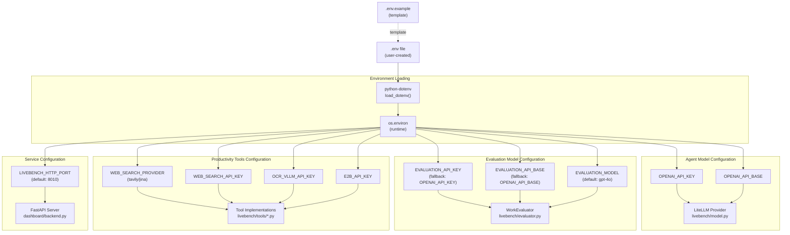
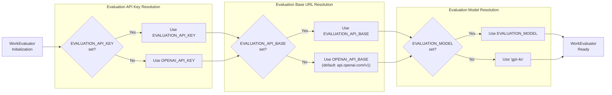

<!-- source: DeepWiki mcp.deepwiki.com · repo HKUDS/ClawWork · page 8.1 Environment Variables · fetched 2026-11-09 -->

# Environment Variables

<details>
<summary>Relevant source files</summary>

The following files were used as context for generating this wiki page:

- [.env.example](.env.example)

</details>


## Purpose and Scope

This page documents all environment variables used to configure ClawWork, including API keys, base URLs, model selection, service ports, and provider configuration. All variables are defined in [.env.example:1-97]() and must be copied to a `.env` file in the project root directory before running the system.

For specific configuration strategies for different components, see:
- Agent model setup: [Agent Model Configuration](#8.2)
- Evaluation model setup: [Evaluation Model Configuration](#8.3)
- Productivity tools APIs: [Productivity Tools APIs](#8.4)
- Complete deployment patterns: [Deployment Patterns](#8.5)

---

## Environment Variable Overview

ClawWork uses a modular configuration approach where different system components can be configured with separate API providers. This enables cost optimization (e.g., using a cheaper provider for agent calls while using GPT-4o for evaluation) and flexibility in deployment scenarios.

**Sources:** [.env.example:1-97]()

---

## Complete Variable Reference

The following table lists all environment variables supported by ClawWork:

| Variable Name | Category | Required | Default Value | Purpose |
|--------------|----------|----------|---------------|---------|
| `OPENAI_API_KEY` | Agent Model | Yes | - | API key for the agent's LLM provider |
| `OPENAI_API_BASE` | Agent Model | No | `https://api.openai.com/v1` | Base URL for agent LLM API |
| `EVALUATION_API_KEY` | Evaluation | No | Falls back to `OPENAI_API_KEY` | API key for work evaluation LLM |
| `EVALUATION_API_BASE` | Evaluation | No | Falls back to `OPENAI_API_BASE` | Base URL for evaluation LLM API |
| `EVALUATION_MODEL` | Evaluation | No | `gpt-4o` | Model identifier for work evaluation |
| `WEB_SEARCH_PROVIDER` | Tools | No | `tavily` | Search provider: `tavily` or `jina` |
| `WEB_SEARCH_API_KEY` | Tools | Yes* | - | Unified key for selected search provider |
| `TAVILY_API_KEY` | Tools | No | - | Tavily-specific search API key (legacy) |
| `JINA_API_KEY` | Tools | No | - | Jina-specific search API key (legacy) |
| `OCR_VLLM_API_KEY` | Tools | No | - | Qwen VL OCR API key (DashScope/Alibaba) |
| `E2B_API_KEY` | Tools | Yes* | - | E2B sandbox API key for code execution |
| `LIVEBENCH_HTTP_PORT` | Service | No | `8010` | Port for MCP service HTTP server |

\* Required if using the corresponding tool (`search_web`, `execute_code`)

**Sources:** [.env.example:15-73]()

---

## Configuration Flow Diagram

The following diagram shows how environment variables are loaded and distributed to system components:

**Environment Variable Loading and Distribution**



**Sources:** [.env.example:1-97]()

---

## Agent Model Variables

Agent model variables configure the primary LLM used by agents for task execution, reasoning, and decision-making.

### OPENAI_API_KEY

**Type:** String (required)  
**Purpose:** API key for the agent's LLM provider  
**Usage:** Supports OpenAI, SiliconFlow, or any OpenAI-compatible API

This key authenticates agent LLM calls throughout the system, including:
- Daily task execution in standalone mode
- Per-message responses in ClawMode
- Tool usage decisions
- Work artifact generation

**Code Usage:**
- Referenced in provider initialization
- Used by `TrackedProvider` for token tracking
- Required by `LiveBenchAgentLoop` for agent reasoning

**Sources:** [.env.example:15]()

### OPENAI_API_BASE

**Type:** String (optional)  
**Default:** `https://api.openai.com/v1`  
**Purpose:** Base URL for agent LLM API endpoint

Allows switching between different OpenAI-compatible providers without code changes. Common values:
- `https://api.openai.com/v1` - Official OpenAI API
- `https://api.siliconflow.com/v1` - SiliconFlow (Chinese region)
- Custom endpoints for self-hosted models

**Sources:** [.env.example:16-17]()

---

## Evaluation Model Variables

Evaluation model variables configure the LLM used for scoring agent work submissions. These are separate from agent variables to enable provider separation.

### EVALUATION_API_KEY

**Type:** String (optional)  
**Fallback:** Uses `OPENAI_API_KEY` if not set  
**Purpose:** API key for work evaluation LLM

**Recommendation:** Use a real OpenAI API key for evaluation even if using alternative providers for agents, because:
1. GPT-4o may not be available on all providers
2. OpenAI's GPT-4o has consistent, reliable evaluation quality
3. Evaluation volume is lower than agent calls (minimal cost impact)

**Code Usage:**
- Used by `WorkEvaluator` class in [livebench/evaluator.py]()
- Powers the LLM-based scoring system
- Processes meta-prompts for category-specific evaluation

**Sources:** [.env.example:33-34]()

### EVALUATION_API_BASE

**Type:** String (optional)  
**Fallback:** Uses `OPENAI_API_BASE` if not set  
**Default:** `https://api.openai.com/v1`  
**Purpose:** Base URL for evaluation LLM API endpoint

**Sources:** [.env.example:34]()

### EVALUATION_MODEL

**Type:** String (optional)  
**Default:** `gpt-4o`  
**Purpose:** Model identifier for work evaluation

Change this if using an alternative evaluation model that provides comparable reasoning capabilities to GPT-4o. The evaluation quality directly impacts payment accuracy.

**Sources:** [.env.example:40]()

---

## Productivity Tools Variables

Productivity tools variables configure external services used by agent tools for web search, OCR, and code execution.

### WEB_SEARCH_PROVIDER

**Type:** String (optional)  
**Default:** `tavily`  
**Options:** `tavily`, `jina`  
**Purpose:** Selects the web search provider for `search_web` tool

**Provider Comparison:**

| Feature | Tavily | Jina |
|---------|--------|------|
| Result Format | Structured JSON with answer extraction | Markdown content |
| Cost | $0.0008 per search | $0.05 per 1M tokens |
| Best For | Quick answers, fact-finding | Long-form content, research |
| API Key Required | `WEB_SEARCH_API_KEY` | `WEB_SEARCH_API_KEY` |

**Sources:** [.env.example:49]()

### WEB_SEARCH_API_KEY

**Type:** String (required for search tools)  
**Purpose:** Unified API key for the selected search provider

This key is used by both `search_web` tool in standalone mode and search capabilities in ClawMode. The system routes to the correct provider based on `WEB_SEARCH_PROVIDER`.

**Obtaining Keys:**
- Tavily: https://tavily.com
- Jina: https://jina.ai (free tier available)

**Sources:** [.env.example:50]()

### TAVILY_API_KEY / JINA_API_KEY

**Type:** String (optional, legacy)  
**Purpose:** Provider-specific search API keys

These variables are maintained for backward compatibility but are superseded by the unified `WEB_SEARCH_API_KEY` approach. New deployments should use `WEB_SEARCH_API_KEY` instead.

**Sources:** [.env.example:54-58]()

### OCR_VLLM_API_KEY

**Type:** String (optional)  
**Purpose:** Qwen VL OCR API key for optical character recognition

Used when the agent model does not support multimodal inputs. Enables agents to process image-based tasks by converting images to text via Alibaba Cloud's DashScope platform.

**Obtaining Key:** https://dashscope.aliyuncs.com/

**Tool Usage:** Referenced in OCR tool implementations for processing task reference files containing images.

**Sources:** [.env.example:62]()

### E2B_API_KEY

**Type:** String (required for code execution)  
**Purpose:** E2B sandbox API key for secure code execution

Powers the `execute_code` tool, allowing agents to run Python code in isolated sandboxes. Critical for tasks requiring:
- Data analysis and computation
- File manipulation
- Algorithm implementation
- Report generation with calculations

**Obtaining Key:** https://e2b.dev/

**Security Note:** E2B provides isolated environments preventing malicious code from affecting the host system.

**Sources:** [.env.example:66]()

---

## Service Configuration Variables

Service configuration variables control the runtime behavior of ClawWork services.

### LIVEBENCH_HTTP_PORT

**Type:** Integer (optional)  
**Default:** `8010`  
**Purpose:** Port number for the MCP (Model Context Protocol) service HTTP server

This port is used for:
- Internal service communication
- MCP protocol endpoints
- Health checks and status queries

**Note:** This is separate from the dashboard ports (8000 for FastAPI backend, 3000 for React frontend).

**Sources:** [.env.example:73]()

---

## Fallback Mechanism Diagram

The following diagram illustrates the fallback chain for evaluation configuration:

**Evaluation Configuration Fallback Chain**



**Sources:** [.env.example:30-40]()

---

## Configuration File Setup

### Initial Setup Process

1. **Copy Template File**
   ```bash
   cp .env.example .env
   ```

2. **Edit `.env` File**
   Open `.env` in a text editor and replace placeholder values:
   - `your-api-key-here` → actual API keys
   - `your-openai-api-key-here` → actual OpenAI keys
   - `your-tavily-api-key-here` → actual Tavily keys
   - etc.

3. **Verify Configuration**
   The system will automatically load `.env` on startup via `python-dotenv`.

### File Location

The `.env` file must be placed at the repository root:
```
ClawWork/
├── .env              # User-created configuration
├── .env.example      # Template file (version controlled)
├── livebench/
├── clawmode_integration/
└── ...
```

**Important:** The `.env` file is excluded from version control via `.gitignore` to prevent accidental credential exposure.

**Sources:** [.env.example:1-5]()

---

## Configuration Examples

The `.env.example` file includes three pre-configured deployment patterns:

### Example 1: All-OpenAI Configuration

**Use Case:** Simple, reliable setup with consistent provider  
**Cost:** Higher due to OpenAI pricing for all calls

```bash
OPENAI_API_KEY=sk-proj-xxxxx
EVALUATION_API_KEY=sk-proj-xxxxx  # Same or different OpenAI key
WEB_SEARCH_API_KEY=tvly-xxxxx     # Tavily for search
```

This configuration is recommended for:
- Initial testing and development
- Production deployments prioritizing reliability
- Scenarios where cost is not the primary constraint

**Sources:** [.env.example:79-82]()

### Example 2: Mixed Provider Configuration

**Use Case:** Cost-effective setup balancing price and quality  
**Cost:** Lower agent costs via SiliconFlow, reliable evaluation via OpenAI

```bash
OPENAI_API_KEY=sk-ngksq...                          # SiliconFlow key
OPENAI_API_BASE=https://api.siliconflow.com/v1
EVALUATION_API_KEY=sk-proj-xxxxx                    # Real OpenAI key
EVALUATION_API_BASE=https://api.openai.com/v1
WEB_SEARCH_API_KEY=tvly-xxxxx
```

This configuration is recommended for:
- Production deployments optimizing cost
- Multi-model competition scenarios
- Research projects with budget constraints

**Sources:** [.env.example:84-89]()

### Example 3: Single Alternative Provider

**Use Case:** Complete alternative provider deployment  
**Cost:** Provider-dependent; may be significantly lower

```bash
OPENAI_API_KEY=sk-ngksq...
OPENAI_API_BASE=https://api.siliconflow.com/v1
WEB_SEARCH_API_KEY=tvly-xxxxx
```

**Requirements:**
- Provider must support GPT-4o or set `EVALUATION_MODEL` to a supported model
- Provider must offer OpenAI-compatible API

This configuration is recommended for:
- Regional deployments (e.g., China with SiliconFlow)
- Self-hosted model deployments
- Custom provider integration testing

**Sources:** [.env.example:91-95]()

---

## Variable Usage in Code Entities

The following table maps environment variables to their primary usage locations in the codebase:

| Variable | Primary Code Entity | File Path | Purpose in Code |
|----------|-------------------|-----------|-----------------|
| `OPENAI_API_KEY` | LLM provider initialization | `livebench/model.py` | Authenticates agent LLM calls |
| `OPENAI_API_BASE` | Provider base URL config | `livebench/model.py` | Sets API endpoint for agents |
| `EVALUATION_API_KEY` | `WorkEvaluator.__init__()` | `livebench/evaluator.py` | Authenticates evaluation LLM |
| `EVALUATION_API_BASE` | `WorkEvaluator.__init__()` | `livebench/evaluator.py` | Sets evaluation API endpoint |
| `EVALUATION_MODEL` | `WorkEvaluator.evaluate()` | `livebench/evaluator.py` | Specifies evaluation model ID |
| `WEB_SEARCH_PROVIDER` | Search tool routing logic | `livebench/tools/` | Selects Tavily vs Jina |
| `WEB_SEARCH_API_KEY` | `search_web()` tool | `livebench/tools/` | Authenticates search requests |
| `OCR_VLLM_API_KEY` | OCR processing | `livebench/tools/` | Authenticates OCR API calls |
| `E2B_API_KEY` | `execute_code()` tool | `livebench/tools/` | Authenticates sandbox creation |
| `LIVEBENCH_HTTP_PORT` | FastAPI server startup | `dashboard/backend.py` | Binds HTTP server port |

**Sources:** [.env.example:1-97]()

---

## Security Considerations

### Credential Protection

1. **Never commit `.env` to version control**
   - The `.gitignore` file excludes `.env` by default
   - Only `.env.example` (with placeholder values) is tracked

2. **Use separate keys for production and development**
   - Create dedicated API keys for each environment
   - Rotate keys periodically

3. **Limit API key permissions**
   - Use read-only keys where possible
   - Set usage limits to prevent abuse

### API Key Validation

The system validates API keys at startup:
- Missing required keys (e.g., `OPENAI_API_KEY`) cause immediate failure
- Invalid keys are detected on first API call
- Fallback mechanisms prevent partial configuration errors

**Sources:** [.env.example:4-6]()

---

## Related Configuration Pages

For detailed configuration strategies for specific components:

- **[Agent Model Configuration](#8.2)** - Selecting and configuring agent LLM providers (OpenAI, SiliconFlow, Claude)
- **[Evaluation Model Configuration](#8.3)** - Configuring GPT-4o evaluator with fallback mechanisms
- **[Productivity Tools APIs](#8.4)** - Setting up web search, OCR, and code execution services
- **[Deployment Patterns](#8.5)** - Three recommended configurations: all-OpenAI, mixed providers, single alternative

For information about how configuration impacts system behavior:

- **[External Dependencies](#3.3)** - Complete list of external APIs and their costs
- **[ClawMode Overview](#5.1)** - How environment variables affect ClawMode deployments
- **[Dashboard Architecture](#7.1)** - Service port configuration for FastAPI and React

---

