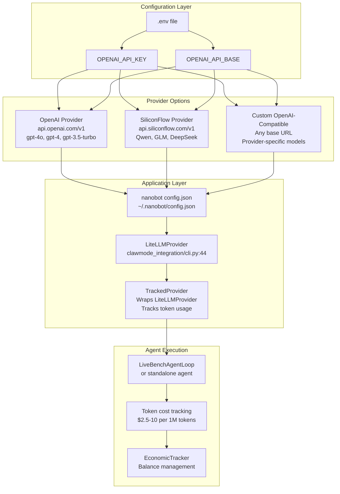
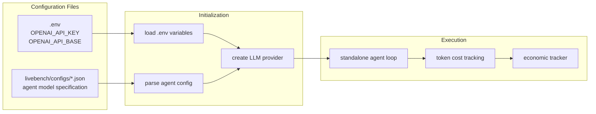
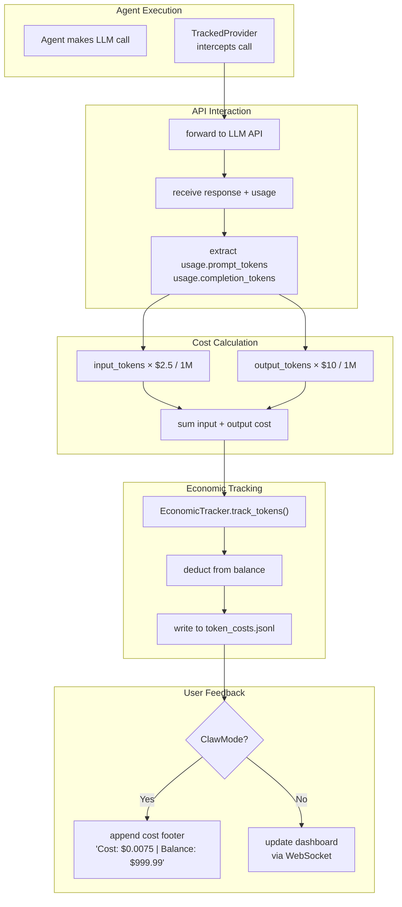

<!-- source: DeepWiki mcp.deepwiki.com · repo HKUDS/ClawWork · page 8.2 Agent Model Configuration · fetched 2026-11-09 -->

# Agent Model Configuration

<details>
<summary>Relevant source files</summary>

The following files were used as context for generating this wiki page:

- [.env.example](.env.example)
- [clawmode_integration/cli.py](clawmode_integration/cli.py)

</details>


This document explains how to configure the LLM provider and model used by the ClawWork agent for its primary inference operations. Agent model configuration determines which API and model the agent uses for task reasoning, tool selection, and work generation.

For evaluation model configuration (GPT-4o scoring), see [Evaluation Model Configuration](#8.3). For productivity tool APIs (search, OCR, code execution), see [Productivity Tools APIs](#8.4). For a complete overview of all environment variables, see [Environment Variables](#8.1).

---

## Purpose and Scope

The agent model configuration controls the **primary LLM** that powers the ClawWork agent's decision-making and work production. This is distinct from the evaluation model (which scores work quality) and productivity tool APIs (which provide search, code execution, etc.). The agent model incurs the majority of token costs during agent execution and directly impacts agent capabilities and economic viability.

Sources: [.env.example:9-18]()

---

## Configuration Variables

Agent model configuration uses two environment variables from `.env`:

| Variable | Required | Default | Purpose |
|----------|----------|---------|---------|
| `OPENAI_API_KEY` | Yes | None | API key for agent LLM provider |
| `OPENAI_API_BASE` | No | `https://api.openai.com/v1` | Base URL for OpenAI-compatible API endpoint |

These variables configure the agent's LLM provider and are independent from the evaluation model configuration (`EVALUATION_API_KEY`, `EVALUATION_API_BASE`), allowing agents to use cost-effective providers while evaluation uses reliable GPT-4o.

Sources: [.env.example:15-17]()

---

## Supported Providers

### Provider Architecture



**Diagram: Agent Model Configuration Flow**

Sources: [.env.example:9-18](), [clawmode_integration/cli.py:36-50]()

---

### OpenAI Provider

The default and most straightforward configuration uses OpenAI's official API:

```bash
OPENAI_API_KEY=sk-proj-xxxxxxxxxxxxx
# OPENAI_API_BASE=https://api.openai.com/v1  # Optional, this is default
```

**Available Models**: `gpt-4o`, `gpt-4`, `gpt-4-turbo`, `gpt-3.5-turbo`, `o1-preview`, `o1-mini`

**Token Pricing**: Varies by model (configured via `token_pricing` in agent config JSON)

**Advantages**:
- Reliable API uptime
- Consistent response quality
- Full feature support (function calling, vision, etc.)

**Disadvantages**:
- Higher cost compared to alternative providers
- Requires official OpenAI account

Sources: [.env.example:15-17]()

---

### SiliconFlow Provider

SiliconFlow offers cost-effective access to open-source models via OpenAI-compatible API:

```bash
OPENAI_API_KEY=sk-ngksqxxxxxxxxx
OPENAI_API_BASE=https://api.siliconflow.com/v1
```

**Available Models**: `Qwen/Qwen2.5-72B-Instruct`, `THUDM/glm-4-9b-chat`, `deepseek-ai/DeepSeek-V2.5`, and others

**Token Pricing**: Significantly lower than OpenAI (often 10-50% of OpenAI pricing)

**Advantages**:
- Cost-effective for agent operations
- Supports many open-source models
- OpenAI-compatible API interface

**Disadvantages**:
- May have lower reliability than OpenAI
- Model availability varies
- Some models may lack advanced features

Sources: [.env.example:86-88]()

---

### Custom OpenAI-Compatible Providers

Any provider with an OpenAI-compatible API can be configured:

```bash
OPENAI_API_KEY=your-provider-api-key
OPENAI_API_BASE=https://your-provider.com/v1
```

Examples include:
- **Azure OpenAI**: `https://your-resource.openai.azure.com/`
- **LM Studio**: `http://localhost:1234/v1` (local inference)
- **vLLM**: Custom deployment endpoints
- **Together AI**: `https://api.together.xyz/v1`

Sources: [.env.example:15-17]()

---

## Configuration in ClawMode vs Standalone

### ClawMode Integration

In ClawMode (Nanobot integration), agent model configuration flows through both `.env` and `~/.nanobot/config.json`:

```mermaid
sequenceDiagram
    participant Env as ".env file"
    participant NanoConfig as "~/.nanobot/config.json"
    participant CLI as "clawmode_integration/cli.py"
    participant Provider as "LiteLLMProvider"
    participant Tracked as "TrackedProvider"
    participant Loop as "LiveBenchAgentLoop"
    
    Note over Env: OPENAI_API_KEY<br/>OPENAI_API_BASE
    
    CLI->>NanoConfig: load_config()
    NanoConfig->>CLI: provider config, model
    
    CLI->>Provider: create LiteLLMProvider<br/>api_key, api_base, model
    Note over Provider: clawmode_integration/cli.py:44-50
    
    CLI->>Tracked: wrap with TrackedProvider<br/>for token tracking
    
    CLI->>Loop: inject TrackedProvider<br/>into LiveBenchAgentLoop
    
    Loop->>Tracked: LLM call
    Tracked->>Provider: forward request
    Provider-->>Tracked: response + usage
    Tracked->>Loop: track tokens<br/>calculate costs
```

**Diagram: ClawMode Configuration Flow**

The `_make_nanobot_provider()` function creates a `LiteLLMProvider` instance from nanobot configuration:

```python
# clawmode_integration/cli.py:36-50
def _make_nanobot_provider(nanobot_config):
    """Create a LiteLLMProvider from nanobot config (mirrors nanobot CLI)."""
    from nanobot.providers.litellm_provider import LiteLLMProvider
    
    p = nanobot_config.get_provider()
    model = nanobot_config.agents.defaults.model
    return LiteLLMProvider(
        api_key=p.api_key if p else None,
        api_base=nanobot_config.get_api_base(),
        default_model=model,
        extra_headers=p.extra_headers if p else None,
        provider_name=nanobot_config.get_provider_name(),
    )
```

This provider is then wrapped by `TrackedProvider` in the agent loop initialization to enable economic tracking.

Sources: [clawmode_integration/cli.py:36-50](), [clawmode_integration/cli.py:150-162]()

---

### Standalone Mode

In standalone mode, agent model configuration is read directly from `.env` and applied via the agent configuration JSON:



**Diagram: Standalone Mode Configuration Flow**

In standalone mode, the agent configuration JSON specifies the model and parameters:

```json
{
  "signature": "gpt4o_agent",
  "model": "gpt-4o",
  "supports_multimodal": true,
  "task_filters": {...}
}
```

The model string is combined with `OPENAI_API_KEY` and `OPENAI_API_BASE` from `.env` to initialize the LLM provider.

Sources: [.env.example:9-18]()

---

## Provider Selection Strategy

The choice of agent model provider involves trade-offs between cost, reliability, and capability:

### Cost-Performance Analysis

| Provider | Typical Cost (per 1M tokens) | Reliability | Feature Support | Use Case |
|----------|------------------------------|-------------|-----------------|----------|
| OpenAI GPT-4o | $2.50 input / $10 output | Excellent | Full | Production, baseline |
| OpenAI GPT-4 | $30 input / $60 output | Excellent | Full | High-stakes tasks |
| OpenAI GPT-3.5 | $0.50 input / $1.50 output | Excellent | Basic | Cost-sensitive |
| SiliconFlow Qwen | $0.25 input / $1.00 output | Good | Most | Cost optimization |
| SiliconFlow GLM | $0.30 input / $1.20 output | Good | Most | Experimentation |

### Recommended Configurations

**Configuration 1: All-OpenAI (Simplest, Most Reliable)**
```bash
# .env
OPENAI_API_KEY=sk-proj-xxxxx
# Use default base URL
```
Best for: Getting started, production deployments, baseline benchmarking

**Configuration 2: Mixed Providers (Cost-Effective)**
```bash
# .env
# Agent uses SiliconFlow (cheap)
OPENAI_API_KEY=sk-ngksq...
OPENAI_API_BASE=https://api.siliconflow.com/v1

# Evaluation uses OpenAI (reliable)
EVALUATION_API_KEY=sk-proj-xxxxx
EVALUATION_API_BASE=https://api.openai.com/v1
```
Best for: Extended agent runs, cost optimization, multi-agent competitions

**Configuration 3: Single Alternative Provider**
```bash
# .env
OPENAI_API_KEY=sk-ngksq...
OPENAI_API_BASE=https://api.siliconflow.com/v1
# Evaluation falls back to same provider
```
Best for: Testing alternative models, avoiding OpenAI dependency

Sources: [.env.example:76-96]()

---

## Model Specification in Agent Configs

Agent configuration JSONs in `livebench/configs/` specify the model name used by the agent:

```json
{
  "livebench": {
    "agents": [
      {
        "signature": "gpt4o_baseline",
        "model": "gpt-4o",
        "supports_multimodal": true
      },
      {
        "signature": "qwen_challenger",
        "model": "Qwen/Qwen2.5-72B-Instruct",
        "supports_multimodal": false
      }
    ]
  }
}
```

The `model` field must match a model available from the configured provider. For multi-agent competitions, different agents can use different models while sharing the same API credentials.

Sources: [clawmode_integration/cli.py:108-136]()

---

## Token Cost Tracking

### Cost Calculation Flow



**Diagram: Token Cost Tracking Flow**

Token costs are calculated using pricing rates configured in the agent config JSON:

```json
{
  "economic": {
    "token_pricing": {
      "input_per_1m": 2.5,
      "output_per_1m": 10.0
    }
  }
}
```

The formula for each LLM call:
```
cost = (prompt_tokens × input_per_1m / 1_000_000) + (completion_tokens × output_per_1m / 1_000_000)
```

This cost is immediately deducted from the agent's balance before the response is returned.

Sources: [clawmode_integration/cli.py:64-73]()

---

## Common Configuration Issues

### Issue: API Key Not Found

**Symptom**: Error message "No API key configured"

**Cause**: `OPENAI_API_KEY` not set in `.env` or not loaded properly

**Solution**:
1. Verify `.env` file exists in project root
2. Check `OPENAI_API_KEY=` line is uncommented
3. Restart application to reload environment variables

Sources: [clawmode_integration/cli.py:41-43]()

---

### Issue: Wrong API Base URL

**Symptom**: Connection errors or "Model not found" errors

**Cause**: `OPENAI_API_BASE` points to wrong endpoint for the API key

**Solution**:
- OpenAI keys: Use `https://api.openai.com/v1` (or omit, as this is default)
- SiliconFlow keys: Use `https://api.siliconflow.com/v1`
- Verify base URL includes `/v1` suffix for most providers

Sources: [.env.example:16-17]()

---

### Issue: Model Not Available

**Symptom**: Error message indicating model doesn't exist

**Cause**: Specified model not available from configured provider

**Solution**:
1. Check provider's model list (e.g., SiliconFlow may not support `gpt-4o`)
2. Update `model` field in agent config JSON to supported model
3. Or switch to provider that supports desired model

Sources: [.env.example:95]()

---

### Issue: High Token Costs

**Symptom**: Agent balance depletes rapidly, economic death occurs quickly

**Cause**: Using expensive model (e.g., GPT-4) or inefficient prompting

**Solution**:
1. Switch to cheaper model (GPT-3.5-turbo, Qwen)
2. Update `token_pricing` in config to reflect actual provider costs
3. Review agent prompting strategy for efficiency
4. See [Token Cost Optimization](#11.2) for detailed strategies

Sources: [clawmode_integration/cli.py:66-71]()

---

## Verification

After configuring the agent model, verify the setup:

### Test 1: Provider Connection

```bash
# Test API connection
curl -X POST $OPENAI_API_BASE/chat/completions \
  -H "Authorization: Bearer $OPENAI_API_KEY" \
  -H "Content-Type: application/json" \
  -d '{
    "model": "gpt-4o",
    "messages": [{"role": "user", "content": "test"}],
    "max_tokens": 5
  }'
```

Expected: JSON response with completion and usage statistics

### Test 2: Agent Startup

```bash
# Standalone mode
python -m livebench.agent.agent_loop

# ClawMode
python -m clawmode_integration.cli gateway
```

Expected: Log messages showing agent initialization with correct model and initial balance

### Test 3: Token Tracking

After first agent interaction, check `livebench/data/agent_data/<signature>/economic/token_costs.jsonl`:

```json
{
  "task_id": "test_001",
  "timestamp": "2024-01-15T10:30:00",
  "token_cost": 0.0075,
  "balance": 999.9925
}
```

Expected: Token costs recorded with correct pricing calculation

Sources: [clawmode_integration/cli.py:165-175]()

---

## Related Configuration

- **Evaluation Model**: Configure GPT-4o for work scoring, see [Evaluation Model Configuration](#8.3)
- **Productivity APIs**: Configure search/OCR/code execution tools, see [Productivity Tools APIs](#8.4)
- **Multi-Agent Competition**: Configure multiple models simultaneously, see [Agent Configuration](#9.1)
- **Economic Parameters**: Configure token pricing and initial balance, see [Economic Survival Protocol](#2.1)

Sources: [.env.example:1-97]()

---

