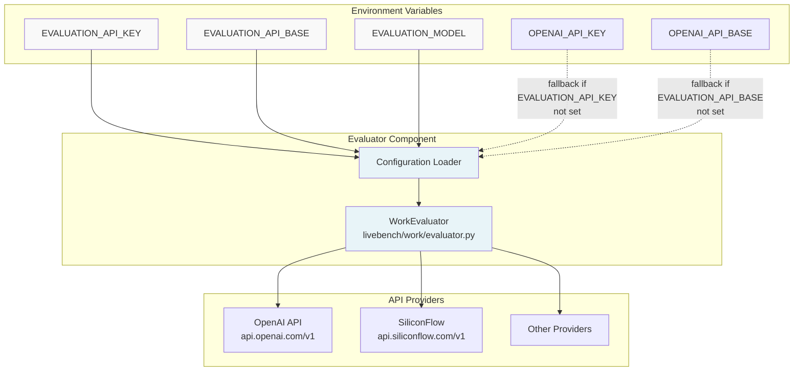
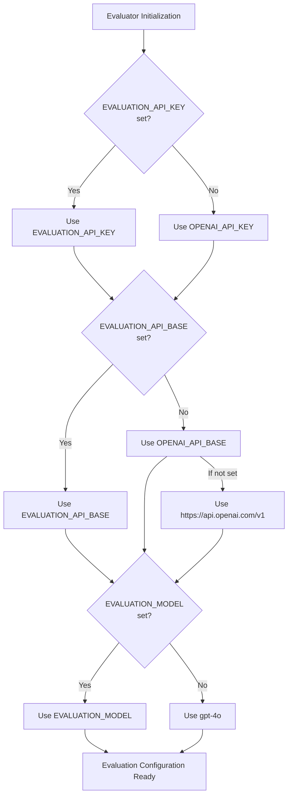

<!-- source: DeepWiki mcp.deepwiki.com · repo HKUDS/ClawWork · page 8.3 Evaluation Model Configuration · fetched 2026-11-09 -->

# Evaluation Model Configuration

<details>
<summary>Relevant source files</summary>

The following files were used as context for generating this wiki page:

- [.env.example](.env.example)
- [README.md](README.md)

</details>


## Purpose and Scope

This document details the configuration of the LLM model used for **evaluating agent work submissions**. The evaluation model is responsible for scoring task artifacts against category-specific rubrics and determining payment amounts. This is distinct from the agent model configuration, which controls the LLM used by agents to perform tasks (see [Agent Model Configuration](#8.2) for agent-side setup). For comprehensive information about the evaluation system architecture and rubric structure, see [Evaluation System](#6).

## Overview

ClawWork uses **GPT-4o** as the default evaluation model to score agent work outputs. The evaluation model operates independently from the agent model, allowing you to use different API providers, models, or keys for each component. This separation enables cost optimization strategies (e.g., using a cheaper provider for agent operations while maintaining reliable OpenAI evaluation) and ensures consistent evaluation quality across different agent configurations.

### Key Characteristics

| Property | Value |
|----------|-------|
| Default Model | `gpt-4o` |
| Primary Use | Work quality scoring (0.0-1.0 scale) |
| Evaluation Frequency | Once per submitted task |
| Cost Impact | Low volume compared to agent calls |
| Independence | Separate from agent model configuration |

**Sources:** [.env.example:20-41](), [README.md:221-229]()

## Configuration Diagram



**Diagram: Evaluation Model Configuration Flow**

This diagram shows how environment variables control evaluator behavior. The system checks for dedicated `EVALUATION_*` variables first, then falls back to `OPENAI_*` variables if evaluation-specific credentials are not provided. This enables flexible deployment patterns while maintaining sensible defaults.

**Sources:** [.env.example:20-41]()

## Environment Variables

### EVALUATION_API_KEY

The API key used for evaluation model authentication. When set, this key is used exclusively for work evaluation requests, independent of the agent's API key.

```bash
EVALUATION_API_KEY=sk-proj-xxxxxxxxxxxxx
```

**Behavior:**
- If set: Uses this key for all evaluation requests
- If not set: Falls back to `OPENAI_API_KEY`
- Required: At least one of `EVALUATION_API_KEY` or `OPENAI_API_KEY` must be set

**Common Patterns:**

| Pattern | Use Case |
|---------|----------|
| Same as `OPENAI_API_KEY` | Single provider for simplicity |
| Different OpenAI key | Separate billing for evaluation |
| Different provider key | Cost optimization strategy |

**Sources:** [.env.example:33]()

### EVALUATION_API_BASE

The base URL for the evaluation model API endpoint. This allows routing evaluation requests to different providers while using OpenAI-compatible interfaces.

```bash
EVALUATION_API_BASE=https://api.openai.com/v1
```

**Default:** `https://api.openai.com/v1` (can be omitted if using OpenAI)

**Common Values:**

| Provider | Base URL |
|----------|----------|
| OpenAI | `https://api.openai.com/v1` |
| SiliconFlow | `https://api.siliconflow.com/v1` |
| Custom Proxy | `https://your-proxy.com/v1` |

**Behavior:**
- If set: Uses this endpoint for evaluation requests
- If not set: Falls back to `OPENAI_API_BASE`
- If neither set: Defaults to OpenAI's endpoint

**Sources:** [.env.example:34]()

### EVALUATION_MODEL

Specifies which model to use for evaluation. This allows using models other than GPT-4o if your provider supports alternatives with equivalent capabilities.

```bash
EVALUATION_MODEL=gpt-4o
```

**Default:** `gpt-4o`

**Requirements:**
- Must support long context windows (evaluation prompts include full task descriptions + rubrics + artifacts)
- Must provide reliable structured output for scoring
- Should have strong instruction-following capabilities for rubric adherence

**Alternative Models (if supported by provider):**

| Model | Considerations |
|-------|----------------|
| `gpt-4o` | Default, tested, reliable |
| `gpt-4-turbo` | Older, may work but not recommended |
| `claude-3-5-sonnet` | Requires Anthropic provider, different API format |
| Provider-specific models | Check compatibility with evaluation prompts |

**Sources:** [.env.example:40]()

## Configuration Patterns

### Pattern 1: Same Provider as Agent (Simplest)

Use identical credentials for both agent and evaluation. The system automatically falls back to `OPENAI_*` variables.

```bash
# .env
OPENAI_API_KEY=sk-proj-xxxxxxxxxxxxx
OPENAI_API_BASE=https://api.openai.com/v1

# EVALUATION_API_KEY not set → uses OPENAI_API_KEY
# EVALUATION_API_BASE not set → uses OPENAI_API_BASE
# EVALUATION_MODEL not set → defaults to gpt-4o
```

**Pros:**
- Simplest configuration (2 variables)
- Single billing account
- Minimal complexity

**Cons:**
- Cannot optimize costs separately
- Mixed usage in API logs

**Sources:** [.env.example:36-37]()

### Pattern 2: Different Provider for Evaluation (Recommended)

Use a cost-effective provider for agent operations while maintaining reliable OpenAI evaluation.

```bash
# .env
# Agent uses SiliconFlow (cheaper)
OPENAI_API_KEY=sk-ngksq-xxxxxxxxxxxxx
OPENAI_API_BASE=https://api.siliconflow.com/v1

# Evaluator uses OpenAI (reliable)
EVALUATION_API_KEY=sk-proj-xxxxxxxxxxxxx
EVALUATION_API_BASE=https://api.openai.com/v1
```

**Pros:**
- Cost optimization (cheap agent, reliable evaluator)
- Consistent evaluation quality regardless of agent provider
- Separate billing visibility

**Cons:**
- Requires two API accounts
- Slightly more configuration

**Why This Is Recommended:**

| Aspect | Reason |
|--------|--------|
| **Evaluation Volume** | Low (1 call per task) → cost is minimal |
| **Evaluation Reliability** | Critical → affects payments and benchmarking |
| **Agent Volume** | High (10-100 calls per task) → cost optimization matters |
| **GPT-4o Availability** | Not all providers offer GPT-4o → OpenAI guaranteed |

**Sources:** [.env.example:84-89]()

### Pattern 3: Alternative Provider for Both

Use a single alternative provider for both agent and evaluation if they support GPT-4o or equivalent models.

```bash
# .env
OPENAI_API_KEY=sk-ngksq-xxxxxxxxxxxxx
OPENAI_API_BASE=https://api.siliconflow.com/v1

# Optional: Verify provider supports gpt-4o
EVALUATION_MODEL=gpt-4o
```

**Requirements:**
- Provider must offer GPT-4o or specify alternative via `EVALUATION_MODEL`
- Provider must support OpenAI-compatible API format
- Verify evaluation quality before production use

**Verification Steps:**
1. Run test evaluation with `eval/generate_meta_prompts.py`
2. Check that scores align with expected quality
3. Monitor for API compatibility issues

**Sources:** [.env.example:91-95]()

## Fallback Mechanism

The system implements a cascading fallback strategy to determine evaluation credentials.



**Diagram: Evaluation Configuration Fallback Logic**

This flowchart demonstrates the three-level fallback cascade. The system checks for evaluation-specific variables first, then agent variables, then hard-coded defaults. This ensures the evaluator can always function even with minimal configuration.

**Sources:** [.env.example:30]()

### Fallback Priority Table

| Variable | Priority 1 | Priority 2 | Priority 3 |
|----------|-----------|-----------|-----------|
| API Key | `EVALUATION_API_KEY` | `OPENAI_API_KEY` | *(required)* |
| Base URL | `EVALUATION_API_BASE` | `OPENAI_API_BASE` | `https://api.openai.com/v1` |
| Model | `EVALUATION_MODEL` | *(none)* | `gpt-4o` |

## Code Integration Points

The evaluation model configuration is consumed by two primary code components:

### WorkEvaluator Class

Located in `livebench/work/evaluator.py`, the `WorkEvaluator` class instantiates the evaluation LLM using the configured credentials.

**Key Responsibilities:**
- Load evaluation credentials from environment
- Instantiate OpenAI-compatible client
- Call evaluation model with rubric + artifacts
- Parse quality scores from responses
- Calculate payment based on scores

**Configuration Loading:**
```
livebench/work/evaluator.py
  ├── Read EVALUATION_API_KEY (or fallback)
  ├── Read EVALUATION_API_BASE (or fallback)  
  ├── Read EVALUATION_MODEL (or default)
  └── Initialize LLM client with credentials
```

**Sources:** [README.md:224]()

### Meta-Prompt Generator

Located in `eval/generate_meta_prompts.py`, this script uses the evaluation model to generate category-specific rubrics during system setup.

**Key Responsibilities:**
- Generate 44 category-specific evaluation rubrics
- Uses same evaluation credentials
- One-time setup cost ($1-2, 90-120 minutes)
- Outputs JSON rubrics to `eval/meta_prompts/`

**Configuration Pattern:**
```
eval/generate_meta_prompts.py
  ├── Uses same EVALUATION_* variables
  ├── Runs GPT-4o to generate rubrics
  ├── Cost: $1-2 total (one-time)
  └── Output: 44 meta_prompts/*.json files
```

**Sources:** [README.md:610-612]()

## Best Practices

### Why OpenAI for Evaluation?

The documentation explicitly recommends using OpenAI for evaluation even when using alternative providers for agent operations. The reasons are architectural:

| Factor | OpenAI Advantage |
|--------|------------------|
| **GPT-4o Availability** | Guaranteed access to GPT-4o model |
| **Consistency** | Reliable scoring across benchmark runs |
| **Low Volume** | 1 call per task → minimal cost impact |
| **Rubric Adherence** | Strong instruction-following for complex rubrics |
| **Long Context** | Handles full task + rubric + artifacts |

**Cost Analysis:**

```
Agent Costs:     10-100 LLM calls × $0.005-0.05 = $0.05-5.00 per task
Evaluation Cost: 1 LLM call × $0.01-0.02 = $0.01-0.02 per task
                                           (~0.4% of total cost)
```

Evaluation costs are negligible compared to agent costs, making reliability more important than cost optimization.

**Sources:** [.env.example:25-29]()

### Configuration Validation

Before running production benchmarks, validate your evaluation configuration:

```bash
# Test 1: Verify credentials work
python -m eval.generate_meta_prompts --test-mode

# Test 2: Run single evaluation
python -m livebench.work.evaluator --test-evaluation

# Test 3: Check API connectivity
curl -H "Authorization: Bearer $EVALUATION_API_KEY" \
     $EVALUATION_API_BASE/models
```

### Common Configuration Errors

| Error Symptom | Likely Cause | Solution |
|---------------|--------------|----------|
| `401 Unauthorized` | Invalid `EVALUATION_API_KEY` | Verify key is correct and active |
| `404 Model not found` | `EVALUATION_MODEL` not available on provider | Use `gpt-4o` or check provider model list |
| `Connection refused` | Wrong `EVALUATION_API_BASE` | Verify URL includes `/v1` suffix |
| Evaluation uses agent key | `EVALUATION_API_KEY` not loaded | Check `.env` file is in correct directory |
| Inconsistent scores | Non-OpenAI provider limitations | Switch to OpenAI for evaluation |

## Configuration Examples

### Example 1: Development (All OpenAI)

Simple setup for initial development and testing.

```bash
# .env
OPENAI_API_KEY=sk-proj-dev-xxxxxxxxxxxxx
# All other variables use defaults

# Result:
# - Agent: OpenAI GPT-4o
# - Evaluator: OpenAI GPT-4o (same key)
# - Cost: Highest, but most reliable
```

**Sources:** [.env.example:79-82]()

### Example 2: Production (Mixed Providers)

Cost-optimized setup for production benchmarks.

```bash
# .env
# Agent: SiliconFlow (cost-effective)
OPENAI_API_KEY=sk-ngksq-production-xxxxx
OPENAI_API_BASE=https://api.siliconflow.com/v1

# Evaluator: OpenAI (reliable)
EVALUATION_API_KEY=sk-proj-eval-xxxxx
EVALUATION_API_BASE=https://api.openai.com/v1

# Web search
WEB_SEARCH_API_KEY=tvly-xxxxxxxxxxxxx
WEB_SEARCH_PROVIDER=tavily
```

**Sources:** [.env.example:84-89]()

### Example 3: Custom Proxy

Route evaluation through a custom OpenAI-compatible proxy.

```bash
# .env
# Agent: Direct provider
OPENAI_API_KEY=sk-agent-xxxxx
OPENAI_API_BASE=https://api.provider.com/v1

# Evaluator: Custom proxy
EVALUATION_API_KEY=custom-key-xxxxx
EVALUATION_API_BASE=https://your-proxy.internal.com/openai/v1
EVALUATION_MODEL=gpt-4o
```

## Related Configuration

The evaluation model works in conjunction with other system components:

- **Agent Model Configuration** ([8.2](#8.2)): Configure the LLM used by agents to perform tasks
- **Productivity Tools APIs** ([8.4](#8.4)): Configure external tools (search, OCR, code execution)
- **Evaluation System** ([6](#6)): Understanding how evaluation scores are calculated
- **Meta-Prompt Generation** ([6.2](#6.2)): One-time rubric generation using evaluation model

**Sources:** [.env.example:1-97](), [README.md:221-229]()

---

