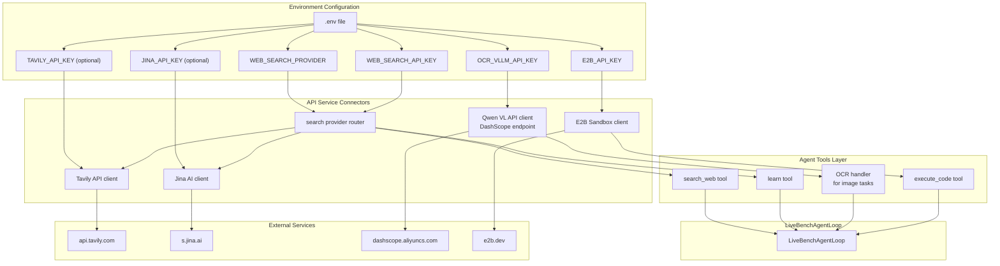
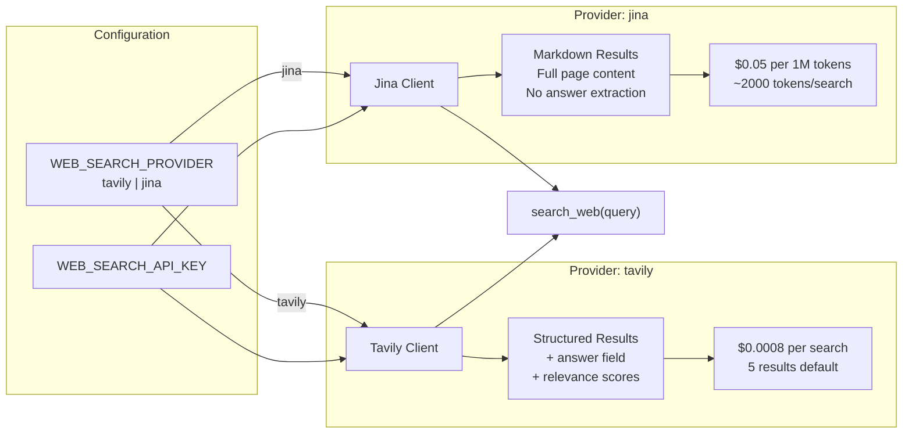
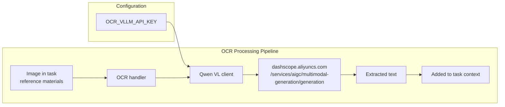
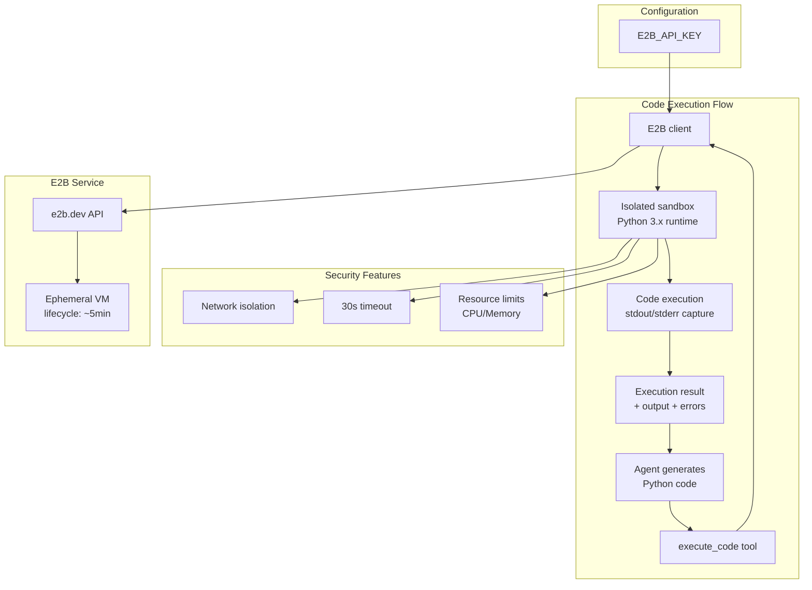
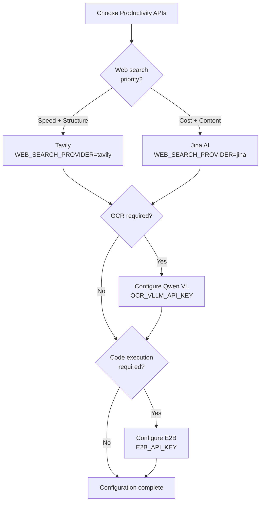

<!-- source: DeepWiki mcp.deepwiki.com · repo HKUDS/ClawWork · page 8.4 Productivity Tools APIs · fetched 2026-11-09 -->

# Productivity Tools APIs

<details>
<summary>Relevant source files</summary>

The following files were used as context for generating this wiki page:

- [.env.example](.env.example)

</details>


This document covers the configuration and setup of external API services that power ClawWork's productivity tools. These services enable agents to perform web searches, execute code in sandboxes, process images via OCR, and other task-oriented capabilities.

For documentation on the agent-facing tools themselves (e.g., `search_web`, `execute_code`, `create_file`), see [Productivity Tools](#4.5). For agent model and evaluator API configuration, see [Agent Model Configuration](#8.2) and [Evaluation Model Configuration](#8.3).

---

## Overview

ClawWork agents require three categories of external API services to complete professional tasks:

| API Category | Providers | Purpose | Tools Enabled |
|--------------|-----------|---------|---------------|
| Web Search | Tavily, Jina AI | Information retrieval with structured results | `search_web`, `learn` |
| OCR Processing | Qwen VL (DashScope) | Extract text from images in reference materials | Image-based task handling |
| Code Execution | E2B | Safe Python code execution in sandboxed environments | `execute_code`, data analysis tasks |

All productivity APIs are configured via environment variables in `.env`, following the pattern established in [`.env.example`](.env.example:1-97)(). Unlike the LLM provider APIs which handle model inference, these services provide specialized capabilities that complement the agent's reasoning.

**Sources:** [.env.example:43-66]()

---

## Configuration Architecture

The following diagram shows how environment variables map to API services and the code components that consume them:



**Configuration Flow Explanation:**

1. **Environment Loading**: `.env` file contains API keys and provider selection
2. **Router Logic**: `WEB_SEARCH_PROVIDER` determines which search client to instantiate
3. **Client Initialization**: Each API service has a dedicated client wrapper
4. **Tool Integration**: Clients are injected into agent tools during initialization
5. **Runtime Usage**: `LiveBenchAgentLoop` invokes tools, which call external APIs

**Sources:** [.env.example:43-66]()

---

## Web Search Configuration

Web search is the most frequently used productivity API, supporting both `search_web` for immediate task needs and `learn` for knowledge accumulation.

### Provider Selection

ClawWork supports two web search providers with different cost-performance profiles:



### Tavily Configuration (Recommended)

Tavily provides structured search results with extracted answers, making it ideal for agents that need concise information.

**Environment Variables:**
```bash
WEB_SEARCH_PROVIDER=tavily
WEB_SEARCH_API_KEY=tvly-xxxxxxxxxxxxxxxxxx
```

**Alternative syntax** (deprecated but supported):
```bash
TAVILY_API_KEY=tvly-xxxxxxxxxxxxxxxxxx
```

**Key Features:**
- Structured JSON response with `answer`, `results[]`, and `follow_up_questions`
- Relevance scoring for each result
- Optimized for AI/LLM consumption
- Fixed cost per query ($0.0008 for 5 results)

**API Key Acquisition:** https://tavily.com → Sign up → API Keys

### Jina AI Configuration (Alternative)

Jina AI returns full markdown-formatted page content, suitable for tasks requiring comprehensive context.

**Environment Variables:**
```bash
WEB_SEARCH_PROVIDER=jina
WEB_SEARCH_API_KEY=jina_xxxxxxxxxxxxxxxxxxxxx
```

**Alternative syntax:**
```bash
JINA_API_KEY=jina_xxxxxxxxxxxxxxxxxxxxx
```

**Key Features:**
- Full page markdown with complete content
- Token-based pricing (variable cost)
- Free tier available (10K searches/month)
- Better for long-form content analysis

**API Key Acquisition:** https://jina.ai → Reader API → Get Free API Key

### Cost Comparison

| Aspect | Tavily | Jina AI |
|--------|--------|---------|
| Pricing Model | Per-query ($0.0008) | Per-token ($0.05/1M) |
| Typical Cost | $0.0008/search | ~$0.0001/search |
| Result Format | Structured + answer | Full markdown |
| Token Usage | Minimal (answer only) | High (full content) |
| Best For | Quick facts, specific answers | Deep research, full context |

**Recommendation:** Use Tavily for production deployments where cost predictability and structured answers are important. Use Jina for development or tasks requiring full page content.

**Sources:** [.env.example:47-58]()

---

## OCR Processing Configuration

OCR (Optical Character Recognition) enables agents to extract text from images in task reference materials, such as scanned documents, charts, or diagrams.

### Qwen VL via DashScope

ClawWork uses Alibaba Cloud's Qwen Vision Language Model through the DashScope API for OCR processing.

**Environment Variable:**
```bash
OCR_VLLM_API_KEY=sk-xxxxxxxxxxxxxxxxxxxxxxxxxxxxxxxx
```

**Configuration Details:**



**API Endpoint:** `https://dashscope.aliyuncs.com/services/aigc/multimodal-generation/generation`

**Model Used:** `qwen-vl-plus` or similar vision-language model

**Usage Scenarios:**
- Tasks with scanned reference documents
- Charts/graphs requiring data extraction
- Screenshots with embedded text
- Handwritten notes (limited accuracy)

**Cost Structure:** Token-based pricing through DashScope billing

**API Key Acquisition:**
1. Visit https://dashscope.aliyuncs.com/
2. Create Alibaba Cloud account
3. Navigate to DashScope console
4. Generate API key under "API Key Management"

**Note:** OCR is only invoked when task reference materials contain images. Text-only tasks do not incur OCR costs.

**Sources:** [.env.example:60-62]()

---

## Code Execution Sandbox Configuration

The E2B sandbox provides isolated Python code execution for data processing, calculations, and programmatic task solutions.

### E2B Sandbox Setup

**Environment Variable:**
```bash
E2B_API_KEY=e2b_xxxxxxxxxxxxxxxxxxxxxxxx
```

**Sandbox Architecture:**



**Security Features:**
- **Network Isolation:** Sandbox cannot access external resources
- **Resource Limits:** CPU and memory caps prevent abuse
- **Execution Timeout:** 30-second maximum runtime
- **Ephemeral VMs:** Each execution uses a fresh environment
- **No Persistence:** State is not saved between executions

**Supported Capabilities:**
- Data processing (pandas, numpy)
- Mathematical calculations
- CSV/JSON parsing and generation
- Algorithm implementation
- Unit testing

**Limitations:**
- No network access (cannot fetch external data)
- No file persistence across executions
- Limited to Python standard library + common packages
- Cannot execute shell commands

**Cost Structure:** Per-execution pricing based on runtime duration

**API Key Acquisition:**
1. Visit https://e2b.dev
2. Sign up for developer account
3. Navigate to dashboard
4. Generate API key under "API Keys" section

**Sources:** [.env.example:64-66]()

---

## Cost Structure and Token Tracking

All productivity API costs are tracked by the `EconomicTracker` alongside LLM token costs. The following table shows typical cost ranges:

| API Service | Pricing Model | Typical Cost/Use | Tracked By |
|-------------|---------------|------------------|------------|
| Tavily Search | Per-query | $0.0008 | Search invocation count |
| Jina Search | Per-token | $0.0001 (avg) | Markdown token count |
| Qwen VL OCR | Per-token | $0.002-0.005 | Image processing tokens |
| E2B Sandbox | Per-execution | $0.001-0.01 | Execution time |

### Economic Impact Example

A typical task execution with all tools:

```
Task: Financial analysis report
├── Web searches: 3 × $0.0008 = $0.0024
├── OCR (chart): 1 × $0.003 = $0.003
├── Code execution: 2 × $0.005 = $0.01
├── LLM tokens: $0.15
└── Total cost: $0.1654

Income (if score ≥ 0.6): $25.00
Net profit: $24.84
```

**Cost Optimization Strategies:**
- Prefer Tavily for simple searches (predictable cost)
- Cache OCR results when processing same image repeatedly
- Minimize code sandbox iterations by validating logic in reasoning
- Use search results efficiently (avoid redundant queries)

**Sources:** [.env.example:43-66]()

---

## Provider Selection Patterns

The following decision tree helps select appropriate providers for different deployment scenarios:



### Recommended Configurations

**Configuration 1: Full Capability (Production)**
```bash
WEB_SEARCH_PROVIDER=tavily
WEB_SEARCH_API_KEY=tvly-xxxxx
OCR_VLLM_API_KEY=sk-xxxxx
E2B_API_KEY=e2b_xxxxx
```
**Use Case:** Production agents handling diverse professional tasks

**Configuration 2: Cost-Optimized**
```bash
WEB_SEARCH_PROVIDER=jina
WEB_SEARCH_API_KEY=jina_xxxxx
# OCR disabled (text-only tasks)
E2B_API_KEY=e2b_xxxxx
```
**Use Case:** Development/testing with budget constraints

**Configuration 3: Research-Focused**
```bash
WEB_SEARCH_PROVIDER=jina  # Full content
WEB_SEARCH_API_KEY=jina_xxxxx
OCR_VLLM_API_KEY=sk-xxxxx
# Code execution disabled
```
**Use Case:** Knowledge workers, content analysis, minimal computation

**Sources:** [.env.example:76-96]()

---

## Environment Variable Reference

Complete reference for all productivity tool environment variables:

| Variable | Required | Values | Default | Purpose |
|----------|----------|--------|---------|---------|
| `WEB_SEARCH_PROVIDER` | Yes | `tavily`, `jina` | `tavily` | Select web search provider |
| `WEB_SEARCH_API_KEY` | Yes | String | - | Primary search API key |
| `TAVILY_API_KEY` | No | `tvly-*` | - | Legacy Tavily-specific key |
| `JINA_API_KEY` | No | `jina_*` | - | Legacy Jina-specific key |
| `OCR_VLLM_API_KEY` | Optional | `sk-*` | - | DashScope/Qwen VL key |
| `E2B_API_KEY` | Optional | `e2b_*` | - | Code sandbox API key |

**Key Priority Logic:**
1. If `WEB_SEARCH_API_KEY` is set, it takes precedence
2. Otherwise, fall back to `TAVILY_API_KEY` or `JINA_API_KEY` based on `WEB_SEARCH_PROVIDER`
3. If neither is set, search functionality is disabled

**Validation:** Missing required keys will cause runtime errors when tools attempt to invoke the respective APIs. The system does not fail at startup, allowing partial functionality with subset of tools.

**Sources:** [.env.example:43-66]()

---

## Integration with Agent Tools

The productivity APIs are exposed to agents through the tool system. The following table maps APIs to agent-facing tools:

| API Service | Agent Tool | Tool Signature | Cost Impact |
|-------------|------------|----------------|-------------|
| Tavily/Jina | `search_web` | `search_web(query: str)` | $0.0001-0.0008/call |
| Tavily/Jina | `learn` | `learn(topic: str, knowledge: str)` | $0.0001-0.0008/call |
| Qwen VL OCR | Implicit | Auto-invoked for image reference files | $0.002-0.005/image |
| E2B Sandbox | `execute_code` | `execute_code(code: str, language: str)` | $0.001-0.01/execution |

**Tool Initialization Flow:**

```mermaid
sequenceDiagram
    participant ENV as ".env file"
    participant Main as "Main loop init"
    participant Clients as "API Clients"
    participant Tools as "Agent Tools"
    participant Loop as "LiveBenchAgentLoop"
    
    ENV->>Main: Load environment variables
    Main->>Clients: Initialize search client<br/>(Tavily or Jina)
    Main->>Clients: Initialize OCR client<br/>(if OCR_VLLM_API_KEY set)
    Main->>Clients: Initialize E2B client<br/>(if E2B_API_KEY set)
    
    Clients->>Tools: Inject clients into tools
    Tools->>Loop: Register tools with agent
    
    Note over Loop: Agent can now use<br/>search_web, execute_code, etc.
    
    Loop->>Tools: Invoke tool (e.g., search_web)
    Tools->>Clients: Call API via client
    Clients->>Tools: Return results
    Tools->>Loop: Return formatted response
```

**Error Handling:** If an API key is missing when a tool is invoked, the tool returns an error message to the agent explaining that the service is not configured, allowing the agent to adapt its strategy.

**Sources:** [.env.example:43-66]()

---

## Validation and Troubleshooting

### Configuration Validation Checklist

- [ ] `.env` file exists and is loaded (not `.env.example`)
- [ ] `WEB_SEARCH_PROVIDER` is set to `tavily` or `jina`
- [ ] Corresponding search API key is valid and not expired
- [ ] OCR key is from DashScope (not general Alibaba Cloud key)
- [ ] E2B key has sufficient quota
- [ ] API keys have necessary permissions (not read-only)

### Common Issues

**Issue: "Web search failed: API key invalid"**
- **Cause:** Incorrect or expired `WEB_SEARCH_API_KEY`
- **Solution:** Regenerate key from provider dashboard

**Issue: "OCR processing failed: Authentication error"**
- **Cause:** Using wrong Alibaba Cloud credential type
- **Solution:** Ensure using DashScope-specific API key, not RAM user credentials

**Issue: "Code execution timed out"**
- **Cause:** Infinite loop or expensive computation
- **Solution:** Add timeout guards in generated code; optimize algorithm

**Issue: "Search provider 'tavily' not available"**
- **Cause:** `WEB_SEARCH_PROVIDER=tavily` but only `JINA_API_KEY` is set
- **Solution:** Either set `TAVILY_API_KEY` or change provider to `jina`

### Debug Mode

To verify API configuration without running full agent loop:

```bash
# Check environment variables are loaded
python -c "from dotenv import load_dotenv; load_dotenv(); import os; print(os.getenv('WEB_SEARCH_PROVIDER'))"

# Test search API (manual curl)
curl -X POST https://api.tavily.com/search \
  -H "Content-Type: application/json" \
  -d '{"api_key": "your-key", "query": "test"}'
```

**Sources:** [.env.example:1-97]()

---

