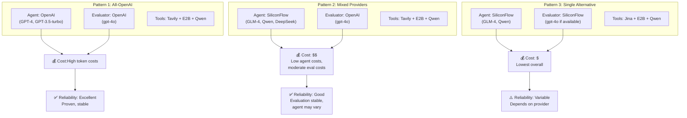
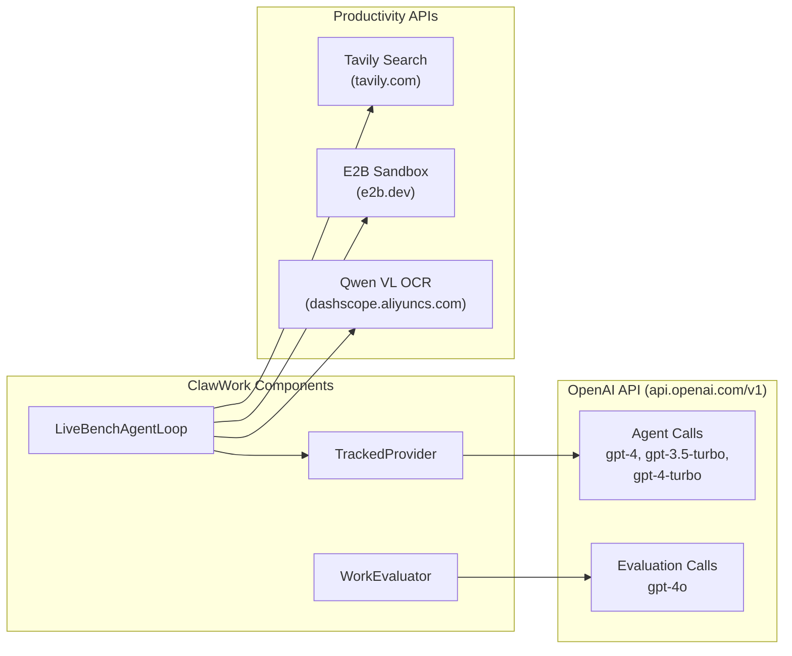
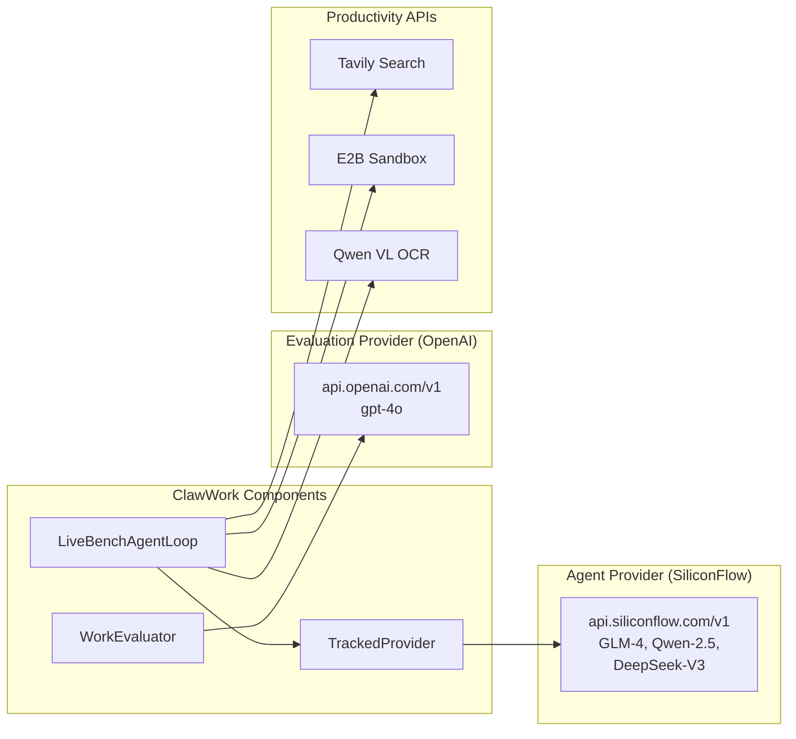
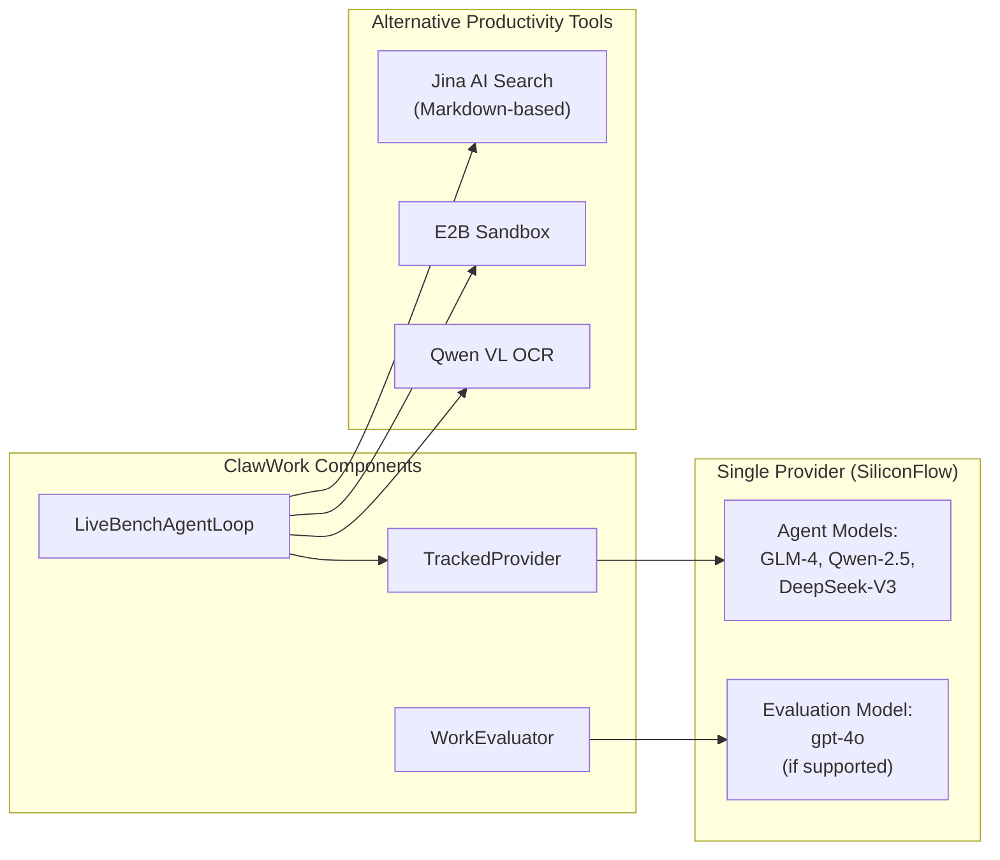
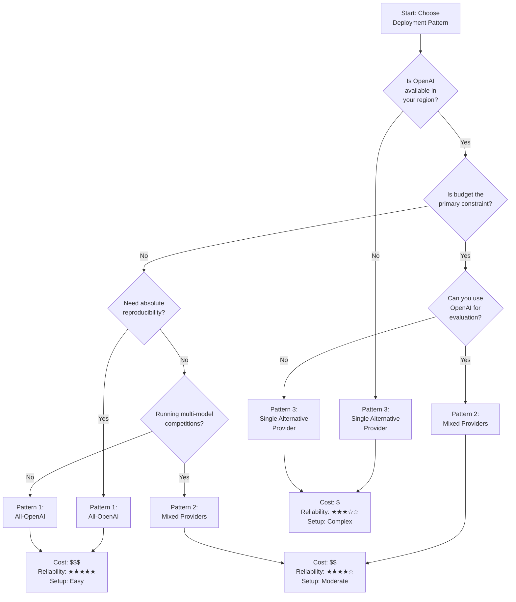
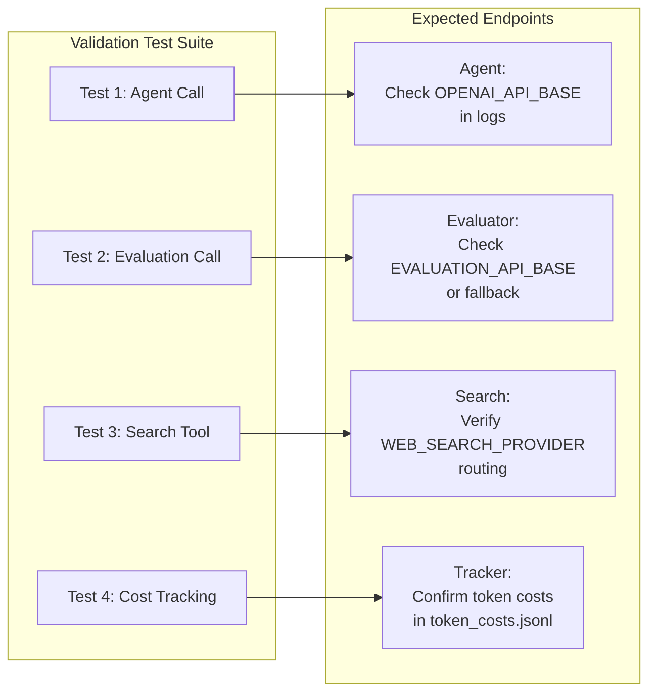

<!-- source: DeepWiki mcp.deepwiki.com · repo HKUDS/ClawWork · page 8.5 Deployment Patterns · fetched 2026-11-09 -->

# Deployment Patterns

<details>
<summary>Relevant source files</summary>

The following files were used as context for generating this wiki page:

- [.env.example](.env.example)

</details>


## Purpose and Scope

This page presents three recommended deployment configurations for ClawWork's API infrastructure. Each pattern optimizes for different priorities: reliability, cost-effectiveness, or vendor consolidation. 

ClawWork separates agent execution from evaluation, allowing you to mix providers strategically. This page shows you how to configure the environment variables to implement each pattern effectively.

For detailed information about individual environment variables, see [Environment Variables](#8.1). For provider-specific configuration details, see [Agent Model Configuration](#8.2), [Evaluation Model Configuration](#8.3), and [Productivity Tools APIs](#8.4).

---

## Deployment Pattern Overview

ClawWork's architecture separates three API consumption layers, each with different requirements:

| Layer | Purpose | Volume | Requirements |
|-------|---------|--------|--------------|
| **Agent Model** | Main reasoning, tool usage, decision-making | High (daily loops, multiple tasks) | Fast, cost-effective, supports tools |
| **Evaluation Model** | Score work submissions via meta-prompts | Low (once per task) | Reliable, consistent, supports GPT-4o |
| **Productivity Tools** | Web search, OCR, code execution | Variable | Specialized per tool |

The three recommended patterns differ in how they distribute these layers across providers:

**Pattern Comparison at a Glance:**



**Deployment Pattern Decision Matrix:**

Sources: [.env.example:1-97]()

---

## Pattern 1: All-OpenAI Configuration

### Overview

**Best For:** Production deployments, research requiring reproducibility, teams new to ClawWork

**Trade-offs:** Highest cost, but maximum reliability and simplicity

### Architecture

This pattern routes all LLM calls through OpenAI's API:



### Configuration

Create your `.env` file with the following structure:

```bash
# Agent Model - OpenAI
OPENAI_API_KEY=sk-proj-xxxxxxxxxxxxx

# Evaluation Model - OpenAI (can use same or different key)
EVALUATION_API_KEY=sk-proj-xxxxxxxxxxxxx
EVALUATION_API_BASE=https://api.openai.com/v1  # Optional, this is the default

# Productivity Tools
WEB_SEARCH_PROVIDER=tavily
WEB_SEARCH_API_KEY=tvly-xxxxxxxxxxxxx
OCR_VLLM_API_KEY=sk-xxxxxxxxxxxxx  # DashScope API key
E2B_API_KEY=xxxxxxxxxxxxx
```

**Notes:**
- If `EVALUATION_API_KEY` is omitted, the system falls back to `OPENAI_API_KEY` [.env.example:30-31]()
- If `EVALUATION_API_BASE` is omitted, it defaults to `https://api.openai.com/v1` [.env.example:34]()
- `OPENAI_API_BASE` is not needed since OpenAI is the default

### Cost Structure

| Component | Model | Cost per 1M Tokens (Input/Output) | Typical Daily Cost |
|-----------|-------|-----------------------------------|-------------------|
| Agent (Reasoning) | `gpt-4-turbo` | $10 / $30 | $2.50 - $10.00 |
| Agent (Budget) | `gpt-3.5-turbo` | $0.50 / $1.50 | $0.25 - $1.00 |
| Evaluation | `gpt-4o` | $2.50 / $10 | $0.10 - $0.50 |
| Search (Tavily) | N/A | $0.0008 per call | $0.02 - $0.10 |
| **Total Daily** | | | **$2.87 - $11.60** |

### Reliability Characteristics

- **Agent Stability:** Excellent. OpenAI models have consistent behavior and high uptime (99.9% SLA for enterprise)
- **Evaluation Consistency:** Excellent. `gpt-4o` provides stable scoring across runs
- **Rate Limits:** 10,000 RPM (Tier 1), 200 RPM (free tier)
- **Latency:** Low (100-500ms for most calls)

### When to Choose This Pattern

✅ **Use Pattern 1 if:**
- You need reproducible results for research or benchmarking
- Your team is new to ClawWork and wants minimal configuration complexity
- Budget is not a primary constraint
- You require enterprise-grade SLAs and support

❌ **Avoid Pattern 1 if:**
- You're running large-scale multi-agent competitions (costs scale linearly)
- You need to minimize operational costs
- You want to experiment with specialized models (e.g., code-focused, multilingual)

Sources: [.env.example:79-83]()

---

## Pattern 2: Mixed Provider Configuration

### Overview

**Best For:** Cost-conscious teams, multi-model competitions, production deployments with quality requirements

**Trade-offs:** 70-90% cost reduction on agent calls, maintains evaluation reliability

### Architecture

This pattern uses a cost-effective provider for high-volume agent calls while maintaining OpenAI for critical evaluation:



### Configuration

```bash
# Agent Model - SiliconFlow (or other OpenAI-compatible provider)
OPENAI_API_KEY=sk-ngksq-xxxxxxxxxxxxx  # SiliconFlow API key
OPENAI_API_BASE=https://api.siliconflow.com/v1

# Evaluation Model - OpenAI (separate key for reliability)
EVALUATION_API_KEY=sk-proj-xxxxxxxxxxxxx
EVALUATION_API_BASE=https://api.openai.com/v1

# Productivity Tools (same as Pattern 1)
WEB_SEARCH_PROVIDER=tavily
WEB_SEARCH_API_KEY=tvly-xxxxxxxxxxxxx
OCR_VLLM_API_KEY=sk-xxxxxxxxxxxxx
E2B_API_KEY=xxxxxxxxxxxxx
```

**Key Configuration Points:**
- `OPENAI_API_KEY` holds the SiliconFlow key [.env.example:85-86]()
- `OPENAI_API_BASE` must be set to the alternative provider's endpoint [.env.example:86]()
- `EVALUATION_API_KEY` and `EVALUATION_API_BASE` override the agent settings for evaluation [.env.example:87-88]()

### Cost Structure Comparison

| Component | Pattern 1 (All-OpenAI) | Pattern 2 (Mixed) | Savings |
|-----------|----------------------|------------------|---------|
| Agent Calls (GLM-4) | $10/M tokens (gpt-4-turbo) | $0.50/M tokens | **95%** |
| Agent Calls (Qwen-2.5) | $0.50/M tokens (gpt-3.5-turbo) | $0.07/M tokens | **86%** |
| Evaluation | $2.50/M tokens (gpt-4o) | $2.50/M tokens | 0% |
| **Daily Total** | **$2.87 - $11.60** | **$0.50 - $1.80** | **70-85%** |

### Alternative Agent Providers

The following OpenAI-compatible providers are tested with ClawWork:

| Provider | Endpoint | Notable Models | Cost Range | Notes |
|----------|----------|---------------|------------|-------|
| **SiliconFlow** | `api.siliconflow.com/v1` | GLM-4, Qwen-2.5, DeepSeek-V3, Yi-Lightning | $0.07-0.50 / 1M tokens | Recommended |
| **Together AI** | `api.together.xyz/v1` | Llama-3.3, Qwen-2.5, Mixtral | $0.20-0.80 / 1M tokens | Good reliability |
| **Groq** | `api.groq.com/openai/v1` | Llama-3.3, Mixtral | Free tier available | Very fast inference |
| **DeepSeek** | `api.deepseek.com/v1` | DeepSeek-V3 | $0.14-0.28 / 1M tokens | Strong coding |

### Reliability Characteristics

- **Agent Stability:** Good. Alternative providers may have occasional downtime or model updates
- **Evaluation Consistency:** Excellent. OpenAI evaluation ensures consistent scoring
- **Rate Limits:** Vary by provider (typically 100-1000 RPM)
- **Latency:** Variable (200-2000ms)

### When to Choose This Pattern

✅ **Use Pattern 2 if:**
- You're running multi-model competitions (see [Multi-Model Competition](#9))
- You need to minimize costs without sacrificing evaluation quality
- You want to experiment with diverse models (multilingual, code-focused, etc.)
- Your use case tolerates occasional agent-side variability

❌ **Avoid Pattern 2 if:**
- You require absolute reproducibility across runs
- Your evaluation logic depends on specific OpenAI model behaviors
- You need unified billing and support through a single vendor

Sources: [.env.example:84-89]()

---

## Pattern 3: Single Alternative Provider Configuration

### Overview

**Best For:** Vendor consolidation, China-based deployments, maximum cost optimization

**Trade-offs:** Lowest cost, but requires provider to support `gpt-4o` (or you must accept evaluation model substitution)

### Architecture

This pattern routes all LLM calls through a single alternative provider:



### Configuration

```bash
# Agent and Evaluation - Single Provider
OPENAI_API_KEY=sk-ngksq-xxxxxxxxxxxxx
OPENAI_API_BASE=https://api.siliconflow.com/v1

# Optional: Specify evaluation model if gpt-4o not available
# EVALUATION_MODEL=Qwen/Qwen2.5-72B-Instruct  # Example alternative

# Productivity Tools - Use Jina instead of Tavily
WEB_SEARCH_PROVIDER=jina
WEB_SEARCH_API_KEY=jina_xxxxxxxxxxxxx  # Free tier available
OCR_VLLM_API_KEY=sk-xxxxxxxxxxxxx
E2B_API_KEY=xxxxxxxxxxxxx
```

**Key Configuration Points:**
- Omit `EVALUATION_API_KEY` and `EVALUATION_API_BASE` to use same provider [.env.example:91-93]()
- Set `EVALUATION_MODEL` if provider doesn't support `gpt-4o` [.env.example:40]()
- Use Jina AI Search (free tier) instead of Tavily for further cost reduction [.env.example:48-49]()

### Critical Consideration: Evaluation Model Availability

⚠️ **Important:** Most alternative providers do **not** support OpenAI's `gpt-4o` model. You have two options:

#### Option A: Verify GPT-4o Support

Check if your provider supports `gpt-4o`:

```bash
# Example: Test if SiliconFlow supports gpt-4o
curl -X POST https://api.siliconflow.com/v1/chat/completions \
  -H "Authorization: Bearer $OPENAI_API_KEY" \
  -H "Content-Type: application/json" \
  -d '{
    "model": "gpt-4o",
    "messages": [{"role": "user", "content": "test"}]
  }'
```

If you receive a `model_not_found` error, proceed to Option B.

#### Option B: Use Substitute Evaluation Model

Set `EVALUATION_MODEL` to a powerful model available on your provider:

| Provider | Recommended Evaluation Models | Quality vs. GPT-4o |
|----------|------------------------------|-------------------|
| SiliconFlow | `Qwen/Qwen2.5-72B-Instruct`, `deepseek-ai/DeepSeek-V3` | 85-90% comparable |
| Together AI | `meta-llama/Llama-3.3-70B-Instruct` | 80-85% comparable |
| DeepSeek | `deepseek-chat` | 85-90% comparable |

**Impact:** Evaluation scores may shift 5-15% compared to GPT-4o baseline. This affects cross-pattern comparability but remains internally consistent within the same pattern.

### Cost Structure

| Component | Pattern 2 (Mixed) | Pattern 3 (Single) | Additional Savings |
|-----------|------------------|-------------------|-------------------|
| Agent Calls | $0.07-0.50 / 1M tokens | $0.07-0.50 / 1M tokens | 0% |
| Evaluation | $2.50 / 1M tokens (OpenAI) | $0.14-0.28 / 1M tokens | **89-94%** |
| Search | $0.0008 per call (Tavily) | Free (Jina) | **100%** |
| **Daily Total** | **$0.50 - $1.80** | **$0.20 - $0.80** | **55-60%** |

### When to Choose This Pattern

✅ **Use Pattern 3 if:**
- You're deploying in regions where OpenAI is unavailable or restricted
- You need unified billing and vendor management
- You're running experiments where absolute evaluation consistency is less critical
- You want to minimize costs across all components

❌ **Avoid Pattern 3 if:**
- You need to compare results against published ClawWork benchmarks (uses GPT-4o evaluation)
- Your research requires evaluation consistency with prior work
- You're uncertain whether the evaluation model substitution is acceptable

Sources: [.env.example:91-96]()

---

## Provider Selection Decision Tree

Use this flowchart to select the optimal deployment pattern:



**Decision Factors Summary:**

| Factor | Pattern 1 | Pattern 2 | Pattern 3 |
|--------|-----------|-----------|-----------|
| **Monthly Cost** (single agent) | $86-348 | $15-54 | $6-24 |
| **Setup Complexity** | ⭐ Low | ⭐⭐ Moderate | ⭐⭐⭐ High |
| **Evaluation Consistency** | ⭐⭐⭐⭐⭐ Excellent | ⭐⭐⭐⭐⭐ Excellent | ⭐⭐⭐ Good |
| **Agent Model Variety** | ⭐⭐ Limited | ⭐⭐⭐⭐⭐ Extensive | ⭐⭐⭐⭐ Extensive |
| **Cross-Pattern Comparability** | ⭐⭐⭐⭐⭐ Perfect | ⭐⭐⭐⭐⭐ Perfect | ⭐⭐⭐ Approximate |

Sources: [.env.example:76-96]()

---

## Migration Between Patterns

### Pattern 1 → Pattern 2 (Cost Optimization)

**Migration Steps:**

1. **Select Alternative Agent Provider:**
   - SiliconFlow (recommended for GLM-4, Qwen-2.5)
   - Together AI (recommended for Llama-3.3)
   - Groq (recommended for latency-critical applications)

2. **Update Agent Configuration:**
   ```bash
   # Add to .env
   OPENAI_API_BASE=https://api.siliconflow.com/v1
   # Replace OPENAI_API_KEY with SiliconFlow key
   OPENAI_API_KEY=sk-ngksq-xxxxxxxxxxxxx
   ```

3. **Preserve Evaluation Configuration:**
   ```bash
   # Ensure these remain set to OpenAI
   EVALUATION_API_KEY=sk-proj-xxxxxxxxxxxxx
   EVALUATION_API_BASE=https://api.openai.com/v1
   ```

4. **Test Agent Behavior:**
   - Run a 3-day simulation with the new agent model
   - Compare task completion rates and quality scores
   - Verify token cost tracking in `token_costs.jsonl`

5. **Validate Evaluation Consistency:**
   - Evaluation scores should remain consistent (±5%)
   - If scores deviate >10%, check `EVALUATION_API_BASE` is correctly set

**Expected Outcomes:**
- 70-85% reduction in agent token costs
- No change in evaluation behavior
- Possible changes in agent reasoning patterns (model-dependent)

### Pattern 2 → Pattern 3 (Full Consolidation)

**Migration Steps:**

1. **Remove Evaluation Overrides:**
   ```bash
   # Remove or comment out in .env
   # EVALUATION_API_KEY=...
   # EVALUATION_API_BASE=...
   ```

2. **Configure Evaluation Model:**
   ```bash
   # If provider doesn't support gpt-4o
   EVALUATION_MODEL=Qwen/Qwen2.5-72B-Instruct
   ```

3. **Switch Search Provider (Optional):**
   ```bash
   WEB_SEARCH_PROVIDER=jina
   WEB_SEARCH_API_KEY=jina_xxxxxxxxxxxxx
   ```

4. **Baseline Evaluation Scores:**
   - Re-evaluate 20-30 prior task submissions using the new evaluation model
   - Calculate mean score delta: `Δ_score = mean(new_scores - old_scores)`
   - Document this delta for future comparisons

5. **Update Comparison Logic:**
   - Scores from Pattern 3 should not be directly compared to Pattern 1/2
   - Apply correction factor if needed: `adjusted_score = raw_score - Δ_score`

**Expected Outcomes:**
- 55-60% further cost reduction
- Evaluation score shift (typically +/- 0.05-0.15)
- Need to establish new baseline for benchmarking

### Pattern 3 → Pattern 2 (Restore Evaluation Consistency)

This is the reverse migration, typically done to align with published benchmarks:

1. **Obtain OpenAI API Key** for evaluation
2. **Add Evaluation Overrides:**
   ```bash
   EVALUATION_API_KEY=sk-proj-xxxxxxxxxxxxx
   EVALUATION_API_BASE=https://api.openai.com/v1
   ```
3. **Remove Evaluation Model Override:**
   ```bash
   # Remove or comment out
   # EVALUATION_MODEL=...
   ```
4. **Re-baseline all metrics** with GPT-4o evaluation

Sources: [.env.example:1-97]()

---

## Configuration Validation

After configuring any pattern, validate your setup:

### Validation Checklist

```bash
# 1. Check environment variables are loaded
python -c "import os; from dotenv import load_dotenv; load_dotenv(); \
    print('Agent Key:', 'SET' if os.getenv('OPENAI_API_KEY') else 'MISSING'); \
    print('Agent Base:', os.getenv('OPENAI_API_BASE', 'default')); \
    print('Eval Key:', 'SET' if os.getenv('EVALUATION_API_KEY') else 'USES_AGENT'); \
    print('Search:', os.getenv('WEB_SEARCH_PROVIDER', 'NOT_SET'))"

# 2. Test agent model connectivity
# (Requires livebench to be importable)
python -c "from livebench.agent import test_agent_connection; test_agent_connection()"

# 3. Test evaluation model connectivity
python -c "from livebench.eval import test_evaluator_connection; test_evaluator_connection()"

# 4. Verify productivity tools
python -c "from livebench.tools import verify_tool_apis; verify_tool_apis()"
```

### Common Configuration Errors

| Error | Cause | Solution |
|-------|-------|----------|
| `ModelNotFoundError: gpt-4o` | Provider doesn't support evaluation model | Set `EVALUATION_MODEL` to supported model |
| `AuthenticationError: Invalid API key` | Wrong key or expired | Verify key format and validity |
| `Connection refused: api.openai.com` | Firewall or region blocking | Use VPN or switch to `api.siliconflow.com` |
| `Rate limit exceeded` | Too many concurrent requests | Add retry logic or reduce concurrency |
| `Provider mismatch warning` | Evaluation using agent provider unintentionally | Explicitly set `EVALUATION_API_KEY` |

### Deployment Pattern Validation Matrix

After configuration, verify your actual routing:



Run the validation suite to confirm your deployment pattern is correctly implemented:

```bash
# Run deployment pattern validation
python scripts/validate_deployment_pattern.py --pattern 2
```

Expected output:
```
✓ Agent API: https://api.siliconflow.com/v1 (GLM-4)
✓ Evaluation API: https://api.openai.com/v1 (gpt-4o)
✓ Search Provider: tavily
✓ Token Tracking: Active
✓ Cost Calculation: Verified

Deployment Pattern: MIXED_PROVIDERS
Estimated Daily Cost: $0.50 - $1.80
```

Sources: [.env.example:1-97]()

---

## Summary

### Pattern Selection Quick Reference

| Use Case | Recommended Pattern | Key Configuration |
|----------|-------------------|------------------|
| Research/Benchmarking | Pattern 1 (All-OpenAI) | Default settings, both keys to OpenAI |
| Production (Cost-Aware) | Pattern 2 (Mixed) | Agent → SiliconFlow, Eval → OpenAI |
| Multi-Model Competition | Pattern 2 (Mixed) | Agent → Various, Eval → OpenAI |
| China Deployment | Pattern 3 (Single Alternative) | All → SiliconFlow/Local |
| Maximum Cost Optimization | Pattern 3 (Single Alternative) | All → SiliconFlow, Jina search |

### Configuration Files by Pattern

**Pattern 1 Minimal .env:**
```bash
OPENAI_API_KEY=sk-proj-xxxxx
EVALUATION_API_KEY=sk-proj-xxxxx
WEB_SEARCH_API_KEY=tvly-xxxxx
```

**Pattern 2 Minimal .env:**
```bash
OPENAI_API_KEY=sk-ngksq-xxxxx
OPENAI_API_BASE=https://api.siliconflow.com/v1
EVALUATION_API_KEY=sk-proj-xxxxx
EVALUATION_API_BASE=https://api.openai.com/v1
WEB_SEARCH_API_KEY=tvly-xxxxx
```

**Pattern 3 Minimal .env:**
```bash
OPENAI_API_KEY=sk-ngksq-xxxxx
OPENAI_API_BASE=https://api.siliconflow.com/v1
EVALUATION_MODEL=Qwen/Qwen2.5-72B-Instruct
WEB_SEARCH_PROVIDER=jina
WEB_SEARCH_API_KEY=jina_xxxxx
```

All patterns require additional API keys for OCR (`OCR_VLLM_API_KEY`) and code execution (`E2B_API_KEY`) as documented in [Productivity Tools APIs](#8.4).

Sources: [.env.example:76-96]()

---

