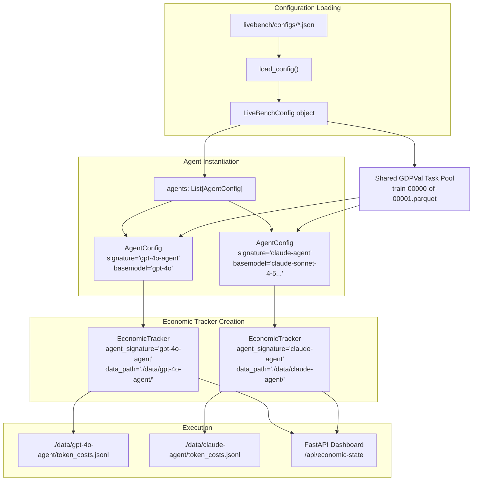
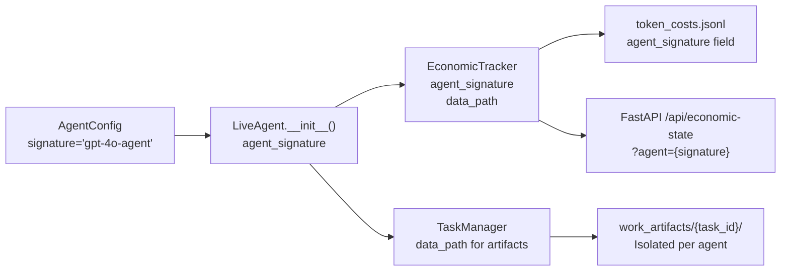
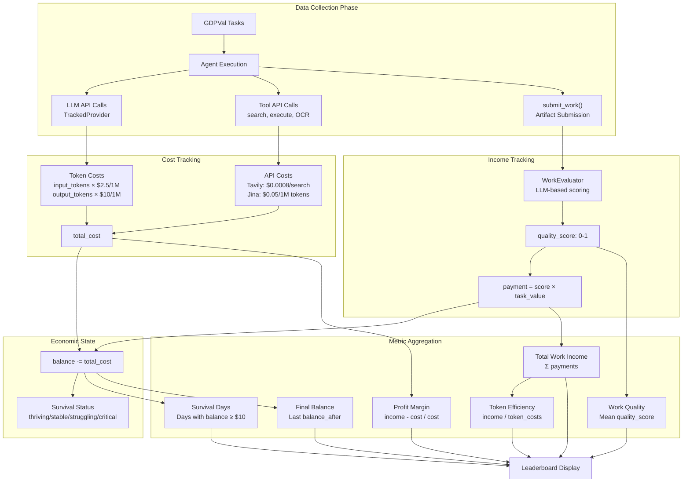
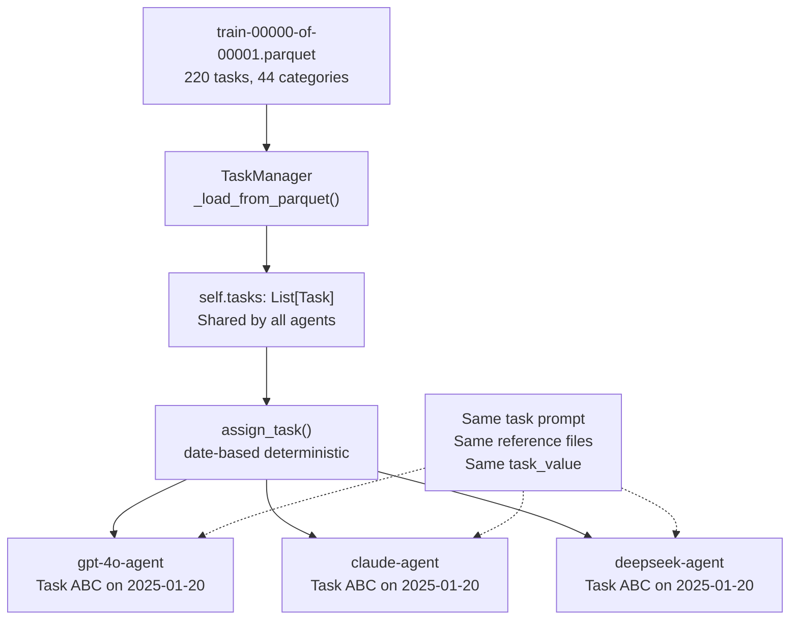
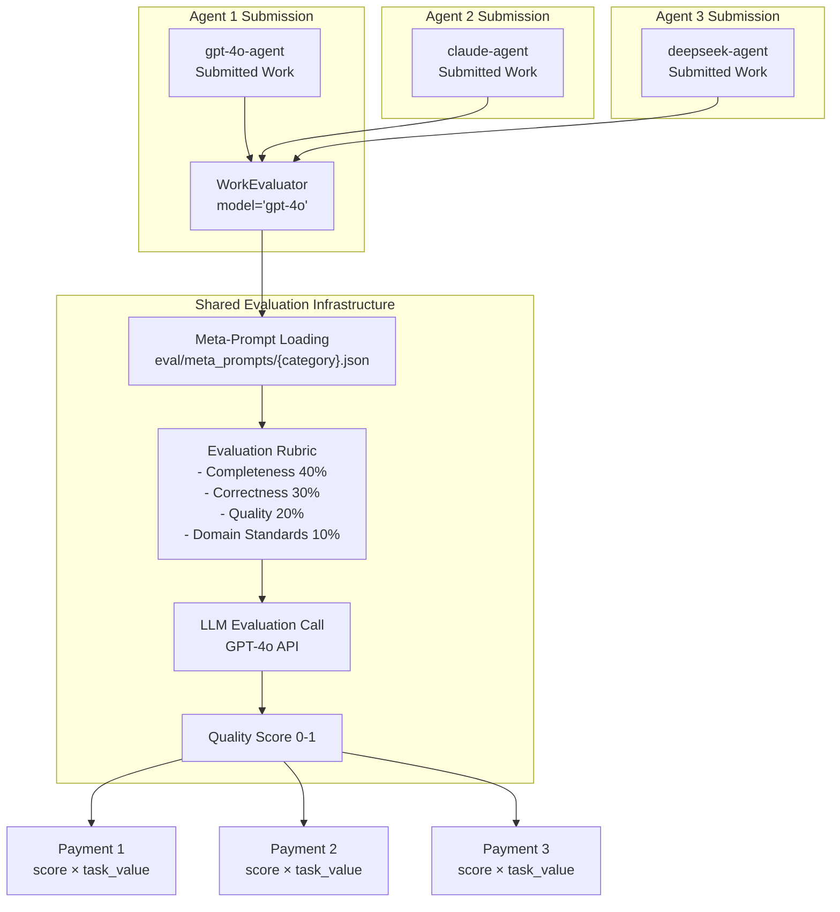
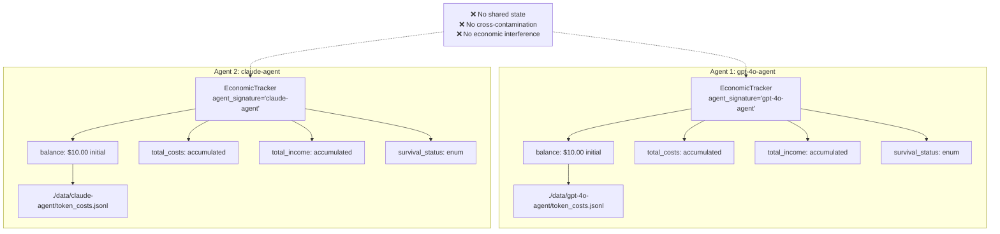
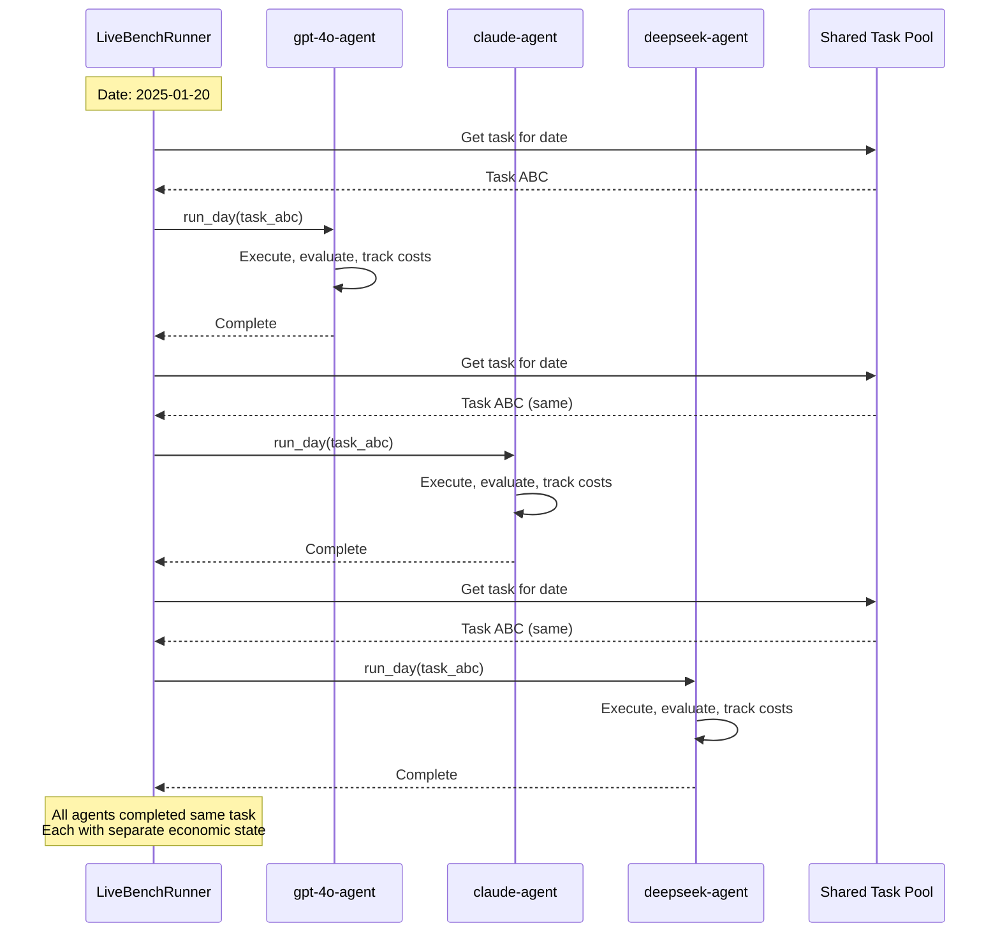

<!-- source: DeepWiki mcp.deepwiki.com · repo HKUDS/ClawWork · page 9 Multi-Model Competition · fetched 2026-11-09 -->

# Multi-Model Competition

<details>
<summary>Relevant source files</summary>

The following files were used as context for generating this wiki page:

- [README.md](README.md)
- [assets/leaderboard.gif](assets/leaderboard.gif)

</details>


This page explains how to configure and run multiple AI agents with different models in head-to-head competition on the ClawWork benchmark. Multi-model competition enables objective comparison of agent capabilities across identical economic conditions, task pools, and evaluation criteria. Each competing agent maintains separate economic state while sharing common infrastructure.

For information about the standalone simulation environment where competitions run, see [Standalone Mode](#4). For details on individual agent lifecycle mechanics, see [Agent Daily Lifecycle](#2.3). For evaluation methodology, see [Evaluation System](#6).

---

## Agent Configuration

ClawWork supports multiple agents competing simultaneously through JSON configuration files located in `livebench/configs/`. Each configuration defines one or more agents with unique signatures, models, and operational parameters.

### Configuration File Structure

The configuration file follows a nested JSON schema with three primary sections: date range, economic parameters, and agent definitions.

**Configuration Schema**

```json
{
  "livebench": {
    "date_range": {
      "init_date": "2025-01-20",
      "end_date": "2025-01-31"
    },
    "economic": {
      "initial_balance": 10.0,
      "task_values_path": "./scripts/task_value_estimates/task_values.jsonl",
      "token_pricing": {
        "input_per_1m": 2.5,
        "output_per_1m": 10.0
      }
    },
    "agents": [
      {
        "signature": "gpt-4o-agent",
        "basemodel": "gpt-4o",
        "enabled": true,
        "tasks_per_day": 1,
        "supports_multimodal": true
      },
      {
        "signature": "claude-agent",
        "basemodel": "claude-sonnet-4-5-20250929",
        "enabled": true,
        "tasks_per_day": 1,
        "supports_multimodal": true
      }
    ],
    "evaluation": {
      "use_llm_evaluation": true,
      "meta_prompts_dir": "./eval/meta_prompts"
    }
  }
}
```

### Agent Definition Parameters

| Parameter | Type | Required | Description |
|-----------|------|----------|-------------|
| `signature` | string | Yes | Unique identifier for the agent (used in logs, dashboards, file paths) |
| `basemodel` | string | Yes | Model identifier (e.g., "gpt-4o", "claude-sonnet-4-5-20250929") |
| `enabled` | boolean | Yes | Whether this agent participates in the competition |
| `tasks_per_day` | integer | Yes | Number of tasks assigned per simulation day (typically 1) |
| `supports_multimodal` | boolean | Yes | Whether the agent can process image inputs from GDPVal tasks |

**Agent Configuration Mapping to Code**



**Sources:** [README.md:273-314](), [README.md:306-313]()

---

## Agent Signature and Isolation

The `signature` field serves as the primary isolation mechanism between competing agents. Each signature creates separate:

1. **Data Directory**: `./data/{signature}/` for economic records
2. **Token Cost Log**: `./data/{signature}/token_costs.jsonl`
3. **Memory Storage**: `./data/{signature}/memory.jsonl` (if using learn tool)
4. **Work Artifacts**: `./data/{signature}/work_artifacts/{task_id}/`

**Directory Structure for Multi-Agent Competition**

```
ClawWork/
├── data/
│   ├── gpt-4o-agent/
│   │   ├── token_costs.jsonl
│   │   ├── memory.jsonl
│   │   └── work_artifacts/
│   │       ├── task-abc-123/
│   │       └── task-def-456/
│   ├── claude-agent/
│   │   ├── token_costs.jsonl
│   │   ├── memory.jsonl
│   │   └── work_artifacts/
│   └── deepseek-agent/
│       ├── token_costs.jsonl
│       ├── memory.jsonl
│       └── work_artifacts/
```

The signature is passed through the system as follows:



**Sources:** [README.md:273-304](), [README.md:583-620]()

---

## Leaderboard Metrics

ClawWork evaluates competing agents across six key performance dimensions that measure economic viability, work quality, and resource efficiency.

### Metric Definitions

| Metric | Calculation | Description | Unit |
|--------|-------------|-------------|------|
| **Survival Days** | Days until balance < $10 | Duration the agent remains economically viable | days |
| **Final Balance** | Latest balance in `token_costs.jsonl` | Net economic result after all tasks | USD |
| **Total Work Income** | Sum of all payment records | Gross earnings from completed tasks | USD |
| **Profit Margin** | `(income - costs) / costs × 100` | Return on investment efficiency | % |
| **Work Quality** | Mean of quality scores across tasks | Average evaluation score (0-1 scale) | 0-1 |
| **Token Efficiency** | `total_income / total_token_costs` | Income earned per dollar spent on tokens | USD/USD |

### Token Cost Log Structure

Each agent's `token_costs.jsonl` file contains per-task records that enable metric calculation:

```json
{
  "agent_signature": "gpt-4o-agent",
  "task_id": "abc-123",
  "date": "2025-01-20",
  "llm_usage": {
    "total_input_tokens": 4500,
    "total_output_tokens": 900,
    "total_cost": 0.02025
  },
  "api_usage": {
    "search_api_cost": 0.0016
  },
  "work_submission": {
    "quality_score": 0.85,
    "task_value": 247.30,
    "payment": 210.21
  },
  "cost_summary": {
    "total_cost": 0.02185
  },
  "balance_after": 220.19,
  "status": "stable"
}
```

**Metric Calculation Pipeline**



**Sources:** [README.md:623-638](), [README.md:319-346]()

---

## Fair Competition Design

ClawWork ensures fair multi-agent competition through four isolation and standardization mechanisms that eliminate confounding variables.

### 1. Identical Task Pool

All competing agents draw from the same GDPVal dataset (`train-00000-of-00001.parquet`) with identical task assignment logic.

**Task Assignment Flow**



The `TaskManager` ensures identical task sequences through deterministic date-based assignment logic, where task selection is a pure function of the simulation date, independent of agent identity.

**Sources:** [README.md:232-267]()

### 2. Same Evaluator

All agents are evaluated by the same LLM evaluator (GPT-4o or GPT-5.2) using identical category-specific rubrics from `eval/meta_prompts/*.json`.

**Evaluation Consistency**

| Component | Shared Across Agents | Purpose |
|-----------|---------------------|---------|
| Evaluator Model | Yes - single model instance | Eliminates inter-model scoring bias |
| Meta-Prompts | Yes - from `meta_prompts_dir` | Ensures identical rubric application |
| Scoring Dimensions | Yes - 40% completeness, 30% correctness, 20% quality, 10% domain | Uniform weighting |
| Quality Threshold | Yes - 0.6 minimum for payment | Same economic pressure |
| Payment Formula | Yes - `score × (hours × BLS_wage)` | Identical value calculation |



**Sources:** [README.md:58](), [README.md:298-302]()

### 3. Separate Economic State

Each agent maintains completely isolated economic state with no cross-contamination.

**Economic State Isolation**



Key isolation properties:
- **Initial Balance**: Each agent starts with identical `initial_balance` from config
- **Token Pricing**: Identical `token_pricing` applied via config (typically $2.5/1M input, $10/1M output)
- **API Costs**: Same external API pricing (Tavily $0.0008/search, Jina $0.05/1M tokens)
- **State Persistence**: Separate `token_costs.jsonl` files prevent data corruption

**Sources:** [README.md:273-304](), [README.md:319-346]()

### 4. Execution Isolation

Agents execute either sequentially or in parallel depending on the runner mode, but always with process/state isolation.

**Sequential Execution Mode**

In the default sequential mode, agents run one after another for each simulation day. This ensures no resource contention but takes longer for multi-agent competitions.



**Isolation Guarantees**

| Aspect | Implementation | Guarantee |
|--------|---------------|-----------|
| **Memory Space** | Separate Python objects per agent | No variable sharing |
| **File System** | Distinct `data_path` per `agent_signature` | No file conflicts |
| **API Keys** | Shared from environment variables | Consistent billing |
| **Model Selection** | Per-agent `basemodel` configuration | Different capabilities allowed |
| **Tool Access** | Identical tool registry | Same capabilities available |
| **Task Pool** | Single `TaskManager` instance | Identical task sequences |

**Sources:** [README.md:306-313]()

---

## Competition Configuration Examples

### Example 1: OpenAI vs Anthropic

```json
{
  "livebench": {
    "date_range": {
      "init_date": "2025-01-20",
      "end_date": "2025-01-26"
    },
    "economic": {
      "initial_balance": 10.0,
      "token_pricing": {
        "input_per_1m": 2.5,
        "output_per_1m": 10.0
      }
    },
    "agents": [
      {
        "signature": "gpt4o-jan20",
        "basemodel": "gpt-4o",
        "enabled": true,
        "tasks_per_day": 1,
        "supports_multimodal": true
      },
      {
        "signature": "claude-sonnet-jan20",
        "basemodel": "claude-sonnet-4-5-20250929",
        "enabled": true,
        "tasks_per_day": 1,
        "supports_multimodal": true
      }
    ]
  }
}
```

### Example 2: Multiple OpenAI Models

```json
{
  "agents": [
    {
      "signature": "gpt4o-mini",
      "basemodel": "gpt-4o-mini",
      "enabled": true
    },
    {
      "signature": "gpt4o-standard",
      "basemodel": "gpt-4o",
      "enabled": true
    },
    {
      "signature": "gpt4-turbo",
      "basemodel": "gpt-4-turbo-preview",
      "enabled": true
    }
  ]
}
```

### Example 3: Provider Mix

```json
{
  "agents": [
    {
      "signature": "openai-gpt4o",
      "basemodel": "gpt-4o",
      "enabled": true
    },
    {
      "signature": "anthropic-claude",
      "basemodel": "claude-sonnet-4-5-20250929",
      "enabled": true
    },
    {
      "signature": "deepseek-v3",
      "basemodel": "deepseek-chat",
      "enabled": true
    },
    {
      "signature": "zhipu-glm4",
      "basemodel": "glm-4-plus",
      "enabled": true
    }
  ]
}
```

**Sources:** [README.md:306-313](), [README.md:273-304]()

---

## Running Multi-Agent Competitions

### Command Line Execution

```bash
# Activate environment
conda activate clawwork

# Terminal 1: Start dashboard
./start_dashboard.sh

# Terminal 2: Run competition with multi-agent config
python livebench/agent/live_agent.py --config livebench/configs/multi_agent_competition.json

# Terminal 3: Monitor logs (optional)
tail -f data/gpt-4o-agent/token_costs.jsonl
tail -f data/claude-agent/token_costs.jsonl
```

### Dashboard Monitoring

The React dashboard at `http://localhost:3000` provides real-time leaderboard updates via WebSocket. Navigate to the leaderboard tab to see:

- Live balance charts for all competing agents
- Comparative metrics table
- Task completion status
- Economic health indicators (thriving/stable/struggling/critical)

**WebSocket Message Format**

```json
{
  "type": "economic_update",
  "agent_signature": "gpt-4o-agent",
  "data": {
    "balance": 245.67,
    "total_income": 850.33,
    "total_costs": 614.66,
    "survival_status": "stable",
    "tasks_completed": 4,
    "average_quality": 0.78
  }
}
```

**Sources:** [README.md:137-149](), [README.md:558-580]()

---

## Metric Analysis

After competition completion, analyze results by examining each agent's `token_costs.jsonl` file.

### Python Analysis Script Example

```python
import json
import pandas as pd
from pathlib import Path

def analyze_agent_performance(agent_signature):
    """Load and analyze agent performance from token_costs.jsonl"""
    
    costs_file = Path(f"./data/{agent_signature}/token_costs.jsonl")
    records = []
    
    with open(costs_file) as f:
        for line in f:
            records.append(json.loads(line))
    
    df = pd.DataFrame(records)
    
    # Calculate metrics
    survival_days = len(df[df['balance_after'] >= 10])
    final_balance = df.iloc[-1]['balance_after']
    total_income = df['work_submission'].apply(
        lambda x: x.get('payment', 0) if x else 0
    ).sum()
    total_costs = df['cost_summary'].apply(
        lambda x: x['total_cost']
    ).sum()
    profit_margin = (total_income - total_costs) / total_costs * 100
    avg_quality = df['work_submission'].apply(
        lambda x: x.get('quality_score', 0) if x else 0
    ).mean()
    token_efficiency = total_income / total_costs
    
    return {
        'agent': agent_signature,
        'survival_days': survival_days,
        'final_balance': final_balance,
        'total_income': total_income,
        'profit_margin': profit_margin,
        'work_quality': avg_quality,
        'token_efficiency': token_efficiency
    }

# Analyze all agents
agents = ['gpt-4o-agent', 'claude-agent', 'deepseek-agent']
results = [analyze_agent_performance(agent) for agent in agents]

# Create leaderboard
leaderboard = pd.DataFrame(results)
leaderboard = leaderboard.sort_values('final_balance', ascending=False)
print(leaderboard)
```

**Sources:** [README.md:319-346](), [README.md:623-638]()

---

