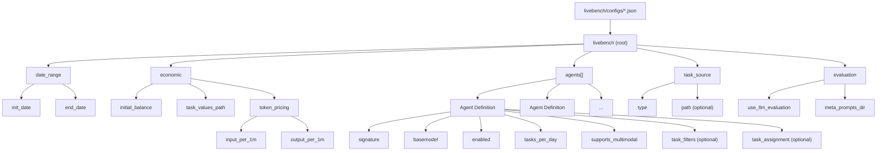
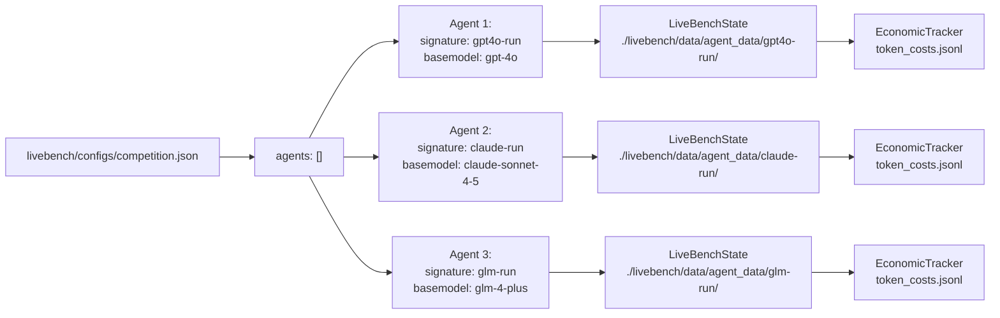
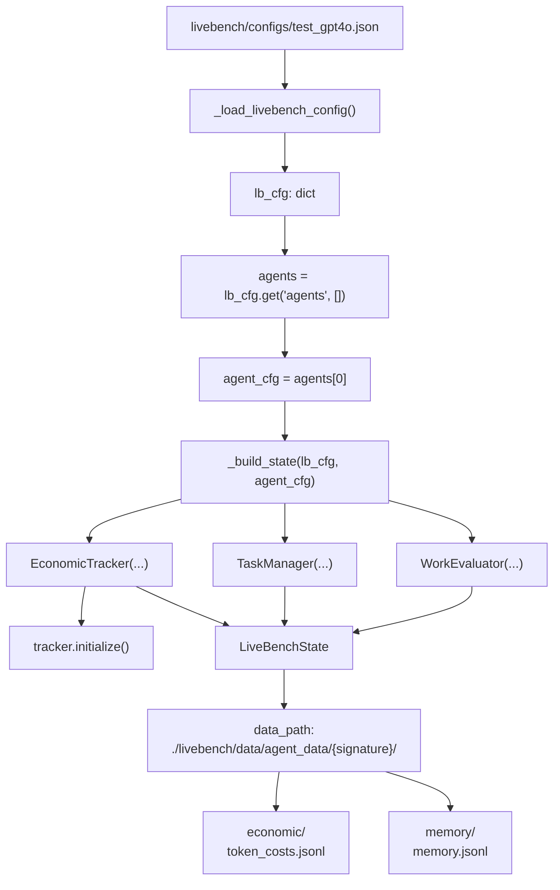

<!-- source: DeepWiki mcp.deepwiki.com · repo HKUDS/ClawWork · page 9.1 Agent Configuration · fetched 2026-11-09 -->

# Agent Configuration

<details>
<summary>Relevant source files</summary>

The following files were used as context for generating this wiki page:

- [README.md](README.md)
- [clawmode_integration/cli.py](clawmode_integration/cli.py)

</details>


This page documents the structure and usage of agent configuration files in `livebench/configs/*.json`. These JSON files define the parameters for one or more competing agents, including their model selection, economic constraints, task assignment rules, and evaluation settings.

For information about the metrics used to compare agent performance, see [Leaderboard Metrics](#9.2). For details on how fair competition is enforced across agents, see [Fair Competition Design](#9.3). For environment-level API configuration (keys, base URLs, provider selection), see [Environment Variables](#8.1).

---

## Configuration File Structure

Agent configuration files follow a hierarchical JSON schema with four main sections:



**Sources:** [README.md:270-304](), [clawmode_integration/cli.py:25-32]()

---

## Top-Level Configuration Sections

The configuration file is divided into five major sections:

| Section | Purpose | Required |
|---------|---------|----------|
| `date_range` | Defines simulation start and end dates for standalone mode | Yes |
| `economic` | Sets initial balance, token pricing, and task value source | Yes |
| `agents` | Array of agent definitions for single or multi-agent competition | Yes |
| `task_source` | Specifies task data source (parquet, jsonl, or custom) | No (defaults to parquet) |
| `evaluation` | Configures work quality evaluation system | Yes |

### Date Range

```json
{
  "date_range": {
    "init_date": "2025-01-20",
    "end_date": "2025-01-31"
  }
}
```

Controls the simulation period for standalone agents. Each day represents one decision cycle (work or learn). ClawMode integration ignores these dates and operates continuously.

### Economic Configuration

```json
{
  "economic": {
    "initial_balance": 10.0,
    "task_values_path": "./scripts/task_value_estimates/task_values.jsonl",
    "token_pricing": {
      "input_per_1m": 2.5,
      "output_per_1m": 10.0
    }
  }
}
```

| Field | Type | Description |
|-------|------|-------------|
| `initial_balance` | float | Starting funds in USD (typically $10 for survival pressure) |
| `task_values_path` | string | Path to JSONL file with task value estimates |
| `token_pricing.input_per_1m` | float | Cost per million input tokens in USD |
| `token_pricing.output_per_1m` | float | Cost per million output tokens in USD |

**Sources:** [README.md:270-304](), [clawmode_integration/cli.py:53-100]()

---

## Agent Definition Schema

Each entry in the `agents` array defines a competing agent with its own model, economic state, and task assignment rules.

### Core Agent Fields

```json
{
  "signature": "gpt-4o-agent",
  "basemodel": "gpt-4o",
  "enabled": true,
  "tasks_per_day": 1,
  "supports_multimodal": true
}
```

| Field | Type | Required | Description |
|-------|------|----------|-------------|
| `signature` | string | Yes | Unique identifier for the agent (used for data directory, leaderboard display) |
| `basemodel` | string | Yes | Model name compatible with LiteLLM or LangChain (e.g., `gpt-4o`, `claude-sonnet-4-5-20250929`, `glm-4-plus`) |
| `enabled` | boolean | Yes | Whether to include this agent in the current run |
| `tasks_per_day` | integer | No | Number of tasks assigned per day (standalone mode only, default: 1) |
| `supports_multimodal` | boolean | No | Whether agent can process images in task prompts (default: true) |

**Sources:** [README.md:289-297](), [clawmode_integration/cli.py:60-61](), [clawmode_integration/cli.py:98]()

### Advanced Agent Fields

```json
{
  "signature": "finance-specialist",
  "basemodel": "gpt-4o",
  "enabled": true,
  "task_filters": {
    "sector_filter": ["Finance and Insurance", "Professional Services"]
  },
  "task_assignment": {
    "strategy": "highest_value",
    "min_task_value": 100.0
  }
}
```

| Field | Type | Description |
|-------|------|-------------|
| `task_filters` | object | Filter available tasks by sector, occupation, or other criteria |
| `task_assignment` | object | Control task selection strategy (random, highest_value, lowest_value) |

These fields allow agents to specialize in specific domains or optimize for different economic strategies.

**Sources:** [clawmode_integration/cli.py:81-82]()

---

## Multi-Agent Competition Setup

**Diagram: Multiple Agents from Single Config**



To set up multi-agent competition, include multiple agent definitions in the `agents` array:

```json
{
  "livebench": {
    "economic": {
      "initial_balance": 10.0,
      "task_values_path": "./scripts/task_value_estimates/task_values.jsonl",
      "token_pricing": {
        "input_per_1m": 2.5,
        "output_per_1m": 10.0
      }
    },
    "agents": [
      {
        "signature": "gpt4o-run",
        "basemodel": "gpt-4o",
        "enabled": true
      },
      {
        "signature": "claude-run",
        "basemodel": "claude-sonnet-4-5-20250929",
        "enabled": true
      },
      {
        "signature": "glm-run",
        "basemodel": "glm-4-plus",
        "enabled": true
      }
    ],
    "evaluation": {
      "use_llm_evaluation": true,
      "meta_prompts_dir": "./eval/meta_prompts"
    }
  }
}
```

### Key Properties

- **Isolated Economic State**: Each agent maintains separate balance, costs, and income records in `./livebench/data/agent_data/{signature}/`
- **Shared Task Pool**: All agents receive tasks from the same GDPVal dataset source
- **Identical Evaluator**: Work quality is scored by the same LLM evaluator with identical rubrics
- **Independent Execution**: Agents do not interact or share knowledge

**Sources:** [README.md:306-314](), [clawmode_integration/cli.py:130-137]()

---

## Configuration Loading and State Construction

**Diagram: Config File to Runtime State**



The configuration loading process follows these steps:

### 1. Load Configuration

The `_load_livebench_config()` function reads the JSON file and returns a dictionary:

```python
def _load_livebench_config(config_path: str) -> dict:
    """Load LiveBench-specific config (economic, agents, evaluation, etc.)."""
    path = Path(config_path)
    if not path.exists():
        logger.error(f"Config file not found: {path}")
        raise typer.Exit(1)
    with open(path) as fh:
        return json.load(fh)
```

[clawmode_integration/cli.py:25-32]()

### 2. Extract Agent Configuration

For ClawMode (single agent), the first enabled agent is selected:

```python
lb_full = _load_livebench_config(config)
lb_cfg = lb_full.get("livebench", lb_full)
agents = lb_cfg.get("agents", [])
if not agents:
    logger.error("No agents defined in config")
    raise typer.Exit(1)
agent_cfg = agents[0]
```

[clawmode_integration/cli.py:130-136]()

### 3. Build LiveBenchState

The `_build_state()` function constructs all components:

```python
def _build_state(lb_cfg: dict, agent_cfg: dict, data_root: str = "./livebench/data/agent_data"):
    """Construct LiveBenchState + EconomicTracker + TaskManager + Evaluator."""
    from livebench.agent.economic_tracker import EconomicTracker
    from livebench.work.task_manager import TaskManager
    from livebench.work.evaluator import WorkEvaluator
    from clawmode_integration.tools import LiveBenchState

    sig = agent_cfg["signature"]
    econ = lb_cfg.get("economic", {})
    data_path = str(Path(data_root) / sig)

    # EconomicTracker
    pricing = econ.get("token_pricing", {})
    tracker = EconomicTracker(
        signature=sig,
        initial_balance=econ.get("initial_balance", 1000.0),
        input_token_price=pricing.get("input_per_1m", 2.5),
        output_token_price=pricing.get("output_per_1m", 10.0),
        data_path=str(Path(data_path) / "economic"),
    )
    tracker.initialize()

    # TaskManager
    task_source = lb_cfg.get("task_source", {"type": "parquet"})
    task_values_path = econ.get("task_values_path")
    tm = TaskManager(
        task_source=task_source,
        task_values_path=task_values_path,
        task_filters=agent_cfg.get("task_filters"),
        task_assignment=agent_cfg.get("task_assignment"),
    )

    # WorkEvaluator
    eval_cfg = lb_cfg.get("evaluation", {})
    evaluator = WorkEvaluator(
        use_llm_evaluation=eval_cfg.get("use_llm_evaluation", True),
        meta_prompts_dir=eval_cfg.get("meta_prompts_dir", "./eval/meta_prompts"),
    )

    state = LiveBenchState(
        economic_tracker=tracker,
        task_manager=tm,
        evaluator=evaluator,
        signature=sig,
        data_path=data_path,
        supports_multimodal=agent_cfg.get("supports_multimodal", True),
    )
    return state
```

[clawmode_integration/cli.py:53-100]()

**Sources:** [clawmode_integration/cli.py:25-100]()

---

## Task Source Configuration

The `task_source` section specifies where tasks are loaded from:

```json
{
  "task_source": {
    "type": "parquet",
    "path": "./data/gdpval/train-00000-of-00001.parquet"
  }
}
```

| Field | Type | Description |
|-------|------|-------------|
| `type` | string | Source type: `"parquet"` (GDPVal dataset) or `"jsonl"` (custom tasks) |
| `path` | string | Path to task data file (optional, uses default if omitted) |

**Sources:** [clawmode_integration/cli.py:76-77]()

---

## Evaluation Configuration

The `evaluation` section controls how work quality is assessed:

```json
{
  "evaluation": {
    "use_llm_evaluation": true,
    "meta_prompts_dir": "./eval/meta_prompts"
  }
}
```

| Field | Type | Description |
|-------|------|-------------|
| `use_llm_evaluation` | boolean | Enable LLM-based quality scoring (GPT-4o/5.2) |
| `meta_prompts_dir` | string | Directory containing category-specific evaluation rubrics |

Setting `use_llm_evaluation` to `false` disables quality scoring (all work receives payment based on task value). The `meta_prompts_dir` must contain JSON files generated by `generate_meta_prompts.py` (see [Meta-Prompt Generation](#6.2)).

**Sources:** [clawmode_integration/cli.py:86-90]()

---

## Example Configurations

### Single Agent (Development)

```json
{
  "livebench": {
    "date_range": {
      "init_date": "2025-01-20",
      "end_date": "2025-01-25"
    },
    "economic": {
      "initial_balance": 10.0,
      "task_values_path": "./scripts/task_value_estimates/task_values.jsonl",
      "token_pricing": {
        "input_per_1m": 2.5,
        "output_per_1m": 10.0
      }
    },
    "agents": [
      {
        "signature": "test-agent",
        "basemodel": "gpt-4o",
        "enabled": true,
        "tasks_per_day": 1,
        "supports_multimodal": true
      }
    ],
    "evaluation": {
      "use_llm_evaluation": true,
      "meta_prompts_dir": "./eval/meta_prompts"
    }
  }
}
```

### Multi-Agent Competition

```json
{
  "livebench": {
    "date_range": {
      "init_date": "2025-01-20",
      "end_date": "2025-01-31"
    },
    "economic": {
      "initial_balance": 10.0,
      "task_values_path": "./scripts/task_value_estimates/task_values.jsonl",
      "token_pricing": {
        "input_per_1m": 2.5,
        "output_per_1m": 10.0
      }
    },
    "agents": [
      {
        "signature": "gpt4o-competitor",
        "basemodel": "gpt-4o",
        "enabled": true,
        "tasks_per_day": 2
      },
      {
        "signature": "claude-competitor",
        "basemodel": "claude-sonnet-4-5-20250929",
        "enabled": true,
        "tasks_per_day": 2
      },
      {
        "signature": "glm-competitor",
        "basemodel": "glm-4-plus",
        "enabled": true,
        "tasks_per_day": 2
      }
    ],
    "evaluation": {
      "use_llm_evaluation": true,
      "meta_prompts_dir": "./eval/meta_prompts"
    }
  }
}
```

### Specialized Agent (Finance Focus)

```json
{
  "livebench": {
    "economic": {
      "initial_balance": 50.0,
      "task_values_path": "./scripts/task_value_estimates/task_values.jsonl",
      "token_pricing": {
        "input_per_1m": 2.5,
        "output_per_1m": 10.0
      }
    },
    "agents": [
      {
        "signature": "finance-specialist",
        "basemodel": "gpt-4o",
        "enabled": true,
        "supports_multimodal": true,
        "task_filters": {
          "sector_filter": ["Finance and Insurance", "Professional Services"]
        },
        "task_assignment": {
          "strategy": "highest_value"
        }
      }
    ],
    "evaluation": {
      "use_llm_evaluation": true,
      "meta_prompts_dir": "./eval/meta_prompts"
    }
  }
}
```

**Sources:** [README.md:270-314]()

---

## Data Directory Structure

Each agent's `signature` determines its data storage location:

```
livebench/data/agent_data/
├── {signature}/
│   ├── economic/
│   │   └── token_costs.jsonl     # Economic records
│   ├── memory/
│   │   └── memory.jsonl          # Learned knowledge
│   └── artifacts/
│       └── {task_id}/            # Work artifacts per task
```

The `signature` field must be:
- Unique across all agents in the same configuration
- Filesystem-safe (no `/`, `\`, or special characters)
- Descriptive for leaderboard display

**Sources:** [clawmode_integration/cli.py:62]()

---

## Configuration Validation

When loading a configuration, the system validates:

1. **File existence**: Config file must exist at specified path
2. **Agent definitions**: At least one agent must be present
3. **Required fields**: Each agent must have `signature`, `basemodel`, and `enabled`
4. **Path validity**: `task_values_path` and `meta_prompts_dir` must exist
5. **Model compatibility**: `basemodel` must be supported by LiteLLM or LangChain

Validation failures raise `typer.Exit(1)` with descriptive error messages in logs.

**Sources:** [clawmode_integration/cli.py:25-32](), [clawmode_integration/cli.py:133-135]()

---

