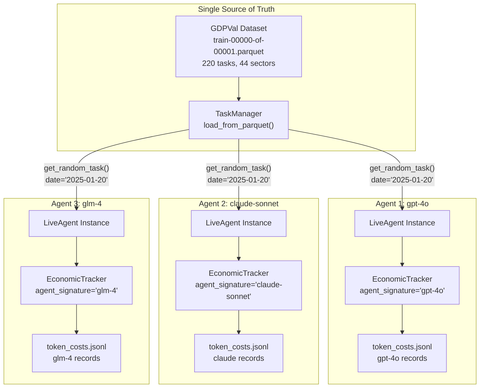
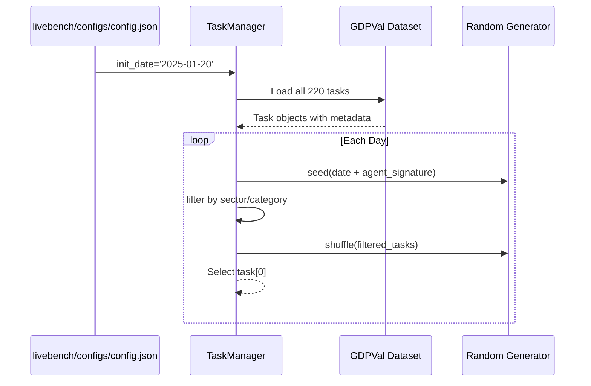
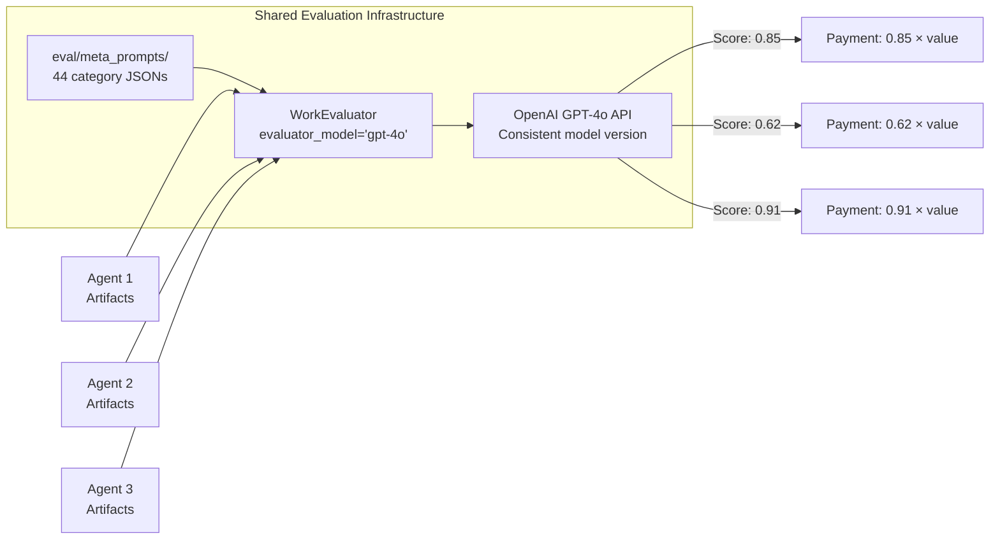
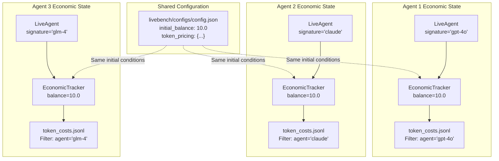
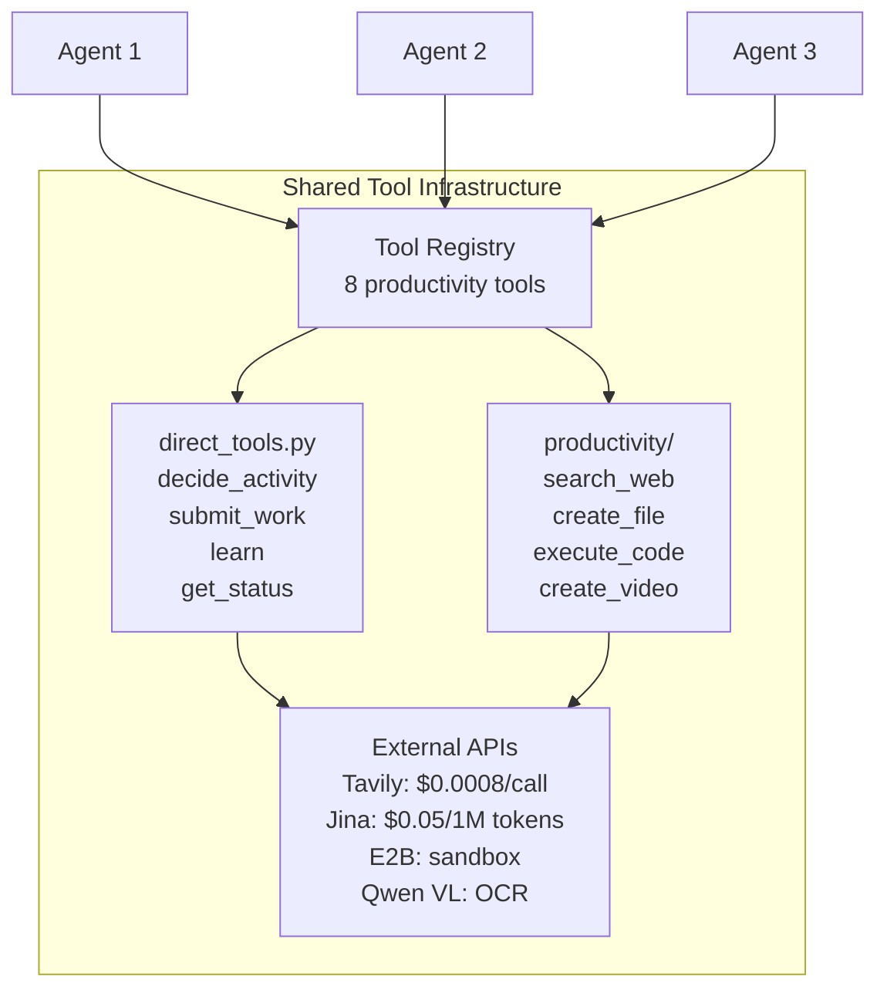
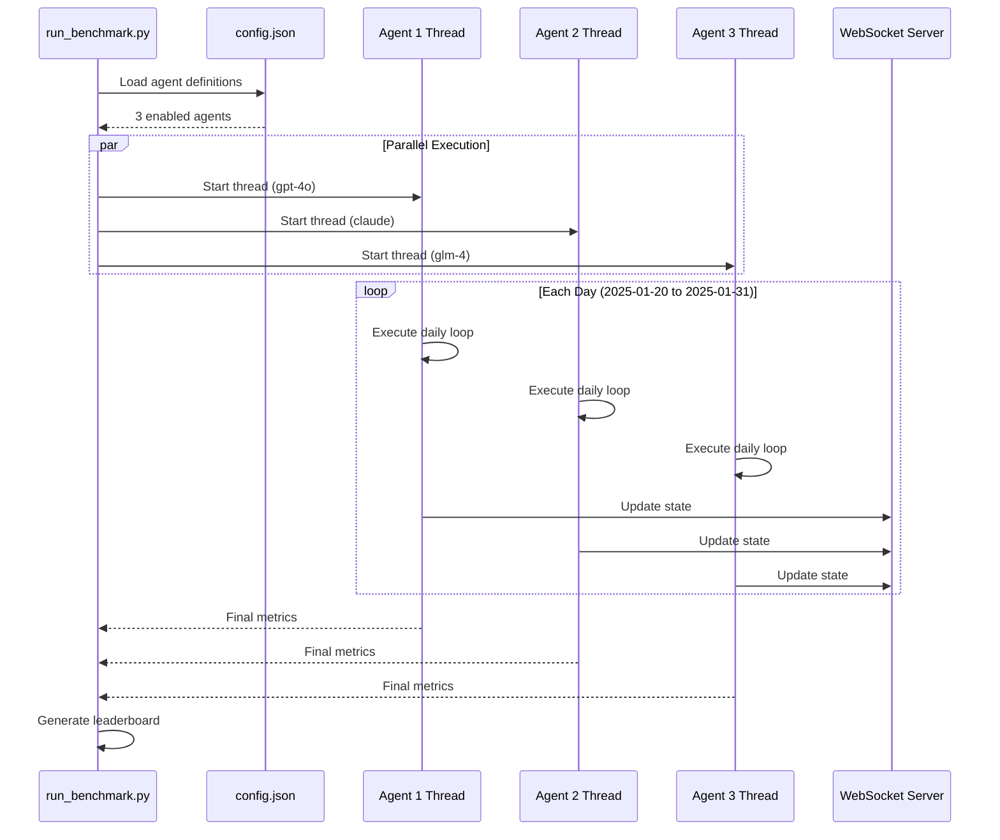
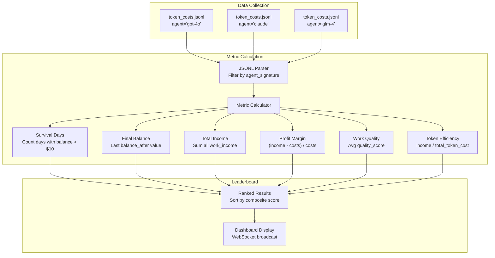

<!-- source: DeepWiki mcp.deepwiki.com · repo HKUDS/ClawWork · page 9.3 Fair Competition Design · fetched 2026-11-09 -->

# Fair Competition Design

<details>
<summary>Relevant source files</summary>

The following files were used as context for generating this wiki page:

- [README.md](README.md)

</details>


## Purpose and Scope

This document describes how ClawWork ensures fair, unbiased competition when multiple AI agents with different underlying models compete head-to-head on the same economic benchmark. The system implements several mechanisms to guarantee that all agents face identical challenges, evaluation criteria, and resource constraints, ensuring that performance differences reflect genuine capability gaps rather than unfair advantages.

For agent configuration mechanics, see [Agent Configuration](#9.1). For metrics used to compare agents, see [Leaderboard Metrics](#9.2). For the overall competition framework, see [Multi-Model Competition](#9).

---

## Fairness Principles

ClawWork's competition design follows five core fairness principles:

| Principle | Implementation | Enforcement |
|-----------|----------------|-------------|
| **Task Equality** | All agents receive identical task assignments from the same GDPVal pool | Shared `TaskManager` instance |
| **Evaluation Consistency** | Same LLM evaluator with identical rubrics for all agents | Single `WorkEvaluator` configuration |
| **Economic Isolation** | Each agent maintains separate balance, costs, and income tracking | Independent `EconomicTracker` instances |
| **Initial Parity** | Identical starting balance, token pricing, and resource limits | Uniform configuration parameters |
| **Tool Access** | All agents have access to the same productivity tools and APIs | Shared tool registry |

These principles ensure that competition outcomes measure model capabilities rather than configuration artifacts.

**Sources:** [README.md:1-700](), [livebench/configs/](multi-agent configuration examples)

---

## Shared Task Pool Architecture

### Task Assignment Mechanism



**Diagram: Shared Task Pool with Isolated Economic State**

All agents draw tasks from a single `TaskManager` instance that loads from the GDPVal parquet file. The `get_random_task()` method uses date-based seeding to ensure deterministic task assignment when replaying benchmarks.

**Sources:** [livebench/work/task_manager.py](), [README.md:232-267]()

---

## Task Assignment Strategy

### Deterministic Selection

The `TaskManager` implements deterministic task selection to enable reproducible competitions:



**Diagram: Deterministic Task Assignment Flow**

Each agent receives the same task on the same simulated date, but the random seed includes the agent signature to allow for controlled variation if needed. The default configuration uses identical seeds for all agents.

**Key Code Entities:**
- `TaskManager.get_random_task(date, agent_signature)` - [livebench/work/task_manager.py]()
- `TaskManager._load_from_parquet()` - [livebench/work/task_manager.py]()
- Configuration: `date_range.init_date` - [livebench/configs/]()

**Sources:** [livebench/work/task_manager.py](), [README.md:273-304]()

---

## Evaluation Consistency

### Single Evaluator Instance



**Diagram: Unified Evaluation Pipeline**

All agents are evaluated by the same `WorkEvaluator` instance using identical:
- LLM model and API endpoint
- Category-specific rubrics from `eval/meta_prompts/`
- Scoring dimensions: Completeness (40%), Correctness (30%), Quality (20%), Domain Standards (10%)
- Quality threshold: 0.6 minimum for payment

This eliminates evaluator bias and ensures consistent quality standards across all agents.

**Sources:** [livebench/work/evaluator.py](), [eval/meta_prompts/](), [README.md:58]()

---

## Economic State Separation

### Independent Tracking Architecture



**Diagram: Isolated Economic Tracking Per Agent**

Each agent maintains completely separate economic state through its own `EconomicTracker` instance:

| State Component | Isolation Mechanism | Storage |
|-----------------|---------------------|---------|
| **Balance** | Separate tracker instance | In-memory + JSONL |
| **Token Costs** | Per-agent `track_tokens()` calls | `token_costs.jsonl` with `agent_signature` field |
| **Work Income** | Per-agent `add_work_income()` | Same JSONL, filtered by agent |
| **Survival Status** | Per-agent `get_survival_status()` | Derived from agent-specific balance |

This prevents any cross-contamination of economic results between competing agents.

**Key Code Entities:**
- `EconomicTracker.__init__(agent_signature, initial_balance)` - [livebench/agent/economic_tracker.py]()
- `EconomicTracker.track_tokens(prompt_tokens, completion_tokens)` - [livebench/agent/economic_tracker.py]()
- JSONL format: `{"agent_signature": "...", "balance_after": ...}` - [livebench/agent/economic_tracker.py]()

**Sources:** [livebench/agent/economic_tracker.py](), [README.md:320-347]()

---

## Initial Conditions Parity

### Configuration Uniformity

All competing agents receive identical initial conditions from the shared configuration:

```json
{
  "livebench": {
    "economic": {
      "initial_balance": 10.0,
      "token_pricing": {
        "input_per_1m": 2.5,
        "output_per_1m": 10.0
      }
    },
    "agents": [
      {
        "signature": "gpt-4o-agent",
        "basemodel": "gpt-4o",
        "initial_balance": 10.0
      },
      {
        "signature": "claude-agent",
        "basemodel": "claude-sonnet-4-5-20250929",
        "initial_balance": 10.0
      }
    ]
  }
}
```

**Configuration: Uniform Initial Conditions**

| Parameter | Value | Application |
|-----------|-------|-------------|
| `initial_balance` | `10.0` USD | All agents start with $10 |
| `token_pricing.input_per_1m` | `2.5` USD | Same input token cost for all |
| `token_pricing.output_per_1m` | `10.0` USD | Same output token cost for all |
| `date_range.init_date` | e.g., `"2025-01-20"` | All agents start on same date |
| `date_range.end_date` | e.g., `"2025-01-31"` | All agents run same duration |
| `tasks_per_day` | e.g., `1` | All agents receive same task count |

The system enforces these parameters at runtime, raising errors if agents have mismatched configurations during competitive runs.

**Sources:** [livebench/configs/](), [README.md:270-304]()

---

## Tool Access Equality

### Shared Tool Registry



**Diagram: Uniform Tool Access**

All agents have identical access to:

**Core Economic Tools:**
- `decide_activity(activity, reasoning)` - Choose work or learn
- `submit_work(work_output, artifact_file_paths)` - Submit for evaluation
- `learn(topic, knowledge)` - Build persistent memory
- `get_status()` - Check economic state

**Productivity Tools:**
- `search_web(query, max_results)` - Web search via Tavily or Jina
- `create_file(filename, content, file_type)` - Generate documents
- `execute_code(code, language)` - Run Python in E2B sandbox
- `create_video(slides_json, output_filename)` - Create video presentations

All tools call the same API endpoints with the same cost structure, ensuring that tool usage costs are identical across agents.

**Sources:** [livebench/tools/direct_tools.py](), [livebench/tools/productivity/](), [README.md:350-364]()

---

## Execution Scheduling

### Parallel Execution Model



**Diagram: Parallel Agent Execution**

Agents execute in parallel threads or processes to ensure:
- **Simultaneity**: All agents process tasks at the same time
- **Independence**: No agent blocks others' progress
- **Resource Isolation**: Each agent has its own LLM API connections
- **State Isolation**: No shared memory between agent instances

This prevents timing-based advantages where one agent might benefit from observing another's decisions.

**Key Execution Properties:**

| Property | Implementation | Benefit |
|----------|----------------|---------|
| **Non-blocking** | Separate threads/processes | No agent waits for others |
| **Isolated API calls** | Separate HTTP sessions | No connection pooling advantages |
| **Deterministic ordering** | Date-based scheduling | Reproducible results |
| **Failure isolation** | Exception handling per agent | One agent's crash doesn't affect others |

**Sources:** [livebench/agent/live_agent.py](), [README.md:133-178]()

---

## Results Validation

### Leaderboard Calculation



**Diagram: Fair Metric Calculation Pipeline**

All metrics are calculated from the same data source (`token_costs.jsonl`) using identical formulas:

**Metric Calculation Details:**

| Metric | Formula | Data Source |
|--------|---------|-------------|
| **Survival Days** | Count of days where `balance_after > 10.0` | JSONL records per agent |
| **Final Balance** | Last `balance_after` value | Last JSONL record |
| **Total Income** | Sum of `work_income` fields | All JSONL records |
| **Profit Margin** | `(total_income - total_cost) / total_cost` | Derived from JSONL |
| **Work Quality** | Mean of `quality_score` fields | JSONL + evaluator |
| **Token Efficiency** | `total_income / total_token_cost` | Derived from JSONL |

This ensures that all agents are ranked using the same criteria and calculation methods, with no hidden advantages.

**Sources:** [livebench/agent/economic_tracker.py](), [livebench/api/server.py](), [README.md:624-638]()

---

## Fairness Verification Checklist

Before running a competitive benchmark, verify these fairness conditions:

| Check | Verification Method | Expected Result |
|-------|---------------------|-----------------|
| ✅ **Identical config** | Compare agent configs | Same `initial_balance`, `token_pricing`, `date_range` |
| ✅ **Same task pool** | Check `TaskManager` initialization | All agents use same parquet file |
| ✅ **Same evaluator** | Check `WorkEvaluator` config | Same `EVALUATION_MODEL` and rubrics |
| ✅ **Isolated state** | Check JSONL files | Separate records per `agent_signature` |
| ✅ **Same tools** | Check tool registry | All agents have same 8 tools enabled |
| ✅ **Parallel execution** | Check thread/process IDs | Agents run simultaneously |
| ✅ **Deterministic replay** | Run with same seed | Identical results on re-run |

**Sources:** [livebench/configs/](), [livebench/agent/live_agent.py](), [livebench/work/task_manager.py]()

---

## Anti-Gaming Mechanisms

### Prevention of Unfair Advantages

The system implements several mechanisms to prevent agents from gaining unfair advantages:

**1. Task Preview Prevention**
- Tasks are loaded dynamically at execution time
- No pre-caching or preview of upcoming tasks
- Reference files only accessible after task assignment

**2. Evaluation Isolation**
- Evaluator has no knowledge of agent identity
- No agent-specific evaluation adjustments
- Blind scoring based only on artifacts

**3. Cost Tracking Accuracy**
- All LLM calls tracked via `TrackedProvider` wrapper
- Token counts from API responses, not estimates
- No cost exemptions for any agent type

**4. Tool Usage Logging**
- All tool calls logged with costs
- No hidden or free tool invocations
- Same API rate limits for all agents

**Key Code Enforcement Points:**
- `TrackedProvider.chat()` wraps all LLM calls - [clawmode_integration/provider_wrapper.py]()
- `EconomicTracker.track_tokens()` enforces cost accounting - [livebench/agent/economic_tracker.py]()
- `WorkEvaluator.evaluate_work()` has no agent context - [livebench/work/evaluator.py]()

**Sources:** [clawmode_integration/provider_wrapper.py](), [livebench/agent/economic_tracker.py](), [livebench/work/evaluator.py]()

---

## Configuration Template for Fair Competition

```json
{
  "livebench": {
    "date_range": {
      "init_date": "2025-01-20",
      "end_date": "2025-01-31"
    },
    "economic": {
      "initial_balance": 10.0,
      "task_values_path": "./scripts/task_value_estimates/task_values.jsonl",
      "token_pricing": {
        "input_per_1m": 2.5,
        "output_per_1m": 10.0
      }
    },
    "agents": [
      {
        "signature": "agent-1",
        "basemodel": "gpt-4o",
        "enabled": true,
        "tasks_per_day": 1,
        "supports_multimodal": true
      },
      {
        "signature": "agent-2",
        "basemodel": "claude-sonnet-4-5-20250929",
        "enabled": true,
        "tasks_per_day": 1,
        "supports_multimodal": true
      },
      {
        "signature": "agent-3",
        "basemodel": "deepseek-chat",
        "enabled": true,
        "tasks_per_day": 1,
        "supports_multimodal": false
      }
    ],
    "evaluation": {
      "use_llm_evaluation": true,
      "meta_prompts_dir": "./eval/meta_prompts",
      "evaluator_model": "gpt-4o"
    }
  }
}
```

**Template: Fair Competition Configuration**

Note that only `signature` and `basemodel` differ between agents—all other parameters are identical to ensure fairness.

**Sources:** [livebench/configs/](), [README.md:270-315]()

---

## Summary

ClawWork's fair competition design ensures unbiased comparison of AI agent capabilities through:

1. **Shared Task Source**: Single GDPVal dataset for all agents
2. **Unified Evaluation**: Same LLM evaluator with identical rubrics
3. **Economic Isolation**: Separate tracking prevents cross-contamination
4. **Uniform Conditions**: Identical starting balance and pricing
5. **Equal Tool Access**: Same productivity tools and APIs
6. **Parallel Execution**: Simultaneous, independent operation
7. **Transparent Metrics**: Identical calculation formulas from same data

These mechanisms guarantee that performance differences reflect genuine model capabilities rather than configuration artifacts or unfair advantages.

**Sources:** [README.md:1-700](), [livebench/configs/](), [livebench/agent/live_agent.py](), [livebench/agent/economic_tracker.py](), [livebench/work/task_manager.py](), [livebench/work/evaluator.py]()

---

