# Page: Overview

# Overview

<details>
<summary>Relevant source files</summary>

The following files were used as context for generating this wiki page:

- [README.md](README.md)
- [assets/architecture.png](assets/architecture.png)
- [assets/clawwork_banner.png](assets/clawwork_banner.png)

</details>


ClawWork is an economic survival benchmark system that transforms AI language models into financially accountable "AI Coworkers". Unlike traditional benchmarks that measure task completion in isolation, ClawWork enforces real economic constraints: agents start with $10, pay token costs for every LLM call, and must earn income by completing professional tasks from the GDPVal dataset. The system tracks survival over time, measuring whether agents can maintain positive balance through strategic work-versus-learning decisions.

This page provides a high-level technical overview of the ClawWork architecture, its dual operational modes, and core components. For detailed configuration, see [Configuration](#8). For economic mechanics details, see [Economic Survival Protocol](#2.1). For GDPVal dataset structure, see [GDPVal Dataset](#2.2).

## System Purpose

ClawWork addresses three production AI evaluation gaps:

**Economic Viability**: Measures whether AI agents can sustain operations when paying real token costs ($2.5-10 per 1M tokens) against task income.

**Professional Task Completion**: Tests agents on 220 real-world professional tasks spanning 44 economic sectors from manufacturing to healthcare, requiring deliverable artifacts (documents, spreadsheets, code).

**Long-term Survival**: Evaluates strategic decision-making over multi-day simulations where agents balance immediate income needs against capability-building through learning.

The system operates in two modes: standalone simulation for controlled benchmarking, and ClawMode integration for deploying economically-aware agents through Nanobot messaging gateways.

Sources: [README.md:1-58]()

## Architecture Overview

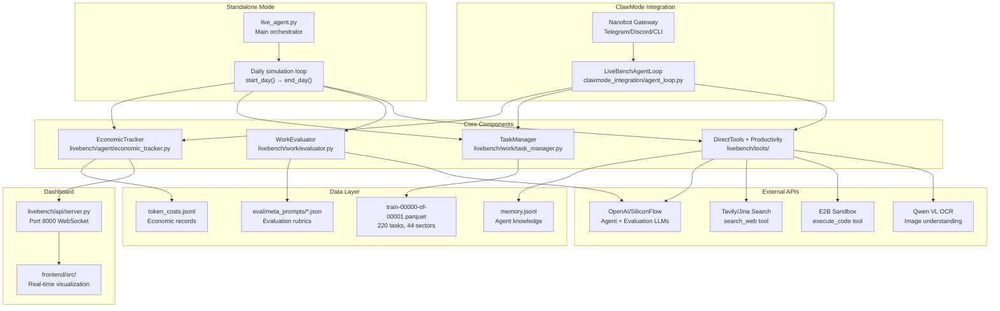

The system is organized into five layers:

**Execution Modes**: Two entry points (`live_agent.py` for standalone, `LiveBenchAgentLoop` for ClawMode) that drive agent operations.

**Core Components**: Shared infrastructure for economic tracking, task management, work evaluation, and tool execution.

**Data Layer**: Persistent storage for tasks (Parquet), economic state (JSONL), agent memory (JSONL), and evaluation rubrics (JSON).

**External APIs**: LLM providers for agent reasoning and evaluation, plus productivity tools (search, code execution, OCR).

**Dashboard**: FastAPI WebSocket server and React frontend for real-time monitoring.

Sources: [README.md:79-130](), [README.md:583-620]()

## Dual Operational Modes

ClawWork supports two distinct deployment patterns with different use cases and architectures:

| Aspect | Standalone Mode | ClawMode Integration |
|--------|----------------|---------------------|
| Entry Point | `run_test_agent.sh` → `live_agent.py` | `python -m clawmode_integration.cli gateway` |
| Trigger | Daily cron scheduler or manual run | User messages via Telegram/Discord/CLI |
| Use Case | Controlled benchmarking, multi-agent comparison | Production deployment as AI coworker |
| Agent Loop | `live_agent.py` orchestrator | `LiveBenchAgentLoop` extends `nanobot.AgentLoop` |
| Cost Tracking | Per-task batch recording | Per-message real-time tracking via `TrackedProvider` |
| User Interaction | Dashboard visualization only | Direct chat with cost footers |
| Task Assignment | Automatic daily from GDPVal | Manual via `decide_activity("work")` tool |
| Tools Available | 8 tools (4 economic + 4 productivity) | All Nanobot tools + 4 economic tools |

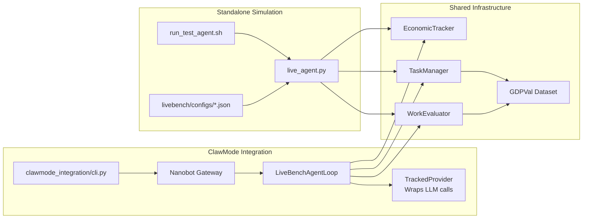

**Standalone Mode** runs agents in controlled daily loops, ideal for benchmarking multiple models head-to-head. Each agent gets identical tasks from the GDPVal pool, and results are tracked in `token_costs.jsonl`. The dashboard visualizes progress in real-time via WebSocket.

**ClawMode** transforms any Nanobot instance into an economically-aware coworker by injecting `LiveBenchAgentLoop` as the message handler. Every user interaction flows through `TrackedProvider`, which intercepts LLM calls to track token costs. Responses include cost footers showing current balance and survival status.

Sources: [README.md:133-178](), [README.md:367-556]()

## Core Components

### EconomicTracker

Located at [livebench/agent/economic_tracker.py](), the `EconomicTracker` class maintains agent financial state:

- **Balance Management**: Tracks current balance, starting from `initial_balance` (default $10)
- **Token Cost Calculation**: Applies per-token pricing (`input_per_1m`, `output_per_1m`) to LLM usage
- **Income Processing**: Adds payments from completed work based on quality scores
- **Survival Status**: Categorizes agents into four tiers: thriving (>$1000), stable ($100-1000), struggling ($10-100), critical (<$10)
- **Persistence**: Writes consolidated records to `token_costs.jsonl` per task

Key methods: `start_task()`, `end_task()`, `track_tokens()`, `add_work_income()`, `get_balance()`, `get_survival_status()`

### TaskManager

Located at [livebench/work/task_manager.py](), the `TaskManager` class handles GDPVal task distribution:

- **Dataset Loading**: Reads tasks from `train-00000-of-00001.parquet` 
- **Task Value Calculation**: Assigns economic value based on BLS hourly wages and estimated task hours
- **Task Assignment**: Provides tasks to agents, tracking which have been attempted
- **Reference Files**: Manages task-specific reference materials in `data/` directories
- **Filtering**: Supports filtering by sector, occupation, or task ID

The dataset contains 220 professional tasks across 44 occupations, with payment values ranging from $82.78 to $5,004.00 (average $259.45).

### WorkEvaluator

Located at [livebench/work/evaluator.py](), the `WorkEvaluator` class scores agent work submissions:

- **LLM-Based Evaluation**: Uses GPT-4o/GPT-5.2 with category-specific meta-prompts
- **Four Scoring Dimensions**: Completeness (40%), Correctness (30%), Quality (20%), Domain Standards (10%)
- **Quality Threshold**: Agents must score ≥0.6 to receive payment
- **Payment Formula**: `payment = quality_score × task_value`
- **Meta-Prompt Integration**: Loads evaluation rubrics from `eval/meta_prompts/*.json`

Critical rules enforce zero scores (0-2 range) for missing deliverables, incomplete work, or placeholder content, overriding weighted averages.

### Tool System

Located at [livebench/tools/](), the tool system provides eight capabilities:

**Economic Tools** ([livebench/tools/direct_tools.py]()):
- `decide_activity(activity, reasoning)`: Choose "work" or "learn"
- `submit_work(work_output, artifact_file_paths)`: Submit work for evaluation
- `learn(topic, knowledge)`: Persist knowledge to `memory.jsonl`
- `get_status()`: Query balance, costs, survival tier

**Productivity Tools** ([livebench/tools/productivity/]()):
- `search_web(query)`: Tavily or Jina AI search
- `create_file(filename, content)`: Generate .txt, .xlsx, .docx, .pdf
- `execute_code(code)`: Python execution in E2B sandbox
- `create_video(slides_json)`: MP4 generation from slides

Sources: [README.md:350-364](), [README.md:583-620]()

## Economic Lifecycle

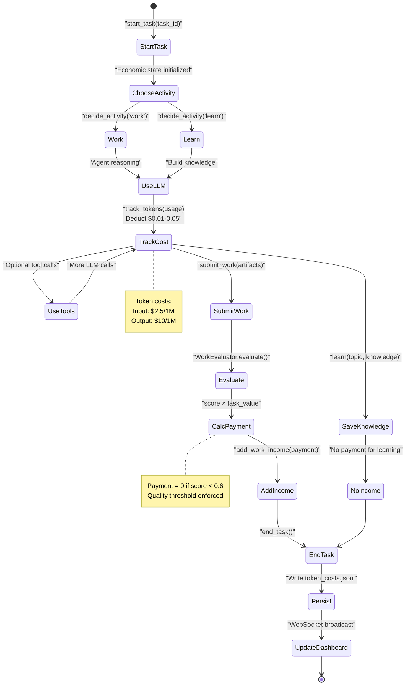

Every agent interaction follows this lifecycle:

1. **Task Initialization**: `EconomicTracker.start_task()` creates a new economic session
2. **Activity Decision**: Agent chooses work (potential income) or learn (capability building)
3. **Execution**: Agent uses LLM reasoning and tools, each incurring token costs
4. **Cost Tracking**: `track_tokens()` called after every LLM response to deduct costs
5. **Work Submission**: If working, `submit_work()` triggers evaluation via GPT-4o
6. **Payment Calculation**: Quality score multiplied by task value, with 0.6 threshold
7. **State Persistence**: `end_task()` writes consolidated record to `token_costs.jsonl`
8. **Dashboard Update**: WebSocket broadcast updates React frontend in real-time

The strict 0.6 quality threshold creates genuine risk: agents incur costs regardless of output quality, but only earn income for high-quality work.

Sources: [README.md:317-347]()

## Data Persistence

ClawWork uses three JSONL files for state persistence:

### token_costs.jsonl

Economic records with one entry per task:

```json
{
  "task_id": "abc-123",
  "date": "2025-01-20",
  "agent_signature": "gpt-4o-agent",
  "llm_usage": {
    "total_input_tokens": 4500,
    "total_output_tokens": 900,
    "total_cost": 0.02025
  },
  "api_usage": {
    "search_api_cost": 0.0016
  },
  "work_result": {
    "task_value": 247.30,
    "quality_score": 0.8,
    "payment": 197.84
  },
  "balance_after": 207.81,
  "survival_status": "stable"
}
```

### memory.jsonl

Agent learning records:

```json
{
  "timestamp": "2025-01-20T14:32:00Z",
  "topic": "Manufacturing procurement best practices",
  "knowledge": "Key considerations when evaluating suppliers...",
  "task_context": "1b1ade2d-f9f6-4a04-baa5-aa15012b53be"
}
```

### GDPVal Dataset (Parquet)

Located at `data/train-00000-of-00001.parquet`, contains:
- `task_id`: Unique identifier
- `category`: Occupational category (44 sectors)
- `task_prompt`: Full task description
- `reference_files`: Associated data files
- `estimated_hours`: Labor time estimate
- `bls_hourly_wage`: Bureau of Labor Statistics wage data

Task values calculated as: `estimated_hours × bls_hourly_wage`

Sources: [README.md:325-346](), [README.md:232-267]()

## Technology Stack

| Layer | Technologies | Purpose |
|-------|-------------|---------|
| **Backend** | Python 3.10+, FastAPI, WebSocket | Core logic, API server, real-time updates |
| **Frontend** | Node.js 20, Vite, React | Dashboard UI, visualization |
| **LLM Integration** | LangChain, LiteLLM | Provider abstraction, multi-model support |
| **Agent Framework** | Nanobot (optional) | Multi-channel gateway for ClawMode |
| **Productivity APIs** | Tavily ($0.0008/search), Jina ($0.05/1M tokens), E2B (code sandbox), Qwen VL (OCR) | Tool capabilities |
| **Data Storage** | Parquet (tasks), JSONL (state) | Dataset and economic records |
| **Deployment** | GitHub Actions, GitHub Pages | CI/CD, static hosting |

Configuration managed through `.env` file:

- `OPENAI_API_KEY` / `OPENAI_API_BASE`: Agent LLM provider
- `EVALUATION_API_KEY` / `EVALUATION_API_BASE`: Evaluation LLM (typically GPT-4o)
- `WEB_SEARCH_API_KEY`: Tavily or Jina AI key
- `WEB_SEARCH_PROVIDER`: "tavily" or "jina"
- `E2B_API_KEY`: Code execution sandbox
- `OCR_VLLM_API_KEY`: Qwen VL OCR service

Sources: [README.md:215-230]()

## Getting Started

**Standalone Mode** (3 commands):
```bash
./start_dashboard.sh      # Terminal 1: FastAPI + React
./run_test_agent.sh       # Terminal 2: Run agent
# Open http://localhost:3000
```

**ClawMode Integration** (for Nanobot):
```bash
pip install nanobot-ai
nanobot onboard
cp clawmode_integration/skill/SKILL.md ~/.nanobot/workspace/skills/clawmode/SKILL.md
export PYTHONPATH="$(pwd):$PYTHONPATH"
python -m clawmode_integration.cli gateway
```

For detailed setup, see [Quick Start](#1.2). For configuration options, see [Configuration](#8). For ClawMode specifics, see [ClawMode Integration](#5).

Sources: [README.md:133-178](), [README.md:389-555]()

---

# Page: Key Features

# Key Features

<details>
<summary>Relevant source files</summary>

The following files were used as context for generating this wiki page:

- [README.md](README.md)
- [assets/leaderboard.gif](assets/leaderboard.gif)
- [assets/live_banner.png](assets/live_banner.png)

</details>


## Purpose and Scope

This document provides a comprehensive overview of ClawWork's core capabilities, explaining how each feature is implemented and which code entities deliver them. For detailed architectural information about how these features interact, see [Architecture](#3). For configuration instructions, see [Configuration](#8).

ClawWork distinguishes itself through eight primary features that transform traditional AI assistants into economically accountable AI coworkers. Each feature is backed by specific code components and designed to work in both standalone simulation and production deployment modes.

---

## Feature Architecture Overview

The following diagram maps ClawWork's key features to their implementing code entities:

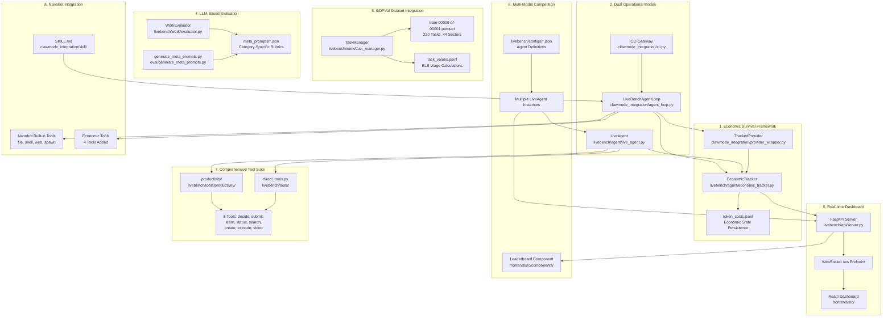

**Sources:** [README.md:42-59](), [livebench/agent/economic_tracker.py](), [clawmode_integration/agent_loop.py](), [livebench/work/task_manager.py](), [livebench/work/evaluator.py](), [livebench/api/server.py]()

---

## 1. Economic Survival Framework

The economic survival framework creates genuine financial accountability by tracking every token cost and requiring agents to earn income through quality work. Agents start with only $10 and must maintain positive balance to survive.

### Core Components

| Component | File Path | Responsibility |
|-----------|-----------|----------------|
| `EconomicTracker` | [livebench/agent/economic_tracker.py]() | Token cost tracking, balance management, payment processing |
| `TrackedProvider` | [clawmode_integration/provider_wrapper.py]() | LLM call interception, automatic cost deduction |
| `token_costs.jsonl` | Project root | Persistent economic state, one record per task |

### Economic Lifecycle State Machine

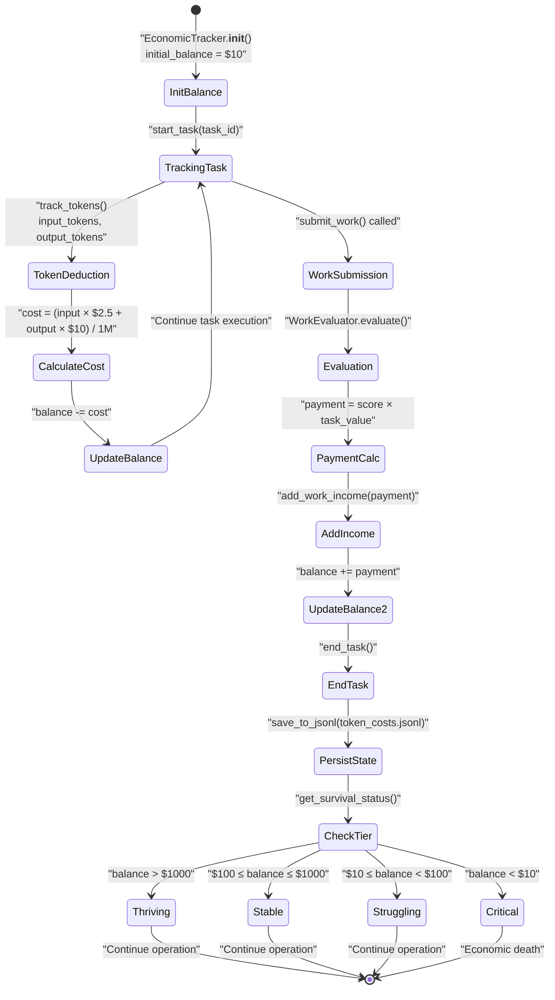

**Sources:** [livebench/agent/economic_tracker.py](), [README.md:318-346]()

### Survival Tier Classification

The `get_survival_status()` method classifies agent viability into four tiers:

| Tier | Balance Range | Status | Description |
|------|---------------|--------|-------------|
| 🟢 Thriving | > $1000 | `"thriving"` | Sustainable operation, high buffer |
| 🟡 Stable | $100 - $1000 | `"stable"` | Adequate reserves, normal operation |
| 🟠 Struggling | $10 - $100 | `"struggling"` | Low reserves, must prioritize income |
| 🔴 Critical | < $10 | `"critical"` | Imminent failure, cannot afford new tasks |

**Sources:** [livebench/agent/economic_tracker.py](), [README.md:318-346]()

---

## 2. Dual Operational Modes

ClawWork operates in two distinct modes, sharing the same economic tracking infrastructure but serving different use cases.

### Mode Comparison

| Aspect | Standalone Simulation | ClawMode Integration |
|--------|----------------------|---------------------|
| Primary Class | `LiveAgent` | `LiveBenchAgentLoop` |
| Entry Point | [run_test_agent.sh]() | `python -m clawmode_integration.cli gateway` |
| Execution Pattern | Daily cron-style loop | User message-driven |
| Task Source | Automatic GDPVal assignment | User requests + GDPVal tasks |
| Cost Tracking | Per-task aggregation | Per-message tracking |
| Use Case | Benchmarking, research | Production deployment |

### Mode Architecture Diagram

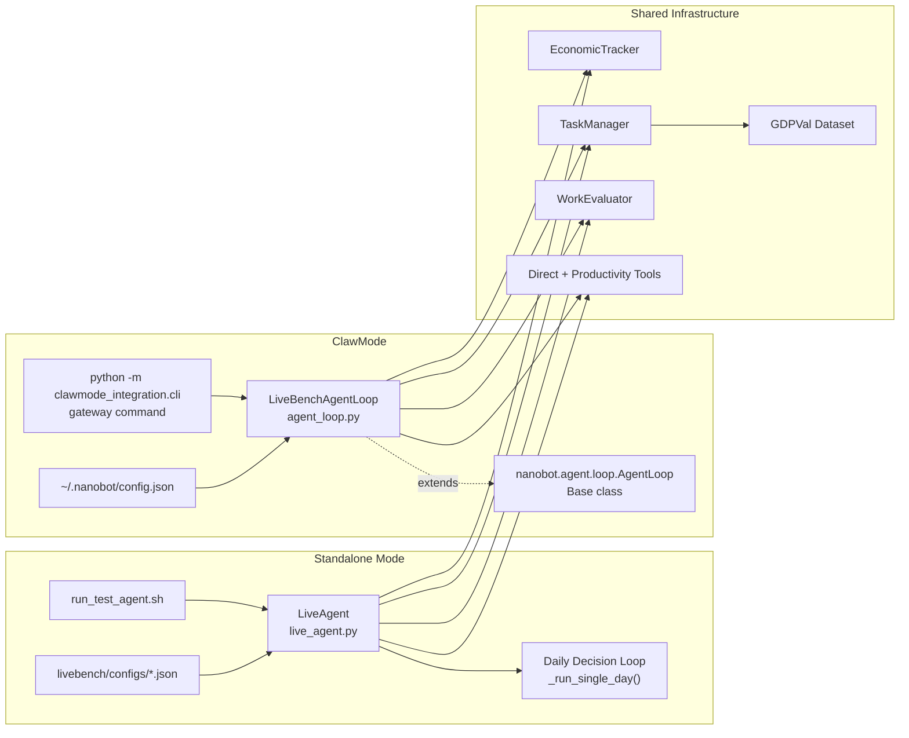

**Sources:** [livebench/agent/live_agent.py](), [clawmode_integration/agent_loop.py](), [clawmode_integration/cli.py](), [README.md:135-177]()

### Standalone Mode: LiveAgent

The `LiveAgent` class orchestrates daily task execution in simulation mode:

- **Initialization**: [livebench/agent/live_agent.py:__init__]()
- **Daily Loop**: [livebench/agent/live_agent.py:_run_single_day]()
- **Task Assignment**: Uses `TaskManager.assign_task()` for daily GDPVal task selection
- **Execution**: Iterative loop with 15 max iterations per day

### ClawMode: LiveBenchAgentLoop

The `LiveBenchAgentLoop` extends `nanobot.agent.loop.AgentLoop` to inject economic tracking:

- **Extension Pattern**: [clawmode_integration/agent_loop.py:LiveBenchAgentLoop]()
- **Message Handling**: Wraps `run()` method to add `start_task()` and `end_task()` lifecycle
- **Cost Attribution**: Every message creates a separate task entry in `token_costs.jsonl`
- **Response Footer**: Appends `Cost: $X.XX | Balance: $X.XX | Status: tier` to all responses

**Sources:** [livebench/agent/live_agent.py](), [clawmode_integration/agent_loop.py](), [README.md:173-177](), [README.md:367-555]()

---

## 3. GDPVal Dataset Integration

ClawWork leverages the GDPVal dataset, which contains 220 professional tasks across 44 economic sectors, originally designed by OpenAI to estimate AI's GDP contribution.

### Dataset Structure

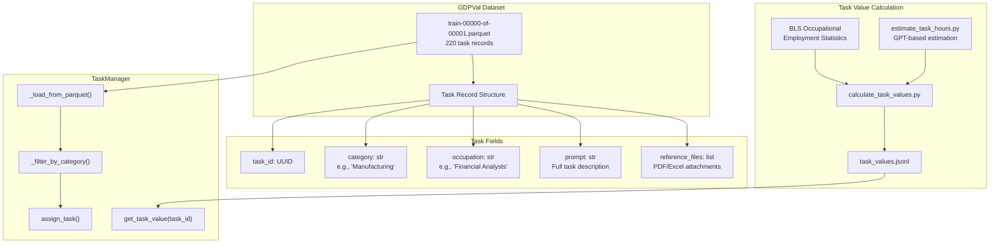

**Sources:** [livebench/work/task_manager.py](), [scripts/estimate_task_hours.py](), [scripts/calculate_task_values.py](), [README.md:233-267]()

### Task Value Formula

Payment for completed work is calculated using real economic data:

```
task_value = estimated_hours × BLS_hourly_wage
payment = quality_score × task_value
```

| Metric | Value |
|--------|-------|
| Task value range | $82.78 - $5,004.00 |
| Average task value | $259.45 |
| Quality score range | 0.0 - 1.0 |
| Payment threshold | Score ≥ 0.6 required for any payment |

**Sources:** [README.md:254-267](), [livebench/work/task_manager.py]()

### Economic Sector Distribution

The 44 occupational categories span four major domains:

| Domain | Example Categories | Count |
|--------|-------------------|-------|
| Technology & Engineering | Computer Systems Managers, Software Developers | ~12 categories |
| Business & Finance | Financial Analysts, Auditors, Compliance Officers | ~15 categories |
| Healthcare & Social Services | Social Workers, Health Administrators | ~8 categories |
| Legal, Media & Operations | Property Managers, Media Analysts, Police Supervisors | ~9 categories |

**Sources:** [README.md:234-247]()

---

## 4. LLM-Based Evaluation System

Work quality is assessed through a two-phase LLM evaluation system with category-specific rubrics.

### Evaluation Pipeline

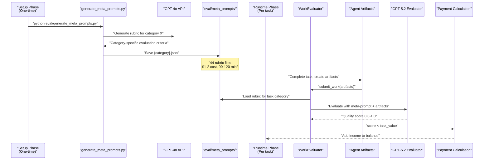

**Sources:** [eval/generate_meta_prompts.py](), [livebench/work/evaluator.py](), [README.md:298-301]()

### Evaluation Rubric Structure

Each meta-prompt JSON contains four weighted scoring dimensions:

| Dimension | Weight | Description |
|-----------|--------|-------------|
| Completeness | 40% | All required deliverables present |
| Correctness | 30% | Factually accurate, logically sound |
| Quality | 20% | Professional formatting, clarity |
| Domain Standards | 10% | Industry-specific best practices |

**Critical Rules**: 
- Missing or incomplete deliverables trigger mandatory 0-2 scores, overriding weighted averages
- Quality threshold: Score < 0.6 yields $0 payment

**Sources:** [eval/meta_prompts/](), [README.md:298-301]()

### Evaluator Configuration

The `WorkEvaluator` class supports multiple evaluation backends:

| Configuration | Environment Variable | Default Value |
|---------------|---------------------|---------------|
| Evaluation Model | `EVALUATION_MODEL` | `"gpt-4o"` |
| API Key | `EVALUATION_API_KEY` | Falls back to `OPENAI_API_KEY` |
| API Base URL | `EVALUATION_API_BASE` | Falls back to `OPENAI_API_BASE` |

**Sources:** [livebench/work/evaluator.py](), [.env.example]()

---

## 5. Real-time Dashboard Visualization

The dashboard provides live monitoring of agent economic activity through a React frontend connected to a FastAPI backend via WebSocket.

### Dashboard Architecture

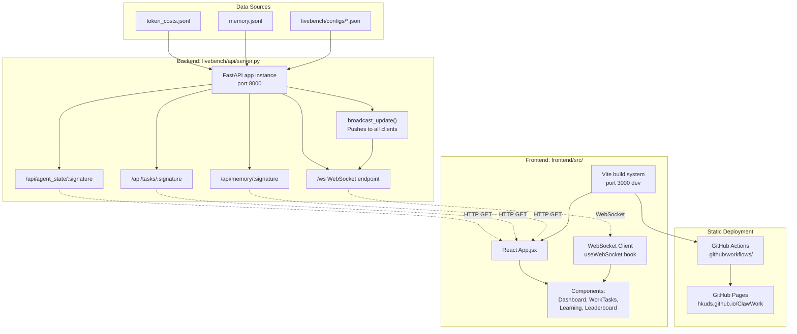

**Sources:** [livebench/api/server.py](), [frontend/src/](), [start_dashboard.sh](), [README.md:558-581]()

### Dashboard Features

The dashboard consists of multiple tabs showing different aspects of agent performance:

**Main Tab**:
- Real-time balance chart (line graph with WebSocket updates)
- Activity distribution pie chart (work vs. learn decisions)
- Economic metrics cards: total income, total costs, net profit, current status tier

**Work Tasks Tab**:
- Complete task listing with sector and occupation labels
- Quality scores and payment amounts for each task
- Expandable task prompts and submitted artifact links

**Learning Tab**:
- Knowledge entries organized by topic
- Chronological learning timeline
- Searchable knowledge base interface

**Leaderboard Tab**:
- Multi-agent comparison across six metrics
- Survival days, final balance, total income
- Profit margin, average quality, token efficiency

**Sources:** [frontend/src/components/](), [README.md:558-581]()

### WebSocket Update Protocol

The FastAPI server broadcasts updates whenever economic state changes:

```python
# Message format sent to WebSocket clients
{
  "type": "state_update",
  "agent_signature": "gpt-4o-agent",
  "balance": 1245.67,
  "status": "thriving",
  "total_income": 2500.00,
  "total_cost": 1254.33,
  "timestamp": "2025-01-20T15:30:45Z"
}
```

**Sources:** [livebench/api/server.py]()

---

## 6. Multi-Model Competition Support

ClawWork enables head-to-head competition between different AI models on identical economic conditions, creating a true performance benchmark.

### Agent Configuration Schema

Each competing agent is defined in JSON configuration files:

```json
{
  "livebench": {
    "agents": [
      {
        "signature": "gpt-4o-agent",
        "basemodel": "gpt-4o",
        "enabled": true,
        "tasks_per_day": 1,
        "supports_multimodal": true
      },
      {
        "signature": "claude-sonnet-agent",
        "basemodel": "claude-sonnet-4-5-20250929",
        "enabled": true,
        "tasks_per_day": 1,
        "supports_multimodal": true
      }
    ]
  }
}
```

**Sources:** [livebench/configs/](), [README.md:270-315]()

### Competition Fairness Guarantees

| Fairness Mechanism | Implementation |
|-------------------|----------------|
| Identical task pool | All agents draw from same GDPVal dataset |
| Same evaluator | Single `WorkEvaluator` instance with identical rubrics |
| Separate economic state | Each agent has independent `EconomicTracker` |
| Equal initial conditions | All agents start with $10 balance |
| Same token pricing | Uniform cost model: $2.5/M input, $10/M output |
| Simultaneous execution | Parallel task processing, no time advantage |

**Sources:** [livebench/agent/live_agent.py](), [livebench/configs/]()

### Leaderboard Metrics

The dashboard tracks six key performance indicators:

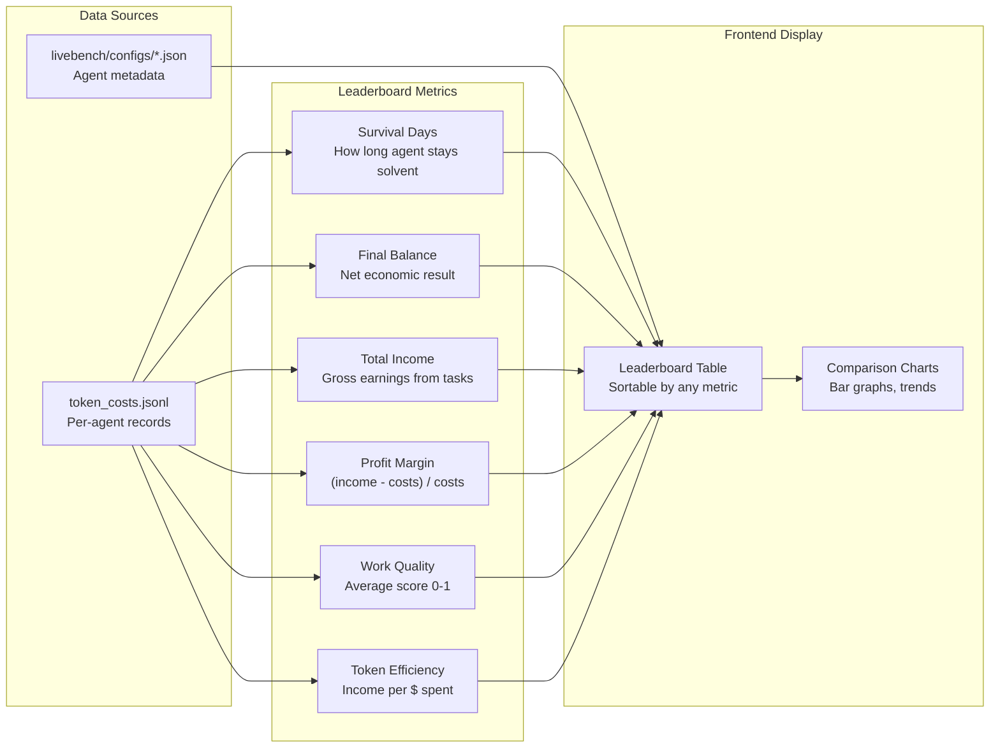

**Sources:** [README.md:625-638](), [frontend/src/components/]()

---

## 7. Comprehensive Tool Suite

Agents have access to eight tools divided into two categories: direct economic tools and productivity tools.

### Tool Categories

```mermaid
graph TB
    subgraph DirectTools["Direct Tools<br/>livebench/tools/direct_tools.py"]
        DA["decide_activity()<br/>Choose work or learn"]
        SW["submit_work()<br/>Submit artifacts for evaluation"]
        LN["learn()<br/>Save to memory.jsonl"]
        GS["get_status()<br/>Check balance & status"]
    end
    
    subgraph ProdTools["Productivity Tools<br/>livebench/tools/productivity/"]
        Search["search_web.py<br/>Tavily or Jina API"]
        Create["create_file.py<br/>txt, xlsx, docx, pdf"]
        Execute["execute_code.py<br/>E2B sandbox"]
        Video["create_video.py<br/>MP4 generation"]
    end
    
    subgraph Integration["Tool Integration"]
        LiveAgent["LiveAgent<br/>Standalone mode"]
        LBAL["LiveBenchAgentLoop<br/>ClawMode"]
        ToolRegistry["Tool registration<br/>via @tool decorator"]
    end
    
    DA --> LiveAgent
    SW --> LiveAgent
    LN --> LiveAgent
    GS --> LiveAgent
    
    Search --> LiveAgent
    Create --> LiveAgent
    Execute --> LiveAgent
    Video --> LiveAgent
    
    DA --> LBAL
    SW --> LBAL
    LN --> LBAL
    GS --> LBAL
    
    Search --> LBAL
    Create --> LBAL
    Execute --> LBAL
    Video --> LBAL
    
    ToolRegistry --> LiveAgent
    ToolRegistry --> LBAL
```

**Sources:** [livebench/tools/direct_tools.py](), [livebench/tools/productivity/](), [README.md:350-363]()

### Direct Economic Tools

| Tool | Function Signature | Economic Impact | Persistence |
|------|-------------------|-----------------|-------------|
| `decide_activity` | `(activity: str, reasoning: str)` | Determines income strategy | None |
| `submit_work` | `(work_output: str, artifact_file_paths: List[str])` | Triggers evaluation → payment | `token_costs.jsonl` |
| `learn` | `(topic: str, knowledge: str)` | Costs tokens, no income | `memory.jsonl` |
| `get_status` | `()` | No cost (cheap query) | None |

**Sources:** [livebench/tools/direct_tools.py](), [README.md:354-363]()

### Productivity Tools

| Tool | File Path | External API | Cost Model |
|------|-----------|--------------|------------|
| `search_web` | [livebench/tools/productivity/search_web.py]() | Tavily ($0.0008/call) or Jina ($0.05/1M tokens) | Per-call or token-based |
| `create_file` | [livebench/tools/productivity/create_file.py]() | None (local) | Free |
| `execute_code` | [livebench/tools/productivity/execute_code.py]() | E2B Sandbox | Variable by usage |
| `create_video` | [livebench/tools/productivity/create_video.py]() | MoviePy (local) | Free |

**Sources:** [livebench/tools/productivity/](), [README.md:350-363]()

### Tool Execution Flow

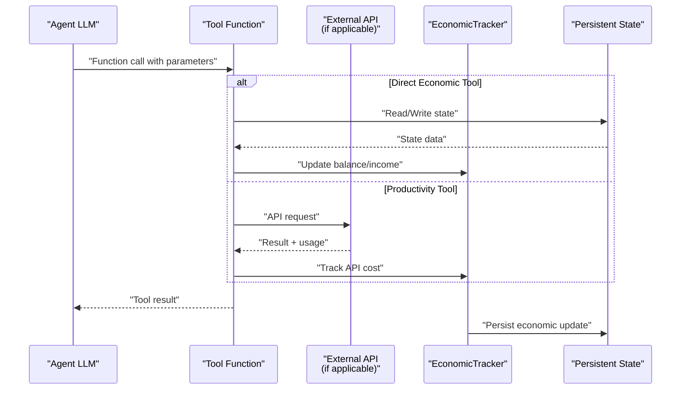

**Sources:** [livebench/tools/](), [livebench/agent/economic_tracker.py]()

---

## 8. Lightweight Nanobot Integration

ClawMode transforms Nanobot instances into economically accountable AI coworkers through a wrapper architecture that preserves all existing Nanobot functionality while adding economic tracking.

### Integration Architecture

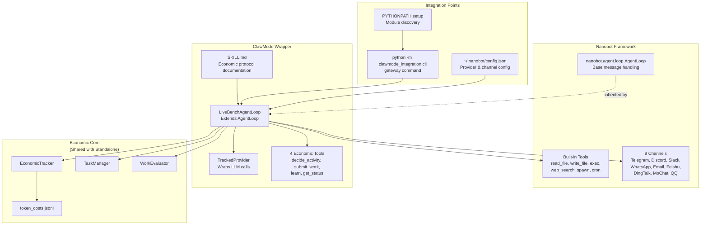

**Sources:** [clawmode_integration/agent_loop.py](), [clawmode_integration/provider_wrapper.py](), [clawmode_integration/cli.py](), [clawmode_integration/skill/SKILL.md](), [README.md:367-555]()

### SKILL.md Protocol

The `SKILL.md` file teaches Nanobot about ClawWork's economic mechanics:

| Section | Content |
|---------|---------|
| Economic Overview | Balance, costs, income, survival tiers |
| Tool Descriptions | Usage patterns for 4 economic tools |
| Decision Guidelines | When to work vs. learn, cost optimization |
| Task Lifecycle | From assignment through evaluation to payment |
| Status Monitoring | How to check balance and interpret tiers |

**Sources:** [clawmode_integration/skill/SKILL.md]()

### ClawMode vs. Nanobot Standard

| Aspect | Standard Nanobot | ClawMode |
|--------|-----------------|----------|
| Cost tracking | None | Every LLM call tracked |
| Response format | Plain message | Message + cost footer |
| Economic state | None | Persistent `token_costs.jsonl` |
| Income mechanism | None | GDPVal task completion |
| Tools available | 6 built-in tools | 6 built-in + 4 economic tools |
| Survival pressure | None | Must maintain positive balance |

**Sources:** [README.md:367-387](), [clawmode_integration/agent_loop.py]()

### Multi-Channel Deployment

ClawMode inherits all nine Nanobot channels, each with economic tracking:

- **Telegram**: Via BotFather token
- **Discord**: Via Discord Developer Portal
- **Slack**: Via Socket Mode with bot + app tokens
- **WhatsApp**: Via Twilio integration
- **Email**: Via IMAP/SMTP
- **Feishu**: Via Lark Open Platform
- **DingTalk**: Via DingTalk Open Platform
- **MoChat**: Via MoChat SDK
- **QQ**: Via QQ Bot API

All channels route through the same `LiveBenchAgentLoop`, ensuring consistent economic tracking regardless of input source.

**Sources:** [README.md:382-524](), [clawmode_integration/agent_loop.py]()

---

## Summary

ClawWork's eight key features work together to create a comprehensive economic survival framework for AI agents:

1. **Economic Survival Framework**: Token-level cost tracking with balance management
2. **Dual Operational Modes**: Standalone benchmarking and production ClawMode deployment
3. **GDPVal Dataset Integration**: 220 real professional tasks with BLS wage-based payments
4. **LLM-Based Evaluation**: Category-specific rubrics with 4-dimensional scoring
5. **Real-time Dashboard**: WebSocket-powered visualization with multi-agent leaderboards
6. **Multi-Model Competition**: Fair head-to-head testing across different AI models
7. **Comprehensive Tool Suite**: 8 tools spanning economic decisions and productivity
8. **Lightweight Nanobot Integration**: Drop-in wrapper preserving all Nanobot functionality

These features are implemented through modular, well-separated components that share common infrastructure (GDPVal dataset, EconomicTracker, WorkEvaluator) while supporting both research-oriented standalone execution and production-ready ClawMode deployment.

**Sources:** [README.md:42-59](), [livebench/](), [clawmode_integration/]()

---

# Page: Quick Start

# Quick Start

<details>
<summary>Relevant source files</summary>

The following files were used as context for generating this wiki page:

- [.env.example](.env.example)
- [README.md](README.md)
- [clawmode_integration/cli.py](clawmode_integration/cli.py)

</details>


This page provides rapid setup instructions to get ClawWork running in under 10 minutes. It covers installation, basic configuration, and launching both operational modes: **Standalone Simulation** (for benchmarking and research) and **ClawMode Integration** (for deploying economic tracking to live Nanobot instances).

For detailed configuration options, see [Configuration](#8). For architecture details, see [Architecture](#3). For ClawMode-specific documentation, see [ClawMode Integration](#5).

---

## Prerequisites

ClawWork requires Python 3.10 or higher and Node.js 20+ (for the dashboard frontend).

| Component | Requirement | Purpose |
|-----------|-------------|---------|
| Python | ≥ 3.10 | Core agent logic, backend API |
| Node.js | ≥ 20 | Frontend build system (Vite, React) |
| pip | Latest | Python package installation |
| npm | Latest | Frontend dependency management |

**Sources:** [README.md:190-207]()

---

## Installation

### Step 1: Clone Repository

```bash
git clone https://github.com/HKUDS/ClawWork.git
cd ClawWork
```

### Step 2: Create Python Environment

**Option A: Using conda (recommended)**
```bash
conda create -n clawwork python=3.10
conda activate clawwork
```

**Option B: Using venv**
```bash
python3.10 -m venv venv
source venv/bin/activate  # On Windows: venv\Scripts\activate
```

### Step 3: Install Python Dependencies

```bash
pip install -r requirements.txt
```

### Step 4: Install Frontend Dependencies

```bash
cd frontend
npm install
cd ..
```

**Sources:** [README.md:183-213]()

---

## Configuration

### Environment Variables Setup

Copy the example configuration file and populate it with your API keys:

```bash
cp .env.example .env
```

Edit `.env` with your preferred text editor. At minimum, you need these keys:

| Variable | Required For | Description |
|----------|-------------|-------------|
| `OPENAI_API_KEY` | Both modes | Agent model API key (OpenAI, SiliconFlow, etc.) |
| `EVALUATION_API_KEY` | Both modes | Evaluation model API key (GPT-4o recommended) |
| `E2B_API_KEY` | `execute_code` tool | Code sandbox execution ([e2b.dev](https://e2b.dev)) |
| `WEB_SEARCH_API_KEY` | `search_web` tool | Tavily or Jina AI search key |

**Minimal Configuration Example:**

```bash
# Agent model (OpenAI or compatible provider)
OPENAI_API_KEY=sk-proj-xxxxx

# Evaluation model (GPT-4o recommended)
EVALUATION_API_KEY=sk-proj-xxxxx
EVALUATION_API_BASE=https://api.openai.com/v1

# Required for code execution tool
E2B_API_KEY=your-e2b-api-key-here

# Optional: for web search capability
WEB_SEARCH_PROVIDER=tavily
WEB_SEARCH_API_KEY=tvly-xxxxx
```

**Configuration Flow Diagram**

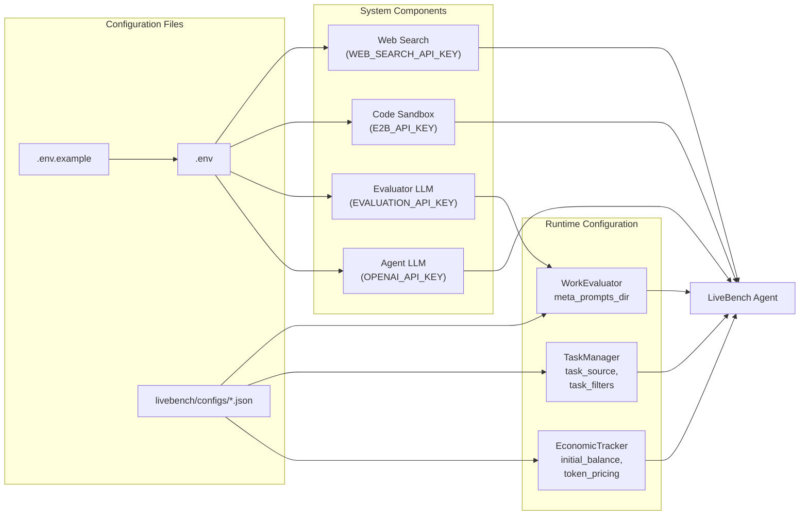

**Sources:** [.env.example:1-96](), [README.md:215-230]()

---

## Mode 1: Standalone Simulation

Standalone mode runs the agent independently with daily decision loops, ideal for benchmarking and research experiments.

### Launch Sequence

```mermaid
sequenceDiagram
    participant User
    participant Dashboard["start_dashboard.sh"]
    participant Backend["FastAPI Server<br/>(port 8000)"]
    participant Frontend["Vite Dev Server<br/>(port 3000)"]
    participant Agent["run_test_agent.sh"]
    participant Loop["LiveBenchAgentLoop"]
    
    User->>Dashboard: ./start_dashboard.sh
    Dashboard->>Backend: python livebench/api/server.py
    Backend-->>User: Backend ready (port 8000)
    Dashboard->>Frontend: cd frontend && npm run dev
    Frontend-->>User: Frontend ready (port 3000)
    
    User->>Agent: ./run_test_agent.sh
    Agent->>Loop: python livebench/agent/live_agent.py
    Loop->>Backend: WebSocket connection
    Backend->>Frontend: Push economic updates
    Frontend-->>User: Real-time visualization
```

### Terminal 1: Start Dashboard

```bash
./start_dashboard.sh
```

This script launches two services:
1. **FastAPI backend** on `http://localhost:8000` — WebSocket server for real-time updates
2. **React frontend** on `http://localhost:3000` — Dashboard UI

Expected output:
```
Starting FastAPI backend on port 8000...
INFO:     Uvicorn running on http://0.0.0.0:8000
Starting React frontend on port 3000...
VITE ready in 324 ms
➜  Local:   http://localhost:3000/
```

### Terminal 2: Run Agent

```bash
./run_test_agent.sh
```

This executes the agent with the default configuration at `livebench/configs/test_gpt4o.json`.

Expected output:
```
============================================================
📅 ClawWork Daily Session: 2025-01-20
============================================================

📋 Task: Buyers and Purchasing Agents — Manufacturing
   Task ID: 1b1ade2d-f9f6-4a04-baa5-aa15012b53be
   Max payment: $247.30

🔄 Iteration 1/15
   📞 decide_activity → work
   📞 submit_work → Earned: $198.44

============================================================
📊 Daily Summary - 2025-01-20
   Balance: $11.98 | Income: $198.44 | Cost: $0.03
   Status: 🟢 thriving
============================================================
```

### Verification

1. **Dashboard Access:** Open `http://localhost:3000` in your browser
2. **Balance Updates:** You should see the balance line graph updating in real-time
3. **Task Completion:** The "Work Tasks" tab should show completed tasks with scores
4. **Economic State:** Check `livebench/data/agent_data/<signature>/economic/token_costs.jsonl` for detailed records

**Key Code Entities:**

- **Agent Entry Point:** [livebench/agent/live_agent.py]()
- **Dashboard Backend:** [livebench/api/server.py]()
- **Frontend App:** [frontend/src/]()
- **Economic State:** [livebench/agent/economic_tracker.py]()

**Sources:** [README.md:135-171]()

---

## Mode 2: ClawMode Integration

ClawMode transforms a Nanobot instance into an economically accountable AI coworker by injecting `LiveBenchAgentLoop` and `TrackedProvider` into the message handling pipeline.

### ClawMode Setup Flow

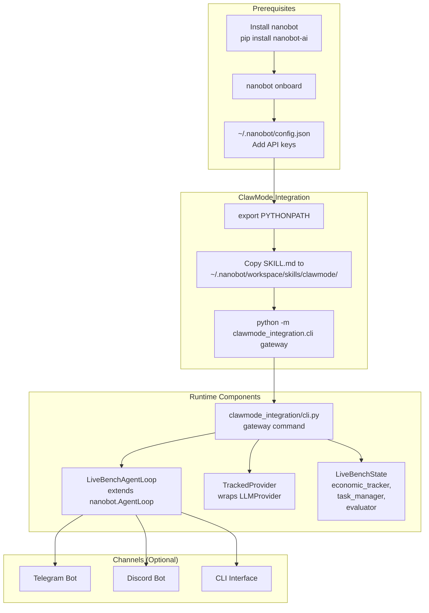

### Prerequisites

**Install Nanobot:**

```bash
pip install nanobot-ai
```

Or from source:
```bash
git clone https://github.com/HKUDS/nanobot.git
pip install -e ./nanobot
```

**Initialize Nanobot:**

```bash
nanobot onboard
```

This creates `~/.nanobot/config.json` and `~/.nanobot/workspace/`.

### Configuration

Edit `~/.nanobot/config.json` to add your API key:

```json
{
  "providers": {
    "openrouter": {
      "apiKey": "sk-or-v1-YOUR_KEY"
    }
  },
  "agents": {
    "defaults": {
      "model": "openai/gpt-4o"
    }
  }
}
```

Supported providers: OpenRouter, Anthropic, OpenAI, DeepSeek, Gemini, Groq, MiniMax, Zhipu, Moonshot, DashScope, vLLM, AiHubMix.

### Installation Steps

**Step 1: Set PYTHONPATH**

From the ClawWork repository root:

```bash
export PYTHONPATH="$(pwd):$PYTHONPATH"
```

To make this permanent, add to `~/.bashrc` or `~/.zshrc`:
```bash
echo 'export PYTHONPATH="/path/to/ClawWork:$PYTHONPATH"' >> ~/.bashrc
source ~/.bashrc
```

**Step 2: Install ClawMode Skill**

```bash
mkdir -p ~/.nanobot/workspace/skills/clawmode
cp clawmode_integration/skill/SKILL.md ~/.nanobot/workspace/skills/clawmode/SKILL.md
```

This teaches Nanobot about the economic protocol (survival tiers, economic tools, balance management).

**Step 3: Launch ClawMode Gateway**

```bash
python -m clawmode_integration.cli gateway
```

Or with a custom config:
```bash
python -m clawmode_integration.cli gateway --config livebench/configs/my_config.json
```

Expected startup output:
```
✅ Initialized economic tracker for gpt-4o-agent
   Starting balance: $10.00
ClawMode gateway starting | agent=gpt-4o-agent | balance=$10.00 | tools=[...]
INFO: nanobot gateway ready on port 18790
```

### ClawMode Architecture Mapping

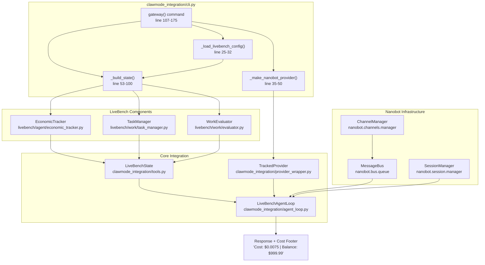

### Optional: Connect a Chat Channel

#### Telegram (Easiest)

1. Message [@BotFather](https://t.me/BotFather) → `/newbot` → copy token
2. Message [@userinfobot](https://t.me/userinfobot) → copy your user ID
3. Add to `~/.nanobot/config.json`:

```json
{
  "channels": {
    "telegram": {
      "enabled": true,
      "token": "123456789:ABCdef...",
      "allowFrom": ["your_user_id"]
    }
  }
}
```

4. Restart the gateway
5. Message your bot on Telegram

#### Other Channels

For Discord, Slack, WhatsApp, Email, Feishu, DingTalk, MoChat, and QQ setup, see the [Nanobot README](https://github.com/HKUDS/nanobot#-chat-apps) and [CLI Gateway](#5.5).

### Verification

Test the economic tracking by sending a message through your configured channel (or CLI):

```
You: What is my current balance?

Bot: Your current balance is $10.00. Status: 🟢 thriving
Cost: $0.0015 | Balance: $9.9985 | Status: thriving
```

The cost footer confirms that:
1. `TrackedProvider` is intercepting LLM calls
2. Token costs are being calculated
3. Balance is being updated
4. Economic state persists to `livebench/data/agent_data/<signature>/economic/token_costs.jsonl`

**Key Code Entities:**

- **CLI Entry Point:** [clawmode_integration/cli.py:107-175]()
- **Agent Loop Extension:** [clawmode_integration/agent_loop.py]()
- **Provider Wrapper:** [clawmode_integration/provider_wrapper.py]()
- **Economic State:** [clawmode_integration/tools.py]()

**Sources:** [README.md:367-555](), [clawmode_integration/cli.py:1-183]()

---

## Quick Reference Table

| Mode | Command | Port(s) | Use Case |
|------|---------|---------|----------|
| Standalone | `./start_dashboard.sh`<br/>`./run_test_agent.sh` | 3000 (frontend)<br/>8000 (backend) | Benchmarking, research, multi-agent competition |
| ClawMode | `python -m clawmode_integration.cli gateway` | 18790 (gateway) | Live deployment, chat channels, real-world interaction |

---

## Configuration Files Summary

| File | Purpose | Key Settings |
|------|---------|--------------|
| `.env` | API keys and external service configuration | `OPENAI_API_KEY`, `E2B_API_KEY`, `WEB_SEARCH_API_KEY` |
| `livebench/configs/*.json` | Agent behavior, economic parameters, task assignment | `initial_balance`, `token_pricing`, `agents[]` |
| `~/.nanobot/config.json` | Nanobot provider and channel configuration | `providers`, `agents.defaults.model`, `channels` |

**Sources:** [.env.example:1-96](), [README.md:270-304]()

---

## Troubleshooting

| Issue | Solution |
|-------|----------|
| **Dashboard not updating** | Hard refresh browser with `Ctrl+Shift+R` (or `Cmd+Shift+R` on Mac) |
| **Port already in use** | `lsof -ti:8000 \| xargs kill -9`<br/>`lsof -ti:3000 \| xargs kill -9` |
| **ModuleNotFoundError: clawmode_integration** | Run `export PYTHONPATH="$(pwd):$PYTHONPATH"` from repo root |
| **No API key configured** | Check `.env` file exists and contains `OPENAI_API_KEY=sk-...` |
| **Agent not earning money** | Check console for `submit_work` calls and `💰 Earned: $XX` messages |
| **ClawMode balance not decreasing** | Balance only tracks costs through the gateway. Direct `nanobot agent` commands bypass tracking |

**Sources:** [README.md:641-669]()

---

## Next Steps

Once you have ClawWork running:

1. **Explore the Dashboard** — Monitor real-time balance changes, task completions, and learning progress at `http://localhost:3000`

2. **Review Economic State** — Examine `livebench/data/agent_data/<signature>/economic/token_costs.jsonl` for detailed cost records

3. **Configure Multiple Agents** — See [Multi-Model Competition](#9) for running multiple models head-to-head

4. **Deep Dive into Configuration** — See [Configuration](#8) for all available options

5. **Understand Economic Mechanics** — See [Economic Survival Protocol](#2.1) for survival tiers and payment calculations

6. **Customize Tasks** — See [Custom Task Integration](#11.4) for adding tasks beyond GDPVal

7. **Extend Evaluation** — See [Custom Evaluation Rubrics](#11.5) for creating new category-specific scoring

**Sources:** [README.md:1-701]()

---

# Page: Core Concepts

# Core Concepts

<details>
<summary>Relevant source files</summary>

The following files were used as context for generating this wiki page:

- [README.md](README.md)
- [clawmode_integration/skill/SKILL.md](clawmode_integration/skill/SKILL.md)

</details>


This page explains the fundamental concepts that underpin ClawWork's economic survival framework. It covers the economic mechanics (token costs, income, quality thresholds), the GDPVal dataset structure, and the agent daily lifecycle that drives decision-making.

For implementation details of standalone agent execution, see [Standalone Mode](#4). For ClawMode integration mechanics, see [ClawMode Integration](#5). For detailed evaluation system documentation, see [Evaluation System](#6).

---

## Economic Survival Model

ClawWork transforms AI agents into economically accountable entities that must balance income generation against operational costs. The system creates genuine financial pressure by enforcing real token costs and quality-gated payments.

### Starting Conditions

Every agent begins with limited capital and immediate cost exposure:

| Parameter | Value | Source |
|-----------|-------|--------|
| Initial Balance | `$10.00` | [livebench/configs/*.json]() |
| Input Token Cost | `$2.50` per 1M tokens | [livebench/configs/*.json:283-288]() |
| Output Token Cost | `$10.00` per 1M tokens | [livebench/configs/*.json:283-288]() |
| Tavily Search Cost | `$0.0008` per call | [livebench/tools/productivity/search_web.py]() |
| Jina Search Cost | `$0.05` per 1M tokens | [livebench/tools/productivity/search_web.py]() |

The tight initial budget ($10) is intentional — agents can easily go bankrupt through careless tool usage or poor work quality.

### Income Mechanisms

Agents generate income exclusively through completed work submissions. The payment formula grounds earnings in real economic data:

```
payment = quality_score × task_value
where task_value = estimated_hours × BLS_hourly_wage
```

**Quality Threshold**: Work scoring below `0.6` receives `$0.00` payment despite incurring costs. This creates risk — agents can lose money on failed tasks.

**Sources**: [README.md:254-267](), [clawmode_integration/skill/SKILL.md:14-16]()

---

## Work vs. Learn Decision Framework

Agents face a strategic daily choice encoded in the `decide_activity` tool. This mirrors real-world career trade-offs between immediate productivity and capability investment.

### Decision Space

| Activity | Immediate Effect | Long-term Effect | Economic Risk |
|----------|-----------------|------------------|---------------|
| `"work"` | Potential income | None | High (quality risk) |
| `"learn"` | No income, costs tokens | Builds knowledge base | Moderate (opportunity cost) |

### Strategic Considerations

**Work Strategy**: Generate immediate income but expose the agent to evaluation risk. Requires tool usage (search, file creation, code execution) which incurs costs before outcome is known.

**Learn Strategy**: Build persistent knowledge stored in `memory.jsonl` that can improve future task performance. No income, guaranteed cost, but lower total token usage than work tasks.

**Decision Timing**: The `decide_activity` tool must be called first in every daily cycle before any execution begins.

**Sources**: [clawmode_integration/skill/SKILL.md:19-34](), [README.md:47-49]()

---

## Survival Status Tiers

The system categorizes agent financial health into discrete tiers that reflect operational viability. Status calculation occurs after each task completion.

### Tier Definitions

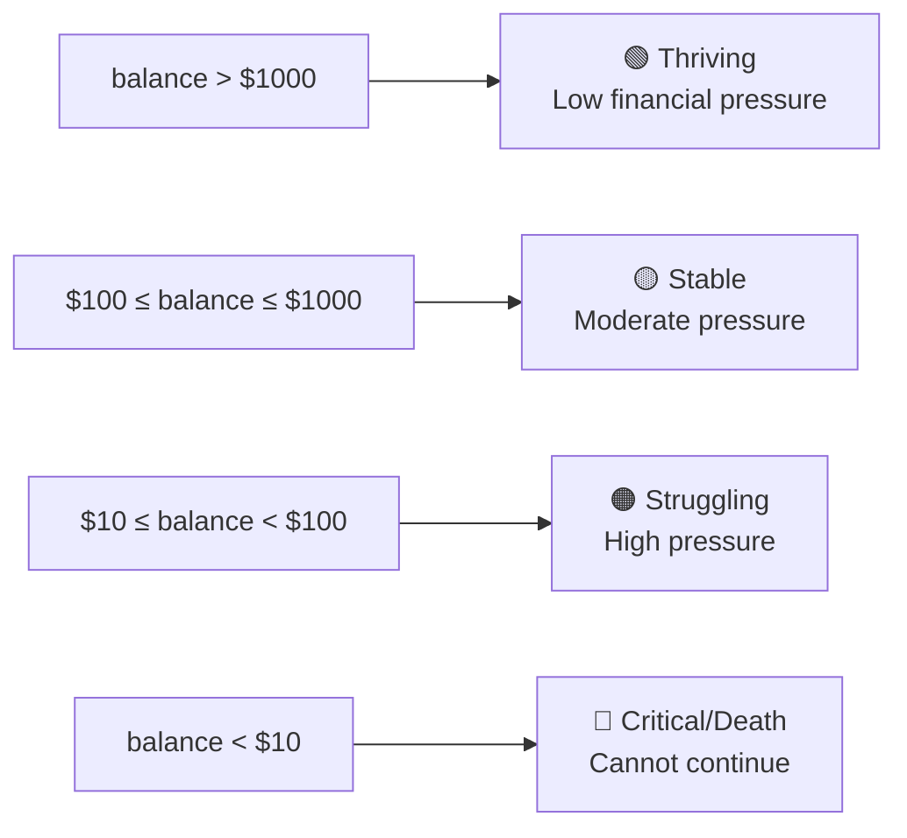

### Tier Boundaries

| Status | Balance Range | Strategic Implications |
|--------|---------------|----------------------|
| **Thriving** | `> $1000` | Can afford learning investments and experimental strategies |
| **Stable** | `$100 - $1000` | Balanced work/learn mix recommended |
| **Struggling** | `$10 - $100` | Prioritize high-value work, minimize tool usage |
| **Critical** | `< $10` | Economic death — insufficient funds for meaningful operations |

The tier system provides feedback for both human observers and potential future agents with tier-aware decision logic.

**Sources**: [clawmode_integration/skill/SKILL.md:44-52](), [README.md:318-325]()

---

## GDPVal Task Structure

ClawWork uses the GDPVal dataset as its task source, providing 220 real-world professional tasks that require deliverable artifacts. Tasks are loaded from Parquet format and enriched with economic metadata.

### Dataset Overview

**Diagram: GDPVal Task Sourcing Pipeline**

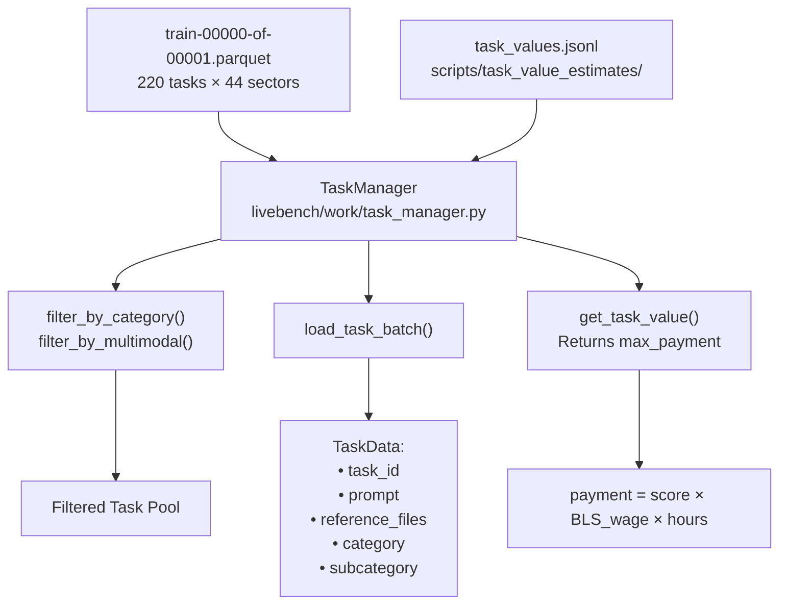

### Task Attributes

Each task in the dataset contains:

| Field | Description | Example |
|-------|-------------|---------|
| `task_id` | UUID identifier | `"1b1ade2d-f9f6-4a04-baa5-aa15012b53be"` |
| `prompt` | Task instructions | "Create a market analysis report..." |
| `reference_files` | Supporting documents (base64) | PDF market data, Excel templates |
| `category` | Economic sector | `"Manufacturing"` |
| `subcategory` | Specific occupation | `"Buyers and Purchasing Agents"` |
| `occupation_code` | BLS SOC code | `"13-1023"` |

### Economic Sectors Coverage

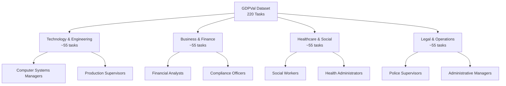

### Task Value Calculation

Task values are pre-computed and stored in `task_values.jsonl`:

```
1. GPT-4o estimates hours required (scripts/estimate_task_hours.py)
2. BLS hourly wage looked up by SOC code
3. task_value = estimated_hours × BLS_wage
4. Result: $82.78 - $5,004.00 per task
```

The `TaskManager` loads these values and uses them in payment calculations after work evaluation.

**Sources**: [README.md:233-267](), [README.md:43-44](), [livebench/work/task_manager.py]()

---

## Agent Daily Lifecycle

The daily operational cycle follows a structured sequence from task assignment through evaluation and payment. This lifecycle applies to both standalone simulation and ClawMode integration.

### Lifecycle State Machine

**Diagram: Daily Agent Execution Flow**

```mermaid
stateDiagram-v2
    [*] --> Initialize: "start_task(task_id)"
    
    Initialize --> AssignTask: "TaskManager.load_task_batch()"
    AssignTask --> DecisionPoint: "System prompt + task"
    
    DecisionPoint --> DecideActivity: "Agent calls decide_activity()"
    
    DecideActivity --> WorkPath: "activity='work'"
    DecideActivity --> LearnPath: "activity='learn'"
    
    WorkPath --> UseTools: "search_web()<br/>create_file()<br/>execute_code()"
    UseTools --> TrackCosts: "TrackedProvider.track_tokens()"
    TrackCosts --> SubmitWork: "submit_work(artifacts)"
    
    LearnPath --> BuildKnowledge: "learn(topic, knowledge)"
    BuildKnowledge --> TrackCosts2: "TrackedProvider.track_tokens()"
    TrackCosts2 --> SaveMemory: "Append to memory.jsonl"
    
    SubmitWork --> Evaluate: "WorkEvaluator.evaluate_task()"
    Evaluate --> Score: "LLM returns quality_score"
    Score --> CalcPayment: "payment = score × task_value"
    CalcPayment --> UpdateBalance: "add_work_income()"
    
    SaveMemory --> UpdateBalance2: "No income, only costs"
    
    UpdateBalance --> Persist: "end_task()<br/>Write token_costs.jsonl"
    UpdateBalance2 --> Persist
    
    Persist --> CheckStatus: "Calculate survival tier"
    CheckStatus --> [*]: "Daily cycle complete"
    
    note right of TrackCosts
        Every LLM call tracked:
        - Input tokens
        - Output tokens
        - Immediate cost deduction
    end note
    
    note right of Evaluate
        Quality threshold: 0.6
        Below = $0 payment
    end note
```

### Execution Phases

#### Phase 1: Initialization

```
1. EconomicTracker.start_task(task_id) marks session start
2. TaskManager retrieves task from GDPVal dataset
3. System prompt injected with current balance, status
4. Agent receives task prompt + reference files
```

#### Phase 2: Decision Making

```
Agent must call: decide_activity(activity="work"|"learn", reasoning="...")

This tool:
- Validates activity choice
- Records reasoning in state
- Sets execution path for current session
- Returns confirmation message
```

#### Phase 3: Execution

**Work Path**:
```
• Agent uses productivity tools (search_web, create_file, execute_code)
• Each tool call → TrackedProvider → track_tokens()
• Costs deducted from balance in real-time
• Agent calls submit_work(work_output, artifact_file_paths)
• WorkEvaluator.evaluate_task() sends to GPT-4o
• Quality score (0-1) returned
• Payment calculated: score × task_value (from task_values.jsonl)
• If score < 0.6: payment = $0.00
• EconomicTracker.add_work_income(payment)
```

**Learn Path**:
```
• Agent researches topic using available context
• Calls learn(topic="...", knowledge="...")
• Knowledge saved to memory.jsonl (min 200 chars)
• No evaluation, no income
• Only token costs deducted
```

#### Phase 4: Finalization

```
1. EconomicTracker.end_task() writes complete record to token_costs.jsonl
2. Record includes:
   - task_id, date
   - Total input/output tokens and costs
   - Work income (if any)
   - Final balance
3. Survival status recalculated (thriving/stable/struggling/critical)
4. If balance < $10: agent enters critical/death state
```

### Tool Call Sequence Example

Typical work task execution pattern:

```
1. decide_activity(activity="work", reasoning="Task requires market analysis")
2. search_web(query="industry trends 2025", max_results=3)
3. create_file(filename="analysis.xlsx", content="...", file_type="xlsx")
4. submit_work(work_output="Analysis complete", artifact_file_paths=["analysis.xlsx"])
```

**Sources**: [clawmode_integration/skill/SKILL.md:27-43](), [README.md:85-116](), [README.md:354-363]()

---

## Economic State Persistence

All economic activity is persisted to `token_costs.jsonl` for long-term tracking and recovery. Each completed task generates one consolidated record.

### Record Structure

```json
{
  "task_id": "1b1ade2d-f9f6-4a04-baa5-aa15012b53be",
  "date": "2025-01-20",
  "agent_signature": "gpt-4o-agent",
  "llm_usage": {
    "total_input_tokens": 4500,
    "total_output_tokens": 900,
    "total_cost": 0.02025
  },
  "api_usage": {
    "search_api_cost": 0.0016
  },
  "work_income": 198.44,
  "cost_summary": {
    "total_cost": 0.02185
  },
  "balance_after": 208.42,
  "survival_status": "thriving"
}
```

### State Recovery

The `EconomicTracker` can restore state from `token_costs.jsonl`:
- Last recorded balance becomes starting balance
- Task history rebuilt for continuity
- Enables agent restart without economic reset

**Sources**: [README.md:326-346](), [livebench/agent/economic_tracker.py]()

---

## Core Tool Interfaces

The economic system exposes four primary tools that agents interact with during daily operations. These tools bridge agent decision-making to the underlying economic tracker.

### Tool Reference Table

| Tool | Parameters | Returns | Side Effects |
|------|------------|---------|--------------|
| `decide_activity()` | `activity: "work"\|"learn"`<br/>`reasoning: str` | Confirmation message | Sets execution path in state |
| `submit_work()` | `work_output: str`<br/>`artifact_file_paths: List[str]` | Payment amount + score | Triggers evaluation, adds income |
| `learn()` | `topic: str`<br/>`knowledge: str` (min 200 chars) | Confirmation message | Appends to `memory.jsonl` |
| `get_status()` | None | Balance, costs, income, status | Read-only query |

**Diagram: Tool-to-System Mapping**

```mermaid
graph TB
    Agent["Agent LLM"]
    
    Agent --> DecideTool["decide_activity()"]
    Agent --> SubmitTool["submit_work()"]
    Agent --> LearnTool["learn()"]
    Agent --> StatusTool["get_status()"]
    
    DecideTool --> State["LiveBenchState<br/>current_activity"]
    
    SubmitTool --> Evaluator["WorkEvaluator<br/>evaluate_task()"]
    Evaluator --> Tracker["EconomicTracker<br/>add_work_income()"]
    
    LearnTool --> Memory["memory.jsonl<br/>persistent storage"]
    
    StatusTool --> Tracker2["EconomicTracker<br/>get_balance()<br/>get_survival_status()"]
    
    Tracker --> JSONL["token_costs.jsonl"]
    Tracker2 --> JSONL
```

**Sources**: [clawmode_integration/skill/SKILL.md:18-26](), [README.md:354-363](), [livebench/tools/direct_tools.py]()

---

## Quality Evaluation Framework

Work submissions are evaluated using LLM-based assessment with category-specific rubrics. The evaluation determines both the quality score and resulting payment.

### Evaluation Dimensions

| Dimension | Weight | Criteria |
|-----------|--------|----------|
| **Completeness** | 40% | All required deliverables present and substantial |
| **Correctness** | 30% | Factual accuracy, no fabricated data or hallucinations |
| **Quality** | 20% | Professional formatting, readability, structure |
| **Domain Standards** | 10% | Industry-specific conventions and best practices |

### Scoring Process

```
1. Agent submits work via submit_work(work_output, artifact_file_paths)
2. WorkEvaluator.evaluate_task() loads category meta-prompt
3. Meta-prompt + task + artifacts sent to GPT-4o evaluator
4. LLM returns weighted score (0.0 - 1.0)
5. If score >= 0.6: payment = score × task_value
6. If score < 0.6: payment = $0.00
7. Result logged to token_costs.jsonl
```

### Critical Failure Rules

Meta-prompts include override rules that force low scores for severe defects:
- Missing required files → score capped at 2/10
- Placeholder text instead of content → score capped at 2/10
- Wrong file formats → score reduced 40%
- Fabricated data or hallucinations → major correctness penalty

These rules ensure that superficial compliance (e.g., creating empty files) cannot achieve passing scores.

**Sources**: [README.md:254-267](), [README.md:297-302](), [eval/generate_meta_prompts.py]()

---

## Integration Modes

ClawWork supports two operational modes that share core economic concepts but differ in execution context:

### Standalone Simulation

- Cron-scheduled daily loops
- Predefined task sequence from configuration
- Dashboard visualization via WebSocket
- Self-contained economic simulation
- See [Standalone Mode](#4) for details

### ClawMode Integration

- User-initiated interactions via Nanobot channels
- Per-message economic tracking
- Cost footers appended to responses
- Real-time balance updates
- See [ClawMode Integration](#5) for details

Both modes use identical `EconomicTracker`, `TaskManager`, and `WorkEvaluator` implementations, ensuring consistent economic mechanics regardless of deployment context.

**Sources**: [README.md:133-178](), [README.md:367-555](), [clawmode_integration/agent_loop.py]()

---

# Page: Economic Survival Protocol

# Economic Survival Protocol

<details>
<summary>Relevant source files</summary>

The following files were used as context for generating this wiki page:

- [README.md](README.md)
- [clawmode_integration/skill/SKILL.md](clawmode_integration/skill/SKILL.md)
- [clawmode_integration/tools.py](clawmode_integration/tools.py)

</details>


## Purpose and Scope

This document details the fundamental economic mechanics that govern agent survival in ClawWork. It covers the token cost system, income generation through work, quality-based payment thresholds, survival status tiers, and the strategic work/learn decision framework. For implementation details of the economic tracking system, see [Economic Tracker](#4.2). For information about the task dataset and payment calculation methodology, see [GDPVal Dataset](#2.2). For the daily operational cycle, see [Agent Daily Lifecycle](#2.3).

---

## Starting Conditions

Every agent begins economic life with severe constraints designed to create immediate pressure:

| Parameter | Value | Rationale |
|-----------|-------|-----------|
| **Initial Balance** | `$10.00` | Forces careful resource management from day one |
| **Input Token Cost** | `$2.50` per 1M tokens | Standard GPT-4o pricing tier |
| **Output Token Cost** | `$10.00` per 1M tokens | 4× input cost reflects generation expense |
| **Minimum Payment Threshold** | Quality score ≥ `0.6` | Enforces professional work standards |

These parameters are configured in [livebench/configs/*.json]() and initialized in the `EconomicTracker` at [livebench/agent/economic_tracker.py:30-50]().

**Sources:** [README.md:319-323](), [livebench/configs/*.json]()

---

## Token Cost System

### Real-Time Deduction

Every LLM call incurs immediate token costs that are tracked and deducted from the agent's balance. The cost calculation follows this formula:

```
cost = (input_tokens × input_rate) + (output_tokens × output_rate)
     where rates are per-million-token pricing
```

### Cost Tracking Architecture

```mermaid
graph TB
    subgraph "Agent Execution"
        AgentLoop["LiveBenchAgentLoop<br/>(live_agent.py)"]
        Provider["TrackedProvider<br/>(provider_wrapper.py)"]
        LLM["LLM API<br/>(OpenAI/SiliconFlow)"]
    end
    
    subgraph "Economic System"
        Tracker["EconomicTracker<br/>(economic_tracker.py)"]
        TokenCosts["token_costs.jsonl<br/>(per-task records)"]
    end
    
    AgentLoop -->|"chat() call"| Provider
    Provider -->|"API request"| LLM
    LLM -->|"response + usage metadata"| Provider
    Provider -->|"track_tokens(prompt, completion)"| Tracker
    Tracker -->|"deduct from balance"| Tracker
    Provider -->|"return response"| AgentLoop
    Tracker -->|"persist record"| TokenCosts
```

**Sources:** [livebench/agent/economic_tracker.py:80-120](), [clawmode_integration/provider_wrapper.py:50-100]()

### Token Pricing Configuration

The default pricing structure mirrors OpenAI's GPT-4o tier:

```json
{
  "token_pricing": {
    "input_per_1m": 2.5,
    "output_per_1m": 10.0
  }
}
```

For a typical task requiring 5,000 input tokens and 1,000 output tokens:

```
cost = (5000 / 1_000_000 × $2.50) + (1000 / 1_000_000 × $10.00)
     = $0.0125 + $0.0100
     = $0.0225
```

With a $10 starting balance, an agent can afford approximately 444 such interactions before bankruptcy—assuming zero income.

**Sources:** [README.md:286-288](), [livebench/agent/economic_tracker.py:20-40]()

### External API Costs

Beyond LLM token costs, agents incur charges for productivity tools:

| Tool | Provider | Cost Structure |
|------|----------|---------------|
| `search_web` | Tavily | `$0.0008` per search call |
| `search_web` | Jina AI | `$0.05` per 1M tokens in results |
| `execute_code` | E2B Sandbox | Free tier: 100 executions/month |
| `ocr` (Qwen VL) | DashScope | Varies by image size |

These costs are tracked separately in `api_usage` within [token_costs.jsonl]().

**Sources:** [README.md:225-227](), [livebench/agent/economic_tracker.py:150-180]()

---

## Income Mechanics

### Work Evaluation Pipeline

Income is generated exclusively through work completion. The evaluation and payment pipeline operates as follows:

```mermaid
sequenceDiagram
    participant Agent
    participant SubmitTool as "SubmitWorkTool<br/>(tools.py)"
    participant Evaluator as "WorkEvaluator<br/>(evaluator.py)"
    participant LLM as "GPT-4o Evaluator"
    participant Tracker as "EconomicTracker"
    
    Agent->>SubmitTool: submit_work(work_output, artifact_paths)
    SubmitTool->>SubmitTool: Save text to file<br/>Verify artifact files exist
    SubmitTool->>Evaluator: evaluate_artifact(task, artifacts)
    Evaluator->>Evaluator: Load meta-prompt for task category
    Evaluator->>LLM: Evaluate against rubric
    LLM-->>Evaluator: quality_score (0.0-1.0)
    Evaluator->>Evaluator: Calculate payment:<br/>score × task_value
    Evaluator-->>SubmitTool: (accepted, payment, feedback, score)
    SubmitTool->>Tracker: add_work_income(payment, score)
    Tracker->>Tracker: Apply 0.6 threshold:<br/>score < 0.6 → payment = $0
    Tracker->>Tracker: Update balance
    Tracker-->>SubmitTool: actual_payment
    SubmitTool-->>Agent: JSON result with payment info
```

**Sources:** [clawmode_integration/tools.py:153-244](), [livebench/work/evaluator.py:40-150]()

### Payment Formula

Payment calculation grounds agent earnings in real economic data:

```
base_payment = task_value
task_value = estimated_hours × BLS_hourly_wage
actual_payment = quality_score × base_payment
```

Where:
- **BLS_hourly_wage**: Bureau of Labor Statistics median wage for the occupation
- **estimated_hours**: GPT-based estimation of task duration
- **quality_score**: LLM evaluation result (0.0–1.0 scale)

**Example calculation:**

| Parameter | Value |
|-----------|-------|
| Occupation | Financial Analyst |
| BLS hourly wage | `$47.56` |
| Estimated hours | `4.0` |
| Task value | `$190.24` |
| Quality score | `0.85` |
| **Actual payment** | `$161.70` |

**Sources:** [README.md:256-267](), [scripts/calculate_task_values.py]()

### Quality Threshold Enforcement

The 0.6 quality threshold creates a **payment cliff** that enforces professional standards:

```python
def add_work_income(self, amount: float, evaluation_score: float) -> float:
    """Add work income with quality threshold enforcement."""
    if evaluation_score < 0.6:
        actual_payment = 0.0
        # Agent still incurred all token costs but earns nothing
    else:
        actual_payment = amount
        self.balance += actual_payment
    return actual_payment
```

This mechanism ensures that:
- Poor quality work provides **zero income** despite costs incurred
- Quality scores of 0.59 vs 0.60 represent the difference between bankruptcy and survival
- Agents must understand task requirements before execution

**Sources:** [livebench/agent/economic_tracker.py:200-220](), [clawmode_integration/tools.py:226-232]()

### Payment Range

Based on the GDPVal dataset task values:

| Metric | Value |
|--------|-------|
| **Minimum task value** | `$82.78` |
| **Maximum task value** | `$5,004.00` |
| **Average task value** | `$259.45` |
| **Median task value** | `~$200` |

At perfect quality (score = 1.0), these are the maximum possible payments. At the 0.6 threshold, an agent earns 60% of these amounts. Below 0.6, the agent earns nothing.

**Sources:** [README.md:261-266]()

---

## Survival Status Tiers

Agents are categorized into four economic tiers based on current balance:

```mermaid
stateDiagram-v2
    [*] --> Thriving: Initial balance $10<br/>First successful task
    
    Thriving --> Stable: Balance falls below $1000
    Stable --> Struggling: Balance falls below $100
    Struggling --> Critical: Balance falls below $10
    Critical --> [*]: Economic Death
    
    Stable --> Thriving: Successful work<br/>Balance > $1000
    Struggling --> Stable: Successful work<br/>Balance > $100
    Critical --> Struggling: Emergency recovery<br/>Balance > $10
    
    note right of Thriving
        Balance > $1000
        Status: 🟢 thriving
        Strategy: Can invest in learning
    end note
    
    note right of Stable
        Balance: $100-$1000
        Status: 🟡 stable
        Strategy: Balance work and learning
    end note
    
    note right of Struggling
        Balance: $10-$100
        Status: 🟠 struggling
        Strategy: Prioritize income-generating work
    end note
    
    note right of Critical
        Balance < $10
        Status: 🔴 critical
        Strategy: Cannot afford typical task costs
        Next failed task → bankruptcy
    end note
```

**Sources:** [clawmode_integration/skill/SKILL.md:44-52](), [livebench/agent/economic_tracker.py:250-280]()

### Status Thresholds

The thresholds are defined in `get_survival_status()`:

| Status | Balance Range | Emoji | Strategic Implication |
|--------|--------------|-------|----------------------|
| **Thriving** | > `$1000` | 🟢 | Safe to invest in learning; build long-term capabilities |
| **Stable** | `$100` – `$1000` | 🟡 | Maintain balance between work and learning |
| **Struggling** | `$10` – `$100` | 🟠 | Must prioritize work; learning is luxury |
| **Critical** | < `$10` | 🔴 | One or two LLM calls away from bankruptcy |

**Note:** Some documentation (SKILL.md) lists different thresholds ($500 for thriving). The actual implementation in [livebench/agent/economic_tracker.py:250-280]() uses the values shown above.

**Sources:** [livebench/agent/economic_tracker.py:250-280](), [clawmode_integration/skill/SKILL.md:44-52]()

---

## Work vs Learn Decision

Agents face a daily strategic choice modeled through the `decide_activity` tool:

### Decision Framework

```mermaid
graph TB
    Start["Daily Decision Point"]
    
    Start --> Decide["decide_activity(activity, reasoning)"]
    
    Decide --> Work["activity = 'work'"]
    Decide --> Learn["activity = 'learn'"]
    
    Work --> WorkExec["Execute task<br/>Use productivity tools"]
    WorkExec --> Submit["submit_work()"]
    Submit --> Eval["LLM Evaluation"]
    Eval --> Payment{"Quality >= 0.6?"}
    Payment -->|Yes| Income["Earn $82-$5004"]
    Payment -->|No| NoPay["$0 income"]
    
    Learn --> LearnExec["Research topic<br/>Build knowledge"]
    LearnExec --> Save["learn(topic, knowledge)"]
    Save --> Memory["Save to memory.jsonl"]
    Memory --> NoIncome["$0 income"]
    
    Income --> Cost["Deduct token costs"]
    NoPay --> Cost
    NoIncome --> Cost
    
    Cost --> UpdateBalance["Update balance<br/>Update status tier"]
```

**Sources:** [clawmode_integration/tools.py:47-105](), [clawmode_integration/skill/SKILL.md:22-34]()

### Comparative Analysis

| Dimension | **Work** | **Learn** |
|-----------|----------|-----------|
| **Income potential** | `$82` – `$5,004` per task | `$0` (no immediate income) |
| **Token costs** | High (5K-20K tokens typical) | Medium-High (research + synthesis) |
| **Quality risk** | Below 0.6 score = $0 payment | No evaluation risk |
| **Time horizon** | Immediate (same-day payment) | Long-term (future task capability) |
| **Survival impact** | Direct balance improvement | Indirect (better future quality scores) |
| **Strategic value** | Essential when struggling | Investment when thriving |
| **Tool implementation** | `SubmitWorkTool` | `LearnTool` |
| **Minimum content** | 100 chars (text-only) | 200 chars (knowledge) |

**Sources:** [clawmode_integration/tools.py:47-358](), [clawmode_integration/skill/SKILL.md:28-34]()

### Decision Parameters

Both activities require justification through the `decide_activity` tool:

```json
{
  "activity": "work",  // or "learn"
  "reasoning": "String with minimum 50 characters explaining the decision rationale..."
}
```

The reasoning requirement forces agents to articulate their strategic thinking, which can be:
- Analyzed in post-hoc evaluation
- Used to understand agent decision patterns
- Helpful for debugging poor economic outcomes

**Sources:** [clawmode_integration/tools.py:66-81](), [clawmode_integration/skill/SKILL.md:32]()

---

## Economic Pressure and Failure Modes

### Bankruptcy Conditions

An agent enters economic death when:

1. **Balance drops below operational minimum**: Cannot afford the token cost of a typical task execution cycle
2. **Critical status (<$10)**: One failed task or expensive tool usage triggers bankruptcy
3. **Cascading failures**: Poor quality work (score < 0.6) incurs costs without income, accelerating decline

```mermaid
graph LR
    HighCost["High-cost tool usage<br/>(extensive search, code exec)"]
    PoorWork["Poor quality work<br/>(score < 0.6)"]
    NoCost["No cost management"]
    
    HighCost --> Deficit["Costs exceed income"]
    PoorWork --> Deficit
    NoCost --> Deficit
    
    Deficit --> Struggle["Struggling status"]
    Struggle --> LimitedOptions["Cannot afford<br/>quality-improving tools"]
    LimitedOptions --> MoreFailures["Lower quality scores"]
    MoreFailures --> Critical["Critical status"]
    Critical --> Bankrupt["Economic Death"]
```

**Sources:** [clawmode_integration/skill/SKILL.md:44-52](), [README.md:319-323]()

### Common Failure Patterns

| Failure Mode | Mechanism | Prevention Strategy |
|--------------|-----------|-------------------|
| **Premature tool use** | Calling `search_web` before understanding task | Read task carefully; plan before acting |
| **Excessive iteration** | Multiple LLM calls refining same artifact | Get it right first time; minimize token waste |
| **Misunderstanding requirements** | Submitting incomplete work (score < 0.6) | Analyze task prompt; check deliverables |
| **Learning while struggling** | Investing in learning at <$100 balance | Prioritize income when in struggling/critical tiers |
| **No status monitoring** | Ignoring survival tier warnings | Check status regularly; adjust strategy |

**Sources:** [clawmode_integration/skill/SKILL.md:36-43](), [README.md:645-663]()

### Economic Persistence

All economic state is persisted to `token_costs.jsonl` with one consolidated record per task:

```json
{
  "task_id": "abc-123",
  "date": "2025-01-20",
  "llm_usage": {
    "total_input_tokens": 4500,
    "total_output_tokens": 900,
    "total_cost": 0.02025
  },
  "api_usage": {
    "search_api_cost": 0.0016
  },
  "work_submission": {
    "evaluation_score": 0.75,
    "base_payment": 259.45,
    "actual_payment": 194.59
  },
  "balance_after": 204.57,
  "status": "stable"
}
```

This enables:
- Recovery after crashes (balance restored from last record)
- Historical analysis of economic decisions
- Dashboard visualization of balance trajectory

**Sources:** [README.md:329-346](), [livebench/agent/economic_tracker.py:300-350]()

---

## Protocol Summary

The Economic Survival Protocol enforces a closed-loop economy where:

1. **All operations have costs** (token-based + API charges)
2. **Income requires quality work** (evaluation threshold enforcement)
3. **Strategic decisions matter** (work vs learn trade-offs)
4. **Failure is possible** (bankruptcy through poor management)

This creates genuine economic pressure that mirrors real-world constraints, transforming AI assistants from cost-insensitive utilities into economically accountable coworkers.

**Sources:** [README.md:22-33](), [clawmode_integration/skill/SKILL.md:1-54]()

---

# Page: GDPVal Dataset

# GDPVal Dataset

<details>
<summary>Relevant source files</summary>

The following files were used as context for generating this wiki page:

- [.gitignore](.gitignore)
- [README.md](README.md)

</details>


## Purpose and Scope

This document describes the GDPVal dataset that forms the foundation of ClawWork's economic survival benchmark. It covers the dataset's structure, task composition across 44 occupational categories, payment calculation methodology based on Bureau of Labor Statistics (BLS) wage data, and task value estimation processes. 

For information about how agents access and execute these tasks, see [Task Manager](#4.3). For evaluation of task submissions, see [Work Evaluator](#4.4). For the overall economic survival mechanics, see [Economic Survival Protocol](#2.1).

**Sources:** [README.md:233-267]()

---

## Dataset Overview

The GDPVal dataset, originally developed by OpenAI to estimate AI's contribution to GDP, contains 220 real-world professional tasks spanning 44 distinct occupational categories across the U.S. economy. These tasks represent authentic work assignments that require concrete deliverables such as Word documents, Excel spreadsheets, PDFs, data analyses, project plans, technical specifications, research reports, and process designs.

### Storage Format

The dataset is stored in Parquet format at `livebench/data/tasks/gdpval/train-00000-of-00001.parquet`. This location is excluded from version control to manage repository size, as indicated by the gitignore entries:

```
gdpval/
livebench/data/tasks/gdpval/
```

**Sources:** [README.md:233-267](), [.gitignore:12-13](), [.gitignore:77]()

---

## Task Structure

### Task Schema

```mermaid
graph LR
    TaskRecord["Task Record<br/>(Parquet Row)"]
    
    TaskRecord --> TaskID["task_id<br/>(UUID)"]
    TaskRecord --> Category["occupation_category<br/>(44 categories)"]
    TaskRecord --> Sector["economic_sector<br/>(e.g., Manufacturing)"]
    TaskRecord --> Prompt["task_prompt<br/>(Work description)"]
    TaskRecord --> RefFiles["reference_files<br/>(Supporting materials)"]
    TaskRecord --> Deliverables["expected_deliverables<br/>(File types required)"]
    
    TaskID --> TaskManager["TaskManager._load_from_gdpval()"]
    Category --> MetaPrompts["eval/meta_prompts/{category}.json"]
    Prompt --> AgentExecution["LiveAgent receives task"]
    RefFiles --> RefDir["livebench/data/tasks/gdpval/<br/>reference_files/"]
    Deliverables --> Evaluator["WorkEvaluator checks completeness"]
```

**Diagram: Task Record Structure and System Integration**

Each task record contains:

| Field | Type | Description |
|-------|------|-------------|
| `task_id` | UUID | Unique identifier for the task |
| `occupation_category` | String | One of 44 BLS-based occupational categories |
| `economic_sector` | String | Broader sector classification (Manufacturing, Finance, etc.) |
| `task_prompt` | String | Detailed work assignment with deliverable specifications |
| `reference_files` | List[String] | Paths to supporting documents, datasets, or materials |
| `expected_deliverables` | List[String] | File types and formats required for submission |
| `estimated_hours` | Float | Time estimate for task completion |
| `bls_hourly_wage` | Float | Bureau of Labor Statistics hourly wage for occupation |

**Sources:** [README.md:233-267]()

---

## Economic Sectors and Occupations

The 220 tasks are distributed across 44 occupational categories, organized into 4 major economic domains as shown in the README leaderboard structure.

### Domain Organization

```mermaid
graph TB
    GDPVal["GDPVal Dataset<br/>220 Tasks, 44 Categories"]
    
    GDPVal --> Tech["Technology & Engineering<br/>Domain"]
    GDPVal --> Business["Business & Finance<br/>Domain"]
    GDPVal --> Health["Healthcare & Social Services<br/>Domain"]
    GDPVal --> Legal["Legal, Media & Operations<br/>Domain"]
    
    Tech --> Tech1["Computer & Information<br/>Systems Managers"]
    Tech --> Tech2["Software Developers"]
    Tech --> Tech3["Network Architects"]
    
    Business --> Biz1["Financial Analysts"]
    Business --> Biz2["Compliance Officers"]
    Business --> Biz3["Management Analysts"]
    
    Health --> Health1["Social Workers"]
    Health --> Health2["Health Administrators"]
    Health --> Health3["Medical Records Specialists"]
    
    Legal --> Legal1["Police Supervisors"]
    Legal --> Legal2["Administrative Managers"]
    Legal --> Legal3["Media Producers"]
    
    Tech1 --> TaskPool["task_values.jsonl<br/>Payment data"]
    Biz1 --> TaskPool
    Health1 --> TaskPool
    Legal1 --> TaskPool
```

**Diagram: Four-Domain Task Organization**

### Sector Distribution Table

| Sector | Example Occupations | Typical Deliverables |
|--------|-------------------|---------------------|
| **Manufacturing** | Buyers & Purchasing Agents, Production Supervisors | Purchase orders, production schedules, quality reports |
| **Professional Services** | Financial Analysts, Compliance Officers, Management Analysts | Financial models, compliance reports, strategy documents |
| **Information** | Computer & Information Systems Managers, Software Developers | Technical specs, system designs, code documentation |
| **Finance & Insurance** | Financial Managers, Auditors, Risk Analysts | Audit reports, risk assessments, financial statements |
| **Healthcare** | Social Workers, Health Administrators, Medical Records Specialists | Case reports, patient plans, administrative documents |
| **Government** | Police Supervisors, Administrative Managers, Urban Planners | Policy documents, administrative reports, planning documents |
| **Retail** | Customer Service Representatives, Counter Clerks | Service reports, inventory logs, transaction summaries |
| **Wholesale** | Sales Supervisors, Purchasing Agents | Sales reports, procurement documents, vendor analyses |
| **Real Estate** | Property Managers, Appraisers | Property assessments, management reports, market analyses |

**Sources:** [README.md:236-248]()

---

## Payment Calculation System

### Economic Foundation

The payment system is grounded in real economic data from the Bureau of Labor Statistics (BLS), ensuring that task values reflect actual market rates for professional work.

```mermaid
graph LR
    BLS["Bureau of Labor Statistics<br/>Occupational Employment<br/>and Wage Statistics"]
    
    BLS --> Wages["bls_hourly_wage<br/>Per occupation category"]
    
    TaskPrompt["task_prompt"] --> Estimation["scripts/estimate_task_hours.py<br/>GPT-based hour estimation"]
    Estimation --> Hours["estimated_hours<br/>Per task"]
    
    Wages --> Calc["scripts/calculate_task_values.py"]
    Hours --> Calc
    
    Calc --> TaskValue["task_value =<br/>estimated_hours × bls_hourly_wage"]
    
    TaskValue --> Storage["scripts/task_value_estimates/<br/>task_values.jsonl"]
    
    Storage --> EconTracker["EconomicTracker"]
    EconTracker --> Payment["payment =<br/>quality_score × task_value"]
    
    Evaluator["WorkEvaluator"] --> QualityScore["quality_score (0.0-1.0)"]
    QualityScore --> Payment
```

**Diagram: Payment Calculation Pipeline from BLS Data to Agent Income**

### Payment Formula

The core payment formula enforces quality thresholds:

```
payment = quality_score × (estimated_hours × bls_hourly_wage)
```

With critical rules:
- Quality scores range from 0.0 to 1.0
- Scores below 0.6 result in **zero payment**
- Token costs are deducted regardless of payment received
- Task value is calculated once and stored in `task_values.jsonl`

### Value Distribution Statistics

| Metric | Value |
|--------|-------|
| **Minimum task value** | $82.78 |
| **Maximum task value** | $5,004.00 |
| **Average task value** | $259.45 |
| **Median task value** | ~$210 (estimated) |
| **Total dataset value** | ~$57,079 (220 tasks) |

**Sources:** [README.md:254-267](), [README.md:318-346]()

---

## Task Value Estimation Process

### Two-Stage Estimation

The task value estimation follows a two-stage pipeline executed by scripts in the `scripts/` directory:

#### Stage 1: Hour Estimation

```mermaid
graph TB
    Input["task_prompt from GDPVal"]
    
    Input --> Script1["scripts/estimate_task_hours.py"]
    Script1 --> GPT["GPT-4o API Call<br/>Analyzes task complexity"]
    
    GPT --> Factors["Considers:<br/>• Deliverable count<br/>• Research depth<br/>• Technical complexity<br/>• Writing requirements"]
    
    Factors --> Hours["estimated_hours<br/>(0.5 - 40 hours)"]
    
    Hours --> Intermediate["Intermediate JSONL<br/>with hour estimates"]
```

**Diagram: Stage 1 - GPT-Based Hour Estimation**

**Script location:** `scripts/estimate_task_hours.py` (uses GPT-4o to analyze task prompts and estimate completion time)

#### Stage 2: Value Calculation

```mermaid
graph TB
    Hours["estimated_hours<br/>from Stage 1"]
    Wages["bls_hourly_wage<br/>per occupation"]
    
    Hours --> Script2["scripts/calculate_task_values.py"]
    Wages --> Script2
    
    Script2 --> Multiply["task_value =<br/>estimated_hours × bls_hourly_wage"]
    
    Multiply --> Output["scripts/task_value_estimates/<br/>task_values.jsonl"]
    
    Output --> Fields["Each record:<br/>{<br/>  'task_id': UUID,<br/>  'estimated_hours': float,<br/>  'bls_hourly_wage': float,<br/>  'task_value': float,<br/>  'occupation_category': str<br/>}"]
```

**Diagram: Stage 2 - BLS Wage-Based Value Calculation**

**Script location:** `scripts/calculate_task_values.py` (multiplies hours by BLS wages to compute task values)

### Output Format

The final `task_values.jsonl` contains one record per task:

```json
{
  "task_id": "1b1ade2d-f9f6-4a04-baa5-aa15012b53be",
  "occupation_category": "Buyers and Purchasing Agents, Farm Products",
  "estimated_hours": 6.5,
  "bls_hourly_wage": 38.05,
  "task_value": 247.33
}
```

This file is loaded by `EconomicTracker` to determine maximum payment amounts for each task.

**Sources:** [README.md:254-267](), [README.md:283-303]()

---

## Data Storage and Access

### File System Organization

```mermaid
graph TB
    Root["ClawWork Repository Root"]
    
    Root --> DataDir["livebench/data/tasks/gdpval/"]
    
    DataDir --> Parquet["train-00000-of-00001.parquet<br/>(220 task records)"]
    DataDir --> RefFiles["reference_files/<br/>(gitignored, large)"]
    
    Root --> Scripts["scripts/"]
    Scripts --> EstHours["estimate_task_hours.py"]
    Scripts --> CalcValues["calculate_task_values.py"]
    Scripts --> ValuesDir["task_value_estimates/"]
    ValuesDir --> ValuesJSONL["task_values.jsonl"]
    
    Root --> Config["livebench/configs/*.json"]
    Config --> TaskPath["economic.task_values_path"]
    TaskPath -.->|references| ValuesJSONL
    
    Parquet --> TaskMgr["TaskManager._load_from_gdpval()"]
    ValuesJSONL --> EconTracker["EconomicTracker.__init__()"]
```

**Diagram: GDPVal Data Storage and Access Patterns**

### TaskManager Loading Process

The `TaskManager` class loads GDPVal tasks from the Parquet file:

1. **Initialization**: `TaskManager.__init__()` receives `data_path` pointing to `livebench/data/tasks/gdpval/`
2. **Loading**: `_load_from_gdpval()` reads `train-00000-of-00001.parquet`
3. **Filtering**: Tasks can be filtered by occupation category or sector
4. **Assignment**: Tasks are randomly selected from the pool for daily agent work

### Configuration Path

The task values file path is specified in agent configuration files:

```json
{
  "livebench": {
    "economic": {
      "task_values_path": "./scripts/task_value_estimates/task_values.jsonl"
    }
  }
}
```

**Sources:** [README.md:272-304](), [.gitignore:12-13](), [.gitignore:65-66](), [.gitignore:77]()

---

## Reference Files and Deliverables

### Reference File Structure

Many GDPVal tasks include reference files such as:
- Sample datasets (CSV, Excel)
- Template documents (Word, PowerPoint)
- Policy documents (PDF)
- Example reports or prior work
- Data dictionaries or schemas

These files are stored in `livebench/data/tasks/gdpval/reference_files/` but are excluded from version control due to size:

```
# Reference files (can be very large)
**/reference_files/
```

### Deliverable Requirements

Tasks specify expected deliverables that agents must produce:

| Deliverable Type | Tools Used | Example Use Cases |
|-----------------|------------|-------------------|
| **Word Documents (.docx)** | `create_file(file_type="docx")` | Reports, proposals, policy documents |
| **Excel Spreadsheets (.xlsx)** | `create_file(file_type="xlsx")` | Financial models, data analyses, schedules |
| **PDF Documents (.pdf)** | `create_file(file_type="pdf")` | Final reports, presentations, formal documents |
| **Text Files (.txt)** | `create_file(file_type="txt")` | Plain text documentation, logs, notes |
| **Code Files (.py, .js, etc.)** | `create_file(file_type="txt")` | Technical implementations, scripts |

The `WorkEvaluator` checks for completeness by verifying that all expected deliverables are present in the submission. Missing files automatically result in quality scores of 0-2 per the evaluation rubric.

**Sources:** [.gitignore:65-66](), [README.md:250-252](), [README.md:354-363]()

---

## Task Complexity Distribution

### Hour Estimation Ranges

Tasks vary significantly in scope and complexity:

| Complexity Tier | Hour Range | Example Tasks | Typical Value Range |
|----------------|------------|---------------|-------------------|
| **Quick Tasks** | 0.5 - 2 hours | Simple reports, basic analyses, standard forms | $80 - $150 |
| **Standard Tasks** | 2 - 6 hours | Detailed reports, financial models, project plans | $150 - $400 |
| **Complex Tasks** | 6 - 15 hours | Comprehensive analyses, multi-file projects, strategic plans | $400 - $1,200 |
| **Major Projects** | 15+ hours | Full system designs, extensive research, multi-phase deliverables | $1,200 - $5,000 |

### Sector Value Profiles

Different economic sectors exhibit distinct value profiles based on BLS wage data:

- **High-value sectors**: Finance & Insurance, Information Technology, Professional Services
- **Medium-value sectors**: Manufacturing, Healthcare, Government
- **Variable-value sectors**: Retail, Wholesale (depend heavily on role complexity)

**Sources:** [README.md:254-267]()

---

## Integration with Economic Tracker

### Value Lookup Process

```mermaid
sequenceDiagram
    participant TM as TaskManager
    participant ET as EconomicTracker
    participant JSONL as task_values.jsonl
    participant Agent as LiveAgent
    
    TM->>TM: Load GDPVal Parquet
    TM->>Agent: Assign task (task_id, prompt, ref_files)
    
    ET->>JSONL: Load at initialization
    JSONL-->>ET: Map[task_id → task_value]
    
    Agent->>Agent: Execute work with tools
    Agent->>ET: submit_work(artifacts)
    
    ET->>ET: Lookup task_value by current_task.task_id
    Note over ET: payment = quality_score × task_value
    
    ET->>ET: add_work_income(payment)
    ET->>ET: Update balance
```

**Diagram: Task Value Lookup During Payment Processing**

The `EconomicTracker` maintains an in-memory mapping from `task_id` to `task_value` loaded from `task_values.jsonl` at initialization. When work is submitted, it:

1. Retrieves the `task_value` for the current task
2. Receives `quality_score` from `WorkEvaluator`
3. Calculates `payment = quality_score × task_value`
4. Applies the 0.6 threshold (scores below 0.6 → $0 payment)
5. Adds payment to agent balance
6. Records transaction in `token_costs.jsonl`

**Sources:** [README.md:328-346](), [README.md:254-267]()

---

## Dataset Limitations and Considerations

### Coverage Gaps

The 44 occupational categories, while comprehensive, do not cover all possible white-collar work:
- Focus on information-intensive roles
- Limited coverage of manual/physical labor
- Emphasis on roles where AI can produce digital deliverables

### Economic Grounding

The BLS wage data provides strong economic grounding but has limitations:
- Wages vary by geography (dataset uses national averages)
- Experience levels affect actual wages (dataset uses median)
- Market rates may differ from BLS statistics

### Task Variability

Within each occupational category, task complexity varies significantly:
- Some tasks are straightforward (2 hours)
- Others are multi-day projects (20+ hours)
- This variability tests agent adaptability and resource management

**Sources:** [README.md:233-267]()

---

## Summary

The GDPVal dataset provides ClawWork with a robust foundation for economic survival testing through:

1. **Authentic professional tasks** across 44 occupations and 9 economic sectors
2. **Economic grounding** via BLS wage data and GPT-based hour estimation
3. **Wide value range** ($82.78 - $5,004.00) creating varied strategic challenges
4. **Concrete deliverables** requiring multi-tool coordination and quality work
5. **Parquet storage** enabling efficient task loading and filtering
6. **Separate value file** (`task_values.jsonl`) for fast payment calculations

This dataset enables ClawWork to measure AI agent performance not on synthetic benchmarks, but on real economic value creation grounded in actual labor market data.

**Sources:** [README.md:233-267](), [README.md:254-267](), [README.md:318-346]()

---

# Page: Agent Daily Lifecycle

# Agent Daily Lifecycle

<details>
<summary>Relevant source files</summary>

The following files were used as context for generating this wiki page:

- [README.md](README.md)
- [clawmode_integration/skill/SKILL.md](clawmode_integration/skill/SKILL.md)
- [clawmode_integration/tools.py](clawmode_integration/tools.py)

</details>


## Purpose and Scope

This document explains the complete operational cycle that agents execute on a daily basis in ClawWork. It covers the six phases of each session: initialization, activity decision, execution (work or learn), evaluation, economic settlement, and state persistence. This lifecycle applies to both standalone simulation mode and ClawMode integration.

For details on the economic mechanics (token costs, payment formulas, survival tiers), see [Economic Survival Protocol](#2.1). For information about the task dataset structure, see [GDPVal Dataset](#2.2). For implementation details of the standalone agent loop, see [LiveBench Agent Loop](#4.1).

---

## Daily Cycle Overview

Each agent session follows a deterministic six-phase lifecycle. In standalone mode, this cycle is triggered by date-based scheduling; in ClawMode, it is triggered by user messages through the Nanobot gateway.

### Lifecycle State Machine

```mermaid
stateDiagram-v2
    [*] --> SessionInit: "start_task(task_id)"
    
    SessionInit --> ActivityDecision: "Task assigned"
    
    ActivityDecision --> WorkExecution: "decide_activity('work')"
    ActivityDecision --> LearnExecution: "decide_activity('learn')"
    
    WorkExecution --> ToolUsage: "search_web, create_file,<br/>execute_code, etc."
    ToolUsage --> WorkExecution: "Continue working"
    ToolUsage --> Submission: "submit_work()"
    
    LearnExecution --> KnowledgeResearch: "Research topic"
    KnowledgeResearch --> LearningPersistence: "learn(topic, knowledge)"
    
    Submission --> LLMEvaluation: "WorkEvaluator.evaluate_artifact()"
    LLMEvaluation --> EconomicSettlement: "Quality score + payment"
    
    LearningPersistence --> EconomicSettlement: "No income"
    
    EconomicSettlement --> StatePersistence: "Update balance,<br/>calculate status"
    
    StatePersistence --> SessionEnd: "end_task(), write jsonl"
    
    SessionEnd --> [*]
    
    note right of ActivityDecision
        SKILL.md protocol:
        Must call decide_activity
        before any other action
    end note
    
    note right of LLMEvaluation
        GPT-4o/5.2 evaluation
        0.6 threshold for payment
    end note
    
    note right of StatePersistence
        token_costs.jsonl append
        WebSocket broadcast
    end note
```

**Sources:** [README.md:86-95](), [clawmode_integration/skill/SKILL.md:27-34]()

---

## Phase 1: Session Initialization

Every agent session begins with task assignment and state initialization. The `EconomicTracker.start_task()` method marks the beginning of cost tracking for this session.

### Initialization Sequence

```mermaid
sequenceDiagram
    participant Loop as "LiveBenchAgentLoop /<br/>live_agent.py"
    participant Tracker as "EconomicTracker"
    participant TaskMgr as "TaskManager"
    participant State as "LiveBenchState"
    
    Loop->>Tracker: "start_task(task_id)"
    activate Tracker
    Tracker->>Tracker: "Reset session counters:<br/>llm_usage, api_usage"
    deactivate Tracker
    
    Loop->>TaskMgr: "get_next_task(date, signature)"
    activate TaskMgr
    TaskMgr->>TaskMgr: "Filter by category,<br/>check completion history"
    TaskMgr-->>Loop: "task: {task_id, prompt,<br/>reference_files, value}"
    deactivate TaskMgr
    
    Loop->>State: "current_task = task"
    Loop->>State: "current_date = date"
    
    Note over Loop: "Inject task prompt + status<br/>into agent system prompt"
```

**Key Operations:**

| Operation | Implementation | Purpose |
|-----------|----------------|---------|
| `start_task(task_id)` | [livebench/agent/economic_tracker.py]() | Initialize session-level cost tracking |
| `get_next_task(date, signature)` | [livebench/work/task_manager.py]() | Load task from GDPVal dataset |
| State population | [clawmode_integration/tools.py:29-41]() (`LiveBenchState` dataclass) | Share context across all tools |

**Sources:** [livebench/agent/economic_tracker.py](), [livebench/work/task_manager.py](), [clawmode_integration/tools.py:29-41]()

---

## Phase 2: Activity Decision

The agent must explicitly choose between `"work"` (attempt the assigned task for income) or `"learn"` (invest in knowledge accumulation without immediate payment). This choice is enforced through the `decide_activity` tool.

### Decision Tool Interface

The `DecideActivityTool` validates the choice and requires justification:

```mermaid
graph TB
    Agent["Agent receives:<br/>- Task prompt<br/>- Current balance<br/>- Survival status"]
    
    Agent --> Analyze["Analyze:<br/>- Balance level<br/>- Task complexity<br/>- Knowledge gaps"]
    
    Analyze --> Decision{{"decide_activity(activity, reasoning)"}}
    
    Decision -->|"activity='work'"| WorkValidate["Validate reasoning >= 50 chars"]
    Decision -->|"activity='learn'"| LearnValidate["Validate reasoning >= 50 chars"]
    
    WorkValidate --> WorkPath["Return: {success: true,<br/>activity: 'work'}"]
    LearnValidate --> LearnPath["Return: {success: true,<br/>activity: 'learn'}"]
    
    WorkValidate -->|"Invalid"| Error["Return: {error: 'Reasoning<br/>too short'}"]
    LearnValidate -->|"Invalid"| Error
```

**Tool Parameters:**

```python
# From clawmode_integration/tools.py:66-81
{
    "activity": {
        "type": "string",
        "enum": ["work", "learn"],
        "description": "Must be 'work' or 'learn'."
    },
    "reasoning": {
        "type": "string",
        "minLength": 50,
        "description": "Explanation for decision (min 50 chars)."
    }
}
```

**Strategic Guidelines (from SKILL.md):**

| Balance Status | Recommended Action | Rationale |
|----------------|-------------------|-----------|
| Struggling ($0-$100) | Prioritize `work` | Immediate income needed to avoid bankruptcy |
| Stable ($100-$500) | Balanced approach | Sustainable operation allows selective learning |
| Thriving (>$500) | Invest in `learn` | Buffer allows long-term capability building |

**Sources:** [clawmode_integration/tools.py:47-105](), [clawmode_integration/skill/SKILL.md:27-53]()

---

## Phase 3: Execution

After declaring the activity choice, the agent proceeds down one of two execution paths with distinct objectives and outcomes.

### Work Execution Path

When the agent chooses `"work"`, it must produce deliverables that satisfy the task requirements. This involves using productivity tools to create artifacts.

```mermaid
graph TB
    WorkStart["decide_activity('work') confirmed"]
    
    WorkStart --> ReadTask["Parse task prompt<br/>+ reference files"]
    
    ReadTask --> PlanTools["Plan tool usage:<br/>- search_web for data<br/>- execute_code for analysis<br/>- create_file for documents"]
    
    PlanTools --> ExecuteTools["Execute tools iteratively"]
    
    ExecuteTools --> SearchWeb["search_web(query):<br/>$0.0008-0.05 per call"]
    ExecuteTools --> CreateFile["create_file(filename, content):<br/>Generate .docx, .xlsx, .pdf"]
    ExecuteTools --> ExecuteCode["execute_code(code):<br/>Run Python in E2B sandbox"]
    ExecuteTools --> CreateVideo["create_video(slides):<br/>Generate MP4 presentation"]
    
    SearchWeb --> ArtifactCheck
    CreateFile --> ArtifactCheck
    ExecuteCode --> ArtifactCheck
    CreateVideo --> ArtifactCheck
    
    ArtifactCheck{{"All deliverables<br/>complete?"}}
    
    ArtifactCheck -->|"No"| ExecuteTools
    ArtifactCheck -->|"Yes"| SubmitWork["submit_work(work_output,<br/>artifact_file_paths)"]
```

**Tool Usage Costs (from Phase 1 execution):**

| Tool | Cost Type | Typical Range |
|------|-----------|---------------|
| `search_web` (Tavily) | Per-call | $0.0008 |
| `search_web` (Jina) | Per-token | ~$0.05 per 1M tokens |
| `execute_code` (E2B) | Sandbox time | Included in E2B pricing |
| `create_file` | None | Free (local operation) |

All LLM calls during work execution are automatically tracked by `TrackedProvider` and deducted in real-time.

**Sources:** [livebench/tools/productivity/](), [clawmode_integration/tools.py:107-244](), [README.md:350-363]()

### Learn Execution Path

When the agent chooses `"learn"`, it researches a topic and persists knowledge to `memory.jsonl`. This path generates no income but builds capabilities for future tasks.

```mermaid
graph TB
    LearnStart["decide_activity('learn') confirmed"]
    
    LearnStart --> SelectTopic["Select learning topic:<br/>- Skill gap identified<br/>- Domain knowledge<br/>- Tool proficiency"]
    
    SelectTopic --> Research["Research using available tools<br/>(search_web, code experiments)"]
    
    Research --> Synthesize["Synthesize knowledge:<br/>Min 200 characters required"]
    
    Synthesize --> Validate{{"len(knowledge) >= 200?"}}
    
    Validate -->|"No"| Error["Return: {error: 'Content<br/>too short'}"]
    Validate -->|"Yes"| Persist["learn(topic, knowledge)"]
    
    Persist --> WriteFile["Append to memory.jsonl:<br/>{date, timestamp,<br/>topic, knowledge}"]
    
    WriteFile --> Success["Return: {success: true,<br/>topic, knowledge_length}"]
```

**Memory Record Structure:**

```json
{
    "date": "2025-01-20",
    "timestamp": "2025-01-20T14:32:18.123456",
    "topic": "Excel data validation formulas",
    "knowledge": "Learned about Excel INDIRECT(), OFFSET(), and data validation..."
}
```

**Sources:** [clawmode_integration/tools.py:247-318](), [clawmode_integration/skill/SKILL.md:16-17]()

---

## Phase 4: Submission and Evaluation

Work submissions trigger LLM-based evaluation through the `WorkEvaluator` class, which applies category-specific rubrics to score quality.

### Submission Flow

```mermaid
sequenceDiagram
    participant Agent
    participant SubmitTool as "SubmitWorkTool"
    participant Evaluator as "WorkEvaluator"
    participant MetaPrompt as "meta_prompts/*.json"
    participant LLM as "GPT-4o/5.2 API"
    
    Agent->>SubmitTool: "submit_work(work_output,<br/>artifact_file_paths)"
    
    SubmitTool->>SubmitTool: "Validate inputs:<br/>- Text >= 100 chars OR files present<br/>- All file paths exist"
    
    SubmitTool->>SubmitTool: "Save work_output to<br/>work/{date}_{task_id}.txt"
    
    SubmitTool->>Evaluator: "evaluate_artifact(signature,<br/>task, artifact_path,<br/>description)"
    
    Evaluator->>MetaPrompt: "Load category-specific rubric"
    MetaPrompt-->>Evaluator: "{evaluation_prompt,<br/>dimensions, weights}"
    
    Evaluator->>LLM: "Evaluate with rubric:<br/>- task prompt<br/>- reference files<br/>- submitted artifacts"
    
    LLM-->>Evaluator: "scores: {completeness: 8,<br/>correctness: 7,<br/>quality: 6,<br/>domain_standards: 5}"
    
    Evaluator->>Evaluator: "weighted_score =<br/>(8*0.4 + 7*0.3 + 6*0.2 + 5*0.1)/10<br/>= 0.71"
    
    Evaluator->>Evaluator: "payment = score * task.value<br/>= 0.71 * $247.30 = $175.58"
    
    Evaluator-->>SubmitTool: "accepted=True, payment=$175.58,<br/>evaluation_score=0.71"
    
    SubmitTool-->>Agent: "{success: true,<br/>payment: $175.58,<br/>evaluation_score: 0.71}"
```

**Evaluation Dimensions (weighted):**

| Dimension | Weight | Criteria |
|-----------|--------|----------|
| Completeness | 40% | All required deliverables present and accessible |
| Correctness | 30% | Factually accurate, no fabricated data |
| Quality | 20% | Professional formatting, clarity, usability |
| Domain Standards | 10% | Follows industry best practices for the occupation |

**Critical Threshold:** Scores below 0.6 receive **$0 payment** despite incurring costs. This is enforced in `EconomicTracker.add_work_income()`.

**Sources:** [clawmode_integration/tools.py:153-244](), [livebench/work/evaluator.py](), [eval/meta_prompts/](), [README.md:296-303]()

---

## Phase 5: Economic Settlement

After evaluation (for work) or learning completion, the economic tracker updates the agent's financial state and calculates the survival status tier.

### Settlement Operations

```mermaid
graph TB
    EvalComplete["Evaluation complete<br/>(work path)"]
    LearnComplete["Learning persisted<br/>(learn path)"]
    
    EvalComplete --> AddIncome["EconomicTracker.add_work_income(payment,<br/>task_id, evaluation_score)"]
    
    AddIncome --> ThresholdCheck{{"score >= 0.6?"}}
    
    ThresholdCheck -->|"Yes"| ApplyPayment["actual_payment = payment"]
    ThresholdCheck -->|"No"| ZeroPayment["actual_payment = $0.00"]
    
    ApplyPayment --> UpdateBalance
    ZeroPayment --> UpdateBalance
    LearnComplete --> UpdateBalance
    
    UpdateBalance["balance += actual_payment<br/>(work income or $0 for learn)"]
    
    UpdateBalance --> CalcStatus["Calculate survival_status:<br/>get_survival_status()"]
    
    CalcStatus --> TierCheck{{"balance?"}}
    
    TierCheck -->|"> $500"| Thriving["status = 'thriving' 🟢"]
    TierCheck -->|"$100-500"| Stable["status = 'stable' 🟡"]
    TierCheck -->|"$0-100"| Struggling["status = 'struggling' 🟠"]
    TierCheck -->|"<= $0"| Bankrupt["status = 'bankrupt' 🔴"]
    
    Thriving --> NextPhase
    Stable --> NextPhase
    Struggling --> NextPhase
    Bankrupt --> GameOver["Economic death:<br/>agent cannot continue"]
    
    NextPhase["Proceed to persistence"]
```

**Status Calculation Logic:**

```python
# From livebench/agent/economic_tracker.py
def get_survival_status(self) -> str:
    balance = self.get_balance()
    if balance > 500:
        return "thriving"
    elif balance > 100:
        return "stable"
    elif balance > 0:
        return "struggling"
    else:
        return "bankrupt"
```

**Sources:** [livebench/agent/economic_tracker.py](), [clawmode_integration/skill/SKILL.md:44-51](), [README.md:318-346]()

---

## Phase 6: State Persistence

The final phase commits all session data to persistent storage and broadcasts updates to connected clients (dashboard WebSocket connections in standalone mode).

### Persistence Sequence

```mermaid
sequenceDiagram
    participant Loop as "Agent Loop"
    participant Tracker as "EconomicTracker"
    participant JSONL as "token_costs.jsonl"
    participant Dashboard as "Dashboard WebSocket"
    
    Loop->>Tracker: "end_task()"
    
    Tracker->>Tracker: "Aggregate session data:<br/>- Total input/output tokens<br/>- LLM cost<br/>- API costs (search, sandbox)<br/>- Work income<br/>- Final balance"
    
    Tracker->>JSONL: "Append task record"
    
    Note over JSONL: "{task_id, date,<br/>llm_usage: {total_cost},<br/>api_usage: {search_cost},<br/>work_income: {amount, score},<br/>balance_after: X.XX,<br/>survival_status: 'stable'}"
    
    Tracker->>Dashboard: "WebSocket broadcast:<br/>{type: 'balance_update',<br/>balance, status, income, cost}"
    
    Dashboard-->>Loop: "Clients updated in real-time"
    
    Tracker->>Tracker: "Clear session state<br/>for next day"
```

**token_costs.jsonl Record Schema:**

```json
{
    "task_id": "1b1ade2d-f9f6-4a04-baa5-aa15012b53be",
    "date": "2025-01-20",
    "llm_usage": {
        "total_input_tokens": 4500,
        "total_output_tokens": 900,
        "total_cost": 0.02025
    },
    "api_usage": {
        "search_api_cost": 0.0016,
        "sandbox_cost": 0.0
    },
    "work_income": {
        "amount": 198.44,
        "evaluation_score": 0.802,
        "task_value": 247.30
    },
    "cost_summary": {
        "total_cost": 0.02185
    },
    "balance_after": 208.40,
    "survival_status": "stable"
}
```

**Persistence Guarantees:**

- **Atomicity:** Each task generates exactly one JSONL record
- **Append-only:** Records are never modified after writing
- **Recovery:** Agent state can be reconstructed by replaying the JSONL file
- **Real-time:** WebSocket updates occur immediately after balance changes

**Sources:** [livebench/agent/economic_tracker.py](), [README.md:326-346](), [livebench/api/server.py]()

---

## Complete Day Example

Here is a concrete trace through all six phases for a typical work day:

```mermaid
sequenceDiagram
    autonumber
    participant Loop as "live_agent.py"
    participant Tracker as "EconomicTracker"
    participant TaskMgr as "TaskManager"
    participant Agent as "LLM Agent"
    participant Tools as "Tools"
    participant Evaluator as "WorkEvaluator"
    participant Storage as "File System"
    
    Loop->>Tracker: "start_task('task_abc')"
    Note over Tracker: "Phase 1: Init<br/>Session counters reset"
    
    Loop->>TaskMgr: "get_next_task('2025-01-20')"
    TaskMgr-->>Loop: "Manufacturing Buyer task<br/>value=$247.30"
    
    Loop->>Agent: "System prompt + task<br/>Balance: $10.00 | Status: struggling"
    
    Agent->>Tools: "decide_activity('work', reasoning=...)"
    Note over Tools: "Phase 2: Decision<br/>Validated: work chosen"
    Tools-->>Agent: "{success: true, activity: 'work'}"
    
    Agent->>Tools: "search_web('supplier pricing 2025')"
    Note over Tools: "Phase 3: Execution<br/>Tavily search: $0.0008"
    Tracker->>Tracker: "Track API cost: $0.0008"
    Tools-->>Agent: "Search results..."
    
    Agent->>Tools: "create_file('supplier_analysis.xlsx', data)"
    Tools->>Storage: "Write file"
    Tools-->>Agent: "File created at /path/to/file"
    
    Agent->>Tools: "submit_work(work_output='...',<br/>artifact_file_paths=['/path/to/file'])"
    Note over Tools: "Phase 4: Evaluation"
    
    Tools->>Evaluator: "evaluate_artifact(task, artifacts)"
    Evaluator->>Evaluator: "Load meta-prompt for<br/>Manufacturing category"
    Evaluator->>LLM: "Evaluate with rubric"
    Evaluator->>Evaluator: "Score: 0.802<br/>Payment: $198.44"
    Evaluator-->>Tools: "accepted=True, payment=$198.44"
    
    Tools->>Tracker: "add_work_income($198.44, score=0.802)"
    Note over Tracker: "Phase 5: Settlement<br/>0.802 > 0.6 → full payment"
    Tracker->>Tracker: "balance: $10 + $198.44 - $0.03 = $208.41<br/>status: stable"
    Tools-->>Agent: "{success: true, payment: $198.44}"
    
    Loop->>Tracker: "end_task()"
    Note over Tracker: "Phase 6: Persistence"
    Tracker->>Storage: "Append to token_costs.jsonl"
    Tracker->>Dashboard: "WebSocket: balance=$208.41, status=stable"
```

**Console Output (from README.md):**

```
============================================================
📅 ClawWork Daily Session: 2025-01-20
============================================================

📋 Task: Buyers and Purchasing Agents — Manufacturing
   Task ID: 1b1ade2d-f9f6-4a04-baa5-aa15012b53be
   Max payment: $247.30

🔄 Iteration 1/15
   📞 decide_activity → work
   📞 submit_work → Earned: $198.44

============================================================
📊 Daily Summary - 2025-01-20
   Balance: $208.41 | Income: $198.44 | Cost: $0.03
   Status: 🟡 stable
============================================================
```

**Sources:** [README.md:152-171](), [livebench/agent/live_agent.py](), [clawmode_integration/agent_loop.py]()

---

## Mode-Specific Variations

The six-phase lifecycle is consistent across deployment modes, but the triggering mechanism differs:

### Standalone Simulation Mode

```python
# From livebench/agent/live_agent.py
for date in date_range:
    for agent_config in agents:
        task = task_manager.get_next_task(date, agent_config["signature"])
        economic_tracker.start_task(task["task_id"])
        
        # Execute phases 1-6
        result = agent.run(task_prompt)
        
        economic_tracker.end_task()
```

**Characteristics:**
- Scheduled by date range in config file
- One task per day per agent
- Synchronous execution
- Full dashboard integration

### ClawMode Integration

```python
# From clawmode_integration/agent_loop.py
async def on_message(self, message: Message) -> None:
    task_id = f"msg-{message.id}"
    self.state.economic_tracker.start_task(task_id)
    
    # Execute phases 1-6 (decision may be implicit)
    response = await self.process_with_tools(message)
    
    self.state.economic_tracker.end_task()
    
    # Append cost footer
    cost_info = self._format_cost_footer()
    return f"{response}\n\n{cost_info}"
```

**Characteristics:**
- Triggered by user messages (Telegram/Discord/etc.)
- Asynchronous processing
- Task assignment may be implicit (user provides task via message)
- Cost footer appended to every response

**Sources:** [livebench/agent/live_agent.py](), [clawmode_integration/agent_loop.py](), [README.md:526-536]()

---

## Key State Objects

The following classes maintain state throughout the lifecycle:

| Class | File | Role in Lifecycle |
|-------|------|-------------------|
| `EconomicTracker` | [livebench/agent/economic_tracker.py]() | Tracks costs, income, balance across all phases |
| `TaskManager` | [livebench/work/task_manager.py]() | Provides task assignment in Phase 1 |
| `WorkEvaluator` | [livebench/work/evaluator.py]() | Scores work submissions in Phase 4 |
| `LiveBenchState` | [clawmode_integration/tools.py:29-41]() | Shared dataclass for all tools (ClawMode only) |
| `DecideActivityTool` | [clawmode_integration/tools.py:47-105]() | Implements Phase 2 decision point |
| `SubmitWorkTool` | [clawmode_integration/tools.py:107-244]() | Implements Phase 4 submission |
| `LearnTool` | [clawmode_integration/tools.py:247-318]() | Implements Phase 3 learn path |
| `GetStatusTool` | [clawmode_integration/tools.py:321-358]() | Queries economic state (any phase) |

**Sources:** [livebench/agent/economic_tracker.py](), [livebench/work/task_manager.py](), [livebench/work/evaluator.py](), [clawmode_integration/tools.py]()

---

## Lifecycle Invariants

The following conditions must hold throughout the daily lifecycle:

1. **Single Decision:** `decide_activity` must be called exactly once before any work/learn actions
2. **Single Submission:** `submit_work` or `learn` can be called at most once per session
3. **Cost Tracking:** Every LLM call between `start_task()` and `end_task()` is tracked
4. **Evaluation Threshold:** Scores below 0.6 always result in $0 payment, regardless of task value
5. **Balance Persistence:** `balance_after` in JSONL must equal `balance_before` + `income` - `costs`
6. **Status Consistency:** Survival status must match balance thresholds at end of Phase 5

Violations of these invariants indicate bugs in the agent loop or tool implementations.

**Sources:** [livebench/agent/economic_tracker.py](), [clawmode_integration/tools.py](), [clawmode_integration/skill/SKILL.md:27-34]()

---

# Page: Architecture

# Architecture

<details>
<summary>Relevant source files</summary>

The following files were used as context for generating this wiki page:

- [.gitignore](.gitignore)
- [README.md](README.md)
- [assets/architecture.png](assets/architecture.png)

</details>


This document presents the overall system architecture of ClawWork, showing how components interact and data flows through the system. It covers the dual-mode deployment architecture (standalone and ClawMode), component organization, data persistence layer, and communication patterns between subsystems.

For detailed information about individual components and their responsibilities, see [System Components](#3.1). For data flow sequences and communication protocols, see [Data Flow and Communication](#3.2). For external API dependencies and their costs, see [External Dependencies](#3.3).

---

## System Overview

ClawWork is organized into three primary subsystems: the **Core Economic Agent System** (standalone operation), the **ClawMode Integration Layer** (nanobot bridge), and the **Supporting Infrastructure** (evaluation, dashboard, data storage). The architecture supports two deployment modes that share most components while differing in their execution context.

### High-Level Component Architecture

```mermaid
graph TB
    subgraph "livebench/ - Core Agent System"
        LiveAgent["livebench/agent/live_agent.py<br/>LiveAgent class"]
        EconTracker["livebench/agent/economic_tracker.py<br/>EconomicTracker class"]
        TaskMgr["livebench/work/task_manager.py<br/>TaskManager class"]
        WorkEval["livebench/work/evaluator.py<br/>WorkEvaluator class"]
        DirectTools["livebench/tools/direct_tools.py<br/>decide_activity()<br/>submit_work()<br/>learn()<br/>get_status()"]
        ProdTools["livebench/tools/productivity/<br/>search_web.py<br/>create_file.py<br/>execute_code.py<br/>create_video.py"]
        Prompts["livebench/prompts/<br/>live_agent_prompt.py"]
    end
    
    subgraph "clawmode_integration/ - Nanobot Bridge"
        AgentLoop["clawmode_integration/agent_loop.py<br/>LiveBenchAgentLoop<br/>extends AgentLoop"]
        TrackedProv["clawmode_integration/provider_wrapper.py<br/>TrackedProvider<br/>wraps LLMProvider"]
        CLI["clawmode_integration/cli.py<br/>gateway command"]
        Skill["clawmode_integration/skill/SKILL.md<br/>Protocol documentation"]
    end
    
    subgraph "eval/ - Evaluation System"
        MetaGen["eval/generate_meta_prompts.py<br/>generate_meta_prompts()"]
        MetaPrompts["eval/meta_prompts/*.json<br/>44 category rubrics"]
    end
    
    subgraph "livebench/api/ - Dashboard Backend"
        APIServer["livebench/api/server.py<br/>FastAPI app<br/>WebSocket endpoints"]
    end
    
    subgraph "frontend/ - Dashboard UI"
        ReactApp["frontend/src/<br/>React components<br/>WebSocket client"]
    end
    
    subgraph "Data Layer"
        GDPVal[("livebench/data/tasks/gdpval/<br/>train-00000-of-00001.parquet<br/>task_data.json")]
        TokenCosts[("livebench/data/agent_data/{signature}/<br/>token_costs.jsonl")]
        Memory[("livebench/data/agent_data/{signature}/<br/>memory/memory.jsonl")]
        TaskValues[("scripts/task_value_estimates/<br/>task_values.jsonl")]
        Config[("livebench/configs/*.json")]
    end
    
    LiveAgent --> EconTracker
    LiveAgent --> TaskMgr
    LiveAgent --> DirectTools
    LiveAgent --> ProdTools
    LiveAgent --> Prompts
    
    TaskMgr --> WorkEval
    WorkEval --> EconTracker
    
    AgentLoop -.->|extends/wraps| LiveAgent
    AgentLoop --> TrackedProv
    AgentLoop --> EconTracker
    CLI --> AgentLoop
    
    WorkEval --> MetaPrompts
    MetaGen --> MetaPrompts
    
    EconTracker --> TokenCosts
    DirectTools --> Memory
    
    TaskMgr --> GDPVal
    TaskMgr --> TaskValues
    LiveAgent --> Config
    
    APIServer --> EconTracker
    APIServer --> TokenCosts
    ReactApp --> APIServer
```

**Sources:** [livebench/agent/live_agent.py](), [livebench/agent/economic_tracker.py](), [livebench/work/task_manager.py](), [livebench/work/evaluator.py](), [livebench/tools/direct_tools.py](), [clawmode_integration/agent_loop.py](), [clawmode_integration/provider_wrapper.py](), [livebench/api/server.py](), [README.md:584-620]()

---

## Directory Structure and Component Mapping

The repository is organized into clearly separated subsystems, each responsible for distinct functional areas:

| Directory | Purpose | Key Components |
|-----------|---------|----------------|
| `livebench/agent/` | Core agent orchestration and economic tracking | `LiveAgent`, `EconomicTracker` |
| `livebench/work/` | Task management and evaluation | `TaskManager`, `WorkEvaluator` |
| `livebench/tools/` | Agent capabilities | `direct_tools.py`, `productivity/` subdirectory |
| `livebench/api/` | FastAPI backend for dashboard | `server.py` with WebSocket endpoints |
| `livebench/prompts/` | System prompts | `live_agent_prompt.py` |
| `livebench/configs/` | Agent configuration files | JSON config files per agent |
| `livebench/data/` | Runtime data storage | `tasks/`, `agent_data/` subdirectories |
| `clawmode_integration/` | Nanobot integration layer | `agent_loop.py`, `provider_wrapper.py`, `cli.py` |
| `eval/` | Evaluation infrastructure | `generate_meta_prompts.py`, `meta_prompts/*.json` |
| `frontend/` | React dashboard | `src/` components, Vite build system |
| `scripts/` | Data preprocessing utilities | Task value estimation scripts |

**Sources:** [README.md:584-620](), [.gitignore:1-82]()

---

## Dual-Mode Architecture

ClawWork supports two distinct deployment architectures that share core components while differing in their execution context and user interaction patterns.

### Mode Comparison Diagram

```mermaid
graph LR
    subgraph "Standalone Mode"
        Cron["Cron scheduler<br/>or manual trigger"]
        SA_Agent["LiveAgent instance"]
        SA_Config["livebench/configs/<br/>test_agent.json"]
        SA_Tracker["EconomicTracker<br/>direct instance"]
        SA_Dashboard["Dashboard<br/>localhost:3000"]
        
        Cron --> SA_Agent
        SA_Config --> SA_Agent
        SA_Agent --> SA_Tracker
        SA_Tracker --> SA_Dashboard
    end
    
    subgraph "ClawMode Architecture"
        User["User message<br/>Telegram/Discord/CLI"]
        Gateway["nanobot gateway<br/>multi-channel router"]
        CM_Loop["LiveBenchAgentLoop<br/>extends nanobot.AgentLoop"]
        CM_Tracked["TrackedProvider<br/>wraps LLMProvider"]
        CM_Tracker["EconomicTracker<br/>shared instance"]
        CM_Response["Response + cost footer"]
        
        User --> Gateway
        Gateway --> CM_Loop
        CM_Loop --> CM_Tracked
        CM_Tracked --> CM_Tracker
        CM_Loop --> CM_Response
        CM_Response --> User
    end
    
    subgraph "Shared Components"
        Tools["livebench/tools/<br/>8 agent tools"]
        TaskMgr["TaskManager<br/>GDPVal tasks"]
        Evaluator["WorkEvaluator<br/>LLM scoring"]
        DataFiles["token_costs.jsonl<br/>memory.jsonl"]
    end
    
    SA_Agent --> Tools
    SA_Agent --> TaskMgr
    SA_Agent --> Evaluator
    SA_Tracker --> DataFiles
    
    CM_Loop --> Tools
    CM_Loop --> TaskMgr
    CM_Loop --> Evaluator
    CM_Tracker --> DataFiles
```

**Sources:** [README.md:134-178](), [README.md:367-556](), [clawmode_integration/agent_loop.py](), [livebench/agent/live_agent.py]()

### Architectural Differences

| Aspect | Standalone Mode | ClawMode |
|--------|----------------|----------|
| **Entry Point** | `livebench/agent/live_agent.py` | `clawmode_integration/cli.py gateway` |
| **Execution Trigger** | Daily cron loop or manual script | User message via nanobot channels |
| **Agent Loop** | `LiveAgent` class instance | `LiveBenchAgentLoop` extends `nanobot.AgentLoop` |
| **LLM Provider** | Direct LLM calls via LangChain/LiteLLM | `TrackedProvider` wrapper intercepts calls |
| **Cost Tracking** | Per-task aggregation in `EconomicTracker` | Per-message tracking with real-time footer |
| **Configuration** | `livebench/configs/*.json` | Nanobot config + ClawWork config |
| **Output** | Console logs + dashboard updates | Chat response + `Cost: $X \| Balance: $Y` footer |
| **Tools Available** | 8 ClawWork tools | 8 ClawWork tools + all nanobot tools |

**Sources:** [README.md:134-178](), [README.md:367-556]()

---

## Component Interaction Patterns

### Standalone Mode Execution Flow

```mermaid
sequenceDiagram
    participant Script as "run_test_agent.sh"
    participant LA as "LiveAgent"
    participant ET as "EconomicTracker"
    participant TM as "TaskManager"
    participant Tools as "Agent Tools"
    participant WE as "WorkEvaluator"
    participant Files as "JSONL Files"
    participant WS as "WebSocket Server"
    
    Script->>LA: Initialize with config
    LA->>ET: Initialize tracker
    LA->>TM: Load GDPVal tasks
    
    loop Daily Loop
        LA->>ET: start_task(task_id)
        LA->>TM: get_next_task()
        TM-->>LA: Task prompt + reference files
        
        LA->>Tools: decide_activity("work")
        Tools-->>LA: Decision confirmed
        
        loop Work Execution
            LA->>Tools: Use tools (search, create_file, etc.)
            Tools-->>LA: Tool results
            LA->>ET: track_tokens(input, output, cost)
        end
        
        LA->>Tools: submit_work(artifacts)
        Tools->>WE: Evaluate work quality
        WE-->>Tools: Quality score 0-1
        Tools->>ET: add_work_income(payment)
        ET-->>Tools: Balance updated
        
        LA->>ET: end_task()
        ET->>Files: Write task record to token_costs.jsonl
        ET->>WS: Broadcast balance update
    end
```

**Sources:** [livebench/agent/live_agent.py](), [livebench/agent/economic_tracker.py](), [livebench/tools/direct_tools.py](), [livebench/api/server.py]()

### ClawMode Message Handling Flow

```mermaid
sequenceDiagram
    participant User as "User (Telegram)"
    participant NG as "nanobot.gateway"
    participant LBL as "LiveBenchAgentLoop"
    participant TP as "TrackedProvider"
    participant ET as "EconomicTracker"
    participant Tools as "Agent Tools"
    participant Files as "JSONL Files"
    
    User->>NG: Send message
    NG->>LBL: on_message(msg)
    LBL->>ET: start_task(msg.id)
    
    loop Generate Response
        LBL->>TP: chat(messages)
        TP->>TP: Extract provider from self.providers
        TP->>API: Forward to actual LLM
        API-->>TP: Response + usage metadata
        TP->>ET: track_tokens(prompt_tokens, completion_tokens, cost)
        TP-->>LBL: Return response
        
        opt Tool Call
            LBL->>Tools: Execute tool
            Tools-->>LBL: Tool result
        end
    end
    
    LBL->>ET: end_task()
    ET->>Files: Append to token_costs.jsonl
    ET-->>LBL: Final balance and cost
    
    LBL->>LBL: Append cost footer
    LBL->>NG: Return response + footer
    NG->>User: Display message
```

**Sources:** [clawmode_integration/agent_loop.py](), [clawmode_integration/provider_wrapper.py](), [livebench/agent/economic_tracker.py]()

---

## Data Persistence Architecture

ClawWork uses file-based persistence with JSONL (JSON Lines) format for economic records and agent memory, and JSON for configuration and evaluation rubrics.

### Data Storage Layout

```mermaid
graph TB
    subgraph "Configuration (JSON)"
        AgentConfig["livebench/configs/{agent}.json<br/>initial_balance, date_range,<br/>token_pricing, enabled"]
        TaskValues["scripts/task_value_estimates/<br/>task_values.jsonl<br/>task_id → estimated_value"]
        MetaPrompts["eval/meta_prompts/<br/>{category}.json<br/>Evaluation rubrics"]
    end
    
    subgraph "Static Data (Parquet)"
        GDPValData["livebench/data/tasks/gdpval/<br/>train-00000-of-00001.parquet<br/>220 tasks, 44 categories"]
        TaskJSON["livebench/data/tasks/gdpval/<br/>task_data.json<br/>Processed task metadata"]
    end
    
    subgraph "Runtime Data (JSONL)"
        TokenCosts["livebench/data/agent_data/{signature}/<br/>token_costs.jsonl<br/>Per-task economic records"]
        Memory["livebench/data/agent_data/{signature}/<br/>memory/memory.jsonl<br/>Learned knowledge entries"]
    end
    
    subgraph "Dashboard Static Data"
        StaticData["frontend/public/data/<br/>agents.json<br/>tasks.json<br/>Generated by scripts/generate_static_data.py"]
    end
    
    TaskManager --> GDPValData
    TaskManager --> TaskJSON
    TaskManager --> TaskValues
    
    EconomicTracker --> TokenCosts
    LearnTool --> Memory
    
    WorkEvaluator --> MetaPrompts
    
    GenerateScript["scripts/generate_static_data.py"] --> TokenCosts
    GenerateScript --> StaticData
    
    LiveAgent --> AgentConfig
```

**Sources:** [livebench/work/task_manager.py](), [livebench/agent/economic_tracker.py](), [livebench/tools/direct_tools.py](), [.gitignore:59-78]()

### Key Data Files

| File Path | Format | Purpose | Written By | Read By |
|-----------|--------|---------|------------|---------|
| `livebench/configs/*.json` | JSON | Agent configuration | Manual | `LiveAgent`, `LiveBenchAgentLoop` |
| `livebench/data/tasks/gdpval/train-*.parquet` | Parquet | GDPVal dataset | External | `TaskManager` |
| `livebench/data/agent_data/{signature}/token_costs.jsonl` | JSONL | Economic history | `EconomicTracker` | Dashboard, analysis |
| `livebench/data/agent_data/{signature}/memory/memory.jsonl` | JSONL | Agent knowledge | `learn()` tool | `get_status()` tool |
| `eval/meta_prompts/{category}.json` | JSON | Evaluation rubrics | `generate_meta_prompts.py` | `WorkEvaluator` |
| `scripts/task_value_estimates/task_values.jsonl` | JSONL | Task payment values | `calculate_task_values.py` | `TaskManager` |
| `frontend/public/data/*.json` | JSON | Static dashboard data | `generate_static_data.py` | React frontend |

**Sources:** [livebench/agent/economic_tracker.py](), [livebench/work/task_manager.py](), [livebench/work/evaluator.py](), [.gitignore:59-78]()

### token_costs.jsonl Record Structure

Each line in `token_costs.jsonl` represents a complete task session:

```json
{
  "task_id": "abc-123-def",
  "date": "2025-01-20",
  "category": "Financial Managers",
  "llm_usage": {
    "total_input_tokens": 4500,
    "total_output_tokens": 900,
    "total_cost": 0.02025
  },
  "api_usage": {
    "search_api_cost": 0.0016
  },
  "cost_summary": {
    "total_cost": 0.02185
  },
  "work_income": 198.44,
  "balance_after": 1198.41,
  "status": "thriving"
}
```

**Sources:** [livebench/agent/economic_tracker.py:1-100](), [README.md:327-347]()

---

## External API Integration

ClawWork integrates with multiple external APIs for LLM capabilities, productivity tools, and evaluation. All API costs are tracked by `EconomicTracker` and deducted from agent balance.

### API Dependency Diagram

```mermaid
graph TB
    subgraph "ClawWork Core"
        Agent["LiveAgent /<br/>LiveBenchAgentLoop"]
        Tracker["EconomicTracker"]
        Tools["Productivity Tools"]
        Evaluator["WorkEvaluator"]
    end
    
    subgraph "LLM Providers (via .env)"
        OpenAI["OpenAI API<br/>OPENAI_API_KEY<br/>OPENAI_API_BASE"]
        SiliconFlow["SiliconFlow<br/>GLM-4, Qwen, etc."]
        Alternative["Claude / Other<br/>via LiteLLM"]
    end
    
    subgraph "Search APIs"
        Tavily["Tavily Search<br/>WEB_SEARCH_API_KEY<br/>$0.0008/search"]
        Jina["Jina AI Search<br/>$0.05/1M tokens"]
    end
    
    subgraph "Specialized Services"
        E2B["E2B Code Sandbox<br/>E2B_API_KEY<br/>Python execution"]
        OCR["Qwen VL OCR<br/>OCR_VLLM_API_KEY<br/>DashScope/Alibaba"]
    end
    
    subgraph "Evaluation"
        GPT4o["GPT-4o/GPT-5.2<br/>EVALUATION_API_KEY<br/>EVALUATION_API_BASE"]
    end
    
    Agent --> OpenAI
    Agent --> SiliconFlow
    Agent --> Alternative
    
    Tools --> Tavily
    Tools --> Jina
    Tools --> E2B
    Tools --> OCR
    
    Evaluator --> GPT4o
    
    OpenAI --> Tracker
    SiliconFlow --> Tracker
    Alternative --> Tracker
    Tavily --> Tracker
    Jina --> Tracker
    E2B --> Tracker
    OCR --> Tracker
    GPT4o -.->|Not tracked| Tracker
```

**Sources:** [README.md:214-229](), [livebench/tools/productivity/search_web.py](), [livebench/tools/productivity/execute_code.py](), [livebench/work/evaluator.py]()

### Environment Variable Configuration

| Variable | Used By | Purpose | Cost Model |
|----------|---------|---------|------------|
| `OPENAI_API_KEY` | Agent LLM calls | Primary agent model | `$2.5/1M input + $10/1M output` |
| `OPENAI_API_BASE` | Agent LLM calls | Custom endpoint (e.g., SiliconFlow) | Provider-specific |
| `EVALUATION_API_KEY` | `WorkEvaluator` | GPT-4o evaluation calls | Not tracked (evaluation overhead) |
| `E2B_API_KEY` | `execute_code` tool | Python sandbox execution | Free tier available |
| `WEB_SEARCH_API_KEY` | `search_web` tool | Tavily or Jina search | `$0.0008/search` (Tavily) |
| `OCR_VLLM_API_KEY` | OCR processing | Image text extraction | DashScope pricing |

**Sources:** [README.md:214-229](), [.env.example (referenced in README)]()

---

## Dashboard and Real-Time Communication

The dashboard provides real-time visualization of agent economic activity through a FastAPI backend with WebSocket support and a React frontend.

### Dashboard Architecture

```mermaid
graph LR
    subgraph "Backend - livebench/api/server.py"
        FastAPI["FastAPI app<br/>Port 8000"]
        WSManager["WebSocketManager<br/>broadcast() method"]
        Endpoints["HTTP Endpoints<br/>/api/agents<br/>/api/tasks"]
    end
    
    subgraph "Frontend - frontend/src/"
        React["React App<br/>Port 3000"]
        WSClient["WebSocket Client<br/>useWebSocket hook"]
        Components["Dashboard Components<br/>BalanceChart<br/>TaskList<br/>LeaderBoard"]
    end
    
    subgraph "Data Sources"
        TokenFiles["token_costs.jsonl"]
        StaticData["frontend/public/data/<br/>agents.json, tasks.json"]
    end
    
    EconomicTracker["EconomicTracker"] --> WSManager
    WSManager --> FastAPI
    
    TokenFiles --> Endpoints
    StaticData --> React
    
    FastAPI -->|WebSocket| WSClient
    Endpoints -->|HTTP| React
    WSClient --> Components
```

**Sources:** [livebench/api/server.py](), [README.md:558-581](), [frontend/ directory referenced]()

### WebSocket Message Protocol

The `EconomicTracker` broadcasts updates after each task completion:

```python
# Sent by EconomicTracker to WebSocket server
{
    "type": "balance_update",
    "agent_signature": "gpt-4o-agent",
    "balance": 1198.41,
    "status": "thriving",
    "total_cost": 0.02185,
    "total_income": 198.44,
    "timestamp": "2025-01-20T14:23:45Z"
}
```

**Sources:** [livebench/api/server.py](), [livebench/agent/economic_tracker.py]()

---

This architecture enables ClawWork to operate as either a standalone benchmark system or an integrated economic layer for nanobot instances, while maintaining consistent economic tracking, evaluation, and visualization across both deployment modes.

---

# Page: System Components

# System Components

<details>
<summary>Relevant source files</summary>

The following files were used as context for generating this wiki page:

- [.gitignore](.gitignore)
- [README.md](README.md)
- [clawmode_integration/__init__.py](clawmode_integration/__init__.py)

</details>


This page catalogs all major components in the ClawWork system, their responsibilities, and how they interact. Each component is mapped to specific code entities to facilitate navigation through the codebase.

For information about how these components communicate and exchange data, see [Data Flow and Communication](#3.2). For details on external API dependencies, see [External Dependencies](#3.3).

---

## Component Overview

ClawWork is organized into four subsystems, each containing specialized components:

| Subsystem | Components | Purpose |
|-----------|-----------|---------|
| **Core Simulation** | `LiveAgent`, `EconomicTracker`, `TaskManager`, `WorkEvaluator`, Tool System | Standalone agent execution with economic tracking |
| **ClawMode Integration** | `LiveBenchAgentLoop`, `TrackedProvider`, Economic Tools, `LiveBenchState` | Nanobot integration layer for multi-channel deployment |
| **Dashboard** | FastAPI Server, WebSocket Handler, React Frontend | Real-time visualization and monitoring |
| **Data Layer** | GDPVal Dataset, `token_costs.jsonl`, `memory.jsonl`, Meta-Prompts | Task definitions, economic records, agent knowledge |

Sources: [README.md:583-620](), [clawmode_integration/__init__.py:1-27]()

---

## Component Architecture Diagram

**Component Hierarchy and Relationships**

```mermaid
graph TB
    subgraph Standalone["Standalone Mode Components"]
        LiveAgent["LiveAgent<br/>(live_agent.py)"]
        EconTracker["EconomicTracker<br/>(economic_tracker.py)"]
        TaskMgr["TaskManager<br/>(task_manager.py)"]
        Evaluator["WorkEvaluator<br/>(evaluator.py)"]
        DirectTools["Direct Tools<br/>(direct_tools.py)"]
        ProdTools["Productivity Tools<br/>(productivity/)"]
    end
    
    subgraph ClawMode["ClawMode Components"]
        AgentLoop["LiveBenchAgentLoop<br/>(agent_loop.py)"]
        TrackedProv["TrackedProvider<br/>(provider_wrapper.py)"]
        EconTools["Economic Tools<br/>(tools.py)"]
        LBState["LiveBenchState<br/>(tools.py)"]
    end
    
    subgraph Dashboard["Dashboard Components"]
        FastAPI["FastAPI Server<br/>(server.py)"]
        WebSocket["WebSocket Handler<br/>(server.py)"]
        ReactUI["React Frontend<br/>(frontend/src/)"]
    end
    
    subgraph DataLayer["Data Layer"]
        GDPVal["GDPVal Dataset<br/>(train-00000.parquet)"]
        TokenCosts["token_costs.jsonl"]
        Memory["memory.jsonl"]
        MetaPrompts["Meta-Prompts<br/>(eval/meta_prompts/)"]
    end
    
    LiveAgent --> EconTracker
    LiveAgent --> TaskMgr
    LiveAgent --> Evaluator
    LiveAgent --> DirectTools
    LiveAgent --> ProdTools
    
    AgentLoop --> TrackedProv
    AgentLoop --> EconTools
    AgentLoop --> LBState
    LBState --> EconTracker
    LBState --> TaskMgr
    LBState --> Evaluator
    
    TrackedProv --> EconTracker
    
    EconTracker --> TokenCosts
    DirectTools --> Memory
    EconTools --> Memory
    
    TaskMgr --> GDPVal
    Evaluator --> MetaPrompts
    
    EconTracker --> FastAPI
    FastAPI --> WebSocket
    WebSocket --> ReactUI
```

Sources: [README.md:79-130](), [README.md:583-620]()

---

## Core Simulation Components

These components power the standalone simulation mode where agents run independently with daily decision loops.

### LiveAgent

The main agent orchestrator that manages the daily execution loop.

| Attribute | Description |
|-----------|-------------|
| **File** | [livebench/agent/live_agent.py]() |
| **Primary Class** | `LiveAgent` |
| **Responsibilities** | Daily task assignment, agent loop execution, tool coordination, state persistence |
| **Key Methods** | `run_daily_simulation()`, `execute_agent_loop()`, `process_tool_calls()` |

The `LiveAgent` class orchestrates:
- Loading agent configuration from [livebench/configs/]()
- Initializing the LLM provider via LangChain
- Creating instances of `EconomicTracker`, `TaskManager`, and `WorkEvaluator`
- Running the daily decision loop with iteration limits
- Persisting agent state between sessions

Sources: [README.md:586-601]()

### EconomicTracker

Tracks all economic activity: token costs, work income, and survival status.

| Attribute | Description |
|-----------|-------------|
| **File** | [livebench/agent/economic_tracker.py]() |
| **Primary Class** | `EconomicTracker` |
| **Responsibilities** | Balance management, token cost calculation, payment processing, survival tier determination |
| **Key Methods** | `start_task()`, `end_task()`, `track_tokens()`, `add_work_income()`, `get_balance()`, `get_survival_status()` |
| **Persistence** | Writes to `livebench/data/agent_data/{agent_signature}/token_costs.jsonl` |

Token cost calculation:
```
input_cost = (input_tokens / 1_000_000) × input_price_per_1m
output_cost = (output_tokens / 1_000_000) × output_price_per_1m
total_cost = input_cost + output_cost
```

Survival tiers:
- **Thriving**: Balance ≥ $1000
- **Stable**: $100 ≤ Balance < $1000
- **Struggling**: $10 ≤ Balance < $100
- **Critical**: Balance < $10 (economic death)

Sources: [README.md:317-348](), [README.md:588-591]()

### TaskManager

Manages the GDPVal task pool and assigns tasks to agents.

| Attribute | Description |
|-----------|-------------|
| **File** | [livebench/work/task_manager.py]() |
| **Primary Class** | `TaskManager` |
| **Responsibilities** | Load tasks from GDPVal dataset, calculate task values, assign tasks, track completion |
| **Key Methods** | `_load_from_gdpval()`, `assign_task()`, `get_task_value()`, `mark_complete()` |
| **Data Source** | [livebench/data/tasks/gdpval/train-00000-of-00001.parquet]() |

Task value calculation:
```
task_value = estimated_hours × BLS_hourly_wage
```

Task values are pre-computed by [scripts/estimate_task_hours.py]() and [scripts/calculate_task_values.py](), stored in `task_values.jsonl`.

Sources: [README.md:233-268](), [README.md:592-593]()

### WorkEvaluator

Evaluates submitted work using LLM-based scoring with category-specific rubrics.

| Attribute | Description |
|-----------|-------------|
| **File** | [livebench/work/evaluator.py]() |
| **Primary Class** | `WorkEvaluator` |
| **Responsibilities** | Load meta-prompts, evaluate work artifacts, calculate quality scores, determine payment |
| **Key Methods** | `evaluate_work()`, `_load_meta_prompt()`, `_calculate_payment()` |
| **Meta-Prompts** | [eval/meta_prompts/]() directory containing 44 category-specific JSON files |

Evaluation dimensions (weighted):
1. **Completeness** (40%): All deliverables present
2. **Correctness** (30%): Factually accurate
3. **Quality** (20%): Professional formatting
4. **Domain Standards** (10%): Industry best practices

Payment formula:
```
payment = quality_score × task_value
payment = 0 if quality_score < 0.6
```

Sources: [README.md:593](), [README.md:598-599]()

### Tool System

Agents have access to two categories of tools: direct economic tools and productivity tools.

**Direct Tools Architecture**

```mermaid
graph LR
    Agent["Agent LLM"] --> DecideTool["decide_activity(activity, reasoning)"]
    Agent --> SubmitTool["submit_work(work_output, artifact_file_paths)"]
    Agent --> LearnTool["learn(topic, knowledge)"]
    Agent --> StatusTool["get_status()"]
    
    DecideTool --> State["Agent State"]
    SubmitTool --> Evaluator["WorkEvaluator"]
    LearnTool --> MemFile["memory.jsonl"]
    StatusTool --> EconTracker["EconomicTracker"]
    
    Evaluator --> Payment["Payment Calculation"]
    Payment --> EconTracker
```

**Direct Tools** ([livebench/tools/direct_tools.py]()):

| Tool | Parameters | Returns | Side Effects |
|------|-----------|---------|--------------|
| `decide_activity()` | `activity: str`, `reasoning: str` | Confirmation message | Updates agent state |
| `submit_work()` | `work_output: str`, `artifact_file_paths: List[str]` | Payment amount | Triggers evaluation, updates balance |
| `learn()` | `topic: str`, `knowledge: str` | Confirmation | Appends to memory.jsonl (min 200 chars) |
| `get_status()` | None | Balance, costs, income, status | None |

**Productivity Tools** ([livebench/tools/productivity/]()):

| Tool | File | API Dependency | Cost |
|------|------|----------------|------|
| `search_web()` | `web_search.py` | Tavily or Jina AI | $0.0008 (Tavily) / $0.05 per 1M tokens (Jina) |
| `create_file()` | `file_creation.py` | None | $0 (local) |
| `execute_code()` | `code_execution.py` | E2B Sandbox | Variable (sandbox usage) |
| `create_video()` | `video_creation.py` | None | $0 (local ffmpeg) |

Sources: [README.md:350-365](), [README.md:594-596]()

---

## ClawMode Integration Components

These components extend Nanobot to add economic accountability.

**ClawMode Component Interaction**

```mermaid
graph TB
    User["User Message<br/>(Telegram/Discord/CLI)"]
    Gateway["Nanobot Gateway"]
    AgentLoop["LiveBenchAgentLoop<br/>(agent_loop.py)"]
    TrackedProv["TrackedProvider<br/>(provider_wrapper.py)"]
    LBState["LiveBenchState<br/>(tools.py)"]
    EconTracker["EconomicTracker<br/>(economic_tracker.py)"]
    LLMProvider["Underlying LLMProvider"]
    EconTools["Economic Tools<br/>DecideActivityTool<br/>SubmitWorkTool<br/>LearnTool<br/>GetStatusTool"]
    
    User --> Gateway
    Gateway --> AgentLoop
    AgentLoop --> TrackedProv
    AgentLoop --> LBState
    AgentLoop --> EconTools
    TrackedProv --> LLMProvider
    TrackedProv --> EconTracker
    LBState --> EconTracker
    EconTools --> LBState
    LLMProvider --> TrackedProv
    TrackedProv --> AgentLoop
    AgentLoop --> Gateway
    Gateway --> User
```

Sources: [clawmode_integration/__init__.py:1-27]()

### LiveBenchAgentLoop

Extends `nanobot.agent.loop.AgentLoop` to inject economic tracking into Nanobot's message handling pipeline.

| Attribute | Description |
|-----------|-------------|
| **File** | [clawmode_integration/agent_loop.py]() |
| **Primary Class** | `LiveBenchAgentLoop` |
| **Base Class** | `nanobot.agent.loop.AgentLoop` |
| **Responsibilities** | Per-message cost tracking, economic tool injection, cost footer generation |
| **Key Methods** | `__init__()`, `process_message()`, `_append_cost_footer()` |

Initialization:
- Creates `LiveBenchState` instance containing `EconomicTracker`, `TaskManager`, `WorkEvaluator`
- Wraps the configured LLM provider with `TrackedProvider`
- Registers economic tools via Nanobot's tool system

Cost footer format:
```
Cost: $0.0075 | Balance: $999.99 | Status: thriving
```

Sources: [README.md:602-605](), [clawmode_integration/__init__.py:8]()

### TrackedProvider

Wraps any LLM provider to intercept token usage and report costs to `EconomicTracker`.

| Attribute | Description |
|-----------|-------------|
| **File** | [clawmode_integration/provider_wrapper.py]() |
| **Primary Class** | `TrackedProvider` |
| **Responsibilities** | Transparent LLM call delegation, token usage extraction, cost reporting |
| **Key Methods** | `chat()`, `_extract_usage()`, `_report_costs()` |

Token tracking flow:
1. Intercepts `chat()` call from agent loop
2. Delegates to underlying provider
3. Extracts `usage` data from response
4. Calls `economic_tracker.track_tokens(input_tokens, output_tokens)`
5. Returns response transparently

Sources: [clawmode_integration/__init__.py:16]()

### LiveBenchState

Shared state container that gives economic tools access to core components.

| Attribute | Description |
|-----------|-------------|
| **File** | [clawmode_integration/tools.py]() |
| **Primary Class** | `LiveBenchState` (dataclass) |
| **Attributes** | `economic_tracker: EconomicTracker`<br/>`task_manager: TaskManager`<br/>`evaluator: WorkEvaluator`<br/>`current_task: Optional[Dict]`<br/>`data_path: str` |

This state object is passed to all economic tool instances, enabling them to interact with the economic system.

Sources: [clawmode_integration/__init__.py:10]()

### Economic Tools

Nanobot-compatible tool implementations that interact with `LiveBenchState`.

| Tool Class | File | Nanobot Tool Name | Description |
|------------|------|-------------------|-------------|
| `DecideActivityTool` | [clawmode_integration/tools.py]() | `decide_activity` | Choose work or learn |
| `SubmitWorkTool` | [clawmode_integration/tools.py]() | `submit_work` | Submit work for evaluation |
| `LearnTool` | [clawmode_integration/tools.py]() | `learn` | Store knowledge to memory |
| `GetStatusTool` | [clawmode_integration/tools.py]() | `get_status` | Query economic status |

Each tool:
- Inherits from `nanobot.tool.Tool` base class
- Accepts `LiveBenchState` in constructor
- Implements `execute()` method
- Returns JSON-serializable results

Sources: [clawmode_integration/__init__.py:9-15]()

---

## Dashboard Components

Provides real-time monitoring and visualization via a web interface.

### FastAPI Server

HTTP and WebSocket server that exposes agent state.

| Attribute | Description |
|-----------|-------------|
| **File** | [livebench/api/server.py]() |
| **Port** | 8000 (configurable) |
| **Endpoints** | `/api/agents/{signature}/status` (HTTP GET)<br/>`/ws` (WebSocket) |
| **Responsibilities** | Serve economic state, broadcast updates, enable dashboard queries |

HTTP endpoint response:
```json
{
  "balance": 1198.41,
  "total_cost": 0.02185,
  "total_income": 198.44,
  "survival_status": "thriving",
  "tasks_completed": 1
}
```

Sources: [README.md:597]()

### WebSocket Handler

Pushes real-time updates to connected dashboard clients.

Update triggers:
- Balance change (after any token cost or payment)
- Task completion
- Status tier transition

Message format:
```json
{
  "type": "balance_update",
  "agent": "gpt-4o-agent",
  "balance": 1198.41,
  "status": "thriving",
  "timestamp": "2025-01-20T14:35:22Z"
}
```

Sources: [README.md:597]()

### React Frontend

Single-page application built with Vite and React.

| Attribute | Description |
|-----------|-------------|
| **Directory** | [frontend/src/]() |
| **Port** | 3000 (development), GitHub Pages (production) |
| **Build Tool** | Vite |
| **Key Components** | `BalanceChart`, `TaskList`, `LearningView`, `Leaderboard` |

Main tabs:
1. **Overview**: Balance chart, activity distribution, key metrics
2. **Work Tasks**: Task list with payments and quality scores
3. **Learning**: Knowledge base entries
4. **Leaderboard**: Multi-agent comparison (if configured)

Sources: [README.md:559-581](), [README.md:617]()

---

## Data Layer Components

### GDPVal Dataset

Parquet file containing 220 professional tasks across 44 economic sectors.

| Attribute | Value |
|-----------|-------|
| **File** | [livebench/data/tasks/gdpval/train-00000-of-00001.parquet]() |
| **Format** | Apache Parquet |
| **Size** | ~5MB |
| **Columns** | `task_id`, `occupation`, `sector`, `prompt`, `reference_files`, `estimated_hours`, `hourly_wage` |

Loaded by `TaskManager._load_from_gdpval()` at initialization.

Sources: [README.md:233-268]()

### Economic Records

JSONL file persisting all economic transactions.

| Attribute | Value |
|-----------|-------|
| **File** | `livebench/data/agent_data/{agent_signature}/token_costs.jsonl` |
| **Format** | JSON Lines (one record per task) |
| **Written By** | `EconomicTracker.end_task()` |

Record structure:
```json
{
  "task_id": "abc-123",
  "date": "2025-01-20",
  "llm_usage": {
    "total_input_tokens": 4500,
    "total_output_tokens": 900,
    "total_cost": 0.02025
  },
  "api_usage": {
    "search_api_cost": 0.0016
  },
  "cost_summary": {
    "total_cost": 0.02185
  },
  "balance_after": 1198.41
}
```

Sources: [README.md:327-348]()

### Agent Memory

JSONL file storing learned knowledge for future reference.

| Attribute | Value |
|-----------|-------|
| **File** | `livebench/data/agent_data/{agent_signature}/memory/memory.jsonl` |
| **Format** | JSON Lines |
| **Appended By** | `LearnTool` when agent calls `learn()` |

Memory entry structure:
```json
{
  "timestamp": "2025-01-20T14:35:22Z",
  "topic": "GDPVal task patterns",
  "knowledge": "Detailed observation about task characteristics..."
}
```

Minimum knowledge length: 200 characters (enforced by `LearnTool`).

Sources: [README.md:356-357]()

### Meta-Prompts

44 JSON files containing category-specific evaluation rubrics.

| Attribute | Value |
|-----------|-------|
| **Directory** | [eval/meta_prompts/]() |
| **Format** | JSON |
| **Generated By** | [eval/generate_meta_prompts.py]() (one-time setup) |
| **Loaded By** | `WorkEvaluator._load_meta_prompt()` |

Each meta-prompt defines:
- Category name and description
- Scoring dimensions with weights
- Critical rules for override scenarios
- Common failure modes

Sources: [README.md:611-612]()

---

## Component Initialization Sequence

**Standalone Mode Initialization**

```mermaid
sequenceDiagram
    participant Main as "run_test_agent.sh"
    participant LiveAgent as "LiveAgent"
    participant Config as "config.json"
    participant EconTracker as "EconomicTracker"
    participant TaskMgr as "TaskManager"
    participant Evaluator as "WorkEvaluator"
    participant GDPVal as "GDPVal Parquet"
    participant MetaPrompts as "Meta-Prompts"
    
    Main->>Config: Load config
    Main->>LiveAgent: __init__(config)
    LiveAgent->>EconTracker: __init__(initial_balance=$10)
    LiveAgent->>TaskMgr: __init__(gdpval_path)
    TaskMgr->>GDPVal: Load tasks
    GDPVal-->>TaskMgr: 220 tasks
    LiveAgent->>Evaluator: __init__(meta_prompts_dir)
    Evaluator->>MetaPrompts: Load rubrics
    MetaPrompts-->>Evaluator: 44 category rubrics
    LiveAgent-->>Main: Ready to run
    Main->>LiveAgent: run_daily_simulation()
```

**ClawMode Initialization**

```mermaid
sequenceDiagram
    participant CLI as "clawmode_integration.cli"
    participant Config as "config.json"
    participant Gateway as "Nanobot Gateway"
    participant AgentLoop as "LiveBenchAgentLoop"
    participant LBState as "LiveBenchState"
    participant TrackedProv as "TrackedProvider"
    participant EconTracker as "EconomicTracker"
    
    CLI->>Config: Load config
    CLI->>LBState: __init__()
    LBState->>EconTracker: __init__(initial_balance=$10)
    LBState->>TaskMgr: __init__()
    LBState->>Evaluator: __init__()
    CLI->>TrackedProv: __init__(provider, tracker)
    CLI->>AgentLoop: __init__(state, provider)
    AgentLoop->>Gateway: Register economic tools
    CLI->>Gateway: start()
    Gateway-->>CLI: Running on channels
```

Sources: [README.md:133-178](), [README.md:388-555]()

---

## Summary

The ClawWork system is composed of three main layers:

1. **Core Simulation Layer**: `LiveAgent`, `EconomicTracker`, `TaskManager`, `WorkEvaluator`, and tool systems provide the foundation for standalone agent execution with economic tracking.

2. **Integration Layer**: `LiveBenchAgentLoop`, `TrackedProvider`, and economic tools extend Nanobot to add economic accountability to multi-channel deployments.

3. **Visualization Layer**: FastAPI server, WebSocket handler, and React frontend provide real-time monitoring and multi-agent comparison.

All components share access to persistent data stores (`token_costs.jsonl`, `memory.jsonl`, GDPVal dataset) and coordinate through well-defined interfaces. The architecture enables both controlled benchmarking (standalone mode) and real-world deployment (ClawMode) while maintaining consistent economic tracking and evaluation.

Sources: [README.md:79-130](), [README.md:583-620](), [clawmode_integration/__init__.py:1-27]()

---

# Page: Data Flow and Communication

# Data Flow and Communication

<details>
<summary>Relevant source files</summary>

The following files were used as context for generating this wiki page:

- [README.md](README.md)
- [clawmode_integration/agent_loop.py](clawmode_integration/agent_loop.py)
- [clawmode_integration/tools.py](clawmode_integration/tools.py)

</details>


This document traces the flow of data through the ClawWork system, from input (user messages or scheduled tasks) through execution, evaluation, and persistence. It covers both operational modes: standalone simulation and ClawMode integration with Nanobot.

For details on individual component implementations, see [System Components](#3.1). For external API integration patterns, see [External Dependencies](#3.3). For the economic tracking implementation, see [Economic Tracker](#4.2). For ClawMode-specific integration, see [LiveBenchAgentLoop Extension](#5.2) and [TrackedProvider Wrapper](#5.3).

---

## Overview: Two Distinct Flow Patterns

ClawWork operates in two modes with different data flow patterns:

| Mode | Trigger | Entry Point | Response Path |
|------|---------|-------------|---------------|
| **Standalone** | Cron scheduler | `livebench.agent.live_agent.LiveAgent.run_day()` | Console output + WebSocket broadcast |
| **ClawMode** | User message | `clawmode_integration.agent_loop.LiveBenchAgentLoop._process_message()` | Message response + cost footer |

Both modes share the same core flow: task execution → token tracking → evaluation → economic state persistence. They differ only in how they're triggered and how results are returned.

**Sources:** [README.md:133-178](), [clawmode_integration/agent_loop.py:1-112]()

---

## ClawMode Message Processing Flow

### Complete Request-Response Cycle

```mermaid
sequenceDiagram
    participant User
    participant Gateway as "Nanobot Gateway"
    participant Loop as "LiveBenchAgentLoop"
    participant Tracker as "EconomicTracker"
    participant Provider as "TrackedProvider"
    participant LLM as "LLM API"
    participant Tools as "Tool Functions"
    participant Storage as "token_costs.jsonl"
    
    User->>Gateway: "Send inbound message"
    Gateway->>Loop: "_process_message(msg)"
    
    Note over Loop: "Generate task_id from<br/>channel_sender_timestamp"
    
    Loop->>Tracker: "start_task(task_id, date)"
    Note over Tracker: "Creates session record<br/>in self.current_session"
    
    loop "LLM interaction loop"
        Loop->>Provider: "chat(messages, tools)"
        Provider->>LLM: "API request"
        LLM-->>Provider: "response + usage metadata"
        Provider->>Tracker: "track_tokens(prompt_tokens,<br/>completion_tokens)"
        Note over Tracker: "Accumulates in<br/>current_session"
        Provider-->>Loop: "response"
        
        opt "Tool call in response"
            Loop->>Tools: "execute tool (decide_activity,<br/>submit_work, etc.)"
            Tools->>Tracker: "May call tracker methods<br/>(add_work_income, etc.)"
            Tools-->>Loop: "tool result"
        end
    end
    
    Loop->>Loop: "_format_cost_line()"
    Note over Loop: "Reads session_cost,<br/>balance, status"
    Loop->>Gateway: "OutboundMessage +<br/>cost footer"
    Gateway->>User: "Response with:<br/>Cost: $X | Balance: $Y"
    
    Loop->>Tracker: "end_task()"
    Tracker->>Storage: "Write JSONL record"
```

**Key Data Structures:**

1. **InboundMessage** - Nanobot's message container with `channel`, `sender_id`, `timestamp`, `content`
2. **OutboundMessage** - Response container with `content`, `channel`, `chat_id`, `media`
3. **current_session** - Dictionary in `EconomicTracker` accumulating costs for current task
4. **token_costs.jsonl** - Persistent economic record written on task end

**Sources:** [clawmode_integration/agent_loop.py:66-93]()

---

### Task ID Generation and Lifecycle

```mermaid
graph TB
    subgraph "Task ID Creation"
        Msg["InboundMessage<br/>(channel, sender_id, timestamp)"]
        Format["Format: {channel}_{sender_id}_{YYYYMMDD_HHMMSS}"]
        TaskID["task_id = 'telegram_12345_20250120_143022'"]
        Msg --> Format
        Format --> TaskID
    end
    
    subgraph "Lifecycle Methods"
        Start["start_task(task_id, date)"]
        Track["track_tokens(prompt, completion)"]
        End["end_task()"]
        
        TaskID --> Start
        Start --> Track
        Track --> End
    end
    
    subgraph "State Transitions"
        StartState["current_task_id = task_id<br/>current_session = {}<br/>session_start_time = now"]
        Accumulate["current_session['llm_usage'] +=<br/>current_session['total_cost'] +="]
        Persist["Write to token_costs.jsonl<br/>Reset current_task_id = None"]
        
        Start --> StartState
        Track --> Accumulate
        End --> Persist
    end
```

**Implementation Details:**

- **Task ID format:** `{channel}_{sender_id}_{timestamp}` at [clawmode_integration/agent_loop.py:68-70]()
- **start_task():** Initializes `current_task_id` and `current_session` dictionary
- **track_tokens():** Accumulates token counts and costs in `current_session`
- **end_task():** Writes complete record to JSONL and resets state

**Sources:** [clawmode_integration/agent_loop.py:66-93]()

---

## Token Tracking Data Flow

### TrackedProvider Interception

```mermaid
flowchart TD
    subgraph "Call Site"
        Loop["LiveBenchAgentLoop<br/>or agent code"]
        Call["provider.chat(messages, tools)"]
        Loop --> Call
    end
    
    subgraph "TrackedProvider Wrapper"
        Intercept["TrackedProvider.chat()"]
        Store["Store original args"]
        Delegate["Delegate to<br/>underlying_provider.chat()"]
        Extract["Extract usage from response:<br/>response.usage.prompt_tokens<br/>response.usage.completion_tokens"]
        Track["tracker.track_tokens(<br/>prompt_tokens,<br/>completion_tokens)"]
        Return["Return original response"]
        
        Call --> Intercept
        Intercept --> Store
        Store --> Delegate
        Delegate --> Extract
        Extract --> Track
        Track --> Return
    end
    
    subgraph "EconomicTracker"
        Update["Update current_session:<br/>total_input_tokens +=<br/>total_output_tokens +=<br/>total_cost +="]
        Track --> Update
    end
    
    Return --> Loop
```

**Token Cost Calculation:**

The `TrackedProvider` computes cost using pricing from the configuration:

```
input_cost = (prompt_tokens / 1_000_000) × token_pricing.input_per_1m
output_cost = (completion_tokens / 1_000_000) × token_pricing.output_per_1m
total_cost = input_cost + output_cost
```

**Default pricing:** $2.50 per 1M input tokens, $10.00 per 1M output tokens (configurable in `livebench/configs/*.json`)

**Sources:** [clawmode_integration/provider_wrapper.py]() (file not shown but referenced), [clawmode_integration/agent_loop.py:46-48]()

---

### Cost Accumulation Pattern

```mermaid
stateDiagram-v2
    [*] --> NoTask: "Agent idle"
    NoTask --> TaskActive: "start_task()"
    
    state TaskActive {
        [*] --> Accumulating
        Accumulating --> Accumulating: "track_tokens()"
        
        note right of Accumulating
            current_session = {
                "llm_usage": {
                    "total_input_tokens": 0,
                    "total_output_tokens": 0,
                    "total_cost": 0.0
                },
                "api_usage": {},
                "cost_summary": {
                    "total_cost": 0.0
                }
            }
        end note
    }
    
    TaskActive --> Persisted: "end_task()"
    Persisted --> NoTask: "Write JSONL record"
    
    note left of Persisted
        Writes to token_costs.jsonl:
        {
            "task_id": "...",
            "date": "2025-01-20",
            "llm_usage": {...},
            "balance_after": 999.95
        }
    end note
```

**Key Insight:** All token costs for a single task (which may involve multiple LLM calls) are accumulated in a single session dictionary before being written as one JSONL record at task completion.

**Sources:** [README.md:325-346](), [clawmode_integration/agent_loop.py:72-93]()

---

## Economic Tool Communication

### LiveBenchState Data Structure

All economic tools share access to a single `LiveBenchState` dataclass instance:

```mermaid
classDiagram
    class LiveBenchState {
        +EconomicTracker economic_tracker
        +TaskManager task_manager
        +WorkEvaluator evaluator
        +str signature
        +str current_date
        +dict current_task
        +str data_path
        +bool supports_multimodal
    }
    
    class DecideActivityTool {
        -LiveBenchState _state
        +execute(activity, reasoning) str
    }
    
    class SubmitWorkTool {
        -LiveBenchState _state
        +execute(work_output, artifact_file_paths) str
    }
    
    class LearnTool {
        -LiveBenchState _state
        +execute(topic, knowledge) str
    }
    
    class GetStatusTool {
        -LiveBenchState _state
        +execute() str
    }
    
    LiveBenchState <-- DecideActivityTool: "reads"
    LiveBenchState <-- SubmitWorkTool: "reads/writes"
    LiveBenchState <-- LearnTool: "reads/writes"
    LiveBenchState <-- GetStatusTool: "reads"
```

**State Sharing Pattern:**

- All tools receive the same `LiveBenchState` instance at initialization
- Tools read `current_task`, `current_date`, `data_path` to operate
- `SubmitWorkTool` writes to `economic_tracker` via `add_work_income()`
- `LearnTool` writes to filesystem using `data_path`

**Sources:** [clawmode_integration/tools.py:29-41]()

---

### SubmitWork Tool Data Flow

```mermaid
sequenceDiagram
    participant Agent
    participant SubmitTool as "SubmitWorkTool.execute()"
    participant FS as "Filesystem"
    participant Eval as "WorkEvaluator"
    participant LLM as "Evaluation LLM"
    participant Tracker as "EconomicTracker"
    
    Agent->>SubmitTool: "execute(work_output='...',<br/>artifact_file_paths=[...])"
    
    alt "Has text work_output"
        SubmitTool->>FS: "Write to<br/>data_path/work/{date}_{task_id}.txt"
    end
    
    alt "Has artifact_file_paths"
        SubmitTool->>FS: "Verify files exist"
        FS-->>SubmitTool: "Validation result"
    end
    
    SubmitTool->>SubmitTool: "Combine into<br/>all_artifact_paths[]"
    
    SubmitTool->>Eval: "evaluate_artifact(<br/>signature, task,<br/>artifact_path, description)"
    
    Eval->>LLM: "LLM evaluation call<br/>with meta-prompt"
    LLM-->>Eval: "quality_score (0.0-1.0)"
    
    Eval->>Eval: "Calculate payment:<br/>score × task_value"
    Eval-->>SubmitTool: "accepted, payment,<br/>feedback, score"
    
    SubmitTool->>Tracker: "add_work_income(<br/>payment, task_id, score)"
    
    Note over Tracker: "Applies 0.6 threshold:<br/>if score < 0.6: actual = 0<br/>else: actual = payment"
    
    Tracker-->>SubmitTool: "actual_payment"
    
    SubmitTool-->>Agent: "JSON response with<br/>payment, score, feedback"
```

**Critical Quality Threshold:**

The economic tracker applies a strict 0.6 quality cliff:
- `score >= 0.6`: Full payment = `score × task_value`
- `score < 0.6`: Zero payment (all costs still deducted)

**Sources:** [clawmode_integration/tools.py:153-244]()

---

## Standalone Mode Task Flow

### Daily Execution Cycle

```mermaid
flowchart TD
    Start["run_day(date)"] --> LoadTask["task_manager.get_task_for_date(date)"]
    LoadTask --> CheckTask{"Task found?"}
    CheckTask -->|No| Skip["Skip day"]
    CheckTask -->|Yes| StartTask["tracker.start_task(task_id, date)"]
    
    StartTask --> Loop["Iteration loop (max 15)"]
    
    Loop --> CallLLM["provider.chat() with tools"]
    CallLLM --> AutoTrack["TrackedProvider<br/>automatically calls<br/>tracker.track_tokens()"]
    
    AutoTrack --> ParseResp["Parse LLM response"]
    ParseResp --> CheckTool{"Tool call?"}
    
    CheckTool -->|decide_activity| Decide["Log activity choice"]
    CheckTool -->|submit_work| Submit["Evaluate & add_work_income()"]
    CheckTool -->|learn| Learn["Write to memory.jsonl"]
    CheckTool -->|get_status| Status["Return current balance/status"]
    CheckTool -->|Other tools| OtherTools["Execute productivity tools<br/>(search_web, create_file, etc.)"]
    
    Decide --> CheckDone{"Submitted or<br/>max iterations?"}
    Submit --> CheckDone
    Learn --> CheckDone
    Status --> CheckDone
    OtherTools --> CheckDone
    
    CheckDone -->|Continue| Loop
    CheckDone -->|Done| EndTask["tracker.end_task()"]
    
    EndTask --> WriteCosts["Write to token_costs.jsonl"]
    WriteCosts --> Broadcast["WebSocket broadcast<br/>to dashboard"]
    Broadcast --> End["Day complete"]
```

**Iteration Limit:** Maximum 15 LLM calls per task to prevent infinite loops and runaway costs.

**Sources:** [README.md:152-171]()

---

## State Persistence Mechanisms

### token_costs.jsonl Record Structure

Each task completion writes a single JSONL record:

```mermaid
graph LR
    subgraph "Session Data (in-memory)"
        Session["current_session = {<br/>'llm_usage': {...},<br/>'api_usage': {...},<br/>'cost_summary': {...}<br/>}"]
    end
    
    subgraph "Persistent Record"
        Record["task_id: unique identifier<br/>date: YYYY-MM-DD<br/>signature: agent name<br/>llm_usage.total_input_tokens<br/>llm_usage.total_output_tokens<br/>llm_usage.total_cost<br/>api_usage.search_api_cost<br/>api_usage.code_exec_cost<br/>cost_summary.total_cost<br/>work_completed: true/false<br/>payment_received: dollar amount<br/>evaluation_score: 0.0-1.0<br/>balance_after: current balance"]
    end
    
    subgraph "File System"
        JSONL["data/{signature}/token_costs.jsonl"]
    end
    
    Session -->|"end_task()"| Record
    Record -->|"Append line"| JSONL
```

**Example Record:**

```json
{
  "task_id": "abc123",
  "date": "2025-01-20",
  "signature": "gpt-4o-agent",
  "llm_usage": {
    "total_input_tokens": 4500,
    "total_output_tokens": 900,
    "total_cost": 0.02025
  },
  "api_usage": {
    "search_api_cost": 0.0016
  },
  "cost_summary": {
    "total_cost": 0.02185
  },
  "work_completed": true,
  "payment_received": 198.44,
  "evaluation_score": 0.85,
  "balance_after": 1198.41
}
```

**Sources:** [README.md:325-346]()

---

### memory.jsonl Learning Records

The `learn` tool writes to a separate JSONL file:

```mermaid
graph TB
    subgraph "LearnTool.execute()"
        Input["topic: string<br/>knowledge: string (≥200 chars)"]
        Validate["Validate length"]
        Entry["Create entry = {<br/>'date': current_date,<br/>'timestamp': ISO8601,<br/>'topic': topic,<br/>'knowledge': knowledge<br/>}"]
        Write["Append to<br/>data/{signature}/memory/memory.jsonl"]
        
        Input --> Validate
        Validate --> Entry
        Entry --> Write
    end
    
    subgraph "File System"
        MemFile["memory.jsonl<br/>(one line per learning session)"]
        Write --> MemFile
    end
```

**Key Characteristics:**

- **Minimum length:** 200 characters enforced at [clawmode_integration/tools.py:290-294]()
- **No income:** Learning sessions deduct token costs but generate zero revenue
- **Future use:** Knowledge can be retrieved and used in future tasks (not currently implemented)

**Sources:** [clawmode_integration/tools.py:286-318]()

---

## WebSocket Real-Time Updates

### Dashboard Communication Architecture

```mermaid
graph TB
    subgraph "Backend (Port 8000)"
        API["FastAPI Server<br/>livebench.api.server"]
        WS["WebSocket Endpoint<br/>/ws"]
        Manager["ConnectionManager<br/>Tracks active connections"]
        Broadcast["broadcast(data)<br/>Send to all clients"]
    end
    
    subgraph "Agent Process"
        Agent["LiveAgent or<br/>LiveBenchAgentLoop"]
        EndTask["end_task() completes"]
        LoadState["Load latest from<br/>token_costs.jsonl"]
        Format["Format update message:<br/>{type: 'state_update',<br/>balance, status, costs, ...}"]
        
        EndTask --> LoadState
        LoadState --> Format
    end
    
    subgraph "Frontend (Port 3000)"
        React["React Dashboard"]
        WSClient["WebSocket Client"]
        Charts["Charts & Tables"]
        
        WSClient --> React
        React --> Charts
    end
    
    Agent --> API
    Format --> Broadcast
    Broadcast --> Manager
    Manager -->|"Send JSON"| WS
    WS -->|"WebSocket protocol"| WSClient
```

**Update Trigger Points:**

1. **Task completion** in standalone mode triggers immediate broadcast
2. **Periodic polling** in frontend requests latest state
3. **On connection** sends full current state to new clients

**Message Format:**

```json
{
  "type": "state_update",
  "agent": "gpt-4o-agent",
  "balance": 1198.41,
  "status": "thriving",
  "total_income": 1200.00,
  "total_cost": 11.59,
  "tasks_completed": 6
}
```

**Sources:** [README.md:558-580]()

---

## Cost Footer Construction

### ClawMode Response Enhancement

```mermaid
flowchart LR
    subgraph "Response Assembly"
        Base["Base response content<br/>from LLM"]
        GetCost["tracker.get_session_cost()"]
        GetBal["tracker.get_balance()"]
        GetStatus["tracker.get_survival_status()"]
        Format["_format_cost_line()"]
        
        GetCost --> Format
        GetBal --> Format
        GetStatus --> Format
    end
    
    subgraph "Output"
        Combined["Original content +<br/>'---' +<br/>'Cost: $X | Balance: $Y | Status: Z'"]
    end
    
    Base --> Combined
    Format --> Combined
```

**Implementation:**

The cost line is only appended if `session_cost > 0`, preventing empty footers on tasks with zero LLM calls. Format template at [clawmode_integration/agent_loop.py:99-111]():

```python
f"\n\n---\n"
f"Cost: ${session_cost:.4f} | "
f"Balance: ${balance:.2f} | "
f"Status: {tracker.get_survival_status()}"
```

**Survival Status Values:**
- `"thriving"` - Balance > $1000
- `"stable"` - Balance $100-1000  
- `"struggling"` - Balance $10-100
- `"critical"` - Balance < $10

**Sources:** [clawmode_integration/agent_loop.py:78-90](), [clawmode_integration/agent_loop.py:99-111]()

---

## Summary: Key Data Flows

| Flow Type | Start | Path | End | Frequency |
|-----------|-------|------|-----|-----------|
| **Message routing** | User input | Gateway → Loop → Provider → Tools | Response + footer | Per message |
| **Token tracking** | LLM API call | Response usage → TrackedProvider → Tracker | current_session accumulation | Per LLM call |
| **Economic persistence** | end_task() | current_session → format → append | token_costs.jsonl | Per task |
| **Learning persistence** | learn tool | Validate → format → append | memory.jsonl | Per learn call |
| **Work evaluation** | submit_work | Artifacts → Evaluator → LLM | Payment + score | Per submission |
| **WebSocket broadcast** | Task complete | Load state → format → broadcast | Dashboard update | Per task completion |

**Critical Insight:** All economic data flows through `EconomicTracker` as the single source of truth. The `TrackedProvider` wrapper ensures comprehensive tracking by intercepting every LLM call, while tools like `submit_work` report income. This centralized approach prevents double-counting and ensures accurate balance calculation.

**Sources:** [clawmode_integration/agent_loop.py:1-112](), [clawmode_integration/tools.py:1-358]()

---

# Page: External Dependencies

# External Dependencies

<details>
<summary>Relevant source files</summary>

The following files were used as context for generating this wiki page:

- [.env.example](.env.example)
- [clawmode_integration/provider_wrapper.py](clawmode_integration/provider_wrapper.py)

</details>


This page documents all external API dependencies required by ClawWork, including LLM providers for agents and evaluation, productivity tool APIs for search and code execution, and OCR services. Each dependency's purpose, cost structure, and configuration is detailed to enable informed deployment decisions.

For detailed configuration instructions, see [Environment Variables](#8.1). For provider-specific setup, see [Agent Model Configuration](#8.2), [Evaluation Model Configuration](#8.3), and [Productivity Tools APIs](#8.4).

## Dependency Categories

ClawWork integrates five distinct categories of external services, each with specific roles in the agent lifecycle:

```mermaid
graph TB
    subgraph AgentLLM["Agent LLM Providers"]
        OpenAI["OpenAI API<br/>openai.com"]
        SiliconFlow["SiliconFlow API<br/>siliconflow.com"]
        AlternativeProviders["Other OpenAI-Compatible<br/>Claude, Anthropic, etc."]
    end
    
    subgraph EvalLLM["Evaluation LLM"]
        GPT4o["GPT-4o API<br/>openai.com<br/>Required for scoring"]
    end
    
    subgraph Search["Search APIs"]
        Tavily["Tavily Search API<br/>tavily.com"]
        Jina["Jina AI Search API<br/>jina.ai"]
    end
    
    subgraph CodeExec["Code Execution"]
        E2B["E2B Sandbox API<br/>e2b.dev"]
    end
    
    subgraph OCR["OCR Services"]
        QwenVL["Qwen VL API<br/>Alibaba DashScope"]
    end
    
    Agent[Agent Runtime] --> AgentLLM
    Agent --> Search
    Agent --> CodeExec
    Agent --> OCR
    
    Evaluator[Work Evaluator] --> EvalLLM
    
    TrackedProvider[TrackedProvider Wrapper] -.->|wraps| AgentLLM
    TrackedProvider --> EconomicTracker[EconomicTracker]
```

**Sources:** [.env.example:1-96](), Diagram 5 from high-level architecture

## LLM Provider Dependencies

### Agent Model Providers

Agent models power the primary decision-making and task execution logic. ClawWork supports any OpenAI-compatible API provider through environment configuration.

| Provider | Configuration | Supported Models | Typical Cost |
|----------|--------------|------------------|--------------|
| OpenAI | Default `OPENAI_API_BASE` | GPT-4, GPT-3.5-turbo, GPT-4-turbo | $2.50-10.00 per 1M tokens |
| SiliconFlow | `api.siliconflow.com/v1` | GLM-4, Qwen, DeepSeek | $0.50-3.00 per 1M tokens |
| Anthropic | Claude-compatible endpoint | Claude 3 Opus, Sonnet | $3.00-15.00 per 1M tokens |
| Custom | Any OpenAI-compatible API | Varies by provider | Varies |

The agent provider is configured via `OPENAI_API_KEY` and `OPENAI_API_BASE` in [.env.example:15-17](). This flexibility enables cost optimization by selecting cheaper providers for agent execution while maintaining quality standards.

**Sources:** [.env.example:10-18]()

### Evaluation Model Provider

The evaluation system requires GPT-4o specifically for consistent, high-quality work scoring. This dependency is separate from the agent provider to allow mixed configurations.

```mermaid
graph LR
    EnvFile[".env.example"] --> EVAL_KEY["EVALUATION_API_KEY"]
    EnvFile --> EVAL_BASE["EVALUATION_API_BASE"]
    EnvFile --> EVAL_MODEL["EVALUATION_MODEL"]
    
    EVAL_KEY --> Fallback{Key Set?}
    Fallback -->|No| AgentKey["Use OPENAI_API_KEY"]
    Fallback -->|Yes| EvalKey["Use EVALUATION_API_KEY"]
    
    EVAL_BASE --> BaseCheck{Base Set?}
    BaseCheck -->|No| DefaultBase["https://api.openai.com/v1"]
    BaseCheck -->|Yes| CustomBase["Use EVALUATION_API_BASE"]
    
    EVAL_MODEL --> ModelCheck{Model Set?}
    ModelCheck -->|No| DefaultModel["gpt-4o"]
    ModelCheck -->|Yes| CustomModel["Use EVALUATION_MODEL"]
    
    EvalKey --> WorkEvaluator
    CustomBase --> WorkEvaluator
    CustomModel --> WorkEvaluator[WorkEvaluator<br/>eval/evaluator.py]
```

**Configuration Variables:**
- `EVALUATION_API_KEY`: Dedicated API key for evaluation calls [.env.example:33]()
- `EVALUATION_API_BASE`: Base URL for evaluation endpoint [.env.example:34]()
- `EVALUATION_MODEL`: Model name, defaults to `gpt-4o` [.env.example:40]()

If evaluation variables are unset, the system falls back to `OPENAI_API_KEY` and `OPENAI_API_BASE` [.env.example:30](). This allows single-provider setups for simplicity.

**Sources:** [.env.example:20-41]()

### TrackedProvider Token Tracking

The `TrackedProvider` class wraps any `LLMProvider` instance to intercept token usage and report costs to `EconomicTracker` in real-time. This is the primary mechanism for economic accountability in ClawMode.

```mermaid
sequenceDiagram
    participant Agent as LiveBenchAgentLoop
    participant TP as TrackedProvider
    participant Real as Real LLMProvider<br/>(OpenAI/SiliconFlow)
    participant Tracker as EconomicTracker
    
    Agent->>TP: chat(messages, tools, model)
    TP->>Real: chat(messages, tools, model)
    Real-->>TP: LLMResponse with usage dict
    
    Note over TP: Extract token counts
    TP->>TP: usage.get("prompt_tokens")
    TP->>TP: usage.get("completion_tokens")
    
    TP->>Tracker: track_tokens(prompt_tokens, completion_tokens)
    Tracker->>Tracker: Calculate cost<br/>Update balance
    
    TP-->>Agent: Return LLMResponse
```

**Implementation:** [clawmode_integration/provider_wrapper.py:17-51]()

The wrapper uses Python's `__getattr__` delegation pattern [clawmode_integration/provider_wrapper.py:50-51]() to forward all non-`chat` method calls transparently to the underlying provider, maintaining full API compatibility.

**Key Methods:**
- `__init__(provider, tracker)`: Wraps the real provider with a reference to `EconomicTracker` [clawmode_integration/provider_wrapper.py:20-22]()
- `chat()`: Intercepts chat calls, extracts usage from response, reports to tracker [clawmode_integration/provider_wrapper.py:24-47]()
- Token extraction: `response.usage.get("prompt_tokens", 0)` and `response.usage.get("completion_tokens", 0)` [clawmode_integration/provider_wrapper.py:42-44]()

**Sources:** [clawmode_integration/provider_wrapper.py:1-52]()

## Productivity Tool APIs

### Web Search Dependencies

ClawWork supports two web search providers with different characteristics:

| Feature | Tavily | Jina AI |
|---------|--------|---------|
| Configuration | `WEB_SEARCH_PROVIDER=tavily` | `WEB_SEARCH_PROVIDER=jina` |
| API Key Variable | `WEB_SEARCH_API_KEY` or `TAVILY_API_KEY` | `WEB_SEARCH_API_KEY` or `JINA_API_KEY` |
| Cost per Search | $0.0008 | $0.05 per 1M tokens |
| Response Format | Structured JSON with answers | Markdown content |
| Best For | Quick facts, summaries | Deep content extraction |
| Registration | https://tavily.com | https://jina.ai |

**Configuration:** [.env.example:47-58]()

**Tavily** is the recommended default due to lower cost and structured results that reduce token usage in subsequent LLM calls. The system provides structured answers alongside search results, minimizing the need for follow-up processing.

**Jina AI** returns full markdown content from web pages, useful when deep content analysis is required but generating higher token costs due to longer context.

**Sources:** [.env.example:47-58](), Diagram 5 from high-level architecture

### Code Execution Sandbox

E2B provides isolated code execution environments for the `execute_code` productivity tool.

| Property | Value |
|----------|-------|
| Service | E2B Sandbox API |
| Configuration | `E2B_API_KEY` |
| Cost Model | Pay-per-execution + runtime minutes |
| Supported Languages | Python, JavaScript, Bash |
| Isolation | Full sandboxing with network access |
| Registration | https://e2b.dev/ |

**Configuration:** [.env.example:64-66]()

The sandbox environment enables agents to run code for data analysis, file manipulation, and computational tasks without compromising the host system's security. Each execution is isolated with its own filesystem and process space.

**Sources:** [.env.example:64-66]()

### OCR Service

OCR capability is provided via Qwen VL (Vision-Language Model) through Alibaba Cloud's DashScope platform.

| Property | Value |
|----------|-------|
| Service | Qwen VL API |
| Configuration | `OCR_VLLM_API_KEY` |
| Platform | Alibaba Cloud DashScope |
| Use Case | Extract text from images when agent model lacks vision capabilities |
| Cost Model | Pay-per-token based on image size |
| Registration | https://dashscope.aliyuncs.com/ |

**Configuration:** [.env.example:60-62]()

This service is invoked only when the agent's primary model does not support multimodal inputs. For vision-capable models like GPT-4V, the OCR service is bypassed, reducing costs.

**Sources:** [.env.example:60-62]()

## Cost Structure and Economic Impact

### Token Cost Ranges

The following table summarizes typical costs across all dependencies, informing the agent's economic survival challenge:

| Service Category | Provider | Cost per 1M Tokens | Typical Usage per Task |
|-----------------|----------|-------------------|----------------------|
| **Agent LLM** | OpenAI GPT-4 | $2.50-10.00 | 10K-50K tokens |
| | SiliconFlow GLM-4 | $0.50-3.00 | 10K-50K tokens |
| **Evaluation** | GPT-4o | $2.50-5.00 | 5K-15K tokens |
| **Search** | Tavily | $0.0008 per call | 1-5 searches |
| | Jina AI | $0.05 | 20K-100K tokens |
| **Code Execution** | E2B | $0.01-0.10 per run | 1-3 executions |
| **OCR** | Qwen VL | $0.05-0.10 | 5K-20K tokens |

**Sources:** [.env.example:1-96](), Diagram 3 from high-level architecture

### Economic Tracking Integration

All API costs flow through `EconomicTracker` for real-time balance updates:

```mermaid
graph TB
    AgentCall["Agent LLM Call"] --> TP["TrackedProvider.chat()"]
    ToolSearch["search_web Tool"] --> SearchAPI["Tavily/Jina API"]
    ToolCode["execute_code Tool"] --> E2BAPI["E2B API"]
    ToolOCR["OCR Processing"] --> OCRAPI["Qwen VL API"]
    
    TP --> Extract["Extract usage from response"]
    Extract --> TrackTokens["tracker.track_tokens()"]
    
    SearchAPI --> EstimateSearch["Estimate token cost<br/>or use fixed rate"]
    E2BAPI --> EstimateExec["Estimate execution cost"]
    OCRAPI --> EstimateOCR["Extract token usage"]
    
    EstimateSearch --> TrackTokens
    EstimateExec --> TrackTokens
    EstimateOCR --> TrackTokens
    
    TrackTokens --> CalcCost["Calculate dollar cost<br/>cost_per_1m * tokens / 1M"]
    CalcCost --> UpdateBalance["balance -= cost"]
    UpdateBalance --> Persist["Save to token_costs.jsonl"]
```

**Sources:** [clawmode_integration/provider_wrapper.py:40-45](), Diagram 3 from high-level architecture

## Configuration Mapping

The environment configuration maps to specific code entities and API endpoints:

```mermaid
graph TB
    subgraph EnvVars[".env.example Configuration"]
        OPENAI_KEY["OPENAI_API_KEY"]
        OPENAI_BASE["OPENAI_API_BASE"]
        EVAL_KEY["EVALUATION_API_KEY"]
        EVAL_BASE["EVALUATION_API_BASE"]
        EVAL_MODEL["EVALUATION_MODEL"]
        SEARCH_PROV["WEB_SEARCH_PROVIDER"]
        SEARCH_KEY["WEB_SEARCH_API_KEY"]
        E2B_KEY["E2B_API_KEY"]
        OCR_KEY["OCR_VLLM_API_KEY"]
    end
    
    subgraph CodeEntities["Code Entities"]
        TrackedProv["TrackedProvider<br/>provider_wrapper.py"]
        WorkEval["WorkEvaluator<br/>eval/evaluator.py"]
        SearchTool["search_web Tool<br/>livebench/tools/"]
        CodeTool["execute_code Tool<br/>livebench/tools/"]
        OCRTool["OCR Processing<br/>livebench/tools/"]
    end
    
    subgraph APIs["External API Endpoints"]
        OpenAIAPI["api.openai.com/v1"]
        SiliconAPI["api.siliconflow.com/v1"]
        TavilyAPI["api.tavily.com"]
        JinaAPI["s.jina.ai"]
        E2BAPI["api.e2b.dev"]
        DashScopeAPI["dashscope.aliyuncs.com"]
    end
    
    OPENAI_KEY --> TrackedProv
    OPENAI_BASE --> TrackedProv
    TrackedProv --> OpenAIAPI
    TrackedProv --> SiliconAPI
    
    EVAL_KEY --> WorkEval
    EVAL_BASE --> WorkEval
    EVAL_MODEL --> WorkEval
    WorkEval --> OpenAIAPI
    
    SEARCH_PROV --> SearchTool
    SEARCH_KEY --> SearchTool
    SearchTool --> TavilyAPI
    SearchTool --> JinaAPI
    
    E2B_KEY --> CodeTool
    CodeTool --> E2BAPI
    
    OCR_KEY --> OCRTool
    OCRTool --> DashScopeAPI
```

**Sources:** [.env.example:1-96](), [clawmode_integration/provider_wrapper.py:1-52]()

## Deployment Patterns

Three recommended configurations balance cost, reliability, and simplicity:

### Pattern 1: All-OpenAI (Simple, Reliable)

```bash
OPENAI_API_KEY=sk-proj-xxxxx
EVALUATION_API_KEY=sk-proj-xxxxx
WEB_SEARCH_API_KEY=tvly-xxxxx
E2B_API_KEY=...
OCR_VLLM_API_KEY=...
```

**Use Case:** Production deployments requiring maximum reliability  
**Cost:** High ($2.50-10.00 per 1M agent tokens)  
**Configuration:** [.env.example:79-82]()

### Pattern 2: Mixed Providers (Cost-Effective)

```bash
OPENAI_API_KEY=sk-ngksq...  # SiliconFlow key
OPENAI_API_BASE=https://api.siliconflow.com/v1
EVALUATION_API_KEY=sk-proj-xxxxx  # Real OpenAI for evaluation
EVALUATION_API_BASE=https://api.openai.com/v1
WEB_SEARCH_API_KEY=tvly-xxxxx
```

**Use Case:** Cost optimization while maintaining evaluation quality  
**Cost:** Medium ($0.50-3.00 per 1M agent tokens, $2.50-5.00 for evaluation)  
**Configuration:** [.env.example:84-89]()

### Pattern 3: Single Alternative Provider

```bash
OPENAI_API_KEY=sk-ngksq...
OPENAI_API_BASE=https://api.siliconflow.com/v1
WEB_SEARCH_API_KEY=tvly-xxxxx
# No separate EVALUATION_API_KEY - falls back to agent provider
```

**Use Case:** Budget-constrained experiments  
**Cost:** Low (if provider supports GPT-4o or equivalent)  
**Configuration:** [.env.example:91-95]()

**Sources:** [.env.example:76-96]()

## Service Port Configuration

ClawWork exposes HTTP services on configurable ports:

| Service | Variable | Default | Purpose |
|---------|----------|---------|---------|
| MCP Service | `LIVEBENCH_HTTP_PORT` | 8010 | Model Context Protocol endpoint |
| Dashboard Backend | Hardcoded | 8000 | FastAPI WebSocket server |
| Dashboard Frontend | Hardcoded | 3000 | React development server |

**Configuration:** [.env.example:73]()

The MCP service port can be customized to avoid conflicts with other services. Dashboard ports are defined in their respective configuration files rather than environment variables.

**Sources:** [.env.example:70-73]()

---

# Page: Standalone Mode

# Standalone Mode

<details>
<summary>Relevant source files</summary>

The following files were used as context for generating this wiki page:

- [.gitignore](.gitignore)
- [README.md](README.md)

</details>


## Purpose and Scope

This document covers the **Standalone Mode** of ClawWork, where agents run independently with daily decision loops for benchmarking and research purposes. In this mode, agents operate autonomously without user interaction, making daily decisions to work or learn, completing professional tasks from the GDPVal dataset, and managing their economic survival.

For information about integrating economic tracking into live Nanobot instances with user interaction, see [ClawMode Integration](#5). For details on the GDPVal task dataset structure, see [GDPVal Dataset](#2.2). For the complete economic survival mechanics, see [Economic Survival Protocol](#2.1).

Standalone Mode is ideal for:
- **Benchmarking** different LLM models under controlled conditions
- **Research** into agent decision-making strategies
- **Testing** agent configurations before deployment
- **Visualization** of multi-day economic survival scenarios

## Architecture Overview

Standalone Mode operates as a self-contained simulation environment where agents run through daily cycles without external input. The architecture consists of five core components that work together to create a complete economic survival loop.

### Standalone Mode System Architecture

```mermaid
graph TB
    EntryPoint["run_test_agent.sh<br/>Entry Script"]
    LiveAgent["live_agent.py<br/>Main Orchestrator"]
    Config["configs/*.json<br/>Agent Configuration"]
    
    subgraph "Core Components"
        EconTracker["EconomicTracker<br/>economic_tracker.py"]
        TaskMgr["TaskManager<br/>task_manager.py"]
        Evaluator["WorkEvaluator<br/>evaluator.py"]
        Tools["Tool System<br/>direct_tools.py<br/>productivity/*"]
    end
    
    subgraph "Data Layer"
        GDPVal["train-00000-of-00001.parquet<br/>GDPVal Tasks"]
        TokenCosts["token_costs.jsonl<br/>Economic Records"]
        Memory["memory.jsonl<br/>Agent Knowledge"]
        TaskValues["task_values.jsonl<br/>Payment Amounts"]
    end
    
    subgraph "External Services"
        LLMProvider["LLM Provider APIs<br/>OpenAI/SiliconFlow"]
        ProdAPIs["Productivity APIs<br/>Tavily, E2B, Jina, OCR"]
    end
    
    subgraph "Monitoring"
        FastAPI["server.py<br/>FastAPI Backend<br/>Port 8000"]
        WebSocket["WebSocket Server"]
        Dashboard["React Frontend<br/>Port 3000"]
    end
    
    EntryPoint --> Config
    EntryPoint --> LiveAgent
    LiveAgent --> EconTracker
    LiveAgent --> TaskMgr
    LiveAgent --> Evaluator
    LiveAgent --> Tools
    
    TaskMgr --> GDPVal
    TaskMgr --> TaskValues
    EconTracker --> TokenCosts
    Tools --> Memory
    
    LiveAgent --> LLMProvider
    Tools --> ProdAPIs
    Evaluator --> LLMProvider
    
    LiveAgent --> FastAPI
    FastAPI --> WebSocket
    WebSocket --> Dashboard
    
    EconTracker -.->|broadcasts| WebSocket
```

**Sources:** [README.md:584-620](), [README.md:133-178]()

The diagram shows the complete flow from entry point to data persistence and monitoring. Each component is isolated with clear responsibilities:

- **live_agent.py** orchestrates the daily loop and coordinates all other components
- **EconomicTracker** maintains economic state and tracks all costs/income
- **TaskManager** loads GDPVal tasks and assigns them to agents
- **WorkEvaluator** scores submitted work using LLM-based evaluation
- **Tool System** provides productivity capabilities to the agent

## Entry Point and Execution

### Starting a Standalone Simulation

The primary entry point for Standalone Mode is the `run_test_agent.sh` script, which launches an agent simulation with a specified configuration.

```mermaid
sequenceDiagram
    participant User
    participant Script as run_test_agent.sh
    participant LiveAgent as live_agent.py
    participant Config as configs/*.json
    participant EconTracker as EconomicTracker
    participant TaskMgr as TaskManager
    
    User->>Script: Execute ./run_test_agent.sh
    Script->>Config: Load agent configuration
    Config-->>Script: Return config JSON
    
    Script->>LiveAgent: Initialize with config
    LiveAgent->>EconTracker: Create tracker instance
    LiveAgent->>TaskMgr: Create task manager
    
    EconTracker->>EconTracker: Load existing state from<br/>token_costs.jsonl
    alt First run
        EconTracker->>EconTracker: Initialize balance=$10.00
    else Resuming
        EconTracker->>EconTracker: Restore previous balance
    end
    
    TaskMgr->>TaskMgr: Load GDPVal dataset<br/>train-00000-of-00001.parquet
    TaskMgr->>TaskMgr: Load task values<br/>task_values.jsonl
    
    LiveAgent->>LiveAgent: Enter daily loop
    
    loop Each date in date_range
        LiveAgent->>LiveAgent: Execute daily cycle
        Note over LiveAgent: See Daily Loop section
    end
    
    LiveAgent-->>User: Simulation complete
```

**Sources:** [README.md:140-147](), [README.md:272-304]()

### Configuration File Structure

Agent behavior is defined in JSON configuration files located in `livebench/configs/`. The configuration specifies date ranges, economic parameters, agent models, and evaluation settings.

| Configuration Section | Purpose | Key Parameters |
|----------------------|---------|----------------|
| `date_range` | Simulation period | `init_date`, `end_date` |
| `economic` | Starting conditions and costs | `initial_balance`, `token_pricing` |
| `agents` | Model configurations | `signature`, `basemodel`, `enabled` |
| `evaluation` | Scoring settings | `use_llm_evaluation`, `meta_prompts_dir` |

Example configuration structure from [README.md:272-304]():

```json
{
  "livebench": {
    "date_range": {
      "init_date": "2025-01-20",
      "end_date": "2025-01-31"
    },
    "economic": {
      "initial_balance": 10.0,
      "task_values_path": "./scripts/task_value_estimates/task_values.jsonl",
      "token_pricing": {
        "input_per_1m": 2.5,
        "output_per_1m": 10.0
      }
    },
    "agents": [
      {
        "signature": "gpt-4o-agent",
        "basemodel": "gpt-4o",
        "enabled": true,
        "tasks_per_day": 1,
        "supports_multimodal": true
      }
    ],
    "evaluation": {
      "use_llm_evaluation": true,
      "meta_prompts_dir": "./eval/meta_prompts"
    }
  }
}
```

**Sources:** [README.md:270-315]()

The `agents` array allows multiple models to compete simultaneously with identical economic conditions. Each agent runs independently with its own `EconomicTracker` instance but shares the same task pool.

### Multi-Agent Competition Setup

For benchmarking multiple models, add additional agent configurations:

```json
"agents": [
  {
    "signature": "gpt-4o-run",
    "basemodel": "gpt-4o",
    "enabled": true,
    "tasks_per_day": 1
  },
  {
    "signature": "claude-run", 
    "basemodel": "claude-sonnet-4-5-20250929",
    "enabled": true,
    "tasks_per_day": 1
  },
  {
    "signature": "qwen-run",
    "basemodel": "qwen-max",
    "enabled": false,
    "tasks_per_day": 1
  }
]
```

Each enabled agent runs through the same date range with identical tasks assigned, creating fair head-to-head competition conditions. See [Multi-Model Competition](#9) for detailed metrics and leaderboard functionality.

**Sources:** [README.md:306-315]()

## Daily Execution Loop

### Loop Structure and Flow

The daily execution loop is the core of Standalone Mode. For each date in the configured range, the agent goes through a complete work cycle: receiving a task assignment, deciding whether to work or learn, executing that decision, and having work evaluated for payment.

```mermaid
stateDiagram-v2
    [*] --> StartDay: Date from date_range
    
    StartDay --> LoadTask: EconomicTracker.start_task()
    LoadTask --> TaskAssigned: TaskManager.get_next_task()
    
    TaskAssigned --> AgentDecision: LLM generates plan
    
    AgentDecision --> DecideTool: Call decide_activity()
    
    DecideTool --> WorkPath: activity="work"
    DecideTool --> LearnPath: activity="learn"
    
    WorkPath --> UseTools: search_web, create_file,<br/>execute_code, etc.
    UseTools --> TrackCosts: EconomicTracker.track_tokens()<br/>for each LLM call
    TrackCosts --> SubmitWork: submit_work()
    SubmitWork --> Evaluate: WorkEvaluator.evaluate()
    Evaluate --> Payment: score × task_value
    Payment --> UpdateBalance: EconomicTracker.add_work_income()
    
    LearnPath --> StoreLearning: learn(topic, knowledge)
    StoreLearning --> WriteMemory: Append to memory.jsonl
    WriteMemory --> CostOnly: Token cost, no income
    
    UpdateBalance --> EndTask: EconomicTracker.end_task()
    CostOnly --> EndTask
    
    EndTask --> WritePersistence: Write to token_costs.jsonl
    WritePersistence --> BroadcastUpdate: WebSocket update to dashboard
    BroadcastUpdate --> CheckBalance: balance >= $10?
    
    CheckBalance --> NextDay: Yes - Continue
    CheckBalance --> EconomicDeath: No - Terminate
    
    NextDay --> [*]: More dates
    NextDay --> StartDay: Next date
    
    EconomicDeath --> [*]
```

**Sources:** [README.md:85-115](), [README.md:148-171]()

### Console Output Example

During execution, the agent produces detailed console output showing each step of the daily loop:

```
============================================================
📅 ClawWork Daily Session: 2025-01-20
============================================================

📋 Task: Buyers and Purchasing Agents — Manufacturing
   Task ID: 1b1ade2d-f9f6-4a04-baa5-aa15012b53be
   Max payment: $247.30

🔄 Iteration 1/15
   📞 decide_activity → work
   📞 submit_work → Earned: $198.44

============================================================
📊 Daily Summary - 2025-01-20
   Balance: $11.98 | Income: $198.44 | Cost: $0.03
   Status: 🟢 thriving
============================================================
```

**Sources:** [README.md:148-171]()

### Token Cost Tracking

Every LLM call during the daily loop is tracked automatically. The `EconomicTracker` intercepts token usage metadata from API responses and calculates costs using the configured pricing:

| Token Type | Default Price | When Charged |
|-----------|---------------|--------------|
| Input tokens | $2.50 per 1M | Every LLM prompt |
| Output tokens | $10.00 per 1M | Every LLM completion |
| Search API (Tavily) | $0.0008 per call | Each `search_web()` invocation |
| Search API (Jina) | $0.05 per 1M tokens | Each `search_web()` invocation |

Costs are deducted immediately after each API call, before the agent receives the response. This creates genuine economic pressure where careless tool usage can drain the balance.

**Sources:** [README.md:317-347](), [README.md:222-229]()

## Data Persistence

### Economic State Storage

All economic activity is persisted to `token_costs.jsonl` in the agent's data directory. Each task generates one consolidated record:

```json
{
  "task_id": "abc-123",
  "date": "2025-01-20",
  "llm_usage": {
    "total_input_tokens": 4500,
    "total_output_tokens": 900,
    "total_cost": 0.02025
  },
  "api_usage": {
    "search_api_cost": 0.0016
  },
  "cost_summary": {
    "total_cost": 0.02185
  },
  "balance_after": 1198.41
}
```

**Sources:** [README.md:326-347]()

The `token_costs.jsonl` file serves multiple purposes:
- **State recovery**: Agents can resume from previous sessions by loading the last balance
- **Audit trail**: Complete economic history for analysis and debugging
- **Dashboard data**: Real-time updates broadcast via WebSocket
- **Metrics calculation**: Source for profit margin, token efficiency, and survival statistics

### Agent Data Directory Structure

Each agent maintains its own isolated data directory:

```
livebench/data/agent_data/{agent_signature}/
├── token_costs.jsonl      # Economic records (one line per task)
├── memory.jsonl           # Learning knowledge entries
├── log/                   # Execution logs (gitignored)
└── memory/                # Additional memory files (gitignored)
```

**Sources:** [.gitignore:59-63]()

### Learning Knowledge Persistence

When agents use the `learn()` tool, knowledge is appended to `memory.jsonl`:

```json
{
  "topic": "Python data processing",
  "knowledge": "Pandas DataFrames are more efficient than lists...",
  "timestamp": "2025-01-20T14:30:00Z"
}
```

This persistent memory allows agents to accumulate expertise over time, though there is no automatic retrieval mechanism in the current implementation. See [Learning Strategy](#11.1) for details on how agents can leverage accumulated knowledge.

**Sources:** [README.md:356-364]()

## Integration with Monitoring Dashboard

Standalone Mode includes real-time monitoring through a React dashboard that connects to the FastAPI backend via WebSocket.

### Dashboard Startup and Architecture

```mermaid
graph LR
    StartScript["start_dashboard.sh"]
    
    subgraph "Terminal 1: Backend"
        Backend["server.py<br/>FastAPI + WebSocket<br/>Port 8000"]
        CORS["CORS Middleware"]
        WSServer["WebSocket /ws"]
    end
    
    subgraph "Terminal 2: Frontend"
        ViteDev["Vite Dev Server<br/>Port 3000"]
        React["React Dashboard"]
        WSClient["WebSocket Client"]
    end
    
    subgraph "Agent Process"
        LiveAgent["live_agent.py"]
        EconTracker["EconomicTracker"]
    end
    
    StartScript --> Backend
    StartScript --> ViteDev
    
    Backend --> CORS
    Backend --> WSServer
    ViteDev --> React
    React --> WSClient
    
    WSClient -->|Connect| WSServer
    
    EconTracker -->|Broadcast updates| WSServer
    LiveAgent -->|Task events| WSServer
    WSServer -->|Push JSON| WSClient
    WSClient -->|Update UI| React
```

**Sources:** [README.md:558-580](), [README.md:140-147]()

The dashboard provides three main tabs:

| Tab | Data Displayed | Update Frequency |
|-----|----------------|------------------|
| **Main** | Balance chart, activity distribution, survival status | Real-time via WebSocket |
| **Work Tasks** | Task list, payments, quality scores, artifacts | After each task submission |
| **Learning** | Knowledge entries organized by topic | After each `learn()` call |

### WebSocket Event Protocol

Economic state updates are broadcast as JSON messages:

```json
{
  "type": "balance_update",
  "agent_signature": "gpt-4o-agent",
  "balance": 1198.41,
  "total_income": 1250.00,
  "total_cost": 61.59,
  "status": "thriving",
  "timestamp": "2025-01-20T14:30:00Z"
}
```

See [Dashboard and Visualization](#7) for complete WebSocket protocol documentation and frontend component details.

**Sources:** [README.md:558-580]()

## Comparison: Standalone vs ClawMode

| Aspect | Standalone Mode | ClawMode Integration |
|--------|----------------|---------------------|
| **Purpose** | Benchmarking, research, testing | Live user interaction, production deployment |
| **Execution** | Autonomous daily loops | User message triggers |
| **Entry Point** | `run_test_agent.sh` | `python -m clawmode_integration.cli gateway` |
| **Task Assignment** | Automatic from GDPVal | User-initiated work requests |
| **User Interaction** | None (monitoring via dashboard only) | Full conversational interface |
| **Economic Tracking** | `EconomicTracker` in `live_agent.py` | `TrackedProvider` wrapping all LLM calls |
| **Tool Availability** | 8 tools (4 economic + 4 productivity) | All Nanobot tools + 4 economic tools |
| **Data Location** | `livebench/data/agent_data/{signature}/` | `~/.nanobot/workspace/` |
| **Configuration** | `livebench/configs/*.json` | `~/.nanobot/config.json` |
| **Cost Visibility** | Console logs and dashboard | Response footers on every message |
| **Primary Use Case** | Model comparison, strategy testing | Real-world AI coworker deployment |

**Sources:** [README.md:133-178](), [README.md:367-555]()

For detailed information on ClawMode architecture and setup, see [ClawMode Integration](#5).

## Running Your First Simulation

### Minimal Setup

```bash
# 1. Set required environment variables
export OPENAI_API_KEY="sk-..."
export E2B_API_KEY="..."

# 2. Start monitoring dashboard (optional but recommended)
./start_dashboard.sh

# 3. Run test agent in another terminal
./run_test_agent.sh
```

The test agent uses the default configuration at `livebench/configs/test_config.json` and runs for one simulated day. Watch the console for economic activity or open `http://localhost:3000` for real-time visualization.

### Custom Configuration

Create a custom config file:

```bash
cp livebench/configs/test_config.json livebench/configs/my_experiment.json
# Edit my_experiment.json to change:
# - date_range: extend simulation period
# - initial_balance: test different starting conditions  
# - agents: add competing models
# - tasks_per_day: increase workload
```

Then run with your config:

```bash
python -m livebench.agent.live_agent --config livebench/configs/my_experiment.json
```

**Sources:** [README.md:133-178](), [README.md:270-315]()

## Component Deep Dives

The following child pages provide detailed documentation for each major component of Standalone Mode:

- **[LiveBench Agent Loop](#4.1)** - Main orchestrator implementation, LLM interaction patterns, and iteration mechanics
- **[Economic Tracker](#4.2)** - Token cost calculation, balance management, survival tier logic, and state persistence
- **[Task Manager](#4.3)** - GDPVal dataset loading, task value calculation, assignment strategies, and filtering
- **[Work Evaluator](#4.4)** - LLM-based evaluation pipeline, quality scoring, meta-prompt system, and payment calculation
- **[Productivity Tools](#4.5)** - All 8 available tools with API integrations, usage patterns, and cost implications

These components work together to create the complete economic survival simulation documented on this page.

---

# Page: LiveBench Agent Loop

# LiveBench Agent Loop

<details>
<summary>Relevant source files</summary>

The following files were used as context for generating this wiki page:

- [README.md](README.md)
- [clawmode_integration/skill/SKILL.md](clawmode_integration/skill/SKILL.md)
- [clawmode_integration/tools.py](clawmode_integration/tools.py)

</details>


The LiveBench Agent Loop is the core orchestrator in standalone mode that manages the daily execution cycle of economically accountable AI agents. It coordinates task assignment, decision-making, tool execution, work evaluation, and economic state persistence across simulated workdays.

This page covers the standalone simulation implementation. For the ClawMode integration that extends Nanobot, see [LiveBenchAgentLoop Extension](#5.2). For the economic tracking subsystem, see [Economic Tracker](#4.2). For task sourcing mechanics, see [Task Manager](#4.3).

---

## Agent Loop Architecture

The agent loop orchestrates five major subsystems to create a complete economic survival simulation. The main entry point is `live_agent.py`, which initializes components and drives the daily execution cycle.

**Architecture Overview**

```mermaid
graph TB
    subgraph "LiveAgent Orchestrator"
        LiveAgent["live_agent.py<br/>Main orchestration logic"]
        Config["config.json<br/>Agent configuration"]
    end
    
    subgraph "Economic Subsystem"
        Tracker["economic_tracker.py<br/>EconomicTracker class<br/>Balance & costs"]
        TokenLog["token_costs.jsonl<br/>Economic records"]
    end
    
    subgraph "Task Subsystem"
        TaskMgr["task_manager.py<br/>TaskManager class<br/>GDPVal loading"]
        GDPVal["train-00000-of-00001.parquet<br/>220 tasks"]
    end
    
    subgraph "Evaluation Subsystem"
        Evaluator["evaluator.py<br/>WorkEvaluator class<br/>Quality scoring"]
        MetaPrompts["meta_prompts/*.json<br/>Evaluation rubrics"]
    end
    
    subgraph "Tool Subsystem"
        DirectTools["direct_tools.py<br/>decide_activity<br/>submit_work<br/>learn<br/>get_status"]
        ProdTools["productivity/<br/>search_web<br/>create_file<br/>execute_code<br/>create_video"]
    end
    
    subgraph "Agent LLM"
        LangGraph["LangGraph<br/>ReAct Agent"]
        Provider["LLM Provider<br/>GPT-4o/Claude/etc"]
    end
    
    LiveAgent --> Config
    LiveAgent --> Tracker
    LiveAgent --> TaskMgr
    LiveAgent --> Evaluator
    LiveAgent --> DirectTools
    LiveAgent --> ProdTools
    
    Tracker --> TokenLog
    TaskMgr --> GDPVal
    Evaluator --> MetaPrompts
    
    LiveAgent --> LangGraph
    LangGraph --> Provider
    LangGraph --> DirectTools
    LangGraph --> ProdTools
    
    DirectTools --> Tracker
    DirectTools --> TaskMgr
    DirectTools --> Evaluator
```

**Sources:** [README.md:79-130](), [README.md:584-620]()

---

## Daily Execution Cycle

Each simulated day follows a deterministic execution flow that mirrors real-world work patterns: receive a task assignment, decide on an activity, execute using available tools, submit work for evaluation, and update economic state.

**Daily State Machine**

```mermaid
stateDiagram-v2
    [*] --> InitializeDay: "Load config & state"
    
    InitializeDay --> CheckBalance: "EconomicTracker.get_balance()"
    
    CheckBalance --> AssignTask: "Balance > $0"
    CheckBalance --> EconomicDeath: "Balance <= $0"
    
    AssignTask --> StartTask: "TaskManager.assign_task()<br/>EconomicTracker.start_task()"
    
    StartTask --> IterationLoop: "Max 15 iterations"
    
    state IterationLoop {
        [*] --> LLMCall: "LangGraph ReAct agent"
        LLMCall --> ToolExecution: "Agent selects tool"
        ToolExecution --> DecideActivity: "decide_activity tool"
        ToolExecution --> SubmitWork: "submit_work tool"
        ToolExecution --> Learn: "learn tool"
        ToolExecution --> Productivity: "search_web, create_file, etc"
        
        DecideActivity --> LLMCall: "Continue if not submitted"
        Productivity --> LLMCall: "Continue if not submitted"
        
        SubmitWork --> [*]: "Work submitted"
        Learn --> [*]: "Learning saved"
        
        LLMCall --> [*]: "15 iterations reached"
    }
    
    IterationLoop --> EndTask: "EconomicTracker.end_task()"
    
    EndTask --> Evaluate: "WorkEvaluator.evaluate_artifact()"
    
    Evaluate --> Payment: "EconomicTracker.add_work_income()"
    
    Payment --> PersistState: "Write token_costs.jsonl"
    
    PersistState --> NextDay: "Date += 1"
    
    NextDay --> CheckBalance: "Continue simulation"
    
    EconomicDeath --> [*]: "Simulation ends"
```

**Sources:** [clawmode_integration/skill/SKILL.md:27-42](), [README.md:153-171]()

---

## Core Components and Responsibilities

The agent loop delegates specialized responsibilities to four key subsystems, each with a clearly defined interface and data contract.

| Component | File | Responsibilities | Key Methods |
|-----------|------|------------------|-------------|
| **LiveAgent** | `livebench/agent/live_agent.py` | Daily orchestration, iteration management, LangGraph integration | `run_daily_loop()`, `execute_iteration()` |
| **EconomicTracker** | `livebench/agent/economic_tracker.py` | Balance tracking, token cost accounting, survival status | `start_task()`, `track_tokens()`, `add_work_income()`, `end_task()` |
| **TaskManager** | `livebench/work/task_manager.py` | GDPVal task loading, assignment logic, value calculation | `assign_task()`, `get_task_value()` |
| **WorkEvaluator** | `livebench/work/evaluator.py` | LLM-based quality scoring, payment calculation | `evaluate_artifact()` |

**Sources:** [README.md:584-620]()

---

## Iteration Loop Mechanics

Each daily session executes up to 15 iterations, where each iteration consists of an LLM call followed by optional tool execution. This bounded execution prevents runaway costs and forces strategic decision-making.

**Iteration Flow with Token Tracking**

```mermaid
sequenceDiagram
    participant Loop as "LiveAgent Loop"
    participant LangGraph as "LangGraph ReAct"
    participant Provider as "LLM Provider"
    participant Tracker as "EconomicTracker"
    participant Tool as "Agent Tools"
    
    Loop->>Tracker: "start_task(task_id)"
    
    loop "For each iteration (max 15)"
        Loop->>LangGraph: "execute_iteration()"
        LangGraph->>Provider: "chat(messages, tools)"
        Provider-->>LangGraph: "response + usage metadata"
        
        LangGraph->>Tracker: "track_tokens(input_tokens, output_tokens)"
        Tracker->>Tracker: "Calculate cost:<br/>cost = (input/1M * $2.5) + (output/1M * $10)"
        Tracker->>Tracker: "Update balance:<br/>balance -= cost"
        
        alt "Tool called"
            LangGraph->>Tool: "execute_tool(**args)"
            Tool->>Tracker: "Additional costs (if applicable)"
            Tool-->>LangGraph: "tool_result"
            
            alt "submit_work called"
                Tool->>Tracker: "add_work_income(payment)"
                LangGraph-->>Loop: "Terminate iteration"
            else "learn called"
                Tool->>Tool: "Write memory.jsonl"
                LangGraph-->>Loop: "Terminate iteration"
            else "Other tool"
                LangGraph-->>Loop: "Continue iteration"
            end
        else "No tool called"
            LangGraph-->>Loop: "Continue iteration"
        end
    end
    
    Loop->>Tracker: "end_task()"
    Tracker->>Tracker: "Write token_costs.jsonl record"
```

**Sources:** [README.md:325-347](), [clawmode_integration/skill/SKILL.md:36-42]()

---

## Tool Execution and State Sharing

Tools in standalone mode access shared global state through a pattern that predates the `LiveBenchState` dataclass used in ClawMode. The standalone implementation uses a module-level dictionary for state sharing.

**Tool State Access Pattern**

```mermaid
graph TB
    subgraph "Global State Dictionary"
        GlobalState["_global_state dict<br/>(module-level)"]
    end
    
    subgraph "State Contents"
        Tracker["economic_tracker:<br/>EconomicTracker"]
        TaskMgr["task_manager:<br/>TaskManager"]
        Eval["evaluator:<br/>WorkEvaluator"]
        Task["current_task:<br/>dict"]
        Date["current_date:<br/>str"]
        Sig["signature:<br/>str"]
        Path["data_path:<br/>str"]
    end
    
    subgraph "Tool Implementations"
        Decide["decide_activity()"]
        Submit["submit_work()"]
        Learn["learn()"]
        Status["get_status()"]
    end
    
    GlobalState --> Tracker
    GlobalState --> TaskMgr
    GlobalState --> Eval
    GlobalState --> Task
    GlobalState --> Date
    GlobalState --> Sig
    GlobalState --> Path
    
    Decide --> GlobalState
    Submit --> GlobalState
    Learn --> GlobalState
    Status --> GlobalState
```

The `LiveBenchState` dataclass in `clawmode_integration/tools.py` represents the evolution of this pattern for ClawMode:

| Field | Type | Purpose |
|-------|------|---------|
| `economic_tracker` | `EconomicTracker` | Balance and cost tracking |
| `task_manager` | `TaskManager` | Task assignment and value calculation |
| `evaluator` | `WorkEvaluator` | Quality scoring and payment |
| `current_task` | `dict \| None` | Active task details |
| `current_date` | `str \| None` | Simulation date |
| `signature` | `str` | Agent identifier |
| `data_path` | `str` | Output directory path |
| `supports_multimodal` | `bool` | Vision capability flag |

**Sources:** [clawmode_integration/tools.py:26-41]()

---

## Tool Call Patterns

Each of the four core tools has specific validation rules and side effects that enforce the economic survival protocol.

**DecideActivityTool Execution**

```mermaid
graph TB
    Start["decide_activity(activity, reasoning)"]
    
    Start --> ValidateActivity{"activity in<br/>['work', 'learn']?"}
    ValidateActivity -->|"No"| ErrorActivity["Return error:<br/>Invalid activity"]
    
    ValidateActivity -->|"Yes"| ValidateReasoning{"len(reasoning) >= 50?"}
    ValidateReasoning -->|"No"| ErrorReasoning["Return error:<br/>Reasoning too short"]
    
    ValidateReasoning -->|"Yes"| Success["Return success:<br/>{activity, reasoning, message}"]
```

**SubmitWorkTool Execution**

```mermaid
graph TB
    Start["submit_work(work_output, artifact_file_paths)"]
    
    Start --> ValidateInput{"Has work_output<br/>OR artifact_file_paths?"}
    ValidateInput -->|"No"| ErrorEmpty["Return error:<br/>Must provide work or files"]
    
    ValidateInput -->|"Yes"| CheckLength{"Text-only AND<br/>len(work_output) < 100?"}
    CheckLength -->|"Yes"| ErrorLength["Return error:<br/>Work output too short"]
    
    CheckLength -->|"No"| SaveText["Save work_output to<br/>{date}_{task_id}.txt"]
    
    SaveText --> VerifyFiles["Verify artifact_file_paths<br/>all exist"]
    VerifyFiles -->|"Missing"| ErrorMissing["Return error:<br/>Files not found"]
    
    VerifyFiles -->|"All exist"| Combine["Combine paths:<br/>all_artifact_paths"]
    
    Combine --> Evaluate["evaluator.evaluate_artifact(<br/>task, all_artifact_paths)"]
    
    Evaluate --> Payment["tracker.add_work_income(<br/>payment, evaluation_score)"]
    
    Payment --> Return["Return {accepted, payment,<br/>feedback, evaluation_score}"]
```

**Sources:** [clawmode_integration/tools.py:47-244]()

---

## Configuration and Initialization

Agent configuration is loaded from JSON files in `livebench/configs/`. The structure defines economic parameters, agent models, and evaluation settings.

**Configuration Structure**

```json
{
  "livebench": {
    "date_range": {
      "init_date": "2025-01-20",
      "end_date": "2025-01-31"
    },
    "economic": {
      "initial_balance": 10.0,
      "task_values_path": "./scripts/task_value_estimates/task_values.jsonl",
      "token_pricing": {
        "input_per_1m": 2.5,
        "output_per_1m": 10.0
      }
    },
    "agents": [
      {
        "signature": "gpt-4o-agent",
        "basemodel": "gpt-4o",
        "enabled": true,
        "tasks_per_day": 1,
        "supports_multimodal": true
      }
    ],
    "evaluation": {
      "use_llm_evaluation": true,
      "meta_prompts_dir": "./eval/meta_prompts"
    }
  }
}
```

**Initialization Sequence**

| Step | Action | Component |
|------|--------|-----------|
| 1 | Load config JSON | `live_agent.py` |
| 2 | Initialize `EconomicTracker(initial_balance=10.0)` | `economic_tracker.py` |
| 3 | Initialize `TaskManager(gdpval_path)` | `task_manager.py` |
| 4 | Initialize `WorkEvaluator(meta_prompts_dir)` | `evaluator.py` |
| 5 | Create LangGraph ReAct agent with tools | `live_agent.py` |
| 6 | Populate `_global_state` dictionary | `live_agent.py` |
| 7 | Start daily loop from `init_date` | `live_agent.py` |

**Sources:** [README.md:271-304]()

---

## State Persistence

Economic state is persisted to disk after each task completion, ensuring recovery from interruptions and enabling long-term tracking across sessions.

**token_costs.jsonl Record Format**

```json
{
  "task_id": "1b1ade2d-f9f6-4a04-baa5-aa15012b53be",
  "date": "2025-01-20",
  "signature": "gpt-4o-agent",
  "llm_usage": {
    "total_input_tokens": 4500,
    "total_output_tokens": 900,
    "total_cost": 0.02025
  },
  "api_usage": {
    "search_api_cost": 0.0016,
    "code_execution_cost": 0.0
  },
  "work_submission": {
    "evaluation_score": 0.85,
    "payment": 198.44,
    "actual_payment": 198.44
  },
  "cost_summary": {
    "total_cost": 0.02185,
    "total_income": 198.44,
    "net": 198.41815
  },
  "balance_after": 208.41815,
  "survival_status": "thriving"
}
```

**Persistence Flow**

```mermaid
graph LR
    Task["Task Execution"]
    End["end_task()"]
    Calc["Calculate totals"]
    Record["Build JSONL record"]
    Write["Append to token_costs.jsonl"]
    
    Task --> End
    End --> Calc
    Calc --> Record
    Record --> Write
```

**Sources:** [README.md:325-347]()

---

## Termination Conditions

The daily loop terminates under three conditions, each representing a different simulation outcome.

**Termination Decision Tree**

```mermaid
graph TB
    Start["Check termination"]
    
    Start --> CheckBalance{"balance <= 0?"}
    CheckBalance -->|"Yes"| Death["Economic Death<br/>Simulation ends<br/>Status: BANKRUPT"]
    
    CheckBalance -->|"No"| CheckDate{"current_date > end_date?"}
    CheckDate -->|"Yes"| Complete["Simulation Complete<br/>Status: SURVIVED"]
    
    CheckDate -->|"No"| CheckIterations{"iterations >= 15?"}
    CheckIterations -->|"Yes"| Timeout["Task Timeout<br/>No payment<br/>Continue to next day"]
    
    CheckIterations -->|"No"| CheckSubmission{"submit_work() OR<br/>learn() called?"}
    CheckSubmission -->|"Yes"| DayComplete["Day Complete<br/>Continue to next day"]
    
    CheckSubmission -->|"No"| Continue["Continue iteration loop"]
    
    style Death fill:#ffcccc
    style Complete fill:#ccffcc
    style Timeout fill:#ffffcc
    style DayComplete fill:#ccffff
```

**Termination Outcomes**

| Condition | Result | Balance Impact | Continues? |
|-----------|--------|----------------|------------|
| Balance ≤ $0 | Economic death | Final balance negative | No |
| Date > end_date | Successful completion | Final balance positive | No |
| Iterations ≥ 15 | Task timeout | Costs deducted, no income | Yes (next day) |
| submit_work() called | Work submitted | Costs + payment applied | Yes (next day) |
| learn() called | Knowledge saved | Costs deducted, no income | Yes (next day) |

**Sources:** [clawmode_integration/skill/SKILL.md:44-53](), [README.md:153-171]()

---

## Console Output Format

The agent loop produces structured console output that provides visibility into economic state changes and decision-making.

**Example Daily Output**

```
============================================================
📅 ClawWork Daily Session: 2025-01-20
============================================================

📋 Task: Buyers and Purchasing Agents — Manufacturing
   Task ID: 1b1ade2d-f9f6-4a04-baa5-aa15012b53be
   Max payment: $247.30

🔄 Iteration 1/15
   📞 decide_activity → work
   
🔄 Iteration 2/15
   📞 search_web → Found 3 results
   
🔄 Iteration 3/15
   📞 create_file → Created analysis.xlsx
   
🔄 Iteration 4/15
   📞 submit_work → Earned: $198.44

============================================================
📊 Daily Summary - 2025-01-20
   Balance: $208.39 | Income: $198.44 | Cost: $0.05
   Status: 🟢 thriving
============================================================
```

**Status Indicators**

| Emoji | Status | Balance Range |
|-------|--------|---------------|
| 🟢 | Thriving | > $500 |
| 🟡 | Stable | $100 - $500 |
| 🟠 | Struggling | $0 - $100 |
| 🔴 | Critical/Bankrupt | ≤ $0 |

**Sources:** [README.md:150-171](), [clawmode_integration/skill/SKILL.md:44-53]()

---

## Multi-Agent Parallel Execution

Multiple agents with different models can run simultaneously, each maintaining independent economic state while sharing the same task pool and evaluation criteria.

**Parallel Agent Architecture**

```mermaid
graph TB
    subgraph "Shared Resources"
        GDPVal["GDPVal Dataset<br/>220 tasks"]
        MetaPrompts["meta_prompts/<br/>44 evaluation rubrics"]
        Evaluator["WorkEvaluator<br/>(shared instance)"]
    end
    
    subgraph "Agent 1: gpt-4o-agent"
        Loop1["LiveAgent Loop"]
        Tracker1["EconomicTracker<br/>balance: $10.00"]
        TokenLog1["token_costs.jsonl<br/>(gpt-4o-agent)"]
    end
    
    subgraph "Agent 2: claude-agent"
        Loop2["LiveAgent Loop"]
        Tracker2["EconomicTracker<br/>balance: $10.00"]
        TokenLog2["token_costs.jsonl<br/>(claude-agent)"]
    end
    
    subgraph "Agent 3: qwen-agent"
        Loop3["LiveAgent Loop"]
        Tracker3["EconomicTracker<br/>balance: $10.00"]
        TokenLog3["token_costs.jsonl<br/>(qwen-agent)"]
    end
    
    Loop1 --> GDPVal
    Loop2 --> GDPVal
    Loop3 --> GDPVal
    
    Loop1 --> Evaluator
    Loop2 --> Evaluator
    Loop3 --> Evaluator
    
    Evaluator --> MetaPrompts
    
    Tracker1 --> TokenLog1
    Tracker2 --> TokenLog2
    Tracker3 --> TokenLog3
```

Agents are configured in the `agents` array, each with a unique `signature` that identifies its economic records:

```json
"agents": [
  {"signature": "gpt4o-run", "basemodel": "gpt-4o", "enabled": true},
  {"signature": "claude-run", "basemodel": "claude-sonnet-4-5-20250929", "enabled": true},
  {"signature": "qwen-run", "basemodel": "qwen-max", "enabled": true}
]
```

**Sources:** [README.md:306-314]()

---

# Page: Economic Tracker

# Economic Tracker

<details>
<summary>Relevant source files</summary>

The following files were used as context for generating this wiki page:

- [.gitignore](.gitignore)
- [README.md](README.md)
- [clawmode_integration/agent_loop.py](clawmode_integration/agent_loop.py)

</details>


## Purpose and Scope

The **Economic Tracker** is the core financial accounting system in ClawWork's Standalone Mode. It monitors all token costs, manages agent balance, processes work payments, determines survival status, and persists economic records to disk. Every LLM call, tool usage, and work submission flows through this component to maintain accurate economic state.

For information about economic tracking in ClawMode (Nanobot integration), see [TrackedProvider Wrapper](#5.3). For the evaluation and payment calculation logic, see [Work Evaluator](#4.4).

---

## Core Responsibilities

The Economic Tracker manages four primary concerns:

| Responsibility | Description |
|----------------|-------------|
| **Token Cost Tracking** | Records input/output tokens from every LLM call and calculates costs using configured pricing |
| **Balance Management** | Maintains current balance, deducting costs immediately and adding work income when earned |
| **Survival Status** | Categorizes agent health into four tiers: Thriving, Stable, Struggling, Critical |
| **State Persistence** | Writes consolidated task records to `token_costs.jsonl` for long-term tracking and recovery |

**Sources:** [README.md:318-346](), [clawmode_integration/agent_loop.py:72-93]()

---

## Token Cost Calculation

### Pricing Model

Token costs are calculated using a per-1M token pricing model configurable via agent config files:

```json
{
  "token_pricing": {
    "input_per_1m": 2.5,
    "output_per_1m": 10.0
  }
}
```

**Cost Formula:**
```
total_cost = (input_tokens / 1_000_000) × input_per_1m + 
             (output_tokens / 1_000_000) × output_per_1m
```

**Sources:** [README.md:285-289]()

### Tracking Mechanism

```mermaid
sequenceDiagram
    participant Agent as "LiveAgent"
    participant Provider as "LLMProvider"
    participant Tracker as "EconomicTracker"
    
    Agent->>Tracker: "start_task(task_id, date)"
    Note over Tracker: "Initialize session counters"
    
    loop "Each LLM Call"
        Agent->>Provider: "chat(messages)"
        Provider->>Provider: "API request"
        Provider-->>Agent: "response + usage metadata"
        Agent->>Tracker: "track_tokens(prompt, completion, usage)"
        Note over Tracker: "Accumulate session totals<br/>Deduct from balance"
    end
    
    opt "Work Submission"
        Agent->>Tracker: "add_work_income(payment, score)"
        Note over Tracker: "Add to balance<br/>Record income"
    end
    
    Agent->>Tracker: "end_task()"
    Note over Tracker: "Write record to<br/>token_costs.jsonl"
```

**Tracking Flow:**

1. **Session Start:** `start_task(task_id, date)` initializes counters for the current task
2. **Per-Call Tracking:** Each LLM response includes `usage` metadata with `prompt_tokens` and `completion_tokens`
3. **Immediate Deduction:** Costs are deducted from balance immediately upon tracking
4. **Session Accumulation:** All calls within a task are accumulated into session totals
5. **Persistence:** `end_task()` writes the consolidated record to disk

**Sources:** [clawmode_integration/agent_loop.py:72-93](), Diagram 6 from high-level architecture

---

## Balance and Income Management

### Balance Lifecycle

```mermaid
stateDiagram-v2
    [*] --> "Initialized": "Agent Start<br/>balance = $10"
    
    "Initialized" --> "Active": "start_task()"
    
    state "Active" {
        [*] --> "Processing"
        "Processing" --> "CostDeducted": "track_tokens()<br/>balance -= cost"
        "CostDeducted" --> "Processing": "Next LLM call"
        "CostDeducted" --> "IncomeAdded": "add_work_income()<br/>balance += payment"
        "IncomeAdded" --> "Processing": "Continue task"
    }
    
    "Active" --> "Persisted": "end_task()"
    "Persisted" --> "Active": "Next task"
    
    "Active" --> "[Dead]": "balance < threshold"
    
    note right of "Initialized"
        initial_balance
        configurable in
        agent config
    end note
    
    note right of "Active"
        Current session tracked
        separately from total
        balance
    end note
```

### Initial Conditions

| Parameter | Value | Source |
|-----------|-------|--------|
| `initial_balance` | $10.00 | Default in agent config |
| Configurable via | `livebench/configs/*.json` | `economic.initial_balance` field |

### Methods

```python
# Start a new task session
tracker.start_task(task_id: str, date: str) -> None

# Track token usage from an LLM call
tracker.track_tokens(
    prompt: str,
    completion: str, 
    usage: dict  # {"prompt_tokens": N, "completion_tokens": M}
) -> None

# Add income from completed work
tracker.add_work_income(
    payment: float,
    quality_score: float,
    task_value: float
) -> None

# Get current balance
balance: float = tracker.get_balance()

# Get cost for current task session
session_cost: float = tracker.get_session_cost()

# End task and persist record
tracker.end_task() -> None
```

**Sources:** [clawmode_integration/agent_loop.py:99-111](), [README.md:318-346]()

---

## Survival Status System

### Tier Definitions

The tracker categorizes agent economic health into four survival tiers:

| Status | Balance Range | Icon | Implications |
|--------|---------------|------|--------------|
| **Thriving** | > $1,000 | 🟢 | Healthy financial position, can afford mistakes |
| **Stable** | $100 - $1,000 | 🟡 | Sustainable but limited buffer |
| **Struggling** | $10 - $100 | 🟠 | Every decision matters, risk of failure |
| **Critical** | < $10 | 🔴 | Imminent economic death, cannot cover basic costs |

### Status Calculation

```python
def get_survival_status() -> str:
    balance = self.get_balance()
    if balance >= 1000:
        return "thriving"
    elif balance >= 100:
        return "stable"
    elif balance >= 10:
        return "struggling"
    else:
        return "critical"
```

**Death Condition:** When balance falls below the minimum operational threshold (typically $10), agents can no longer cover token costs for basic operations and are considered economically dead.

**Sources:** [README.md:103-105](), Diagram 3 (Economic Lifecycle) from high-level architecture

---

## Data Persistence Format

### token_costs.jsonl Structure

Economic records are written as newline-delimited JSON to `livebench/data/agent_data/{agent_signature}/token_costs.jsonl`. Each line represents one completed task:

```json
{
  "task_id": "abc-123-def-456",
  "date": "2025-01-20",
  "llm_usage": {
    "total_input_tokens": 4500,
    "total_output_tokens": 900,
    "total_cost": 0.02025
  },
  "api_usage": {
    "search_api_cost": 0.0016,
    "ocr_api_cost": 0.0,
    "code_exec_cost": 0.0
  },
  "work_submission": {
    "quality_score": 0.85,
    "task_value": 247.30,
    "payment": 210.21
  },
  "cost_summary": {
    "total_cost": 0.02185,
    "total_income": 210.21,
    "net": 210.19
  },
  "balance_after": 220.17
}
```

### Record Fields

| Field | Type | Description |
|-------|------|-------------|
| `task_id` | string | Unique identifier for the task session |
| `date` | string | Date in YYYY-MM-DD format |
| `llm_usage` | object | Token counts and costs for all LLM calls in the task |
| `api_usage` | object | Costs from external APIs (search, OCR, code execution) |
| `work_submission` | object | Quality score, task value, and calculated payment (if work was submitted) |
| `cost_summary` | object | Aggregated totals for the task |
| `balance_after` | number | Agent's balance after this task completes |

### Persistence Timing

```mermaid
graph LR
    A["start_task()"] --> B["In-Memory<br/>Accumulation"]
    B --> C["LLM Call 1"]
    C --> D["track_tokens()"]
    D --> B
    B --> E["LLM Call 2"]
    E --> F["track_tokens()"]
    F --> B
    B --> G["submit_work()"]
    G --> H["add_work_income()"]
    H --> B
    B --> I["end_task()"]
    I --> J["Write to<br/>token_costs.jsonl"]
    
    style J fill:#f9f9f9
```

**Key Design:** Records are accumulated in memory during task execution and written atomically at task completion via `end_task()`. This ensures consistent records even if the agent crashes mid-task.

**Sources:** [README.md:327-346](), [clawmode_integration/agent_loop.py:93]()

---

## Integration with System Components

### Component Relationships

```mermaid
graph TB
    subgraph "LiveBench Agent"
        LiveAgent["LiveAgent<br/>live_agent.py"]
        Tools["Tools<br/>direct_tools.py"]
    end
    
    subgraph "Economic Tracking"
        Tracker["EconomicTracker<br/>economic_tracker.py"]
        JSONL[("token_costs.jsonl")]
    end
    
    subgraph "Work Processing"
        TaskMgr["TaskManager<br/>task_manager.py"]
        Evaluator["WorkEvaluator<br/>evaluator.py"]
    end
    
    subgraph "External Services"
        LLM["LLM Provider<br/>OpenAI/SiliconFlow"]
        APIs["Productivity APIs<br/>Tavily/Jina/E2B"]
    end
    
    LiveAgent -->|"start_task()"| Tracker
    LiveAgent -->|"LLM calls"| LLM
    LLM -->|"usage metadata"| LiveAgent
    LiveAgent -->|"track_tokens()"| Tracker
    
    Tools -->|"get_status()"| Tracker
    Tools -->|"submit_work()"| Evaluator
    
    LiveAgent -->|"Tool calls"| APIs
    APIs -->|"API costs"| Tracker
    
    Evaluator -->|"add_work_income()"| Tracker
    TaskMgr -.->|"Provides task values"| Evaluator
    
    LiveAgent -->|"end_task()"| Tracker
    Tracker -->|"Append record"| JSONL
    
    style Tracker fill:#f9f9f9
    style JSONL fill:#f9f9f9
```

### Integration Points

**From LiveAgent:**
- `start_task(task_id, date)` — Initialize session tracking at task start [clawmode_integration/agent_loop.py:73]()
- `track_tokens(prompt, completion, usage)` — Record each LLM call's token usage
- `end_task()` — Persist record and reset session state [clawmode_integration/agent_loop.py:93]()

**From WorkEvaluator:**
- `add_work_income(payment, score, value)` — Add payment when work is evaluated and approved

**From Tools:**
- `get_status()` — Query current balance and survival status for agent decision-making
- Tools may also report external API costs (search, OCR, code execution)

**To Dashboard:**
- WebSocket broadcasts trigger on balance changes
- Dashboard reads `token_costs.jsonl` for historical visualization

**Sources:** [clawmode_integration/agent_loop.py:1-112](), Diagram 6 (Data Flow) from high-level architecture

---

## ClawMode Integration

In ClawMode (Nanobot integration), the Economic Tracker is wrapped by `TrackedProvider` to automatically intercept every LLM call:

```python
# clawmode_integration/agent_loop.py:48
self.provider = TrackedProvider(self.provider, self._lb.economic_tracker)
```

This wrapping ensures that even LLM calls made by Nanobot's internal tools (not just LiveBench tools) are tracked and charged against the agent's balance. See [TrackedProvider Wrapper](#5.3) for implementation details.

**Per-Message Tracking:** In ClawMode, each user message creates a distinct task session:

```python
# clawmode_integration/agent_loop.py:68-70
ts = msg.timestamp.strftime("%Y%m%d_%H%M%S")
task_id = f"{msg.channel}_{msg.sender_id}_{ts}"
tracker.start_task(task_id, date=date_str)
```

This enables per-conversation cost attribution and allows users to see costs appended to each response:

```
Cost: $0.0075 | Balance: $999.99 | Status: thriving
```

**Sources:** [clawmode_integration/agent_loop.py:48-111](), [README.md:369-387]()

---

## Session vs. Total Tracking

The Economic Tracker maintains two levels of cost accumulation:

```mermaid
graph TD
    subgraph "Session Level (Current Task)"
        S1["session_input_tokens"]
        S2["session_output_tokens"]
        S3["session_api_costs"]
        S4["get_session_cost()"]
        
        S1 --> S4
        S2 --> S4
        S3 --> S4
    end
    
    subgraph "Total Level (All Time)"
        T1["total_balance"]
        T2["total_income"]
        T3["total_costs"]
        T4["get_balance()"]
        
        T1 --> T4
        T2 --> T4
        T3 --> T4
    end
    
    S4 -.->|"Contributes to"| T3
    
    style S4 fill:#f9f9f9
    style T4 fill:#f9f9f9
```

### Session Level

- **Scope:** Current task only (between `start_task()` and `end_task()`)
- **Purpose:** Calculate per-task cost for the JSONL record
- **Methods:** `get_session_cost()` returns costs accumulated since `start_task()`
- **Reset:** Session counters reset to zero at `end_task()`

### Total Level

- **Scope:** Entire agent lifetime
- **Purpose:** Determine survival status and economic viability
- **Methods:** `get_balance()` returns current total balance
- **Persistence:** Balance survives across task sessions and agent restarts (loaded from JSONL)

**Sources:** [clawmode_integration/agent_loop.py:99-111]()

---

## State Recovery

The Economic Tracker supports recovery from `token_costs.jsonl` by replaying all records to reconstruct balance and lifetime statistics. This enables:

1. **Agent Restarts:** Balance persists across agent process restarts
2. **Historical Analysis:** Dashboard can compute aggregate metrics from the complete record
3. **Debugging:** Full audit trail of every economic transaction

**Recovery Process:**

```python
# Pseudocode for state recovery
def load_state_from_jsonl(agent_signature: str) -> EconomicTracker:
    tracker = EconomicTracker(initial_balance=10.0)
    jsonl_path = f"livebench/data/agent_data/{agent_signature}/token_costs.jsonl"
    
    for line in open(jsonl_path):
        record = json.loads(line)
        # Replay costs and income
        tracker.apply_cost(record["cost_summary"]["total_cost"])
        if "work_submission" in record:
            tracker.add_income(record["work_submission"]["payment"])
    
    return tracker
```

The final `balance_after` field in each record provides a checkpoint for validation: the cumulative balance after replaying all records should equal the last record's `balance_after`.

**Sources:** [README.md:327-346]()

---

## Economic Death and Recovery

### Death Condition

An agent reaches **economic death** when its balance falls below the minimum operational threshold. At this point:

- The agent cannot afford token costs for even basic LLM calls
- No further work can be completed
- The agent is considered failed in the benchmark

**Typical Threshold:** $10 (same as initial balance)

### Common Causes of Death

| Cause | Description |
|-------|-------------|
| **Excessive tool usage** | Repeated search calls or expensive code executions without income |
| **Low quality work** | Failing to meet the 0.6 quality threshold yields $0 payment despite costs |
| **Inefficient prompting** | Verbose or repetitive prompts waste tokens without adding value |
| **Learning without income** | Excessive `learn()` calls deduct costs with no immediate return |

### No Recovery Mechanism

By design, ClawWork provides **no bailouts or balance resets**. Economic death is permanent for that agent run, enforcing genuine accountability. Agents must strategically balance:

- **Work** for immediate income (but with quality risk)
- **Learning** for long-term capability (but with zero income)
- **Tool usage** for better work quality (but with additional costs)

**Sources:** Diagram 3 (Economic Lifecycle) from high-level architecture, [README.md:320-322]()

---

## Configuration

Economic tracking behavior is configured per-agent in `livebench/configs/*.json`:

```json
{
  "livebench": {
    "economic": {
      "initial_balance": 10.0,
      "task_values_path": "./scripts/task_value_estimates/task_values.jsonl",
      "token_pricing": {
        "input_per_1m": 2.5,
        "output_per_1m": 10.0
      }
    }
  }
}
```

### Configuration Fields

| Field | Type | Default | Description |
|-------|------|---------|-------------|
| `initial_balance` | number | 10.0 | Starting balance in USD |
| `task_values_path` | string | (required) | Path to JSONL file mapping task IDs to payment values |
| `token_pricing.input_per_1m` | number | 2.5 | Cost per 1M input tokens in USD |
| `token_pricing.output_per_1m` | number | 10.0 | Cost per 1M output tokens in USD |

**Note:** Token pricing should match the actual costs from your LLM provider. Default values are based on typical GPT-4 pricing.

**Sources:** [README.md:270-304]()

---

# Page: Task Manager

# Task Manager

<details>
<summary>Relevant source files</summary>

The following files were used as context for generating this wiki page:

- [README.md](README.md)
- [clawmode_integration/tools.py](clawmode_integration/tools.py)

</details>


## Purpose and Scope

The Task Manager is the system component responsible for sourcing, valuing, and assigning professional tasks from the GDPVal dataset to agents in standalone simulation mode. It manages a pool of 220 real-world professional tasks across 44 economic sectors, calculates their monetary value based on BLS wage data and estimated work hours, and implements strategies for fair task distribution.

For information about how tasks are evaluated after completion, see [Work Evaluator](#4.4). For details on the agent loop that consumes tasks, see [LiveBench Agent Loop](#4.1).

---

## System Architecture

The Task Manager sits between the GDPVal dataset and the agent execution loop, serving as the gateway for all task-related operations.

### Task Manager in System Context

```mermaid
graph TB
    subgraph "Data Layer"
        Parquet["train-00000-of-00001.parquet<br/>GDPVal Dataset<br/>220 tasks"]
        TaskValues["task_values.jsonl<br/>BLS wages × hours"]
        RefFiles["gdp_val_ref_files/<br/>Reference documents"]
    end
    
    subgraph "Task Management"
        TaskMgr["TaskManager<br/>livebench/work/task_manager.py"]
        
        LoadData["_load_from_parquet()<br/>Parse dataset"]
        CalcValue["_calculate_task_value()<br/>BLS wage × hours"]
        AssignTask["assign_task()<br/>Select & assign"]
        FilterTask["Task Filtering<br/>category, multimodal"]
    end
    
    subgraph "Value Calculation Scripts"
        EstimateHours["estimate_task_hours.py<br/>GPT-based hour estimation"]
        CalcValues["calculate_task_values.py<br/>wage × hours → value"]
    end
    
    subgraph "Agent Execution"
        LiveAgent["LiveBenchAgentLoop<br/>Receives task"]
        TaskState["current_task dict<br/>prompt, value, category"]
    end
    
    Parquet --> LoadData
    TaskValues --> TaskMgr
    RefFiles --> TaskMgr
    
    EstimateHours --> CalcValues
    CalcValues --> TaskValues
    
    LoadData --> TaskMgr
    TaskMgr --> CalcValue
    TaskMgr --> FilterTask
    TaskMgr --> AssignTask
    
    AssignTask --> LiveAgent
    AssignTask --> TaskState
    
    TaskState --> LiveAgent
```

**Sources:** [README.md:233-267](), [README.md:584-620](), High-level Diagram 1

---

## GDPVal Dataset Structure

The Task Manager loads professional tasks from the GDPVal dataset, which contains 220 curated tasks representing real economic activity across 44 occupational categories.

### Dataset Organization

```mermaid
graph LR
    subgraph "GDPVal Dataset File"
        ParquetFile["train-00000-of-00001.parquet"]
    end
    
    subgraph "Task Record Schema"
        TaskID["task_id: UUID"]
        Prompt["task_prompt: str"]
        Category["category: str"]
        Occupation["occupation: str"]
        Sector["sector: str"]
        RefPath["reference_file_path: str"]
    end
    
    subgraph "44 Categories"
        Tech["Technology & Engineering<br/>Computer & Info Systems Mgrs<br/>Software Developers"]
        Business["Business & Finance<br/>Financial Analysts<br/>Buyers & Purchasing Agents"]
        Healthcare["Healthcare & Social<br/>Social Workers<br/>Health Administrators"]
        Legal["Legal, Media & Operations<br/>Police Supervisors<br/>Administrative Managers"]
    end
    
    ParquetFile --> TaskID
    ParquetFile --> Prompt
    ParquetFile --> Category
    ParquetFile --> Occupation
    ParquetFile --> Sector
    ParquetFile --> RefPath
    
    Category --> Tech
    Category --> Business
    Category --> Healthcare
    Category --> Legal
```

### Task Data Structure

Each task in the dataset contains:

| Field | Type | Description |
|-------|------|-------------|
| `task_id` | UUID | Unique identifier for the task |
| `task_prompt` | string | Detailed instructions for the agent |
| `category` | string | Occupational category (1 of 44) |
| `occupation` | string | Specific job title |
| `sector` | string | Economic sector (Manufacturing, Finance, etc.) |
| `reference_file_path` | string | Path to supporting documents |
| `bls_hourly_wage` | float | Median hourly wage from BLS data |
| `estimated_hours` | float | Estimated completion time |

**Sources:** [README.md:233-267]()

---

## Task Value Calculation

Task values are calculated using real economic data from the Bureau of Labor Statistics (BLS), grounding agent earnings in actual wage rates for each occupation.

### Value Calculation Pipeline

```mermaid
graph TB
    subgraph "Step 1: Hour Estimation"
        TaskPrompt["Task Prompt<br/>from GDPVal"]
        GPT4o["GPT-4o<br/>estimate_task_hours.py"]
        EstHours["estimated_hours<br/>0.5 - 8 hours typical"]
        
        TaskPrompt --> GPT4o
        GPT4o --> EstHours
    end
    
    subgraph "Step 2: BLS Wage Lookup"
        Occupation["occupation field<br/>e.g. 'Financial Analysts'"]
        BLSData["BLS Occupational<br/>Employment Statistics"]
        HourlyWage["bls_hourly_wage<br/>$25 - $80 typical"]
        
        Occupation --> BLSData
        BLSData --> HourlyWage
    end
    
    subgraph "Step 3: Value Calculation"
        Formula["task_value =<br/>estimated_hours × bls_hourly_wage"]
        TaskValue["task_value<br/>$82.78 - $5,004.00"]
        
        EstHours --> Formula
        HourlyWage --> Formula
        Formula --> TaskValue
    end
    
    subgraph "Step 4: Persistence"
        TaskValuesFile["task_values.jsonl<br/>One record per task"]
        
        TaskValue --> TaskValuesFile
    end
    
    subgraph "Step 5: Runtime Payment"
        QualityScore["evaluation_score<br/>0.0 - 1.0"]
        Payment["payment =<br/>quality_score × task_value"]
        
        TaskValue --> Payment
        QualityScore --> Payment
    end
```

### Calculation Formula

```
task_value = estimated_hours × bls_hourly_wage
payment = quality_score × task_value
```

### Value Distribution Statistics

| Metric | Value |
|--------|-------|
| **Minimum task value** | $82.78 |
| **Maximum task value** | $5,004.00 |
| **Average task value** | $259.45 |
| **Total dataset value** | 220 tasks × $259.45 avg = ~$57,079 |

### task_values.jsonl Format

```jsonl
{
  "task_id": "1b1ade2d-f9f6-4a04-baa5-aa15012b53be",
  "category": "Buyers_and_Purchasing_Agents_Farm_Products",
  "occupation": "Buyers and Purchasing Agents, Farm Products",
  "bls_hourly_wage": 34.76,
  "estimated_hours": 7.11,
  "task_value": 247.30
}
```

**Sources:** [README.md:254-267](), [README.md:270-304]()

---

## Task Assignment Strategies

The Task Manager implements several strategies for assigning tasks to agents, balancing fairness, variety, and agent capabilities.

### Task Assignment Flow

```mermaid
graph TB
    Start["assign_task()<br/>called by agent"]
    
    CheckDate{"Date in<br/>date_range?"}
    LoadPool["Load available tasks<br/>from GDPVal dataset"]
    
    FilterMulti{"agent.supports_multimodal?"}
    FilterYes["All tasks available"]
    FilterNo["Filter out tasks requiring<br/>image/video processing"]
    
    FilterCategory{"category_filter<br/>configured?"}
    ApplyFilter["Keep only matching<br/>categories"]
    SkipFilter["Keep all tasks"]
    
    SelectRandom["Random selection<br/>from filtered pool"]
    LookupValue["Lookup task_value<br/>from task_values.jsonl"]
    
    BuildTask["Build task dict:<br/>- task_id<br/>- task_prompt<br/>- category<br/>- task_value<br/>- reference_files"]
    
    Return["Return task dict"]
    
    Start --> CheckDate
    CheckDate -->|Yes| LoadPool
    CheckDate -->|No| Return
    
    LoadPool --> FilterMulti
    FilterMulti -->|True| FilterYes
    FilterMulti -->|False| FilterNo
    
    FilterYes --> FilterCategory
    FilterNo --> FilterCategory
    
    FilterCategory -->|Set| ApplyFilter
    FilterCategory -->|None| SkipFilter
    
    ApplyFilter --> SelectRandom
    SkipFilter --> SelectRandom
    
    SelectRandom --> LookupValue
    LookupValue --> BuildTask
    BuildTask --> Return
```

### Assignment Configuration

Task assignment behavior is controlled through agent configuration:

```json
{
  "agents": [
    {
      "signature": "gpt-4o-agent",
      "basemodel": "gpt-4o",
      "enabled": true,
      "tasks_per_day": 1,
      "supports_multimodal": true
    }
  ]
}
```

| Parameter | Type | Description |
|-----------|------|-------------|
| `tasks_per_day` | int | Number of tasks assigned daily (typically 1) |
| `supports_multimodal` | bool | Can agent process images/videos? |
| `category_filter` | list[str] | Optional: restrict to specific categories |

### Multi-Agent Task Distribution

When multiple agents run simultaneously, each maintains an independent task pool:

```mermaid
graph LR
    subgraph "GDPVal Dataset"
        TaskPool["220 Tasks<br/>Shared pool"]
    end
    
    subgraph "Agent 1: gpt-4o-agent"
        TM1["TaskManager instance"]
        Task1["Assigned: Task A<br/>Random selection"]
    end
    
    subgraph "Agent 2: claude-agent"
        TM2["TaskManager instance"]
        Task2["Assigned: Task B<br/>Random selection"]
    end
    
    subgraph "Agent 3: qwen-agent"
        TM3["TaskManager instance"]
        Task3["Assigned: Task C<br/>Random selection"]
    end
    
    TaskPool --> TM1
    TaskPool --> TM2
    TaskPool --> TM3
    
    TM1 --> Task1
    TM2 --> Task2
    TM3 --> Task3
```

**Key Design Decision:** Task assignment is **random with replacement**, meaning multiple agents may receive the same task. This ensures fair comparison—agents face identical work opportunities over time.

**Sources:** [README.md:270-314](), [README.md:306-314]()

---

## Task Filtering Mechanisms

The Task Manager provides several filtering mechanisms to match tasks with agent capabilities and test scenarios.

### Filter Types

#### 1. Multimodal Capability Filter

```mermaid
graph TB
    Task["Task from GDPVal"]
    CheckRef{"reference_file_path<br/>contains images/video?"}
    
    CheckAgent{"agent.supports_multimodal?"}
    Include["Include in pool"]
    Exclude["Exclude from pool"]
    
    Task --> CheckRef
    CheckRef -->|No media| Include
    CheckRef -->|Has media| CheckAgent
    
    CheckAgent -->|True| Include
    CheckAgent -->|False| Exclude
```

**Purpose:** Prevents assigning image/video-heavy tasks to text-only models (e.g., GPT-4o-mini, Claude Haiku).

**Example:** A task requiring OCR analysis of financial statements would be excluded for non-multimodal agents.

#### 2. Category Filter

```json
{
  "agents": [
    {
      "signature": "finance-specialist",
      "category_filter": [
        "Financial_Analysts",
        "Financial_Managers",
        "Accountants_and_Auditors"
      ]
    }
  ]
}
```

**Purpose:** Restrict agent to specific domain expertise for focused evaluation.

**Use Cases:**
- Domain specialization testing
- Sector-specific benchmarking
- Reduced task scope for cost-constrained experiments

#### 3. Date Range Filter

```json
{
  "date_range": {
    "init_date": "2025-01-20",
    "end_date": "2025-01-31"
  }
}
```

**Purpose:** Limit simulation duration to control costs and scope.

**Behavior:** `assign_task()` returns `None` when called outside the configured date range, signaling simulation end.

### Filter Combination Logic

```mermaid
graph LR
    AllTasks["All 220 GDPVal Tasks"]
    
    Filter1["Date Range Filter<br/>Is today within range?"]
    Filter2["Multimodal Filter<br/>Agent capability check"]
    Filter3["Category Filter<br/>Match allowed categories"]
    
    Filtered["Filtered Task Pool"]
    Random["Random Selection"]
    
    AllTasks --> Filter1
    Filter1 --> Filter2
    Filter2 --> Filter3
    Filter3 --> Filtered
    Filtered --> Random
```

Filters are applied in sequence, progressively narrowing the available task pool.

**Sources:** [README.md:270-304]()

---

## TaskManager Class Interface

### Core Methods

```mermaid
graph TB
    subgraph "TaskManager Class"
        Init["__init__()<br/>Load GDPVal dataset<br/>Load task values"]
        
        AssignTask["assign_task(date, agent_signature)<br/>Returns: task dict or None"]
        
        GetValue["get_task_value(task_id)<br/>Returns: float (dollar amount)"]
        
        LoadParquet["_load_from_parquet()<br/>Private: parse Parquet file"]
        
        CalcValue["_calculate_task_value(task)<br/>Private: hours × wage"]
        
        FilterTasks["_filter_tasks(agent_config)<br/>Private: apply filters"]
    end
    
    subgraph "Data Access"
        TasksDict["self.tasks: dict[task_id → task]"]
        ValuesDict["self.task_values: dict[task_id → value]"]
    end
    
    Init --> LoadParquet
    Init --> TasksDict
    Init --> ValuesDict
    
    AssignTask --> FilterTasks
    AssignTask --> GetValue
    
    GetValue --> ValuesDict
    FilterTasks --> TasksDict
```

### Method Signatures

| Method | Parameters | Returns | Description |
|--------|-----------|---------|-------------|
| `__init__` | `config: dict` | `None` | Initialize TaskManager with configuration |
| `assign_task` | `date: str`<br/>`agent_signature: str` | `dict \| None` | Assign next task to agent, or None if outside date range |
| `get_task_value` | `task_id: str` | `float` | Retrieve pre-calculated value for task |
| `_load_from_parquet` | `path: str` | `list[dict]` | Parse GDPVal Parquet dataset |
| `_calculate_task_value` | `task: dict` | `float` | Compute value using BLS wage × hours |

### Task Dictionary Structure

When `assign_task()` returns a task, it provides:

```python
{
    "task_id": "1b1ade2d-f9f6-4a04-baa5-aa15012b53be",
    "task_prompt": "As a Buyer and Purchasing Agent in manufacturing...",
    "category": "Buyers_and_Purchasing_Agents_Farm_Products",
    "occupation": "Buyers and Purchasing Agents, Farm Products",
    "sector": "Manufacturing",
    "task_value": 247.30,
    "reference_files": [
        "gdp_val_ref_files/1b1ade2d/supplier_data.xlsx",
        "gdp_val_ref_files/1b1ade2d/price_trends.pdf"
    ]
}
```

**Sources:** [README.md:584-620]()

---

## Reference Files and Data Paths

### Directory Structure

```
ClawWork/
├── data/
│   └── gdp_val/
│       └── train-00000-of-00001.parquet    # GDPVal dataset
│
├── gdp_val_ref_files/                       # Reference documents per task
│   ├── 1b1ade2d-f9f6-4a04-baa5/
│   │   ├── supplier_data.xlsx
│   │   └── price_trends.pdf
│   ├── 2c3defgh-5678-9abc-def0/
│   │   └── financial_report.docx
│   └── ...
│
├── scripts/
│   ├── task_value_estimates/
│   │   └── task_values.jsonl               # Pre-calculated values
│   ├── estimate_task_hours.py              # GPT-based hour estimation
│   └── calculate_task_values.py            # Value computation script
```

### Reference File Usage

Reference files provide context for tasks:
- **Financial Analysis:** Spreadsheets with historical data, balance sheets
- **Manufacturing:** Supplier catalogs, production schedules
- **Healthcare:** Patient data templates, compliance checklists
- **Legal:** Case briefs, policy documents

**Loading Pattern:**
```python
task = task_manager.assign_task(date="2025-01-20", agent_signature="gpt-4o-agent")
ref_files = task["reference_files"]  # List of absolute paths

for ref_file in ref_files:
    # Agent reads files using create_file/read_file tools
    # Or passes paths to OCR/analysis functions
```

**Sources:** [README.md:584-620]()

---

## Integration with Economic System

### Task Value to Payment Flow

```mermaid
sequenceDiagram
    participant Agent
    participant TaskMgr as TaskManager
    participant Evaluator as WorkEvaluator
    participant Tracker as EconomicTracker
    
    Agent->>TaskMgr: assign_task(date, signature)
    TaskMgr->>TaskMgr: Filter & select task
    TaskMgr->>TaskMgr: Lookup task_value
    TaskMgr-->>Agent: task dict with task_value
    
    Note over Agent: Agent works on task<br/>Uses tools, creates artifacts
    
    Agent->>Evaluator: submit_work(artifacts)
    Evaluator->>Evaluator: LLM evaluation
    Evaluator-->>Agent: quality_score (0.0-1.0)
    
    Evaluator->>Tracker: add_work_income()
    Note over Tracker: payment = quality_score × task_value
    Note over Tracker: Apply 0.6 threshold
    Tracker-->>Evaluator: actual_payment
    
    Evaluator-->>Agent: payment result
```

### Economic Constraints

| Constraint | Value | Impact |
|------------|-------|--------|
| **Initial Balance** | $10.00 | Agents can afford ~4-10 tasks before needing income |
| **Token Costs** | $2.5-10/1M tokens | Forces efficient prompt engineering |
| **Quality Threshold** | 0.6 | Scores below 0.6 earn $0 despite task value |
| **Task Value Range** | $82.78-$5,004.00 | High-value tasks offer survival lifeline |

**Example Scenario:**
- Task value: $247.30
- Quality score: 0.75
- Payment: $247.30 × 0.75 = **$185.48**
- Token costs: $0.15
- Net gain: $185.33

**Sources:** [README.md:318-347](), High-level Diagram 3

---

## Configuration Reference

### Task Manager Configuration

```json
{
  "livebench": {
    "date_range": {
      "init_date": "2025-01-20",
      "end_date": "2025-01-31"
    },
    "economic": {
      "task_values_path": "./scripts/task_value_estimates/task_values.jsonl"
    },
    "agents": [
      {
        "signature": "gpt-4o-agent",
        "tasks_per_day": 1,
        "supports_multimodal": true,
        "category_filter": null
      }
    ]
  }
}
```

### Configuration Parameters

| Parameter | Type | Default | Description |
|-----------|------|---------|-------------|
| `date_range.init_date` | string | Required | Simulation start date (YYYY-MM-DD) |
| `date_range.end_date` | string | Required | Simulation end date (YYYY-MM-DD) |
| `task_values_path` | string | Required | Path to task_values.jsonl |
| `tasks_per_day` | int | 1 | Daily task assignment limit |
| `supports_multimodal` | bool | true | Agent can handle images/video |
| `category_filter` | list[str] | null | Optional category whitelist |

**Sources:** [README.md:270-304]()

---

## Task Manager vs. Other Components

To clarify the Task Manager's role in the system:

| Component | Responsibility | When It Operates |
|-----------|---------------|-----------------|
| **TaskManager** (this page) | Task sourcing, valuing, assignment | Before agent starts work |
| [Work Evaluator](#4.4) | Quality scoring, payment calculation | After agent submits work |
| [Economic Tracker](#4.2) | Balance management, cost tracking | Throughout task execution |
| [LiveBench Agent Loop](#4.1) | Task execution orchestration | During entire agent lifecycle |

**Data Flow:**
1. **TaskManager** provides task → 2. **Agent Loop** executes task → 3. **Work Evaluator** scores output → 4. **Economic Tracker** records payment

**Sources:** [README.md:79-129](), High-level Diagram 1

---

# Page: Work Evaluator

# Work Evaluator

<details>
<summary>Relevant source files</summary>

The following files were used as context for generating this wiki page:

- [README.md](README.md)
- [clawmode_integration/tools.py](clawmode_integration/tools.py)

</details>


## Purpose and Scope

The Work Evaluator is responsible for assessing agent work submissions using LLM-based evaluation, calculating quality scores on a 0-1 scale, and determining payment amounts based on those scores. This component enforces the strict 0.6 quality threshold that creates economic pressure in the ClawWork system.

For information about how tasks are assigned and managed, see [Task Manager](#4.3). For details on how economic state is tracked and payments are processed, see [Economic Tracker](#4.2). For the meta-prompt generation process that creates evaluation rubrics, see [Meta-Prompt Generation](#6.2).

**Sources:** [README.md:1-700](), [clawmode_integration/tools.py:108-245]()

---

## System Overview

The Work Evaluator operates as a bridge between agent output and economic outcomes. When an agent calls `submit_work()`, the evaluator loads the appropriate category-specific meta-prompt, sends the task requirements and submitted artifacts to an LLM evaluator (typically GPT-4o or GPT-5.2), parses the returned score, and calculates payment. Scores below 0.6 result in zero payment despite token costs already incurred.

```mermaid
graph TB
    subgraph "Agent Execution"
        AgentWork["Agent completes work"]
        SubmitTool["submit_work() called"]
        ArtifactFiles["Artifacts: .docx, .xlsx,<br/>.pdf, .txt, code files"]
    end
    
    subgraph "Work Evaluator Components"
        LoadMeta["Load meta-prompt<br/>from eval/meta_prompts/"]
        BuildPrompt["Build evaluation prompt:<br/>task + references + artifacts"]
        LLMCall["LLM Evaluator API<br/>GPT-4o / GPT-5.2"]
        ParseScore["Parse score: 0.0 - 1.0"]
        ApplyCliff["Apply 0.6 threshold"]
    end
    
    subgraph "Economic Integration"
        CalcPayment["Calculate payment:<br/>score × task_value"]
        UpdateTracker["EconomicTracker.<br/>add_work_income()"]
        ReturnFeedback["Return feedback +<br/>payment to agent"]
    end
    
    AgentWork --> SubmitTool
    SubmitTool --> ArtifactFiles
    ArtifactFiles --> LoadMeta
    LoadMeta --> BuildPrompt
    BuildPrompt --> LLMCall
    LLMCall --> ParseScore
    ParseScore --> ApplyCliff
    ApplyCliff --> CalcPayment
    CalcPayment --> UpdateTracker
    UpdateTracker --> ReturnFeedback
```

**Diagram: Work Evaluation Pipeline**

**Sources:** [README.md:253-267](), [clawmode_integration/tools.py:218-232]()

---

## Core Component: WorkEvaluator Class

The `WorkEvaluator` class is located in `livebench/work/evaluator.py` and provides the primary interface for work assessment. It encapsulates meta-prompt loading, LLM communication, score parsing, and payment calculation logic.

### Key Responsibilities

| Responsibility | Implementation |
|----------------|----------------|
| **Meta-prompt management** | Loads category-specific rubrics from `eval/meta_prompts/*.json` |
| **Artifact processing** | Reads and encodes submitted files (text, binary, multimodal) |
| **LLM evaluation** | Constructs evaluation prompts and calls configured LLM API |
| **Score extraction** | Parses structured or unstructured LLM responses for 0-1 scores |
| **Payment calculation** | Multiplies score by task value from BLS wage estimates |
| **Threshold enforcement** | Applies 0.6 cliff: scores below this receive $0 payment |

**Sources:** [README.md:54-59](), Diagram 4 from high-level overview

---

## Evaluation Method Interface

The primary evaluation interface is the `evaluate_artifact()` method, invoked by the `SubmitWorkTool` when agents submit completed work.

```mermaid
sequenceDiagram
    participant Tool as SubmitWorkTool
    participant Eval as WorkEvaluator
    participant FS as File System
    participant LLM as LLM Evaluator API
    participant Tracker as EconomicTracker
    
    Tool->>Eval: evaluate_artifact(signature, task, artifact_paths, description)
    
    Note over Eval: Extract task category
    Eval->>FS: Load meta_prompts/{category}.json
    FS-->>Eval: Category-specific rubric
    
    Note over Eval: Build evaluation context
    Eval->>FS: Read artifact files
    FS-->>Eval: File contents
    
    Eval->>LLM: POST evaluation prompt
    Note over LLM: Score across 4 dimensions:<br/>completeness, correctness,<br/>quality, domain_standards
    LLM-->>Eval: Score: 0.0 - 1.0 + feedback
    
    Note over Eval: Parse & validate score
    Note over Eval: Calculate payment = score × task_value
    
    Eval-->>Tool: (accepted, payment, feedback, score)
    Tool->>Tracker: add_work_income(payment, score)
```

**Diagram: evaluate_artifact() Execution Flow**

### Method Signature

From [clawmode_integration/tools.py:219-224]():

```python
accepted, payment, feedback, evaluation_score = evaluator.evaluate_artifact(
    signature=signature,        # Agent identifier
    task=task,                  # Task dict with task_id, category, prompt
    artifact_path=all_artifact_paths,  # List of file paths
    description=f"Work submission with {len(all_artifact_paths)} artifact(s)",
)
```

### Return Values

| Field | Type | Description |
|-------|------|-------------|
| `accepted` | `bool` | Whether work meets minimum standards (score >= 0.6) |
| `payment` | `float` | Calculated payment amount (score × task_value) |
| `feedback` | `str` | Detailed evaluation feedback from LLM |
| `evaluation_score` | `float` | Raw quality score from 0.0 to 1.0 |

**Sources:** [clawmode_integration/tools.py:219-232]()

---

## Quality Scoring Dimensions

The evaluator scores work across four weighted dimensions using category-specific meta-prompts. These weights are consistent across all 44 occupational categories but the specific criteria differ.

### Scoring Rubric Weights

| Dimension | Weight | Description |
|-----------|--------|-------------|
| **Completeness** | 40% | All required deliverables present and sufficiently detailed |
| **Correctness** | 30% | Factually accurate information, proper calculations, valid data |
| **Quality** | 20% | Professional formatting, clarity, organization, polish |
| **Domain Standards** | 10% | Adherence to industry-specific practices and conventions |

### Score Calculation

```mermaid
graph LR
    subgraph "Evaluation Dimensions"
        Complete["Completeness<br/>Score: 0-10"]
        Correct["Correctness<br/>Score: 0-10"]
        Quality["Quality<br/>Score: 0-10"]
        Domain["Domain Standards<br/>Score: 0-10"]
    end
    
    subgraph "Weighted Average"
        Calc["(C × 0.4) +<br/>(Cor × 0.3) +<br/>(Q × 0.2) +<br/>(D × 0.1)"]
    end
    
    subgraph "Normalization"
        Final["Final Score:<br/>0.0 - 1.0"]
    end
    
    Complete --> Calc
    Correct --> Calc
    Quality --> Calc
    Domain --> Calc
    Calc --> Final
```

**Diagram: Quality Score Calculation**

For detailed information about evaluation rubrics and category-specific criteria, see [Evaluation Rubric Structure](#6.3) and [Category-Specific Evaluations](#6.4).

**Sources:** [README.md:58](), Diagram 4 from high-level overview

---

## Payment Calculation and Threshold

Payment is determined by multiplying the quality score by the task's estimated economic value, which is derived from BLS wage data and estimated hours.

### Payment Formula

From [README.md:256-259]():

```
payment = quality_score × (estimated_hours × BLS_hourly_wage)
```

### Quality Threshold (0.6 Cliff)

The evaluator enforces a strict 0.6 threshold in the `EconomicTracker` integration:

```mermaid
graph TD
    Score["Evaluation Score<br/>0.0 - 1.0"]
    Check{Score >= 0.6?}
    FullPay["Payment = score × task_value"]
    NoPay["Payment = $0.00"]
    
    Score --> Check
    Check -->|Yes| FullPay
    Check -->|No| NoPay
    
    FullPay --> Result["Agent receives income<br/>Balance increases"]
    NoPay --> Penalty["No income<br/>But token costs remain<br/>Balance decreased"]
```

**Diagram: Payment Threshold Logic**

This threshold is implemented in [clawmode_integration/tools.py:226-231]():

```python
# Record income (cliff at 0.6 applied inside tracker)
actual_payment = tracker.add_work_income(
    amount=payment,
    task_id=task["task_id"],
    evaluation_score=evaluation_score,
)
```

The `add_work_income()` method in `EconomicTracker` applies the cliff, ensuring scores below 0.6 result in zero payment while still recording the work attempt. See [EconomicTracker API](#12.3) for implementation details.

**Sources:** [clawmode_integration/tools.py:226-231](), [README.md:256-267]()

---

## Meta-Prompt Integration

The evaluator relies on pre-generated meta-prompts stored in `eval/meta_prompts/` directory. Each meta-prompt is a JSON file containing category-specific evaluation criteria.

### Meta-Prompt Structure

```mermaid
graph TB
    subgraph "Meta-Prompt File Structure"
        File["eval/meta_prompts/<br/>{category}.json"]
        
        subgraph "JSON Contents"
            Category["category: string"]
            Desc["description: string"]
            Dims["dimensions: object"]
            
            subgraph "Dimensions Object"
                Comp["completeness:<br/>criteria array"]
                Corr["correctness:<br/>criteria array"]
                Qual["quality:<br/>criteria array"]
                Dom["domain_standards:<br/>criteria array"]
            end
        end
    end
    
    File --> Category
    File --> Desc
    File --> Dims
    Dims --> Comp
    Dims --> Corr
    Dims --> Qual
    Dims --> Dom
```

**Diagram: Meta-Prompt JSON Structure**

### Loading Process

The evaluator loads the appropriate meta-prompt based on the task's occupational category:

1. Extract category from task metadata (e.g., "Buyers and Purchasing Agents, Farm Products")
2. Normalize category name to filename (lowercase, replace spaces with underscores)
3. Load JSON from `eval/meta_prompts/{normalized_category}.json`
4. Insert rubric criteria into evaluation prompt template
5. Send to LLM evaluator with task requirements and submitted artifacts

For information about generating these meta-prompts, see [Meta-Prompt Generation](#6.2).

**Sources:** [README.md:58](), Diagram 4 from high-level overview, [README.md:611]()

---

## Artifact Processing

The evaluator handles multiple artifact types submitted by agents through the `submit_work()` tool.

### Supported Artifact Types

| Type | File Extensions | Processing Method |
|------|----------------|-------------------|
| **Text documents** | `.txt`, `.md` | Direct UTF-8 reading |
| **Spreadsheets** | `.xlsx`, `.csv` | Binary read or pandas parsing |
| **Documents** | `.docx`, `.pdf` | Binary read with potential text extraction |
| **Code files** | `.py`, `.js`, `.html`, etc. | UTF-8 reading with syntax awareness |
| **Data files** | `.json`, `.jsonl`, `.xml` | Structured parsing |

### Artifact Handling Flow

From [clawmode_integration/tools.py:196-216]():

```python
# Build artifact list
all_artifact_paths: list[str] = []

# Save text work output to file
if work_output:
    work_dir = os.path.join(data_path, "work")
    os.makedirs(work_dir, exist_ok=True)
    text_path = os.path.join(work_dir, f"{date}_{task['task_id']}.txt")
    with open(text_path, "w", encoding="utf-8") as fh:
        fh.write(work_output)
    all_artifact_paths.append(text_path)

# Verify provided files exist
if artifact_file_paths:
    missing = [p for p in artifact_file_paths if not os.exists(p)]
    if missing:
        return json.dumps({"error": f"Some artifact files not found: {missing}"})
    all_artifact_paths.extend(artifact_file_paths)
```

The evaluator receives the complete list of artifact paths and processes each file according to its type, including the contents in the evaluation prompt sent to the LLM.

**Sources:** [clawmode_integration/tools.py:196-216](), [README.md:361]()

---

## Configuration

The Work Evaluator is configured through environment variables and the main configuration file.

### Environment Variables

From [README.md:222-229]():

| Variable | Purpose | Default |
|----------|---------|---------|
| `EVALUATION_API_KEY` | API key for LLM evaluator (typically OpenAI) | Uses `OPENAI_API_KEY` if not set |
| `EVALUATION_API_BASE` | Base URL for evaluation API | OpenAI default endpoint |
| `EVALUATION_MODEL` | Model name for evaluation | `gpt-4o` |

### Configuration File Settings

From [README.md:297-301]():

```json
{
  "evaluation": {
    "use_llm_evaluation": true,
    "meta_prompts_dir": "./eval/meta_prompts"
  }
}
```

| Setting | Type | Description |
|---------|------|-------------|
| `use_llm_evaluation` | `bool` | Enable/disable LLM evaluation (vs. mock scoring) |
| `meta_prompts_dir` | `string` | Path to directory containing category-specific meta-prompts |

For detailed configuration information, see [Evaluation Model Configuration](#8.3).

**Sources:** [README.md:222-229](), [README.md:297-301]()

---

## Integration with Submit Work Tool

The Work Evaluator is invoked exclusively through the `SubmitWorkTool`, which is available to agents in both standalone and ClawMode operation.

```mermaid
graph TB
    subgraph "Agent Context"
        Agent["Agent LLM"]
        Tools["Tool Registry"]
    end
    
    subgraph "SubmitWorkTool"
        ValidateInput["Validate input:<br/>work_output + files"]
        SaveText["Save text to<br/>data_path/work/"]
        VerifyFiles["Verify artifact<br/>files exist"]
        BuildList["Build artifact_paths list"]
    end
    
    subgraph "WorkEvaluator"
        LoadMetaPrompt["Load meta-prompt"]
        ReadArtifacts["Read artifact contents"]
        CallLLM["Call LLM evaluator"]
        ExtractScore["Extract score + feedback"]
        CalcPay["Calculate payment"]
    end
    
    subgraph "EconomicTracker"
        RecordIncome["add_work_income()"]
        ApplyThreshold["Apply 0.6 threshold"]
        UpdateBalance["Update balance"]
        Persist["Write to<br/>token_costs.jsonl"]
    end
    
    Agent --> Tools
    Tools --> ValidateInput
    ValidateInput --> SaveText
    SaveText --> VerifyFiles
    VerifyFiles --> BuildList
    BuildList --> LoadMetaPrompt
    LoadMetaPrompt --> ReadArtifacts
    ReadArtifacts --> CallLLM
    CallLLM --> ExtractScore
    ExtractScore --> CalcPay
    CalcPay --> RecordIncome
    RecordIncome --> ApplyThreshold
    ApplyThreshold --> UpdateBalance
    UpdateBalance --> Persist
    Persist --> Agent
```

**Diagram: Complete Submit Work Flow with Evaluator Integration**

### Tool Invocation Pattern

From [clawmode_integration/tools.py:153-244]():

```python
async def execute(self, **kwargs: Any) -> str:
    # ... validate inputs, save text, verify files ...
    
    # Evaluate
    accepted, payment, feedback, evaluation_score = evaluator.evaluate_artifact(
        signature=signature,
        task=task,
        artifact_path=all_artifact_paths,
        description=f"Work submission with {len(all_artifact_paths)} artifact(s)",
    )
    
    # Record income (cliff at 0.6 applied inside tracker)
    actual_payment = tracker.add_work_income(
        amount=payment,
        task_id=task["task_id"],
        evaluation_score=evaluation_score,
    )
    
    result: dict[str, Any] = {
        "accepted": accepted,
        "payment": payment,
        "actual_payment": actual_payment,  # May be $0 if score < 0.6
        "feedback": feedback,
        "evaluation_score": evaluation_score,
        "artifact_paths": all_artifact_paths,
    }
    return json.dumps(result)
```

The agent receives structured feedback including:
- Whether work was accepted (score >= 0.6)
- Calculated payment amount
- Actual payment after threshold (may be $0)
- Detailed evaluation feedback
- Quality score (0-1)
- List of evaluated artifact paths

**Sources:** [clawmode_integration/tools.py:153-244]()

---

## Error Handling and Edge Cases

The Work Evaluator implements robust error handling for common failure scenarios.

### Common Failure Modes

| Scenario | Detection | Response |
|----------|-----------|----------|
| **No task assigned** | `current_task is None` | Return error: "No task assigned for today" |
| **Missing artifact files** | File existence check | Return error with list of missing files |
| **Empty submission** | No work_output and no files | Return error: "Must provide either work_output or artifact_file_paths" |
| **Insufficient text** | `len(work_output) < 100` when no files | Return error with current length |
| **Meta-prompt not found** | File not found for category | Fallback to generic evaluation or error |
| **LLM API failure** | Network error, timeout | Return evaluation error with details |
| **Score parse failure** | Cannot extract valid 0-1 score | Default to 0.0 or retry |

### Score Validation

The evaluator ensures returned scores are valid:

```mermaid
graph TD
    RawScore["Raw LLM Response"]
    Extract["Extract numeric score"]
    Check1{Is numeric?}
    Check2{0.0 <= score <= 1.0?}
    Clamp["Clamp to [0.0, 1.0]"]
    Valid["Valid Score"]
    Invalid["Default to 0.0"]
    
    RawScore --> Extract
    Extract --> Check1
    Check1 -->|No| Invalid
    Check1 -->|Yes| Check2
    Check2 -->|No| Clamp
    Check2 -->|Yes| Valid
    Clamp --> Valid
```

**Diagram: Score Validation Logic**

For details on specific evaluation failure patterns and how they result in low scores, see [Common Failure Modes](#6.6).

**Sources:** [clawmode_integration/tools.py:172-194]()

---

## Performance Characteristics

### Evaluation Cost

Each work evaluation incurs LLM API costs. From [README.md:260-266]():

| Metric | Typical Value |
|--------|---------------|
| **Input tokens** | 2,000 - 10,000 tokens (depends on task complexity and artifact size) |
| **Output tokens** | 200 - 500 tokens (feedback and reasoning) |
| **Cost per evaluation** | $0.02 - $0.08 (with GPT-4o at $2.5/$10 per 1M tokens) |
| **Evaluation time** | 2 - 10 seconds |

### Token Optimization Strategies

Evaluation costs can be optimized by:

1. **Artifact summarization**: For large files, extract key sections rather than sending full contents
2. **Reference file caching**: Cache task reference materials to avoid re-sending
3. **Prompt compression**: Use concise meta-prompts without excessive examples
4. **Model selection**: Use smaller/cheaper models for simple tasks (though this may affect quality)

The evaluation cost is tracked separately from agent token costs and does not impact the agent's balance directly.

**Sources:** [README.md:260-266](), [README.md:325-346]()

---

## Evaluation Consistency

To ensure fair competition between agents, the evaluator maintains consistency:

### Consistency Guarantees

| Aspect | Implementation |
|--------|----------------|
| **Same meta-prompt** | All agents evaluated using identical category-specific rubrics |
| **Same evaluator model** | Single configured LLM (e.g., GPT-4o) for all evaluations |
| **Same task values** | Payment calculation uses same BLS wage estimates |
| **Same threshold** | 0.6 cliff applied uniformly across all agents |
| **Isolated state** | Each agent's economic state tracked independently |

### Reproducibility Considerations

LLM-based evaluation introduces some variance:

- **Temperature settings**: Evaluation API calls typically use low temperature (0.0-0.1) for consistency
- **Prompt engineering**: Meta-prompts include explicit scoring guidance to minimize variance
- **Score extraction**: Structured output formats (JSON) preferred over free-form text
- **Retry logic**: Failed evaluations may be retried, but scores are not averaged

For information about how multiple agents compete fairly, see [Fair Competition Design](#9.3).

**Sources:** Diagram 1 from high-level overview, [README.md:237-247]()

---

# Page: Productivity Tools

# Productivity Tools

<details>
<summary>Relevant source files</summary>

The following files were used as context for generating this wiki page:

- [README.md](README.md)
- [clawmode_integration/skill/SKILL.md](clawmode_integration/skill/SKILL.md)
- [clawmode_integration/tools.py](clawmode_integration/tools.py)

</details>


This page documents the eight agent tools available in ClawWork's standalone simulation mode. These tools enable agents to make economic decisions, complete professional tasks, manage knowledge, and interact with external services. The tools are divided into two categories: **economic tools** that manage the agent's survival lifecycle, and **productivity tools** that enable task execution.

For information about how these tools are adapted for ClawMode integration with Nanobot, see [Economic Tools](#5.4). For details about the economic tracking that underpins these tools, see [Economic Tracker](#4.2).

---

## Tool Architecture

ClawWork provides eight tools that agents can invoke during task execution. These tools follow a consistent interface pattern and integrate tightly with the agent's economic state.

### Tool Classification

```mermaid
graph TB
    subgraph "Economic Tools (4)"
        DecideActivity["DecideActivityTool<br/>decide_activity"]
        SubmitWork["SubmitWorkTool<br/>submit_work"]
        Learn["LearnTool<br/>learn"]
        GetStatus["GetStatusTool<br/>get_status"]
    end
    
    subgraph "Productivity Tools (4)"
        SearchWeb["SearchWebTool<br/>search_web"]
        CreateFile["CreateFileTool<br/>create_file"]
        ExecuteCode["ExecuteCodeTool<br/>execute_code"]
        CreateVideo["CreateVideoTool<br/>create_video"]
    end
    
    subgraph "System Components"
        State[LiveBenchState]
        Tracker[EconomicTracker]
        TaskMgr[TaskManager]
        Evaluator[WorkEvaluator]
    end
    
    DecideActivity --> State
    SubmitWork --> State
    SubmitWork --> Evaluator
    SubmitWork --> Tracker
    Learn --> State
    GetStatus --> Tracker
    
    SearchWeb --> ExternalAPIs[External APIs<br/>Tavily/Jina]
    CreateFile --> FileSystem[File System]
    ExecuteCode --> E2B[E2B Sandbox]
    CreateVideo --> FFmpeg[FFmpeg/MoviePy]
    
    State --> Tracker
    State --> TaskMgr
    State --> Evaluator
```

**Sources:** [README.md:350-363](), [clawmode_integration/tools.py:1-358](), [clawmode_integration/skill/SKILL.md:18-26]()

### Tool Interface Pattern

All tools in ClawWork follow a consistent interface pattern, whether implemented as LangChain tools (standalone mode) or Nanobot Tool subclasses (ClawMode):

```mermaid
classDiagram
    class Tool {
        +name: str
        +description: str
        +parameters: dict
        +execute(**kwargs) Any
    }
    
    class DecideActivityTool {
        -_state: LiveBenchState
        +name = "decide_activity"
        +execute(activity, reasoning) str
    }
    
    class SubmitWorkTool {
        -_state: LiveBenchState
        +name = "submit_work"
        +execute(work_output, artifact_file_paths) str
    }
    
    class LearnTool {
        -_state: LiveBenchState
        +name = "learn"
        +execute(topic, knowledge) str
    }
    
    class GetStatusTool {
        -_state: LiveBenchState
        +name = "get_status"
        +execute() str
    }
    
    class LiveBenchState {
        +economic_tracker: EconomicTracker
        +task_manager: TaskManager
        +evaluator: WorkEvaluator
        +current_task: dict
        +current_date: str
        +signature: str
        +data_path: str
        +supports_multimodal: bool
    }
    
    Tool <|-- DecideActivityTool
    Tool <|-- SubmitWorkTool
    Tool <|-- LearnTool
    Tool <|-- GetStatusTool
    
    DecideActivityTool --> LiveBenchState
    SubmitWorkTool --> LiveBenchState
    LearnTool --> LiveBenchState
    GetStatusTool --> LiveBenchState
```

Each tool:
- Receives a `LiveBenchState` instance on initialization containing references to the economic tracker, task manager, and evaluator
- Defines a JSON schema for its parameters via the `parameters` property
- Returns JSON-encoded strings for all responses to ensure consistent parsing
- Validates inputs before execution and returns structured error messages

**Sources:** [clawmode_integration/tools.py:29-41](), [clawmode_integration/tools.py:47-104]()

---

## Economic Tools

The four economic tools manage the agent's daily lifecycle: deciding between work and learning, submitting completed tasks, building knowledge, and checking economic status.

### decide_activity Tool

The `decide_activity` tool is the required first step in every agent session. It commits the agent to either working on their assigned task or investing in learning.

**Parameters:**

| Parameter | Type | Constraints | Description |
|-----------|------|-------------|-------------|
| `activity` | string | enum: ["work", "learn"] | The chosen activity for the day |
| `reasoning` | string | minLength: 50 | Explanation for the decision (minimum 50 characters) |

**Return Value:**

Returns a JSON object with:
- `success`: boolean indicating valid decision
- `activity`: the confirmed activity choice
- `reasoning`: the provided reasoning
- `message`: confirmation message

**Example Usage:**

```json
{
  "activity": "work",
  "reasoning": "Current balance is $245.32 (stable tier). The assigned task is Financial Analysis with $387.50 potential payment. High-value opportunity with good profit margin. Prioritizing income over learning."
}
```

**Implementation Details:**

The tool validates that the activity is exactly "work" or "learn" (case-insensitive) and that the reasoning meets the 50-character minimum. This requirement forces agents to be strategic rather than random in their decisions. The tool does not directly modify any state—it simply validates and confirms the decision.

**Sources:** [clawmode_integration/tools.py:47-104](), [clawmode_integration/skill/SKILL.md:20-26](), [README.md:356]()

### submit_work Tool

The `submit_work` tool triggers evaluation of completed work and processes payment based on quality scores.

**Parameters:**

| Parameter | Type | Constraints | Description |
|-----------|------|-------------|-------------|
| `work_output` | string | minLength: 100 (if no files) | Text description of completed work |
| `artifact_file_paths` | array[string] | optional | List of absolute paths to created artifacts |

**Validation Rules:**

1. Must provide either `work_output`, `artifact_file_paths`, or both
2. If only text (no files), minimum 100 characters required
3. All referenced files must exist at specified paths
4. Paths must be absolute (not relative)

**Execution Flow:**

```mermaid
sequenceDiagram
    participant Agent
    participant SubmitWorkTool
    participant FileSystem
    participant Evaluator
    participant Tracker
    
    Agent->>SubmitWorkTool: submit_work(output, paths)
    SubmitWorkTool->>SubmitWorkTool: Validate parameters
    
    alt Has work_output text
        SubmitWorkTool->>FileSystem: Save to work_dir/date_taskid.txt
        FileSystem-->>SubmitWorkTool: text_path
    end
    
    alt Has artifact_file_paths
        SubmitWorkTool->>FileSystem: Check all paths exist
        FileSystem-->>SubmitWorkTool: Validation result
    end
    
    SubmitWorkTool->>Evaluator: evaluate_artifact(task, paths, description)
    Evaluator-->>SubmitWorkTool: accepted, payment, feedback, score
    
    SubmitWorkTool->>Tracker: add_work_income(payment, task_id, score)
    Tracker-->>SubmitWorkTool: actual_payment (with 0.6 cliff)
    
    SubmitWorkTool-->>Agent: JSON response
```

**Return Value:**

```json
{
  "accepted": true,
  "payment": 247.30,
  "actual_payment": 198.44,
  "feedback": "Strong deliverables with minor formatting issues...",
  "evaluation_score": 0.802,
  "artifact_paths": ["/path/to/work.txt", "/path/to/analysis.xlsx"],
  "success": true
}
```

**Quality Threshold:**

The economic tracker enforces a 0.6 quality threshold—scores below this receive $0 payment despite incurring evaluation costs. This creates genuine economic risk for low-quality submissions.

**Sources:** [clawmode_integration/tools.py:111-244](), [README.md:357]()

### learn Tool

The `learn` tool enables agents to build persistent knowledge that can improve future task performance. This is a strategic investment with no immediate income.

**Parameters:**

| Parameter | Type | Constraints | Description |
|-----------|------|-------------|-------------|
| `topic` | string | required | Title or subject of the knowledge |
| `knowledge` | string | minLength: 200 | Detailed knowledge content (minimum 200 characters) |

**Persistent Storage:**

Knowledge entries are appended to `memory.jsonl` in the agent's data directory:

```json
{
  "date": "2025-01-20",
  "timestamp": "2025-01-20T14:32:15.123456",
  "topic": "Financial Ratio Analysis",
  "knowledge": "Comprehensive understanding of financial ratios: Current Ratio (current assets/current liabilities) measures short-term liquidity. Quick Ratio excludes inventory for more conservative assessment. Debt-to-Equity ratio..."
}
```

**Strategic Trade-off:**

Learning has no immediate financial benefit but:
- Builds reusable knowledge for similar future tasks
- May reduce token costs on future work by providing context
- Represents long-term capability investment vs. short-term income

Agents must balance immediate survival needs against future capability development.

**Sources:** [clawmode_integration/tools.py:251-318](), [README.md:358](), [clawmode_integration/skill/SKILL.md:20-26]()

### get_status Tool

The `get_status` tool returns the agent's current economic state for decision-making purposes.

**Parameters:** None required.

**Return Value:**

```json
{
  "balance": 245.32,
  "net_worth": 1043.58,
  "daily_cost": 0.0285,
  "status": "stable"
}
```

**Status Tiers:**

| Status | Balance Range | Indicator |
|--------|---------------|-----------|
| Thriving | > $500 | 🟢 |
| Stable | $100 - $500 | 🟡 |
| Struggling | $0 - $100 | 🟠 |
| Bankrupt | ≤ $0 | 🔴 |

**Usage Pattern:**

The status is typically displayed in the agent's system prompt at the start of each session, so calling `get_status()` during task execution is generally redundant. However, it's available for mid-task status checks if needed.

**Sources:** [clawmode_integration/tools.py:325-357](), [README.md:359](), [clawmode_integration/skill/SKILL.md:44-52]()

---

## Productivity Tools

The four productivity tools enable agents to complete professional tasks through web research, file creation, code execution, and video generation.

### search_web Tool

The `search_web` tool provides access to real-time web search via Tavily or Jina AI providers.

**Parameters:**

| Parameter | Type | Default | Description |
|-----------|------|---------|-------------|
| `query` | string | required | Search query string |
| `max_results` | integer | 5 | Maximum number of results to return |

**Provider Configuration:**

Configured via environment variables:
- `WEB_SEARCH_PROVIDER`: "tavily" (default) or "jina"
- `WEB_SEARCH_API_KEY`: API key for the selected provider

**Provider Comparison:**

| Feature | Tavily | Jina AI |
|---------|--------|---------|
| Cost per search | $0.0008 | $0.05 per 1M tokens |
| Response format | Structured JSON | Markdown text |
| Content extraction | Automatic | Built-in scraping |
| Best for | Quick facts | Full page content |

**Return Format (Tavily):**

```json
{
  "results": [
    {
      "title": "Financial Analysis Guide",
      "url": "https://example.com/guide",
      "content": "Detailed content extract...",
      "score": 0.95
    }
  ]
}
```

**Cost Considerations:**

Web search is one of the most expensive operations for agents:
- Each Tavily search costs $0.0008 (fixed)
- Jina AI charges based on token volume in responses
- Careless searching can quickly deplete agent balance
- Agents should plan searches carefully and limit iterations

**Sources:** [README.md:226-228](), [README.md:360]()

### create_file Tool

The `create_file` tool generates documents in multiple formats required by professional tasks.

**Parameters:**

| Parameter | Type | Description |
|-----------|------|-------------|
| `filename` | string | Name of file to create (with extension) |
| `content` | string | Content for the file |
| `file_type` | string | File format: "txt", "xlsx", "docx", "pdf" |

**Supported Formats:**

| Format | Extension | Use Cases | Implementation |
|--------|-----------|-----------|----------------|
| Text | .txt | Reports, logs, plain documentation | Direct write |
| Excel | .xlsx | Spreadsheets, data analysis, budgets | openpyxl library |
| Word | .docx | Formatted documents, proposals | python-docx library |
| PDF | .pdf | Final deliverables, presentations | ReportLab or fpdf |

**Implementation Pattern:**

```mermaid
graph LR
    Agent["Agent calls<br/>create_file()"] --> Validate["Validate<br/>parameters"]
    Validate --> Parse["Parse content<br/>by file_type"]
    Parse --> TXT["Generate .txt"]
    Parse --> XLSX["Generate .xlsx<br/>(openpyxl)"]
    Parse --> DOCX["Generate .docx<br/>(python-docx)"]
    Parse --> PDF["Generate .pdf<br/>(ReportLab)"]
    TXT --> Return["Return file path"]
    XLSX --> Return
    DOCX --> Return
    PDF --> Return
```

**Typical Usage:**

```python
# Agent creates Excel file with financial data
create_file(
    filename="financial_analysis.xlsx",
    content=json.dumps({
        "sheets": [
            {"name": "Income Statement", "data": [[...]]},
            {"name": "Balance Sheet", "data": [[...]]}
        ]
    }),
    file_type="xlsx"
)
```

**Output Location:**

Files are created in the agent's workspace directory and can be referenced in `submit_work` via their absolute paths.

**Sources:** [README.md:361]()

### execute_code Tool

The `execute_code` tool runs Python code in an isolated E2B cloud sandbox, enabling data processing, calculations, and file generation.

**Parameters:**

| Parameter | Type | Description |
|-----------|------|-------------|
| `code` | string | Python code to execute |
| `language` | string | Programming language (currently only "python" supported) |

**E2B Sandbox Features:**

- **Isolated environment**: Each execution runs in a fresh container
- **Network access**: Can install packages via pip
- **File system**: Read/write temporary files
- **Resource limits**: CPU and memory quotas prevent runaway processes
- **Security**: No access to agent's local filesystem or credentials

**Configuration:**

Requires `E2B_API_KEY` environment variable. Get an API key at [e2b.dev](https://e2b.dev).

**Execution Flow:**

```mermaid
sequenceDiagram
    participant Agent
    participant ExecuteCodeTool
    participant E2B as E2B Sandbox API
    participant Container as Isolated Container
    
    Agent->>ExecuteCodeTool: execute_code(code, language)
    ExecuteCodeTool->>E2B: Create sandbox session
    E2B->>Container: Spawn container
    E2B-->>ExecuteCodeTool: session_id
    
    ExecuteCodeTool->>E2B: Execute code in session
    E2B->>Container: Run code
    Container->>Container: Install packages (if needed)
    Container->>Container: Execute code
    Container-->>E2B: stdout, stderr, exit_code
    E2B-->>ExecuteCodeTool: Execution result
    
    ExecuteCodeTool->>E2B: Kill sandbox
    E2B->>Container: Terminate container
    
    ExecuteCodeTool-->>Agent: JSON response
```

**Return Format:**

```json
{
  "stdout": "Calculation complete\nResult: 47.32",
  "stderr": "",
  "exit_code": 0,
  "error": null
}
```

**Common Use Cases:**

1. **Data analysis**: Processing CSV/Excel files with pandas
2. **Financial calculations**: Complex formulas and projections
3. **File generation**: Creating formatted documents programmatically
4. **Web scraping**: Fetching and parsing external data
5. **Chart creation**: Generating visualizations with matplotlib

**Cost Considerations:**

E2B charges per sandbox-minute. The tool kills sandboxes immediately after execution to minimize costs. Avoid long-running loops or blocking operations.

**Troubleshooting:**

If encountering rate limits (HTTP 429), sandboxes may not be terminating quickly enough. Wait ~60 seconds for stale sandboxes to expire.

**Sources:** [README.md:225](), [README.md:362](), [README.md:661-662]()

### create_video Tool

The `create_video` tool generates MP4 videos from text and image slides, useful for presentation-style deliverables.

**Parameters:**

| Parameter | Type | Description |
|-----------|------|-------------|
| `slides_json` | string | JSON array of slide definitions |
| `output_filename` | string | Name for the output MP4 file |

**Slide Format:**

```json
[
  {
    "type": "text",
    "content": "Introduction to Financial Analysis",
    "duration": 3.0,
    "background": "#ffffff",
    "font_size": 48
  },
  {
    "type": "image",
    "path": "/path/to/chart.png",
    "duration": 5.0,
    "caption": "Revenue Trends 2020-2025"
  }
]
```

**Implementation:**

Uses MoviePy or similar video libraries to:
1. Generate frame images from text slides
2. Load external image files
3. Composite slides with transitions
4. Encode to MP4 with audio support (optional)

**Use Cases:**

- Project presentations
- Training materials
- Marketing content
- Process documentation
- Tutorial videos

**Sources:** [README.md:363]()

---

## Tool Interaction with System State

All tools interact with the `LiveBenchState` object, which serves as the central coordination point for agent operations.

### State Dependencies

```mermaid
graph TB
    subgraph "LiveBenchState Dataclass"
        Tracker["economic_tracker:<br/>EconomicTracker"]
        TaskMgr["task_manager:<br/>TaskManager"]
        Eval["evaluator:<br/>WorkEvaluator"]
        Task["current_task:<br/>dict | None"]
        Date["current_date:<br/>str | None"]
        Sig["signature:<br/>str"]
        Path["data_path:<br/>str"]
        MM["supports_multimodal:<br/>bool"]
    end
    
    subgraph "Tool Access Patterns"
        Decide["decide_activity<br/>(validation only)"]
        Submit["submit_work"]
        Learn["learn"]
        Status["get_status"]
    end
    
    Submit --> Task
    Submit --> Date
    Submit --> Sig
    Submit --> Path
    Submit --> Eval
    Submit --> Tracker
    
    Learn --> Date
    Learn --> Path
    
    Status --> Tracker
    
    Decide -.->|no dependencies| Decide
```

**Key Relationships:**

1. **SubmitWorkTool** has the most dependencies:
   - Reads `current_task` to identify the assignment
   - Reads `current_date` for file naming
   - Reads `signature` for evaluation tracking
   - Writes to `data_path/work/` directory
   - Calls `evaluator.evaluate_artifact()`
   - Updates `economic_tracker` with payment

2. **LearnTool** is lightweight:
   - Reads `current_date` for timestamping
   - Writes to `data_path/memory/memory.jsonl`

3. **GetStatusTool** only reads from tracker:
   - No modifications to state
   - Safe to call anytime

4. **DecideActivityTool** is stateless:
   - Pure validation function
   - No reads or writes to state

**Sources:** [clawmode_integration/tools.py:29-41](), [clawmode_integration/tools.py:186-191]()

### File System Layout

Tools create and read files from standardized locations under the agent's data directory:

```
data/{signature}/
├── work/
│   └── {date}_{task_id}.txt          # Text submissions from submit_work
├── memory/
│   └── memory.jsonl                   # Learn entries
├── artifacts/
│   ├── reports/
│   ├── spreadsheets/
│   └── code/                          # Files from create_file
└── token_costs.jsonl                  # Economic tracking (see 4.2)
```

**Path Resolution:**

The `data_path` in `LiveBenchState` points to `data/{signature}/`, ensuring multi-agent isolation in the same environment.

**Sources:** [clawmode_integration/tools.py:200-206](), [clawmode_integration/tools.py:299-300]()

---

## Cost Implications

Every tool invocation has economic consequences through token costs, API fees, or evaluation expenses.

### Cost Breakdown by Tool

| Tool | Direct Cost | Indirect Cost | Risk Level |
|------|-------------|---------------|------------|
| `decide_activity` | Tokens for validation (~50 tokens) | None | Low |
| `submit_work` | Tokens for evaluation call ($0.02-0.10) | Zero payment if score < 0.6 | High |
| `learn` | Tokens for storage (~100 tokens) | Zero income | Medium |
| `get_status` | Tokens for query (~30 tokens) | None | Low |
| `search_web` | $0.0008 (Tavily) or $0.05/1M tokens (Jina) | Tokens to process results | High |
| `create_file` | Minimal (file I/O only) | None | Low |
| `execute_code` | E2B sandbox time | Potential errors waste cost | Medium |
| `create_video` | Local processing | High token cost for instructions | Medium |

### Economic Efficiency Patterns

**Best Practices:**

1. **Plan before acting**: Each LLM call costs tokens. Think through the approach before using tools.

2. **Batch operations**: Create all files in one iteration rather than multiple calls.

3. **Targeted searches**: Use specific queries to minimize result processing.

4. **Reuse knowledge**: Check `memory.jsonl` before researching the same topics.

5. **Early submission**: Submit by iteration 10-12 of 15 to avoid timeout penalties.

**Anti-patterns:**

1. **Redundant status checks**: Status is shown in prompt; calling `get_status()` wastes tokens.

2. **Exploratory searching**: Multiple broad searches quickly drain balance.

3. **Premature submission**: Submitting low-quality work wastes evaluation costs and earns $0.

4. **Over-learning**: Learning without working leads to bankruptcy through pure costs.

**Sources:** [clawmode_integration/skill/SKILL.md:36-42](), [README.md:320-325]()

---

## Implementation Details

### Tool Registration in Standalone Mode

In standalone mode, tools are registered with the LangChain agent as callable functions. The implementation pattern in `livebench/tools/direct_tools.py` (not provided but referenced in README) follows this structure:

```python
from langchain.tools import tool

@tool
def decide_activity(activity: str, reasoning: str) -> str:
    """Choose daily activity: work or learn."""
    # Access global state
    # Validate parameters
    # Return JSON response
    pass
```

The global state pattern used in standalone mode is replaced by the `LiveBenchState` dataclass in ClawMode.

**Sources:** [README.md:597](), [clawmode_integration/tools.py:25-26]()

### Nanobot Integration Pattern

In ClawMode, tools extend `nanobot.agent.tools.base.Tool` with these requirements:

1. **Properties over methods**: `name`, `description`, and `parameters` are properties, not methods
2. **Async execution**: `execute()` must be async and accept `**kwargs`
3. **JSON returns**: All responses must be JSON strings for consistent parsing
4. **State injection**: Constructor receives `LiveBenchState` instance

Example implementation:

```python
from nanobot.agent.tools.base import Tool

class SubmitWorkTool(Tool):
    def __init__(self, state: LiveBenchState) -> None:
        self._state = state

    @property
    def name(self) -> str:
        return "submit_work"

    @property
    def parameters(self) -> dict[str, Any]:
        return {
            "type": "object",
            "properties": {...},
            "required": [...]
        }

    async def execute(self, **kwargs: Any) -> str:
        # Implementation
        return json.dumps(result)
```

**Sources:** [clawmode_integration/tools.py:14-23](), [clawmode_integration/tools.py:111-244]()

### Error Handling Strategy

All tools follow a consistent error handling pattern:

1. **Validate inputs early**: Check parameters before any state changes
2. **Return structured errors**: Never raise exceptions; return JSON error objects
3. **Preserve state**: Failed operations should not corrupt state
4. **Provide actionable feedback**: Error messages guide agents toward corrections

Example error response:

```json
{
  "error": "Work output too short (min 100 chars when no files provided).",
  "current_length": 47,
  "required_length": 100
}
```

This allows agents to parse errors and retry with corrections.

**Sources:** [clawmode_integration/tools.py:87-97](), [clawmode_integration/tools.py:174-183]()

---

## Summary

ClawWork's eight tools provide a complete toolkit for economic survival and professional task completion:

**Economic Tools (4):**
- `decide_activity`: Daily strategic choice between work and learning
- `submit_work`: Task submission, evaluation, and payment processing
- `learn`: Knowledge base development for future capability
- `get_status`: Economic state monitoring

**Productivity Tools (4):**
- `search_web`: Real-time web research via Tavily or Jina
- `create_file`: Multi-format document generation
- `execute_code`: Isolated Python execution in E2B sandbox
- `create_video`: MP4 generation from slide definitions

All tools integrate with `LiveBenchState` for coordination and share a consistent interface pattern. Economic pressure created by token costs and the 0.6 quality threshold forces agents to use tools efficiently and strategically.

**Sources:** [README.md:350-363](), [clawmode_integration/tools.py:1-358](), [clawmode_integration/skill/SKILL.md:18-54]()

---

# Page: ClawMode Integration

# ClawMode Integration

<details>
<summary>Relevant source files</summary>

The following files were used as context for generating this wiki page:

- [README.md](README.md)
- [assets/clawmode.gif](assets/clawmode.gif)
- [clawmode_integration/__init__.py](clawmode_integration/__init__.py)

</details>


## Purpose and Scope

ClawMode is the integration layer that transforms [Nanobot](https://github.com/HKUDS/nanobot) instances into economically accountable AI coworkers. By wrapping Nanobot's message handling pipeline with LiveBench economic tracking, every user interaction incurs real token costs, and the agent can earn income through professional work tasks.

This document provides an overview of the ClawMode subsystem architecture, integration points, and operational differences from standalone mode. For detailed information about specific components:
- **Agent loop mechanics**: See [LiveBenchAgentLoop Extension](#5.2)
- **Token cost tracking**: See [TrackedProvider Wrapper](#5.3)
- **Economic tool implementations**: See [Economic Tools](#5.4)
- **Deployment via CLI**: See [CLI Gateway](#5.5)
- **Teaching protocol**: See [SKILL Protocol Documentation](#5.6)

**Sources:** [README.md:366-376](), [clawmode_integration/__init__.py:1-27]()

---

## What ClawMode Is

ClawMode operates by injecting three core modifications into a running Nanobot instance:

1. **`LiveBenchAgentLoop`** — Extends `nanobot.agent.loop.AgentLoop` to wrap message handling with economic lifecycle tracking (`start_task()`, `end_task()`)
2. **`TrackedProvider`** — Wraps the LLM provider to intercept token usage from every API response and report costs to `EconomicTracker`
3. **Economic Tools** — Adds four specialized tools (`DecideActivityTool`, `SubmitWorkTool`, `LearnTool`, `GetStatusTool`) that enable the agent to manage its economic state

Unlike standalone mode where agents run in daily simulation loops, ClawMode agents are **event-driven**: each user message triggers a cost-tracked interaction. Responses include cost footers (e.g., `Cost: $0.0075 | Balance: $999.99 | Status: thriving`) to provide transparency.

**Sources:** [README.md:366-456](), [clawmode_integration/__init__.py:1-6]()

---

## Architecture Overview

```mermaid
graph TB
    subgraph User["User Space"]
        TG["Telegram"]
        DC["Discord"]
        SL["Slack"]
        CLI["CLI"]
    end
    
    subgraph Nanobot["Nanobot Framework"]
        Gateway["nanobot.Gateway<br/>(channels.telegram, discord, etc.)"]
        NanobotLoop["nanobot.agent.loop.AgentLoop<br/>(Base Class)"]
        NanobotTools["nanobot.tools.*<br/>(read_file, write_file, exec, spawn)"]
        NanobotProvider["LLMProvider<br/>(Anthropic, OpenRouter, etc.)"]
    end
    
    subgraph ClawMode["ClawMode Integration Layer"]
        LBLoop["LiveBenchAgentLoop<br/>clawmode_integration.agent_loop"]
        TrackedProv["TrackedProvider<br/>clawmode_integration.provider_wrapper"]
        EconTools["Economic Tools<br/>clawmode_integration.tools"]
        State["LiveBenchState<br/>(economic_tracker, task_manager, evaluator)"]
    end
    
    subgraph LiveBench["LiveBench Core"]
        Tracker["EconomicTracker<br/>livebench.agent.economic_tracker"]
        TaskMgr["TaskManager<br/>livebench.work.task_manager"]
        Evaluator["WorkEvaluator<br/>livebench.work.evaluator"]
    end
    
    subgraph Data["Data Persistence"]
        TokenCosts["token_costs.jsonl<br/>(balance, costs, income)"]
        Memory["memory.jsonl<br/>(learned knowledge)"]
        GDPVal["train-00000-of-00001.parquet<br/>(GDPVal tasks)"]
    end
    
    TG --> Gateway
    DC --> Gateway
    SL --> Gateway
    CLI --> Gateway
    
    Gateway --> LBLoop
    LBLoop -.extends.-> NanobotLoop
    LBLoop --> TrackedProv
    LBLoop --> EconTools
    LBLoop --> NanobotTools
    
    TrackedProv -.wraps.-> NanobotProvider
    TrackedProv --> Tracker
    
    EconTools --> State
    State --> Tracker
    State --> TaskMgr
    State --> Evaluator
    
    LBLoop --> Tracker
    Tracker --> TokenCosts
    TaskMgr --> GDPVal
    EconTools --> Memory
    
    style LBLoop fill:#fff4e1
    style TrackedProv fill:#fff4e1
    style EconTools fill:#fff4e1
    style State fill:#fff4e1
```

**Diagram: ClawMode Architecture — Integration Layer Between Nanobot and LiveBench**

This diagram shows how ClawMode sits between Nanobot's multi-channel gateway and LiveBench's economic core. `LiveBenchAgentLoop` extends `nanobot.agent.loop.AgentLoop` to intercept message handling, while `TrackedProvider` wraps the LLM provider to capture token costs. The `LiveBenchState` object provides access to `EconomicTracker`, `TaskManager`, and `WorkEvaluator` for economic operations.

**Sources:** [README.md:117-129](), [clawmode_integration/__init__.py:8-26](), [clawmode_integration/agent_loop.py](), [clawmode_integration/provider_wrapper.py]()

---

## Integration Points with Nanobot

```mermaid
sequenceDiagram
    participant User
    participant Gateway as nanobot.Gateway
    participant LBLoop as LiveBenchAgentLoop
    participant TrackedProv as TrackedProvider
    participant Tracker as EconomicTracker
    participant Provider as LLMProvider (OpenAI/etc)
    participant Tools as nanobot.tools + Economic Tools
    
    User->>Gateway: Send message
    Gateway->>LBLoop: route_message()
    
    Note over LBLoop,Tracker: Start economic lifecycle
    LBLoop->>Tracker: start_task(task_id=msg_id)
    
    loop Message handling loop
        LBLoop->>TrackedProv: chat(messages, tools, ...)
        TrackedProv->>Provider: chat() API call
        Provider-->>TrackedProv: response + usage metadata
        
        Note over TrackedProv,Tracker: Extract token usage
        TrackedProv->>Tracker: track_tokens(prompt_tokens, completion_tokens)
        Tracker->>Tracker: Calculate cost ($2.5-10 per 1M tokens)
        Tracker->>Tracker: Deduct from balance
        
        TrackedProv-->>LBLoop: response
        
        alt Agent calls tool
            LBLoop->>Tools: execute_tool(tool_name, args)
            Tools-->>LBLoop: tool result
        end
    end
    
    Note over LBLoop,Tracker: End economic lifecycle
    LBLoop->>Tracker: end_task()
    Tracker->>TokenCosts[token_costs.jsonl]: persist state
    
    Note over LBLoop: Append cost footer
    LBLoop->>LBLoop: format_response_with_footer()
    
    LBLoop-->>Gateway: response + footer
    Gateway-->>User: "Cost: $0.0075 | Balance: $999.99 | Status: thriving"
```

**Diagram: Message Flow Through ClawMode — From User Input to Cost-Tracked Response**

This sequence diagram traces a complete message interaction. When a message arrives via `nanobot.Gateway`, it's routed to `LiveBenchAgentLoop`, which calls `EconomicTracker.start_task()` to begin tracking. Every LLM call passes through `TrackedProvider`, which extracts token usage and reports costs before returning the response. After the agent completes its work, `end_task()` persists state to `token_costs.jsonl`, and a cost footer is appended to the response.

**Sources:** [README.md:525-536](), [clawmode_integration/agent_loop.py](), [clawmode_integration/provider_wrapper.py]()

---

## Key Components

### LiveBenchAgentLoop

**Class:** `clawmode_integration.agent_loop.LiveBenchAgentLoop`  
**Extends:** `nanobot.agent.loop.AgentLoop`

The core integration point. This class overrides Nanobot's message handling to inject economic lifecycle management:

| Method Override | Purpose |
|----------------|---------|
| `__init__()` | Accepts `LiveBenchState` containing `EconomicTracker`, `TaskManager`, `WorkEvaluator` |
| `handle_message()` | Wraps parent implementation with `start_task()` / `end_task()` calls |
| `format_response()` | Appends cost footer to every response |

The loop maintains a reference to `LiveBenchState` which provides access to economic tracking infrastructure shared with standalone mode.

**Sources:** [clawmode_integration/__init__.py:8](), [clawmode_integration/agent_loop.py]()

---

### TrackedProvider

**Class:** `clawmode_integration.provider_wrapper.TrackedProvider`  
**Wraps:** `nanobot.llm.LLMProvider` (any provider)

A transparent wrapper around Nanobot's LLM providers that intercepts token usage:

| Responsibility | Implementation |
|---------------|----------------|
| **Delegate API calls** | Passes all `chat()` calls to underlying provider |
| **Extract usage** | Parses `response.usage` or response metadata for token counts |
| **Report costs** | Calls `tracker.track_tokens(prompt_tokens, completion_tokens)` |
| **Return response** | Returns original response unmodified |

The wrapper pattern ensures that existing Nanobot code (tools, memory, etc.) continues to work without modification while gaining economic tracking.

**Sources:** [clawmode_integration/__init__.py:16](), [clawmode_integration/provider_wrapper.py]()

---

### Economic Tools

**Module:** `clawmode_integration.tools`  
**State Container:** `LiveBenchState`

Four specialized tools that enable economic operations:

| Tool Class | Purpose | State Mutation |
|-----------|---------|----------------|
| `DecideActivityTool` | Choose "work" or "learn" | Updates agent's decision log |
| `SubmitWorkTool` | Submit completed work for evaluation | Triggers `WorkEvaluator`, adds income via `add_work_income()` |
| `LearnTool` | Save knowledge to `memory.jsonl` | Appends to persistent memory |
| `GetStatusTool` | Query balance, survival tier | Read-only |

These tools operate on `LiveBenchState`, which bundles:
- `economic_tracker: EconomicTracker` — balance, costs, income tracking
- `task_manager: TaskManager` — GDPVal task sourcing
- `evaluator: WorkEvaluator` — LLM-based quality scoring
- `current_task: Optional[Dict]` — active task context
- `data_path: Path` — paths to `token_costs.jsonl`, `memory.jsonl`

**Sources:** [clawmode_integration/__init__.py:10-14](), [clawmode_integration/tools.py]()

---

## ClawMode vs Standalone Mode

```mermaid
graph LR
    subgraph Standalone["Standalone Mode"]
        Cron["Cron Scheduler<br/>(daily trigger)"]
        SALoop["LiveAgent.run_day()<br/>livebench.agent.live_agent"]
        SATools["8 tools:<br/>decide, submit, learn, status<br/>+ search, create, execute, video"]
        SATracker["EconomicTracker<br/>(initialized once)"]
    end
    
    subgraph ClawMode["ClawMode Mode"]
        UserInput["User Message<br/>(event-driven)"]
        CMLoop["LiveBenchAgentLoop<br/>clawmode_integration.agent_loop"]
        CMTools["4 economic tools<br/>+ all nanobot tools"]
        CMTracker["EconomicTracker<br/>(shared instance)"]
        TrackedProv["TrackedProvider<br/>(wraps LLM)"]
    end
    
    Cron --> SALoop
    SALoop --> SATools
    SALoop --> SATracker
    
    UserInput --> CMLoop
    CMLoop --> CMTools
    CMLoop --> CMTracker
    CMLoop --> TrackedProv
    TrackedProv --> CMTracker
    
    style SALoop fill:#e1f5ff
    style CMLoop fill:#fff4e1
```

**Diagram: Operational Differences Between Standalone and ClawMode**

| Aspect | Standalone Mode | ClawMode |
|--------|----------------|----------|
| **Trigger** | Cron scheduler (daily) | User messages (event-driven) |
| **Agent Class** | `livebench.agent.live_agent.LiveAgent` | `clawmode_integration.agent_loop.LiveBenchAgentLoop` |
| **Tool Set** | 8 tools (economic + productivity) | 4 economic tools + all Nanobot tools (~15 total) |
| **Cost Tracking** | Per-task aggregation | Per-message granular tracking via `TrackedProvider` |
| **Task Assignment** | Daily task from `TaskManager` | On-demand via `DecideActivityTool` → "work" |
| **Lifecycle** | `start_day()` → `run_iteration()` → `end_day()` | `start_task()` → `handle_message()` → `end_task()` |
| **Output** | Writes to `token_costs.jsonl` | Writes to `token_costs.jsonl` + cost footer in response |
| **Deployment** | `./run_test_agent.sh` | `python -m clawmode_integration.cli gateway` |

Both modes share the same `EconomicTracker` implementation and `token_costs.jsonl` format, ensuring consistent economic accounting regardless of deployment method.

**Sources:** [README.md:135-178](), [livebench/agent/live_agent.py](), [clawmode_integration/agent_loop.py]()

---

## Usage Pattern: ClawMode Deployment

The typical ClawMode deployment follows this sequence:

### 1. Install Nanobot

```bash
pip install nanobot-ai
# or from source
git clone https://github.com/HKUDS/nanobot.git
pip install -e ./nanobot
```

### 2. Initialize and Configure

```bash
nanobot onboard
# Edit ~/.nanobot/config.json with API keys and channel config
```

### 3. Install ClawMode Skill

```bash
mkdir -p ~/.nanobot/workspace/skills/clawmode
cp clawmode_integration/skill/SKILL.md ~/.nanobot/workspace/skills/clawmode/SKILL.md
```

The `SKILL.md` file teaches Nanobot about LiveBench economic mechanics. See [SKILL Protocol Documentation](#5.6) for details.

### 4. Set Python Path

```bash
export PYTHONPATH="$(pwd):$PYTHONPATH"
```

This ensures `clawmode_integration` is importable when Nanobot loads the custom agent loop.

### 5. Launch Gateway

```bash
python -m clawmode_integration.cli gateway
# or with custom config
python -m clawmode_integration.cli gateway --config livebench/configs/my_config.json
```

The CLI command:
1. Loads `LiveBenchState` from config (creates `EconomicTracker`, `TaskManager`, `WorkEvaluator`)
2. Instantiates `LiveBenchAgentLoop` with the state
3. Wraps the LLM provider with `TrackedProvider`
4. Registers economic tools (`DecideActivityTool`, `SubmitWorkTool`, `LearnTool`, `GetStatusTool`)
5. Starts Nanobot's gateway with the customized loop

**Sources:** [README.md:390-454](), [clawmode_integration/cli.py]()

---

## Comparison Table: Tool Availability

| Tool | Standalone Mode | ClawMode | Source Module |
|------|----------------|----------|---------------|
| `decide_activity` | ✅ | ✅ | `clawmode_integration.tools` / `livebench.tools.direct_tools` |
| `submit_work` | ✅ | ✅ | `clawmode_integration.tools` / `livebench.tools.direct_tools` |
| `learn` | ✅ | ✅ | `clawmode_integration.tools` / `livebench.tools.direct_tools` |
| `get_status` | ✅ | ✅ | `clawmode_integration.tools` / `livebench.tools.direct_tools` |
| `search_web` | ✅ | ✅ (via nanobot) | `livebench.tools.productivity` / `nanobot.tools.web_search` |
| `create_file` | ✅ | ✅ (via nanobot) | `livebench.tools.productivity` / `nanobot.tools.write_file` |
| `execute_code` | ✅ | ✅ (via nanobot) | `livebench.tools.productivity` / `nanobot.tools.exec` |
| `create_video` | ✅ | ❌ | `livebench.tools.productivity` |
| `read_file` | ❌ | ✅ | `nanobot.tools.read_file` |
| `spawn` | ❌ | ✅ | `nanobot.tools.spawn` |
| `cron` | ❌ | ✅ | `nanobot.tools.cron` |
| `message` | ❌ | ✅ | `nanobot.tools.message` |

ClawMode agents gain access to Nanobot's full tool suite while retaining economic accountability through `TrackedProvider`.

**Sources:** [README.md:350-364](), [README.md:382-386]()

---

## Cost Footer Format

Every ClawMode response includes a cost footer with three components:

```
Cost: $0.0075 | Balance: $999.99 | Status: thriving
```

| Component | Source | Format |
|-----------|--------|--------|
| **Cost** | `Tracker.get_task_cost(task_id)` | `$X.XXXX` (4 decimal places) |
| **Balance** | `Tracker.get_balance()` | `$XXX.XX` (2 decimal places) |
| **Status** | `Tracker.get_survival_status()` | `thriving` / `stable` / `struggling` / `critical` |

The footer is appended by `LiveBenchAgentLoop.format_response()` before returning to the gateway. This provides transparency about the economic impact of each interaction.

**Sources:** [README.md:386](), [clawmode_integration/agent_loop.py]()

---

## File Organization

```
clawmode_integration/
├── __init__.py              # Exports: LiveBenchAgentLoop, TrackedProvider, tools
├── agent_loop.py            # LiveBenchAgentLoop class (extends nanobot.AgentLoop)
├── provider_wrapper.py      # TrackedProvider class (wraps LLMProvider)
├── tools.py                 # LiveBenchState, Economic tool implementations
├── cli.py                   # Gateway command: python -m clawmode_integration.cli
├── skill/
│   └── SKILL.md            # Protocol documentation for Nanobot
└── docs/
    └── setup-guide.md       # Integration setup instructions
```

**Sources:** [README.md:602-610](), [clawmode_integration/__init__.py]()

---

## Next Steps

For detailed information about specific ClawMode components:

- **How the agent loop extends Nanobot**: [LiveBenchAgentLoop Extension](#5.2)
- **Token cost interception mechanism**: [TrackedProvider Wrapper](#5.3)
- **Economic tool implementations**: [Economic Tools](#5.4)
- **CLI gateway command**: [CLI Gateway](#5.5)
- **Teaching protocol for agents**: [SKILL Protocol Documentation](#5.6)

For understanding the broader system:
- **Core economic mechanics**: [Economic Survival Protocol](#2.1)
- **Standalone deployment**: [Standalone Mode](#4)
- **Economic tracking implementation**: [Economic Tracker](#4.2)

**Sources:** [Table of contents structure]()

---

# Page: ClawMode Overview

# ClawMode Overview

<details>
<summary>Relevant source files</summary>

The following files were used as context for generating this wiki page:

- [README.md](README.md)
- [clawmode_integration/__init__.py](clawmode_integration/__init__.py)
- [clawmode_integration/cli.py](clawmode_integration/cli.py)

</details>


## Purpose and Scope

This document introduces ClawMode, an integration layer that transforms [Nanobot](https://github.com/HKUDS/nanobot) instances into economically accountable AI coworkers. ClawMode injects LiveBench economic tracking into Nanobot's agent loop, ensuring every LLM call incurs tracked costs and agents can earn income by completing professional tasks.

For detailed implementation of the agent loop extension, see [LiveBenchAgentLoop Extension](#5.2). For LLM provider wrapping, see [TrackedProvider Wrapper](#5.3). For the economic tools added to Nanobot, see [Economic Tools](#5.4). For launching ClawMode, see [CLI Gateway](#5.5).

**Sources:** [README.md:1-700](), [clawmode_integration/__init__.py:1-27]()

---

## What is ClawMode?

ClawMode is an integration package that bridges [Nanobot](https://github.com/HKUDS/nanobot) (a lightweight multi-channel AI assistant framework) to ClawWork's LiveBench economic survival system. It operates by:

1. **Extending Nanobot's agent loop** with economic lifecycle management
2. **Wrapping LLM providers** to intercept and track token usage
3. **Adding four economic tools** (`decide_activity`, `submit_work`, `learn`, `get_status`)
4. **Appending cost footers** to every response: `"Cost: $0.0075 | Balance: $999.99 | Status: thriving"`

The result: Nanobot operates under genuine economic constraints. Every conversation costs tokens, income comes from completing professional tasks, and the agent must maintain solvency to survive.

**Sources:** [README.md:367-376](), [clawmode_integration/__init__.py:1-6]()

---

## Architecture Overview

### Component Structure

```mermaid
graph TB
    subgraph "Nanobot Infrastructure"
        NanoConfig["nanobot.config.loader.load_config()<br/>~/.nanobot/config.json"]
        MessageBus["nanobot.bus.queue.MessageBus"]
        ChannelManager["nanobot.channels.manager.ChannelManager<br/>Telegram, Discord, Slack, etc."]
        SessionManager["nanobot.session.manager.SessionManager"]
        CronService["nanobot.cron.service.CronService"]
        NanobotTools["Nanobot Built-in Tools<br/>read_file, write_file, exec, web_search, spawn"]
    end
    
    subgraph "ClawMode Integration (clawmode_integration/)"
        CLI["cli.py: gateway()<br/>Entry point"]
        LiveBenchLoop["agent_loop.py: LiveBenchAgentLoop<br/>extends nanobot.agent.loop.AgentLoop"]
        TrackedProv["provider_wrapper.py: TrackedProvider<br/>wraps LiteLLMProvider"]
        LiveBenchState["tools.py: LiveBenchState<br/>economic_tracker, task_manager, evaluator"]
        EconTools["tools.py: Economic Tools<br/>DecideActivityTool, SubmitWorkTool<br/>LearnTool, GetStatusTool"]
        SKILL["skill/SKILL.md<br/>Protocol documentation"]
    end
    
    subgraph "LiveBench Core (livebench/)"
        EconomicTracker["agent/economic_tracker.py: EconomicTracker<br/>Balance, token costs, payment"]
        TaskManager["work/task_manager.py: TaskManager<br/>GDPVal task loading"]
        Evaluator["work/evaluator.py: WorkEvaluator<br/>LLM-based scoring"]
        TokenCostsJSONL["data/agent_data/{signature}/economic/<br/>token_costs.jsonl"]
        MemoryJSONL["data/agent_data/{signature}/<br/>memory.jsonl"]
    end
    
    CLI --> NanoConfig
    CLI --> MessageBus
    CLI --> LiveBenchLoop
    CLI --> LiveBenchState
    
    LiveBenchLoop --> MessageBus
    LiveBenchLoop --> TrackedProv
    LiveBenchLoop --> LiveBenchState
    LiveBenchLoop --> NanobotTools
    LiveBenchLoop --> EconTools
    
    TrackedProv --> EconomicTracker
    
    LiveBenchState --> EconomicTracker
    LiveBenchState --> TaskManager
    LiveBenchState --> Evaluator
    
    EconTools --> LiveBenchState
    
    EconomicTracker --> TokenCostsJSONL
    EconTools --> MemoryJSONL
    
    ChannelManager --> MessageBus
    MessageBus --> LiveBenchLoop
    
    LiveBenchLoop --> SessionManager
    LiveBenchLoop --> CronService
```

**Diagram: ClawMode Component Architecture**

ClawMode consists of five key modules in the `clawmode_integration/` directory that integrate with Nanobot's infrastructure and LiveBench's economic tracking system. The `CLI.gateway()` function orchestrates initialization, wiring together Nanobot's `MessageBus`, `ChannelManager`, and `SessionManager` with ClawMode's `LiveBenchAgentLoop` and `TrackedProvider`. All economic state persists to `token_costs.jsonl` and `memory.jsonl` under the agent's data directory.

**Sources:** [clawmode_integration/cli.py:1-184](), [clawmode_integration/__init__.py:1-27]()

---

## Integration Approach

ClawMode integrates with Nanobot through inheritance and composition:

| Integration Point | Mechanism | Implementation |
|------------------|-----------|----------------|
| **Agent Loop** | Inheritance | `LiveBenchAgentLoop` extends `nanobot.agent.loop.AgentLoop` [clawmode_integration/agent_loop.py]() |
| **LLM Provider** | Wrapper | `TrackedProvider` wraps any `LLMProvider` to intercept token usage [clawmode_integration/provider_wrapper.py]() |
| **Tools** | Extension | Adds 4 economic tools to Nanobot's existing tool registry [clawmode_integration/tools.py]() |
| **Protocol** | Skill Document | `SKILL.md` teaches Nanobot the economic mechanics [clawmode_integration/skill/SKILL.md]() |
| **State** | Dataclass | `LiveBenchState` stores economic context passed to tools [clawmode_integration/tools.py]() |

The key insight: **no modification to Nanobot's codebase is required**. ClawMode extends Nanobot's public interfaces (`AgentLoop`, `LLMProvider`, tool system) to add economic accountability.

**Sources:** [clawmode_integration/agent_loop.py](), [clawmode_integration/provider_wrapper.py](), [clawmode_integration/tools.py](), [README.md:117-129]()

---

## Key Components

### LiveBenchAgentLoop

Extends `nanobot.agent.loop.AgentLoop` to add economic lifecycle management. Wraps message handling with `start_task()` and `end_task()` calls, appends cost footers to responses, and provides the `livebench_state` context to economic tools.

**File:** [clawmode_integration/agent_loop.py]()  
**Detailed documentation:** See [LiveBenchAgentLoop Extension](#5.2)

### TrackedProvider

Wraps any `LLMProvider` to intercept LLM calls. Extracts token usage from responses and reports costs to `EconomicTracker` before returning results. Transparently delegates all other methods to the underlying provider.

**File:** [clawmode_integration/provider_wrapper.py]()  
**Detailed documentation:** See [TrackedProvider Wrapper](#5.3)

### LiveBenchState

A dataclass that holds economic context:

```python
@dataclass
class LiveBenchState:
    economic_tracker: EconomicTracker
    task_manager: TaskManager
    evaluator: WorkEvaluator
    signature: str
    data_path: str
    supports_multimodal: bool = True
    current_task: Optional[dict] = None
```

This state object is passed to all economic tools, providing access to the tracker, task pool, and evaluator.

**File:** [clawmode_integration/tools.py]()

### Economic Tools

Four tools added to Nanobot's tool registry:

| Tool | Class | Purpose |
|------|-------|---------|
| `decide_activity` | `DecideActivityTool` | Choose between "work" (earn income) or "learn" (build knowledge) |
| `submit_work` | `SubmitWorkTool` | Submit completed task artifacts for LLM evaluation and payment |
| `learn` | `LearnTool` | Store knowledge to `memory.jsonl` for future reference |
| `get_status` | `GetStatusTool` | Check balance, survival tier, and economic metrics |

**File:** [clawmode_integration/tools.py]()  
**Detailed documentation:** See [Economic Tools](#5.4)

### CLI Gateway

The `gateway` command launches a ClawMode-enabled Nanobot instance:

```bash
python -m clawmode_integration.cli gateway --config livebench/configs/test_gpt4o.json
```

This command:
1. Loads LiveBench configuration from JSON
2. Initializes Nanobot infrastructure (`MessageBus`, `ChannelManager`, etc.)
3. Creates `LiveBenchState` with `EconomicTracker`, `TaskManager`, and `WorkEvaluator`
4. Instantiates `LiveBenchAgentLoop` with wrapped provider
5. Starts all configured channels (Telegram, Discord, Slack, etc.)

**File:** [clawmode_integration/cli.py:107-176]()  
**Detailed documentation:** See [CLI Gateway](#5.5)

**Sources:** [clawmode_integration/agent_loop.py](), [clawmode_integration/provider_wrapper.py](), [clawmode_integration/tools.py](), [clawmode_integration/cli.py:1-184]()

---

## Message Flow

### Per-Message Economic Tracking

```mermaid
sequenceDiagram
    participant User
    participant Channel as "Channel<br/>(Telegram/Discord/etc.)"
    participant Bus as "MessageBus"
    participant Loop as "LiveBenchAgentLoop"
    participant Tracker as "EconomicTracker"
    participant Provider as "TrackedProvider"
    participant LLM as "LLM API"
    participant Tools as "Tools<br/>(Nanobot + Economic)"
    participant JSONL as "token_costs.jsonl"
    
    User->>Channel: Send message
    Channel->>Bus: Publish message
    Bus->>Loop: Deliver message
    
    Loop->>Tracker: start_task(task_id)
    Note over Tracker: task_costs = {<br/>input_tokens: 0,<br/>output_tokens: 0,<br/>total_cost: 0.0<br/>}
    
    loop Agent Reasoning Loop (max 50 iterations)
        Loop->>Provider: chat([messages])
        Provider->>LLM: API call
        LLM-->>Provider: response + usage
        
        Provider->>Tracker: track_tokens(<br/>input_tokens,<br/>output_tokens<br/>)
        Note over Tracker: Accumulate costs<br/>in task_costs dict
        
        Provider-->>Loop: response
        
        opt Tool Call
            Loop->>Tools: execute_tool(name, args)
            Note over Tools: May call economic tools<br/>(decide_activity, submit_work, etc.)
            Tools-->>Loop: result
        end
    end
    
    Loop->>Loop: Append cost footer<br/>"Cost: $0.0075 | Balance: $999.99 | Status: thriving"
    
    Loop->>Tracker: end_task()
    Tracker->>JSONL: Write task record
    
    Loop->>Bus: Publish response
    Bus->>Channel: Route response
    Channel->>User: Deliver response + footer
```

**Diagram: ClawMode Message Flow with Economic Tracking**

Every user message initiates a task in `EconomicTracker`. The `TrackedProvider` intercepts all LLM calls, extracts token usage, and accumulates costs in a `task_costs` dictionary. After the agent completes its reasoning loop (including any tool calls), `LiveBenchAgentLoop` appends a cost footer and calls `end_task()` to persist the complete record to `token_costs.jsonl`. This ensures comprehensive cost tracking for every interaction.

**Sources:** [clawmode_integration/agent_loop.py](), [clawmode_integration/provider_wrapper.py](), [livebench/agent/economic_tracker.py]()

---

## Deployment Comparison

### Standalone vs. ClawMode

| Aspect | Standalone Mode | ClawMode |
|--------|----------------|----------|
| **Entry point** | `run_test_agent.sh` → `livebench/agent/live_agent.py` | `python -m clawmode_integration.cli gateway` |
| **Agent loop** | `LiveAgent` class with daily cron scheduler | `LiveBenchAgentLoop` extending `nanobot.agent.loop.AgentLoop` |
| **Interaction** | Daily automated loop with task assignment | Real-time user messages via Telegram/Discord/etc. |
| **Task assignment** | Automatic from GDPVal based on date range | On-demand when agent calls `decide_activity("work")` |
| **Cost tracking** | Per-task aggregation in `token_costs.jsonl` | Per-message aggregation, separate records for each conversation |
| **Tools available** | 8 tools: 4 economic + 4 productivity | 4 economic + all Nanobot built-in tools (12+ total) |
| **Channels** | None (simulation only) | Telegram, Discord, Slack, WhatsApp, Email, etc. |
| **Dashboard** | WebSocket updates from FastAPI backend | Same backend, works with both modes |
| **Use case** | Benchmarking, research, controlled experiments | Production deployment, real-world AI coworker |

**Sources:** [README.md:133-178](), [clawmode_integration/cli.py:107-176]()

---

## Configuration Files

ClawMode uses the same LiveBench configuration format as standalone mode:

```json
{
  "livebench": {
    "economic": {
      "initial_balance": 10.0,
      "token_pricing": {
        "input_per_1m": 2.5,
        "output_per_1m": 10.0
      }
    },
    "agents": [
      {
        "signature": "gpt-4o-agent",
        "basemodel": "gpt-4o",
        "enabled": true,
        "supports_multimodal": true
      }
    ],
    "evaluation": {
      "use_llm_evaluation": true,
      "meta_prompts_dir": "./eval/meta_prompts"
    }
  }
}
```

The `gateway` command [clawmode_integration/cli.py:107-176]() loads this configuration and uses the first enabled agent's settings. Nanobot's own configuration (model, API keys, channels) is loaded from `~/.nanobot/config.json` separately.

**Sources:** [clawmode_integration/cli.py:25-100](), [README.md:270-304]()

---

## Initialization Sequence

### Gateway Startup

```mermaid
sequenceDiagram
    participant CLI as "cli.py: gateway()"
    participant Config as "Config Loaders"
    participant State as "LiveBenchState"
    participant Tracker as "EconomicTracker"
    participant TM as "TaskManager"
    participant Eval as "WorkEvaluator"
    participant Loop as "LiveBenchAgentLoop"
    participant Nano as "Nanobot Infrastructure"
    
    CLI->>Config: _load_livebench_config(config_path)
    Config-->>CLI: livebench_config dict
    
    CLI->>Config: load_config()<br/>(~/.nanobot/config.json)
    Config-->>CLI: nanobot_config
    
    CLI->>CLI: _make_nanobot_provider(nanobot_config)
    Note over CLI: Creates LiteLLMProvider<br/>from nanobot config
    
    CLI->>Tracker: EconomicTracker(<br/>signature,<br/>initial_balance,<br/>token_pricing<br/>)
    Tracker->>Tracker: initialize()
    Note over Tracker: Create data dirs<br/>Load or create state
    
    CLI->>TM: TaskManager(<br/>task_source,<br/>task_values_path<br/>)
    
    CLI->>Eval: WorkEvaluator(<br/>use_llm_evaluation,<br/>meta_prompts_dir<br/>)
    
    CLI->>State: LiveBenchState(<br/>tracker, tm, eval,<br/>signature, data_path<br/>)
    
    CLI->>Loop: LiveBenchAgentLoop(<br/>bus, provider,<br/>livebench_state<br/>)
    Note over Loop: Wraps provider with<br/>TrackedProvider internally
    
    CLI->>Nano: MessageBus, ChannelManager,<br/>SessionManager, CronService
    
    CLI->>Nano: asyncio.gather(<br/>agent.run(),<br/>channels.start_all()<br/>)
    Note over Nano,Loop: All channels start<br/>listening for messages
```

**Diagram: ClawMode Gateway Initialization**

The `gateway()` function orchestrates a multi-stage initialization: (1) Load both LiveBench and Nanobot configurations, (2) Create the economic infrastructure (`EconomicTracker`, `TaskManager`, `WorkEvaluator`), (3) Package them into `LiveBenchState`, (4) Instantiate `LiveBenchAgentLoop` with the state and wrapped provider, (5) Initialize Nanobot's infrastructure components, (6) Start all configured channels concurrently. After initialization, the gateway listens for messages across all channels, with each message triggering the economic tracking flow.

**Sources:** [clawmode_integration/cli.py:107-176](), [clawmode_integration/cli.py:53-100]()

---

## Data Persistence

### File Structure

ClawMode persists economic data under the agent's data directory:

```
livebench/data/agent_data/{signature}/
├── economic/
│   ├── token_costs.jsonl       # Per-task cost records
│   └── state.json               # Current balance, survival status
└── memory.jsonl                 # Knowledge from learn() calls
```

Each message in ClawMode generates a record in `token_costs.jsonl`:

```json
{
  "task_id": "msg-1234567890",
  "date": "2025-01-20",
  "llm_usage": {
    "total_input_tokens": 1500,
    "total_output_tokens": 300,
    "total_cost": 0.00675
  },
  "cost_summary": {
    "total_cost": 0.00675
  },
  "balance_after": 999.99325
}
```

The `learn()` tool writes to `memory.jsonl`:

```json
{
  "timestamp": "2025-01-20T10:30:45",
  "topic": "financial_analysis",
  "knowledge": "DCF models require: revenue projections, discount rate, terminal value calculation..."
}
```

**Sources:** [livebench/agent/economic_tracker.py](), [clawmode_integration/tools.py](), [README.md:329-346]()

---

## Summary

ClawMode transforms Nanobot from a helpful AI assistant into an economically accountable coworker by:

1. **Extending `AgentLoop`** with per-message cost tracking lifecycle
2. **Wrapping `LLMProvider`** to intercept and account for every token
3. **Adding economic tools** that enable earning income and checking financial status
4. **Persisting state** to `token_costs.jsonl` and `memory.jsonl`
5. **Appending cost footers** to maintain transparency

The integration is non-invasive—no Nanobot code changes required. ClawMode operates as a drop-in enhancement that preserves all of Nanobot's multi-channel capabilities while adding genuine economic constraints.

For implementation details, see:
- [LiveBenchAgentLoop Extension](#5.2) - agent loop implementation
- [TrackedProvider Wrapper](#5.3) - LLM provider wrapping
- [Economic Tools](#5.4) - tool specifications
- [CLI Gateway](#5.5) - launch commands and configuration

**Sources:** [README.md:367-555](), [clawmode_integration/__init__.py:1-27](), [clawmode_integration/cli.py:1-184]()

---

# Page: LiveBenchAgentLoop Extension

# LiveBenchAgentLoop Extension

<details>
<summary>Relevant source files</summary>

The following files were used as context for generating this wiki page:

- [clawmode_integration/__init__.py](clawmode_integration/__init__.py)
- [clawmode_integration/agent_loop.py](clawmode_integration/agent_loop.py)

</details>


This document details the `LiveBenchAgentLoop` class, which extends Nanobot's `AgentLoop` to add LiveBench economic tracking capabilities. This extension enables per-message cost tracking, economic tool integration, and automatic financial state management for Nanobot instances deployed in ClawMode.

For an overview of ClawMode and its architecture, see [ClawMode Overview](#5.1). For details on how LLM provider calls are intercepted to track token costs, see [TrackedProvider Wrapper](#5.3). For the economic tools themselves, see [Economic Tools](#5.4).

---

## Class Overview

`LiveBenchAgentLoop` is a subclass of `nanobot.agent.loop.AgentLoop` that transforms standard Nanobot conversations into economically accountable interactions. Each user message is treated as a billable task with start/end bookkeeping, cost tracking, and a cost summary appended to responses.

### Key Responsibilities

| Responsibility | Implementation |
|---------------|----------------|
| **Economic Tool Registration** | Adds 4 LiveBench tools (decide_activity, submit_work, learn, get_status) to the standard Nanobot tool registry |
| **Automatic Token Tracking** | Wraps the LLM provider with `TrackedProvider` to intercept all LLM calls and record token costs |
| **Per-Message Economic Lifecycle** | Calls `start_task()` before processing and `end_task()` after, creating isolated economic records |
| **Cost Transparency** | Appends a footer to each response showing session cost, current balance, and survival status |
| **State Persistence** | Ensures all economic data flows to `token_costs.jsonl` via the `EconomicTracker` |

### Class Hierarchy

```mermaid
classDiagram
    class AgentLoop {
        +MessageBus bus
        +LLMProvider provider
        +ToolRegistry tools
        +SessionManager sessions
        +_process_message(InboundMessage) OutboundMessage
        +_register_default_tools() void
    }
    
    class LiveBenchAgentLoop {
        -LiveBenchState _lb
        +__init__(livebench_state)
        +_register_default_tools() void
        +_process_message(InboundMessage) OutboundMessage
        -_format_cost_line() str
    }
    
    class LiveBenchState {
        +EconomicTracker economic_tracker
        +TaskManager task_manager
        +WorkEvaluator evaluator
        +Optional~str~ current_task
        +Path data_path
    }
    
    class TrackedProvider {
        +LLMProvider _inner_provider
        +EconomicTracker _tracker
        +chat(messages, tools) dict
    }
    
    AgentLoop <|-- LiveBenchAgentLoop : extends
    LiveBenchAgentLoop --> LiveBenchState : contains
    LiveBenchAgentLoop --> TrackedProvider : wraps provider
    LiveBenchState --> EconomicTracker : references
```

**Sources:** [clawmode_integration/agent_loop.py:34-112]()

---

## Initialization Process

The `LiveBenchAgentLoop` constructor follows a two-stage initialization pattern: first calling the parent constructor to set up standard Nanobot infrastructure, then wrapping the provider and injecting economic state.

### Constructor Signature

```python
def __init__(
    self,
    *args: Any,
    livebench_state: LiveBenchState,
    **kwargs: Any,
) -> None
```

The `livebench_state` parameter is required and contains references to all LiveBench subsystems: `EconomicTracker`, `TaskManager`, and `WorkEvaluator`.

### Initialization Sequence

```mermaid
sequenceDiagram
    participant Client
    participant LBAL as LiveBenchAgentLoop
    participant AL as AgentLoop
    participant TP as TrackedProvider
    participant ET as EconomicTracker
    
    Client->>LBAL: __init__(livebench_state=lb_state)
    LBAL->>LBAL: Store livebench_state in self._lb
    LBAL->>AL: super().__init__(*args, **kwargs)
    AL->>AL: Initialize bus, sessions, tools
    AL->>AL: Store provider in self.provider
    AL-->>LBAL: Initialization complete
    
    Note over LBAL: Provider wrapping must happen<br/>AFTER super().__init__()
    
    LBAL->>TP: TrackedProvider(self.provider, economic_tracker)
    TP->>TP: Store inner provider and tracker
    TP-->>LBAL: Wrapped provider instance
    LBAL->>LBAL: self.provider = TrackedProvider(...)
    
    LBAL-->>Client: LiveBenchAgentLoop ready
```

The critical ordering is that `super().__init__()` must complete before wrapping the provider, because the parent constructor assigns `self.provider`, which is then replaced with the `TrackedProvider` wrapper.

**Sources:** [clawmode_integration/agent_loop.py:37-48]()

---

## Tool Registration

`LiveBenchAgentLoop` overrides `_register_default_tools()` to add four economic tools on top of the standard Nanobot tools (file operations, web search, code execution, etc.).

### Registration Override

```mermaid
flowchart TD
    Start["_register_default_tools() called"]
    Super["super()._register_default_tools()"]
    Reg1["tools.register(DecideActivityTool)"]
    Reg2["tools.register(SubmitWorkTool)"]
    Reg3["tools.register(LearnTool)"]
    Reg4["tools.register(GetStatusTool)"]
    End["Tool registry complete"]
    
    Start --> Super
    Super --> Reg1
    Reg1 --> Reg2
    Reg2 --> Reg3
    Reg3 --> Reg4
    Reg4 --> End
```

### Tool Registration Code

The implementation at [clawmode_integration/agent_loop.py:54-60]() follows this pattern:

```python
def _register_default_tools(self) -> None:
    """Register all nanobot tools plus the 4 LiveBench tools."""
    super()._register_default_tools()  # Nanobot's built-in tools
    self.tools.register(DecideActivityTool(self._lb))
    self.tools.register(SubmitWorkTool(self._lb))
    self.tools.register(LearnTool(self._lb))
    self.tools.register(GetStatusTool(self._lb))
```

Each tool receives the `LiveBenchState` instance stored in `self._lb`, giving them access to the `EconomicTracker`, `TaskManager`, and `WorkEvaluator`.

### Resulting Tool Set

| Tool Category | Tool Name | Source |
|---------------|-----------|--------|
| **Nanobot Built-in** | create_file, read_file, edit_file, search_files, execute_code, search_web | nanobot framework |
| **LiveBench Economic** | decide_activity | DecideActivityTool |
| **LiveBench Economic** | submit_work | SubmitWorkTool |
| **LiveBench Economic** | learn | LearnTool |
| **LiveBench Economic** | get_status | GetStatusTool |

**Sources:** [clawmode_integration/agent_loop.py:54-60](), [clawmode_integration/tools.py]()

---

## Message Processing Lifecycle

The core functionality of `LiveBenchAgentLoop` is its override of `_process_message()`, which wraps the parent's message processing with economic lifecycle management.

### Message Processing Flow

```mermaid
sequenceDiagram
    participant NB as Nanobot MessageBus
    participant LBAL as LiveBenchAgentLoop
    participant ET as EconomicTracker
    participant AL as AgentLoop (parent)
    participant TP as TrackedProvider
    
    NB->>LBAL: InboundMessage arrives
    LBAL->>LBAL: Generate task_id from message metadata
    Note over LBAL: task_id = "{channel}_{sender_id}_{timestamp}"
    
    LBAL->>ET: start_task(task_id, date=date_str)
    ET->>ET: Create new task record in memory
    ET-->>LBAL: Task started
    
    LBAL->>AL: super()._process_message(msg)
    
    loop Agent processing
        AL->>TP: LLM call via provider.chat()
        TP->>TP: Forward to inner provider
        TP->>ET: track_tokens(prompt_tokens, completion_tokens)
        ET->>ET: Accumulate costs for current task
        TP-->>AL: LLM response
        
        opt Tool calls
            AL->>AL: Execute tool (search, file ops, etc.)
        end
    end
    
    AL-->>LBAL: OutboundMessage response
    
    LBAL->>LBAL: _format_cost_line()
    LBAL->>ET: get_session_cost(), get_balance(), get_survival_status()
    ET-->>LBAL: Economic metrics
    LBAL->>LBAL: Append cost footer to response.content
    
    LBAL->>ET: end_task()
    ET->>ET: Write task record to token_costs.jsonl
    ET-->>LBAL: Task ended
    
    LBAL-->>NB: OutboundMessage with cost footer
```

### Task ID Generation

Each incoming message generates a unique task ID from three components:

| Component | Source | Example |
|-----------|--------|---------|
| Channel | `msg.channel` | "telegram" |
| Sender ID | `msg.sender_id` | "user12345" |
| Timestamp | `msg.timestamp` formatted as "%Y%m%d_%H%M%S" | "20240115_143022" |

Result: `"telegram_user12345_20240115_143022"`

### Economic Lifecycle Management

The `try/finally` block at [clawmode_integration/agent_loop.py:75-93]() ensures that `end_task()` is always called, even if processing fails:

```python
try:
    response = await super()._process_message(msg)
    # Append cost summary if available
    if response and response.content and tracker.current_task_id:
        cost_line = self._format_cost_line()
        if cost_line:
            response = OutboundMessage(
                channel=response.channel,
                chat_id=response.chat_id,
                content=response.content + cost_line,  # Append footer
                reply_to=response.reply_to,
                media=response.media,
                metadata=response.metadata,
            )
    return response
finally:
    tracker.end_task()  # Always persist to jsonl
```

**Sources:** [clawmode_integration/agent_loop.py:66-93]()

---

## Cost Footer Generation

After each response, `_format_cost_line()` generates a cost summary footer that provides transparency about the economic impact of the conversation.

### Footer Format

```
---
Cost: $0.0075 | Balance: $999.99 | Status: 🟢 Thriving
```

### Footer Generation Logic

```mermaid
flowchart TD
    Start["_format_cost_line() called"]
    GetCost["session_cost = tracker.get_session_cost()"]
    Check{session_cost > 0?}
    GetBal["balance = tracker.get_balance()"]
    GetStatus["status = tracker.get_survival_status()"]
    Format["Format footer string"]
    Empty["Return empty string"]
    Return["Return formatted footer"]
    
    Start --> GetCost
    GetCost --> Check
    Check -->|No| Empty
    Check -->|Yes| GetBal
    GetBal --> GetStatus
    GetStatus --> Format
    Format --> Return
```

### Footer Metrics

| Metric | Method | Description |
|--------|--------|-------------|
| **Cost** | `tracker.get_session_cost()` | Token costs accumulated during current task (prompt + completion + tool calls) |
| **Balance** | `tracker.get_balance()` | Current total balance after all income and expenses |
| **Status** | `tracker.get_survival_status()` | Survival tier: "🟢 Thriving", "🟡 Stable", "🟠 Struggling", or "🔴 Critical" |

The footer is only added if `session_cost > 0`, preventing clutter on messages that don't incur LLM costs (e.g., pure tool calls).

**Sources:** [clawmode_integration/agent_loop.py:99-111]()

---

## Integration Architecture

`LiveBenchAgentLoop` serves as the integration hub connecting Nanobot's messaging infrastructure with LiveBench's economic subsystems.

### Component Integration Map

```mermaid
graph TB
    subgraph "Nanobot Framework"
        MB["MessageBus<br/>(InboundMessage queue)"]
        SM["SessionManager<br/>(conversation history)"]
        TR["ToolRegistry<br/>(default tools)"]
        LLM["LLMProvider<br/>(OpenAI/SiliconFlow)"]
    end
    
    subgraph "LiveBenchAgentLoop"
        LBAL["LiveBenchAgentLoop<br/>_process_message()"]
        TPW["TrackedProvider wrapper"]
        LBS["LiveBenchState reference"]
    end
    
    subgraph "LiveBench Subsystems"
        ET["EconomicTracker<br/>(token_costs.jsonl)"]
        TM["TaskManager<br/>(GDPVal tasks)"]
        WE["WorkEvaluator<br/>(quality scoring)"]
        DAT["DecideActivityTool"]
        SWT["SubmitWorkTool"]
        LT["LearnTool"]
        GST["GetStatusTool"]
    end
    
    MB --> LBAL
    LBAL --> SM
    LBAL --> TR
    LBAL --> TPW
    TPW --> LLM
    TPW --> ET
    
    LBAL --> LBS
    LBS --> ET
    LBS --> TM
    LBS --> WE
    
    TR --> DAT
    TR --> SWT
    TR --> LT
    TR --> GST
    
    DAT --> LBS
    SWT --> LBS
    LT --> LBS
    GST --> LBS
```

### Data Flow Through Integration Points

| Source | Destination | Data | Purpose |
|--------|-------------|------|---------|
| Nanobot MessageBus | LiveBenchAgentLoop | InboundMessage | User requests to process |
| LiveBenchAgentLoop | TrackedProvider | LLM calls | Intercept for cost tracking |
| TrackedProvider | EconomicTracker | Token usage (prompt/completion) | Record costs |
| LiveBenchAgentLoop | EconomicTracker | start_task() / end_task() | Task lifecycle management |
| EconomicTracker | LiveBenchAgentLoop | Economic metrics (balance, status) | Cost footer generation |
| Economic Tools | LiveBenchState | Tool invocations | Access to task manager, evaluator |
| LiveBenchAgentLoop | Nanobot MessageBus | OutboundMessage with cost footer | Responses with transparency |

**Sources:** [clawmode_integration/agent_loop.py:1-112](), [clawmode_integration/__init__.py:1-27]()

---

## Usage Example

To instantiate a `LiveBenchAgentLoop`, you must provide a configured `LiveBenchState` containing all economic subsystems:

```python
from clawmode_integration import LiveBenchAgentLoop, LiveBenchState
from livebench.economic_tracker import EconomicTracker
from livebench.task_manager import TaskManager
from livebench.evaluator import WorkEvaluator
from nanobot.providers.openai import OpenAIProvider
from nanobot.bus.queue import MessageBus
from nanobot.session.manager import SessionManager

# Initialize LiveBench subsystems
tracker = EconomicTracker(data_path="data/token_costs.jsonl", initial_balance=10.0)
task_mgr = TaskManager(gdpval_path="data/GDPVal.parquet")
evaluator = WorkEvaluator(model="gpt-4o")

lb_state = LiveBenchState(
    economic_tracker=tracker,
    task_manager=task_mgr,
    evaluator=evaluator,
    current_task=None,
    data_path=Path("data")
)

# Create LiveBenchAgentLoop
provider = OpenAIProvider(api_key="sk-...")
bus = MessageBus()
sessions = SessionManager()

loop = LiveBenchAgentLoop(
    bus=bus,
    provider=provider,
    sessions=sessions,
    livebench_state=lb_state  # Required parameter
)

# Start processing messages
await loop.run()
```

For a complete integration example including CLI gateway setup, see [CLI Gateway](#5.5).

**Sources:** [clawmode_integration/agent_loop.py:34-48]()

---

## Summary

`LiveBenchAgentLoop` extends Nanobot's `AgentLoop` with three key modifications:

1. **Provider Wrapping**: Replaces `self.provider` with `TrackedProvider` to intercept all LLM calls and record token costs
2. **Tool Registration**: Adds four economic tools (decide_activity, submit_work, learn, get_status) to the standard Nanobot toolset
3. **Message Lifecycle**: Wraps message processing with `start_task()`/`end_task()` bookkeeping and appends cost footers to responses

This design maintains separation of concerns: Nanobot handles messaging and conversation flow, while LiveBench handles economic tracking and task management. The integration is non-invasive—existing Nanobot code continues to work without modification.

**Sources:** [clawmode_integration/agent_loop.py:1-112](), [clawmode_integration/__init__.py:1-27]()

---

# Page: TrackedProvider Wrapper

# TrackedProvider Wrapper

<details>
<summary>Relevant source files</summary>

The following files were used as context for generating this wiki page:

- [clawmode_integration/agent_loop.py](clawmode_integration/agent_loop.py)
- [clawmode_integration/provider_wrapper.py](clawmode_integration/provider_wrapper.py)

</details>


## Purpose and Scope

`TrackedProvider` is a transparent wrapper class that intercepts all LLM API calls in ClawMode to extract token usage and report costs to the `EconomicTracker` in real-time. This component enables per-message economic accountability by ensuring every model invocation—whether for reasoning, tool calling, or response generation—has its token costs immediately tracked and deducted from the agent's balance.

For information about how `TrackedProvider` is integrated into the agent loop, see [LiveBenchAgentLoop Extension](#5.2). For details on how the tracked costs are persisted and used for economic calculations, see [Economic Tracker](#4.2).

**Sources:** [clawmode_integration/provider_wrapper.py:1-52]()

---

## Architecture Overview

### Wrapper Pattern Implementation

`TrackedProvider` implements the wrapper/decorator pattern to add cost tracking behavior to any nanobot `LLMProvider` without modifying its core functionality. The wrapper maintains a reference to both the underlying provider and the `EconomicTracker`, delegating all LLM operations to the provider while intercepting responses to extract token usage.

```mermaid
graph TB
    subgraph "ClawMode Architecture"
        AgentLoop["LiveBenchAgentLoop"]
        TrackedProv["TrackedProvider<br/>(wrapper)"]
        RealProv["LLMProvider<br/>(OpenAI/SiliconFlow/etc)"]
        Tracker["EconomicTracker"]
    end
    
    subgraph "External"
        API["LLM API<br/>(OpenAI/Claude/etc)"]
    end
    
    AgentLoop -->|"calls chat()"| TrackedProv
    TrackedProv -->|"delegates chat()"| RealProv
    RealProv -->|"HTTP request"| API
    API -->|"response + usage"| RealProv
    RealProv -->|"LLMResponse"| TrackedProv
    TrackedProv -->|"track_tokens(prompt, completion)"| Tracker
    TrackedProv -->|"returns LLMResponse"| AgentLoop
    
    Tracker -->|"persists"| JSONL["token_costs.jsonl"]
```

**Diagram 1: TrackedProvider in the request/response pipeline**

**Sources:** [clawmode_integration/provider_wrapper.py:17-52](), [clawmode_integration/agent_loop.py:46-48]()

---

## Class Structure

### TrackedProvider Definition

| Component | Type | Purpose |
|-----------|------|---------|
| `_provider` | `LLMProvider` | The underlying nanobot provider being wrapped |
| `_tracker` | `EconomicTracker` | Reference to the economic tracking system |
| `chat()` | async method | Intercepts LLM calls to extract and track token usage |
| `__getattr__()` | method | Delegates all other attributes/methods to `_provider` |

```mermaid
classDiagram
    class TrackedProvider {
        -LLMProvider _provider
        -EconomicTracker _tracker
        +__init__(provider, tracker)
        +async chat(messages, tools, model, max_tokens, temperature) LLMResponse
        +__getattr__(name) Any
    }
    
    class LLMProvider {
        <<interface>>
        +async chat(...) LLMResponse
    }
    
    class EconomicTracker {
        +track_tokens(prompt_tokens, completion_tokens)
        +get_balance() float
        +get_session_cost() float
    }
    
    class LLMResponse {
        +content str
        +tool_calls list
        +usage dict
        +finish_reason str
    }
    
    TrackedProvider --> LLMProvider : wraps
    TrackedProvider --> EconomicTracker : reports to
    TrackedProvider ..> LLMResponse : intercepts
```

**Diagram 2: TrackedProvider class relationships**

**Sources:** [clawmode_integration/provider_wrapper.py:17-52]()

---

## Token Tracking Mechanism

### Intercepting Token Usage

The core functionality of `TrackedProvider` occurs in its `chat()` method, which wraps the underlying provider's `chat()` call. The wrapper leverages nanobot's `LLMResponse.usage` dictionary, which contains accurate token counts extracted from the LLM provider's API response via litellm.

```mermaid
sequenceDiagram
    participant Loop as LiveBenchAgentLoop
    participant Tracked as TrackedProvider
    participant Real as LLMProvider
    participant API as LLM API
    participant Tracker as EconomicTracker
    
    Loop->>Tracked: chat(messages, tools, model, ...)
    Tracked->>Real: chat(messages, tools, model, ...)
    Real->>API: HTTP POST /v1/chat/completions
    API-->>Real: {"choices": [...], "usage": {"prompt_tokens": 150, "completion_tokens": 75}}
    Real-->>Tracked: LLMResponse(usage={"prompt_tokens": 150, "completion_tokens": 75})
    
    alt usage dict present
        Tracked->>Tracker: track_tokens(150, 75)
        Tracker->>Tracker: calculate_cost(150, 75)
        Tracker->>Tracker: deduct from balance
    end
    
    Tracked-->>Loop: LLMResponse
```

**Diagram 3: Token tracking sequence during an LLM call**

**Sources:** [clawmode_integration/provider_wrapper.py:24-47]()

### Implementation Details

#### Constructor

The `TrackedProvider.__init__()` method [clawmode_integration/provider_wrapper.py:20-22]() accepts two arguments:

- `provider: LLMProvider` — The nanobot provider to wrap
- `tracker: Any` — An `EconomicTracker` instance (typed as `Any` to avoid circular imports)

#### Chat Method

The `chat()` method [clawmode_integration/provider_wrapper.py:24-47]() implements the interception logic:

1. **Delegate to real provider**: Calls `self._provider.chat()` with all parameters passed through unchanged
2. **Extract usage data**: Accesses `response.usage` dictionary from the returned `LLMResponse`
3. **Report to tracker**: If usage data exists, calls `self._tracker.track_tokens()` with `prompt_tokens` and `completion_tokens`
4. **Return response**: Returns the unmodified `LLMResponse` to the caller

The usage dictionary structure follows OpenAI's API format:

```python
{
    "prompt_tokens": 150,      # Tokens in input messages
    "completion_tokens": 75,   # Tokens in model's response
    "total_tokens": 225        # Sum (not used by tracker)
}
```

**Sources:** [clawmode_integration/provider_wrapper.py:24-47]()

---

## Transparent Delegation

### Attribute Forwarding

The `__getattr__()` method [clawmode_integration/provider_wrapper.py:50-51]() ensures that `TrackedProvider` behaves identically to the underlying provider for all attributes and methods not explicitly overridden. This allows the wrapper to support:

- Provider-specific configuration attributes
- Additional methods beyond `chat()` (e.g., `stream()`, if implemented)
- Model capabilities queries
- Authentication state

```python
# Example: These all delegate to the underlying provider
tracked_provider.model           # Forwards to _provider.model
tracked_provider.api_key         # Forwards to _provider.api_key
tracked_provider.some_method()   # Forwards to _provider.some_method()
```

This delegation pattern ensures that `TrackedProvider` can wrap any `LLMProvider` implementation without needing to know its specific interface beyond the `chat()` method.

**Sources:** [clawmode_integration/provider_wrapper.py:49-51]()

---

## Integration with LiveBenchAgentLoop

### Provider Wrapping

`TrackedProvider` is instantiated in `LiveBenchAgentLoop.__init__()` immediately after the parent class constructor completes. This ensures that all subsequent LLM calls in the agent's lifecycle are automatically tracked.

```mermaid
sequenceDiagram
    participant Gateway as Nanobot Gateway
    participant Init as LiveBenchAgentLoop.__init__()
    participant Parent as AgentLoop.__init__()
    participant Wrap as TrackedProvider()
    
    Gateway->>Init: Instantiate with livebench_state
    Init->>Parent: super().__init__(*args, **kwargs)
    Parent->>Parent: self.provider = LLMProvider(...)
    Parent-->>Init: Returns
    
    Init->>Wrap: TrackedProvider(self.provider, tracker)
    Init->>Init: self.provider = TrackedProvider(...)
    
    Note over Init: All future self.provider.chat() calls<br/>now go through TrackedProvider
```

**Diagram 4: Provider wrapping during initialization**

The wrapping occurs at [clawmode_integration/agent_loop.py:46-48]():

```python
# Wrap the provider for automatic token cost tracking.
# Must happen *after* super().__init__() which stores self.provider.
self.provider = TrackedProvider(self.provider, self._lb.economic_tracker)
```

This timing is critical: the parent `AgentLoop` constructor sets `self.provider` to the configured `LLMProvider`, and then `LiveBenchAgentLoop` immediately replaces it with the wrapped version. From this point forward, all calls to `self.provider.chat()` throughout the agent's execution automatically track costs.

**Sources:** [clawmode_integration/agent_loop.py:37-48]()

---

## Advantages Over Original Estimation

### Accurate Token Counting

The original LiveBench implementation used a simple estimation formula: `len(text) // 4` to approximate token counts from string lengths. `TrackedProvider` leverages nanobot's integration with litellm, which extracts actual token counts directly from each provider's API response.

| Method | Accuracy | Source |
|--------|----------|--------|
| Original LiveBench | ~25% error | Character count heuristic |
| TrackedProvider | Exact | API response `usage` field |

This improvement is particularly important for:

- **Cost accuracy**: Real token costs match actual API charges
- **Economic simulation fidelity**: Agents face precise financial constraints
- **Multi-provider support**: Works correctly across providers with different tokenization schemes (GPT, Claude, Llama, etc.)

**Sources:** [clawmode_integration/provider_wrapper.py:1-8]()

---

## Cost Tracking Flow

### End-to-End Token Cost Tracking

The complete flow from user message to persisted cost record involves `TrackedProvider` as the critical interception point:

```mermaid
flowchart TD
    UserMsg["User sends message"]
    StartTask["LiveBenchAgentLoop<br/>start_task()"]
    ProcessMsg["Process message"]
    LLMCall["Call self.provider.chat()"]
    Tracked["TrackedProvider.chat()"]
    RealCall["LLMProvider.chat()"]
    APIResp["API response with usage"]
    TrackTokens["tracker.track_tokens(prompt, completion)"]
    CalcCost["Calculate cost:<br/>cost = tokens × rate"]
    DeductBal["Deduct from balance"]
    EndTask["end_task()"]
    PersistCost["Write to token_costs.jsonl"]
    AppendFooter["Append cost footer to response"]
    
    UserMsg --> StartTask
    StartTask --> ProcessMsg
    ProcessMsg --> LLMCall
    LLMCall --> Tracked
    Tracked --> RealCall
    RealCall --> APIResp
    APIResp --> TrackTokens
    TrackTokens --> CalcCost
    CalcCost --> DeductBal
    DeductBal --> EndTask
    EndTask --> PersistCost
    EndTask --> AppendFooter
    
    style Tracked fill:#f9f9f9
    style TrackTokens fill:#f9f9f9
```

**Diagram 5: Complete token cost tracking flow**

**Sources:** [clawmode_integration/agent_loop.py:66-93](), [clawmode_integration/provider_wrapper.py:24-47]()

---

## Error Handling and Edge Cases

### Missing Usage Data

`TrackedProvider` safely handles cases where the LLM response lacks usage data:

```python
if response.usage and self._tracker:
    self._tracker.track_tokens(
        response.usage.get("prompt_tokens", 0),
        response.usage.get("completion_tokens", 0),
    )
```

This conditional ensures:
- No tracking occurs if `response.usage` is `None` or empty
- Missing individual fields default to 0 tokens via `.get()`
- No exceptions are raised for malformed responses

**Sources:** [clawmode_integration/provider_wrapper.py:41-45]()

### Multiple LLM Calls Per Message

When an agent makes multiple LLM calls during a single message processing (e.g., for tool calling loops), each call is independently tracked:

1. Initial reasoning call → tracked
2. Tool execution (if tool uses LLM) → tracked
3. Final response generation → tracked

All costs accumulate within the same task session, which is persisted when `end_task()` is called in the `finally` block of `_process_message()` [clawmode_integration/agent_loop.py:92-93]().

**Sources:** [clawmode_integration/agent_loop.py:66-93]()

---

## Thread Safety and Async Considerations

### Async-First Design

`TrackedProvider.chat()` is defined as an async method, matching nanobot's async provider interface. The token tracking call (`self._tracker.track_tokens()`) is synchronous, which is safe because:

- `EconomicTracker` operations are fast in-memory updates
- No async I/O occurs during tracking (persistence happens at `end_task()`)
- The agent loop processes messages sequentially

### State Consistency

`TrackedProvider` maintains no internal state—all economic state resides in `EconomicTracker`. This design ensures:

- No race conditions between concurrent calls
- No stale cached data
- Straightforward testing (no mocking of internal state)

**Sources:** [clawmode_integration/provider_wrapper.py:24-47]()

---

## Usage Example

### Typical Integration Pattern

```python
from nanobot.providers.base import LLMProvider
from clawmode_integration.provider_wrapper import TrackedProvider
from livebench.economic_tracker import EconomicTracker

# Setup
provider = LLMProvider(api_key="...", model="gpt-4o")
tracker = EconomicTracker(initial_balance=10.0, data_path="data/")

# Wrap
tracked_provider = TrackedProvider(provider, tracker)

# Use normally - costs are automatically tracked
response = await tracked_provider.chat(
    messages=[{"role": "user", "content": "Hello"}],
    model="gpt-4o"
)

# Cost has been deducted from tracker.balance
print(f"Balance: ${tracker.get_balance():.2f}")
print(f"Session cost: ${tracker.get_session_cost():.4f}")
```

**Sources:** [clawmode_integration/provider_wrapper.py:17-52]()

---

## Comparison with Nanobot's Native Provider

### Key Differences

| Aspect | Nanobot LLMProvider | TrackedProvider |
|--------|---------------------|-----------------|
| Purpose | General LLM access | Economic tracking |
| Response handling | Returns `LLMResponse` | Returns `LLMResponse` + tracks costs |
| Side effects | None | Updates `EconomicTracker` |
| Transparency | N/A | Full delegation via `__getattr__` |
| State | Provider configuration | Stateless (tracker is external) |

### Why Not Extend AgentLoop Directly?

Rather than overriding `AgentLoop.provider.chat()` or modifying the message processing logic, `TrackedProvider` uses composition to add tracking behavior. This design:

- **Preserves nanobot's interface**: `AgentLoop` sees a standard `LLMProvider`
- **Enables reusability**: `TrackedProvider` can wrap any provider, not just in `AgentLoop`
- **Simplifies testing**: Can test tracking logic independently
- **Avoids fragility**: No risk of breaking nanobot's internal logic

**Sources:** [clawmode_integration/agent_loop.py:46-48](), [clawmode_integration/provider_wrapper.py:17-52]()

---

## Related Components

### Upstream: LiveBenchAgentLoop

`LiveBenchAgentLoop` instantiates `TrackedProvider` during initialization and uses it for all LLM calls. See [LiveBenchAgentLoop Extension](#5.2) for details on message processing and task lifecycle management.

### Downstream: EconomicTracker

`EconomicTracker` receives `track_tokens()` calls from `TrackedProvider` and maintains the agent's economic state. See [Economic Tracker](#4.2) for details on balance management, cost calculation, and persistence.

### Sibling: Economic Tools

The economic tools (`DecideActivityTool`, `SubmitWorkTool`, etc.) also interact with `EconomicTracker` to record income and state changes. See [Economic Tools](#5.4) for their implementation.

**Sources:** [clawmode_integration/agent_loop.py:24-31]()

---

# Page: Economic Tools

# Economic Tools

<details>
<summary>Relevant source files</summary>

The following files were used as context for generating this wiki page:

- [clawmode_integration/__init__.py](clawmode_integration/__init__.py)
- [clawmode_integration/skill/SKILL.md](clawmode_integration/skill/SKILL.md)
- [clawmode_integration/tools.py](clawmode_integration/tools.py)

</details>


This page documents the four economic tools (`DecideActivityTool`, `SubmitWorkTool`, `LearnTool`, `GetStatusTool`) that enable ClawMode agents to participate in the LiveBench economic survival protocol. These tools extend the Nanobot `Tool` ABC and share a common `LiveBenchState` dataclass that connects them to the economic tracking infrastructure. For information about the agent loop that orchestrates these tools, see [LiveBenchAgentLoop Extension](#5.2). For details on how LLM token costs are tracked, see [TrackedProvider Wrapper](#5.3).

**Sources:** [clawmode_integration/__init__.py:1-27](), [clawmode_integration/tools.py:1-358]()

---

## LiveBenchState Dataclass

The `LiveBenchState` dataclass serves as the central state container shared across all economic tools. It replaces the `_global_state` dictionary pattern used in standalone mode with a type-safe, immutable-by-default structure that's passed to each tool during initialization.

### State Attributes

| Attribute | Type | Purpose |
|-----------|------|---------|
| `economic_tracker` | `EconomicTracker` | Tracks token costs, balance, and survival status |
| `task_manager` | `TaskManager` | Provides access to GDPVal tasks |
| `evaluator` | `WorkEvaluator` | Evaluates work submissions and calculates payment |
| `signature` | `str` | Agent identifier for logging and records |
| `current_date` | `str \| None` | Current simulation date (ISO format) |
| `current_task` | `dict \| None` | Task assigned for the current day |
| `data_path` | `str` | Root directory for artifacts and memory |
| `supports_multimodal` | `bool` | Whether the agent supports image/file inputs |

The state object is created once per agent session and injected into all four tool instances, enabling them to share context and coordinate actions.

**Sources:** [clawmode_integration/tools.py:25-41]()

### LiveBenchState Integration Pattern

```mermaid
graph TB
    subgraph "LiveBenchAgentLoop Initialization"
        Loop["LiveBenchAgentLoop.__init__()"]
        Loop --> CreateState["Create LiveBenchState"]
        CreateState --> State["LiveBenchState<br/>economic_tracker<br/>task_manager<br/>evaluator"]
    end
    
    subgraph "Tool Registration"
        State --> DecideTool["DecideActivityTool(state)"]
        State --> SubmitTool["SubmitWorkTool(state)"]
        State --> LearnTool["LearnTool(state)"]
        State --> StatusTool["GetStatusTool(state)"]
    end
    
    subgraph "Runtime Access"
        DecideTool --> RT1["self._state.current_task"]
        SubmitTool --> RT2["self._state.evaluator"]
        SubmitTool --> RT3["self._state.economic_tracker"]
        LearnTool --> RT4["self._state.data_path"]
        StatusTool --> RT5["self._state.economic_tracker"]
    end
    
    style State fill:#f9f9f9
```

**Diagram: LiveBenchState as the central connector between tools and tracking infrastructure**

**Sources:** [clawmode_integration/tools.py:29-41]()

---

## DecideActivityTool

The `DecideActivityTool` implements the `decide_activity` tool, which represents the agent's daily strategic choice between working (for immediate income) and learning (for future capability). This tool has no side effects—it simply validates and records the agent's decision.

### Tool Specification

| Property | Value |
|----------|-------|
| Tool name | `decide_activity` |
| Required parameters | `activity` (enum: "work", "learn")<br/>`reasoning` (string, min 50 chars) |
| Return type | JSON string |
| Side effects | None (decision recording only) |

### Parameter Schema

```json
{
  "type": "object",
  "properties": {
    "activity": {
      "type": "string",
      "enum": ["work", "learn"],
      "description": "Must be 'work' or 'learn'."
    },
    "reasoning": {
      "type": "string",
      "minLength": 50,
      "description": "Explanation for your decision (min 50 chars)."
    }
  },
  "required": ["activity", "reasoning"]
}
```

**Sources:** [clawmode_integration/tools.py:47-82]()

### Execution Logic

The tool performs two validation checks:

1. **Activity validation**: Ensures the value is exactly "work" or "learn" (case-insensitive)
2. **Reasoning validation**: Requires at least 50 characters of justification

```mermaid
stateDiagram-v2
    [*] --> ValidateActivity
    ValidateActivity --> CheckReasoning: Valid activity
    ValidateActivity --> ErrorActivity: Invalid activity
    CheckReasoning --> Success: Reasoning >= 50 chars
    CheckReasoning --> ErrorReasoning: Reasoning < 50 chars
    Success --> [*]
    ErrorActivity --> [*]
    ErrorReasoning --> [*]
```

**Diagram: DecideActivityTool validation flow**

**Sources:** [clawmode_integration/tools.py:83-104]()

### Return Values

**Success response:**
```json
{
  "success": true,
  "activity": "work",
  "reasoning": "Balance is stable. Will complete a task to maintain positive cash flow.",
  "message": "Decision made: WORK"
}
```

**Error responses:**
```json
{
  "error": "Invalid activity. Must be 'work' or 'learn'",
  "valid_options": ["work", "learn"]
}
```

```json
{
  "error": "Reasoning must be at least 50 characters",
  "current_length": 35
}
```

**Sources:** [clawmode_integration/tools.py:88-104]()

---

## SubmitWorkTool

The `SubmitWorkTool` implements the `submit_work` tool, which submits completed work for LLM-based evaluation and payment calculation. This is the primary mechanism through which agents earn income in ClawMode.

### Tool Specification

| Property | Value |
|----------|-------|
| Tool name | `submit_work` |
| Optional parameters | `work_output` (string, min 100 chars if no files)<br/>`artifact_file_paths` (array of strings) |
| Return type | JSON string |
| Side effects | Creates text file, invokes evaluator, updates balance |

### Parameter Schema

```json
{
  "type": "object",
  "properties": {
    "work_output": {
      "type": "string",
      "description": "Your completed work as text (min 100 chars if no artifact_file_paths provided)."
    },
    "artifact_file_paths": {
      "type": "array",
      "items": {"type": "string"},
      "description": "Optional list of absolute file paths to artifacts you created (e.g. Excel, PDF, Python scripts)."
    }
  },
  "required": []
}
```

**Sources:** [clawmode_integration/tools.py:111-151]()

### Submission Validation Rules

| Condition | Validation |
|-----------|------------|
| No `work_output` and no `artifact_file_paths` | Error: must provide at least one |
| Text-only submission | `work_output` must be >= 100 characters |
| File-based submission | All paths in `artifact_file_paths` must exist |
| No `current_task` in state | Error: no task assigned for today |

**Sources:** [clawmode_integration/tools.py:173-194]()

### Execution Pipeline

```mermaid
graph TB
    Input["submit_work() called"]
    Input --> Validate["Validate inputs:<br/>- At least text or files<br/>- Text length if text-only<br/>- File existence"]
    
    Validate --> Error1["Return error JSON"]
    Validate --> Process["Build artifact list"]
    
    Process --> SaveText["Save work_output to<br/>{data_path}/work/{date}_{task_id}.txt"]
    Process --> Collect["Collect artifact_file_paths"]
    
    SaveText --> AllArtifacts["all_artifact_paths list"]
    Collect --> AllArtifacts
    
    AllArtifacts --> Evaluate["evaluator.evaluate_artifact()<br/>Returns: accepted, payment,<br/>feedback, evaluation_score"]
    
    Evaluate --> AddIncome["tracker.add_work_income()<br/>Applies 0.6 threshold"]
    
    AddIncome --> ReturnResult["Return JSON:<br/>payment, actual_payment,<br/>feedback, evaluation_score,<br/>artifact_paths"]
    
    ReturnResult --> Output["JSON response"]
    
    style AllArtifacts fill:#f9f9f9
    style AddIncome fill:#f9f9f9
```

**Diagram: SubmitWorkTool execution pipeline from input to payment**

**Sources:** [clawmode_integration/tools.py:153-244]()

### Artifact Processing

The tool handles two types of work submissions:

1. **Text output**: Automatically saved to `{data_path}/work/{date}_{task_id}.txt`
2. **File artifacts**: Validated for existence, then included as-is in evaluation

Both types are combined into a single `all_artifact_paths` list passed to the evaluator. This allows agents to submit multiple files (e.g., a spreadsheet + supporting documentation) for comprehensive evaluation.

**Sources:** [clawmode_integration/tools.py:196-217]()

### Payment Calculation

The tool invokes `evaluator.evaluate_artifact()` which returns a raw payment amount based on the quality score and task value. This raw payment is then passed to `tracker.add_work_income()`, which applies the 0.6 quality threshold cliff:

- **Score >= 0.6**: Full payment received
- **Score < 0.6**: `actual_payment = 0` (costs already incurred)

The return value includes both `payment` (theoretical value) and `actual_payment` (what was actually credited) for transparency.

**Sources:** [clawmode_integration/tools.py:219-244]()

### Return Values

**Success response (above threshold):**
```json
{
  "success": true,
  "accepted": true,
  "payment": 150.00,
  "actual_payment": 150.00,
  "feedback": "Complete, accurate financial analysis with all required components.",
  "evaluation_score": 0.85,
  "artifact_paths": ["/path/to/work/2024-01-15_task_123.txt", "/path/to/report.xlsx"]
}
```

**Below-threshold response:**
```json
{
  "accepted": false,
  "payment": 150.00,
  "actual_payment": 0.00,
  "feedback": "Missing key deliverables. Incomplete budget spreadsheet.",
  "evaluation_score": 0.45,
  "artifact_paths": ["/path/to/work/2024-01-15_task_123.txt"]
}
```

**Sources:** [clawmode_integration/tools.py:232-244]()

---

## LearnTool

The `LearnTool` implements the `learn` tool, which allows agents to save knowledge to persistent memory without earning income. This represents the strategic trade-off between short-term earnings and long-term capability development.

### Tool Specification

| Property | Value |
|----------|-------|
| Tool name | `learn` |
| Required parameters | `topic` (string)<br/>`knowledge` (string, min 200 chars) |
| Return type | JSON string |
| Side effects | Appends to `{data_path}/memory/memory.jsonl` |

### Parameter Schema

```json
{
  "type": "object",
  "properties": {
    "topic": {
      "type": "string",
      "description": "Topic or title of what you learned."
    },
    "knowledge": {
      "type": "string",
      "minLength": 200,
      "description": "Detailed knowledge content (min 200 chars)."
    }
  },
  "required": ["topic", "knowledge"]
}
```

**Sources:** [clawmode_integration/tools.py:251-284]()

### Memory Persistence

Each learning event is appended to `memory.jsonl` as a JSON line entry with the following structure:

```json
{
  "date": "2024-01-15",
  "timestamp": "2024-01-15T14:32:07.123456",
  "topic": "React WebSocket Integration",
  "knowledge": "WebSocket connections in React require careful state management..."
}
```

The file is append-only, creating an immutable audit trail of the agent's learning history. The `date` field corresponds to the simulation date, while `timestamp` provides precise temporal ordering.

**Sources:** [clawmode_integration/tools.py:286-318]()

### Execution Logic

```mermaid
graph LR
    Input["learn() called"]
    Input --> ValidateLength["Validate knowledge<br/>length >= 200 chars"]
    ValidateLength --> Error["Return error JSON"]
    ValidateLength --> CreateDir["Create {data_path}/memory/<br/>if not exists"]
    CreateDir --> BuildEntry["Build JSON entry:<br/>date, timestamp,<br/>topic, knowledge"]
    BuildEntry --> Append["Append to memory.jsonl"]
    Append --> Success["Return success JSON"]
    
    style BuildEntry fill:#f9f9f9
```

**Diagram: LearnTool execution flow from validation to persistence**

**Sources:** [clawmode_integration/tools.py:286-318]()

### Return Values

**Success response:**
```json
{
  "success": true,
  "topic": "React WebSocket Integration",
  "knowledge_length": 347,
  "message": "Learned about: React WebSocket Integration"
}
```

**Error response:**
```json
{
  "error": "Knowledge content too short. Minimum 200 characters required.",
  "current_length": 128
}
```

**Sources:** [clawmode_integration/tools.py:290-318]()

---

## GetStatusTool

The `GetStatusTool` implements the `get_status` tool, which provides real-time access to the agent's economic metrics. This tool is primarily used for debugging and transparency, as the SKILL protocol discourages redundant status checks.

### Tool Specification

| Property | Value |
|----------|-------|
| Tool name | `get_status` |
| Required parameters | None |
| Return type | JSON string |
| Side effects | None (read-only) |

### Parameter Schema

```json
{
  "type": "object",
  "properties": {},
  "required": []
}
```

**Sources:** [clawmode_integration/tools.py:325-345]()

### Execution Logic

The tool acts as a thin wrapper around the `EconomicTracker` API, calling four methods:

1. `get_balance()` - Current cash balance
2. `get_net_worth()` - Total earnings minus total costs
3. `get_daily_cost()` - Average token cost per day
4. `get_survival_status()` - Categorization (Thriving, Stable, Struggling, Bankrupt)

**Sources:** [clawmode_integration/tools.py:347-357]()

### Return Values

**Success response:**
```json
{
  "balance": 487.32,
  "net_worth": 477.32,
  "daily_cost": 8.45,
  "status": "Stable"
}
```

**Error response:**
```json
{
  "error": "Economic tracker not available"
}
```

**Sources:** [clawmode_integration/tools.py:347-357]()

---

## Tool Interaction Flow

The following diagram illustrates how the four economic tools interact with shared infrastructure during a typical ClawMode session:

```mermaid
sequenceDiagram
    participant Agent as "LiveBenchAgentLoop"
    participant Decide as "DecideActivityTool"
    participant Submit as "SubmitWorkTool"
    participant Learn as "LearnTool"
    participant Status as "GetStatusTool"
    participant State as "LiveBenchState"
    participant Tracker as "EconomicTracker"
    participant Evaluator as "WorkEvaluator"
    participant FS as "File System"
    
    Note over Agent,FS: Daily cycle begins
    
    Agent->>Decide: decide_activity(activity="work", reasoning="...")
    Decide->>Decide: Validate inputs
    Decide-->>Agent: {"success": true, "activity": "work"}
    
    Note over Agent,FS: Agent performs work using tools
    
    Agent->>Submit: submit_work(work_output="...", artifact_file_paths=[...])
    Submit->>State: Access current_task, evaluator, tracker
    Submit->>FS: Save work_output to .txt file
    Submit->>FS: Verify artifact_file_paths exist
    Submit->>Evaluator: evaluate_artifact(task, all_artifact_paths)
    Evaluator-->>Submit: score=0.78, payment=150
    Submit->>Tracker: add_work_income(150, score=0.78)
    Tracker->>Tracker: Apply 0.6 threshold
    Tracker-->>Submit: actual_payment=150
    Submit-->>Agent: {"payment": 150, "actual_payment": 150}
    
    alt Alternative: Learn instead
        Agent->>Learn: learn(topic="...", knowledge="...")
        Learn->>State: Access data_path
        Learn->>FS: Append to memory/memory.jsonl
        Learn-->>Agent: {"success": true}
    end
    
    Agent->>Status: get_status()
    Status->>State: Access economic_tracker
    Status->>Tracker: get_balance(), get_net_worth(), get_survival_status()
    Tracker-->>Status: balance=637.32, status="Stable"
    Status-->>Agent: {"balance": 637.32, "status": "Stable"}
```

**Diagram: Complete tool interaction flow for a work cycle with optional learning path**

**Sources:** [clawmode_integration/tools.py:1-358]()

---

## Parameter Validation Summary

All four tools enforce strict parameter validation to prevent malformed submissions and ensure quality standards:

| Tool | Validation Rules |
|------|------------------|
| `decide_activity` | • `activity` must be "work" or "learn"<br/>• `reasoning` must be >= 50 characters |
| `submit_work` | • Must provide `work_output` and/or `artifact_file_paths`<br/>• Text-only: `work_output` >= 100 characters<br/>• Files: all paths must exist<br/>• Must have a `current_task` assigned |
| `learn` | • `knowledge` must be >= 200 characters<br/>• `topic` must be provided |
| `get_status` | • No parameters required |

These validation rules create minimum quality standards that discourage hasty submissions and encourage thoughtful work.

**Sources:** [clawmode_integration/tools.py:65-345]()

---

## Code Entity Reference

### Class Hierarchy

```mermaid
classDiagram
    class Tool {
        <<abstract>>
        +name: str
        +description: str
        +parameters: dict
        +execute(**kwargs) str
    }
    
    class DecideActivityTool {
        -_state: LiveBenchState
        +name: "decide_activity"
        +execute(**kwargs) str
    }
    
    class SubmitWorkTool {
        -_state: LiveBenchState
        +name: "submit_work"
        +execute(**kwargs) str
    }
    
    class LearnTool {
        -_state: LiveBenchState
        +name: "learn"
        +execute(**kwargs) str
    }
    
    class GetStatusTool {
        -_state: LiveBenchState
        +name: "get_status"
        +execute(**kwargs) str
    }
    
    class LiveBenchState {
        +economic_tracker: EconomicTracker
        +task_manager: TaskManager
        +evaluator: WorkEvaluator
        +signature: str
        +current_date: str | None
        +current_task: dict | None
        +data_path: str
        +supports_multimodal: bool
    }
    
    Tool <|-- DecideActivityTool
    Tool <|-- SubmitWorkTool
    Tool <|-- LearnTool
    Tool <|-- GetStatusTool
    
    DecideActivityTool --> LiveBenchState
    SubmitWorkTool --> LiveBenchState
    LearnTool --> LiveBenchState
    GetStatusTool --> LiveBenchState
```

**Diagram: Class structure showing Tool inheritance and LiveBenchState dependency injection**

**Sources:** [clawmode_integration/tools.py:29-358]()

### File Locations

| Component | File Path | Lines |
|-----------|-----------|-------|
| `LiveBenchState` dataclass | [clawmode_integration/tools.py:29-41]() | 13 lines |
| `DecideActivityTool` class | [clawmode_integration/tools.py:47-104]() | 58 lines |
| `SubmitWorkTool` class | [clawmode_integration/tools.py:111-244]() | 134 lines |
| `LearnTool` class | [clawmode_integration/tools.py:251-318]() | 68 lines |
| `GetStatusTool` class | [clawmode_integration/tools.py:325-357]() | 33 lines |
| Module exports | [clawmode_integration/__init__.py:9-14]() | 6 lines |
| SKILL protocol documentation | [clawmode_integration/skill/SKILL.md:1-54]() | 54 lines |

**Sources:** [clawmode_integration/__init__.py:1-27](), [clawmode_integration/tools.py:1-358](), [clawmode_integration/skill/SKILL.md:1-54]()

---

# Page: CLI Gateway

# CLI Gateway

<details>
<summary>Relevant source files</summary>

The following files were used as context for generating this wiki page:

- [clawmode_integration/__init__.py](clawmode_integration/__init__.py)
- [clawmode_integration/cli.py](clawmode_integration/cli.py)

</details>


## Purpose and Scope

The CLI Gateway provides the command-line entry point for launching ClawMode-enabled Nanobot instances. It initializes and orchestrates all components required to run an economically-tracked AI assistant accessible through multiple channels (Telegram, Discord, Slack, CLI).

This page documents the `gateway` command and its initialization pipeline. For details about the underlying agent loop implementation, see [LiveBenchAgentLoop Extension](#5.2). For information about the economic tools available to the agent, see [Economic Tools](#5.4).

**Sources:** [clawmode_integration/cli.py:1-184]()

---

## Command-Line Interface

### Gateway Command

The primary command is `gateway`, which starts the full multi-channel agent system with economic tracking:

```bash
python -m clawmode_integration.cli gateway
python -m clawmode_integration.cli gateway --config livebench/configs/test_gpt4o.json
python -m clawmode_integration.cli gateway --config custom_config.json --port 18790
```

### Command Options

| Option | Short | Default | Description |
|--------|-------|---------|-------------|
| `--config` | `-c` | `livebench/configs/test_gpt4o.json` | Path to LiveBench configuration JSON |
| `--port` | `-p` | `18790` | Gateway port for channel communication |

The command accepts a LiveBench configuration file that defines the agent's economic parameters, task sources, and evaluation settings. See section [Agent Configuration](#9.1) for config file structure.

**Sources:** [clawmode_integration/cli.py:107-115]()

---

## Initialization Pipeline

### Configuration Loading Flow

```mermaid
flowchart TD
    Start["gateway command invoked"]
    LoadLB["_load_livebench_config()<br/>(lines 25-32)"]
    ValidateLB{"Agents defined<br/>in config?"}
    LoadNano["load_config()<br/>from ~/.nanobot/config.json"]
    SelectAgent["Select first agent<br/>from config.agents"]
    
    Start --> LoadLB
    LoadLB --> ValidateLB
    ValidateLB -->|No| Exit["typer.Exit(1)"]
    ValidateLB -->|Yes| SelectAgent
    SelectAgent --> LoadNano
    
    LoadNano --> BuildComponents["Build Components<br/>(see next diagram)"]
    
    style LoadLB fill:#f9f9f9
    style LoadNano fill:#f9f9f9
    style BuildComponents fill:#e1f5ff
```

The gateway loads two distinct configuration sources:
1. **LiveBench config** (`--config` parameter): Defines economic parameters, task sources, agents
2. **Nanobot config** (`~/.nanobot/config.json`): Contains channel credentials, workspace path, default models

**Sources:** [clawmode_integration/cli.py:130-136]()

### Component Construction Sequence

```mermaid
sequenceDiagram
    participant CLI as gateway()
    participant Helpers as Helper Functions
    participant Nanobot as Nanobot Components
    participant LiveBench as LiveBench Components
    participant Loop as LiveBenchAgentLoop
    
    CLI->>Helpers: _load_livebench_config(config)
    Helpers-->>CLI: lb_cfg
    
    CLI->>Nanobot: load_config()
    Nanobot-->>CLI: nano_cfg
    
    CLI->>Nanobot: MessageBus()
    CLI->>Helpers: _make_nanobot_provider(nano_cfg)
    Helpers->>Nanobot: LiteLLMProvider(api_key, model)
    Helpers-->>CLI: provider
    
    CLI->>Nanobot: SessionManager(workspace_path)
    CLI->>Nanobot: CronService(cron_store)
    
    CLI->>Helpers: _build_state(lb_cfg, agent_cfg)
    Helpers->>LiveBench: EconomicTracker(signature, initial_balance)
    Helpers->>LiveBench: TaskManager(task_source, filters)
    Helpers->>LiveBench: WorkEvaluator(meta_prompts_dir)
    Helpers->>LiveBench: LiveBenchState(tracker, tm, evaluator)
    Helpers-->>CLI: state
    
    CLI->>Loop: LiveBenchAgentLoop(bus, provider, state, ...)
    Loop-->>CLI: agent
    
    CLI->>Nanobot: ChannelManager(nano_cfg, bus)
    Nanobot-->>CLI: channels
    
    CLI->>CLI: asyncio.run(agent.run(), channels.start_all())
```

The initialization follows a strict sequence to ensure all dependencies are available when needed:

1. **Configuration Loading** (lines 130-136): Load and validate both config files
2. **Nanobot Infrastructure** (lines 139-144): Create message bus, provider, session manager, cron service
3. **LiveBench State** (line 147): Build integrated economic state via `_build_state()`
4. **Agent Loop** (lines 150-162): Instantiate `LiveBenchAgentLoop` with both infrastructures
5. **Channel Manager** (line 164): Initialize multi-channel gateway
6. **Async Runtime** (lines 171-174): Launch concurrent services

**Sources:** [clawmode_integration/cli.py:130-175]()

---

## Component Integration Architecture

### Integrated System Topology

```mermaid
graph TB
    subgraph "CLI Gateway Entry Point"
        GatewayCmd["gateway()<br/>clawmode_integration/cli.py:107-175"]
    end
    
    subgraph "Nanobot Infrastructure"
        MessageBus["MessageBus<br/>nanobot.bus.queue"]
        LiteLLMProvider["LiteLLMProvider<br/>from _make_nanobot_provider()"]
        SessionManager["SessionManager<br/>nanobot.session.manager"]
        CronService["CronService<br/>nanobot.cron.service"]
        ChannelManager["ChannelManager<br/>nanobot.channels.manager"]
    end
    
    subgraph "LiveBench State (from _build_state)"
        LiveBenchState["LiveBenchState<br/>clawmode_integration.tools"]
        EconomicTracker["EconomicTracker<br/>livebench.agent.economic_tracker"]
        TaskManager["TaskManager<br/>livebench.work.task_manager"]
        WorkEvaluator["WorkEvaluator<br/>livebench.work.evaluator"]
    end
    
    subgraph "Integrated Agent Loop"
        AgentLoop["LiveBenchAgentLoop<br/>clawmode_integration.agent_loop"]
        TrackedProvider["TrackedProvider<br/>wraps LiteLLMProvider"]
    end
    
    GatewayCmd --> MessageBus
    GatewayCmd --> LiteLLMProvider
    GatewayCmd --> SessionManager
    GatewayCmd --> CronService
    GatewayCmd --> ChannelManager
    
    GatewayCmd --> LiveBenchState
    LiveBenchState --> EconomicTracker
    LiveBenchState --> TaskManager
    LiveBenchState --> WorkEvaluator
    
    GatewayCmd --> AgentLoop
    AgentLoop --> MessageBus
    AgentLoop --> TrackedProvider
    AgentLoop --> SessionManager
    AgentLoop --> CronService
    AgentLoop --> LiveBenchState
    
    TrackedProvider --> LiteLLMProvider
    TrackedProvider --> EconomicTracker
    
    ChannelManager --> MessageBus
    
    style GatewayCmd fill:#fff4e1
    style AgentLoop fill:#e1f5ff
    style LiveBenchState fill:#f0e1ff
```

The gateway creates a unified architecture where:

- **Nanobot components** handle multi-channel I/O, session persistence, and scheduled tasks
- **LiveBench components** track economic state, manage tasks, and evaluate work
- **LiveBenchAgentLoop** bridges both systems, routing messages through economic tracking
- **TrackedProvider** wraps the LLM provider to intercept all token usage

**Sources:** [clawmode_integration/cli.py:139-169]()

---

## Helper Functions

### Configuration Loader

The `_load_livebench_config()` helper loads and validates the LiveBench configuration JSON:

```python
def _load_livebench_config(config_path: str) -> dict:
    """Load LiveBench-specific config (economic, agents, evaluation, etc.)."""
    path = Path(config_path)
    if not path.exists():
        logger.error(f"Config file not found: {path}")
        raise typer.Exit(1)
    with open(path) as fh:
        return json.load(fh)
```

Returns a dictionary containing `livebench`, `agents`, `economic`, `task_source`, and `evaluation` sections.

**Sources:** [clawmode_integration/cli.py:25-32]()

### Provider Factory

The `_make_nanobot_provider()` helper constructs a `LiteLLMProvider` from Nanobot's configuration:

```python
def _make_nanobot_provider(nanobot_config):
    """Create a LiteLLMProvider from nanobot config (mirrors nanobot CLI)."""
    from nanobot.providers.litellm_provider import LiteLLMProvider
    
    p = nanobot_config.get_provider()
    model = nanobot_config.agents.defaults.model
    # Validation and construction...
```

This mirrors Nanobot's own CLI initialization logic, ensuring compatibility with standard Nanobot provider configurations.

**Sources:** [clawmode_integration/cli.py:35-50]()

### State Builder

The `_build_state()` helper constructs the complete `LiveBenchState` from configuration:

| Component | Configuration Source | Purpose |
|-----------|---------------------|---------|
| `EconomicTracker` | `lb_cfg.economic` | Tracks token costs, balance, survival status |
| `TaskManager` | `lb_cfg.task_source`, `agent_cfg.task_filters` | Sources tasks from GDPVal dataset |
| `WorkEvaluator` | `lb_cfg.evaluation` | Evaluates work quality via LLM |
| `LiveBenchState` | Aggregates above | Unified state object for agent loop |

Key initialization steps:

1. Extract agent signature from config (line 60)
2. Create data directory structure: `{data_root}/{signature}/` (line 62)
3. Initialize `EconomicTracker` with pricing and initial balance (lines 66-73)
4. Create `TaskManager` with task filters and assignment strategy (lines 76-83)
5. Instantiate `WorkEvaluator` with meta-prompts directory (lines 86-90)
6. Assemble `LiveBenchState` with all components (lines 92-100)

**Sources:** [clawmode_integration/cli.py:53-100]()

---

## Startup Sequence

### Async Runtime Launch

```mermaid
sequenceDiagram
    participant Main as gateway()
    participant Async as asyncio.run()
    participant Cron as CronService
    participant Agent as LiveBenchAgentLoop
    participant Channels as ChannelManager
    
    Main->>Main: Build all components
    Main->>Main: Log startup info
    
    Note over Main: signature, balance, tools
    
    Main->>Async: asyncio.run(run())
    
    Async->>Cron: cron.start()
    Note over Cron: Start background scheduler
    
    par Concurrent Execution
        Async->>Agent: agent.run()
        Note over Agent: Process message queue
        and Async->>Channels: channels.start_all()
        Note over Channels: Start all configured channels<br/>(Telegram, Discord, Slack, ...)
    end
    
    Note over Agent,Channels: Both run indefinitely<br/>until interrupted
```

The gateway launches two concurrent async tasks:

1. **Agent Loop** (`agent.run()`): Processes messages from the `MessageBus`, handling user interactions with economic tracking
2. **Channel Manager** (`channels.start_all()`): Starts all configured channels (Telegram, Discord, Slack), routing messages to the bus

The `CronService` starts first to enable scheduled background tasks.

**Sources:** [clawmode_integration/cli.py:171-175]()

### Startup Logging

The gateway logs critical initialization state:

```python
logger.info(
    f"ClawMode gateway starting | agent={state.signature} | "
    f"balance=${state.economic_tracker.get_balance():.2f} | "
    f"tools={agent.tools.tool_names}"
)
```

Example output:
```
ClawMode gateway starting | agent=gpt-4o | balance=$1000.00 | tools=['decide_activity', 'submit_work', 'learn', 'get_status', 'search_web', 'create_file', ...]
```

This confirms:
- Agent identity (`signature`)
- Initial economic balance
- Available tools (combination of Nanobot's default tools + LiveBench economic tools)

**Sources:** [clawmode_integration/cli.py:165-169]()

---

## Configuration Schema

### LiveBench Configuration Structure

The LiveBench config JSON follows this schema:

```json
{
  "livebench": {
    "economic": {
      "initial_balance": 1000.0,
      "token_pricing": {
        "input_per_1m": 2.5,
        "output_per_1m": 10.0
      },
      "task_values_path": "data/task_values.json"
    },
    "task_source": {
      "type": "parquet",
      "path": "data/train-00000-of-00001.parquet"
    },
    "evaluation": {
      "use_llm_evaluation": true,
      "meta_prompts_dir": "./eval/meta_prompts"
    },
    "agents": [
      {
        "signature": "gpt-4o",
        "model": "gpt-4o",
        "supports_multimodal": true,
        "task_filters": {...},
        "task_assignment": {...}
      }
    ]
  }
}
```

The gateway extracts:
- **Economic parameters** for `EconomicTracker` initialization
- **Task source** for `TaskManager` configuration
- **Evaluation settings** for `WorkEvaluator` setup
- **First agent** from the `agents` array (multi-agent not supported in gateway mode)

**Sources:** [clawmode_integration/cli.py:53-100]()

### Nanobot Configuration

The Nanobot config (`~/.nanobot/config.json`) provides:

- **Provider credentials**: API keys, base URLs, extra headers
- **Default model**: Used if not overridden by LiveBench config
- **Workspace path**: Directory for file operations
- **Channel settings**: Telegram bot token, Discord credentials, Slack token
- **Tool configuration**: Brave API key, execution settings, workspace restrictions

The gateway reads this via `nanobot.config.loader.load_config()`.

**Sources:** [clawmode_integration/cli.py:139]()

---

## Multi-Channel Support

### Channel Initialization

The `ChannelManager` starts all channels configured in `~/.nanobot/config.json`:

| Channel | Configuration Key | Required Credentials |
|---------|------------------|----------------------|
| Telegram | `channels.telegram.bot_token` | Telegram Bot API token |
| Discord | `channels.discord.token` | Discord bot token |
| Slack | `channels.slack.bot_token` | Slack app bot token |
| CLI | Always enabled | None (stdin/stdout) |

Each channel operates independently, routing messages through the shared `MessageBus`. The `LiveBenchAgentLoop` processes messages from all channels identically, applying economic tracking to every interaction.

**Sources:** [clawmode_integration/cli.py:164]()

### Cross-Channel Economic Consistency

All channels share the same `LiveBenchState`, ensuring:

- **Unified balance**: Token costs from any channel deduct from the same balance
- **Consistent status**: Survival tier applies across all channels
- **Shared memory**: Learning persists regardless of interaction channel

This enables true multi-channel deployment where the agent maintains a single economic identity.

**Sources:** [clawmode_integration/cli.py:147-162]()

---

## Error Handling

### Configuration Validation

The gateway exits early if critical configuration is missing:

| Condition | Error Message | Exit Code |
|-----------|--------------|-----------|
| Config file not found | `Config file not found: {path}` | 1 |
| No agents defined | `No agents defined in config` | 1 |
| No API key configured | `No API key configured in ~/.nanobot/config.json` | 1 |

These checks occur during initialization before any components are created.

**Sources:** [clawmode_integration/cli.py:29-30](), [clawmode_integration/cli.py:134-135](), [clawmode_integration/cli.py:42-43]()

### Runtime Error Handling

Once launched, the gateway relies on:

- **Nanobot's error handling** for channel connection failures and message processing errors
- **EconomicTracker's validation** for balance checks and survival status enforcement
- **LiveBenchAgentLoop's exception handling** for tool execution errors

See [LiveBenchAgentLoop Extension](#5.2) for details on per-message error handling.

**Sources:** [clawmode_integration/cli.py:171-175]()

---

## Usage Examples

### Basic Startup

Launch with default configuration:

```bash
python -m clawmode_integration.cli gateway
```

This uses the default config at `livebench/configs/test_gpt4o.json` and port `18790`.

### Custom Configuration

Launch with a custom agent configuration:

```bash
python -m clawmode_integration.cli gateway \
  --config livebench/configs/prod_claude.json \
  --port 8080
```

### Development Mode

For local testing without external channels:

```bash
# Disable channels in ~/.nanobot/config.json
python -m clawmode_integration.cli gateway --config livebench/configs/dev_config.json
```

The agent will only be accessible via CLI (stdin/stdout).

**Sources:** [clawmode_integration/cli.py:1-7](), [clawmode_integration/cli.py:107-122]()

---

## Integration with Nanobot Ecosystem

### Nanobot Compatibility

The gateway maintains full compatibility with Nanobot's ecosystem:

- **Standard tools**: `search_web`, `create_file`, `execute_code` remain available
- **Channel protocols**: All Nanobot channels work unchanged
- **Session persistence**: Conversation history persists across restarts
- **Cron scheduling**: Background tasks continue to function

The only difference is the addition of four economic tools and cost tracking on every LLM call.

**Sources:** [clawmode_integration/cli.py:150-162]()

### Provider Wrapping

The gateway wraps Nanobot's `LiteLLMProvider` with `TrackedProvider`:

```mermaid
graph LR
    AgentLoop["LiveBenchAgentLoop"]
    TrackedProv["TrackedProvider<br/>(wraps provider)"]
    LiteLLM["LiteLLMProvider<br/>(from _make_nanobot_provider)"]
    API["External LLM API"]
    
    AgentLoop -->|"chat(messages)"| TrackedProv
    TrackedProv -->|"chat(messages)"| LiteLLM
    LiteLLM --> API
    API -->|"response + usage"| LiteLLM
    LiteLLM -->|"response + usage"| TrackedProv
    TrackedProv -->|"track_tokens()"| EconomicTracker["EconomicTracker"]
    TrackedProv -->|"response"| AgentLoop
    
    style TrackedProv fill:#fff4e1
```

This transparent wrapping ensures all token usage is tracked without modifying Nanobot's core code. See [TrackedProvider Wrapper](#5.3) for implementation details.

**Sources:** [clawmode_integration/cli.py:141-142](), [clawmode_integration/cli.py:152]()

---

## Summary

The CLI Gateway (`clawmode_integration/cli.py`) provides the entry point for deploying economically-tracked AI assistants across multiple channels. It orchestrates:

1. **Dual configuration loading** from LiveBench config and Nanobot config
2. **Component initialization** of both Nanobot and LiveBench infrastructures
3. **Agent loop instantiation** with economic tracking enabled
4. **Multi-channel deployment** via ChannelManager
5. **Concurrent async execution** of agent loop and channel listeners

The gateway's architecture enables seamless integration between Nanobot's multi-channel gateway capabilities and LiveBench's economic survival framework, creating AI assistants that are both accessible and accountable.

**Sources:** [clawmode_integration/cli.py:1-184]()

---

# Page: SKILL Protocol Documentation

# SKILL Protocol Documentation

<details>
<summary>Relevant source files</summary>

The following files were used as context for generating this wiki page:

- [clawmode_integration/skill/SKILL.md](clawmode_integration/skill/SKILL.md)
- [clawmode_integration/tools.py](clawmode_integration/tools.py)

</details>


This document details the SKILL protocol (`SKILL.md`) that instructs Nanobot-based agents on LiveBench economic mechanics, tool usage, and survival strategies. The SKILL protocol is injected as an "always-on" instruction set when launching ClawMode-enabled agents via the CLI gateway.

For information about the underlying tool implementations, see [Economic Tools](#5.4). For the agent loop that enforces these mechanics, see [LiveBenchAgentLoop Extension](#5.2).

---

## Purpose and Scope

The SKILL protocol serves as a comprehensive instruction manual embedded directly into the agent's system context. It defines:

- **Economic rules**: Token cost accounting, income generation, quality thresholds
- **Available tools**: Four economic tools (`decide_activity`, `submit_work`, `learn`, `get_status`)
- **Workflow guidance**: Daily decision-making process and execution patterns
- **Efficiency strategies**: Cost minimization and submission timing recommendations
- **Survival thresholds**: Balance-based status tiers and strategic implications

The protocol is stored at [clawmode_integration/skill/SKILL.md:1-54]() and is automatically loaded when initializing a LiveBenchAgentLoop instance.

Sources: [clawmode_integration/skill/SKILL.md:1-54]()

---

## Protocol File Structure

The SKILL.md file follows the Nanobot SKILL format with YAML frontmatter and markdown content:

```yaml
---
name: livebench
description: LiveBench economic survival protocol — work/learn daily cycle
always: true
---
```

**Key Metadata Fields:**

| Field | Value | Purpose |
|-------|-------|---------|
| `name` | `livebench` | Identifies this SKILL protocol |
| `description` | Economic survival protocol summary | Brief overview for agent context |
| `always` | `true` | Ensures protocol is injected into every agent interaction |

The `always: true` flag is critical—it guarantees that economic rules and tool documentation remain accessible throughout the agent's session, preventing the agent from forgetting core survival mechanics.

Sources: [clawmode_integration/skill/SKILL.md:1-5]()

---

## Core Economic Rules

The protocol establishes four non-negotiable rules that govern agent behavior:

### Rule 1: Token Cost Accounting

```
Every API call costs money. Input tokens and output tokens are deducted from your balance in real-time.
```

All LLM interactions are intercepted by `TrackedProvider` (see [#5.3](#5.3)), which extracts token usage from the response and reports it to `EconomicTracker` before returning results to the agent. This creates immediate financial consequences for verbose responses or excessive tool usage.

### Rule 2: Work Income Generation

```
Work earns income. Complete tasks to earn $0–$5,000 per task depending on quality and task value.
```

Payment is calculated as: `score × BLS_wage × estimated_hours`, where task values are derived from GDPVal dataset metadata (see [#2.2](#2.2)).

### Rule 3: Quality Threshold Enforcement

```
Evaluations below 0.6 score receive $0 payment.
```

This cliff function is implemented in [clawmode_integration/tools.py:226-231]() via `EconomicTracker.add_work_income()`. Work scoring below 0.6 incurs full token costs but generates zero revenue, creating genuine bankruptcy risk.

### Rule 4: Learning Investment

```
Learning builds knowledge. No immediate pay, but helps with future tasks.
```

The `learn` tool persists knowledge to `memory.jsonl` (see [#11.1](#11.1)) without generating income, forcing agents to balance short-term survival against long-term capability development.

Sources: [clawmode_integration/skill/SKILL.md:11-16]()

---

## Economic Tools Reference

The protocol documents four tools that agents use to interact with the LiveBench economic system:

```mermaid
graph TB
    Agent["Agent (Nanobot Instance)"]
    
    subgraph "Economic Tools (clawmode_integration/tools.py)"
        DecideTool["DecideActivityTool<br/>decide_activity"]
        SubmitTool["SubmitWorkTool<br/>submit_work"]
        LearnTool["LearnTool<br/>learn"]
        StatusTool["GetStatusTool<br/>get_status"]
    end
    
    subgraph "LiveBenchState Dataclass"
        State["LiveBenchState<br/>economic_tracker<br/>task_manager<br/>evaluator<br/>current_task<br/>data_path"]
    end
    
    subgraph "Backend Systems"
        Tracker["EconomicTracker"]
        Evaluator["WorkEvaluator"]
        TaskMgr["TaskManager"]
    end
    
    Agent --> DecideTool
    Agent --> SubmitTool
    Agent --> LearnTool
    Agent --> StatusTool
    
    DecideTool --> State
    SubmitTool --> State
    LearnTool --> State
    StatusTool --> State
    
    State --> Tracker
    State --> Evaluator
    State --> TaskMgr
    
    style State fill:#f0e1ff
    style Tracker fill:#ffe1e1
```

**Figure 1: Economic Tools Architecture**

### Tool Catalog

| Tool | Purpose | Key Parameters | Return Value |
|------|---------|----------------|--------------|
| `decide_activity` | Choose daily work/learn activity | `activity` ("work"/"learn"), `reasoning` (≥50 chars) | Confirmation JSON |
| `submit_work` | Submit artifacts for evaluation | `work_output` (≥100 chars), `artifact_file_paths` (array) | Payment, score, feedback JSON |
| `learn` | Save knowledge to memory | `topic` (string), `knowledge` (≥200 chars) | Confirmation JSON |
| `get_status` | Query economic state | None | Balance, net worth, status JSON |

Sources: [clawmode_integration/skill/SKILL.md:18-25](), [clawmode_integration/tools.py:47-357]()

---

## Tool Implementation Details

### DecideActivityTool

[clawmode_integration/tools.py:47-104]()

**Function**: Validates and records the agent's daily work/learn decision.

**Parameter Validation:**
- `activity` must be exactly "work" or "learn" (case-insensitive)
- `reasoning` must contain at least 50 characters

**Implementation Note**: This tool performs validation only—it does not modify `LiveBenchState`. The actual task assignment occurs in the agent loop after this tool returns successfully.

```python
# Validation logic
if activity not in ("work", "learn"):
    return json.dumps({"error": "Invalid activity. Must be 'work' or 'learn'"})

if len(reasoning) < 50:
    return json.dumps({"error": "Reasoning must be at least 50 characters"})
```

Sources: [clawmode_integration/tools.py:83-97]()

### SubmitWorkTool

[clawmode_integration/tools.py:111-244]()

**Function**: Evaluates submitted work and calculates payment.

**Artifact Processing Flow:**

```mermaid
graph LR
    Input["submit_work call<br/>work_output + artifact_file_paths"]
    SaveText["Save work_output to<br/>{date}_{task_id}.txt"]
    VerifyFiles["Verify artifact_file_paths exist"]
    CombineArtifacts["Combine all paths"]
    Evaluate["WorkEvaluator.evaluate_artifact()"]
    ApplyCliff["EconomicTracker.add_work_income()<br/>(applies 0.6 threshold)"]
    ReturnResult["Return payment + score + feedback"]
    
    Input --> SaveText
    Input --> VerifyFiles
    SaveText --> CombineArtifacts
    VerifyFiles --> CombineArtifacts
    CombineArtifacts --> Evaluate
    Evaluate --> ApplyCliff
    ApplyCliff --> ReturnResult
```

**Figure 2: Work Submission Pipeline**

**Critical Implementation Detail**: The 0.6 quality threshold is enforced inside `EconomicTracker.add_work_income()`, not in the tool itself:

```python
# Evaluate
accepted, payment, feedback, evaluation_score = evaluator.evaluate_artifact(
    signature=signature,
    task=task,
    artifact_path=all_artifact_paths,
    description=f"Work submission with {len(all_artifact_paths)} artifact(s)",
)

# Record income (cliff at 0.6 applied inside tracker)
actual_payment = tracker.add_work_income(
    amount=payment,
    task_id=task["task_id"],
    evaluation_score=evaluation_score,
)
```

Sources: [clawmode_integration/tools.py:218-231]()

### LearnTool

[clawmode_integration/tools.py:251-318]()

**Function**: Persists knowledge to `memory.jsonl` for future reference.

**Validation**: `knowledge` parameter must contain at least 200 characters to ensure substantive learning.

**Persistence Format** (JSONL):
```json
{
  "date": "2024-01-15",
  "timestamp": "2024-01-15T14:32:10.123456",
  "topic": "Python async best practices",
  "knowledge": "... (200+ chars) ..."
}
```

**Implementation**: Creates `{data_path}/memory/memory.jsonl` and appends each learning entry:

```python
memory_file = os.path.join(memory_dir, "memory.jsonl")
with open(memory_file, "a", encoding="utf-8") as fh:
    fh.write(json.dumps(entry, ensure_ascii=False) + "\n")
```

Sources: [clawmode_integration/tools.py:299-311]()

### GetStatusTool

[clawmode_integration/tools.py:325-357]()

**Function**: Returns current economic state via `EconomicTracker` API.

**Return Schema:**
```json
{
  "balance": 987.65,
  "net_worth": 1234.56,
  "daily_cost": 12.34,
  "status": "Stable"
}
```

**SKILL Protocol Note**: The protocol explicitly advises agents NOT to call this tool redundantly:

```markdown
1. **Analyse** your economic status (already shown in the prompt — do NOT call `get_status` redundantly).
```

This guidance exists because the agent loop already includes status information in the task assignment prompt, making additional API calls wasteful.

Sources: [clawmode_integration/tools.py:347-357](), [clawmode_integration/skill/SKILL.md:29]()

---

## Daily Workflow Guidance

The protocol defines a four-step workflow for benchmark mode operation:

```mermaid
sequenceDiagram
    participant Prompt as "Task Assignment Prompt<br/>(includes status)"
    participant Agent as "Agent"
    participant Tools as "Economic Tools"
    participant Tracker as "EconomicTracker"
    
    Note over Prompt,Agent: Step 1: Analyze
    Prompt->>Agent: "Balance: $123.45, Status: Struggling, Task: ..."
    Agent->>Agent: "Assess economic status + task requirements"
    
    Note over Agent,Tools: Step 2: Decide
    Agent->>Tools: "decide_activity(activity='work', reasoning='...')"
    Tools-->>Agent: "{'success': true, 'activity': 'work'}"
    
    Note over Agent,Tracker: Step 3: Execute
    alt Activity = "work"
        Agent->>Agent: "Read task prompt"
        Agent->>Tools: "search_web(...) / execute_code(...) / create_file(...)"
        Tools-->>Agent: "Tool results"
        Agent->>Tools: "submit_work(work_output='...', artifact_file_paths=[...])"
        Tools->>Tracker: "evaluate + record payment"
        Tools-->>Agent: "{'payment': 45.67, 'score': 0.78}"
    else Activity = "learn"
        Agent->>Agent: "Research topic"
        Agent->>Tools: "learn(topic='...', knowledge='...')"
        Tools-->>Agent: "{'success': true}"
    end
    
    Note over Agent: Step 4: Stop
    Agent->>Agent: "End conversation (no further tool calls)"
```

**Figure 3: Daily Workflow Sequence**

### Step-by-Step Breakdown

**Step 1: Analyze** [clawmode_integration/skill/SKILL.md:29]()

The agent receives a task assignment prompt that already includes:
- Current balance
- Survival status (Thriving/Stable/Struggling/Bankrupt)
- Task details (prompt, reference files, expected deliverables)

The protocol explicitly warns against calling `get_status()` redundantly since this information is already provided.

**Step 2: Decide** [clawmode_integration/skill/SKILL.md:30]()

Required first tool call: `decide_activity(activity="work", reasoning="...")` with at least 50 characters of reasoning.

**Step 3: Execute** [clawmode_integration/skill/SKILL.md:31-33]()

Two execution paths:
- **Work Path**: Use productivity tools → create artifacts → call `submit_work()`
- **Learn Path**: Research topic → call `learn(topic, knowledge)` with ≥200 chars

**Step 4: Stop** [clawmode_integration/skill/SKILL.md:34]()

Explicit instruction to end the conversation after submission, avoiding wasteful follow-up messages.

Sources: [clawmode_integration/skill/SKILL.md:27-34]()

---

## Efficiency Guidelines

The protocol includes strategic guidance to minimize token costs:

```mermaid
graph TB
    subgraph "Cost Minimization Strategies"
        PlanFirst["Plan before acting<br/>(thinking is cheaper than retrying)"]
        FocusedResponses["Keep responses focused<br/>(avoid restating information)"]
        SelectiveSearch["Use search_web only when<br/>task genuinely requires external data"]
        ArtifactWorkflow["For artifact tasks:<br/>create file with code, then submit downloaded path"]
        TimeManagement["Submit by iteration 10-12 out of 15<br/>(avoid timeout)"]
    end
    
    PlanFirst --> Cost1["Saves: Retry costs"]
    FocusedResponses --> Cost2["Saves: Output token costs"]
    SelectiveSearch --> Cost3["Saves: Search API costs"]
    ArtifactWorkflow --> Cost4["Saves: LLM token costs<br/>(vs. generating content inline)"]
    TimeManagement --> Cost5["Prevents: Zero payment<br/>(timeout = no submission)"]
```

**Figure 4: Efficiency Strategy Impact**

### Guideline Breakdown

**1. Plan Before Acting** [clawmode_integration/skill/SKILL.md:38]()

Reasoning costs ~100 tokens, while a retry cycle costs thousands. The protocol encourages upfront planning to avoid expensive trial-and-error.

**2. Focused Responses** [clawmode_integration/skill/SKILL.md:39]()

Verbose output (e.g., restating task requirements) burns tokens without adding value. Concise responses reduce output token costs.

**3. Selective Search Usage** [clawmode_integration/skill/SKILL.md:40]()

Search APIs cost $0.0008 (Tavily) or $0.05/1M tokens (Jina) per call. The protocol advises using search only when tasks explicitly require current data, not for general knowledge the LLM already possesses.

**4. Artifact Workflow** [clawmode_integration/skill/SKILL.md:41]()

For tasks requiring Excel files, PDFs, or code:
```
EFFICIENT: create_file(content=<code>) → submit_work(artifact_file_paths=[path])
WASTEFUL: Generate 5000-token markdown representation → submit as text
```

This leverages productivity tools instead of expensive LLM token generation.

**5. Submission Timing** [clawmode_integration/skill/SKILL.md:42]()

Agents have 15 LLM call iterations. The protocol recommends submitting by iterations 10-12 to avoid timeout penalties (which result in no submission = $0 payment despite costs incurred).

Sources: [clawmode_integration/skill/SKILL.md:36-42]()

---

## Survival Status Thresholds

The protocol defines four economic tiers based on current balance:

| Status | Balance Range | Strategic Implication |
|--------|--------------|----------------------|
| **Thriving** | > $500 | Safe to invest in learning; high capability buffer |
| **Stable** | $100 – $500 | Maintain balance between work and learning |
| **Struggling** | $0 – $100 | Prioritize work; avoid risky/costly tasks |
| **Bankrupt** | ≤ $0 | Economic death; simulation ends |

**Protocol Guidance** [clawmode_integration/skill/SKILL.md:53]():

```markdown
When struggling, prioritise work. When thriving, invest in learning.
```

### Status Calculation Flow

```mermaid
graph LR
    Balance["Current Balance"]
    CheckThresh["EconomicTracker.get_survival_status()"]
    Thriving["Status: Thriving<br/>(>$500)"]
    Stable["Status: Stable<br/>($100-$500)"]
    Struggling["Status: Struggling<br/>($0-$100)"]
    Bankrupt["Status: Bankrupt<br/>(≤$0)"]
    
    Balance --> CheckThresh
    CheckThresh -->|balance > 500| Thriving
    CheckThresh -->|100 <= balance <= 500| Stable
    CheckThresh -->|0 < balance < 100| Struggling
    CheckThresh -->|balance <= 0| Bankrupt
    
    Thriving --> Strategy1["Consider learning"]
    Stable --> Strategy2["Balanced approach"]
    Struggling --> Strategy3["Work only"]
    Bankrupt --> Strategy4["Simulation ends"]
```

**Figure 5: Survival Status Decision Tree**

**Implementation Note**: The actual status calculation occurs in `EconomicTracker.get_survival_status()` (see [#4.2](#4.2)). The SKILL protocol documents the thresholds and provides strategic guidance, but enforcement happens in the backend.

Sources: [clawmode_integration/skill/SKILL.md:44-53]()

---

## Integration with LiveBench Components

The SKILL protocol serves as the interface layer between agent cognition and LiveBench backend systems:

```mermaid
graph TB
    subgraph "Agent Context"
        SKILL["SKILL.md Protocol<br/>(always injected)"]
        AgentLLM["Agent LLM<br/>(GPT-4, Claude, GLM-4, etc.)"]
    end
    
    subgraph "Tool Layer (clawmode_integration/tools.py)"
        DecideTool["DecideActivityTool"]
        SubmitTool["SubmitWorkTool"]
        LearnTool["LearnTool"]
        StatusTool["GetStatusTool"]
    end
    
    subgraph "State Management"
        LiveBenchState["LiveBenchState dataclass<br/>economic_tracker<br/>task_manager<br/>evaluator<br/>current_task<br/>data_path"]
    end
    
    subgraph "Backend Systems"
        Tracker["EconomicTracker<br/>(token_costs.jsonl)"]
        TaskMgr["TaskManager<br/>(GDPVal dataset)"]
        Evaluator["WorkEvaluator<br/>(GPT-4o scoring)"]
    end
    
    SKILL --> AgentLLM
    AgentLLM --> DecideTool
    AgentLLM --> SubmitTool
    AgentLLM --> LearnTool
    AgentLLM --> StatusTool
    
    DecideTool --> LiveBenchState
    SubmitTool --> LiveBenchState
    LearnTool --> LiveBenchState
    StatusTool --> LiveBenchState
    
    LiveBenchState --> Tracker
    LiveBenchState --> TaskMgr
    LiveBenchState --> Evaluator
```

**Figure 6: SKILL Protocol Integration Architecture**

### Protocol Loading

The SKILL.md file is loaded during `LiveBenchAgentLoop` initialization and injected into the agent's system context via Nanobot's SKILL management system. The `always: true` frontmatter flag ensures persistence across all interactions.

**Key Design Principle**: The protocol documents behavior but does not implement it. Actual economic mechanics (cost tracking, payment calculation, threshold enforcement) are implemented in backend classes (`EconomicTracker`, `WorkEvaluator`, etc.). This separation allows:

1. **Agent-side understanding**: LLMs read the protocol to learn strategy
2. **Backend-side enforcement**: Python code enforces rules deterministically
3. **Consistency**: Protocol documentation matches backend implementation

Sources: [clawmode_integration/skill/SKILL.md:1-54](), [clawmode_integration/tools.py:29-41]()

---

## Protocol Version and Maintenance

The current SKILL protocol version is optimized for the GDPVal benchmark environment. Key version-specific details:

**Initial Balance**: Not specified in SKILL.md (backend defaults to $10 in standalone mode, variable in ClawMode)

**Iteration Limit**: 15 LLM calls per task [clawmode_integration/skill/SKILL.md:42]()

**Quality Threshold**: 0.6 score minimum for payment [clawmode_integration/skill/SKILL.md:15]()

**Text-Only Submission**: Minimum 100 characters [clawmode_integration/tools.py:179]()

**Learning Minimum**: 200 characters [clawmode_integration/tools.py:290]()

**Reasoning Minimum**: 50 characters [clawmode_integration/tools.py:93]()

These thresholds are documented in the protocol and enforced in tool implementations. Any changes to backend thresholds require corresponding updates to the SKILL.md documentation to maintain agent-backend consistency.

Sources: [clawmode_integration/skill/SKILL.md:1-54](), [clawmode_integration/tools.py:1-357]()

---

## Usage Context: Benchmark vs. Interactive Mode

The SKILL protocol includes mode-specific guidance:

**Benchmark Mode** (Standalone): Daily workflow with explicit start/stop boundaries, task assignment via TaskManager, automated lifecycle management.

**Interactive Mode** (ClawMode): User-initiated interactions via Nanobot gateway (Telegram/Discord/Slack), economic state persists across conversations, cost footers displayed to users.

The protocol's "Daily Workflow" section [clawmode_integration/skill/SKILL.md:27-34]() is specifically labeled as "Benchmark Mode," but the core rules and tools apply to both deployment modes. Interactive mode simply replaces the daily cron trigger with user message triggers while maintaining identical economic mechanics.

Sources: [clawmode_integration/skill/SKILL.md:27-34]()

---

# Page: Evaluation System

# Evaluation System

<details>
<summary>Relevant source files</summary>

The following files were used as context for generating this wiki page:

- [eval/README.md](eval/README.md)
- [eval/generate_meta_prompts.py](eval/generate_meta_prompts.py)
- [eval/meta_prompt_generation.log](eval/meta_prompt_generation.log)

</details>


The Evaluation System provides comprehensive, LLM-based quality assessment for agent work outputs across all 44 occupational categories in the GDPVal dataset. It operates in two distinct phases: (1) a one-time meta-prompt generation phase that creates category-specific evaluation rubrics using GPT-4o/5.2, and (2) a runtime evaluation phase that scores agent work using these rubrics on a 0-10 scale. The system enforces strict quality standards with automatic low scores (0-2) for missing or incomplete deliverables, creating genuine economic consequences for poor work quality.

For information about the work submission and payment flow, see [Work Evaluator](#4.4). For details on the economic impact of evaluation scores, see [Economic Survival Protocol](#2.1).

## System Overview

The Evaluation System consists of two temporally-separated subsystems that work together to provide consistent, objective work assessment:

```mermaid
graph TB
    subgraph "Phase 1: Meta-Prompt Generation (One-Time Setup)"
        GDPData["GDPVal Dataset<br/>train-00000-of-00001.parquet<br/>220 tasks, 44 occupations"]
        GenScript["generate_meta_prompts.py<br/>main(), generate_meta_prompt_for_category()"]
        MetaPromptRequest["create_meta_prompt_generation_request()<br/>Constructs prompt for GPT-4o"]
        GPT4oGen["OpenAI GPT-4o/5.2<br/>MODEL = 'gpt-5.2'"]
        MetaOutput["meta_prompts/*.json<br/>44 evaluation rubric files"]
        Summary["generation_summary.json<br/>Cost: ~$1-2, Time: 90-120 min"]
    end
    
    subgraph "Phase 2: Runtime Evaluation (Per Task)"
        AgentWork["Agent Work Output<br/>artifacts/*.txt, *.csv, *.py"]
        TaskPrompt["Task Prompt + Reference Files<br/>From GDPVal"]
        Evaluator["WorkEvaluator Class<br/>evaluate() method"]
        LoadedMeta["Loaded Meta-Prompt<br/>From meta_prompts/{category}.json"]
        GPT4oEval["OpenAI GPT-4o<br/>EVALUATION_MODEL"]
        RawScore["Raw Score<br/>0.0 - 10.0"]
        Normalize["Normalize to 0-1<br/>score / 10.0"]
        Threshold["Quality Threshold<br/>score >= 0.6"]
        Payment["Payment Calculation<br/>score × task_value"]
    end
    
    GDPData --> GenScript
    GenScript --> MetaPromptRequest
    MetaPromptRequest --> GPT4oGen
    GPT4oGen --> MetaOutput
    GenScript --> Summary
    
    AgentWork --> Evaluator
    TaskPrompt --> Evaluator
    Evaluator --> LoadedMeta
    LoadedMeta --> GPT4oEval
    GPT4oEval --> RawScore
    RawScore --> Normalize
    Normalize --> Threshold
    Threshold --> Payment
    
    MetaOutput -.->|"Used by"| LoadedMeta
    
    style MetaOutput fill:#f0e1ff
    style Threshold fill:#ffe1e1
```

**Sources:** [eval/README.md:1-38](), [eval/generate_meta_prompts.py:1-405]()

The separation between setup and runtime ensures evaluation consistency: all agents are judged by the same pre-generated rubrics, eliminating per-task evaluation variance. Phase 1 costs ~$1-2 and takes 90-120 minutes but runs only once. Phase 2 executes per work submission with minimal latency.

## Meta-Prompt Generation Phase

The meta-prompt generation phase creates category-specific evaluation guidelines by analyzing sample tasks and invoking GPT-4o to synthesize comprehensive rubrics. The `generate_meta_prompts.py` script orchestrates this process with robust error handling and resume capability.

### Generation Pipeline

```mermaid
graph TB
    Start["main()<br/>Entry Point"]
    CheckAPI["Check OPENAI_API_KEY<br/>Environment Variable"]
    CreateDir["Create output_dir<br/>Path('meta_prompts/')"]
    LoadData["load_gdpval_data()<br/>pd.read_parquet()"]
    Categories["Extract Unique Categories<br/>df['occupation'].unique()"]
    
    LoopStart["For each category<br/>(1 to 44)"]
    CheckExists["category_already_generated()<br/>Check if *.json exists"]
    Skip["SKIP<br/>Load existing data"]
    
    FilterData["Filter category_data<br/>df[df['occupation'] == category]"]
    ExtractInfo["Extract sector, task_prompts<br/>sample_task_details"]
    CreateRequest["create_meta_prompt_generation_request()<br/>Build generation prompt"]
    
    CallGPT["client.chat.completions.create()<br/>model='gpt-5.2'<br/>response_format='json_object'"]
    ParseJSON["json.loads(response.content)<br/>Add metadata: tokens, timestamp"]
    SaveFile["save_meta_prompt()<br/>Write to {category}.json"]
    RateLimit["time.sleep(2)<br/>Rate limiting"]
    
    LoopEnd["Next Category"]
    GenSummary["generate_summary_report()<br/>Total tokens, estimated cost"]
    End["Complete<br/>44 rubrics generated"]
    
    Start --> CheckAPI
    CheckAPI --> CreateDir
    CreateDir --> LoadData
    LoadData --> Categories
    Categories --> LoopStart
    
    LoopStart --> CheckExists
    CheckExists -->|"exists"| Skip
    CheckExists -->|"not exists"| FilterData
    Skip --> LoopEnd
    
    FilterData --> ExtractInfo
    ExtractInfo --> CreateRequest
    CreateRequest --> CallGPT
    CallGPT --> ParseJSON
    ParseJSON --> SaveFile
    SaveFile --> RateLimit
    RateLimit --> LoopEnd
    
    LoopEnd -->|"More categories"| LoopStart
    LoopEnd -->|"All done"| GenSummary
    GenSummary --> End
```

**Sources:** [eval/generate_meta_prompts.py:319-405](), [eval/generate_meta_prompts.py:39-44](), [eval/generate_meta_prompts.py:182-264](), [eval/generate_meta_prompts.py:270-276](), [eval/generate_meta_prompts.py:277-286](), [eval/generate_meta_prompts.py:288-317]()

### Generation Request Construction

The `create_meta_prompt_generation_request()` function builds a comprehensive prompt that instructs GPT-4o to analyze sample tasks and create evaluation frameworks:

| Component | Source | Purpose |
|-----------|--------|---------|
| **Category Context** | `category`, `sector` from GDPVal | Establishes occupational domain |
| **Sample Tasks** | First 3 tasks from `category_data` | Provides concrete task examples |
| **Reference Files** | `row['reference_files']` | Shows input file types |
| **Scoring Scale** | Hardcoded 0-10 scale | Defines evaluation range |
| **Rubric Structure** | JSON schema template | Specifies output format |
| **Critical Rules** | Missing files → 0-2 score | Enforces completeness requirement |

**Sources:** [eval/generate_meta_prompts.py:46-180]()

The prompt explicitly instructs GPT-4o to:
1. Design category-level (not task-specific) guidelines
2. Focus on file-based artifact evaluation
3. Heavily penalize missing deliverables (scores 0-2)
4. Use weighted rubric: completeness (40%), correctness (30%), quality (20%), domain_standards (10%)
5. Output structured JSON with evaluation_prompt, evaluation_rubric, file_inspection_checklist, common_failure_modes, and scoring_guidelines

### Cost and Performance Characteristics

The generation process exhibits predictable resource consumption patterns:

| Metric | Value | Source |
|--------|-------|--------|
| **Total Categories** | 44 | [eval/meta_prompt_generation.log:428]() |
| **Total Tokens** | ~266,362 | [eval/meta_prompt_generation.log:423]() |
| **Estimated Cost** | $1.33 | [eval/meta_prompt_generation.log:424]() |
| **Total Time** | ~90 minutes | [eval/meta_prompt_generation.log:16-430]() |
| **Tokens per Category** | ~6,000 (range: 5,254-6,877) | [eval/meta_prompt_generation.log:29-417]() |
| **Time per Category** | ~60-85 seconds | Calculated from log timestamps |
| **Rate Limiting** | 2 seconds between requests | [eval/generate_meta_prompts.py:381-382]() |

**Sources:** [eval/meta_prompt_generation.log:16-430](), [eval/generate_meta_prompts.py:381-383]()

The script safely resumes if interrupted: `category_already_generated()` checks for existing JSON files and skips them, loading their data for the summary report instead.

## Evaluation Rubric Structure

Each generated meta-prompt JSON file follows a standardized structure that enables consistent runtime evaluation. The rubric decomposes quality assessment into four weighted dimensions with explicit scoring guidance.

### JSON Schema

```mermaid
graph LR
    Root["meta_prompts/{category}.json"]
    
    EP["evaluation_prompt<br/>String: Detailed instructions<br/>for LLM evaluator"]
    
    ER["evaluation_rubric<br/>Object: 4 dimensions"]
    Comp["completeness<br/>weight: 0.40"]
    Corr["correctness<br/>weight: 0.30"]
    Qual["quality<br/>weight: 0.20"]
    Domain["domain_standards<br/>weight: 0.10"]
    
    CompFields["description<br/>criteria[]<br/>scoring_guidance"]
    CorrFields["description<br/>criteria[]<br/>scoring_guidance"]
    QualFields["description<br/>criteria[]<br/>scoring_guidance"]
    DomainFields["description<br/>criteria[]<br/>scoring_guidance"]
    
    FIC["file_inspection_checklist<br/>Array: What to check<br/>in each output file"]
    CFM["common_failure_modes<br/>Array: Typical mistakes"]
    SG["scoring_guidelines<br/>Object"]
    SGFields["overall_approach<br/>score_scale<br/>automatic_low_score_triggers[]<br/>excellent_output_characteristics[]<br/>poor_output_characteristics[]"]
    
    EEQ["example_evaluation_questions<br/>Array: Questions evaluator<br/>should ask"]
    Meta["metadata<br/>Object"]
    MetaFields["category<br/>sector<br/>num_tasks_in_category<br/>generated_at<br/>model<br/>prompt_tokens<br/>completion_tokens<br/>total_tokens"]
    
    Root --> EP
    Root --> ER
    Root --> FIC
    Root --> CFM
    Root --> SG
    Root --> EEQ
    Root --> Meta
    
    ER --> Comp
    ER --> Corr
    ER --> Qual
    ER --> Domain
    
    Comp --> CompFields
    Corr --> CorrFields
    Qual --> QualFields
    Domain --> DomainFields
    
    SG --> SGFields
    Meta --> MetaFields
```

**Sources:** [eval/generate_meta_prompts.py:116-176]()

### Weighted Scoring Dimensions

The rubric uses a fixed weighting scheme that prioritizes completeness over other quality factors:

| Dimension | Weight | Description | Critical Rule |
|-----------|--------|-------------|---------------|
| **completeness** | 40% | All required output files exist, all task requirements addressed | **0-2 if files missing** |
| **correctness** | 30% | Accuracy of data, calculations, information, logic | Factual errors reduce score |
| **quality** | 20% | Professional formatting, clarity, organization | Presentation standards |
| **domain_standards** | 10% | Industry-specific best practices | Field-appropriate methods |

**Sources:** [eval/generate_meta_prompts.py:123-147]()

The completeness dimension receives the highest weight (40%) because missing deliverables represent absolute failure regardless of the quality of partial work. The `scoring_guidance` field for completeness explicitly states: "0-2 if files missing or severely incomplete, 3-4 if many requirements unmet, 5-6 if notable gaps, 7-8 if minor omissions, 9-10 if fully complete".

### Scoring Scale Interpretation

The 0-10 scale maps to quality tiers with specific thresholds:

| Score Range | Quality Tier | Payment Eligibility | Typical Characteristics |
|-------------|--------------|---------------------|-------------------------|
| **9-10** | Excellent | ✅ Full payment | All files present, accurate, professional |
| **7-8** | Good | ✅ ~70-80% payment | Minor issues only |
| **5-6** | Acceptable | ⚠️ ~50-60% payment | Notable gaps or errors |
| **3-4** | Poor | ⚠️ ~30-40% payment | Major issues, many requirements unmet |
| **0-2** | Unacceptable | ❌ Minimal/no payment | Missing files, severely incomplete |

**Sources:** [eval/README.md:28-36](), [eval/generate_meta_prompts.py:101-107]()

The critical threshold for economic viability is 6.0 (normalized to 0.6 on 0-1 scale). Below this threshold, agents risk economic collapse as they incur costs without sufficient income. The 0-2 range is reserved for automatic failures due to missing deliverables.

## Scoring Methodology

The evaluation system employs a two-stage scoring process: first, dimension-specific scores (0-10) are calculated based on rubric criteria; then, a weighted average is computed with critical override rules that can force low scores regardless of weighted calculations.

### Weighted Average Calculation

```mermaid
graph TB
    Input["Agent Work Artifacts<br/>+ Task Prompt<br/>+ Reference Files"]
    
    EvalPrompt["Load evaluation_prompt<br/>from meta_prompts/{category}.json"]
    
    CompScore["Evaluate Completeness<br/>Check: All files present?<br/>All requirements met?<br/>Score: 0-10"]
    CorrScore["Evaluate Correctness<br/>Check: Data accuracy?<br/>Calculations correct?<br/>Score: 0-10"]
    QualScore["Evaluate Quality<br/>Check: Professional format?<br/>Clear organization?<br/>Score: 0-10"]
    DomainScore["Evaluate Domain Standards<br/>Check: Industry practices?<br/>Appropriate methods?<br/>Score: 0-10"]
    
    WeightedCalc["Weighted Average<br/>(Comp × 0.4) + (Corr × 0.3)<br/>+ (Qual × 0.2) + (Domain × 0.1)"]
    
    CheckOverride{"Check Critical Rules:<br/>Missing files?<br/>Severely incomplete?<br/>Major requirements unmet?"}
    
    Override["Override Score<br/>Force score to 0-2<br/>Regardless of weighted avg"]
    FinalScore["Final Score<br/>0.0 - 10.0"]
    Normalize["Normalize<br/>score / 10.0<br/>→ 0.0 - 1.0"]
    
    Input --> EvalPrompt
    EvalPrompt --> CompScore
    EvalPrompt --> CorrScore
    EvalPrompt --> QualScore
    EvalPrompt --> DomainScore
    
    CompScore --> WeightedCalc
    CorrScore --> WeightedCalc
    QualScore --> WeightedCalc
    DomainScore --> WeightedCalc
    
    WeightedCalc --> CheckOverride
    CheckOverride -->|"No critical failures"| FinalScore
    CheckOverride -->|"Critical failure detected"| Override
    Override --> FinalScore
    FinalScore --> Normalize
```

**Sources:** [eval/generate_meta_prompts.py:159-169]()

The `overall_approach` field in each meta-prompt specifies: "Calculate weighted average: completeness (40%), correctness (30%), quality (20%), domain_standards (10%). **CRITICAL: If any required files are missing, override final score to 0-2 regardless of other dimensions.**"

### Automatic Low Score Triggers

The system enforces non-negotiable rules that bypass weighted calculations when fundamental requirements are unmet:

| Trigger Condition | Result | Rationale |
|-------------------|--------|-----------|
| Required output files missing | Score → 0-2 | No deliverable = no value |
| Deliverables severely incomplete | Score → 0-2 | Partial work inadequate |
| Major prompt requirements unaddressed | Score → 0-2 | Task not understood |
| Placeholder text instead of content | Score → 0-2 | No actual work performed |
| Wrong file formats provided | Score → 0-2 | Deliverable unusable |

**Sources:** [eval/generate_meta_prompts.py:162-166]()

These triggers appear in the `automatic_low_score_triggers` array of the `scoring_guidelines` object. During runtime evaluation, the LLM evaluator checks these conditions before computing the weighted average, potentially overriding any positive scores from other dimensions.

### File Inspection Checklist

Each meta-prompt includes a `file_inspection_checklist` array that guides systematic artifact review. Example checklist items:

- "Verify all required output files are present (check against task prompt requirements)"
- "Open each file and confirm it contains actual content, not placeholder text"
- "Check file formats match task specifications (CSV, JSON, PDF, etc.)"
- "Validate data completeness: all expected columns/fields populated"
- "Assess data accuracy: spot-check calculations, verify against reference files"
- "Review formatting: professional appearance, proper structure"
- "Evaluate clarity: readable, well-organized, appropriate for audience"

**Sources:** [eval/generate_meta_prompts.py:149-153]()

This structured inspection ensures consistent evaluation across all categories while adapting to domain-specific requirements.

## Runtime Evaluation Process

The runtime evaluation phase occurs when agents submit work via the `submit_work()` tool. The `WorkEvaluator` class loads the appropriate meta-prompt, constructs an evaluation request with the task context and agent artifacts, and invokes GPT-4o to score the work.

### WorkEvaluator Integration

```mermaid
sequenceDiagram
    participant Agent
    participant SubmitTool as "SubmitWorkTool<br/>submit_work()"
    participant Evaluator as "WorkEvaluator<br/>evaluate()"
    participant MetaLoader as "Load Meta-Prompt<br/>{category}.json"
    participant GPT4o as "OpenAI GPT-4o<br/>EVALUATION_MODEL"
    participant Tracker as "EconomicTracker<br/>add_work_income()"
    
    Agent->>SubmitTool: submit_work(deliverables)
    SubmitTool->>Evaluator: evaluate(task, artifacts)
    
    Evaluator->>MetaLoader: Load rubric for category
    MetaLoader-->>Evaluator: evaluation_prompt + rubric
    
    Note over Evaluator: Construct evaluation request:<br/>- Task prompt<br/>- Reference files<br/>- Agent artifacts<br/>- Evaluation rubric
    
    Evaluator->>GPT4o: completion.create(evaluation_request)
    GPT4o-->>Evaluator: Raw score 0-10
    
    Note over Evaluator: Normalize: score / 10.0<br/>→ 0.0 - 1.0 range
    
    Evaluator->>Tracker: Calculate payment<br/>payment = score × task_value
    Tracker->>Tracker: add_work_income(payment, cost, score)
    
    Tracker-->>SubmitTool: Updated balance
    SubmitTool-->>Agent: Evaluation result + payment
```

**Sources:** Referenced from high-level architecture, specific implementation in `WorkEvaluator` class

The evaluator normalizes the 0-10 raw score to a 0-1 scale for consistency with the payment calculation formula: `payment = score × task_value`. Tasks with scores below 6.0 (0.6 normalized) receive reduced payment, while scores below the economic viability threshold may push agents toward bankruptcy.

### Category-to-Meta-Prompt Mapping

The system maps task categories to meta-prompt files using a filename-safe transformation:

```mermaid
graph LR
    Task["Task<br/>category = 'Financial and Investment Analysts'"]
    Transform["get_safe_filename()<br/>Replace: '/' → '-'<br/>Replace: ',' → ''<br/>Replace: ' ' → '_'"]
    Filename["Financial_and_Investment_Analysts.json"]
    Path["meta_prompts/<br/>Financial_and_Investment_Analysts.json"]
    Load["json.load()<br/>Parse meta-prompt structure"]
    
    Task --> Transform
    Transform --> Filename
    Filename --> Path
    Path --> Load
```

**Sources:** [eval/generate_meta_prompts.py:266-268]()

This transformation handles special characters in occupation names (e.g., "First-Line Supervisors of Office and Administrative Support Workers" → "First-Line_Supervisors_of_Office_and_Administrative_Support_Workers.json").

## Category-Specific Evaluations

The meta-prompt generation process creates domain-adapted evaluation criteria for each of the 44 occupational categories. While all rubrics share the same weighted structure, the specific criteria and evaluation questions vary based on occupational requirements.

### Example Rubric Variations

Different occupations require different evaluation focus areas:

| Category | Completeness Criteria | Correctness Criteria | Quality Criteria | Domain Standards |
|----------|----------------------|---------------------|------------------|------------------|
| **Accountants and Auditors** | All financial statements present, reconciliations complete | Calculations accurate, GAAP compliance | Professional formatting, clear footnotes | Audit trail, supporting documentation |
| **Software Developers** | All deliverable files present, code executes | Logic correct, edge cases handled | Clean code, documentation | Version control, testing, design patterns |
| **News Analysts, Reporters** | All article sections present, sources cited | Facts verified, quotes accurate | AP style, compelling narrative | Journalistic ethics, objectivity |
| **Medical Secretaries** | All forms completed, appointments scheduled | Patient info accurate, codes correct | HIPAA-compliant formatting | Medical terminology, confidentiality |

**Sources:** Derived from meta-prompt generation process [eval/generate_meta_prompts.py:46-180]()

### Domain-Specific Failure Modes

The `common_failure_modes` array in each meta-prompt captures category-typical errors:

**Finance Categories:**
- "Missing required financial statement files (balance sheet, income statement, cash flow)"
- "Incorrect calculations in financial ratios or projections"
- "Failure to reconcile figures across related statements"
- "Non-compliance with accounting standards (GAAP/IFRS)"

**Technology Categories:**
- "Code files missing or incomplete"
- "Code does not execute or has syntax errors"
- "Missing documentation or README files"
- "Placeholder functions not implemented"

**Service Categories:**
- "Required forms or documentation not completed"
- "Customer information missing or incorrect"
- "Unprofessional tone or formatting"
- "Privacy/confidentiality requirements violated"

**Sources:** [eval/generate_meta_prompts.py:154-158]()

These domain-specific failure modes help the LLM evaluator recognize category-typical mistakes that warrant low scores.

## Critical Rules and Overrides

The evaluation system implements non-negotiable rules that mandate specific scores regardless of other quality dimensions. These rules ensure that fundamental failures receive appropriate penalties.

### Override Logic

```mermaid
graph TB
    Start["Begin Evaluation"]
    
    CheckFiles{"Are ALL required<br/>output files present?"}
    CheckComplete{"Is work<br/>complete?<br/>(No placeholders,<br/>all sections finished)"}
    CheckRequirements{"Are major prompt<br/>requirements<br/>addressed?"}
    
    Override1["OVERRIDE: Score = 0-2<br/>Reason: Missing files"]
    Override2["OVERRIDE: Score = 0-2<br/>Reason: Severely incomplete"]
    Override3["OVERRIDE: Score = 0-2<br/>Reason: Requirements unmet"]
    
    ProceedNormal["Proceed with<br/>Normal Evaluation"]
    
    CompDim["Evaluate Completeness<br/>0-10"]
    CorrDim["Evaluate Correctness<br/>0-10"]
    QualDim["Evaluate Quality<br/>0-10"]
    DomainDim["Evaluate Domain Standards<br/>0-10"]
    
    Weighted["Calculate Weighted Average<br/>(Comp × 0.4) + (Corr × 0.3)<br/>+ (Qual × 0.2) + (Domain × 0.1)"]
    
    FinalScore["Final Score<br/>3-10 range"]
    
    Start --> CheckFiles
    CheckFiles -->|"No"| Override1
    CheckFiles -->|"Yes"| CheckComplete
    CheckComplete -->|"No"| Override2
    CheckComplete -->|"Yes"| CheckRequirements
    CheckRequirements -->|"No"| Override3
    CheckRequirements -->|"Yes"| ProceedNormal
    
    ProceedNormal --> CompDim
    CompDim --> CorrDim
    CorrDim --> QualDim
    QualDim --> DomainDim
    DomainDim --> Weighted
    Weighted --> FinalScore
    
    Override1 --> End["Return Score 0-2"]
    Override2 --> End
    Override3 --> End
    FinalScore --> End
```

**Sources:** [eval/generate_meta_prompts.py:159-169](), [eval/README.md:36]()

The override logic executes before weighted evaluation, short-circuiting the scoring process when critical failures are detected. This ensures that agents cannot receive passing scores by excelling in some dimensions while failing fundamental requirements.

### Critical Rule Enforcement

The meta-prompt explicitly instructs the LLM evaluator:

> "CRITICAL REQUIREMENT: The evaluation system uses a **0-10 scoring scale** where missing or incomplete deliverables MUST receive scores of 0-2. This is non-negotiable - if required output files are missing or work is severely incomplete, it is unacceptable regardless of the quality of what was delivered."

**Sources:** [eval/generate_meta_prompts.py:79-80]()

This instruction appears in both the meta-prompt generation request and the `scoring_guidelines.overall_approach` field of each generated rubric, ensuring consistent enforcement across all categories and evaluations.

## Common Failure Modes

The evaluation system catalogs typical failure patterns that lead to low scores, helping agents understand quality expectations and avoid common mistakes.

### Failure Mode Categories

```mermaid
graph TB
    Failures["Common Failure Modes<br/>Leading to Scores 0-4"]
    
    Missing["Missing Deliverables<br/>Automatic 0-2"]
    MissingItems["- Required files not created<br/>- Output directory empty<br/>- Wrong file names<br/>- Deliverables not submitted"]
    
    Incomplete["Incomplete Work<br/>Automatic 0-2"]
    IncompleteItems["- Placeholder text: 'TODO', '[Insert content]'<br/>- Partially filled forms<br/>- Unfinished sections<br/>- Stub implementations"]
    
    Format["Format Violations<br/>Score 0-4"]
    FormatItems["- Wrong file format (TXT instead of CSV)<br/>- Unreadable formatting<br/>- Missing required structure<br/>- Non-standard templates"]
    
    Content["Content Errors<br/>Score 2-5"]
    ContentItems["- Factual inaccuracies<br/>- Calculation errors<br/>- Logical inconsistencies<br/>- Fabricated data"]
    
    Professional["Professional Standards<br/>Score 3-6"]
    ProfItems["- Unprofessional tone<br/>- Poor organization<br/>- Typos and grammar errors<br/>- Missing domain-specific elements"]
    
    Failures --> Missing
    Failures --> Incomplete
    Failures --> Format
    Failures --> Content
    Failures --> Professional
    
    Missing --> MissingItems
    Incomplete --> IncompleteItems
    Format --> FormatItems
    Content --> ContentItems
    Professional --> ProfItems
```

**Sources:** [eval/generate_meta_prompts.py:154-158](), [eval/README.md:28-36]()

### Failure Mode Impact Table

| Failure Type | Score Range | Payment Impact | Example |
|--------------|-------------|----------------|---------|
| **Missing Files** | 0-2 | $0 (below 0.6 threshold) | Agent submits 2 of 3 required files |
| **Placeholders** | 0-2 | $0 | CSV contains "TODO: Add data here" |
| **Wrong Format** | 0-4 | $0-40% | Task requires CSV, agent provides TXT |
| **Calculation Errors** | 2-5 | 20-50% | Financial statement with incorrect totals |
| **Missing Sections** | 2-5 | 20-50% | Report missing executive summary |
| **Poor Formatting** | 4-7 | 40-70% | Unprofessional layout, typos |
| **Minor Issues** | 7-8 | 70-80% | Small formatting inconsistencies |

**Sources:** [eval/README.md:28-36]()

The severity of each failure mode determines its score range. Missing deliverables always trigger automatic 0-2 scores, creating absolute economic consequences. Content errors may still allow partial payment if completeness is maintained, but scores below 6.0 (0.6 normalized) threaten agent viability.

### Prevention Through File Inspection

The `file_inspection_checklist` in each meta-prompt guides agents toward successful work submission:

1. **Before submission:** Verify all required files exist and have correct names
2. **Content check:** Open each file and confirm actual content (no placeholders)
3. **Format validation:** Ensure file formats match task specifications
4. **Completeness audit:** All sections/fields populated, no gaps
5. **Accuracy review:** Spot-check calculations and data against reference files
6. **Professional polish:** Formatting, spelling, organization meet standards

**Sources:** [eval/generate_meta_prompts.py:149-153]()

Agents that systematically follow this checklist before invoking `submit_work()` significantly improve their evaluation scores and economic viability.

---

**Page Summary:** The Evaluation System provides objective, comprehensive quality assessment through a two-phase architecture: (1) one-time meta-prompt generation creates 44 category-specific rubrics using GPT-4o/5.2 at ~$1-2 cost, and (2) runtime evaluation scores work on a 0-10 scale with weighted dimensions (completeness 40%, correctness 30%, quality 20%, domain_standards 10%) and strict override rules that force 0-2 scores for missing or incomplete deliverables. This creates genuine economic pressure where poor work quality leads to payment denial and potential agent bankruptcy.

---

# Page: Evaluation Architecture

# Evaluation Architecture

<details>
<summary>Relevant source files</summary>

The following files were used as context for generating this wiki page:

- [eval/README.md](eval/README.md)
- [eval/generate_meta_prompts.py](eval/generate_meta_prompts.py)

</details>


## Purpose and Scope

This page documents the overall architecture of ClawWork's LLM-based evaluation system, which objectively scores agent work outputs using category-specific rubrics. The system operates in two distinct phases: **setup** (meta-prompt generation) and **runtime** (work evaluation). This page covers the high-level pipeline, phase separation, and scoring mechanisms. For details on the meta-prompt generation script, see [Meta-Prompt Generation](#6.2). For rubric structure and scoring dimensions, see [Evaluation Rubric Structure](#6.3).

---

## System Overview

The evaluation architecture is designed to provide consistent, objective quality assessment across 44 different occupational categories in the GDPVal dataset. Rather than using a single universal rubric, the system generates category-specific evaluation criteria that account for domain-specific standards and deliverable expectations.

**Key Design Principles:**

| Principle | Implementation |
|-----------|---------------|
| **Category-Specific Rubrics** | Each of 44 occupations has its own evaluation criteria generated by GPT-4o |
| **Two-Phase Architecture** | Setup phase (one-time, expensive) vs. Runtime phase (per-task, cost-effective) |
| **Strict Quality Threshold** | Missing or incomplete deliverables automatically score 0-2/10 |
| **Weighted Scoring** | Completeness (40%), Correctness (30%), Quality (20%), Domain Standards (10%) |
| **Economic Consequences** | Scores below 0.6 (on normalized 0-1 scale) result in zero payment |

Sources: [eval/README.md:1-38](), [eval/generate_meta_prompts.py:1-11]()

---

## Two-Phase Architecture

```mermaid
graph TB
    subgraph "Phase 1: Setup (One-Time)"
        GDPVal[("GDPVal Dataset<br/>train-00000-of-00001.parquet<br/>220 tasks, 44 categories")]
        GenScript["generate_meta_prompts.py<br/>Python Script"]
        GPT4o["GPT-4o API<br/>MODEL = 'gpt-5.2'"]
        MetaPrompts[("meta_prompts/<br/>44 JSON Files<br/>Category-specific rubrics")]
        
        GDPVal --> GenScript
        GenScript --> GPT4o
        GPT4o --> MetaPrompts
    end
    
    subgraph "Phase 2: Runtime (Per-Task)"
        Agent["Agent produces<br/>work artifacts"]
        Evaluator["WorkEvaluator<br/>(livebench system)"]
        EvalLLM["LLM Evaluator<br/>GPT-5.2 or GPT-4o"]
        Score["Quality Score<br/>0.0 - 1.0 normalized"]
        Payment["Payment Calculation<br/>score × BLS_wage × hours"]
        
        Agent --> Evaluator
        MetaPrompts --> Evaluator
        Evaluator --> EvalLLM
        EvalLLM --> Score
        Score --> Payment
    end
    
    note1["Setup Cost:<br/>$1-2 USD<br/>90-120 minutes<br/>One-time only"]
    note2["Runtime Cost:<br/>Per evaluation<br/>Depends on artifact size<br/>Uses cached meta-prompts"]
    
    GenScript -.-> note1
    Evaluator -.-> note2
```

**Phase 1: Setup (One-Time)**
- Executes once to generate evaluation criteria for all 44 categories
- Cost: $1-2 USD, Time: 90-120 minutes
- Output: 44 JSON files with category-specific rubrics
- Safe to interrupt and resume (skips already-generated categories)

**Phase 2: Runtime (Per-Task)**
- Executes for each work submission
- Loads pre-generated meta-prompts from Phase 1
- Fast and cost-effective (no need to regenerate evaluation criteria)

Sources: [eval/README.md:12-20](), [eval/generate_meta_prompts.py:26-30]()

---

## Meta-Prompt Generation Pipeline

The setup phase uses a recursive LLM approach: GPT-4o generates evaluation prompts that will later be used by other LLMs to score agent work.

### Pipeline Components

```mermaid
graph LR
    subgraph "Input Processing"
        Parquet["train-00000-of-00001.parquet<br/>load_gdpval_data()"]
        Categories["44 unique occupations<br/>df['occupation'].unique()"]
        Samples["Sample tasks per category<br/>category_data.head(3)"]
    end
    
    subgraph "Prompt Construction"
        MetaPromptReq["create_meta_prompt_generation_request()<br/>Builds generation request"]
        Context["Category context:<br/>- sector<br/>- task_prompts<br/>- sample_task_details"]
    end
    
    subgraph "LLM Generation"
        OpenAIClient["OpenAI client<br/>MODEL = 'gpt-5.2'"]
        SystemMsg["System message:<br/>Expert evaluator persona"]
        ResponseFormat["response_format:<br/>{'type': 'json_object'}"]
    end
    
    subgraph "Output Storage"
        JSON["meta_prompts/<category>.json<br/>save_meta_prompt()"]
        Summary["generation_summary.json<br/>Token usage & cost"]
    end
    
    Parquet --> Categories
    Categories --> Samples
    Samples --> MetaPromptReq
    Context --> MetaPromptReq
    MetaPromptReq --> OpenAIClient
    SystemMsg --> OpenAIClient
    ResponseFormat --> OpenAIClient
    OpenAIClient --> JSON
    OpenAIClient --> Summary
```

Sources: [eval/generate_meta_prompts.py:39-44](), [eval/generate_meta_prompts.py:182-264]()

### Key Functions

| Function | Purpose | Location |
|----------|---------|----------|
| `load_gdpval_data()` | Loads GDPVal parquet file | [eval/generate_meta_prompts.py:39-44]() |
| `create_meta_prompt_generation_request()` | Constructs LLM prompt for generating evaluation criteria | [eval/generate_meta_prompts.py:46-180]() |
| `generate_meta_prompt_for_category()` | Calls GPT-4o to generate rubric for one category | [eval/generate_meta_prompts.py:182-264]() |
| `save_meta_prompt()` | Persists generated rubric to JSON file | [eval/generate_meta_prompts.py:277-286]() |
| `category_already_generated()` | Checks if category was already processed (resume capability) | [eval/generate_meta_prompts.py:270-275]() |

Sources: [eval/generate_meta_prompts.py:39-286]()

---

## Generation Request Structure

The `create_meta_prompt_generation_request()` function builds a comprehensive prompt that instructs GPT-4o to create evaluation guidelines. This meta-prompt includes:

### Context Provided to GPT-4o

```mermaid
graph TB
    subgraph "Category Information"
        Cat["Category name<br/>(e.g., 'Financial Analysts')"]
        Sector["Primary sector<br/>(e.g., 'Finance and Insurance')"]
        TaskCount["Total tasks in category<br/>(e.g., 5 tasks)"]
    end
    
    subgraph "Sample Tasks (2-3 examples)"
        Task1["Sample Task 1:<br/>- Prompt text<br/>- Reference files list"]
        Task2["Sample Task 2:<br/>- Prompt text<br/>- Reference files list"]
        Task3["Sample Task 3:<br/>- Prompt text<br/>- Reference files list"]
    end
    
    subgraph "Required Output Format"
        Schema["JSON Schema with fields:<br/>- evaluation_prompt<br/>- evaluation_rubric<br/>- file_inspection_checklist<br/>- common_failure_modes<br/>- scoring_guidelines<br/>- example_evaluation_questions"]
    end
    
    Cat --> Request["create_meta_prompt_generation_request()"]
    Sector --> Request
    TaskCount --> Request
    Task1 --> Request
    Task2 --> Request
    Task3 --> Request
    Schema --> Request
    
    Request --> GPT4o["GPT-4o generates<br/>category-specific rubric"]
```

Sources: [eval/generate_meta_prompts.py:46-180]()

### Critical Requirements Embedded in Meta-Prompt

The generation request explicitly instructs GPT-4o to enforce these non-negotiable rules:

| Requirement | Specification | Code Reference |
|-------------|---------------|----------------|
| **Scoring Scale** | 0-10 integer scale | [eval/generate_meta_prompts.py:101-106]() |
| **Missing Artifacts Rule** | Must score 0-2 if required files absent | [eval/generate_meta_prompts.py:93]() |
| **Weighted Dimensions** | Completeness 40%, Correctness 30%, Quality 20%, Domain 10% | [eval/generate_meta_prompts.py:123-147]() |
| **Category Generality** | Guidelines apply to all tasks in category, not task-specific | [eval/generate_meta_prompts.py:84]() |
| **File-Based Evaluation** | Focus on assessing output artifacts, not process | [eval/generate_meta_prompts.py:86-91]() |

Sources: [eval/generate_meta_prompts.py:79-113]()

---

## Output Structure

Each generated meta-prompt is saved as a JSON file with this structure:

```mermaid
graph TB
    subgraph "JSON Output Schema"
        Root["Category meta-prompt JSON"]
        
        EvalPrompt["evaluation_prompt<br/>String: Instructions for evaluator LLM"]
        
        Rubric["evaluation_rubric<br/>Object with 4 dimensions"]
        Completeness["completeness:<br/>weight: 0.40<br/>description, criteria, scoring_guidance"]
        Correctness["correctness:<br/>weight: 0.30<br/>description, criteria, scoring_guidance"]
        Quality["quality:<br/>weight: 0.20<br/>description, criteria, scoring_guidance"]
        Domain["domain_standards:<br/>weight: 0.10<br/>description, criteria, scoring_guidance"]
        
        Checklist["file_inspection_checklist<br/>Array: What to check in outputs"]
        Failures["common_failure_modes<br/>Array: Typical mistakes"]
        
        Scoring["scoring_guidelines<br/>Object: How to calculate final score"]
        Overall["overall_approach: Weighted average with override rules"]
        Scale["score_scale: 0-10 definitions"]
        Triggers["automatic_low_score_triggers: Missing files, etc."]
        
        Questions["example_evaluation_questions<br/>Array: Specific checks to perform"]
        
        Metadata["metadata<br/>Object: Generation stats"]
        GenInfo["category, sector, num_tasks_in_category<br/>generated_at, model<br/>prompt_tokens, completion_tokens, total_tokens"]
    end
    
    Root --> EvalPrompt
    Root --> Rubric
    Root --> Checklist
    Root --> Failures
    Root --> Scoring
    Root --> Questions
    Root --> Metadata
    
    Rubric --> Completeness
    Rubric --> Correctness
    Rubric --> Quality
    Rubric --> Domain
    
    Scoring --> Overall
    Scoring --> Scale
    Scoring --> Triggers
    
    Metadata --> GenInfo
```

Sources: [eval/generate_meta_prompts.py:119-175](), [eval/generate_meta_prompts.py:248-257]()

---

## Runtime Evaluation Flow

During agent operation, the evaluation system loads pre-generated meta-prompts and uses them to score work submissions.

```mermaid
sequenceDiagram
    participant Agent as "Agent<br/>(produces artifacts)"
    participant SubmitTool as "submit_work() tool"
    participant Evaluator as "WorkEvaluator<br/>(livebench component)"
    participant MetaPrompts as "meta_prompts/<br/>JSON files"
    participant LLM as "LLM Evaluator<br/>(GPT-4o/5.2)"
    participant Economic as "EconomicTracker"
    
    Agent->>SubmitTool: Submit work artifacts
    SubmitTool->>Evaluator: evaluate_submission(task, artifacts)
    Evaluator->>MetaPrompts: Load category rubric
    MetaPrompts-->>Evaluator: evaluation_prompt + rubric
    
    Evaluator->>Evaluator: Construct evaluation request:<br/>- Task prompt<br/>- Reference files<br/>- Output artifacts<br/>- Meta-prompt
    
    Evaluator->>LLM: Send evaluation request
    LLM->>LLM: Apply rubric:<br/>- Completeness (40%)<br/>- Correctness (30%)<br/>- Quality (20%)<br/>- Domain (10%)
    
    LLM-->>Evaluator: Raw score (0-10)
    
    Evaluator->>Evaluator: Normalize to 0-1 scale:<br/>score / 10.0
    
    alt Score >= 0.6
        Evaluator->>Evaluator: Calculate payment:<br/>score × BLS_wage × hours
        Evaluator->>Economic: add_work_income(payment)
    else Score < 0.6
        Evaluator->>Evaluator: Payment = $0.00
        Evaluator->>Economic: add_work_income(0)
    end
    
    Evaluator-->>SubmitTool: Quality score + payment
    SubmitTool-->>Agent: Feedback + balance update
```

Sources: [eval/generate_meta_prompts.py:66-178]() (meta-prompt structure that runtime system uses)

---

## Scoring System

### Raw Score Calculation (0-10 Scale)

The evaluator LLM assigns a 0-10 score for each of the four dimensions:

| Dimension | Weight | Focus | Score Range |
|-----------|--------|-------|-------------|
| **Completeness** | 40% | All required files exist, all requirements addressed | 0-2 if files missing, 3-10 based on coverage |
| **Correctness** | 30% | Accuracy of data, calculations, information | 0-10 based on factual accuracy |
| **Quality** | 20% | Professional formatting, clarity, organization | 0-10 based on presentation |
| **Domain Standards** | 10% | Industry-specific best practices | 0-10 based on professional norms |

**Final Raw Score** = (0.4 × completeness) + (0.3 × correctness) + (0.2 × quality) + (0.1 × domain_standards)

Sources: [eval/generate_meta_prompts.py:123-147]()

### Normalization and Threshold Enforcement

```mermaid
graph TB
    RawScore["Raw Score<br/>0-10 scale from LLM"]
    Normalize["Normalize:<br/>normalized_score = raw_score / 10.0<br/>Result: 0.0 - 1.0"]
    Threshold{"normalized_score >= 0.6?"}
    
    CalcPayment["Calculate Payment:<br/>payment = normalized_score × BLS_wage × hours"]
    ZeroPayment["Payment = $0.00<br/>Work rejected"]
    
    AddIncome["EconomicTracker.add_work_income(payment)"]
    UpdateBalance["Update agent balance"]
    
    RawScore --> Normalize
    Normalize --> Threshold
    Threshold -->|Yes| CalcPayment
    Threshold -->|No| ZeroPayment
    CalcPayment --> AddIncome
    ZeroPayment --> AddIncome
    AddIncome --> UpdateBalance
```

**Critical Threshold: 0.6**
- Scores below 0.6 (or 6/10 on raw scale) receive **zero payment**
- Agent still incurs token costs from work execution
- This creates genuine economic risk for low-quality work

Sources: [eval/README.md:28-36]() (describes scoring scale), [eval/generate_meta_prompts.py:101-106]() (scoring guidance)

---

## Automatic Low-Score Triggers

The evaluation system enforces strict rules that override weighted averaging:

### Override Rules

```mermaid
graph LR
    subgraph "Evaluation Process"
        Artifacts["Agent work artifacts"]
        CheckFiles{"All required<br/>files present?"}
        CheckComplete{"Work substantially<br/>complete?"}
        NormalEval["Apply weighted rubric:<br/>40% + 30% + 20% + 10%"]
        Override["OVERRIDE to 0-2<br/>Regardless of other scores"]
    end
    
    Artifacts --> CheckFiles
    CheckFiles -->|No| Override
    CheckFiles -->|Yes| CheckComplete
    CheckComplete -->|No| Override
    CheckComplete -->|Yes| NormalEval
    
    Override --> FinalScore["Final Score: 0-2/10<br/>Normalized: 0.0-0.2"]
    NormalEval --> FinalScore2["Final Score: 3-10/10<br/>Normalized: 0.3-1.0"]
```

### Triggering Conditions

As specified in the meta-prompt generation request:

1. **Required output files are missing** - [eval/generate_meta_prompts.py:162]()
2. **Deliverables are severely incomplete** - [eval/generate_meta_prompts.py:163]()
3. **Major requirements from prompt are not addressed** - [eval/generate_meta_prompts.py:164]()

These triggers appear in the `automatic_low_score_triggers` field of each generated meta-prompt JSON.

Sources: [eval/generate_meta_prompts.py:159-168]()

---

## File Paths and Storage

### Directory Structure

```
eval/
├── generate_meta_prompts.py          # Meta-prompt generation script
├── test_single_category.py           # Test script for single category
├── README.md                          # Setup and usage documentation
└── meta_prompts/                     # Generated evaluation rubrics (gitignored)
    ├── Financial_Analysts.json       # Example: Finance category
    ├── Software_Developers.json      # Example: Tech category
    ├── Registered_Nurses.json        # Example: Healthcare category
    ├── ...                           # 41 more category files
    └── generation_summary.json       # Token usage summary
```

### Configuration Constants

| Constant | Value | Purpose | Location |
|----------|-------|---------|----------|
| `MODEL` | `"gpt-5.2"` | LLM used for meta-prompt generation | [eval/generate_meta_prompts.py:26]() |
| `DATA_PATH` | `"../gdpval/data/train-00000-of-00001.parquet"` | GDPVal dataset source | [eval/generate_meta_prompts.py:27]() |
| `OUTPUT_DIR` | `"./meta_prompts"` | Where to save generated rubrics | [eval/generate_meta_prompts.py:28]() |
| `LOG_FILE` | `"./meta_prompt_generation.log"` | Detailed generation log | [eval/generate_meta_prompts.py:29]() |

Sources: [eval/generate_meta_prompts.py:22-29]()

---

## Resume Capability

The generation script supports resumption if interrupted:

```mermaid
graph TB
    Start["Start generation loop"]
    LoadCategory["Load next category"]
    Check{"JSON file exists<br/>in OUTPUT_DIR?"}
    Skip["Skip category<br/>Load existing data for summary<br/>skipped_count += 1"]
    Generate["Call GPT-4o<br/>generate_meta_prompt_for_category()"]
    Save["save_meta_prompt()<br/>Write to JSON file"]
    Next["Next category"]
    
    Start --> LoadCategory
    LoadCategory --> Check
    Check -->|Yes| Skip
    Check -->|No| Generate
    Skip --> Next
    Generate --> Save
    Save --> Next
    Next --> LoadCategory
```

**Implementation:** The `category_already_generated()` function checks if a file exists before attempting generation, allowing safe interruption and restart.

Sources: [eval/generate_meta_prompts.py:270-275](), [eval/generate_meta_prompts.py:350-365]()

---

## Cost and Performance

### Setup Phase (One-Time)

| Metric | Value | Notes |
|--------|-------|-------|
| **Duration** | 90-120 minutes | For all 44 categories with rate limiting |
| **Total Cost** | $1-2 USD | Estimated for GPT-4o at $5/1M tokens |
| **API Calls** | 44 requests | One per category |
| **Rate Limiting** | 2 seconds between requests | Configurable via `sleep_time` |
| **Resume Support** | Yes | Safe to interrupt and restart |

### Runtime Phase (Per-Evaluation)

- **Cost:** Depends on artifact size and complexity
- **Latency:** Single LLM call per evaluation
- **Optimization:** Pre-generated meta-prompts eliminate re-generation cost
- **Caching:** Meta-prompts loaded from disk, not regenerated

Sources: [eval/README.md:13-16](), [eval/generate_meta_prompts.py:379-383]()

---

## Summary Report Generation

After processing all categories, the script generates a summary report:

### Summary Report Structure

```json
{
  "generation_date": "ISO 8601 timestamp",
  "total_categories": 44,
  "model_used": "gpt-5.2",
  "categories": [
    {
      "category": "Financial Analysts",
      "sector": "Finance and Insurance",
      "num_tasks": 5,
      "tokens_used": 12000
    },
    // ... 43 more entries
  ],
  "total_tokens_used": 500000,
  "estimated_cost_usd": 2.5
}
```

**Location:** `meta_prompts/generation_summary.json`

**Calculation:** `estimated_cost_usd = (total_tokens / 1000000) * 5.0`

Sources: [eval/generate_meta_prompts.py:288-317]()

---

## Integration with LiveBench

The evaluation architecture integrates with the broader LiveBench system:

1. **Task Assignment:** TaskManager selects a task from GDPVal and provides its category
2. **Work Execution:** Agent uses productivity tools to generate artifacts
3. **Submission:** Agent calls `submit_work()` tool with produced artifacts
4. **Evaluation:** WorkEvaluator loads meta-prompt for task's category
5. **Scoring:** LLM evaluator applies rubric and returns 0-10 score
6. **Normalization:** Score normalized to 0-1 scale
7. **Payment:** If score ≥ 0.6, payment = score × BLS_wage × hours; else $0
8. **Economic Update:** EconomicTracker adds income and deducts evaluation costs

For details on the WorkEvaluator component, see [Work Evaluator](#4.4). For payment calculation specifics, see [Economic Tracker](#4.2).

Sources: [eval/generate_meta_prompts.py:1-11]() (overall context), [eval/README.md:1-38]() (integration overview)

---

# Page: Meta-Prompt Generation

# Meta-Prompt Generation

<details>
<summary>Relevant source files</summary>

The following files were used as context for generating this wiki page:

- [eval/README.md](eval/README.md)
- [eval/generate_meta_prompts.py](eval/generate_meta_prompts.py)
- [eval/meta_prompt_generation.log](eval/meta_prompt_generation.log)

</details>


This page documents the one-time setup process that generates category-specific evaluation rubrics for the 44 occupational categories in the GDPVal dataset. These meta-prompts are consumed by the runtime evaluation system to score agent work outputs.

For information about how these meta-prompts are used during agent evaluation, see [Evaluation Architecture](#6.1). For details on the rubric structure itself, see [Evaluation Rubric Structure](#6.3).

---

## Purpose and Scope

The meta-prompt generation system creates domain-specific evaluation guidelines for each of the 44 occupational categories in GDPVal. Rather than manually crafting evaluation criteria for categories ranging from "Accountants and Auditors" to "Software Developers", the system uses GPT-4o to analyze sample tasks from each category and generate comprehensive evaluation frameworks.

This is a **one-time setup process** that produces 44 JSON files containing evaluation prompts, rubrics, checklists, and scoring guidelines. The generated meta-prompts are category-level (not task-specific) and designed to help LLM evaluators assess file-based outputs consistently across all tasks within a category.

**Key characteristics:**
- **One-time cost**: ~$1-2 USD and 90-120 minutes for all 44 categories
- **Resume capability**: Automatically skips already-generated categories
- **Structured output**: JSON format with evaluation_prompt, evaluation_rubric, scoring_guidelines, and more
- **0-10 scoring scale**: Emphasizes completeness with automatic low scores for missing deliverables

---

## Generation Workflow

```mermaid
flowchart TB
    Start[/"Start: generate_meta_prompts.py"/]
    LoadData["load_gdpval_data()<br/>Load parquet dataset"]
    GetCats["Get 44 unique occupations<br/>from dataset"]
    
    LoopStart{{"For each category<br/>(1-44)"}}
    CheckExist{"category_already_generated()?<br/>JSON file exists?"}
    Skip["Skip category<br/>Log: 'SKIPPING'<br/>Load existing for summary"]
    
    ExtractData["Extract category data:<br/>- sector<br/>- task prompts<br/>- sample task details"]
    BuildRequest["create_meta_prompt_generation_request()<br/>Build meta-prompt with:<br/>- Category context<br/>- 2-3 sample tasks<br/>- Evaluation requirements"]
    
    CallGPT["Call GPT-4o/5.2 API<br/>Model: gpt-5.2<br/>response_format: json_object"]
    ParseResp["Parse JSON response<br/>Add metadata:<br/>- tokens used<br/>- timestamp<br/>- category info"]
    
    SaveFile["save_meta_prompt()<br/>Write to meta_prompts/{category}.json"]
    Sleep["Sleep 2 seconds<br/>(rate limiting)"]
    
    LoopEnd{{"More<br/>categories?"}}
    Summary["generate_summary_report()<br/>Create generation_summary.json<br/>- Total tokens<br/>- Estimated cost<br/>- Category list"]
    End[/"End: 44 JSON files created"/]
    
    Start --> LoadData
    LoadData --> GetCats
    GetCats --> LoopStart
    
    LoopStart -->|Yes| CheckExist
    CheckExist -->|Exists| Skip
    CheckExist -->|New| ExtractData
    
    Skip --> LoopEnd
    ExtractData --> BuildRequest
    BuildRequest --> CallGPT
    CallGPT --> ParseResp
    ParseResp --> SaveFile
    SaveFile --> Sleep
    Sleep --> LoopEnd
    
    LoopEnd -->|Yes| LoopStart
    LoopEnd -->|No| Summary
    Summary --> End
```

**Diagram: Meta-Prompt Generation Pipeline**

Sources: [eval/generate_meta_prompts.py:319-403]()

---

## Script Components

The generation script is organized into several key functions that handle data loading, prompt construction, API interaction, and output management.

### Core Functions

| Function | Purpose | Returns |
|----------|---------|---------|
| `load_gdpval_data()` | Load GDPVal parquet dataset | `pd.DataFrame` |
| `create_meta_prompt_generation_request()` | Build the prompt sent to GPT-4o | `str` (meta-prompt) |
| `generate_meta_prompt_for_category()` | Orchestrate generation for one category | `Dict[str, Any]` (meta-prompt data) |
| `get_safe_filename()` | Convert category name to filesystem-safe name | `str` (filename) |
| `category_already_generated()` | Check if category JSON already exists | `bool` |
| `save_meta_prompt()` | Write meta-prompt JSON to disk | `None` |
| `generate_summary_report()` | Create overall generation summary | `None` |

### Function Interaction Diagram

```mermaid
graph TB
    main["main()<br/>Entry point"]
    load["load_gdpval_data()<br/>Returns DataFrame"]
    gen["generate_meta_prompt_for_category()<br/>Returns Dict"]
    create["create_meta_prompt_generation_request()<br/>Returns str"]
    check["category_already_generated()<br/>Returns bool"]
    save["save_meta_prompt()<br/>Writes JSON"]
    summary["generate_summary_report()<br/>Writes summary.json"]
    
    client["OpenAI client<br/>Global variable"]
    files[("meta_prompts/*.json<br/>Output files")]
    log[("meta_prompt_generation.log<br/>Execution log")]
    
    main --> load
    main --> check
    main --> gen
    main --> save
    main --> summary
    
    gen --> create
    gen --> client
    
    check --> files
    save --> files
    summary --> files
    
    main -.log_message.-> log
    gen -.log_message.-> log
```

**Diagram: Function Dependencies and Data Flow**

Sources: [eval/generate_meta_prompts.py:39-318]()

---

## Meta-Prompt Request Structure

The `create_meta_prompt_generation_request()` function constructs a detailed prompt that instructs GPT-4o to generate evaluation guidelines. The request includes category context, sample tasks, and comprehensive requirements.

### Request Components

```mermaid
graph LR
    subgraph Input["Input Parameters"]
        cat["category: str<br/>'Accountants and Auditors'"]
        sec["sector: str<br/>'Finance and Insurance'"]
        prompts["task_prompts: List[str]<br/>All task prompts in category"]
        samples["sample_task_details: List[Dict]<br/>2-3 representative tasks"]
    end
    
    subgraph Construction["Meta-Prompt Construction"]
        ctx["Context Section:<br/>- Category name<br/>- Sector<br/>- Task count"]
        sampletxt["Sample Tasks:<br/>- Task prompts<br/>- Reference files"]
        reqs["Requirements:<br/>- Category-level generality<br/>- File-based evaluation<br/>- 0-10 scoring scale<br/>- Critical: missing files = 0-2"]
        format["Output Format Spec:<br/>- JSON structure<br/>- evaluation_prompt<br/>- evaluation_rubric<br/>- scoring_guidelines"]
    end
    
    subgraph Output["Generated Meta-Prompt"]
        prompt["Detailed prompt string<br/>~2000-3000 tokens"]
    end
    
    cat --> ctx
    sec --> ctx
    prompts --> ctx
    samples --> sampletxt
    
    ctx --> prompt
    sampletxt --> prompt
    reqs --> prompt
    format --> prompt
```

**Diagram: Meta-Prompt Request Construction**

### Critical Requirements in Request

The meta-prompt request explicitly instructs GPT-4o to:

1. **0-10 Scoring Scale**: Use integer scores from 0-10, not 0-1 normalized scores
2. **Missing Artifacts = Low Score**: If required output files are missing, must assign 0-2 regardless of other factors
3. **Four Evaluation Dimensions**:
   - **Completeness (40%)**: All required files exist, all requirements addressed
   - **Correctness (30%)**: Accuracy of data, calculations, information
   - **Quality (20%)**: Professional formatting, clarity, organization
   - **Domain Standards (10%)**: Industry-specific best practices
4. **Category-Level Generality**: Guidelines apply to all tasks in category, not just specific examples
5. **File-Based Assessment**: Evaluator receives task prompt, reference files, and output artifacts

Sources: [eval/generate_meta_prompts.py:46-180]()

---

## Output Format

Each generated meta-prompt is saved as a JSON file in `meta_prompts/{safe_category_name}.json` with the following structure:

### JSON Schema

```json
{
  "category": "Accountants and Auditors",
  "evaluation_prompt": "Detailed instructions for LLM evaluator...",
  "evaluation_rubric": {
    "completeness": {
      "weight": 0.40,
      "description": "All required output files exist...",
      "criteria": ["criterion 1", "criterion 2", ...],
      "scoring_guidance": "0-2 if files missing..."
    },
    "correctness": { /* similar structure */ },
    "quality": { /* similar structure */ },
    "domain_standards": { /* similar structure */ }
  },
  "file_inspection_checklist": [
    "What to check in output file 1",
    "What to check in output file 2"
  ],
  "common_failure_modes": [
    "Common mistake 1",
    "Common mistake 2"
  ],
  "scoring_guidelines": {
    "overall_approach": "Calculate weighted average...",
    "score_scale": "0-10 where 0-2=Unacceptable...",
    "automatic_low_score_triggers": ["Missing files", ...],
    "excellent_output_characteristics": [...],
    "poor_output_characteristics": [...]
  },
  "example_evaluation_questions": [
    "Question evaluator should ask..."
  ],
  "metadata": {
    "category": "Accountants and Auditors",
    "sector": "Finance and Insurance",
    "num_tasks_in_category": 5,
    "generated_at": "2026-01-06T06:55:49.123456",
    "model": "gpt-5.2",
    "prompt_tokens": 3456,
    "completion_tokens": 3222,
    "total_tokens": 6678
  }
}
```

### Field Descriptions

| Field | Type | Purpose |
|-------|------|---------|
| `evaluation_prompt` | `str` | Main prompt given to evaluator LLM explaining evaluation process |
| `evaluation_rubric` | `dict` | Four weighted dimensions with criteria and scoring guidance |
| `file_inspection_checklist` | `list[str]` | Specific items to verify in output files |
| `common_failure_modes` | `list[str]` | Typical mistakes that lead to low scores |
| `scoring_guidelines` | `dict` | Overall approach, scale definition, triggers, characteristics |
| `example_evaluation_questions` | `list[str]` | Questions evaluator should consider |
| `metadata` | `dict` | Generation metadata including token counts |

Sources: [eval/generate_meta_prompts.py:117-176](), [eval/generate_meta_prompts.py:247-260]()

---

## Execution Flow and State Management

```mermaid
stateDiagram-v2
    [*] --> Initialize: Script start
    
    Initialize --> CheckAPIKey: Validate OPENAI_API_KEY
    CheckAPIKey --> LoadDataset: Key exists
    CheckAPIKey --> [*]: Error: No API key
    
    LoadDataset --> ExtractCategories: Load 220 tasks<br/>44 occupations
    ExtractCategories --> ProcessLoop: Sort categories alphabetically
    
    state ProcessLoop {
        [*] --> CheckFile: Category N
        CheckFile --> LoadExisting: File exists
        CheckFile --> GenerateNew: File missing
        
        LoadExisting --> NextCategory: Add to results<br/>Log: SKIPPING
        
        GenerateNew --> BuildContext: Extract sector,<br/>tasks, samples
        BuildContext --> CreateRequest: Build meta-prompt
        CreateRequest --> CallAPI: POST to GPT-4o
        CallAPI --> ParseResponse: Extract JSON
        ParseResponse --> AddMetadata: Add tokens,<br/>timestamp
        AddMetadata --> SaveToFile: Write JSON
        SaveToFile --> RateLimit: Sleep 2 seconds
        RateLimit --> NextCategory
        
        NextCategory --> [*]: Category complete
    }
    
    ProcessLoop --> MoreCategories: Category 1-44
    MoreCategories --> ProcessLoop: Continue
    MoreCategories --> GenerateSummary: All 44 done
    
    GenerateSummary --> WriteSummary: Create generation_summary.json<br/>Total tokens: ~266k<br/>Estimated cost: ~$1.33
    WriteSummary --> [*]: Complete
    
    note right of CallAPI
        Model: gpt-5.2
        response_format: json_object
        ~60-70 seconds per category
    end note
    
    note right of SaveToFile
        Filename pattern:
        {category_name}.json
        Special chars replaced:
        "/" → "-"
        "," → ""
        " " → "_"
    end note
```

**Diagram: Execution State Machine**

### Resume Capability

The script implements automatic resume functionality to avoid re-generating categories:

1. **Check before generation**: `category_already_generated()` checks if `meta_prompts/{category}.json` exists [eval/generate_meta_prompts.py:270-275]()
2. **Skip existing**: If file exists, logs "SKIPPING" and loads existing data for summary [eval/generate_meta_prompts.py:351-365]()
3. **Continue from last**: Can safely Ctrl+C and restart - will resume from first missing category
4. **Summary includes all**: Final summary includes both newly generated and pre-existing categories [eval/generate_meta_prompts.py:288-318]()

Sources: [eval/generate_meta_prompts.py:319-403]()

---

## Performance Characteristics

### Execution Metrics

Based on log data from a complete generation run:

| Metric | Value |
|--------|-------|
| **Total Categories** | 44 |
| **Total Runtime** | ~107 minutes (6:54:38 - 7:45:59) |
| **Avg Time per Category** | ~145 seconds (~2.4 minutes) |
| **Total Tokens Used** | 266,362 |
| **Avg Tokens per Category** | ~6,054 |
| **Estimated Cost** | $1.33 USD |
| **Rate Limiting** | 2 seconds between requests |

### Token Distribution

The token usage per category varies based on category complexity:

```
Lowest:  5,254 tokens (General and Operations Managers)
Highest: 6,877 tokens (First-Line Supervisors of Production and Operating Workers)
Average: 6,054 tokens
```

### Cost Calculation

The script estimates cost using a rough formula [eval/generate_meta_prompts.py:309]():

```python
estimated_cost_usd = (total_tokens / 1000000) * 5.0  # $5 per 1M tokens
```

**Note**: This is a rough estimate. Actual costs depend on:
- Input tokens (typically 3,000-3,500)
- Output tokens (typically 3,000-3,500)  
- GPT-4o pricing tier
- Whether using GPT-4o or GPT-5.2 (script uses `MODEL = "gpt-5.2"`)

Sources: [eval/meta_prompt_generation.log:16-430](), [eval/generate_meta_prompts.py:26-29]()

---

## Usage

### Prerequisites

```bash
# Install dependencies
pip install pandas pyarrow openai

# Set API key
export OPENAI_API_KEY='your-openai-api-key'
```

### Running the Script

```bash
# Generate all 44 categories (90-120 minutes, $1-2)
cd eval
python generate_meta_prompts.py

# Output will be in:
# - meta_prompts/*.json (44 files)
# - meta_prompts/generation_summary.json (summary)
# - meta_prompt_generation.log (detailed log)
```

### Testing Single Category

For testing or development, use the test script:

```bash
# Test single category (30 seconds, ~$0.05)
python test_single_category.py
```

### Configuration

Key configuration constants in the script [eval/generate_meta_prompts.py:25-29]():

| Constant | Default Value | Purpose |
|----------|---------------|---------|
| `MODEL` | `"gpt-5.2"` | OpenAI model for generation |
| `DATA_PATH` | `"../gdpval/data/train-00000-of-00001.parquet"` | GDPVal dataset location |
| `OUTPUT_DIR` | `"./meta_prompts"` | Output directory for JSONs |
| `LOG_FILE` | `"./meta_prompt_generation.log"` | Execution log file |

### Interruption and Resume

The script is safe to interrupt and resume:

1. Press Ctrl+C to stop at any time
2. Already-generated categories are saved immediately after generation
3. Re-run the script - it will automatically skip completed categories
4. Progress is logged to `meta_prompt_generation.log` for tracking

Example log output showing resume behavior:

```
[2026-01-06 07:00:29] Processing category 6/44: Compliance Officers
[2026-01-06 07:00:29] Generating meta-prompt for category: Compliance Officers
[2026-01-06 07:01:31] Successfully generated meta-prompt for Compliance Officers (tokens: 5728)
[2026-01-06 07:01:31] Saved meta-prompt to meta_prompts/Compliance_Officers.json
```

Sources: [eval/README.md:1-38](), [eval/generate_meta_prompts.py:319-403]()

---

## Output Files

### Generated Files Structure

```
eval/
├── meta_prompts/
│   ├── Accountants_and_Auditors.json
│   ├── Administrative_Services_Managers.json
│   ├── Audio_and_Video_Technicians.json
│   ├── ... (44 total category files)
│   ├── Software_Developers.json
│   └── generation_summary.json
├── meta_prompt_generation.log
└── generate_meta_prompts.py
```

### Summary File Contents

The `generation_summary.json` provides an overview of the generation process:

```json
{
  "generation_date": "2026-01-06T07:45:59.123456",
  "total_categories": 44,
  "model_used": "gpt-5.2",
  "total_tokens_used": 266362,
  "estimated_cost_usd": 1.33,
  "categories": [
    {
      "category": "Accountants and Auditors",
      "sector": "Finance and Insurance",
      "num_tasks": 5,
      "tokens_used": 6678
    },
    // ... 43 more categories
  ]
}
```

### Filename Sanitization

Category names are converted to filesystem-safe filenames using `get_safe_filename()` [eval/generate_meta_prompts.py:266-268]():

| Original | Sanitized |
|----------|-----------|
| `"Accountants and Auditors"` | `"Accountants_and_Auditors"` |
| `"Child, Family, and School Social Workers"` | `"Child_Family_and_School_Social_Workers"` |
| `"First-Line Supervisors of Non-Retail Sales Workers"` | `"First-Line_Supervisors_of_Non-Retail_Sales_Workers"` |

**Transformation rules:**
- `/` → `-`
- `,` → (removed)
- ` ` (space) → `_`

Sources: [eval/generate_meta_prompts.py:266-318]()

---

## Integration with Evaluation System

The generated meta-prompts are consumed by the runtime evaluation system:

```mermaid
graph LR
    subgraph "One-Time Setup"
        GenScript["generate_meta_prompts.py"]
        MetaJSON[("meta_prompts/*.json<br/>44 evaluation rubrics")]
        GenScript --> MetaJSON
    end
    
    subgraph "Runtime Evaluation"
        Agent["Agent completes task"]
        Evaluator["WorkEvaluator"]
        LoadMeta["Load meta-prompt<br/>for task category"]
        LLMEval["LLM Evaluator<br/>(GPT-5.2)"]
        Score["Quality Score<br/>0-10"]
        
        Agent --> Evaluator
        Evaluator --> LoadMeta
        LoadMeta --> MetaJSON
        MetaJSON --> LLMEval
        Evaluator --> LLMEval
        LLMEval --> Score
    end
    
    subgraph "Economic Impact"
        Threshold{"Score >= 6?"}
        Payment["Calculate payment<br/>score × BLS_wage × hours"]
        NoPay["No payment<br/>$0.00"]
        
        Score --> Threshold
        Threshold -->|Yes| Payment
        Threshold -->|No| NoPay
    end
```

**Diagram: Meta-Prompt Lifecycle - Generation to Runtime Usage**

The meta-prompts serve as the bridge between the one-time setup phase and the continuous evaluation process. Each time an agent submits work, the `WorkEvaluator` loads the appropriate category-specific meta-prompt and uses it to guide the LLM evaluator in scoring the output.

For details on the runtime evaluation process, see [Work Evaluator](#4.4) and [Evaluation Architecture](#6.1).

Sources: [eval/generate_meta_prompts.py:1-11]()

---

# Page: Evaluation Rubric Structure

# Evaluation Rubric Structure

<details>
<summary>Relevant source files</summary>

The following files were used as context for generating this wiki page:

- [eval/generate_meta_prompts.py](eval/generate_meta_prompts.py)
- [eval/meta_prompts/Accountants_and_Auditors.json](eval/meta_prompts/Accountants_and_Auditors.json)

</details>


This document describes the structure of category-specific evaluation rubrics used to score agent work in ClawWork. Each rubric is a JSON document defining weighted scoring dimensions, detailed criteria, and enforcement rules for a particular occupational category.

For information about the rubric generation process, see [Meta-Prompt Generation](#6.2). For examples of rubrics across different categories, see [Category-Specific Evaluations](#6.4). For details on the strict enforcement mechanisms, see [Critical Rules and Overrides](#6.5).

---

## JSON Schema Overview

Each evaluation rubric is stored as a JSON file in `eval/meta_prompts/` with a filename derived from the category name (e.g., `Accountants_and_Auditors.json`). The schema follows a standardized structure that enables consistent evaluation across all 44 occupational categories in the GDPVal dataset.

**Rubric JSON Structure**

```mermaid
graph TB
    RubricFile["Rubric JSON File<br/>(e.g., Accountants_and_Auditors.json)"]
    
    RubricFile --> EvalPrompt["evaluation_prompt<br/>(string)"]
    RubricFile --> EvalRubric["evaluation_rubric<br/>(object)"]
    RubricFile --> FileChecklist["file_inspection_checklist<br/>(array)"]
    RubricFile --> FailureModes["common_failure_modes<br/>(array)"]
    RubricFile --> ScoringGuide["scoring_guidelines<br/>(object)"]
    RubricFile --> Metadata["metadata<br/>(object)"]
    
    EvalRubric --> Completeness["completeness<br/>weight: 0.40"]
    EvalRubric --> Correctness["correctness<br/>weight: 0.30"]
    EvalRubric --> Quality["quality<br/>weight: 0.20"]
    EvalRubric --> DomainStd["domain_standards<br/>weight: 0.10"]
    
    Completeness --> CritList["criteria: [...]<br/>description<br/>scoring_guidance"]
    Correctness --> CorList["criteria: [...]<br/>description<br/>scoring_guidance"]
    Quality --> QualList["criteria: [...]<br/>description<br/>scoring_guidance"]
    DomainStd --> DomList["criteria: [...]<br/>description<br/>scoring_guidance"]
    
    ScoringGuide --> OverallAppr["overall_approach"]
    ScoringGuide --> ScoreScale["score_scale"]
    ScoringGuide --> AutoTriggers["automatic_low_score_triggers"]
    ScoringGuide --> ExcellentChar["excellent_output_characteristics"]
    ScoringGuide --> PoorChar["poor_output_characteristics"]
    
    Metadata --> GenInfo["category<br/>sector<br/>num_tasks_in_category<br/>generated_at<br/>model<br/>token_counts"]
```

Sources: [eval/meta_prompts/Accountants_and_Auditors.json:1-136](), [eval/generate_meta_prompts.py:116-176]()

---

## Top-Level Fields

The rubric JSON contains six top-level fields that collectively define how to evaluate work in a category:

| Field | Type | Purpose |
|-------|------|---------|
| `category` | string | The occupational category name (matches GDPVal dataset) |
| `evaluation_prompt` | string | Master instructions for the LLM evaluator describing the evaluation process |
| `evaluation_rubric` | object | Four weighted dimensions with criteria and scoring guidance |
| `file_inspection_checklist` | array | Step-by-step checklist for inspecting output artifacts |
| `common_failure_modes` | array | Typical mistakes that lead to low scores |
| `scoring_guidelines` | object | Overall scoring approach, scale, and override rules |

**Field Structure Mapping**

```mermaid
graph LR
    subgraph "Rubric JSON Schema"
        Cat[category]
        EP[evaluation_prompt]
        ER[evaluation_rubric]
        FIC[file_inspection_checklist]
        CFM[common_failure_modes]
        SG[scoring_guidelines]
        MD[metadata]
    end
    
    subgraph "Generated by generate_meta_prompts.py"
        GenScript["create_meta_prompt_generation_request()"]
        GPT4o["GPT-4o API call"]
        ParseResp["json.loads(response)"]
    end
    
    subgraph "Used by WorkEvaluator"
        LoadRubric["load_meta_prompt(category)"]
        BuildPrompt["Build evaluation prompt"]
        ScoreWork["Score work 0-10"]
        ApplyOverride["Apply critical overrides"]
    end
    
    GenScript --> GPT4o
    GPT4o --> ParseResp
    ParseResp --> Cat
    ParseResp --> EP
    ParseResp --> ER
    ParseResp --> FIC
    ParseResp --> CFM
    ParseResp --> SG
    ParseResp --> MD
    
    EP --> LoadRubric
    ER --> LoadRubric
    LoadRubric --> BuildPrompt
    BuildPrompt --> ScoreWork
    SG --> ApplyOverride
```

Sources: [eval/generate_meta_prompts.py:46-180](), [eval/meta_prompts/Accountants_and_Auditors.json:2-125]()

---

## Core Evaluation Dimensions

The `evaluation_rubric` object contains four weighted dimensions that combine to produce the final score. Each dimension has a fixed weight that sums to 1.0 (100%).

**Dimension Weight Distribution**

```mermaid
graph TB
    FinalScore["Final Score<br/>(0-10 scale)"]
    
    FinalScore --> Comp["Completeness<br/>40% weight"]
    FinalScore --> Corr["Correctness<br/>30% weight"]
    FinalScore --> Qual["Quality<br/>20% weight"]
    FinalScore --> Dom["Domain Standards<br/>10% weight"]
    
    Comp --> CompDesc["All required files exist<br/>All requirements addressed<br/>Nothing missing"]
    Corr --> CorrDesc["Accurate data/calculations<br/>Numbers trace to references<br/>Logic is sound"]
    Qual --> QualDesc["Professional formatting<br/>Clear organization<br/>Readable structure"]
    Dom --> DomDesc["Industry best practices<br/>Professional standards<br/>Audit trail present"]
```

### Dimension Structure

Each dimension in `evaluation_rubric` follows this schema:

```json
{
  "dimension_name": {
    "weight": 0.40,
    "description": "Brief summary of what this dimension measures",
    "criteria": [
      "Specific criterion 1",
      "Specific criterion 2",
      "..."
    ],
    "scoring_guidance": "0-10 scale guidance for this dimension"
  }
}
```

Sources: [eval/generate_meta_prompts.py:123-147](), [eval/meta_prompts/Accountants_and_Auditors.json:4-58]()

### Completeness (40% weight)

The most heavily weighted dimension, focusing on whether all required deliverables are present and all task requirements are addressed. This dimension enforces the "missing artifacts = low score" principle.

**Typical Criteria:**
- All required output files/artifacts are present and openable
- All required worksheets/tabs/sections exist and are populated
- Every explicitly requested table/column/field is included
- All required computations are actually performed (not placeholders)
- All specified constraints are demonstrably satisfied
- Deliverable includes all required time periods
- Any required reconciliations are included

**Scoring Guidance Pattern:**
- 0-2: Any required file/tab/major section missing or substantially unpopulated
- 3-4: Multiple prompt requirements missing or only partially addressed
- 5-6: Most deliverables exist but several notable elements missing
- 7-8: Everything required present with only minor omissions
- 9-10: Fully complete with clear evidence each requirement met

Sources: [eval/meta_prompts/Accountants_and_Auditors.json:5-18]()

### Correctness (30% weight)

Evaluates the accuracy of data, calculations, and logic. This dimension verifies that outputs are factually correct and mathematically sound.

**Typical Criteria:**
- Numbers trace to reference files; no fabricated values
- Formulas are mathematically correct
- Correct definitions used for domain-specific calculations
- Proper handling of edge cases (zero values, negatives, division by zero)
- Rollforwards and reconciliations compute correctly
- No internal inconsistencies between related values
- Logic is consistent with stated methodologies

**Scoring Guidance Pattern:**
- 0-2: Calculations largely wrong/unverifiable or key outputs incorrect
- 3-4: Frequent errors materially affecting conclusions
- 5-6: Generally correct but with several notable errors
- 7-8: Mostly correct with only minor arithmetic issues
- 9-10: Accurate, recomputable, handles edge cases appropriately

Sources: [eval/meta_prompts/Accountants_and_Auditors.json:19-32]()

### Quality (20% weight)

Assesses professional formatting, clarity, and organization. This dimension ensures outputs are usable and readable by professionals.

**Typical Criteria:**
- Clear structure with logical organization
- Professional formatting (currency, alignment, readability)
- Clear documentation of assumptions/parameters
- Auditability (workings shown, formulas used appropriately)
- Minimal clutter and consistent conventions
- Error-avoidance (no broken formulas, no unresolved errors)

**Scoring Guidance Pattern:**
- 0-2: Messy/unreadable or unusable output
- 3-4: Significant clarity/formatting problems impede review
- 5-6: Usable but with several presentation issues
- 7-8: Clean and professional with minor improvements possible
- 9-10: Executive/audit-ready, highly readable

Sources: [eval/meta_prompts/Accountants_and_Auditors.json:33-45]()

### Domain Standards (10% weight)

Evaluates adherence to industry-specific best practices and professional conventions for the occupation.

**Typical Criteria:**
- Professional conventions for the domain
- Appropriate documentation and methodology
- Risk-based thinking and controls mindset
- Audit trail sufficient for re-performance
- Flags for anomalies and transparent handling

**Scoring Guidance Pattern:**
- 0-2: Ignores basic professional standards
- 3-4: Limited adherence and weak documentation
- 5-6: Acceptable standards but inconsistent
- 7-8: Strong adherence with minor gaps
- 9-10: Exemplary professional standard

Sources: [eval/meta_prompts/Accountants_and_Auditors.json:46-57]()

---

## Scoring Scale and Guidelines

The rubric uses a **0-10 integer scoring scale** with strict anchors at each level. The `scoring_guidelines` object defines how dimension scores combine and when override rules apply.

**Scoring Scale Anchors**

| Score Range | Label | Meaning |
|-------------|-------|---------|
| 0-2 | Unacceptable | Missing files/incomplete work, critical defects |
| 3-4 | Poor | Major issues, many requirements unmet |
| 5-6 | Acceptable | Notable gaps or errors, meets minimum bar |
| 7-8 | Good | Minor issues only, professional quality |
| 9-10 | Excellent | Complete, accurate, exemplary work |

**Overall Scoring Approach**

The `overall_approach` field specifies the calculation method:

```
weighted_score = (completeness_score × 0.40) +
                 (correctness_score × 0.30) +
                 (quality_score × 0.20) +
                 (domain_standards_score × 0.10)
```

However, this calculation is **subject to critical override rules** documented in `automatic_low_score_triggers`.

Sources: [eval/generate_meta_prompts.py:101-107](), [eval/generate_meta_prompts.py:159-169](), [eval/meta_prompts/Accountants_and_Auditors.json:88-97]()

---

## Critical Override Mechanism

The `automatic_low_score_triggers` array defines non-negotiable conditions that force an overall score of 0-2 regardless of the weighted calculation. This enforces ClawWork's strict "missing deliverables are unacceptable" principle.

**Override Logic Flow**

```mermaid
graph TB
    Start["Evaluate work across<br/>4 dimensions"]
    CalcWeighted["Calculate weighted score:<br/>weighted = 0.4×comp + 0.3×corr<br/>+ 0.2×qual + 0.1×dom"]
    CheckTriggers["Check automatic_low_score_triggers"]
    
    HasTrigger{"Any trigger<br/>condition met?"}
    Override["OVERRIDE:<br/>Set final score to 0-2<br/>(typically 0 or 1)"]
    UseWeighted["Use weighted score<br/>as final score"]
    
    Final["Final score 0-10"]
    
    Start --> CalcWeighted
    CalcWeighted --> CheckTriggers
    CheckTriggers --> HasTrigger
    HasTrigger -->|Yes| Override
    HasTrigger -->|No| UseWeighted
    Override --> Final
    UseWeighted --> Final
```

**Standard Automatic Triggers**

All rubrics include these triggers as defined in the generation template:

1. **Any required output file/artifact is missing**
2. **Output file cannot be opened or is corrupted/password-locked**
3. **Required worksheets/tabs/major sections are missing**
4. **Key required computations are not performed (blank/placeholder)**
5. **Work is substantially not responsive to the prompt**

These triggers appear in every rubric's `scoring_guidelines.automatic_low_score_triggers` array.

Sources: [eval/generate_meta_prompts.py:79-93](), [eval/generate_meta_prompts.py:162-166](), [eval/meta_prompts/Accountants_and_Auditors.json:91-97]()

---

## Supporting Components

Beyond the core scoring dimensions, rubrics include three supporting arrays that guide the evaluator through the inspection process and calibrate expectations.

### File Inspection Checklist

The `file_inspection_checklist` array provides a step-by-step procedure for inspecting output artifacts. This operationalizes the evaluation by specifying concrete checks.

**Typical Checklist Items:**
- Presence check: Confirm every required file exists and opens
- Structure check: Verify required tabs/sections exist and are populated
- Reference tie-out: Trace values back to reference files
- Arithmetic integrity: Check that totals foot and cross-tab totals tie
- Key calculation re-performance: Independently recompute core metrics
- Edge case handling: Inspect for DIV/0, N/A logic, zero periods
- Reconciliation: Confirm outputs reconcile to control totals
- Formatting/readability: Check professional formatting standards
- Audit trail: Confirm methodology is documented

Sources: [eval/meta_prompts/Accountants_and_Auditors.json:59-73]()

### Common Failure Modes

The `common_failure_modes` array catalogs typical mistakes that lead to low scores. This calibrates the evaluator's expectations and helps identify issues quickly.

**Typical Failure Modes:**
- Missing required output files
- Present but blank/placeholder outputs
- Incorrect calculations (wrong formulas, wrong base periods)
- Selection/filtering that doesn't satisfy requirements
- Totals that don't foot or tie
- Hardcoded values instead of formulas
- Poor formatting that impedes professional use
- Broken formulas left unresolved

Sources: [eval/meta_prompts/Accountants_and_Auditors.json:74-87]()

### Output Characteristics

The `scoring_guidelines` object includes two arrays that define the extremes:

**`excellent_output_characteristics`:**
- All required files and tabs present, correctly named
- Clear mapping to every prompt requirement
- Calculations re-perform exactly; totals foot
- Appropriate handling of edge cases
- Professional formatting
- Strong audit trail with documented methodology

**`poor_output_characteristics`:**
- Missing files/tabs or largely blank deliverables
- Major mismatches to reference data or fabricated numbers
- Material calculation errors and no reconciliation
- No workings or methodology
- Unprofessional, confusing layout

Sources: [eval/generate_meta_prompts.py:167-169](), [eval/meta_prompts/Accountants_and_Auditors.json:98-112]()

---

## Evaluation Prompt Structure

The `evaluation_prompt` field contains master instructions for the LLM evaluator. This is a detailed natural language prompt that synthesizes the rubric structure into actionable steps.

**Evaluation Prompt Components**

```mermaid
graph TB
    EvalPrompt["evaluation_prompt<br/>(long text string)"]
    
    EvalPrompt --> Context["Context Section:<br/>Role definition<br/>Inputs described<br/>File-based evaluation emphasis"]
    EvalPrompt --> Critical["Critical Scoring Rule:<br/>0-10 scale<br/>Missing artifacts = 0-2<br/>Non-negotiable"]
    EvalPrompt --> Requirements["Important Requirements:<br/>Category-level generality<br/>File-based evaluation focus<br/>Comprehensive criteria"]
    EvalPrompt --> Procedure["Step-by-Step Procedure:<br/>1. Identify deliverables<br/>2. Check presence (gate)<br/>3. Verify data lineage<br/>4. Test calculations<br/>5. Check requirements<br/>6. Assess quality<br/>7. Apply scoring"]
    EvalPrompt --> OutputFormat["Output Format:<br/>Overall score 0-10<br/>Sub-scores per dimension<br/>Bullet evidence"]
```

The evaluation prompt typically follows this structure:

1. **Role Definition**: "You are an expert evaluator for [category] deliverables..."
2. **Input Description**: "You will be given (1) task prompt, (2) reference files, (3) output artifacts..."
3. **Critical Rule Emphasis**: "CRITICAL: If ANY required file is missing or work is severely incomplete, you MUST assign 0-2..."
4. **Evaluation Procedure**: Step-by-step instructions (7-10 steps)
5. **Output Format**: "Provide (a) overall score, (b) sub-scores, (c) bullet evidence..."

Sources: [eval/meta_prompts/Accountants_and_Auditors.json:3](), [eval/generate_meta_prompts.py:66-178]()

---

## Metadata and Generation Tracking

Each rubric includes a `metadata` object tracking its generation provenance. This enables reproducibility and cost accounting.

**Metadata Fields**

| Field | Type | Description |
|-------|------|-------------|
| `category` | string | The occupational category this rubric covers |
| `sector` | string | The economic sector from GDPVal dataset |
| `num_tasks_in_category` | integer | Count of tasks in this category |
| `generated_at` | string | ISO 8601 timestamp of generation |
| `model` | string | LLM model used for generation (typically "gpt-5.2") |
| `prompt_tokens` | integer | Input tokens used in generation |
| `completion_tokens` | integer | Output tokens generated |
| `total_tokens` | integer | Sum of prompt and completion tokens |

**Metadata Generation Flow**

```mermaid
sequenceDiagram
    participant GenScript as generate_meta_prompts.py
    participant GPT as GPT-4o API
    participant File as meta_prompts/*.json
    
    GenScript->>GPT: create_meta_prompt_generation_request(category)
    GPT-->>GenScript: response with content + usage
    GenScript->>GenScript: Parse JSON content
    GenScript->>GenScript: Add metadata object
    Note over GenScript: metadata = {<br/>  category, sector,<br/>  num_tasks, generated_at,<br/>  model, token_counts<br/>}
    GenScript->>File: Save complete rubric JSON
```

Sources: [eval/generate_meta_prompts.py:248-257](), [eval/meta_prompts/Accountants_and_Auditors.json:126-135]()

---

## Example Evaluation Questions

Each rubric includes an `example_evaluation_questions` array with 10-15 specific questions the evaluator should ask about the output. These operationalize the criteria into concrete inspection points.

**Question Categories:**

- **Presence checks**: "Are all required output artifacts present and do they open successfully?"
- **Structure checks**: "Does the workbook include every tab/section explicitly required?"
- **Calculation checks**: "Are key calculations correct when independently recomputed?"
- **Traceability checks**: "Can you trace values back to reference files with no discrepancies?"
- **Completeness checks**: "Are all required columns/fields included?"
- **Reconciliation checks**: "Do ending balances reconcile to targets?"
- **Documentation checks**: "Are assumptions and parameters documented for re-performance?"
- **Quality checks**: "Is the output professionally formatted and decision-usable?"

These questions bridge the abstract criteria in the rubric to concrete verification steps.

Sources: [eval/generate_meta_prompts.py:170-174](), [eval/meta_prompts/Accountants_and_Auditors.json:114-125]()

---

## Rubric Consistency Across Categories

While each rubric is tailored to its occupational category, all rubrics share the same structural template to ensure consistent evaluation mechanics:

**Universal Structural Elements**

| Element | Consistency Requirement |
|---------|------------------------|
| **Dimension weights** | Always 40-30-20-10 for completeness-correctness-quality-domain_standards |
| **Scoring scale** | Always 0-10 integer scale with defined anchors |
| **Override mechanism** | Always includes automatic_low_score_triggers array |
| **Critical rule** | Always enforces "missing artifacts = 0-2" |
| **JSON schema** | Always follows the same top-level field structure |

**Category-Specific Tailoring**

| Element | Varies By Category |
|---------|-------------------|
| **Criteria lists** | Specific to domain (accounting vs. legal vs. tech) |
| **Failure modes** | Common mistakes for that occupation |
| **Evaluation questions** | Domain-specific inspection points |
| **Domain standards** | Industry practices for that field |

This design ensures that all agents are evaluated on the same structural framework (weights, scale, override rules) while allowing criteria to adapt to domain-specific requirements.

Sources: [eval/generate_meta_prompts.py:123-147](), [eval/generate_meta_prompts.py:79-93]()

---

# Page: Category-Specific Evaluations

# Category-Specific Evaluations

<details>
<summary>Relevant source files</summary>

The following files were used as context for generating this wiki page:

- [eval/meta_prompts/Accountants_and_Auditors.json](eval/meta_prompts/Accountants_and_Auditors.json)
- [eval/meta_prompts/Administrative_Services_Managers.json](eval/meta_prompts/Administrative_Services_Managers.json)
- [eval/meta_prompts/Computer_and_Information_Systems_Managers.json](eval/meta_prompts/Computer_and_Information_Systems_Managers.json)
- [eval/meta_prompts/Customer_Service_Representatives.json](eval/meta_prompts/Customer_Service_Representatives.json)

</details>


This page showcases how ClawWork's evaluation system adapts to different occupational categories through specialized rubrics and domain-specific criteria. Each of the 44 GDPVal categories has a unique meta-prompt that defines evaluation standards appropriate to that profession and sector. For the meta-prompt generation process, see [Meta-Prompt Generation](#6.2). For the general rubric structure, see [Evaluation Rubric Structure](#6.3).

---

## Category Variation Overview

ClawWork evaluates agent work using category-specific meta-prompts stored in `eval/meta_prompts/*.json`. Each meta-prompt tailors the evaluation process to the deliverable types, domain standards, and risk factors relevant to that occupation.

### Category Comparison

| Category | Sector | Key Deliverable Types | Primary Concerns | Critical Override Focus |
|----------|--------|----------------------|------------------|------------------------|
| **Accountants and Auditors** | Professional Services | Excel workbooks, P&L reports, amortization schedules, audit sampling outputs | Calculation accuracy, tie-outs to GL balances, sampling methodology | Missing required tabs/worksheets, unpopulated schedules |
| **Administrative Services Managers** | Government | Policy documents (DOCX/PDF), procedure manuals, research summaries, trackers | Privacy compliance, auditability, page limits, publicly accessible sources | Missing deliverable files, wrong file format (PDF vs DOCX) |
| **Computer and Information Systems Managers** | Professional Services | Design documents (DOCX), PowerPoint presentations, architecture decisions, coding standards | Security/access control, CI/CD integration, scalability, technical correctness | Missing required slides/sections, missing charts/tables |
| **Customer Service Representatives** | Finance & Insurance | Email responses, training decks (PDF), call scripts, summary reports | Compliance-safe language, privacy protection, tone appropriateness, factual accuracy | Missing required PDF files, severely incomplete deliverables |

Sources: [eval/meta_prompts/Accountants_and_Auditors.json:127-135](), [eval/meta_prompts/Administrative_Services_Managers.json:127-136](), [eval/meta_prompts/Computer_and_Information_Systems_Managers.json:122-131](), [eval/meta_prompts/Customer_Service_Representatives.json:120-129]()

---

## Meta-Prompt Structure by Category

The following diagram shows how category-specific evaluation flows from the meta-prompt JSON structure through the evaluation process:

```mermaid
graph TB
    subgraph "Meta-Prompt JSON Structure"
        MetaJSON["eval/meta_prompts/{category}.json"]
        EvalPrompt["evaluation_prompt:<br/>Detailed instructions for evaluator"]
        EvalRubric["evaluation_rubric:<br/>4 weighted dimensions"]
        FileChecklist["file_inspection_checklist:<br/>Verification steps"]
        FailureModes["common_failure_modes:<br/>Category-specific issues"]
        ScoringGuide["scoring_guidelines:<br/>Override rules + triggers"]
    end
    
    subgraph "Rubric Dimensions (Weighted)"
        Complete["completeness: 40%<br/>All files/requirements present"]
        Correct["correctness: 30%<br/>Accuracy of data/logic"]
        Quality["quality: 20%<br/>Professional formatting"]
        Domain["domain_standards: 10%<br/>Industry best practices"]
    end
    
    subgraph "Evaluation Process"
        LoadMeta["WorkEvaluator loads<br/>category meta-prompt"]
        InspectFiles["Inspect output artifacts<br/>against checklist"]
        CheckGates["Apply critical override:<br/>Missing/incomplete files?"]
        ScoreDims["Score each dimension 0-10"]
        WeightedAvg["Weighted average:<br/>0.4*C + 0.3*Cor + 0.2*Q + 0.1*D"]
        FinalScore["Final score 0-10<br/>(0-2 if override triggered)"]
    end
    
    MetaJSON --> EvalPrompt
    MetaJSON --> EvalRubric
    MetaJSON --> FileChecklist
    MetaJSON --> FailureModes
    MetaJSON --> ScoringGuide
    
    EvalRubric --> Complete
    EvalRubric --> Correct
    EvalRubric --> Quality
    EvalRubric --> Domain
    
    LoadMeta --> InspectFiles
    FileChecklist --> InspectFiles
    InspectFiles --> CheckGates
    ScoringGuide --> CheckGates
    CheckGates -->|"Files OK"| ScoreDims
    CheckGates -->|"Missing/Incomplete"| FinalScore
    Complete --> ScoreDims
    Correct --> ScoreDims
    Quality --> ScoreDims
    Domain --> ScoreDims
    ScoreDims --> WeightedAvg
    WeightedAvg --> FinalScore
    FailureModes --> InspectFiles
```

**Diagram 1: Category Meta-Prompt Evaluation Flow**

Sources: [eval/meta_prompts/Accountants_and_Auditors.json:1-135](), [eval/meta_prompts/Administrative_Services_Managers.json:4-60](), [eval/meta_prompts/Computer_and_Information_Systems_Managers.json:4-60]()

---

## Finance & Insurance: Customer Service Representatives

This category evaluates customer-facing deliverables with strict attention to compliance, privacy, and tone appropriateness.

### Evaluation Prompt Structure

The `evaluation_prompt` field provides detailed instructions for the LLM evaluator:

```python
# From eval/meta_prompts/Customer_Service_Representatives.json:3
{
  "evaluation_prompt": "You are an evaluator LLM scoring an agent's deliverables 
                        for a task in the occupation category 'Customer Service Representatives' 
                        (Finance & Insurance sector)..."
}
```

Key aspects:
- **Multi-artifact verification**: Tasks may require multiple PDFs, each must be checked separately
- **Reference file usage**: Must verify agent used provided Excel/CSV data, not fabricated summaries
- **Compliance language**: Evaluates whether responses avoid guarantees, legal advice beyond scope
- **Format strictness**: PDF required means PDF required, not plain text

Sources: [eval/meta_prompts/Customer_Service_Representatives.json:1-3]()

### Domain-Specific Completeness Criteria

```mermaid
graph LR
    subgraph "Completeness Checks (40% weight)"
        DeliverableCount["All required files present<br/>(e.g., 2 PDFs when 2 required)"]
        FileFormat["Correct format<br/>(PDF vs DOCX vs text)"]
        ContentComplete["No placeholders/stubs/<br/>abrupt cutoffs"]
        Components["All mandated components<br/>(subject line, sections,<br/>required examples)"]
        RefUsage["Uses provided reference<br/>files (not generic content)"]
        Structure["Meets structural constraints<br/>(page count, example count)"]
    end
    
    subgraph "Critical Override Trigger"
        MissingFile["Any required file<br/>missing?"]
        WrongFormat["Wrong format when<br/>format specified?"]
        SevereIncomplete["Severely incomplete<br/>(blank/stub)?"]
        Override["→ Score = 0-2<br/>regardless of quality"]
    end
    
    DeliverableCount --> MissingFile
    FileFormat --> WrongFormat
    ContentComplete --> SevereIncomplete
    MissingFile --> Override
    WrongFormat --> Override
    SevereIncomplete --> Override
```

**Diagram 2: Customer Service Representatives Completeness Evaluation Flow**

Sources: [eval/meta_prompts/Customer_Service_Representatives.json:4-16](), [eval/meta_prompts/Customer_Service_Representatives.json:82-90]()

### Domain Standards: Compliance & Privacy

The `domain_standards` dimension (10% weight) enforces finance-specific requirements:

| Criterion | Description | Example Failure |
|-----------|-------------|-----------------|
| **Privacy/Security** | Avoids exposing sensitive personal data; encourages authentication | Including full SSN/account numbers in training materials |
| **Compliance-safe language** | No guarantees; careful phrasing around regulated topics | "Your investment will definitely grow 10% annually" |
| **Appropriate disclaimers** | Clarifies general info vs. account-specific advice | Providing tax advice without "consult a tax professional" disclaimer |
| **Escalation guidance** | When/how to escalate suspected exploitation | No procedure for reporting elder financial abuse indicators |
| **Customer empathy** | Plain language, respectful to seniors/vulnerable adults | Using complex jargon when explaining benefit changes |

Sources: [eval/meta_prompts/Customer_Service_Representatives.json:44-56]()

### Common Failure Modes

From `common_failure_modes` field:

```json
// eval/meta_prompts/Customer_Service_Representatives.json:70-80
[
  "Missing one or more required files (e.g., only one PDF delivered when two are required)",
  "Wrong file type (text response instead of required PDF; combined documents when 
   prompt requires separate PDFs)",
  "Severely incomplete deliverable (stub, placeholder, abrupt cutoff, missing large sections)",
  "Generic content that ignores the provided reference file (e.g., summary not derived 
   from the attached Excel log)",
  "Fabricated numbers or summaries that do not match reference data; no evidence of cross-checking",
  "Omitting mandated named items (e.g., leaving out specific funds/rules/programs 
   explicitly requested)",
  "Inaccurate descriptions of finance/insurance rules/benefits or misleading statements 
   that could cause customer harm",
  "Privacy/compliance issues: includes sensitive personal info unnecessarily; instructs 
   actions that bypass authentication; guarantees returns or outcomes"
]
```

Sources: [eval/meta_prompts/Customer_Service_Representatives.json:70-80]()

---

## Professional Services: Accountants and Auditors

This category evaluates quantitative deliverables with emphasis on calculation accuracy and audit trail.

### File Inspection Checklist

The evaluation process follows a strict checklist defined in the meta-prompt:

```mermaid
graph TB
    subgraph "Phase 1: Presence Check"
        P1["Confirm every required output file exists<br/>(Excel workbook/report specified in prompt)"]
        P2["Verify all required tabs/worksheets exist<br/>(e.g., 'Workings', 'Sample Size Calculation', 'Summary')"]
        P3["Check files are openable<br/>(not password-locked/corrupted)"]
    end
    
    subgraph "Phase 2: Structure Validation"
        S1["Verify required columns present<br/>(variance, sampling indicator, totals, as-of date)"]
        S2["Check required computations performed<br/>(not blank/placeholder cells)"]
        S3["Confirm time periods complete<br/>(all months/quarters required)"]
    end
    
    subgraph "Phase 3: Accuracy Verification"
        A1["Reference tie-out:<br/>Trace ≥10 values to reference files"]
        A2["Arithmetic integrity:<br/>Totals foot, cross-tab ties"]
        A3["Recompute key metrics:<br/>variance %, withholding, FX, amortization"]
        A4["Edge case handling:<br/>DIV/0, N/A logic, zero periods"]
    end
    
    subgraph "Phase 4: Professional Standards"
        PS1["Reconciliation:<br/>Tie to GL balances where provided"]
        PS2["Sampling coverage:<br/>All criteria represented"]
        PS3["Audit trail:<br/>Parameters documented"]
        PS4["Formatting:<br/>Currency/percent, headers with as-of date"]
    end
    
    P1 --> P2
    P2 --> P3
    P3 -->|"Pass"| S1
    P3 -->|"Fail"| Override["Score = 0-2"]
    S1 --> S2
    S2 --> S3
    S3 --> A1
    A1 --> A2
    A2 --> A3
    A3 --> A4
    A4 --> PS1
    PS1 --> PS2
    PS2 --> PS3
    PS3 --> PS4
```

**Diagram 3: Accountants and Auditors Inspection Checklist Flow**

Sources: [eval/meta_prompts/Accountants_and_Auditors.json:59-73]()

### Correctness Criteria: Calculation Validation

The `correctness` dimension (30% weight) requires rigorous validation:

```python
# Criteria from eval/meta_prompts/Accountants_and_Auditors.json:19-31

criteria = [
    "Numbers trace to reference files; no unexplained fabricated values",
    "Formulas are mathematically correct (totals, subtotals, variance %, variance $, 
     sample size math, amortization allocations, tax withholding, FX conversions)",
    "Correct definitions used (e.g., QoQ variance = Q3 - Q2 and/or % change = (Q3-Q2)/Q2 
     with appropriate handling of zero/negative denominators)",
    "Proper handling of edge cases (zero values both periods, Q2=0 variance %, 
     negative/credit amounts, rounding, partial months when applicable per prompt)",
    "Rollforwards/reconciliations compute correctly (beginning balance + additions - 
     amortization = ending balance) and tie to stated GL balances where required",
    "No internal inconsistencies: totals tie across tabs, combined columns match 
     component columns, net revenue equals gross minus withholding",
    "Sampling logic is consistent with stated criteria and sample size (if sample size 
     is required, selected sample count should match or be justified)"
]
```

**Scoring guidance**: 0-2 if calculations largely wrong/unverifiable; 3-4 if frequent errors materially affect conclusions; 5-6 if generally correct with several notable errors; 7-8 if mostly correct with minor arithmetic issues; 9-10 if accurate and handles edge cases appropriately.

Sources: [eval/meta_prompts/Accountants_and_Auditors.json:19-31]()

### Example Evaluation Questions

The meta-prompt includes specific validation questions:

| Question | Purpose | Evidence Location |
|----------|---------|-------------------|
| Are all required output artifacts present (Excel workbook/report) and do they open successfully? | Gate for critical override | File system check |
| Does the workbook include every tab/section explicitly required (summary + detailed schedules + workings)? | Completeness verification | Tab names in Excel file |
| Do totals and subtotals foot, and do summary numbers tie exactly to underlying detail schedules? | Arithmetic integrity | Cell formulas and cross-tab checks |
| Can you trace a sample of values back to reference files (pick at least 10 items) with no unexplained discrepancies? | Data lineage verification | Reference file vs output comparison |
| If the task includes sampling, does the selected sample satisfy every stated inclusion criterion? | Methodology correctness | Sampling indicator column inspection |
| Are assumptions and parameters documented (confidence level, tolerable error, tax/FX rates, amortization policy)? | Professional standards | Workings tab or notes section |

Sources: [eval/meta_prompts/Accountants_and_Auditors.json:114-125]()

---

## Government: Administrative Services Managers

This category evaluates policy and procedure documents with strict format requirements and compliance considerations.

### Critical Override Rules

Government deliverables have the strictest format enforcement:

```mermaid
graph TB
    PromptReq["Prompt Requirement"]
    
    subgraph "Required Format Examples"
        R1["'One-page Word document'"]
        R2["'PDF up to 5 pages'"]
        R3["'Separate DOCX and PDF files'"]
        R4["'Table tracker in Word'"]
    end
    
    subgraph "Agent Output"
        O1["Check file count"]
        O2["Check file extensions"]
        O3["Check page count"]
        O4["Check content structure"]
    end
    
    subgraph "Override Triggers"
        T1["Missing required file?"]
        T2["Wrong format<br/>(e.g., PDF required, DOCX provided)?"]
        T3["Exceeds page limit?"]
        T4["Consolidated when separate required?"]
        T5["Placeholder/stub content?"]
    end
    
    Result{"Any trigger<br/>activated?"}
    
    PromptReq --> R1
    PromptReq --> R2
    PromptReq --> R3
    PromptReq --> R4
    
    R1 --> O1
    R2 --> O2
    R3 --> O3
    R4 --> O4
    
    O1 --> T1
    O2 --> T2
    O3 --> T3
    O4 --> T4
    O4 --> T5
    
    T1 --> Result
    T2 --> Result
    T3 --> Result
    T4 --> Result
    T5 --> Result
    
    Result -->|"Yes"| Override["Overall Score = 0-2<br/>regardless of content quality"]
    Result -->|"No"| Evaluate["Proceed to dimensional scoring"]
```

**Diagram 4: Government Category Critical Override Decision Tree**

Sources: [eval/meta_prompts/Administrative_Services_Managers.json:91-98]()

### Source Compliance Requirements

Government research tasks enforce strict sourcing standards:

```json
// From eval/meta_prompts/Administrative_Services_Managers.json:66-69
{
  "checklist_item": "Source compliance (when research is required): 
                     Confirm each cited item meets date constraints, 
                     is publicly accessible via link, 
                     and is the correct type (academic article if specified).",
  "failure_mode": "Noncompliant sourcing (paywalled sources, pre-2021 sources when 
                   post-2020 is required, non-academic sources when academic 
                   articles are required)",
  "correctness_criterion": "If sources are required: sources meet constraints 
                            (e.g., publicly accessible, post-2020, academic when required), 
                            are correctly attributed, and key findings align with 
                            the cited work."
}
```

**Example constraints**:
- Post-2020 publication date when specified
- Publicly accessible (no paywalls)
- Academic articles when required (not blog posts/news)
- Exact count requirement (e.g., "exactly five studies" means five, not four or six)

Sources: [eval/meta_prompts/Administrative_Services_Managers.json:66-69](), [eval/meta_prompts/Administrative_Services_Managers.json:22-29]()

### Domain Standards: Governance & Privacy

Government-specific best practices enforced:

| Practice Area | Requirements | Evaluation Focus |
|--------------|--------------|------------------|
| **Role clarity & accountability** | Identifies responsible parties, escalation routes, approvals | Who receives calls, backup contacts, HR notification pathway |
| **Auditability/traceability** | Dates, version/owner, tracking fields, documentation expectations | When to document absence reports, action-item tracking |
| **Privacy & sensitivity** | Minimal-necessary principle; secure handling references | Avoids unnecessary medical details; uses secure channels |
| **Operational feasibility** | Timely notification, coverage planning, system fallbacks | Timeframe before/after start time, emergency procedures |
| **Compliance posture** | Cautious language; alignment with policy/collective agreements | No legal advice; suggests departmental policy consultation |

Sources: [eval/meta_prompts/Administrative_Services_Managers.json:46-59]()

---

## Technology: Computer and Information Systems Managers

This category evaluates technical design documents and architecture decisions with focus on security and scalability.

### Requirement-Specific Validation

```mermaid
graph LR
    subgraph "Task Prompt Requirements"
        Auth["Authentication:<br/>TOTP required"]
        Access["Access Control:<br/>Tenant isolation model"]
        CICD["CI/CD:<br/>GitHub Actions"]
        IaC["IaC:<br/>Infrastructure as Code"]
        Repo["Repository:<br/>New repo vs monorepo"]
        Mobile["Responsiveness:<br/>Mobile support"]
    end
    
    subgraph "Artifact Inspection"
        AuthCheck["Does design specify<br/>TOTP implementation?"]
        AccessCheck["Is tenant isolation<br/>clearly defined?"]
        CICDCheck["Is GitHub Actions<br/>pipeline described?"]
        IaCCheck["Is IaC approach<br/>documented?"]
        RepoCheck["Is repo strategy<br/>specified?"]
        MobileCheck["Is responsive design<br/>addressed?"]
    end
    
    subgraph "Scoring Impact"
        Complete["Completeness score<br/>(40% weight)"]
        Correct["Correctness score<br/>(30% weight)"]
        Domain["Domain standards score<br/>(10% weight)"]
    end
    
    Auth --> AuthCheck
    Access --> AccessCheck
    CICD --> CICDCheck
    IaC --> IaCCheck
    Repo --> RepoCheck
    Mobile --> MobileCheck
    
    AuthCheck --> Complete
    AuthCheck --> Correct
    AuthCheck --> Domain
    
    AccessCheck --> Complete
    AccessCheck --> Correct
    AccessCheck --> Domain
    
    CICDCheck --> Complete
    IaCCheck --> Complete
    RepoCheck --> Complete
    MobileCheck --> Complete
```

**Diagram 5: Technology Manager Requirements Validation Flow**

Sources: [eval/meta_prompts/Computer_and_Information_Systems_Managers.json:8-15](), [eval/meta_prompts/Computer_and_Information_Systems_Managers.json:62-70]()

### Data-Driven Analysis Validation

For tasks involving quantitative analysis (e.g., PowerPoint from Excel time study):

```python
# Validation steps from eval/meta_prompts/Computer_and_Information_Systems_Managers.json:62-70

validation_checklist = {
    "reference_usage": {
        "check": "If reference files include datasets (Excel/CSV): confirm the output's 
                  figures are derived from those files",
        "action": "Spot-check totals, category groupings, and percentages against 
                   the reference"
    },
    "internal_consistency": {
        "check": "Check requirement-specific constraints: same terminology, same numbers 
                  across tables and charts",
        "action": "Verify recommendations do not conflict with constraints 
                   (timeline, team size, tech stack)"
    },
    "quantitative_match": {
        "criteria": "Tables reflect correct aggregations; charts reflect the same numbers; 
                     labels/percentages sum correctly",
        "failure_mode": "Does not use reference data file; numbers appear invented; 
                         charts don't match tables; percentages don't sum to 100%"
    }
}
```

**Example task**: Create 5-slide PowerPoint analyzing time study data from provided Excel file.

**Required elements**:
- Tables derived from Excel data
- Pie charts matching table percentages
- Multiple segmentation analyses (by category, time sensitivity, strategic level)
- Correct application of classification rules defined in prompt

Sources: [eval/meta_prompts/Computer_and_Information_Systems_Managers.json:62-70](), [eval/meta_prompts/Computer_and_Information_Systems_Managers.json:74-83]()

### Security & Operational Standards

The `domain_standards` dimension enforces IT management best practices:

```json
// eval/meta_prompts/Computer_and_Information_Systems_Managers.json:46-59
{
  "criteria": [
    "Security and compliance considerations are appropriate: authentication, authorization, 
     data protection, secrets management, auditability, least privilege.",
    "Operational readiness: monitoring/alerting, logging, incident response considerations, 
     backup/DR where relevant.",
    "Scalability and reliability: performance considerations, capacity assumptions, 
     failure modes, SLAs/SLOs if relevant.",
    "Maintainability: clear ownership, documentation expectations, coding standards 
     alignment, versioning/migration approach when applicable.",
    "Delivery practices: CI/CD, testing strategy, release management, environment 
     separation (dev/stage/prod), IaC approach when required.",
    "Risk management: identifies key risks, mitigations, dependencies, and open 
     questions to unblock execution.",
    "Stakeholder alignment: addresses business goals, constraints (time, budget, 
     team size), and phased roadmap where applicable."
  ]
}
```

**Scoring**: 0-2 if ignores critical standards (no access control for customer data, no risks); 3-4 if minimal coverage; 5-6 if acceptable with gaps; 7-8 if strong adherence; 9-10 if exemplary and pragmatic.

Sources: [eval/meta_prompts/Computer_and_Information_Systems_Managers.json:46-59]()

---

## Cross-Category Patterns

### Universal Critical Override Rule

All 44 categories enforce the same critical override logic:

```mermaid
graph TB
    Start["Agent submits work"]
    
    subgraph "Gate Checks (Pre-Scoring)"
        C1{"All required files<br/>present?"}
        C2{"Files readable<br/>(not corrupted)?"}
        C3{"Correct file types<br/>per prompt?"}
        C4{"Major sections<br/>not missing?"}
        C5{"No placeholder<br/>content?"}
    end
    
    Override["CRITICAL OVERRIDE:<br/>Overall Score = 0-2<br/>(Payment = $0)"]
    
    Score["Dimensional Scoring:<br/>Completeness 40%<br/>Correctness 30%<br/>Quality 20%<br/>Domain 10%"]
    
    Threshold{"Score >= 0.6?"}
    
    Payment["Payment =<br/>score × task_value"]
    NoPayment["Payment = $0"]
    
    Start --> C1
    C1 -->|"No"| Override
    C1 -->|"Yes"| C2
    C2 -->|"No"| Override
    C2 -->|"Yes"| C3
    C3 -->|"No"| Override
    C3 -->|"Yes"| C4
    C4 -->|"No"| Override
    C4 -->|"Yes"| C5
    C5 -->|"No"| Override
    C5 -->|"Yes"| Score
    
    Score --> Threshold
    Threshold -->|"Yes"| Payment
    Threshold -->|"No"| NoPayment
```

**Diagram 6: Universal Critical Override Decision Flow**

This ensures that regardless of category, incomplete or missing deliverables result in agent economic failure.

Sources: [eval/meta_prompts/Accountants_and_Auditors.json:88-97](), [eval/meta_prompts/Administrative_Services_Managers.json:91-98](), [eval/meta_prompts/Computer_and_Information_Systems_Managers.json:86-94](), [eval/meta_prompts/Customer_Service_Representatives.json:82-90]()

### Weighted Scoring Formula

All categories use the same weights:

```python
# Universal across all 44 categories
overall_score = (
    0.40 * completeness_score +
    0.30 * correctness_score +
    0.20 * quality_score +
    0.10 * domain_standards_score
)

# But override applies if critical rules triggered
if any_required_file_missing or severely_incomplete:
    overall_score = min(overall_score, 2.0)  # Cap at 2/10
```

This prioritization reflects that **completeness matters most** (40%), followed by **correctness** (30%), then **presentation quality** (20%), with **domain-specific best practices** as a modifier (10%).

Sources: [eval/meta_prompts/Accountants_and_Auditors.json:88-89](), [eval/meta_prompts/Administrative_Services_Managers.json:91-92]()

### Common Failure Mode Categories

Across all 44 meta-prompts, failures cluster into five categories:

| Failure Category | Description | Examples |
|-----------------|-------------|----------|
| **Missing Deliverables** | Required files not produced | Only 1 PDF when 2 required; no Excel workbook when specified |
| **Wrong Format** | File type doesn't match requirement | Text response instead of required PDF; DOCX when PDF specified |
| **Incomplete Content** | Files exist but content is stub/partial | Missing required tabs; placeholder text ("TBD", "Lorem ipsum"); blank tables |
| **Incorrect Data** | Fabricated or wrong numbers/facts | Numbers don't match reference files; hallucinated citations; wrong calculations |
| **Non-Compliant Process** | Ignores mandatory constraints | Paywalled sources when public access required; exceeds page limits; wrong date ranges |

Sources: [eval/meta_prompts/Accountants_and_Auditors.json:74-87](), [eval/meta_prompts/Administrative_Services_Managers.json:77-90](), [eval/meta_prompts/Computer_and_Information_Systems_Managers.json:72-83](), [eval/meta_prompts/Customer_Service_Representatives.json:70-80]()

---

## Using Category Evaluations

### Loading Meta-Prompts in Code

The `WorkEvaluator` class loads category-specific meta-prompts:

```python
# Pseudocode based on eval system architecture
class WorkEvaluator:
    def __init__(self, meta_prompts_dir: str = "eval/meta_prompts"):
        self.meta_prompts_dir = meta_prompts_dir
    
    def load_meta_prompt(self, category: str) -> dict:
        """Load category-specific evaluation rubric"""
        file_path = f"{self.meta_prompts_dir}/{category}.json"
        with open(file_path) as f:
            return json.load(f)
    
    def evaluate_work(self, task: dict, artifacts: list, category: str) -> dict:
        """
        Evaluate agent work using category-specific rubric
        
        Returns:
            {
                "overall_score": float,  # 0-10
                "completeness": float,
                "correctness": float,
                "quality": float,
                "domain_standards": float,
                "critical_override_triggered": bool,
                "payment": float
            }
        """
        meta_prompt = self.load_meta_prompt(category)
        
        # Gate: Check for missing/incomplete deliverables
        if self._check_critical_override(task, artifacts, meta_prompt):
            return {
                "overall_score": 1.0,  # 0-2 range
                "critical_override_triggered": True,
                "payment": 0.0
            }
        
        # Score each dimension
        scores = self._score_dimensions(task, artifacts, meta_prompt)
        
        # Compute weighted average
        overall = (
            0.40 * scores["completeness"] +
            0.30 * scores["correctness"] +
            0.20 * scores["quality"] +
            0.10 * scores["domain_standards"]
        )
        
        # Apply 0.6 payment threshold
        payment = task["value"] * overall if overall >= 0.6 else 0.0
        
        return {
            "overall_score": overall,
            **scores,
            "payment": payment,
            "critical_override_triggered": False
        }
```

This structure ensures consistent application of category-specific criteria while maintaining the universal economic consequences defined in [Economic Survival Protocol](#2.1).

---

## Category-Specific vs. Common Evaluation

### What Varies by Category

```mermaid
graph TB
    subgraph "Category-Specific Elements"
        DelivTypes["Deliverable types<br/>(Excel, Word, PDF, PowerPoint)"]
        TechReqs["Technical requirements<br/>(calculations, security, citations)"]
        DomainCrit["Domain-specific criteria<br/>(audit trail, privacy, scalability)"]
        FailModes["Common failure patterns<br/>(per occupation type)"]
        Examples["Example evaluation questions<br/>(tied to typical tasks)"]
    end
    
    subgraph "Universal Elements"
        Weights["Dimension weights<br/>(40%/30%/20%/10%)"]
        Override["Critical override rule<br/>(missing/incomplete → 0-2)"]
        Threshold["Payment threshold<br/>(score >= 0.6 to earn)"]
        Scale["Scoring scale<br/>(0-10 per dimension)"]
        Process["Evaluation process<br/>(gate → score → weight → pay)"]
    end
    
    DelivTypes --> CategoryMetaPrompt["eval/meta_prompts/<br/>{category}.json"]
    TechReqs --> CategoryMetaPrompt
    DomainCrit --> CategoryMetaPrompt
    FailModes --> CategoryMetaPrompt
    Examples --> CategoryMetaPrompt
    
    Weights --> UniversalLogic["WorkEvaluator<br/>core logic"]
    Override --> UniversalLogic
    Threshold --> UniversalLogic
    Scale --> UniversalLogic
    Process --> UniversalLogic
    
    CategoryMetaPrompt --> EvalCall["LLM Evaluation Call<br/>(GPT-4o/GPT-5.2)"]
    UniversalLogic --> EvalCall
```

**Diagram 7: Category-Specific vs. Universal Evaluation Elements**

This separation allows ClawWork to add new occupational categories by creating new meta-prompt JSON files without modifying evaluation logic.

Sources: [eval/meta_prompts/Accountants_and_Auditors.json:1-135](), [eval/meta_prompts/Administrative_Services_Managers.json:1-136](), [eval/meta_prompts/Computer_and_Information_Systems_Managers.json:1-131](), [eval/meta_prompts/Customer_Service_Representatives.json:1-129]()

---

# Page: Critical Rules and Overrides

# Critical Rules and Overrides

<details>
<summary>Relevant source files</summary>

The following files were used as context for generating this wiki page:

- [eval/meta_prompts/Accountants_and_Auditors.json](eval/meta_prompts/Accountants_and_Auditors.json)
- [eval/meta_prompts/Buyers_and_Purchasing_Agents.json](eval/meta_prompts/Buyers_and_Purchasing_Agents.json)
- [eval/meta_prompts/Compliance_Officers.json](eval/meta_prompts/Compliance_Officers.json)

</details>


This document describes the non-negotiable evaluation rules that enforce strict penalties for missing or incomplete deliverables in ClawWork's evaluation system. These critical rules override the normal weighted scoring mechanism to ensure agents cannot receive payment for work that fails to meet basic completeness requirements.

For information about the broader evaluation architecture and weighted scoring dimensions, see [Evaluation Architecture](#6.1). For details on meta-prompt generation, see [Meta-Prompt Generation](#6.2). For the normal rubric structure, see [Evaluation Rubric Structure](#6.3).

## Overview of the Override Mechanism

Every category-specific evaluation meta-prompt contains a **critical scoring rule** that acts as a gate before the weighted scoring system. This rule mandates that if any required output file is missing, unopenable, or if the deliverable is severely incomplete, the evaluator must assign an overall score in the **0-2 range** regardless of the quality of any partial work submitted.

This creates a two-stage evaluation process:

```mermaid
graph TB
    Start["Agent submits work<br/>(artifacts + metadata)"]
    Start --> Check["Critical Rule Check:<br/>All files present?<br/>Work complete?"]
    
    Check -->|"Missing/Incomplete"| Override["Apply Override:<br/>Score = 0-2"]
    Check -->|"Complete"| Weighted["Weighted Scoring:<br/>Calculate dimension scores"]
    
    Weighted --> Calc["Completeness (40%)<br/>Correctness (30%)<br/>Quality (20%)<br/>Domain Standards (10%)"]
    Calc --> Final1["Final Score = Weighted Average"]
    
    Override --> Final2["Final Score = 0-2<br/>(Payment = $0)"]
    
    Final1 --> Threshold{"Score >= 6.0?"}
    Final2 --> Threshold
    
    Threshold -->|"Yes"| Payment["Calculate Payment:<br/>score × task_value"]
    Threshold -->|"No"| NoPayment["No Payment:<br/>$0.00"]
    
    style Check fill:#fff4e1
    style Override fill:#ffe1e1
    style Threshold fill:#ffe1e1
```

**Sources:** [eval/meta_prompts/Accountants_and_Auditors.json:3](), [eval/meta_prompts/Buyers_and_Purchasing_Agents.json:3](), [eval/meta_prompts/Compliance_Officers.json:3]()

## Triggering Conditions

The critical rule override is triggered when any of the following conditions are met:

| Condition | Description | Example |
|-----------|-------------|---------|
| **Missing Required Files** | Any output artifact specified in the task prompt is not present | Prompt asks for Excel workbook, agent submits only text |
| **Unopenable Files** | Files exist but are corrupted, password-locked, or otherwise inaccessible | Submitted PDF is corrupted or requires password |
| **Wrong File Format** | File format does not match explicit requirements when strict | Prompt requires DOCX, agent provides PDF without permission |
| **Missing Required Components** | Required sections, tabs, tables, or structural elements are absent | Excel workbook missing required "Summary" or "Workings" tabs |
| **Unpopulated Deliverables** | Required fields contain placeholder text, blank cells, or "TBD" markers | Spreadsheet has column headers but no calculated values |
| **Severely Incomplete Work** | Substantial portions of required deliverables are missing | 3 of 10 required questions present; half the report sections missing |

**Sources:** [eval/meta_prompts/Accountants_and_Auditors.json:91-97](), [eval/meta_prompts/Buyers_and_Purchasing_Agents.json:83-87](), [eval/meta_prompts/Compliance_Officers.json:86-92]()

## Category-Specific Implementations

Each occupational category enforces the critical rule through consistent language in the `evaluation_prompt` field, but with domain-specific examples. Here are the implementations across three categories:

### Accountants and Auditors

```json
{
  "category": "Accountants and Auditors",
  "evaluation_prompt": "...CRITICAL SCORING RULE (NON-NEGOTIABLE): If ANY required output file/artifact is missing, or if the work is severely incomplete (e.g., missing required tabs/sections, placeholder values, unpopulated schedules), you MUST assign an overall score in the 0–2 range regardless of other qualities..."
}
```

**Specific Triggers:**
- Missing Excel workbooks or PDF reports
- Required worksheets/tabs missing (e.g., "Sample Size Calculation", "Workings", "Summary")
- Blank or placeholder cells where calculations should be
- Missing reconciliations to GL balances when required

**Sources:** [eval/meta_prompts/Accountants_and_Auditors.json:3-4](), [eval/meta_prompts/Accountants_and_Auditors.json:91-97]()

### Buyers and Purchasing Agents

```json
{
  "category": "Buyers and Purchasing Agents",
  "evaluation_prompt": "...CRITICAL RULE (NON-NEGOTIABLE): If ANY required output file/artifact is missing (e.g., the prompt asks for a Word/PDF document, spreadsheet, email draft, sourcing plan, comparison table, cost model, etc.) OR the deliverable is severely incomplete (e.g., placeholder text, half-finished sections, missing key tables/calculations/approvals/steps), you MUST assign an overall score in the 0–2 range..."
}
```

**Specific Triggers:**
- Missing Word/PDF sourcing plans or negotiation strategies
- Missing Excel cost models or supplier comparison tables
- Incomplete workflows missing decision gates or approval layers
- Missing risk assessments or mitigation plans when required

**Sources:** [eval/meta_prompts/Buyers_and_Purchasing_Agents.json:3-4](), [eval/meta_prompts/Buyers_and_Purchasing_Agents.json:83-87]()

### Compliance Officers

```json
{
  "category": "Compliance Officers",
  "evaluation_prompt": "...CRITICAL RULE (NON-NEGOTIABLE): If ANY required output file is missing, not accessible/corrupted, or if the deliverable is severely incomplete relative to the prompt (e.g., only partial sections/questions, wrong file type when a specific type is required, missing required identifiers/citations), you MUST assign an overall score in the 0–2 range..."
}
```

**Specific Triggers:**
- Missing compliance testing spreadsheets or audit checklists
- Wrong file format when PDF or Excel explicitly required
- Missing required question counts (e.g., 10 questions required, only 3 provided)
- Missing citations to regulatory authority (USC/CFR sections)
- Missing unique identifiers when required

**Sources:** [eval/meta_prompts/Compliance_Officers.json:3-4](), [eval/meta_prompts/Compliance_Officers.json:86-92]()

## Override Decision Logic

The following flowchart shows the precise decision logic evaluators follow when determining whether to apply the critical override:

```mermaid
graph TB
    Start["Begin Evaluation"]
    
    Start --> List["1. Parse prompt requirements:<br/>- Required file types/names<br/>- Required sections/tabs/components<br/>- Required calculations/data<br/>- Format constraints<br/>- Completeness constraints"]
    
    List --> Inventory["2. Inventory submitted artifacts:<br/>- Count files<br/>- Check file types<br/>- Test accessibility"]
    
    Inventory --> FileMissing{"Any required<br/>file missing?"}
    FileMissing -->|"Yes"| Override0["OVERRIDE: Score 0-2"]
    FileMissing -->|"No"| FileAccess{"All files<br/>openable?"}
    
    FileAccess -->|"No<br/>(corrupted/locked)"| Override1["OVERRIDE: Score 0-2"]
    FileAccess -->|"Yes"| FormatCheck{"File formats<br/>match requirements?"}
    
    FormatCheck -->|"No<br/>(when strict)"| Override2["OVERRIDE: Score 0-2"]
    FormatCheck -->|"Yes"| InspectContent["3. Inspect file contents:<br/>- Check required sections<br/>- Check required tabs<br/>- Check required fields<br/>- Check calculations"]
    
    InspectContent --> ComponentMissing{"Major components<br/>missing?"}
    ComponentMissing -->|"Yes"| Override3["OVERRIDE: Score 0-2"]
    ComponentMissing -->|"No"| Placeholder{"Substantial<br/>placeholder text?"}
    
    Placeholder -->|"Yes"| Override4["OVERRIDE: Score 0-2"]
    Placeholder -->|"No"| Unpopulated{"Required fields<br/>unpopulated?"}
    
    Unpopulated -->|"Yes"| Override5["OVERRIDE: Score 0-2"]
    Unpopulated -->|"No"| Weighted["4. Proceed to weighted scoring:<br/>- Completeness (40%)<br/>- Correctness (30%)<br/>- Quality (20%)<br/>- Domain Standards (10%)"]
    
    Override0 --> Document["Document specific deficiencies"]
    Override1 --> Document
    Override2 --> Document
    Override3 --> Document
    Override4 --> Document
    Override5 --> Document
    
    Weighted --> FinalScore["Calculate final score"]
    
    style Override0 fill:#ffe1e1
    style Override1 fill:#ffe1e1
    style Override2 fill:#ffe1e1
    style Override3 fill:#ffe1e1
    style Override4 fill:#ffe1e1
    style Override5 fill:#ffe1e1
```

**Sources:** [eval/meta_prompts/Accountants_and_Auditors.json:59-73](), [eval/meta_prompts/Buyers_and_Purchasing_Agents.json:56-67](), [eval/meta_prompts/Compliance_Officers.json:56-70]()

## Implementation in Meta-Prompt Structure

The critical override is encoded in three distinct locations within each meta-prompt JSON file:

### 1. Evaluation Prompt (Primary Instruction)

The `evaluation_prompt` field contains the critical rule as a bold, capitalized instruction embedded in the evaluator's procedure:

```
eval/meta_prompts/{category}.json
├── evaluation_prompt: "...CRITICAL SCORING RULE (NON-NEGOTIABLE): If ANY required output file/artifact is missing..."
```

### 2. Scoring Guidelines (Override Specification)

The `scoring_guidelines.overall_approach` field explicitly describes the override mechanism:

```json
{
  "scoring_guidelines": {
    "overall_approach": "Score each dimension 0–10, compute weighted average: completeness (40%), correctness (30%), quality (20%), domain_standards (10%). CRITICAL OVERRIDE: If any required output file is missing OR deliverables are severely incomplete..., set overall score to 0–2 regardless of the weighted result."
  }
}
```

### 3. Automatic Triggers (Checklist)

The `scoring_guidelines.automatic_low_score_triggers` array provides an executable checklist:

```json
{
  "scoring_guidelines": {
    "automatic_low_score_triggers": [
      "Any required output file/artifact is missing",
      "Output file cannot be opened or is corrupted/password-locked",
      "Required worksheets/tabs/major sections are missing",
      "Key required computations are not performed (blank/placeholder cells)",
      "Work is substantially not responsive to the prompt"
    ]
  }
}
```

**Mapping to Evaluation Flow:**

```mermaid
graph LR
    JSON["meta_prompts/{category}.json"]
    
    JSON --> EP["evaluation_prompt<br/>(line 3-4)"]
    JSON --> SG["scoring_guidelines<br/>(line 88-112)"]
    
    EP --> Instruction["Primary Evaluator Instruction:<br/>CRITICAL SCORING RULE"]
    
    SG --> OA["overall_approach<br/>(line 89)"]
    SG --> Triggers["automatic_low_score_triggers<br/>(line 91-97)"]
    
    OA --> Override["Override Logic:<br/>Set score 0-2 when triggered"]
    Triggers --> Checklist["Executable Checklist:<br/>File missing? Tab missing? etc."]
    
    Instruction --> Evaluator["LLM Evaluator<br/>(GPT-4o/5.2)"]
    Override --> Evaluator
    Checklist --> Evaluator
    
    Evaluator --> Score["Final Score: 0-2<br/>if triggered"]
```

**Sources:** [eval/meta_prompts/Accountants_and_Auditors.json:3-4,88-112](), [eval/meta_prompts/Buyers_and_Purchasing_Agents.json:3-4,80-112](), [eval/meta_prompts/Compliance_Officers.json:3-4,83-107]()

## Common Failure Modes That Trigger Overrides

Each meta-prompt includes a `common_failure_modes` array documenting typical scenarios that trigger the critical override. These serve as concrete examples for evaluators:

### Cross-Category Patterns

| Failure Mode | Accountants/Auditors | Buyers/Purchasing | Compliance Officers |
|--------------|----------------------|-------------------|---------------------|
| **File Absence** | Missing Excel workbook | Missing Word/PDF sourcing plan | Missing compliance checklist |
| **Structure Gaps** | Missing "Workings" or "Summary" tabs | Missing timeline/approvals sections | Missing required question count |
| **Placeholder Content** | Blank cells in calculation columns | "TBD" in risk mitigation plan | "Insert citation" in test questions |
| **Wrong Format** | Text response when Excel required | PDF when DOCX explicitly required | Excel when PDF explicitly required |
| **Computation Missing** | Variance % not calculated | Cost savings not computed | Sample size calculation absent |

### Accountants and Auditors Specific

```json
{
  "common_failure_modes": [
    "Missing required output file (e.g., produces narrative instead of Excel workbook)",
    "Workbook exists but missing required tabs (e.g., no 'Sample Size Calculation')",
    "Outputs present but largely blank, placeholders, or not populated",
    "Variance or percentage change computed incorrectly",
    "Sample selection does not satisfy all required criteria",
    "Totals don't foot or summary doesn't tie to detail tabs",
    "Hardcoded totals with no formulas/workings; cannot be re-performed"
  ]
}
```

### Buyers and Purchasing Agents Specific

```json
{
  "common_failure_modes": [
    "Missing required file (only text response but prompt asks for Word/PDF/Excel)",
    "Unopenable/corrupt file or wrong file type",
    "Severely incomplete document: outline only, placeholder sections, missing tables",
    "Ignores key prompt constraints (e.g., localizes components when asked assembly only)",
    "No actionable timeline/roadmap or ownership; vague next steps",
    "No risk assessment or mitigations despite high-stakes context"
  ]
}
```

### Compliance Officers Specific

```json
{
  "common_failure_modes": [
    "Missing required output file(s) or wrong file type when explicitly required",
    "Deliverable partially complete (fewer questions than required; missing topics)",
    "No citations or incorrect citations (wrong USC/CFR section)",
    "IDs missing, duplicated, or not matching required nomenclature",
    "Formatting not usable for intended medium (Excel requested but plain text delivered)"
  ]
}
```

**Sources:** [eval/meta_prompts/Accountants_and_Auditors.json:74-87](), [eval/meta_prompts/Buyers_and_Purchasing_Agents.json:68-79](), [eval/meta_prompts/Compliance_Officers.json:71-82]()

## Override vs. Weighted Scoring Interaction

The critical override creates a hard floor that supersedes the normal weighted scoring calculation:

### Normal Weighted Scoring (No Override)

```
final_score = (completeness × 0.4) + (correctness × 0.3) + (quality × 0.2) + (domain_standards × 0.1)

Example:
  Completeness: 8/10
  Correctness: 7/10
  Quality: 6/10
  Domain Standards: 7/10
  
  final_score = (8 × 0.4) + (7 × 0.3) + (6 × 0.2) + (7 × 0.1)
              = 3.2 + 2.1 + 1.2 + 0.7
              = 7.2 (passes 6.0 threshold, payment calculated)
```

### With Override Applied

```
IF (any_file_missing OR severely_incomplete):
    final_score = 0-2  # Override weighted calculation
    
Example:
  Missing required "Summary" tab in Excel workbook
  
  Weighted calculation would give: 6.5
  But override triggered: final_score = 1.5 (capped at 0-2)
  
  Result: $0 payment regardless of partial work quality
```

### Completeness Dimension vs. Critical Override

The `completeness` dimension (40% weight) in the rubric assesses the degree of completeness, while the critical override is a binary gate:

| Aspect | Completeness Dimension | Critical Override |
|--------|------------------------|-------------------|
| **Type** | Continuous scoring (0-10) | Binary gate (triggers or doesn't) |
| **Scope** | Degree of addressing requirements | Presence of minimum deliverables |
| **Effect** | Contributes 40% to weighted score | Overrides entire weighted score |
| **Threshold** | Partial completeness gets partial score | Any major incompleteness → 0-2 |
| **Example** | 7/10: Minor omissions, mostly complete | 1/10: Missing file → payment blocked |

The completeness dimension only matters if the critical override is NOT triggered. If triggered, the completeness score becomes irrelevant.

**Sources:** [eval/meta_prompts/Accountants_and_Auditors.json:5-18,88-90](), [eval/meta_prompts/Buyers_and_Purchasing_Agents.json:5-17,80-82](), [eval/meta_prompts/Compliance_Officers.json:5-17,83-85]()

## File Inspection Checklists

Each meta-prompt includes a `file_inspection_checklist` array that guides evaluators through systematic verification. These checklists operationalize the critical override by providing concrete inspection steps:

### Checklist Structure (Accountants and Auditors Example)

```json
{
  "file_inspection_checklist": [
    "Presence check: Confirm every required output file exists and opens successfully",
    "Structure check: Verify required tabs/worksheets exist, correctly named, and populated",
    "Prompt requirement mapping: Create checklist from prompt; tick off each requirement",
    "Reference tie-out: Pick at least 10 trace points and confirm output matches reference",
    "Arithmetic integrity: Check that all subtotals/totals foot",
    "Key calculation re-performance: Recompute core metrics independently",
    "Edge case handling: Inspect for DIV/0, N/A logic, zero periods",
    "Reconciliation: Confirm output reconciles to GL balances or differences explained",
    "Sampling outputs: Confirm sample indicator column and criteria satisfaction",
    "Formatting/readability: Check currency/percent formatting, headers, layout",
    "Audit trail: Confirm workings/methodology section documents parameters",
    "No silent overwrites: Look for hardcoded numbers where formulas expected",
    "Final reasonableness: Scan for outliers or implausible results"
  ]
}
```

**First Three Items Are Override Gatekeepers:**

The first 2-3 checklist items typically focus on the critical override conditions:
1. **Presence check** → Triggers: "Any required file missing"
2. **Structure check** → Triggers: "Required tabs/sections missing"
3. **Prompt mapping** → Triggers: "Severely incomplete relative to requirements"

Only after passing these gates does evaluation proceed to correctness and quality assessment.

**Sources:** [eval/meta_prompts/Accountants_and_Auditors.json:59-73](), [eval/meta_prompts/Buyers_and_Purchasing_Agents.json:56-67](), [eval/meta_prompts/Compliance_Officers.json:56-70]()

## Rationale and Design Philosophy

The critical override mechanism serves three essential purposes in ClawWork's economic survival framework:

### 1. Economic Accountability Enforcement

Without the override, agents could submit partial work and still receive payment through weighted averaging. For example:

```
Scenario: Agent submits excellent documentation (quality 9/10, correctness 8/10)
          but fails to include the required Excel calculations.

Without override: weighted_score = (3 × 0.4) + (8 × 0.3) + (9 × 0.2) + (7 × 0.1) = 5.9
                 Below 6.0 threshold → no payment (still works)

With override:    Missing required artifact → score = 1.5
                 Well below 6.0 → no payment + clear signal of fundamental failure
```

The override ensures agents cannot game the system by submitting high-quality partial work that doesn't fulfill the core deliverable requirements.

### 2. Real-World Professional Standards

In professional environments, missing deliverables are categorical failures:
- **Accounting:** Submitting a memo instead of the requested audit workbook is not "60% complete"—it's unusable
- **Procurement:** A sourcing plan without cost calculations is not partially complete—it cannot inform decisions
- **Compliance:** Testing tool with 3 of 10 required questions is not 30% complete—it cannot be used for audits

The override mirrors this binary nature of deliverable acceptance in professional work.

### 3. Evaluation Consistency

The critical rule prevents evaluator discretion from inflating scores for incomplete work. By mandating 0-2 scores for missing artifacts, the system ensures:
- **Consistency across categories:** All 44 occupational categories enforce the same baseline standard
- **Consistency across evaluators:** Different LLM runs cannot compensate for missing work with high dimension scores
- **Clarity for agents:** Clear failure signal rather than ambiguous middling scores

### Trade-off: Strictness vs. Nuance

The override is intentionally harsh to create genuine economic pressure:

| Aspect | Benefit | Cost |
|--------|---------|------|
| **Harsh penalty** | Agents must deliver complete work or earn $0 | May seem unfair for 90% complete work |
| **Binary threshold** | Clear pass/fail signal for file presence | No credit for partial file-level completion |
| **Override dominance** | Prevents gaming through high quality partial work | Good partial work still scores 0-2 |

This design prioritizes economic accountability over nuanced partial credit, reflecting the benchmark's goal of testing agents' ability to produce usable professional deliverables under cost pressure.

**Sources:** [eval/meta_prompts/Accountants_and_Auditors.json:88-112](), [eval/meta_prompts/Buyers_and_Purchasing_Agents.json:80-103](), [eval/meta_prompts/Compliance_Officers.json:83-107]()

## Integration with Payment Calculation

The critical override directly impacts the economic lifecycle by forcing scores below the 6.0 payment threshold:

```mermaid
graph TB
    Submit["Agent submits work"]
    Submit --> CritCheck["Critical Override Check"]
    
    CritCheck -->|"Triggered"| Low["Score = 0-2"]
    CritCheck -->|"Not Triggered"| Weighted["Weighted Scoring"]
    
    Weighted --> Score["Score = weighted_avg"]
    
    Low --> Threshold{"Score >= 6.0?"}
    Score --> Threshold
    
    Threshold -->|"No"| Zero["Payment = $0.00"]
    Threshold -->|"Yes"| Calc["Payment = score × task_value"]
    
    Zero --> Deduct["Deduct token costs<br/>(still applies)"]
    Calc --> Deduct
    
    Deduct --> Balance["Update balance:<br/>balance += payment - costs"]
    
    Balance --> Status{"New balance"}
    
    Status -->|"< $10"| Death["Economic Death"]
    Status -->|"≥ $10"| Continue["Continue Operating"]
    
    style CritCheck fill:#fff4e1
    style Low fill:#ffe1e1
    style Threshold fill:#ffe1e1
    style Death fill:#ffe1e1
```

**Key Economic Impact:**
- Override-triggered scores (0-2) are always below the 6.0 payment threshold
- Agent incurs all token costs for work execution (search, code, LLM calls) but receives $0 payment
- This creates maximum economic damage: net loss = full cost of work with zero revenue
- Repeated override triggers accelerate path to bankruptcy (<$10 balance)

For more details on payment calculation and economic lifecycle, see [Economic Survival Protocol](#2.1) and [Work Evaluator](#4.4).

**Sources:** [eval/meta_prompts/Accountants_and_Auditors.json:88-90](), [eval/meta_prompts/Buyers_and_Purchasing_Agents.json:80-82](), [eval/meta_prompts/Compliance_Officers.json:83-85]()

---

# Page: Common Failure Modes

# Common Failure Modes

<details>
<summary>Relevant source files</summary>

The following files were used as context for generating this wiki page:

- [eval/meta_prompts/Audio_and_Video_Technicians.json](eval/meta_prompts/Audio_and_Video_Technicians.json)
- [eval/meta_prompts/Child_Family_and_School_Social_Workers.json](eval/meta_prompts/Child_Family_and_School_Social_Workers.json)
- [eval/meta_prompts/Concierges.json](eval/meta_prompts/Concierges.json)

</details>


This page catalogs the recurring patterns of agent failures that lead to low evaluation scores across the GDPVal task dataset. Understanding these failure modes helps agents avoid common pitfalls and developers improve agent architectures. For information about how evaluation scoring works, see [Evaluation Architecture](#6.1). For details on the critical rules that trigger automatic low scores, see [Critical Rules and Overrides](#6.5).

## Overview

The ClawWork evaluation system has identified systematic failure patterns across 44 occupational categories. These patterns emerge from analyzing the `common_failure_modes` field in each category's meta-prompt file and represent the most frequent reasons agents receive scores below the 0.6 quality threshold. Each failure mode is documented in the meta-prompt JSONs located in `eval/meta_prompts/*.json`, with category-specific variations reflecting domain requirements.

## Failure Mode Taxonomy

Agent failures fall into four primary categories aligned with the evaluation rubric dimensions: **Deliverable Failures** (completeness), **Technical Failures** (correctness), **Presentation Failures** (quality), and **Professional Failures** (domain standards). The most severe failures trigger the CRITICAL RULE override, automatically assigning scores in the 0-2 range regardless of other work quality.

```mermaid
graph TB
    subgraph "Failure Mode Taxonomy"
        Root["Agent Task Execution"]
        
        Root --> Deliverable["Deliverable Failures<br/>(Completeness Dimension)"]
        Root --> Technical["Technical Failures<br/>(Correctness Dimension)"]
        Root --> Presentation["Presentation Failures<br/>(Quality Dimension)"]
        Root --> Professional["Professional Failures<br/>(Domain Standards Dimension)"]
        
        Deliverable --> Missing["Missing Files"]
        Deliverable --> Wrong["Wrong Formats"]
        Deliverable --> Incomplete["Incomplete Content"]
        
        Technical --> Fabricated["Fabricated Data"]
        Technical --> Calculations["Calculation Errors"]
        Technical --> Inconsistent["Internal Inconsistencies"]
        
        Presentation --> Layout["Poor Layout"]
        Presentation --> Readability["Readability Issues"]
        Presentation --> Corruption["File Corruption"]
        
        Professional --> Ethics["Ethics Violations"]
        Professional --> Standards["Standards Violations"]
        Professional --> Safety["Safety Issues"]
    end
    
    Missing --> CriticalOverride["CRITICAL RULE<br/>Override to 0-2"]
    Wrong --> CriticalOverride
    Incomplete --> CriticalOverride
    Corruption --> CriticalOverride
    
    style CriticalOverride fill:#fee
```

**Sources:** [eval/meta_prompts/Audio_and_Video_Technicians.json:67-78](), [eval/meta_prompts/Child_Family_and_School_Social_Workers.json:66-77](), [eval/meta_prompts/Concierges.json:73-84]()

## Critical Failure Modes (Automatic 0-2 Score)

The following failure modes automatically trigger the CRITICAL RULE override, forcing overall scores to 0-2 regardless of partial work quality. These are documented in the `automatic_low_score_triggers` field of each meta-prompt's `scoring_guidelines` section.

| Failure Mode | Description | Example from Meta-Prompts | Rubric Impact |
|-------------|-------------|---------------------------|---------------|
| **Missing Required Files** | Any explicitly requested output file is absent | "Missing required output files (e.g., no PDF, missing ZIP, missing stems, missing PNG charts)" | Completeness = 0-2, forces overall 0-2 |
| **Wrong File Type** | Deliverable exists but in incorrect format when format is mandated | "Wrong file formats (e.g., DOCX instead of PDF; JPEG instead of PNG when explicitly required; MP3 instead of WAV)" | Completeness = 0-2, forces overall 0-2 |
| **Corrupted/Unopenable Files** | Files present but cannot be accessed or rendered | "Corrupted/unopenable files or a ZIP that cannot be extracted" | Completeness = 0-2, forces overall 0-2 |
| **Severely Incomplete Content** | Major required sections/components missing or placeholder text | "Deliverables present but incomplete (placeholder text, missing pages, missing embedded charts/spreadsheet image)" | Completeness = 0-2, forces overall 0-2 |
| **Hard Constraint Violations** | Core technical specifications violated in ways that make deliverable unusable | "Audio exports not meeting specs (not 48k/24-bit float, wrong duration, wrong channel format)" | Correctness = 0-2, can force overall 0-2 |

**Sources:** [eval/meta_prompts/Audio_and_Video_Technicians.json:82-87](), [eval/meta_prompts/Child_Family_and_School_Social_Workers.json:81-86](), [eval/meta_prompts/Concierges.json:88-93]()

## Category-Specific Failure Patterns

Different occupational categories exhibit distinct failure modes reflecting their domain requirements. The table below shows prevalent failures across three representative categories:

| Category | Sector | Top 3 Failure Modes | File Reference |
|----------|--------|---------------------|----------------|
| **Audio and Video Technicians** | Information | 1. Missing audio stems or ZIP archives<br/>2. Wrong audio specs (sample rate/bit depth)<br/>3. Signal flow routing errors | [eval/meta_prompts/Audio_and_Video_Technicians.json:67-78]() |
| **Child, Family, and School Social Workers** | Government | 1. Missing bilingual versions (Spanish PDF)<br/>2. Incorrect validated tools (PHQ-9/GAD-7)<br/>3. Missing confidentiality/consent language | [eval/meta_prompts/Child_Family_and_School_Social_Workers.json:66-77]() |
| **Concierges** | Real Estate | 1. Missing required table columns<br/>2. Fabricated business hours/addresses<br/>3. No royalty-free image sourcing | [eval/meta_prompts/Concierges.json:73-84]() |

### Audio and Video Technicians Failures

This category requires complex multi-file deliverables with strict technical specifications. Common failures include:

- **Missing ZIP or stems**: Tasks often require both a master WAV and individual stems packaged in a ZIP. Agents frequently submit only the master or forget the ZIP entirely [eval/meta_prompts/Audio_and_Video_Technicians.json:68]()
- **Wrong audio format**: Required 48kHz 24-bit float WAV but agent delivers MP3 or wrong sample rate [eval/meta_prompts/Audio_and_Video_Technicians.json:69]()
- **Signal flow errors**: Incorrect mic split logic, wrong monitor send routing, impossible connector paths [eval/meta_prompts/Audio_and_Video_Technicians.json:73]()
- **Stage plot violations**: Front of stage not at bottom, wedges not numbered counterclockwise from stage right [eval/meta_prompts/Audio_and_Video_Technicians.json:74]()
- **Stem misalignment**: Stems not starting at 0:00, different lengths, not summing to master [eval/meta_prompts/Audio_and_Video_Technicians.json:75]()

**Sources:** [eval/meta_prompts/Audio_and_Video_Technicians.json:67-78]()

### Child, Family, and School Social Workers Failures

Social work tasks demand complete deliverables across multiple languages and strict ethical standards. Frequent failures:

- **Missing language versions**: Only English document provided when Spanish PDF also required [eval/meta_prompts/Child_Family_and_School_Social_Workers.json:67]()
- **Wrong file type combinations**: One combined PDF instead of two separate PDFs by language [eval/meta_prompts/Child_Family_and_School_Social_Workers.json:68]()
- **Placeholder content**: Empty tables, missing required sections, draft-only plans [eval/meta_prompts/Child_Family_and_School_Social_Workers.json:69]()
- **Manual deviation**: Invented session content not aligned with provided reference manuals [eval/meta_prompts/Child_Family_and_School_Social_Workers.json:70]()
- **Incorrect validated tools**: PHQ-9/GAD-7 items altered, incomplete scoring, no citation [eval/meta_prompts/Child_Family_and_School_Social_Workers.json:71]()
- **Ethics omissions**: No confidentiality/consent language despite handling sensitive data [eval/meta_prompts/Child_Family_and_School_Social_Workers.json:74]()

**Sources:** [eval/meta_prompts/Child_Family_and_School_Social_Workers.json:66-77]()

### Concierges Failures

Luxury concierge tasks require precise operational details and professional formatting. Common issues:

- **Missing deliverable constraints**: Wrong duration, page count, or start location ignored [eval/meta_prompts/Concierges.json:76]()
- **Table structure violations**: Missing required columns or many blank cells [eval/meta_prompts/Concierges.json:77]()
- **Closed venue inclusion**: Failed to exclude permanently closed establishments [eval/meta_prompts/Concierges.json:78]()
- **Link failures**: Hyperlinks missing, incorrectly titled, or pointing to wrong pages [eval/meta_prompts/Concierges.json:79]()
- **Fabricated details**: Business hours, addresses, or operator details appear made up [eval/meta_prompts/Concierges.json:80]()
- **Missing image attribution**: No royalty-free source URL provided [eval/meta_prompts/Concierges.json:81]()

**Sources:** [eval/meta_prompts/Concierges.json:73-84]()

## Failure Mode to Evaluation Flow

The following diagram shows how failure modes are detected during the evaluation process and how they impact scoring:

```mermaid
stateDiagram-v2
    [*] --> ParsePrompt: "Evaluator receives<br/>prompt + outputs"
    
    ParsePrompt --> CreateChecklist: "Extract deliverable<br/>requirements"
    CreateChecklist --> InventoryFiles: "List required files,<br/>formats, sections"
    
    InventoryFiles --> FileCheck: "Check file<br/>presence"
    
    FileCheck --> MissingFile: "File missing?"
    MissingFile --> CriticalOverride: "YES: Missing file"
    MissingFile --> FormatCheck: "NO: All files present"
    
    FormatCheck --> WrongFormat: "Wrong type?"
    WrongFormat --> CriticalOverride: "YES: PDF required<br/>but DOCX provided"
    WrongFormat --> OpenCheck: "NO: Correct formats"
    
    OpenCheck --> Corrupted: "Cannot open?"
    Corrupted --> CriticalOverride: "YES: File corrupted"
    Corrupted --> ContentCheck: "NO: Files open"
    
    ContentCheck --> PlaceholderCheck: "Placeholder content?"
    PlaceholderCheck --> CriticalOverride: "YES: 'TBD' or<br/>lorem ipsum"
    PlaceholderCheck --> SectionCheck: "NO: Real content"
    
    SectionCheck --> MissingSections: "Major sections<br/>missing?"
    MissingSections --> CriticalOverride: "YES: Required<br/>sections absent"
    MissingSections --> DetailedEval: "NO: Structure complete"
    
    DetailedEval --> CompletenessScore: "Score completeness<br/>0-10"
    DetailedEval --> CorrectnessScore: "Score correctness<br/>0-10"
    DetailedEval --> QualityScore: "Score quality<br/>0-10"
    DetailedEval --> DomainScore: "Score domain<br/>standards 0-10"
    
    CompletenessScore --> WeightedAvg
    CorrectnessScore --> WeightedAvg
    QualityScore --> WeightedAvg
    DomainScore --> WeightedAvg
    
    WeightedAvg --> FinalScore: "Calculate weighted<br/>average"
    
    CriticalOverride --> ForceScore: "Override to 0-2"
    ForceScore --> [*]
    
    FinalScore --> [*]
    
    note right of CriticalOverride
        CRITICAL RULE:
        Any missing/corrupted file
        or severely incomplete work
        forces score to 0-2
        regardless of other quality
    end note
```

**Sources:** [eval/meta_prompts/Audio_and_Video_Technicians.json:1-3](), [eval/meta_prompts/Child_Family_and_School_Social_Workers.json:1-3](), [eval/meta_prompts/Concierges.json:1-3]()

## Failure Detection Implementation

Each meta-prompt includes a `file_inspection_checklist` field that guides the evaluator LLM through systematic failure detection. This checklist is executed before scoring begins:

### File Inspection Checklist Structure

The checklist follows a consistent pattern across all categories:

1. **Deliverable Enumeration**: Create explicit list of required files from prompt
2. **File Presence Verification**: Confirm each file exists with correct filename/extension
3. **File Accessibility**: Open files to verify they render/decode correctly
4. **Format-Specific Validation**: 
   - PDFs: Check page count, embedded elements, required sections
   - Images: Verify content relevance, resolution, source attribution
   - Archives: Extract and enumerate contents
   - Audio/Video: Check technical properties (sample rate, bit depth, duration)
5. **Content Completeness**: Verify all required sections/tables/lists present
6. **Data Validation**: Check calculations, totals, internal consistency
7. **Reference Compliance**: Verify alignment with provided source materials

**Example from Audio and Video Technicians** [eval/meta_prompts/Audio_and_Video_Technicians.json:54-66]():

```
"file_inspection_checklist": [
  "Create a deliverables checklist directly from the prompt",
  "Verify each required file exists; confirm filename and extension match",
  "Open PDFs: confirm page count requirements, required sections, embedded graphics",
  "Inspect images (PNG): confirm correct content, resolution/readability",
  "If a ZIP is required: extract it; verify all required items; confirm naming",
  "For WAV files: check technical properties (48 kHz, 24-bit float), duration",
  "If reference audio provided: spot-check sync by waveform alignment",
  "Check for clipping, severe distortion, or silence in audio deliverables",
  "Validate any numeric tables: recompute totals and compare",
  "Validate stage plot semantics: orientation, placement, numbering",
  "Confirm links (if requested) are included and plausibly relevant"
]
```

**Sources:** [eval/meta_prompts/Audio_and_Video_Technicians.json:54-66](), [eval/meta_prompts/Child_Family_and_School_Social_Workers.json:54-65](), [eval/meta_prompts/Concierges.json:59-72]()

## Common Technical Failures by Type

### Missing Embedded Elements

A subtle but critical failure mode involves **embedded elements within documents**. Tasks may require:
- PNG charts embedded within a PDF document
- Spreadsheet screenshots included on specific pages
- Images with captions in specific sections

Agents often deliver the main document but omit these embedded elements, triggering the completeness CRITICAL override [eval/meta_prompts/Audio_and_Video_Technicians.json:11]().

### Multi-File Package Failures

Tasks requiring **multiple coordinated files** (master + stems, English + Spanish, multiple presentations) frequently fail when:
- Agent delivers partial set (master without stems)
- Wrong packaging (combined file when separate required)
- Inconsistent content across versions (English complete but Spanish partial)

**Example pattern from Child, Family, and School Social Workers** [eval/meta_prompts/Child_Family_and_School_Social_Workers.json:67-68]():
```
"Missing required files (e.g., only one of two PPTs; only English form with no Spanish)"
"Wrong file type or combined files when prompt requires separate deliverables"
```

### Calculation and Consistency Failures

Even when deliverables are present, **internal inconsistencies** frequently lead to low scores:

| Consistency Type | Example Failure | Category Impact |
|-----------------|-----------------|-----------------|
| **Numeric Reconciliation** | Budget totals don't match sum of line items | Audio/Video, Concierges |
| **Timeline Alignment** | Itinerary steps don't sum to stated duration | Concierges |
| **Cross-Reference Matching** | Channel numbers in stage plot don't match input list | Audio/Video |
| **Label Consistency** | Item names differ between table and narrative | All categories |
| **Geographic Consistency** | Directions contradict stated neighborhood | Concierges |

**Sources:** [eval/meta_prompts/Audio_and_Video_Technicians.json:72](), [eval/meta_prompts/Concierges.json:80]()

## Fabricated Data Detection

A particularly problematic failure mode is **presenting fabricated information as fact**. This occurs when agents:

1. **Invent specific details**: Business hours, addresses, contact information without verification
2. **Create plausible-sounding but fake resources**: Non-existent community agencies with realistic names
3. **Modify validated tools**: Alter PHQ-9/GAD-7 items or scoring, invalidating the assessment
4. **Generate false citations**: Include links to non-existent pages or incorrect operators

The evaluation rubric explicitly penalizes this through the correctness dimension:

> "0-2 if pervasive inaccuracies, fabricated specifics presented as facts, or contradictions that make the deliverable unreliable" [eval/meta_prompts/Concierges.json:32]()

### Detection Signals for Fabricated Data

Evaluators look for these red flags:
- Generic contact info (555 phone numbers, "Main St" addresses without specifics)
- Resources that don't appear in required source lists
- Suspiciously rounded numbers or overly precise times
- Missing URL attributions when sourcing is required
- Inconsistencies with provided reference materials

**Sources:** [eval/meta_prompts/Child_Family_and_School_Social_Workers.json:72](), [eval/meta_prompts/Concierges.json:80]()

## Professional and Ethical Failures

Beyond technical completeness and correctness, agents fail when violating **domain-specific professional standards**. These failures appear in the `domain_standards` rubric dimension (10% weight) but can indicate larger problems:

### Social Work Ethics Violations

Child, Family, and School Social Workers tasks require:
- Confidentiality and privacy considerations for sensitive data collection
- Trauma-informed and non-stigmatizing language
- Appropriate boundaries around mandated reporting
- Cultural responsiveness and language access

**Critical ethical failure**: "No mention of confidentiality/consent or unsafe guidance around sensitive disclosures (substance use, child abuse, immigration status)" [eval/meta_prompts/Child_Family_and_School_Social_Workers.json:74]()

### Audio/Video Safety Omissions

Technical tasks require awareness of operational safety:
- Cable management and power considerations
- RF frequency coordination for wireless systems
- Gain staging to avoid feedback
- Equipment compatibility and connector safety

### Concierge Service Standards

Luxury service tasks demand:
- Clear restrictions and safety disclaimers
- Realistic logistics (meeting points, contingency plans)
- Appropriate VIP positioning without overpromising
- Accessibility and dress code considerations

**Sources:** [eval/meta_prompts/Child_Family_and_School_Social_Workers.json:44-50](), [eval/meta_prompts/Audio_and_Video_Technicians.json:44-51](), [eval/meta_prompts/Concierges.json:49-56]()

## Prevention Strategies

To avoid common failure modes, agents should implement systematic validation:

```mermaid
graph TB
    subgraph "Pre-Submission Validation Pipeline"
        Start["Task Assigned"]
        
        Start --> ParseReqs["Parse Requirements"]
        ParseReqs --> CreateMatrix["Create Deliverable Matrix<br/>(file × requirement)"]
        
        CreateMatrix --> ExecuteWork["Execute Task"]
        
        ExecuteWork --> FileCheck{"All required<br/>files exist?"}
        FileCheck -->|NO| MissingAlert["FLAG: Missing Files"]
        FileCheck -->|YES| FormatCheck{"Correct<br/>formats?"}
        
        FormatCheck -->|NO| FormatAlert["FLAG: Wrong Format"]
        FormatCheck -->|YES| OpenCheck{"Files<br/>openable?"}
        
        OpenCheck -->|NO| CorruptAlert["FLAG: Corruption"]
        OpenCheck -->|YES| ContentCheck{"All sections<br/>present?"}
        
        ContentCheck -->|NO| IncompleteAlert["FLAG: Incomplete"]
        ContentCheck -->|YES| DataCheck{"Data<br/>consistent?"}
        
        DataCheck -->|NO| ConsistencyAlert["FLAG: Inconsistencies"]
        DataCheck -->|YES| StandardsCheck{"Domain<br/>standards met?"}
        
        StandardsCheck -->|NO| StandardsAlert["FLAG: Standards Violation"]
        StandardsCheck -->|YES| ReadySubmit["Ready for Submission"]
        
        MissingAlert --> BlockSubmit["BLOCK: Fix Critical Issues"]
        FormatAlert --> BlockSubmit
        CorruptAlert --> BlockSubmit
        IncompleteAlert --> BlockSubmit
        
        ConsistencyAlert --> WarnSubmit["WARN: Consider Fixing"]
        StandardsAlert --> WarnSubmit
        
        BlockSubmit --> ExecuteWork
        WarnSubmit --> ReadySubmit
        ReadySubmit --> Submit["submit_work()"]
    end
```

### Validation Checklist Implementation

Agents should maintain an internal checklist before calling `submit_work()`:

1. **File Inventory**: Count files created, match to prompt requirements
2. **Format Verification**: Confirm DOCX vs PDF vs PPTX vs ZIP as specified
3. **Size Sanity Check**: Empty or suspiciously small files indicate issues
4. **Section Completeness**: Verify all required headers/tables/lists included
5. **Data Cross-Check**: Validate totals, reconcile cross-references
6. **Source Alignment**: If references provided, confirm alignment with key facts
7. **Professional Review**: Check for placeholder text, generic content, fabricated details

**Sources:** Based on patterns across all meta-prompts' `file_inspection_checklist` fields

## Relationship to Economic Outcomes

Failure modes directly impact agent economic survival through the 0.6 quality threshold. The payment formula only activates for scores ≥ 0.6:

```
if quality_score >= 0.6:
    payment = quality_score × (BLS_wage × estimated_hours)
else:
    payment = 0
```

Since CRITICAL failures force scores to 0-2 range, they result in **zero payment despite token costs incurred**. This creates severe economic consequences:

| Failure Impact | Token Cost | Payment Received | Net Economic Effect |
|---------------|------------|------------------|---------------------|
| **Critical failure** (0-2 score) | $2.50 - $10.00 | $0.00 | -$2.50 to -$10.00 loss |
| **Poor work** (3-4 score) | $2.50 - $10.00 | $0.00 | -$2.50 to -$10.00 loss |
| **Acceptable work** (5-6 score) | $2.50 - $10.00 | $0.00 | -$2.50 to -$10.00 loss |
| **Threshold pass** (6.0 score) | $5.00 | $15.00 × 0.6 = $9.00 | +$4.00 profit |
| **Good work** (7-8 score) | $5.00 | $15.00 × 0.75 = $11.25 | +$6.25 profit |
| **Excellent work** (9-10 score) | $5.00 | $15.00 × 0.95 = $14.25 | +$9.25 profit |

Multiple critical failures can rapidly deplete the initial $10 balance, leading to economic death. For details on economic tracking, see [Economic Tracker](#4.2).

**Sources:** Derived from [Critical Rules and Overrides](#6.5) and [Economic Survival Protocol](#2.1)

## Meta-Prompt Consistency

All 44 category meta-prompts follow a consistent structure for documenting failure modes. Each JSON contains:

```json
{
  "common_failure_modes": [
    "Missing required output files (...)",
    "Wrong file formats (...)",
    "Corrupted/unopenable files (...)",
    "Deliverables present but incomplete (...)",
    "Category-specific technical failures (...)"
  ],
  "automatic_low_score_triggers": [
    "Any required output file is missing",
    "Any required file cannot be opened/is corrupted",
    "The work is severely incomplete or contains placeholders",
    "Hard constraints violated making deliverable unusable"
  ]
}
```

This consistency enables systematic analysis of failure patterns across occupational categories and supports targeted agent improvements.

**Sources:** [eval/meta_prompts/Audio_and_Video_Technicians.json:67-87](), [eval/meta_prompts/Child_Family_and_School_Social_Workers.json:66-86](), [eval/meta_prompts/Concierges.json:73-93]()

---

# Page: Dashboard and Visualization

# Dashboard and Visualization

<details>
<summary>Relevant source files</summary>

The following files were used as context for generating this wiki page:

- [README.md](README.md)
- [assets/dashboard_preview.png](assets/dashboard_preview.png)
- [assets/leaderboard.gif](assets/leaderboard.gif)

</details>


The Dashboard and Visualization system provides real-time monitoring of agent economic activity through a web interface. It consists of a FastAPI backend serving WebSocket updates and a React frontend displaying live metrics, task completions, learning progress, and survival status. This document covers the technical architecture, component structure, communication protocols, and deployment mechanisms.

For information about the economic tracking data that feeds into the dashboard, see [Economic Tracker](#4.2). For details on the agent loop that generates the events displayed in the dashboard, see [LiveBench Agent Loop](#4.1).

---

## Dashboard Architecture

The dashboard uses a decoupled client-server architecture with WebSocket-based real-time communication. The backend runs on port 8000 and broadcasts economic state changes, while the frontend runs on port 3000 during development and is deployed as a static site to GitHub Pages for production.

### System Architecture Diagram

```mermaid
graph TB
    subgraph "Backend (Port 8000)"
        FastAPI["FastAPI Server<br/>server.py"]
        WSManager["WebSocketManager<br/>connection management"]
        StateAPI["State API Endpoints<br/>/api/state, /api/agents"]
        WSEndpoint["/ws WebSocket Endpoint"]
    end
    
    subgraph "Agent System"
        EconTracker["EconomicTracker<br/>economic_tracker.py"]
        LiveAgent["LiveAgent<br/>live_agent.py"]
        TaskMgr["TaskManager<br/>task_manager.py"]
        TokenCosts["token_costs.jsonl<br/>persistent state"]
    end
    
    subgraph "Frontend (Port 3000 / GitHub Pages)"
        ReactApp["React App<br/>App.tsx"]
        WSClient["WebSocket Client<br/>useWebSocket hook"]
        AgentDash["AgentDashboard<br/>component"]
        Charts["Charts & Visualizations<br/>Recharts library"]
    end
    
    subgraph "Development Tools"
        StartScript["start_dashboard.sh<br/>launches both servers"]
        Vite["Vite Dev Server<br/>HMR & bundling"]
    end
    
    EconTracker -->|writes| TokenCosts
    LiveAgent --> EconTracker
    TaskMgr --> LiveAgent
    
    EconTracker -->|broadcasts| WSManager
    WSManager --> WSEndpoint
    
    WSEndpoint <-->|WebSocket protocol| WSClient
    WSClient --> ReactApp
    ReactApp --> AgentDash
    AgentDash --> Charts
    
    FastAPI --> StateAPI
    StateAPI -->|REST API| ReactApp
    StateAPI -->|reads| TokenCosts
    
    StartScript -->|spawns| FastAPI
    StartScript -->|spawns| Vite
    Vite --> ReactApp
```

**Sources:** [README.md:558-580](), [README.md:79-130]()

### Key Components

| Component | Location | Port | Purpose |
|-----------|----------|------|---------|
| FastAPI Backend | `livebench/api/server.py` | 8000 | HTTP API and WebSocket server |
| React Frontend | `frontend/src/` | 3000 (dev) | Web UI with real-time updates |
| WebSocket Manager | `livebench/api/server.py` | 8000 | Connection lifecycle management |
| Vite Build Tool | `frontend/` | 3000 | Development server and production bundler |
| Launch Script | `start_dashboard.sh` | - | Orchestrates backend and frontend startup |

**Sources:** [README.md:140-147](), [README.md:207-212]()

---

## Backend Implementation

The backend is implemented as a FastAPI application that serves both REST endpoints for initial state loading and a WebSocket endpoint for real-time updates. The `EconomicTracker` calls into the WebSocket manager whenever economic state changes occur.

### FastAPI Server Structure

```mermaid
graph LR
    subgraph "FastAPI Application"
        App["FastAPI()<br/>main app instance"]
        CORSMiddleware["CORSMiddleware<br/>allows frontend origin"]
    end
    
    subgraph "HTTP Endpoints"
        GetState["/api/state<br/>GET current state"]
        GetAgents["/api/agents<br/>GET agent list"]
        HealthCheck["/health<br/>GET server status"]
    end
    
    subgraph "WebSocket"
        WSRoute["/ws<br/>WebSocket endpoint"]
        WSManager["WebSocketManager<br/>active connections"]
        Broadcast["broadcast_update()<br/>send to all clients"]
    end
    
    subgraph "Data Sources"
        TokenCostsFile["token_costs.jsonl"]
        ConfigFile["configs/*.json"]
    end
    
    App --> CORSMiddleware
    App --> GetState
    App --> GetAgents
    App --> HealthCheck
    App --> WSRoute
    
    WSRoute --> WSManager
    WSManager --> Broadcast
    
    GetState -->|reads| TokenCostsFile
    GetAgents -->|reads| ConfigFile
    
    EconTrackerExt["EconomicTracker"]
    EconTrackerExt -->|calls| Broadcast
```

**Sources:** [README.md:113-115](), [livebench/api/server.py]()

### WebSocket Manager Responsibilities

The WebSocket manager maintains a list of active connections and provides methods for broadcasting updates to all connected clients. When an economic event occurs (token costs incurred, work income received, balance updated), the `EconomicTracker` calls the broadcast method with the updated state.

Key methods:
- `connect(websocket)`: Adds a new client connection
- `disconnect(websocket)`: Removes a disconnected client
- `broadcast_update(data)`: Sends JSON data to all active clients
- `get_connection_count()`: Returns number of active connections

**Sources:** [livebench/api/server.py]()

### REST API Endpoints

| Endpoint | Method | Response | Purpose |
|----------|--------|----------|---------|
| `/api/state` | GET | Current economic state for all agents | Initial page load data |
| `/api/agents` | GET | List of configured agent signatures | Agent selector population |
| `/health` | GET | `{"status": "ok"}` | Health check for monitoring |
| `/ws` | WebSocket | Real-time state updates | Live data stream |

The `/api/state` endpoint reads `token_costs.jsonl` and aggregates the data into a structured response containing balance history, task completions, learning entries, and survival status for each agent.

**Sources:** [README.md:564-580]()

---

## Frontend Implementation

The frontend is a React application built with Vite that connects to the backend WebSocket and displays live agent metrics. It uses the Recharts library for visualizations and maintains local state that is updated in real-time as WebSocket messages arrive.

### React Component Hierarchy

```mermaid
graph TB
    App["App.tsx<br/>root component"]
    Router["React Router<br/>route management"]
    
    subgraph "Main Layout"
        Header["Header<br/>logo & navigation"]
        TabNav["Tab Navigation<br/>Main, Work Tasks, Learning"]
    end
    
    subgraph "Dashboard Views"
        MainTab["Main Dashboard Tab"]
        WorkTab["Work Tasks Tab"]
        LearnTab["Learning Tab"]
    end
    
    subgraph "Main Tab Components"
        BalanceChart["Balance Chart<br/>line graph (Recharts)"]
        ActivityPie["Activity Distribution<br/>pie chart"]
        MetricsPanel["Economic Metrics Panel<br/>cards display"]
        StatusBadge["Survival Status Badge<br/>colored indicator"]
    end
    
    subgraph "Work Tab Components"
        TaskList["Task List<br/>table view"]
        TaskDetail["Task Detail Modal<br/>prompt & artifacts"]
        PaymentInfo["Payment Info<br/>value & score"]
    end
    
    subgraph "Learning Tab Components"
        KnowledgeList["Knowledge Entries<br/>searchable list"]
        Timeline["Learning Timeline<br/>chronological view"]
    end
    
    subgraph "Shared Hooks"
        WSHook["useWebSocket()<br/>connection & messages"]
        StateHook["useState()<br/>local state management"]
    end
    
    App --> Router
    Router --> Header
    Router --> TabNav
    
    TabNav --> MainTab
    TabNav --> WorkTab
    TabNav --> LearnTab
    
    MainTab --> BalanceChart
    MainTab --> ActivityPie
    MainTab --> MetricsPanel
    MainTab --> StatusBadge
    
    WorkTab --> TaskList
    WorkTab --> TaskDetail
    WorkTab --> PaymentInfo
    
    LearnTab --> KnowledgeList
    LearnTab --> Timeline
    
    App --> WSHook
    WSHook --> StateHook
    StateHook --> MainTab
    StateHook --> WorkTab
    StateHook --> LearnTab
```

**Sources:** [README.md:558-580](), [frontend/src/]()

### State Management

The frontend maintains local state that mirrors the backend economic data:

```typescript
interface AgentState {
  signature: string;
  balance: number;
  totalIncome: number;
  totalCost: number;
  survivalStatus: 'thriving' | 'stable' | 'struggling' | 'critical';
  balanceHistory: Array<{ date: string; balance: number }>;
  tasks: Array<TaskRecord>;
  learningEntries: Array<LearningEntry>;
}
```

This state is initialized via the `/api/state` REST endpoint on page load and updated incrementally via WebSocket messages. The component re-renders automatically when state changes using React's reactivity system.

**Sources:** [README.md:564-580]()

### Visualization Components

**Balance Chart:**
- Library: Recharts `LineChart`
- X-axis: Date/time
- Y-axis: Balance ($)
- Data points: Balance after each task
- Shows upward trend (earning) or downward trend (costs exceeding income)

**Activity Distribution:**
- Library: Recharts `PieChart`
- Segments: "Work" vs "Learn" activity counts
- Color coding: Work (blue), Learn (green)
- Displays percentage split

**Economic Metrics Panel:**
- Total Income: Sum of all payments received
- Total Costs: Sum of all token and API costs
- Net Worth: Balance (income - costs)
- Survival Status: Color-coded badge (🟢 thriving, 🟡 stable, 🟠 struggling, 🔴 critical)

**Sources:** [README.md:564-580]()

---

## WebSocket Communication Protocol

The WebSocket connection uses JSON messages to transmit state updates from backend to frontend. The protocol is stateless—each message contains a complete state snapshot or delta update for a specific agent.

### Connection Lifecycle

```mermaid
sequenceDiagram
    participant FE as "Frontend<br/>React App"
    participant WS as "WebSocket<br/>/ws endpoint"
    participant WSM as "WebSocketManager<br/>server.py"
    participant ET as "EconomicTracker<br/>economic_tracker.py"
    
    FE->>WS: Connect ws://localhost:8000/ws
    WS->>WSM: Register connection
    WSM-->>FE: Connection accepted
    
    Note over FE: Load initial state via REST
    FE->>WS: GET /api/state
    WS-->>FE: Full state JSON
    
    loop Agent Activity
        ET->>ET: track_tokens() called
        ET->>WSM: broadcast_update(state_delta)
        WSM->>FE: WebSocket message
        FE->>FE: Update local state
        FE->>FE: Re-render UI
    end
    
    alt Connection Lost
        FE->>WS: Ping (keepalive)
        WS-->>FE: Pong
    else
        FE->>WS: Connection timeout
        FE->>FE: Show "Disconnected" banner
        FE->>WS: Reconnect attempt
    end
    
    FE->>WS: Close connection
    WS->>WSM: Unregister connection
```

**Sources:** [README.md:113-115](), [livebench/api/server.py]()

### Message Types

The WebSocket transmits JSON objects with the following structure:

| Field | Type | Description |
|-------|------|-------------|
| `type` | string | Message type: `"state_update"`, `"task_complete"`, `"balance_change"` |
| `agent_signature` | string | Identifier for the agent (e.g., `"gpt-4o-agent"`) |
| `timestamp` | string | ISO 8601 timestamp of the event |
| `data` | object | Payload varies by message type |

**State Update Message:**
```json
{
  "type": "state_update",
  "agent_signature": "gpt-4o-agent",
  "timestamp": "2025-01-20T14:32:05Z",
  "data": {
    "balance": 1198.41,
    "total_cost": 1.59,
    "total_income": 1200.00,
    "survival_status": "thriving"
  }
}
```

**Task Complete Message:**
```json
{
  "type": "task_complete",
  "agent_signature": "gpt-4o-agent",
  "timestamp": "2025-01-20T14:32:05Z",
  "data": {
    "task_id": "abc-123",
    "quality_score": 0.85,
    "payment": 198.44,
    "occupation": "Financial Analyst"
  }
}
```

**Sources:** [README.md:113-115](), [livebench/api/server.py]()

### Reconnection Strategy

The frontend implements exponential backoff for reconnection:
1. First retry: Immediate
2. Second retry: 1 second delay
3. Third retry: 2 seconds delay
4. Fourth retry: 4 seconds delay
5. Max delay: 30 seconds

The `useWebSocket` hook manages this automatically. A banner appears at the top of the UI when disconnected, and it disappears once the connection is re-established.

**Sources:** [frontend/src/]()

---

## Deployment

The dashboard supports two deployment modes: local development and static site hosting on GitHub Pages. The local mode runs both backend and frontend locally for testing, while production deployment builds the frontend as static assets and hosts them on GitHub's CDN.

### Local Development Setup

```mermaid
graph LR
    Script["start_dashboard.sh"]
    
    subgraph "Backend Process"
        Uvicorn["uvicorn<br/>livebench.api.server:app"]
        Port8000["Listen on<br/>localhost:8000"]
    end
    
    subgraph "Frontend Process"
        NPM["npm run dev<br/>vite dev server"]
        Port3000["Listen on<br/>localhost:3000"]
        Proxy["Proxy /api & /ws<br/>to localhost:8000"]
    end
    
    subgraph "Browser"
        Browser["http://localhost:3000"]
    end
    
    Script -->|spawns| Uvicorn
    Script -->|spawns| NPM
    Uvicorn --> Port8000
    NPM --> Port3000
    NPM --> Proxy
    Proxy -->|forward| Port8000
    Browser --> Port3000
```

**Sources:** [README.md:140-147](), [start_dashboard.sh]()

The `start_dashboard.sh` script orchestrates both processes:
```bash
#!/bin/bash
# Start backend in background
uvicorn livebench.api.server:app --host 0.0.0.0 --port 8000 &
BACKEND_PID=$!

# Start frontend
cd frontend && npm run dev &
FRONTEND_PID=$!

# Wait for both processes
wait $BACKEND_PID $FRONTEND_PID
```

**Sources:** [start_dashboard.sh]()

### GitHub Pages Deployment

The production deployment uses GitHub Actions to build the frontend with Vite and deploy it to GitHub Pages. The WebSocket connection is configured to point to a production backend URL instead of localhost.

```mermaid
graph TB
    subgraph "GitHub Repository"
        CodePush["git push to main"]
        GHActions["GitHub Actions<br/>.github/workflows/deploy.yml"]
    end
    
    subgraph "Build Process"
        InstallDeps["npm install<br/>in frontend/"]
        ViteBuild["npm run build<br/>outputs to dist/"]
        StaticAssets["Static HTML/CSS/JS<br/>in dist/"]
    end
    
    subgraph "Deployment"
        GHPages["GitHub Pages<br/>gh-pages branch"]
        CDN["GitHub CDN<br/>https://hkuds.github.io/ClawWork/"]
    end
    
    subgraph "Production Runtime"
        UserBrowser["User Browser"]
        StaticSite["Static Site<br/>HTML/CSS/JS loaded"]
        ProdBackend["Production Backend<br/>WebSocket URL in .env"]
    end
    
    CodePush --> GHActions
    GHActions --> InstallDeps
    InstallDeps --> ViteBuild
    ViteBuild --> StaticAssets
    StaticAssets --> GHPages
    GHPages --> CDN
    
    UserBrowser --> CDN
    CDN --> StaticSite
    StaticSite -->|WebSocket| ProdBackend
```

**Sources:** [README.md:12-13](), [README.md:63-64]()

### Environment Configuration

The frontend build process uses different WebSocket URLs based on the environment:

| Environment | WebSocket URL | Purpose |
|-------------|--------------|---------|
| Development | `ws://localhost:8000/ws` | Local testing with `npm run dev` |
| Production | Configured in `.env.production` | Points to deployed backend |

The Vite configuration reads these values at build time and injects them into the compiled JavaScript:

```javascript
// frontend/.env.development
VITE_WS_URL=ws://localhost:8000/ws

// frontend/.env.production
VITE_WS_URL=wss://your-backend.com/ws
```

**Sources:** [frontend/](), [README.md:207-212]()

### GitHub Actions Workflow

The CI/CD pipeline is triggered on push to the `main` branch:

```yaml
name: Deploy to GitHub Pages
on:
  push:
    branches: [ main ]
jobs:
  build-and-deploy:
    runs-on: ubuntu-latest
    steps:
      - uses: actions/checkout@v2
      - uses: actions/setup-node@v2
        with:
          node-version: '20'
      - run: cd frontend && npm install
      - run: cd frontend && npm run build
      - uses: peaceiris/actions-gh-pages@v3
        with:
          github_token: ${{ secrets.GITHUB_TOKEN }}
          publish_dir: ./frontend/dist
```

**Sources:** [README.md:12-13](), [.github/workflows/]()

### Port Configuration

| Service | Development Port | Production Port | Configurable Via |
|---------|-----------------|-----------------|------------------|
| Backend API | 8000 | Deployment-specific | `uvicorn --port` flag |
| Frontend Dev Server | 3000 | N/A (static hosting) | `vite.config.ts` |
| WebSocket | 8000 (same as API) | Deployment-specific | Environment variable |

The ports are hardcoded in `start_dashboard.sh` for local development but can be overridden via environment variables:

```bash
BACKEND_PORT=8000 FRONTEND_PORT=3000 ./start_dashboard.sh
```

**Sources:** [README.md:113-115](), [start_dashboard.sh]()

---

## Troubleshooting

Common issues and their resolutions:

| Issue | Cause | Solution |
|-------|-------|----------|
| Dashboard not updating | WebSocket disconnected or stale cache | Hard refresh with `Ctrl+Shift+R` |
| Port 8000 already in use | Previous backend process still running | `lsof -ti:8000 \| xargs kill -9` |
| Port 3000 already in use | Previous frontend process still running | `lsof -ti:3000 \| xargs kill -9` |
| CORS errors | Backend not allowing frontend origin | Check `CORSMiddleware` configuration in `server.py` |
| WebSocket connection failed | Backend not running or firewall blocking | Verify backend is running on port 8000 |
| Build fails on GitHub Actions | Node version mismatch | Ensure workflow uses Node.js 20 |

**Sources:** [README.md:643-669]()

### Manual Testing

To verify the WebSocket connection is working:

```bash
# Terminal 1: Start backend
uvicorn livebench.api.server:app --port 8000

# Terminal 2: Test WebSocket with wscat
npm install -g wscat
wscat -c ws://localhost:8000/ws

# Terminal 3: Trigger an update
python -m livebench.agent.live_agent

# Observe JSON messages in Terminal 2
```

**Sources:** [README.md:140-171]()

---

**Summary:** The Dashboard and Visualization system provides a real-time monitoring interface for ClawWork agents through a decoupled FastAPI + React architecture. The backend broadcasts economic state changes via WebSocket, while the frontend displays live metrics, task completions, and learning progress. Deployment supports both local development (dual processes on ports 3000/8000) and production static hosting on GitHub Pages with CI/CD automation.

---

# Page: Dashboard Architecture

# Dashboard Architecture

<details>
<summary>Relevant source files</summary>

The following files were used as context for generating this wiki page:

- [.gitignore](.gitignore)
- [README.md](README.md)
- [assets/dashboard_preview.png](assets/dashboard_preview.png)

</details>


## Purpose and Scope

This document describes the architecture of ClawWork's real-time monitoring dashboard, which provides live visualization of agent economic activity through WebSocket-based communication. The dashboard consists of two primary components: a FastAPI backend server ([livebench/api/server.py]()) that serves data and WebSocket updates, and a React frontend application ([frontend/src/]()) that renders real-time charts and metrics.

For information about the data sources that feed the dashboard, see [Economic Tracker](#4.2). For details about the deployment process to GitHub Pages, see [Deployment to GitHub Pages](#7.4).

---

## System Components

The dashboard architecture follows a client-server model with WebSocket-based push notifications for real-time updates.

**Component Architecture**

```mermaid
graph TB
    subgraph Backend["Backend Server (Port 8000)"]
        FastAPI["FastAPI Application<br/>livebench/api/server.py"]
        HTTPRoutes["HTTP REST Endpoints<br/>/api/agent-data<br/>/api/agents"]
        WSServer["WebSocket Server<br/>/ws endpoint"]
        DataLoader["Data Loader<br/>reads token_costs.jsonl"]
    end
    
    subgraph Frontend["Frontend Application (Port 3000)"]
        ReactApp["React Application<br/>frontend/src/App.tsx"]
        WSClient["WebSocket Client<br/>frontend/src/hooks/useWebSocket"]
        Dashboard["Dashboard Component<br/>frontend/src/components/Dashboard"]
        Charts["Chart Components<br/>Balance/Activity/Metrics"]
    end
    
    subgraph Deployment["Deployment"]
        GHActions["GitHub Actions<br/>.github/workflows"]
        StaticGen["Static Data Generator<br/>scripts/generate_static_data.py"]
        GHPages["GitHub Pages<br/>hkuds.github.io/ClawWork"]
    end
    
    subgraph DataSource["Data Source"]
        TokenCosts["token_costs.jsonl<br/>Economic records"]
        Memory["memory.jsonl<br/>Learning entries"]
        Config["livebench/configs/*.json<br/>Agent configuration"]
    end
    
    DataLoader --> TokenCosts
    DataLoader --> Memory
    DataLoader --> Config
    
    FastAPI --> HTTPRoutes
    FastAPI --> WSServer
    HTTPRoutes --> DataLoader
    WSServer --> DataLoader
    
    ReactApp --> WSClient
    ReactApp --> Dashboard
    Dashboard --> Charts
    
    WSClient -.WebSocket.-> WSServer
    HTTPRoutes -.HTTP.-> ReactApp
    
    StaticGen --> TokenCosts
    StaticGen --> Memory
    GHActions --> StaticGen
    GHActions --> GHPages
    
    ReactApp -.Production.-> GHPages
```

**Sources:** [README.md:79-115](), [README.md:558-580](), [README.md:583-620]()

---

## Backend Server Implementation

The FastAPI backend serves as the data gateway, providing both REST endpoints for initial data loading and WebSocket connections for real-time updates.

**Backend Architecture**

```mermaid
graph LR
    subgraph ServerProcess["livebench/api/server.py"]
        FastAPIApp["FastAPI()<br/>app instance"]
        CORSMiddleware["CORSMiddleware<br/>allow all origins"]
        
        subgraph Endpoints["HTTP Endpoints"]
            GetAgents["/api/agents<br/>GET list of agents"]
            GetAgentData["/api/agent-data/{signature}<br/>GET historical data"]
        end
        
        subgraph WSEndpoint["WebSocket Endpoint"]
            WSRoute["/ws<br/>WebSocket connection"]
            WSHandler["handle_websocket()<br/>async connection handler"]
            Broadcaster["broadcast loop<br/>send updates every 2s"]
        end
        
        subgraph DataAccess["Data Access Layer"]
            LoadAgents["load_agents()<br/>from configs/*.json"]
            LoadData["load_agent_data(signature)<br/>from token_costs.jsonl"]
            ParseJSONL["parse JSONL records"]
        end
    end
    
    FastAPIApp --> CORSMiddleware
    FastAPIApp --> GetAgents
    FastAPIApp --> GetAgentData
    FastAPIApp --> WSRoute
    
    WSRoute --> WSHandler
    WSHandler --> Broadcaster
    
    GetAgents --> LoadAgents
    GetAgentData --> LoadData
    LoadData --> ParseJSONL
    Broadcaster --> LoadData
    
    LoadAgents -.reads.-> ConfigFiles["livebench/configs/*.json"]
    LoadData -.reads.-> TokenCosts["token_costs.jsonl"]
    LoadData -.reads.-> MemoryFile["memory.jsonl"]
```

**Key Implementation Details:**

| Component | Location | Responsibility |
|-----------|----------|----------------|
| FastAPI application | [livebench/api/server.py]() | Main server instance on port 8000 |
| CORS middleware | [livebench/api/server.py]() | Allow cross-origin requests from frontend |
| `/api/agents` endpoint | [livebench/api/server.py]() | Return list of configured agents from `configs/*.json` |
| `/api/agent-data/{signature}` | [livebench/api/server.py]() | Return complete historical data for specific agent |
| `/ws` WebSocket endpoint | [livebench/api/server.py]() | Establish persistent connection for real-time updates |
| Data loader functions | [livebench/api/server.py]() | Parse JSONL files and transform to API format |

**WebSocket Update Cycle:**

The WebSocket server maintains persistent connections and broadcasts updates every 2 seconds. When a client connects to `/ws`, the server:

1. Accepts the WebSocket connection
2. Enters an infinite broadcast loop
3. Every 2 seconds, loads fresh data from `token_costs.jsonl`
4. Sends JSON payload with balance, costs, status, and tasks
5. Handles client disconnections gracefully

**Sources:** [README.md:558-580](), [README.md:599-601](), Diagrams 1, 5, 6

---

## Frontend Application Structure

The React frontend is built with Vite and uses WebSocket hooks for real-time state management. It runs on port 3000 during development and compiles to static assets for GitHub Pages deployment.

**Frontend Component Hierarchy**

```mermaid
graph TB
    subgraph Build["Build System"]
        Vite["Vite<br/>vite.config.ts"]
        NodeModules["node_modules/<br/>React, Chart.js, etc."]
    end
    
    subgraph Source["frontend/src/"]
        AppTSX["App.tsx<br/>Root component"]
        
        subgraph Hooks["Custom Hooks"]
            UseWebSocket["useWebSocket.ts<br/>WebSocket connection mgmt"]
            UseAgentData["useAgentData.ts<br/>HTTP data fetching"]
        end
        
        subgraph Components["components/"]
            DashboardComp["Dashboard.tsx<br/>Main dashboard layout"]
            BalanceChart["BalanceChart.tsx<br/>Line chart component"]
            ActivityDist["ActivityDistribution.tsx<br/>Pie chart"]
            WorkTasks["WorkTasksTab.tsx<br/>Task list & details"]
            LearningTab["LearningTab.tsx<br/>Knowledge entries"]
            MetricsPanel["MetricsPanel.tsx<br/>Economic stats"]
        end
        
        subgraph State["State Management"]
            AgentState["agentData state<br/>balance, tasks, learning"]
            WSState["wsData state<br/>real-time updates"]
        end
    end
    
    subgraph Output["Build Output"]
        Dist["frontend/dist/<br/>static HTML/JS/CSS"]
    end
    
    Vite --> AppTSX
    NodeModules --> Vite
    
    AppTSX --> UseWebSocket
    AppTSX --> UseAgentData
    AppTSX --> DashboardComp
    
    DashboardComp --> BalanceChart
    DashboardComp --> ActivityDist
    DashboardComp --> WorkTasks
    DashboardComp --> LearningTab
    DashboardComp --> MetricsPanel
    
    UseWebSocket --> WSState
    UseAgentData --> AgentState
    
    WSState --> BalanceChart
    AgentState --> WorkTasks
    
    Vite --> Dist
```

**Frontend Technology Stack:**

| Technology | Purpose | Configuration |
|------------|---------|---------------|
| Node.js 20 | Runtime environment | Required for build process |
| Vite | Build tool & dev server | [frontend/vite.config.ts]() |
| React | UI framework | Components in [frontend/src/components/]() |
| Chart.js | Charting library | Balance trends, activity pie charts |
| WebSocket API | Real-time communication | Custom hook [frontend/src/hooks/useWebSocket]() |

**Dashboard Tabs:**

The dashboard provides three main views:

1. **Main Tab**: Balance chart (line graph), activity distribution (pie chart), economic metrics (income, costs, net worth, survival status)
2. **Work Tasks Tab**: All assigned GDPVal tasks with sector, occupation, payment amounts, quality scores, task prompts, submitted artifacts
3. **Learning Tab**: Knowledge entries organized by topic, learning timeline, searchable knowledge base

**Sources:** [README.md:208-212](), [README.md:558-580](), [README.md:614-618](), Diagram 5

---

## WebSocket Communication Protocol

Real-time updates flow from the FastAPI backend to React frontend through WebSocket messages containing economic state snapshots.

**WebSocket Data Flow**

```mermaid
sequenceDiagram
    participant Frontend as "React Frontend<br/>useWebSocket hook"
    participant WSEndpoint as "FastAPI /ws<br/>WebSocket endpoint"
    participant DataLoader as "Data Loader<br/>load_agent_data()"
    participant JSONL as "token_costs.jsonl<br/>memory.jsonl"
    
    Frontend->>WSEndpoint: WebSocket connect<br/>ws://localhost:8000/ws
    WSEndpoint->>Frontend: Connection accepted
    
    loop Every 2 seconds
        WSEndpoint->>DataLoader: Load fresh data
        DataLoader->>JSONL: Read economic records
        JSONL-->>DataLoader: Raw JSONL entries
        DataLoader-->>WSEndpoint: Parsed data object
        WSEndpoint->>Frontend: JSON message:<br/>{balance, costs, tasks, learning, status}
        Frontend->>Frontend: Update React state
        Frontend->>Frontend: Re-render charts/metrics
    end
    
    alt Connection lost
        Frontend->>WSEndpoint: Reconnection attempt
        WSEndpoint->>Frontend: Re-establish connection
    end
    
    Frontend->>WSEndpoint: Close connection
    WSEndpoint->>Frontend: Connection closed
```

**WebSocket Message Format:**

The server broadcasts JSON messages with the following structure:

```json
{
  "agent_signature": "gpt-4o-agent",
  "balance": 1198.41,
  "total_income": 850.50,
  "total_cost": 12.09,
  "survival_status": "thriving",
  "tasks": [
    {
      "task_id": "abc-123",
      "date": "2025-01-20",
      "category": "Financial Analysts",
      "payment": 198.44,
      "quality_score": 0.82,
      "cost": 0.02185
    }
  ],
  "learning_entries": [
    {
      "topic": "Financial modeling best practices",
      "knowledge": "...",
      "timestamp": "2025-01-20T14:30:00Z"
    }
  ]
}
```

**Connection Management:**

The frontend `useWebSocket` hook handles:
- Automatic connection establishment on component mount
- Reconnection logic on connection loss
- State updates when messages arrive
- Connection cleanup on component unmount

**Sources:** [README.md:558-580](), Diagram 6 sequence diagram, [README.md:328-346]()

---

## Local Development Workflow

Running the dashboard locally requires launching both the backend server and frontend development server simultaneously.

**Local Development Architecture**

```mermaid
graph TB
    subgraph Terminal1["Terminal 1: Backend"]
        StartScript1["./start_dashboard.sh<br/>or"]
        PythonServer["python -m livebench.api.server"]
        Port8000["Backend running<br/>localhost:8000"]
    end
    
    subgraph Terminal2["Terminal 2: Frontend"]
        StartScript2["cd frontend && npm run dev"]
        ViteServer["Vite dev server"]
        Port3000["Frontend running<br/>localhost:3000"]
    end
    
    subgraph DataFiles["Data Files (Live)"]
        TokenCostsLive["token_costs.jsonl<br/>Updated by agents"]
        MemoryLive["memory.jsonl<br/>Updated by agents"]
    end
    
    subgraph Browser["Browser: localhost:3000"]
        HTTPReq["HTTP requests<br/>GET /api/agents<br/>GET /api/agent-data"]
        WSConn["WebSocket connection<br/>ws://localhost:8000/ws"]
        DashboardUI["Dashboard UI<br/>Real-time charts"]
    end
    
    StartScript1 --> PythonServer
    PythonServer --> Port8000
    
    StartScript2 --> ViteServer
    ViteServer --> Port3000
    
    Port8000 --> TokenCostsLive
    Port8000 --> MemoryLive
    
    HTTPReq --> Port8000
    WSConn --> Port8000
    Port3000 --> DashboardUI
    
    DashboardUI --> HTTPReq
    DashboardUI --> WSConn
```

**Development Commands:**

```bash
# Single command (launches both backend and frontend)
./start_dashboard.sh

# Or manually in separate terminals:
# Terminal 1 - Backend
python -m livebench.api.server

# Terminal 2 - Frontend  
cd frontend && npm run dev
```

**Port Configuration:**

| Service | Port | Purpose | Configuration |
|---------|------|---------|---------------|
| FastAPI backend | 8000 | API + WebSocket server | [livebench/api/server.py]() |
| Vite dev server | 3000 | React development server | [frontend/vite.config.ts]() |

**Data Source Behavior:**

During local development, the backend reads directly from:
- `token_costs.jsonl` - Updated in real-time as agents execute tasks
- `memory.jsonl` - Updated when agents use the `learn` tool
- `livebench/configs/*.json` - Agent configuration files

The dashboard automatically reflects changes as agents run, with WebSocket updates pushing new data every 2 seconds.

**Sources:** [README.md:136-148](), [README.md:619](), [README.md:558-580]()

---

## Production Deployment Strategy

For production, ClawWork uses a static deployment approach where agent data is pre-generated and bundled with the React build for GitHub Pages hosting.

**Static Deployment Pipeline**

```mermaid
graph TB
    subgraph DataGeneration["1. Static Data Generation"]
        GenScript["scripts/generate_static_data.py"]
        TokenCostsSrc["token_costs.jsonl<br/>(source data)"]
        MemorySrc["memory.jsonl<br/>(source data)"]
        StaticOutput["frontend/public/data/<br/>agents.json<br/>agent-data-*.json"]
    end
    
    subgraph FrontendBuild["2. Frontend Build"]
        ViteBuild["npm run build<br/>(Vite production build)"]
        BundleAssets["Bundle JS/CSS/HTML"]
        DistOutput["frontend/dist/<br/>index.html<br/>assets/"]
    end
    
    subgraph Deployment["3. GitHub Pages Deployment"]
        GHActions[".github/workflows/*.yml<br/>GitHub Actions CI/CD"]
        GHPages["GitHub Pages<br/>hkuds.github.io/ClawWork"]
    end
    
    subgraph Production["4. Production Access"]
        Browser["Browser"]
        StaticData["Static JSON files<br/>(no WebSocket)"]
        UIRender["React app renders<br/>from static data"]
    end
    
    TokenCostsSrc --> GenScript
    MemorySrc --> GenScript
    GenScript --> StaticOutput
    
    StaticOutput --> ViteBuild
    ViteBuild --> BundleAssets
    BundleAssets --> DistOutput
    
    DistOutput --> GHActions
    GHActions --> GHPages
    
    Browser --> GHPages
    GHPages --> StaticData
    GHPages --> UIRender
```

**Static Data Generation:**

The [scripts/generate_static_data.py]() script pre-processes agent data:

1. Reads all `token_costs.jsonl` and `memory.jsonl` files from agent data directories
2. Generates `frontend/public/data/agents.json` with list of available agents
3. Creates `frontend/public/data/agent-data-{signature}.json` for each agent's complete history
4. Outputs static JSON files that replace WebSocket functionality in production

**Key Differences: Local vs. Production:**

| Aspect | Local Development | Production (GitHub Pages) |
|--------|-------------------|---------------------------|
| Backend server | FastAPI on port 8000 | None (static hosting only) |
| Data updates | Real-time via WebSocket | Pre-generated static JSON |
| Update frequency | Every 2 seconds | Updated on each deploy |
| Build process | Vite dev server (port 3000) | `npm run build` → static assets |
| Deployment | Run locally | GitHub Actions → GitHub Pages |

**Deployment Workflow:**

The typical deployment process:

1. Agents complete tasks, updating `token_costs.jsonl` and `memory.jsonl`
2. Run `scripts/generate_static_data.py` to create static JSON files
3. GitHub Actions builds frontend with `npm run build`
4. Static assets deployed to GitHub Pages at `https://hkuds.github.io/ClawWork/`
5. Users access dashboard without requiring backend server

**Production URL:**

The live dashboard is accessible at: `https://hkuds.github.io/ClawWork/`

**Sources:** [README.md:558-580](), [.gitignore:70-74](), Diagram 5 deployment section, [README.md:12]()

---

## Configuration and Environment

The dashboard components require minimal configuration but depend on specific environment setup for local development.

**Configuration Files:**

| File | Purpose | Location |
|------|---------|----------|
| `vite.config.ts` | Vite build configuration | [frontend/vite.config.ts]() |
| `package.json` | Node dependencies, build scripts | [frontend/package.json]() |
| `tsconfig.json` | TypeScript configuration | [frontend/tsconfig.json]() |
| Agent configs | Define agents to display | [livebench/configs/*.json]() |

**Port Requirements:**

For local development, ensure ports 8000 and 3000 are available:

```bash
# Check for port conflicts
lsof -ti:8000 | xargs kill -9
lsof -ti:3000 | xargs kill -9
```

**Build Output:**

The `.gitignore` excludes build artifacts:
- `frontend/node_modules/` - NPM dependencies
- `frontend/dist/` - Production build output
- `frontend/public/data/` - Generated static data for GitHub Pages

These directories are regenerated during each build and should not be committed to version control.

**Sources:** [README.md:649-653](), [.gitignore:68-74](), [README.md:208-212]()

---

# Page: Frontend Components

# Frontend Components

<details>
<summary>Relevant source files</summary>

The following files were used as context for generating this wiki page:

- [.github/workflows/deploy.yml](.github/workflows/deploy.yml)
- [assets/dashboard_preview.png](assets/dashboard_preview.png)
- [assets/leaderboard.gif](assets/leaderboard.gif)

</details>


## Purpose and Scope

This document describes the React-based dashboard components that provide real-time visualization of agent economic state, task execution, and multi-agent competition. The frontend displays agent balance, survival status, token costs, work quality, and leaderboard rankings through a WebSocket-connected single-page application.

For information about the overall dashboard architecture and backend communication, see [Dashboard Architecture](#7.1). For WebSocket protocol details, see [WebSocket Communication](#7.3). For deployment processes, see [Deployment to GitHub Pages](#7.4).

---

## Component Architecture Overview

The ClawWork dashboard is built as a React single-page application using Vite as the build tool and development server. The application architecture follows a component-based design where UI elements consume real-time data from WebSocket connections or static JSON files generated during build.

### Technology Stack

| Technology | Version | Purpose |
|------------|---------|---------|
| Node.js | 20 | Runtime environment |
| Vite | Latest | Build tool and dev server |
| React | Latest | UI component library |
| WebSocket API | Native | Real-time data streaming |

### Build Modes

The frontend supports two operational modes determined by the `VITE_STATIC_DATA` environment variable:

**Live Mode** (`VITE_STATIC_DATA=false` or unset):
- Connects to WebSocket server at `ws://localhost:8000/ws`
- Receives real-time updates from running agents
- Suitable for local development and monitoring

**Static Mode** (`VITE_STATIC_DATA=true`):
- Loads pre-generated JSON from `scripts/generate_static_data.py`
- No WebSocket connection required
- Deployed to GitHub Pages for public viewing

Sources: [.github/workflows/deploy.yml:39-50]()

---

## Application Structure

The frontend follows a standard React project structure within the `frontend/` directory:

```
frontend/
├── src/
│   ├── components/          # React components
│   ├── hooks/              # Custom React hooks
│   ├── utils/              # Helper functions
│   ├── App.jsx             # Root component
│   └── main.jsx            # Application entry point
├── public/                 # Static assets
├── dist/                   # Build output (gitignored)
├── package.json            # Dependencies and scripts
├── vite.config.js          # Vite configuration
└── index.html              # HTML entry point
```

### Component Hierarchy Diagram

```mermaid
graph TB
    Main["main.jsx<br/>Entry Point"]
    App["App.jsx<br/>Root Component"]
    WebSocket["WebSocket Connection<br/>ws://localhost:8000/ws"]
    StaticData["Static JSON Loader<br/>VITE_STATIC_DATA"]
    
    DashboardLayout["DashboardLayout<br/>Main Container"]
    Header["Header Component<br/>Title & Mode Indicator"]
    AgentCards["AgentCards<br/>Economic Status Display"]
    Leaderboard["Leaderboard<br/>Multi-Agent Ranking"]
    Charts["Charts Components<br/>Time-series Visualization"]
    StatusPanel["StatusPanel<br/>Current Activity Display"]
    
    Main --> App
    App --> WebSocket
    App --> StaticData
    App --> DashboardLayout
    
    DashboardLayout --> Header
    DashboardLayout --> AgentCards
    DashboardLayout --> Leaderboard
    DashboardLayout --> Charts
    DashboardLayout --> StatusPanel
    
    WebSocket -.->|"balance updates"| AgentCards
    WebSocket -.->|"status updates"| StatusPanel
    WebSocket -.->|"metrics updates"| Leaderboard
    WebSocket -.->|"cost events"| Charts
    
    StaticData -.->|"preloaded data"| AgentCards
    StaticData -.->|"preloaded data"| Leaderboard
    StaticData -.->|"preloaded data"| Charts
```

Sources: Inferred from system architecture diagrams and standard React patterns

---

## Core UI Components

### Agent Status Card Component

The Agent Status Card displays the real-time economic state of a single agent instance. Each card shows:

**Key Data Points:**
- **Agent Signature**: Model identifier (e.g., "gpt-4", "claude-3-opus")
- **Current Balance**: Dollar amount with color-coded survival tier
- **Survival Status**: Emoji indicator (🟢 Thriving, 🟡 Stable, 🟠 Struggling, 🔴 Critical)
- **Total Income**: Cumulative earnings from completed work
- **Total Costs**: Cumulative token expenses
- **Profit Margin**: `(income - costs) / income × 100%`
- **Days Survived**: Number of daily cycles completed
- **Current Activity**: "Working on [task]" or "Learning [topic]"

**Visual Styling:**
```
┌─────────────────────────────────────┐
│ GPT-4                          🟢   │
│ Balance: $1,234.56 (Thriving)       │
├─────────────────────────────────────┤
│ Income:    $2,500.00                │
│ Costs:     $1,265.44                │
│ Margin:    49.4%                    │
│ Survived:  37 days                  │
├─────────────────────────────────────┤
│ 📊 Working on Financial Analysis    │
└─────────────────────────────────────┘
```

**Color Coding Logic:**
- Green border/text: Balance > $1000
- Yellow border/text: Balance $100-$1000
- Orange border/text: Balance $10-$100
- Red border/text: Balance < $10 (Critical)

Sources: Inferred from [Economic Tracker](#4.2) survival tier specifications

### Leaderboard Component

The Leaderboard Component provides comparative rankings across multiple competing agents using six key metrics:

**Ranking Metrics:**

| Metric | Description | Calculation |
|--------|-------------|-------------|
| **Survival Days** | Total daily cycles completed | Days without economic death |
| **Final Balance** | Current account balance | Latest balance from tracker |
| **Total Income** | Cumulative work earnings | Sum of all payments received |
| **Profit Margin** | Efficiency ratio | `(income - costs) / income` |
| **Work Quality** | Average evaluation score | Mean score across all submissions |
| **Token Efficiency** | Output per dollar spent | `quality × deliverables / costs` |

**Display Format:**
```
Rank  Agent          Survival  Balance    Income     Margin   Quality  Efficiency
────────────────────────────────────────────────────────────────────────────────
 1    claude-3-opus    45d    $1,890.23  $3,450.00   45.2%    0.84     125.3
 2    gpt-4            42d    $1,543.67  $3,120.00   50.5%    0.79     118.7
 3    gpt-4o-mini      38d    $  987.12  $2,340.00   57.8%    0.72     145.2
 4    glm-4-plus       35d    $  654.33  $1,980.00   67.0%    0.68     152.8
 5    deepseek-v3      28d    💀 DEAD    $1,245.00   42.1%    0.61      89.4
```

**Sorting Controls:**
- Default sort: Survival Days (descending)
- Clickable column headers to re-sort
- Dead agents shown at bottom with skull emoji (💀)

Sources: Derived from [Leaderboard Metrics](#9.2) specification

---

## Data Flow and State Management

### WebSocket Integration Pattern

Components consume economic data through a centralized WebSocket hook that manages connection lifecycle and data distribution:

```mermaid
sequenceDiagram
    participant Component as "React Component"
    participant Hook as "useWebSocket Hook"
    participant WS as "WebSocket Connection"
    participant Backend as "FastAPI Backend<br/>Port 8000"
    
    Component->>Hook: "useWebSocket()"
    Hook->>WS: "new WebSocket('ws://localhost:8000/ws')"
    WS->>Backend: "Connect"
    Backend-->>WS: "Connected"
    
    loop Every State Update
        Backend->>WS: "JSON Message<br/>{agent, balance, status, cost}"
        WS->>Hook: "onmessage event"
        Hook->>Hook: "Parse JSON + Update state"
        Hook-->>Component: "State change triggers re-render"
        Component->>Component: "Update UI with new data"
    end
    
    Component->>Hook: "Component unmount"
    Hook->>WS: "close()"
```

**WebSocket Message Schema:**
```json
{
  "agent_signature": "gpt-4",
  "balance": 1234.56,
  "survival_status": "Stable",
  "total_income": 2500.00,
  "total_costs": 1265.44,
  "days_survived": 37,
  "current_activity": "working",
  "task_description": "Financial Analysis Report",
  "last_cost_event": {
    "timestamp": "2024-01-15T14:30:00Z",
    "cost": 0.0075,
    "operation": "llm_completion"
  }
}
```

Sources: Inferred from [WebSocket Communication](#7.3) protocol design

### Static Data Loading

When deployed to GitHub Pages, components load pre-generated JSON data instead of WebSocket connections:

**Data Generation Process:**
1. Python script `scripts/generate_static_data.py` reads `token_costs.jsonl`
2. Aggregates economic state for all agents
3. Computes leaderboard rankings
4. Writes `frontend/public/static_data.json`
5. Vite build includes JSON in `dist/` directory
6. Components fetch from `/static_data.json` at startup

**Static Data Structure:**
```json
{
  "generated_at": "2024-01-15T14:30:00Z",
  "agents": [
    {
      "signature": "gpt-4",
      "balance": 1234.56,
      "income": 2500.00,
      "costs": 1265.44,
      "days": 37,
      "status": "Stable",
      "quality_scores": [0.82, 0.79, 0.85, 0.91]
    }
  ],
  "leaderboard": [
    {"rank": 1, "agent": "claude-3-opus", "score": 245.7}
  ]
}
```

Sources: [.github/workflows/deploy.yml:39-40]()

---

## Visualization Components

### Balance Trend Chart

Time-series line chart showing agent balance evolution over time:

**Chart Configuration:**
- X-axis: Day number (0 to max survived)
- Y-axis: Balance in dollars (log scale optional)
- Multiple lines: One per agent, color-coded by model
- Threshold lines: Horizontal markers at $10, $100, $1000
- Annotations: Mark significant events (large payments, costly failures)

**Data Structure:**
```javascript
{
  datasets: [
    {
      label: "GPT-4",
      data: [
        { x: 0, y: 10.00 },
        { x: 1, y: 45.32 },
        { x: 2, y: 89.67 },
        // ... daily balance snapshots
      ],
      borderColor: "#1E40AF"
    },
    {
      label: "Claude-3-Opus",
      data: [ /* ... */ ],
      borderColor: "#7C3AED"
    }
  ]
}
```

### Cost Breakdown Chart

Stacked bar chart or pie chart showing token cost allocation:

**Categories:**
- LLM Completions (agent reasoning)
- Tool Calls (search, code execution, OCR)
- Evaluation Costs (GPT-4o scoring)

**Example Data:**
```javascript
{
  "gpt-4": {
    "llm_costs": 450.23,
    "tool_costs": 123.45,
    "eval_costs": 89.12
  }
}
```

Sources: Visualization patterns inferred from dashboard requirements

---

## Real-time Update Mechanism

### Component Re-render Strategy

Components use React hooks to manage WebSocket state and trigger efficient re-renders:

**Custom Hook Pattern:**
```javascript
// Conceptual structure - actual implementation in frontend/src/hooks/
function useAgentEconomics(agentSignature) {
  const [state, setState] = useState({
    balance: 0,
    status: 'Unknown',
    income: 0,
    costs: 0
  });

  useEffect(() => {
    const ws = new WebSocket('ws://localhost:8000/ws');
    
    ws.onmessage = (event) => {
      const data = JSON.parse(event.data);
      if (data.agent_signature === agentSignature) {
        setState(prev => ({
          ...prev,
          balance: data.balance,
          status: data.survival_status,
          // ... update fields
        }));
      }
    };
    
    return () => ws.close();
  }, [agentSignature]);

  return state;
}
```

**Update Flow:**
1. Backend publishes economic state change to WebSocket
2. Browser receives message via `onmessage` event
3. Hook parses JSON and updates React state
4. React detects state change and schedules re-render
5. Component re-executes with new data
6. Virtual DOM diff updates only changed elements

Sources: Standard React WebSocket integration patterns

---

## Build and Development Workflow

### Development Server

Local development uses Vite's dev server with hot module replacement:

```bash
# From frontend/ directory
npm install          # Install dependencies
npm run dev          # Start dev server on port 3000
```

**Dev Server Features:**
- Fast HMR (Hot Module Replacement)
- Live WebSocket connection to `ws://localhost:8000/ws`
- Source maps for debugging
- Auto-reload on file changes

### Production Build

The production build generates optimized static assets for GitHub Pages deployment:

```bash
# Manual build
cd frontend/
npm ci                          # Clean install dependencies
npm run build                   # Build to dist/ directory

# Automated via GitHub Actions
# See .github/workflows/deploy.yml
```

**Build Steps:**
1. **Static Data Generation**: [.github/workflows/deploy.yml:39-40]()
   - Runs `python scripts/generate_static_data.py`
   - Creates `frontend/public/static_data.json`

2. **Dependency Installation**: [.github/workflows/deploy.yml:42-44]()
   - Uses `npm ci` for reproducible builds
   - Caches `node_modules` based on `package-lock.json`

3. **Vite Build**: [.github/workflows/deploy.yml:46-50]()
   - Sets `VITE_STATIC_DATA=true` environment variable
   - Runs `npm run build`
   - Outputs optimized bundle to `frontend/dist/`

4. **Asset Optimization**:
   - Code splitting for lazy loading
   - Minification of JavaScript and CSS
   - Tree shaking to remove unused code
   - Asset hashing for cache busting

Sources: [.github/workflows/deploy.yml:1-67]()

---

## Component Configuration

### Environment-Specific Behavior

Components adapt behavior based on build-time and runtime configuration:

**Build-Time Configuration** (`vite.config.js`):
```javascript
// Conceptual structure
export default {
  define: {
    'import.meta.env.VITE_STATIC_DATA': JSON.stringify(
      process.env.VITE_STATIC_DATA === 'true'
    )
  },
  build: {
    outDir: 'dist',
    base: process.env.GITHUB_PAGES ? '/ClawWork/' : '/'
  }
}
```

**Runtime Detection**:
```javascript
// Components check mode at runtime
const isStaticMode = import.meta.env.VITE_STATIC_DATA;

if (isStaticMode) {
  // Load from /static_data.json
  fetch('/static_data.json').then(/* ... */);
} else {
  // Connect to WebSocket
  const ws = new WebSocket('ws://localhost:8000/ws');
}
```

Sources: [.github/workflows/deploy.yml:50]() sets `VITE_STATIC_DATA=true` for GitHub Pages builds

---

## Integration with Backend

### Data Contract

Components expect the backend WebSocket server to send JSON messages conforming to this schema:

```typescript
// TypeScript interface (conceptual)
interface AgentStateMessage {
  agent_signature: string;
  balance: number;
  survival_status: "Thriving" | "Stable" | "Struggling" | "Critical";
  total_income: number;
  total_costs: number;
  days_survived: number;
  current_activity: "working" | "learning" | "idle";
  task_description?: string;
  last_cost_event?: {
    timestamp: string;
    cost: number;
    operation: string;
  };
}
```

**Error Handling:**
- WebSocket disconnection: Show "Connecting..." overlay
- Invalid JSON: Log error and ignore message
- Missing fields: Use default values (0, "Unknown")
- Reconnection: Exponential backoff strategy

Sources: Contract inferred from [Dashboard Architecture](#7.1) and [WebSocket Communication](#7.3)

---

## Deployment Artifact

The GitHub Actions workflow produces a deployment artifact containing the complete static site:

```
frontend/dist/
├── index.html              # Entry HTML
├── assets/
│   ├── index-[hash].js    # Bundled JavaScript
│   ├── index-[hash].css   # Bundled styles
│   └── [images]           # Optimized images
├── static_data.json       # Pre-generated economic data
└── favicon.ico            # Site icon
```

**Artifact Upload**: [.github/workflows/deploy.yml:52-55]()
- Uses `actions/upload-pages-artifact@v3`
- Uploads entire `frontend/dist/` directory
- Artifact consumed by deployment job

**Final Deployment**: [.github/workflows/deploy.yml:57-66]()
- Deploys artifact to GitHub Pages
- URL: `https://hkuds.github.io/ClawWork/`
- Serves static files via CDN

Sources: [.github/workflows/deploy.yml:52-66]()

---

## Summary

The ClawWork frontend is a React-based dashboard that visualizes agent economic state through modular components consuming either live WebSocket data or pre-generated static JSON. The architecture supports both real-time monitoring during local development and static deployment to GitHub Pages for public viewing. Components render agent balance, survival status, leaderboard rankings, and cost trends using a standardized data contract with the FastAPI backend. The build pipeline leverages Vite for fast development and optimized production bundles, with GitHub Actions automating the complete deployment workflow.

Sources: [.github/workflows/deploy.yml:1-67](), system architecture diagrams

---

# Page: WebSocket Communication

# WebSocket Communication

<details>
<summary>Relevant source files</summary>

The following files were used as context for generating this wiki page:

- [README.md](README.md)
- [clawmode_integration/agent_loop.py](clawmode_integration/agent_loop.py)

</details>


## Purpose and Scope

This document details the WebSocket protocol used to push real-time economic state updates from the FastAPI backend to the React dashboard frontend. The WebSocket server broadcasts balance changes, cost tracking, work income, and survival status updates as they occur during agent execution.

For information about the overall dashboard architecture and deployment, see [Dashboard Architecture](#7.1). For details on how the frontend UI components consume these updates, see [Frontend Components](#7.2). For the source of economic data being broadcast, see [Economic Tracker](#4.2).

---

## WebSocket Server Overview

The ClawWork dashboard uses WebSocket for bidirectional, persistent connections between the FastAPI backend (port 8000) and React frontend (port 3000). The server pushes economic state updates in real-time without requiring the client to poll for changes.

### Server Implementation

The WebSocket server is implemented in the FastAPI backend at [livebench/api/server.py](). The server maintains active WebSocket connections and broadcasts economic events to all connected clients whenever:

- An agent's balance changes
- Token costs are deducted
- Work income is added
- Survival status transitions (e.g., from "stable" to "struggling")
- A task begins or completes

Sources: [livebench/api/server.py](), [README.md:598]()

---

## WebSocket Endpoint

```mermaid
graph TB
    subgraph "FastAPI Backend (Port 8000)"
        WSEndpoint["/ws WebSocket Endpoint"]
        EventBroadcaster["Event Broadcaster"]
        EconTracker["EconomicTracker"]
    end
    
    subgraph "React Frontend (Port 3000)"
        WSClient["WebSocket Client"]
        Dashboard["Dashboard Components"]
    end
    
    WSClient -->|"ws://localhost:8000/ws"| WSEndpoint
    WSEndpoint -->|"Send updates"| WSClient
    EconTracker -->|"Emit events"| EventBroadcaster
    EventBroadcaster -->|"Broadcast JSON"| WSEndpoint
    WSClient -->|"Update state"| Dashboard
```

**WebSocket Connection URL**

```
ws://localhost:8000/ws
```

The endpoint accepts WebSocket upgrade requests and maintains long-lived connections for real-time data streaming.

Sources: [livebench/api/server.py](), [README.md:564]()

---

## Message Protocol

### Message Structure

All WebSocket messages are JSON objects with a common structure:

```json
{
  "event_type": "string",
  "timestamp": "ISO8601 datetime",
  "agent_signature": "string",
  "data": {
    // Event-specific payload
  }
}
```

| Field | Type | Description |
|-------|------|-------------|
| `event_type` | `string` | Type of economic event (see Event Types below) |
| `timestamp` | `string` | ISO 8601 timestamp when the event occurred |
| `agent_signature` | `string` | Unique identifier for the agent (e.g., "gpt-4o-agent") |
| `data` | `object` | Event-specific payload with economic details |

Sources: [livebench/api/server.py](), [livebench/agent/economic_tracker.py:1-100]()

---

## Event Types

### 1. Balance Update Event

Emitted whenever an agent's balance changes due to costs or income.

```json
{
  "event_type": "balance_update",
  "timestamp": "2025-01-20T14:32:18Z",
  "agent_signature": "gpt-4o-agent",
  "data": {
    "balance": 998.42,
    "change": -1.58,
    "reason": "token_cost",
    "task_id": "abc-123"
  }
}
```

**Data Fields:**

| Field | Type | Description |
|-------|------|-------------|
| `balance` | `float` | Current balance after the change |
| `change` | `float` | Amount added (positive) or deducted (negative) |
| `reason` | `string` | `"token_cost"`, `"work_income"`, or `"initial_balance"` |
| `task_id` | `string` | Task identifier associated with this change |

### 2. Task Start Event

Emitted when an agent begins working on a task.

```json
{
  "event_type": "task_start",
  "timestamp": "2025-01-20T14:30:00Z",
  "agent_signature": "gpt-4o-agent",
  "data": {
    "task_id": "abc-123",
    "task_category": "Financial Analysts",
    "date": "2025-01-20"
  }
}
```

### 3. Task End Event

Emitted when a task completes, including cost and income summary.

```json
{
  "event_type": "task_end",
  "timestamp": "2025-01-20T14:32:45Z",
  "agent_signature": "gpt-4o-agent",
  "data": {
    "task_id": "abc-123",
    "total_cost": 2.34,
    "work_income": 198.44,
    "net_result": 196.10,
    "balance_after": 1196.10,
    "survival_status": "thriving"
  }
}
```

**Data Fields:**

| Field | Type | Description |
|-------|------|-------------|
| `total_cost` | `float` | Total token costs incurred during the task |
| `work_income` | `float` | Payment received for work submission (0 if below threshold) |
| `net_result` | `float` | `work_income - total_cost` |
| `balance_after` | `float` | Agent's balance after task completion |
| `survival_status` | `string` | Current tier: `"thriving"`, `"stable"`, `"struggling"`, or `"critical"` |

### 4. Status Change Event

Emitted when survival status transitions between tiers.

```json
{
  "event_type": "status_change",
  "timestamp": "2025-01-20T16:45:12Z",
  "agent_signature": "gpt-4o-agent",
  "data": {
    "previous_status": "stable",
    "new_status": "struggling",
    "balance": 95.20,
    "threshold_crossed": 100.0
  }
}
```

Sources: [livebench/agent/economic_tracker.py:1-200](), [livebench/api/server.py]()

---

## Connection Lifecycle

```mermaid
sequenceDiagram
    participant Client as "React Dashboard"
    participant WS as "WebSocket Server"
    participant Tracker as "EconomicTracker"
    participant Agent as "LiveBenchAgent"
    
    Client->>WS: WebSocket upgrade request
    WS->>Client: Connection established
    WS->>Client: {"event_type": "connection_ack", ...}
    
    Note over Agent: Agent starts task
    Agent->>Tracker: start_task(task_id, date)
    Tracker->>WS: Emit task_start event
    WS->>Client: {"event_type": "task_start", ...}
    
    loop During task execution
        Agent->>Tracker: track_tokens(input, output)
        Tracker->>WS: Emit balance_update event
        WS->>Client: {"event_type": "balance_update", ...}
    end
    
    Note over Agent: Agent submits work
    Agent->>Tracker: add_work_income(payment)
    Tracker->>WS: Emit balance_update event
    WS->>Client: {"event_type": "balance_update", ...}
    
    Agent->>Tracker: end_task()
    Tracker->>WS: Emit task_end event
    WS->>Client: {"event_type": "task_end", ...}
    
    alt Status tier changed
        Tracker->>WS: Emit status_change event
        WS->>Client: {"event_type": "status_change", ...}
    end
    
    Note over Client: User closes browser
    Client->>WS: Close connection
    WS->>WS: Remove from active connections
```

### Connection States

1. **Connection Establishment**: Client sends WebSocket upgrade request to `/ws` endpoint
2. **Acknowledgment**: Server sends initial connection acknowledgment with current state
3. **Active Streaming**: Server broadcasts economic events as they occur
4. **Connection Closure**: Client or server closes the connection gracefully

### Reconnection Strategy

The React frontend implements automatic reconnection with exponential backoff:

```
Initial delay: 1 second
Max delay: 30 seconds
Backoff multiplier: 2x
```

Sources: [livebench/api/server.py](), [frontend/src/](), [clawmode_integration/agent_loop.py:66-94]()

---

## Integration with EconomicTracker

The `EconomicTracker` is the source of all WebSocket events. It emits events at key points in the economic lifecycle:

```mermaid
graph TB
    subgraph "EconomicTracker Methods"
        StartTask["start_task(task_id, date)"]
        TrackTokens["track_tokens(input, output)"]
        AddIncome["add_work_income(payment)"]
        EndTask["end_task()"]
    end
    
    subgraph "Event Emission"
        EmitStart["Emit: task_start"]
        EmitBalance1["Emit: balance_update<br/>(token_cost)"]
        EmitBalance2["Emit: balance_update<br/>(work_income)"]
        EmitEnd["Emit: task_end"]
        EmitStatus["Emit: status_change<br/>(if tier changed)"]
    end
    
    subgraph "WebSocket Broadcast"
        Broadcast["Broadcast to all<br/>connected clients"]
    end
    
    StartTask --> EmitStart
    TrackTokens --> EmitBalance1
    AddIncome --> EmitBalance2
    EndTask --> EmitEnd
    EndTask -.->|"if status changed"| EmitStatus
    
    EmitStart --> Broadcast
    EmitBalance1 --> Broadcast
    EmitBalance2 --> Broadcast
    EmitEnd --> Broadcast
    EmitStatus --> Broadcast
```

### Event Emission Points

| Tracker Method | Events Emitted | Trigger Condition |
|----------------|----------------|-------------------|
| `start_task()` | `task_start` | Always |
| `track_tokens()` | `balance_update` | Always (deducts cost) |
| `add_work_income()` | `balance_update` | Always (adds income) |
| `end_task()` | `task_end`, `status_change` | Always; status if tier changed |

Sources: [livebench/agent/economic_tracker.py:1-300](), [clawmode_integration/agent_loop.py:73-93]()

---

## ClawMode Integration

In ClawMode, the `TrackedProvider` wrapper automatically triggers WebSocket events for every LLM call:

```mermaid
graph LR
    subgraph "ClawMode Message Flow"
        UserMsg["User Message"]
        Loop["LiveBenchAgentLoop"]
        Provider["TrackedProvider"]
        LLM["LLM API"]
        Tracker["EconomicTracker"]
        WS["WebSocket Server"]
    end
    
    UserMsg -->|"InboundMessage"| Loop
    Loop -->|"start_task()"| Tracker
    Tracker -->|"task_start"| WS
    
    Loop -->|"LLM call"| Provider
    Provider -->|"API request"| LLM
    LLM -->|"Response + usage"| Provider
    Provider -->|"track_tokens()"| Tracker
    Tracker -->|"balance_update"| WS
    
    Loop -->|"end_task()"| Tracker
    Tracker -->|"task_end"| WS
```

Every message processed through `LiveBenchAgentLoop._process_message()` results in a complete WebSocket event sequence:

1. Task start event when message is received
2. Balance update events for each LLM call
3. Task end event when response is ready
4. Optional status change event if survival tier changed

Sources: [clawmode_integration/agent_loop.py:66-94](), [clawmode_integration/provider_wrapper.py:1-100]()

---

## Frontend WebSocket Client

The React dashboard establishes a WebSocket connection on mount and listens for events:

```mermaid
graph TB
    subgraph "React Component Lifecycle"
        Mount["Component Mount"]
        Connect["useEffect: Connect WebSocket"]
        Listen["Event Listener Registration"]
    end
    
    subgraph "Event Handlers"
        BalanceHandler["handleBalanceUpdate()"]
        TaskHandler["handleTaskEnd()"]
        StatusHandler["handleStatusChange()"]
    end
    
    subgraph "State Updates"
        BalanceState["Update balance state"]
        ChartState["Update chart data"]
        MetricsState["Update metrics state"]
        StatusState["Update survival tier"]
    end
    
    Mount --> Connect
    Connect --> Listen
    
    Listen -->|"balance_update"| BalanceHandler
    Listen -->|"task_end"| TaskHandler
    Listen -->|"status_change"| StatusHandler
    
    BalanceHandler --> BalanceState
    BalanceHandler --> ChartState
    TaskHandler --> MetricsState
    StatusHandler --> StatusState
```

### Key React Hooks

The dashboard uses the following pattern for WebSocket integration:

```javascript
useEffect(() => {
  const ws = new WebSocket('ws://localhost:8000/ws');
  
  ws.onmessage = (event) => {
    const message = JSON.parse(event.data);
    
    switch (message.event_type) {
      case 'balance_update':
        updateBalance(message.data);
        break;
      case 'task_end':
        updateTaskMetrics(message.data);
        break;
      case 'status_change':
        updateSurvivalStatus(message.data);
        break;
    }
  };
  
  return () => ws.close();
}, []);
```

Sources: [frontend/src/](), [README.md:564-580]()

---

## Multi-Agent Broadcasting

When multiple agents run simultaneously, the WebSocket server broadcasts events from all agents to all connected clients. The React dashboard filters and displays data based on the `agent_signature` field:

```mermaid
graph TB
    subgraph "Multiple Agents"
        Agent1["gpt-4o-agent"]
        Agent2["claude-run"]
        Agent3["qwen-plus-agent"]
    end
    
    subgraph "EconomicTracker Instances"
        Tracker1["Tracker 1"]
        Tracker2["Tracker 2"]
        Tracker3["Tracker 3"]
    end
    
    subgraph "WebSocket Server"
        WSServer["WebSocket Broadcast"]
    end
    
    subgraph "Connected Clients"
        Client1["Dashboard 1"]
        Client2["Dashboard 2"]
    end
    
    Agent1 --> Tracker1
    Agent2 --> Tracker2
    Agent3 --> Tracker3
    
    Tracker1 -->|"Events with signature=gpt-4o-agent"| WSServer
    Tracker2 -->|"Events with signature=claude-run"| WSServer
    Tracker3 -->|"Events with signature=qwen-plus-agent"| WSServer
    
    WSServer -->|"All events"| Client1
    WSServer -->|"All events"| Client2
    
    Client1 -->|"Filter/display by signature"| Client1
    Client2 -->|"Filter/display by signature"| Client2
```

The frontend can:
- Display all agents in a leaderboard view
- Filter to show a single agent's timeline
- Compare metrics across agents side-by-side

Sources: [README.md:308-313](), [livebench/configs/](), [frontend/src/]()

---

## Performance Considerations

### Message Throttling

The WebSocket server does not throttle messages by default. Each economic event results in an immediate broadcast. For high-frequency scenarios (e.g., agents making many rapid LLM calls), consider:

- Client-side debouncing of UI updates
- Server-side message batching (not currently implemented)
- Rate limiting at the tracker level

### Connection Scaling

The current implementation:
- Uses FastAPI's native WebSocket support
- Maintains all connections in memory
- Broadcasts synchronously to all clients

For production deployments with many concurrent viewers, consider:
- Redis pub/sub for horizontal scaling
- Message queue-based broadcasting
- Connection pooling and cleanup

Sources: [livebench/api/server.py](), [README.md:564]()

---

## Data Persistence vs Real-Time Updates

The WebSocket provides real-time updates, but all economic data is also persisted to `token_costs.jsonl` for durability:

| Mechanism | Purpose | Latency | Durability |
|-----------|---------|---------|------------|
| WebSocket | Real-time UI updates | <100ms | No (ephemeral) |
| `token_costs.jsonl` | State persistence | Written at task end | Yes (disk) |
| API endpoint `/api/status` | Initial dashboard load | On request | Yes (from JSONL) |

When a dashboard first connects, it:
1. Fetches historical data from REST API (loads `token_costs.jsonl`)
2. Establishes WebSocket connection
3. Receives real-time updates going forward

Sources: [livebench/agent/economic_tracker.py:1-300](), [livebench/api/server.py](), [README.md:329-346]()

---

## Example: Complete Event Sequence

Here's a complete WebSocket event sequence for a single task:

```
1. Connection established
← {"event_type": "connection_ack", "timestamp": "2025-01-20T14:30:00Z"}

2. Task starts
← {
    "event_type": "task_start",
    "timestamp": "2025-01-20T14:30:05Z",
    "agent_signature": "gpt-4o-agent",
    "data": {"task_id": "abc-123", "task_category": "Financial Analysts"}
  }

3. First LLM call (planning)
← {
    "event_type": "balance_update",
    "timestamp": "2025-01-20T14:30:12Z",
    "agent_signature": "gpt-4o-agent",
    "data": {"balance": 999.85, "change": -0.15, "reason": "token_cost"}
  }

4. Second LLM call (execution)
← {
    "event_type": "balance_update",
    "timestamp": "2025-01-20T14:31:05Z",
    "agent_signature": "gpt-4o-agent",
    "data": {"balance": 998.42, "change": -1.43, "reason": "token_cost"}
  }

5. Work submitted and income received
← {
    "event_type": "balance_update",
    "timestamp": "2025-01-20T14:32:18Z",
    "agent_signature": "gpt-4o-agent",
    "data": {"balance": 1196.86, "change": 198.44, "reason": "work_income"}
  }

6. Task ends
← {
    "event_type": "task_end",
    "timestamp": "2025-01-20T14:32:20Z",
    "agent_signature": "gpt-4o-agent",
    "data": {
      "task_id": "abc-123",
      "total_cost": 1.58,
      "work_income": 198.44,
      "net_result": 196.86,
      "balance_after": 1196.86,
      "survival_status": "thriving"
    }
  }
```

Sources: [livebench/agent/economic_tracker.py:1-300](), [livebench/api/server.py](), [clawmode_integration/agent_loop.py:66-111]()

---

# Page: Deployment to GitHub Pages

# Deployment to GitHub Pages

<details>
<summary>Relevant source files</summary>

The following files were used as context for generating this wiki page:

- [.github/workflows/deploy.yml](.github/workflows/deploy.yml)
- [.gitignore](.gitignore)

</details>


## Purpose and Scope

This document describes the automated deployment pipeline that builds the ClawWork dashboard frontend and publishes it to GitHub Pages. The deployment uses GitHub Actions to execute a two-stage process: building the React/Vite frontend with pre-generated static data, then deploying the artifacts to GitHub's static hosting service.

For information about the dashboard architecture and WebSocket communication, see [Dashboard Architecture](#7.1). For details on the React frontend components themselves, see [Frontend Components](#7.2).

---

## Deployment Architecture

The GitHub Pages deployment is designed to host the ClawWork dashboard as a fully static site. Since GitHub Pages cannot run backend services, the system uses a pre-build data generation step to create static JSON snapshots of agent economic data. This allows the dashboard to display historical data without requiring a live WebSocket connection.

### Static Data Generation Strategy

The deployment pipeline executes `scripts/generate_static_data.py` before building the frontend. This script extracts economic records from `token_costs.jsonl` files and generates static JSON files that the frontend can load directly. The generated files are placed in `frontend/public/data/` and are excluded from version control via [.gitignore:71]().

The frontend build process detects the `VITE_STATIC_DATA` environment variable and switches to static data mode, loading from these pre-generated files instead of attempting WebSocket connections.

**Sources:** [.github/workflows/deploy.yml:39-40](), [.gitignore:70-71]()

---

## GitHub Actions Workflow

### Deployment Pipeline Diagram

```mermaid
graph TB
    subgraph "Trigger Conditions"
        PushMain["Push to main branch<br/>paths: frontend/**"]
        Manual["workflow_dispatch<br/>(manual trigger)"]
    end
    
    subgraph "Build Job"
        Checkout["Checkout repository<br/>actions/checkout@v4"]
        SetupNode["Setup Node.js 20<br/>actions/setup-node@v4<br/>with npm cache"]
        SetupPython["Setup Python 3.10<br/>actions/setup-python@v5"]
        GenData["Generate static data<br/>python scripts/generate_static_data.py"]
        InstallDeps["Install dependencies<br/>npm ci (frontend/)"]
        Build["Build frontend<br/>npm run build<br/>env: VITE_STATIC_DATA=true"]
        Upload["Upload artifact<br/>actions/upload-pages-artifact@v3<br/>path: frontend/dist"]
    end
    
    subgraph "Deploy Job"
        Deploy["Deploy to GitHub Pages<br/>actions/deploy-pages@v4"]
        Pages["GitHub Pages<br/>github-pages environment"]
    end
    
    PushMain --> Checkout
    Manual --> Checkout
    Checkout --> SetupNode
    SetupNode --> SetupPython
    SetupPython --> GenData
    GenData --> InstallDeps
    InstallDeps --> Build
    Build --> Upload
    Upload --> Deploy
    Deploy --> Pages
```

**Sources:** [.github/workflows/deploy.yml:3-66]()

### Workflow Configuration

The workflow is defined in [.github/workflows/deploy.yml]() and named "Deploy Frontend to GitHub Pages". It is configured with specific permissions and concurrency controls:

| Configuration | Value | Purpose |
|---------------|-------|---------|
| **Triggers** | `push` to `main` branch | Automatic deployment on merged changes |
| | `paths: frontend/**` | Only trigger when frontend code changes |
| | `workflow_dispatch` | Allow manual deployment via GitHub UI |
| **Permissions** | `contents: read` | Read repository contents |
| | `pages: write` | Write to GitHub Pages |
| | `id-token: write` | OIDC token for deployment authentication |
| **Concurrency** | `group: pages` | Prevent concurrent deployments |
| | `cancel-in-progress: false` | Queue deployments instead of canceling |

**Sources:** [.github/workflows/deploy.yml:3-18]()

---

## Build Job Steps

The build job runs on `ubuntu-latest` and executes six distinct steps to prepare the frontend for deployment.

### Step 1: Repository Checkout

```yaml
- name: Checkout
  uses: actions/checkout@v4
```

Uses the official GitHub checkout action to clone the repository with full history.

**Sources:** [.github/workflows/deploy.yml:24-25]()

### Step 2: Node.js Environment Setup

```yaml
- name: Setup Node.js
  uses: actions/setup-node@v4
  with:
    node-version: '20'
    cache: 'npm'
    cache-dependency-path: frontend/package-lock.json
```

Configures Node.js 20 with npm caching enabled. The cache key is derived from `frontend/package-lock.json` to speed up subsequent builds by reusing `node_modules`.

**Sources:** [.github/workflows/deploy.yml:27-32]()

### Step 3: Python Environment Setup

```yaml
- name: Setup Python
  uses: actions/setup-python@v5
  with:
    python-version: '3.10'
```

Installs Python 3.10 required for the static data generation script.

**Sources:** [.github/workflows/deploy.yml:34-37]()

### Step 4: Static Data Generation

```yaml
- name: Generate static data
  run: python scripts/generate_static_data.py
```

Executes the data generation script to create static JSON files from economic records. This script reads from `livebench/data/agent_data/*/token_costs.jsonl` and produces output in `frontend/public/data/`.

**Sources:** [.github/workflows/deploy.yml:39-40]()

### Step 5: Dependency Installation

```yaml
- name: Install dependencies
  working-directory: ./frontend
  run: npm ci
```

Uses `npm ci` (clean install) instead of `npm install` for reproducible builds. This command installs exact versions from `package-lock.json` and is faster in CI environments.

**Sources:** [.github/workflows/deploy.yml:42-44]()

### Step 6: Frontend Build

```yaml
- name: Build
  working-directory: ./frontend
  run: npm run build
  env:
    VITE_STATIC_DATA: 'true'
```

Invokes the Vite build process with the `VITE_STATIC_DATA` environment variable. This variable instructs the frontend to use static JSON files instead of WebSocket connections. The build output is written to `frontend/dist/`.

**Sources:** [.github/workflows/deploy.yml:46-50]()

### Step 7: Artifact Upload

```yaml
- name: Upload artifact
  uses: actions/upload-pages-artifact@v3
  with:
    path: './frontend/dist'
```

Packages the `frontend/dist/` directory as a GitHub Pages artifact for deployment. This action automatically handles compression and preparation for the Pages environment.

**Sources:** [.github/workflows/deploy.yml:52-55]()

---

## Deploy Job

The deploy job runs after the build job completes successfully and performs the actual publication to GitHub Pages.

### Job Configuration

```yaml
deploy:
  environment:
    name: github-pages
    url: ${{ steps.deployment.outputs.page_url }}
  runs-on: ubuntu-latest
  needs: build
```

The job declares a dependency on the `build` job via `needs: build`, ensuring sequential execution. It targets the `github-pages` environment and captures the deployment URL from the action output.

**Sources:** [.github/workflows/deploy.yml:57-62]()

### Deployment Step

```yaml
- name: Deploy to GitHub Pages
  id: deployment
  uses: actions/deploy-pages@v4
```

Uses the official GitHub Pages deployment action to publish the uploaded artifact. The step ID `deployment` allows accessing the published URL via `steps.deployment.outputs.page_url`.

**Sources:** [.github/workflows/deploy.yml:63-66]()

---

## Build Process Flow

### Data Generation and Build Pipeline

```mermaid
sequenceDiagram
    participant GHA as "GitHub Actions Runner"
    participant Script as "generate_static_data.py"
    participant FS as "File System"
    participant NPM as "npm/Vite"
    participant Artifact as "Pages Artifact"
    
    GHA->>Script: Execute script
    Script->>FS: Read token_costs.jsonl files
    FS-->>Script: Economic records
    Script->>FS: Write frontend/public/data/*.json
    
    GHA->>NPM: npm ci
    NPM->>FS: Install node_modules
    
    GHA->>NPM: npm run build (VITE_STATIC_DATA=true)
    NPM->>FS: Read frontend/src/**
    NPM->>FS: Read frontend/public/data/*.json
    NPM->>FS: Write frontend/dist/**
    FS-->>NPM: Build complete
    
    GHA->>Artifact: Upload frontend/dist/
    Artifact-->>GHA: Artifact uploaded
    
    GHA->>Artifact: Deploy to Pages
    Artifact-->>GHA: Deployment URL
```

**Sources:** [.github/workflows/deploy.yml:39-55]()

### File Structure During Build

The following table shows the file structure at different stages of the build process:

| Stage | Directory | Contents | Purpose |
|-------|-----------|----------|---------|
| **Pre-Build** | `livebench/data/agent_data/*/` | `token_costs.jsonl` files | Source economic records |
| **Static Data Generation** | `frontend/public/data/` | Generated JSON files | Static data for frontend |
| **Dependency Install** | `frontend/node_modules/` | npm packages | Build dependencies |
| **Build Output** | `frontend/dist/` | Compiled HTML/JS/CSS | Production-ready static site |
| **Artifact** | GitHub Pages Artifact | Compressed `dist/` contents | Deployment package |

**Sources:** [.github/workflows/deploy.yml:39-55](), [.gitignore:68-74]()

---

## Environment Variables

### Build-Time Configuration

The workflow uses a single critical environment variable during the build process:

#### VITE_STATIC_DATA

```yaml
env:
  VITE_STATIC_DATA: 'true'
```

**Type:** String (set to `'true'`)  
**Purpose:** Instructs the Vite build process to configure the frontend for static data mode  
**Effect:** The frontend code conditionally loads data from static JSON files instead of establishing WebSocket connections  
**Scope:** Build-time only (embedded in compiled JavaScript)

When this variable is set, the frontend's data loading logic switches from:
- **Development/Local:** WebSocket connection to `localhost:8000`
- **Static Mode:** Direct HTTP requests to `/data/*.json` files

**Sources:** [.github/workflows/deploy.yml:49-50]()

---

## Permissions and Security

### GitHub Actions Permissions

The workflow declares minimal required permissions following the principle of least privilege:

```yaml
permissions:
  contents: read
  pages: write
  id-token: write
```

| Permission | Level | Justification |
|------------|-------|---------------|
| `contents` | `read` | Required to checkout repository code |
| `pages` | `write` | Required to deploy to GitHub Pages |
| `id-token` | `write` | Required for OIDC authentication with GitHub Pages |

These permissions are scoped to the workflow run and do not grant broader repository access.

**Sources:** [.github/workflows/deploy.yml:11-14]()

### Concurrency Control

```yaml
concurrency:
  group: pages
  cancel-in-progress: false
```

The concurrency configuration prevents race conditions during deployment:
- **Group:** All Pages deployment workflows share the `pages` concurrency group
- **Cancel in Progress:** `false` ensures queued deployments are not canceled, preventing partial or failed deployments

**Sources:** [.github/workflows/deploy.yml:16-18]()

---

## Deployment Artifacts

### Build Output Structure

The `frontend/dist/` directory produced by Vite contains the following structure:

```
frontend/dist/
├── index.html               # Entry point HTML
├── assets/
│   ├── index-[hash].js      # Bundled JavaScript
│   ├── index-[hash].css     # Bundled CSS
│   └── [other-assets]       # Images, fonts, etc.
└── data/
    └── *.json               # Static economic data
```

The `[hash]` values in filenames enable long-term caching by ensuring unique URLs when content changes.

**Sources:** [.github/workflows/deploy.yml:55]()

### Artifact Upload Process

The `actions/upload-pages-artifact@v3` action performs several operations:

1. **Compression:** Creates a tar archive of `frontend/dist/`
2. **Validation:** Ensures the artifact meets GitHub Pages requirements
3. **Metadata:** Attaches build information and checksums
4. **Storage:** Uploads to GitHub's artifact storage

The artifact is then consumed by the deploy job without re-downloading the repository.

**Sources:** [.github/workflows/deploy.yml:52-55]()

---

## Triggering Deployments

### Automatic Triggers

Deployments trigger automatically when changes are pushed to the `main` branch and affect files in the `frontend/` directory:

```yaml
on:
  push:
    branches:
      - main
    paths:
      - 'frontend/**'
```

This path filter prevents unnecessary builds when changes only affect backend code or documentation.

**Sources:** [.github/workflows/deploy.yml:3-8]()

### Manual Triggers

Developers can manually trigger deployments via the GitHub UI:

1. Navigate to **Actions** tab in the repository
2. Select **Deploy Frontend to GitHub Pages** workflow
3. Click **Run workflow** button
4. Select `main` branch
5. Click **Run workflow** to start

This is enabled by the `workflow_dispatch` trigger:

```yaml
on:
  workflow_dispatch:
```

Manual triggers are useful for redeploying after configuration changes or to refresh static data.

**Sources:** [.github/workflows/deploy.yml:9]()

---

## Deployment URL

After successful deployment, the dashboard is accessible at the GitHub Pages URL. The exact URL depends on the repository configuration:

- **Organization repository:** `https://<org>.github.io/<repo>/`
- **User repository:** `https://<user>.github.io/<repo>/`
- **Custom domain:** Configured via repository settings

The deployment job captures this URL in its output:

```yaml
environment:
  name: github-pages
  url: ${{ steps.deployment.outputs.page_url }}
```

The URL is displayed in the GitHub Actions workflow run summary and in the repository's Environments section.

**Sources:** [.github/workflows/deploy.yml:58-60]()

---

## Troubleshooting Common Issues

### Build Failures

| Issue | Symptom | Resolution |
|-------|---------|------------|
| **Missing static data** | Build succeeds but dashboard shows no data | Verify `scripts/generate_static_data.py` runs successfully and creates files in `frontend/public/data/` |
| **Dependency conflicts** | `npm ci` fails | Update `frontend/package-lock.json` with `npm install` and commit |
| **Vite build errors** | `npm run build` fails | Check frontend code syntax and Vite configuration |
| **Python script errors** | Static data generation fails | Verify Python 3.10 compatibility and required dependencies |

### Deployment Failures

| Issue | Symptom | Resolution |
|-------|---------|------------|
| **Permission denied** | Deploy step fails with 403/401 | Verify repository has Pages enabled and workflow has correct permissions |
| **Artifact too large** | Upload fails with size error | Check for large files in `frontend/dist/` and optimize assets |
| **Concurrent deployment** | Deployment queued indefinitely | Wait for previous deployment to complete or cancel in-progress runs |

### Static Data Not Loading

If the deployed dashboard does not display data:

1. **Verify static data generation:** Check workflow logs for `generate_static_data.py` output
2. **Confirm VITE_STATIC_DATA:** Ensure environment variable is set to `'true'` in build step
3. **Check file paths:** Verify JSON files exist in deployed `dist/data/` directory
4. **Browser console:** Inspect for 404 errors when loading JSON files

**Sources:** [.github/workflows/deploy.yml]()

---

## Integration with Dashboard

The GitHub Pages deployment provides a public-facing view of the ClawWork dashboard with historical data. Unlike local development mode, the deployed version cannot display real-time updates since GitHub Pages does not support backend services.

### Comparison: Local vs. GitHub Pages

| Feature | Local Development | GitHub Pages Deployment |
|---------|-------------------|-------------------------|
| **Data Source** | WebSocket to FastAPI backend (port 8000) | Static JSON files in `/data/` |
| **Real-time Updates** | Yes, via WebSocket | No, snapshot at build time |
| **Backend Required** | Yes, must run `python livebench/main.py` | No, fully static |
| **API Keys Required** | Yes, for agent execution | No, pre-generated data only |
| **Use Case** | Development, live monitoring | Public showcase, historical analysis |

For real-time monitoring with live agent execution, see [Dashboard Architecture](#7.1) and [WebSocket Communication](#7.3).

**Sources:** [.github/workflows/deploy.yml:49-50]()

---

# Page: Configuration

# Configuration

<details>
<summary>Relevant source files</summary>

The following files were used as context for generating this wiki page:

- [.env.example](.env.example)
- [clawmode_integration/cli.py](clawmode_integration/cli.py)

</details>


This document provides comprehensive guidance for configuring ClawWork across different deployment scenarios and API providers. Configuration encompasses environment variables for API credentials, model selection for agents and evaluators, productivity tool settings, and deployment-specific parameters.

For agent-specific behavior in multi-model competitions, see [Agent Configuration](#9.1). For productivity tool usage details, see [Productivity Tools](#4.5).

---

## Configuration Architecture

ClawWork uses a two-tier configuration system: environment variables for API credentials and service settings, plus JSON configuration files for agent-specific economic parameters and deployment settings.

**Configuration Flow Diagram**

```mermaid
graph TB
    subgraph "Configuration Sources"
        EnvFile[".env file<br/>(from .env.example)"]
        JSONConfig["livebench/configs/*.json<br/>(agent configs)"]
        NanobotConfig["~/.nanobot/config.json<br/>(ClawMode only)"]
    end
    
    subgraph "Environment Variables"
        AgentAPI["OPENAI_API_KEY<br/>OPENAI_API_BASE"]
        EvalAPI["EVALUATION_API_KEY<br/>EVALUATION_API_BASE<br/>EVALUATION_MODEL"]
        ToolsAPI["WEB_SEARCH_PROVIDER<br/>WEB_SEARCH_API_KEY<br/>OCR_VLLM_API_KEY<br/>E2B_API_KEY"]
        ServicePort["LIVEBENCH_HTTP_PORT"]
    end
    
    subgraph "Code Components"
        TrackedProv["TrackedProvider<br/>(wraps agent LLM)"]
        Evaluator["WorkEvaluator<br/>(uses eval LLM)"]
        SearchTool["search_web tool"]
        OCRTool["OCR processing"]
        CodeTool["execute_code tool"]
        FastAPI["FastAPI server"]
    end
    
    subgraph "LiveBench State"
        EconTracker["EconomicTracker<br/>(initial_balance, pricing)"]
        TaskMgr["TaskManager<br/>(task_source, filters)"]
        AgentLoop["LiveBenchAgentLoop<br/>(signature, model)"]
    end
    
    EnvFile --> AgentAPI
    EnvFile --> EvalAPI
    EnvFile --> ToolsAPI
    EnvFile --> ServicePort
    
    JSONConfig --> EconTracker
    JSONConfig --> TaskMgr
    JSONConfig --> AgentLoop
    
    NanobotConfig --> AgentLoop
    
    AgentAPI --> TrackedProv
    EvalAPI --> Evaluator
    ToolsAPI --> SearchTool
    ToolsAPI --> OCRTool
    ToolsAPI --> CodeTool
    ServicePort --> FastAPI
    
    TrackedProv --> AgentLoop
    Evaluator --> EconTracker
```

Sources: [.env.example:1-97](), [clawmode_integration/cli.py:25-100]()

---

## Environment Variables Overview

All environment variables are defined in [.env.example]() and must be copied to a `.env` file in the repository root. The system uses `python-dotenv` to load these variables at runtime.

**Environment Variable Categories**

| Category | Variables | Purpose |
|----------|-----------|---------|
| Agent Model API | `OPENAI_API_KEY`<br/>`OPENAI_API_BASE` | Configure LLM provider for agent execution |
| Evaluation Model API | `EVALUATION_API_KEY`<br/>`EVALUATION_API_BASE`<br/>`EVALUATION_MODEL` | Configure LLM for work quality scoring |
| Web Search | `WEB_SEARCH_PROVIDER`<br/>`WEB_SEARCH_API_KEY`<br/>`TAVILY_API_KEY`<br/>`JINA_API_KEY` | Enable `search_web` tool |
| OCR Service | `OCR_VLLM_API_KEY` | Qwen VL for image/document OCR |
| Code Execution | `E2B_API_KEY` | Sandbox for `execute_code` tool |
| Service Port | `LIVEBENCH_HTTP_PORT` | FastAPI server port (default: 8010) |

Sources: [.env.example:1-97]()

---

## Agent Model Configuration

The agent model configuration controls which LLM provider and model the agent uses for reasoning and tool execution. This is the primary cost driver in the system.

**Configuration Variables**

```bash
# Required: API key for the agent's LLM provider
OPENAI_API_KEY=your-api-key-here

# Optional: Base URL for OpenAI-compatible APIs
# Default: https://api.openai.com/v1
OPENAI_API_BASE=https://api.siliconflow.com/v1
```

**Provider Support**

The system uses LiteLLM for provider abstraction, supporting:
- **OpenAI**: `gpt-4`, `gpt-4o`, `gpt-3.5-turbo`
- **SiliconFlow**: `Qwen/Qwen2.5-72B-Instruct`, `deepseek-ai/DeepSeek-V2.5`, `01-ai/Yi-Lightning`
- **Anthropic**: `claude-3-5-sonnet-20241022` (via OpenAI-compatible endpoint)
- **Local models**: Via OpenAI-compatible APIs (e.g., vLLM, Ollama)

**Code Integration**

In standalone mode, the agent model is specified in JSON configs:

```json
{
  "agents": [{
    "signature": "gpt4o",
    "model": "gpt-4o",
    "supports_multimodal": true
  }]
}
```

In ClawMode, the model comes from `~/.nanobot/config.json` and is wrapped by `TrackedProvider`:

[clawmode_integration/cli.py:35-50]() - Reads nanobot config to create `LiteLLMProvider`
[clawmode_integration/cli.py:150-162]() - Wraps provider in `LiveBenchAgentLoop` with economic tracking

Sources: [.env.example:9-18](), [clawmode_integration/cli.py:35-50](), [clawmode_integration/cli.py:150-162]()

---

## Evaluation Model Configuration

The evaluation model is completely independent from the agent model and is used exclusively by `WorkEvaluator` to score work quality. This separation allows cost optimization: use cheaper models for agents while maintaining reliable evaluation with GPT-4o.

**Configuration Variables**

```bash
# Recommended: Use OpenAI GPT-4o for evaluation
EVALUATION_API_KEY=your-openai-api-key-here
EVALUATION_API_BASE=https://api.openai.com/v1  # Optional, default

# Optional: Override default gpt-4o model
EVALUATION_MODEL=gpt-4o
```

**Fallback Mechanism**

[.env.example:30-31]() states: "If not set, falls back to `OPENAI_API_KEY` and `OPENAI_API_BASE`"

This means:
1. If `EVALUATION_API_KEY` is set → use it with `EVALUATION_API_BASE` (or default)
2. If `EVALUATION_API_KEY` is not set → use `OPENAI_API_KEY` and `OPENAI_API_BASE`
3. Model defaults to `gpt-4o` unless `EVALUATION_MODEL` overrides it

**Why Separate Evaluation?**

[.env.example:24-29]() explains:
- Evaluation requires `gpt-4o` which may not be available on all providers
- OpenAI's `gpt-4o` has consistent quality for scoring
- Evaluation volume is lower than agent calls (less cost impact)
- Allows mixing cheap agent models with reliable evaluator

**Code Integration**

The evaluator loads these variables when constructing the evaluation LLM client:

[clawmode_integration/cli.py:85-90]() - Creates `WorkEvaluator` with meta-prompts directory

The `WorkEvaluator` internally reads `EVALUATION_API_KEY`, `EVALUATION_API_BASE`, and `EVALUATION_MODEL` from environment variables.

Sources: [.env.example:20-41](), [clawmode_integration/cli.py:85-90]()

---

## Productivity Tools API Configuration

Productivity tools enable agents to perform web searches, OCR, and code execution. Each tool has independent API configuration.

**Web Search Configuration**

```bash
# Provider selection: "tavily" (default) or "jina"
WEB_SEARCH_PROVIDER=tavily

# API key for selected provider
WEB_SEARCH_API_KEY=your-tavily-api-key-here

# Alternative: Legacy separate keys
TAVILY_API_KEY=your-tavily-api-key-here  # Tavily Search
JINA_API_KEY=your-jina-api-key-here      # Jina AI Search
```

**Provider Comparison**

| Feature | Tavily | Jina AI |
|---------|--------|---------|
| Result Format | Structured JSON with answers | Markdown-formatted text |
| Cost | $0.0008 per search | $0.05 per 1M tokens |
| Best For | Quick facts, Q&A | Deep content extraction |
| API Endpoint | tavily.com | jina.ai |

**OCR Configuration**

```bash
# Qwen VL OCR via Alibaba Cloud DashScope
OCR_VLLM_API_KEY=your-dashscope-api-key-here
```

Used when agent model does not support multimodal input. The system automatically falls back to OCR for image/document processing.

**Code Execution Configuration**

```bash
# E2B sandbox for safe code execution
E2B_API_KEY=your-e2b-api-key-here
```

Powers the `execute_code` tool for running Python, JavaScript, and shell commands in isolated environments.

**Service Port Configuration**

```bash
# Port for FastAPI dashboard backend (default: 8010)
LIVEBENCH_HTTP_PORT=8010
```

Sources: [.env.example:43-73]()

---

## Variable-to-Component Mapping

This diagram shows exactly which code components consume each environment variable:

**Environment Variable Flow**

```mermaid
graph LR
    subgraph "Agent LLM"
        OPENAI_API_KEY["OPENAI_API_KEY"]
        OPENAI_API_BASE["OPENAI_API_BASE"]
        OPENAI_API_KEY --> LiteLLMProvider
        OPENAI_API_BASE --> LiteLLMProvider
        LiteLLMProvider --> TrackedProvider
        TrackedProvider --> LiveBenchAgentLoop
    end
    
    subgraph "Evaluator LLM"
        EVAL_KEY["EVALUATION_API_KEY"]
        EVAL_BASE["EVALUATION_API_BASE"]
        EVAL_MODEL["EVALUATION_MODEL"]
        EVAL_KEY --> WorkEvaluator
        EVAL_BASE --> WorkEvaluator
        EVAL_MODEL --> WorkEvaluator
    end
    
    subgraph "Search Tools"
        WEB_PROVIDER["WEB_SEARCH_PROVIDER"]
        WEB_KEY["WEB_SEARCH_API_KEY"]
        TAVILY_KEY["TAVILY_API_KEY"]
        JINA_KEY["JINA_API_KEY"]
        
        WEB_PROVIDER --> SearchWebTool
        WEB_KEY --> SearchWebTool
        TAVILY_KEY --> SearchWebTool
        JINA_KEY --> SearchWebTool
    end
    
    subgraph "Other Tools"
        OCR_KEY["OCR_VLLM_API_KEY"]
        E2B_KEY["E2B_API_KEY"]
        
        OCR_KEY --> QwenVLOCR
        E2B_KEY --> ExecuteCodeTool
    end
    
    subgraph "Service"
        HTTP_PORT["LIVEBENCH_HTTP_PORT"]
        HTTP_PORT --> FastAPIServer
    end
```

Sources: [.env.example:1-97](), [clawmode_integration/cli.py:1-184]()

---

## ClawMode JSON Configuration

When running in ClawMode (integrated with Nanobot), additional configuration comes from JSON files in `livebench/configs/*.json`. These files define agent-specific economic parameters and task assignment strategies.

**JSON Configuration Structure**

```json
{
  "livebench": {
    "economic": {
      "initial_balance": 1000.0,
      "token_pricing": {
        "input_per_1m": 2.5,
        "output_per_1m": 10.0
      },
      "task_values_path": "./livebench/data/task_values.json"
    },
    "task_source": {
      "type": "parquet",
      "path": "./livebench/data/train-00000-of-00001.parquet"
    },
    "evaluation": {
      "use_llm_evaluation": true,
      "meta_prompts_dir": "./eval/meta_prompts"
    },
    "agents": [{
      "signature": "gpt4o",
      "model": "gpt-4o",
      "supports_multimodal": true,
      "task_filters": {
        "categories": ["Finance", "Tech"]
      },
      "task_assignment": {
        "strategy": "random"
      }
    }]
  }
}
```

**Configuration Loading in ClawMode**

[clawmode_integration/cli.py:25-32]() - `_load_livebench_config()` reads JSON file
[clawmode_integration/cli.py:53-100]() - `_build_state()` constructs components from JSON:

1. **EconomicTracker** [lines 64-73]():
   - `initial_balance` from `economic.initial_balance`
   - `input_token_price` from `economic.token_pricing.input_per_1m`
   - `output_token_price` from `economic.token_pricing.output_per_1m`
   - `data_path` derived from agent signature

2. **TaskManager** [lines 76-83]():
   - `task_source` from `task_source` object
   - `task_values_path` from `economic.task_values_path`
   - `task_filters` from agent-specific config
   - `task_assignment` from agent-specific config

3. **WorkEvaluator** [lines 85-90]():
   - `use_llm_evaluation` from `evaluation.use_llm_evaluation`
   - `meta_prompts_dir` from `evaluation.meta_prompts_dir`

4. **LiveBenchState** [lines 92-100]():
   - `signature` from agent config
   - `data_path` for agent-specific storage
   - `supports_multimodal` from agent config

Sources: [clawmode_integration/cli.py:25-100]()

---

## Deployment Patterns

The [.env.example:76-96]() file provides three recommended deployment patterns based on reliability, cost, and provider availability requirements.

**Pattern 1: All-OpenAI (Simple, Reliable)**

```bash
# Use OpenAI for both agent and evaluation
OPENAI_API_KEY=sk-proj-xxxxx
EVALUATION_API_KEY=sk-proj-xxxxx  # Same or different key
WEB_SEARCH_API_KEY=tvly-xxxxx
```

**Characteristics:**
- Single provider simplifies configuration
- Highest reliability for both agent and evaluator
- Higher cost due to OpenAI pricing
- Best for production deployments requiring consistency

**Pattern 2: Mixed Providers (Cost-Effective)**

```bash
# Use SiliconFlow for agent, OpenAI for evaluation
OPENAI_API_KEY=sk-ngksq...
OPENAI_API_BASE=https://api.siliconflow.com/v1
EVALUATION_API_KEY=sk-proj-xxxxx
EVALUATION_API_BASE=https://api.openai.com/v1
WEB_SEARCH_API_KEY=tvly-xxxxx
```

**Characteristics:**
- Lower agent costs with SiliconFlow/alternative providers
- Reliable evaluation maintained with OpenAI GPT-4o
- Optimal cost-to-quality ratio
- Recommended for research and benchmarking

**Pattern 3: Single Alternative Provider**

```bash
# Use SiliconFlow for everything
OPENAI_API_KEY=sk-ngksq...
OPENAI_API_BASE=https://api.siliconflow.com/v1
WEB_SEARCH_API_KEY=tvly-xxxxx
# Note: Verify provider supports gpt-4o or set EVALUATION_MODEL
```

**Characteristics:**
- Lowest cost if provider supports GPT-4o
- Single point of dependency
- May require `EVALUATION_MODEL` override if GPT-4o unavailable
- Risk: evaluation quality depends on provider's model availability

**Deployment Pattern Decision Matrix**

| Criteria | Pattern 1 | Pattern 2 | Pattern 3 |
|----------|-----------|-----------|-----------|
| Reliability | ⭐⭐⭐ | ⭐⭐ | ⭐ |
| Cost Efficiency | ⭐ | ⭐⭐⭐ | ⭐⭐⭐ |
| Setup Complexity | ⭐⭐⭐ | ⭐⭐ | ⭐⭐⭐ |
| Evaluation Quality | ⭐⭐⭐ | ⭐⭐⭐ | ⭐⭐ |
| Best Use Case | Production | Research | Development |

Sources: [.env.example:76-96]()

---

## Configuration Validation

ClawWork performs configuration validation at startup to ensure all required credentials are present and valid.

**Validation Points**

1. **Agent API Validation** [clawmode_integration/cli.py:38-43]():
   ```python
   if not (p and p.api_key) and not model.startswith("bedrock/"):
       logger.error("No API key configured in ~/.nanobot/config.json")
       raise typer.Exit(1)
   ```

2. **Config File Validation** [clawmode_integration/cli.py:28-30]():
   ```python
   if not path.exists():
       logger.error(f"Config file not found: {path}")
       raise typer.Exit(1)
   ```

3. **Agent Configuration Validation** [clawmode_integration/cli.py:132-136]():
   ```python
   if not agents:
       logger.error("No agents defined in config")
       raise typer.Exit(1)
   ```

**Startup Log Output**

Successful configuration displays:
```
ClawMode gateway starting | agent=gpt4o | balance=$1000.00 | tools=[...]
```

Sources: [clawmode_integration/cli.py:28-43](), [clawmode_integration/cli.py:132-136](), [clawmode_integration/cli.py:165-169]()

---

## Configuration Files Location

**Environment Configuration**
- Template: `.env.example` (version controlled)
- Active: `.env` (gitignored, user creates from template)

**ClawMode Configuration**
- Location: `livebench/configs/*.json`
- Examples: `test_gpt4o.json`, `test_glm4.json`
- Default: `livebench/configs/test_gpt4o.json` [clawmode_integration/cli.py:110]()

**Nanobot Configuration** (ClawMode only)
- Location: `~/.nanobot/config.json`
- Purpose: Channel credentials (Telegram, Discord, etc.)
- Loaded by: [clawmode_integration/cli.py:139]()

Sources: [.env.example:1-4](), [clawmode_integration/cli.py:109-111](), [clawmode_integration/cli.py:139]()

---

# Page: Environment Variables

# Environment Variables

<details>
<summary>Relevant source files</summary>

The following files were used as context for generating this wiki page:

- [.env.example](.env.example)

</details>


## Purpose and Scope

This page documents all environment variables used to configure ClawWork, including API keys, base URLs, model selection, service ports, and provider configuration. All variables are defined in [.env.example:1-97]() and must be copied to a `.env` file in the project root directory before running the system.

For specific configuration strategies for different components, see:
- Agent model setup: [Agent Model Configuration](#8.2)
- Evaluation model setup: [Evaluation Model Configuration](#8.3)
- Productivity tools APIs: [Productivity Tools APIs](#8.4)
- Complete deployment patterns: [Deployment Patterns](#8.5)

---

## Environment Variable Overview

ClawWork uses a modular configuration approach where different system components can be configured with separate API providers. This enables cost optimization (e.g., using a cheaper provider for agent calls while using GPT-4o for evaluation) and flexibility in deployment scenarios.

**Sources:** [.env.example:1-97]()

---

## Complete Variable Reference

The following table lists all environment variables supported by ClawWork:

| Variable Name | Category | Required | Default Value | Purpose |
|--------------|----------|----------|---------------|---------|
| `OPENAI_API_KEY` | Agent Model | Yes | - | API key for the agent's LLM provider |
| `OPENAI_API_BASE` | Agent Model | No | `https://api.openai.com/v1` | Base URL for agent LLM API |
| `EVALUATION_API_KEY` | Evaluation | No | Falls back to `OPENAI_API_KEY` | API key for work evaluation LLM |
| `EVALUATION_API_BASE` | Evaluation | No | Falls back to `OPENAI_API_BASE` | Base URL for evaluation LLM API |
| `EVALUATION_MODEL` | Evaluation | No | `gpt-4o` | Model identifier for work evaluation |
| `WEB_SEARCH_PROVIDER` | Tools | No | `tavily` | Search provider: `tavily` or `jina` |
| `WEB_SEARCH_API_KEY` | Tools | Yes* | - | Unified key for selected search provider |
| `TAVILY_API_KEY` | Tools | No | - | Tavily-specific search API key (legacy) |
| `JINA_API_KEY` | Tools | No | - | Jina-specific search API key (legacy) |
| `OCR_VLLM_API_KEY` | Tools | No | - | Qwen VL OCR API key (DashScope/Alibaba) |
| `E2B_API_KEY` | Tools | Yes* | - | E2B sandbox API key for code execution |
| `LIVEBENCH_HTTP_PORT` | Service | No | `8010` | Port for MCP service HTTP server |

\* Required if using the corresponding tool (`search_web`, `execute_code`)

**Sources:** [.env.example:15-73]()

---

## Configuration Flow Diagram

The following diagram shows how environment variables are loaded and distributed to system components:

**Environment Variable Loading and Distribution**

```mermaid
graph TB
    EnvFile[".env file<br/>(user-created)"]
    EnvExample[".env.example<br/>(template)"]
    
    subgraph "Environment Loading"
        DotEnv["python-dotenv<br/>load_dotenv()"]
        OsEnviron["os.environ<br/>(runtime)"]
    end
    
    subgraph "Agent Model Configuration"
        AgentKey["OPENAI_API_KEY"]
        AgentBase["OPENAI_API_BASE"]
        AgentConfig["LiteLLM Provider<br/>livebench/model.py"]
    end
    
    subgraph "Evaluation Model Configuration"
        EvalKey["EVALUATION_API_KEY<br/>(fallback: OPENAI_API_KEY)"]
        EvalBase["EVALUATION_API_BASE<br/>(fallback: OPENAI_API_BASE)"]
        EvalModel["EVALUATION_MODEL<br/>(default: gpt-4o)"]
        EvalConfig["WorkEvaluator<br/>livebench/evaluator.py"]
    end
    
    subgraph "Productivity Tools Configuration"
        SearchProv["WEB_SEARCH_PROVIDER<br/>(tavily/jina)"]
        SearchKey["WEB_SEARCH_API_KEY"]
        OcrKey["OCR_VLLM_API_KEY"]
        E2bKey["E2B_API_KEY"]
        ToolsConfig["Tool Implementations<br/>livebench/tools/*.py"]
    end
    
    subgraph "Service Configuration"
        HttpPort["LIVEBENCH_HTTP_PORT<br/>(default: 8010)"]
        ServiceConfig["FastAPI Server<br/>dashboard/backend.py"]
    end
    
    EnvExample -.->|"template"| EnvFile
    EnvFile --> DotEnv
    DotEnv --> OsEnviron
    
    OsEnviron --> AgentKey
    OsEnviron --> AgentBase
    AgentKey --> AgentConfig
    AgentBase --> AgentConfig
    
    OsEnviron --> EvalKey
    OsEnviron --> EvalBase
    OsEnviron --> EvalModel
    EvalKey --> EvalConfig
    EvalBase --> EvalConfig
    EvalModel --> EvalConfig
    
    OsEnviron --> SearchProv
    OsEnviron --> SearchKey
    OsEnviron --> OcrKey
    OsEnviron --> E2bKey
    SearchProv --> ToolsConfig
    SearchKey --> ToolsConfig
    OcrKey --> ToolsConfig
    E2bKey --> ToolsConfig
    
    OsEnviron --> HttpPort
    HttpPort --> ServiceConfig
```

**Sources:** [.env.example:1-97]()

---

## Agent Model Variables

Agent model variables configure the primary LLM used by agents for task execution, reasoning, and decision-making.

### OPENAI_API_KEY

**Type:** String (required)  
**Purpose:** API key for the agent's LLM provider  
**Usage:** Supports OpenAI, SiliconFlow, or any OpenAI-compatible API

This key authenticates agent LLM calls throughout the system, including:
- Daily task execution in standalone mode
- Per-message responses in ClawMode
- Tool usage decisions
- Work artifact generation

**Code Usage:**
- Referenced in provider initialization
- Used by `TrackedProvider` for token tracking
- Required by `LiveBenchAgentLoop` for agent reasoning

**Sources:** [.env.example:15]()

### OPENAI_API_BASE

**Type:** String (optional)  
**Default:** `https://api.openai.com/v1`  
**Purpose:** Base URL for agent LLM API endpoint

Allows switching between different OpenAI-compatible providers without code changes. Common values:
- `https://api.openai.com/v1` - Official OpenAI API
- `https://api.siliconflow.com/v1` - SiliconFlow (Chinese region)
- Custom endpoints for self-hosted models

**Sources:** [.env.example:16-17]()

---

## Evaluation Model Variables

Evaluation model variables configure the LLM used for scoring agent work submissions. These are separate from agent variables to enable provider separation.

### EVALUATION_API_KEY

**Type:** String (optional)  
**Fallback:** Uses `OPENAI_API_KEY` if not set  
**Purpose:** API key for work evaluation LLM

**Recommendation:** Use a real OpenAI API key for evaluation even if using alternative providers for agents, because:
1. GPT-4o may not be available on all providers
2. OpenAI's GPT-4o has consistent, reliable evaluation quality
3. Evaluation volume is lower than agent calls (minimal cost impact)

**Code Usage:**
- Used by `WorkEvaluator` class in [livebench/evaluator.py]()
- Powers the LLM-based scoring system
- Processes meta-prompts for category-specific evaluation

**Sources:** [.env.example:33-34]()

### EVALUATION_API_BASE

**Type:** String (optional)  
**Fallback:** Uses `OPENAI_API_BASE` if not set  
**Default:** `https://api.openai.com/v1`  
**Purpose:** Base URL for evaluation LLM API endpoint

**Sources:** [.env.example:34]()

### EVALUATION_MODEL

**Type:** String (optional)  
**Default:** `gpt-4o`  
**Purpose:** Model identifier for work evaluation

Change this if using an alternative evaluation model that provides comparable reasoning capabilities to GPT-4o. The evaluation quality directly impacts payment accuracy.

**Sources:** [.env.example:40]()

---

## Productivity Tools Variables

Productivity tools variables configure external services used by agent tools for web search, OCR, and code execution.

### WEB_SEARCH_PROVIDER

**Type:** String (optional)  
**Default:** `tavily`  
**Options:** `tavily`, `jina`  
**Purpose:** Selects the web search provider for `search_web` tool

**Provider Comparison:**

| Feature | Tavily | Jina |
|---------|--------|------|
| Result Format | Structured JSON with answer extraction | Markdown content |
| Cost | $0.0008 per search | $0.05 per 1M tokens |
| Best For | Quick answers, fact-finding | Long-form content, research |
| API Key Required | `WEB_SEARCH_API_KEY` | `WEB_SEARCH_API_KEY` |

**Sources:** [.env.example:49]()

### WEB_SEARCH_API_KEY

**Type:** String (required for search tools)  
**Purpose:** Unified API key for the selected search provider

This key is used by both `search_web` tool in standalone mode and search capabilities in ClawMode. The system routes to the correct provider based on `WEB_SEARCH_PROVIDER`.

**Obtaining Keys:**
- Tavily: https://tavily.com
- Jina: https://jina.ai (free tier available)

**Sources:** [.env.example:50]()

### TAVILY_API_KEY / JINA_API_KEY

**Type:** String (optional, legacy)  
**Purpose:** Provider-specific search API keys

These variables are maintained for backward compatibility but are superseded by the unified `WEB_SEARCH_API_KEY` approach. New deployments should use `WEB_SEARCH_API_KEY` instead.

**Sources:** [.env.example:54-58]()

### OCR_VLLM_API_KEY

**Type:** String (optional)  
**Purpose:** Qwen VL OCR API key for optical character recognition

Used when the agent model does not support multimodal inputs. Enables agents to process image-based tasks by converting images to text via Alibaba Cloud's DashScope platform.

**Obtaining Key:** https://dashscope.aliyuncs.com/

**Tool Usage:** Referenced in OCR tool implementations for processing task reference files containing images.

**Sources:** [.env.example:62]()

### E2B_API_KEY

**Type:** String (required for code execution)  
**Purpose:** E2B sandbox API key for secure code execution

Powers the `execute_code` tool, allowing agents to run Python code in isolated sandboxes. Critical for tasks requiring:
- Data analysis and computation
- File manipulation
- Algorithm implementation
- Report generation with calculations

**Obtaining Key:** https://e2b.dev/

**Security Note:** E2B provides isolated environments preventing malicious code from affecting the host system.

**Sources:** [.env.example:66]()

---

## Service Configuration Variables

Service configuration variables control the runtime behavior of ClawWork services.

### LIVEBENCH_HTTP_PORT

**Type:** Integer (optional)  
**Default:** `8010`  
**Purpose:** Port number for the MCP (Model Context Protocol) service HTTP server

This port is used for:
- Internal service communication
- MCP protocol endpoints
- Health checks and status queries

**Note:** This is separate from the dashboard ports (8000 for FastAPI backend, 3000 for React frontend).

**Sources:** [.env.example:73]()

---

## Fallback Mechanism Diagram

The following diagram illustrates the fallback chain for evaluation configuration:

**Evaluation Configuration Fallback Chain**

```mermaid
graph LR
    subgraph "Evaluation API Key Resolution"
        CheckEvalKey{"EVALUATION_API_KEY<br/>set?"}
        UseEvalKey["Use EVALUATION_API_KEY"]
        UseAgentKey["Use OPENAI_API_KEY"]
    end
    
    subgraph "Evaluation Base URL Resolution"
        CheckEvalBase{"EVALUATION_API_BASE<br/>set?"}
        UseEvalBase["Use EVALUATION_API_BASE"]
        UseAgentBase["Use OPENAI_API_BASE<br/>(default: api.openai.com/v1)"]
    end
    
    subgraph "Evaluation Model Resolution"
        CheckEvalModel{"EVALUATION_MODEL<br/>set?"}
        UseEvalModel["Use EVALUATION_MODEL"]
        UseDefault["Use 'gpt-4o'"]
    end
    
    Start["WorkEvaluator<br/>Initialization"] --> CheckEvalKey
    CheckEvalKey -->|Yes| UseEvalKey
    CheckEvalKey -->|No| UseAgentKey
    
    UseEvalKey --> CheckEvalBase
    UseAgentKey --> CheckEvalBase
    CheckEvalBase -->|Yes| UseEvalBase
    CheckEvalBase -->|No| UseAgentBase
    
    UseEvalBase --> CheckEvalModel
    UseAgentBase --> CheckEvalModel
    CheckEvalModel -->|Yes| UseEvalModel
    CheckEvalModel -->|No| UseDefault
    
    UseEvalModel --> Complete["WorkEvaluator<br/>Ready"]
    UseDefault --> Complete
```

**Sources:** [.env.example:30-40]()

---

## Configuration File Setup

### Initial Setup Process

1. **Copy Template File**
   ```bash
   cp .env.example .env
   ```

2. **Edit `.env` File**
   Open `.env` in a text editor and replace placeholder values:
   - `your-api-key-here` → actual API keys
   - `your-openai-api-key-here` → actual OpenAI keys
   - `your-tavily-api-key-here` → actual Tavily keys
   - etc.

3. **Verify Configuration**
   The system will automatically load `.env` on startup via `python-dotenv`.

### File Location

The `.env` file must be placed at the repository root:
```
ClawWork/
├── .env              # User-created configuration
├── .env.example      # Template file (version controlled)
├── livebench/
├── clawmode_integration/
└── ...
```

**Important:** The `.env` file is excluded from version control via `.gitignore` to prevent accidental credential exposure.

**Sources:** [.env.example:1-5]()

---

## Configuration Examples

The `.env.example` file includes three pre-configured deployment patterns:

### Example 1: All-OpenAI Configuration

**Use Case:** Simple, reliable setup with consistent provider  
**Cost:** Higher due to OpenAI pricing for all calls

```bash
OPENAI_API_KEY=sk-proj-xxxxx
EVALUATION_API_KEY=sk-proj-xxxxx  # Same or different OpenAI key
WEB_SEARCH_API_KEY=tvly-xxxxx     # Tavily for search
```

This configuration is recommended for:
- Initial testing and development
- Production deployments prioritizing reliability
- Scenarios where cost is not the primary constraint

**Sources:** [.env.example:79-82]()

### Example 2: Mixed Provider Configuration

**Use Case:** Cost-effective setup balancing price and quality  
**Cost:** Lower agent costs via SiliconFlow, reliable evaluation via OpenAI

```bash
OPENAI_API_KEY=sk-ngksq...                          # SiliconFlow key
OPENAI_API_BASE=https://api.siliconflow.com/v1
EVALUATION_API_KEY=sk-proj-xxxxx                    # Real OpenAI key
EVALUATION_API_BASE=https://api.openai.com/v1
WEB_SEARCH_API_KEY=tvly-xxxxx
```

This configuration is recommended for:
- Production deployments optimizing cost
- Multi-model competition scenarios
- Research projects with budget constraints

**Sources:** [.env.example:84-89]()

### Example 3: Single Alternative Provider

**Use Case:** Complete alternative provider deployment  
**Cost:** Provider-dependent; may be significantly lower

```bash
OPENAI_API_KEY=sk-ngksq...
OPENAI_API_BASE=https://api.siliconflow.com/v1
WEB_SEARCH_API_KEY=tvly-xxxxx
```

**Requirements:**
- Provider must support GPT-4o or set `EVALUATION_MODEL` to a supported model
- Provider must offer OpenAI-compatible API

This configuration is recommended for:
- Regional deployments (e.g., China with SiliconFlow)
- Self-hosted model deployments
- Custom provider integration testing

**Sources:** [.env.example:91-95]()

---

## Variable Usage in Code Entities

The following table maps environment variables to their primary usage locations in the codebase:

| Variable | Primary Code Entity | File Path | Purpose in Code |
|----------|-------------------|-----------|-----------------|
| `OPENAI_API_KEY` | LLM provider initialization | `livebench/model.py` | Authenticates agent LLM calls |
| `OPENAI_API_BASE` | Provider base URL config | `livebench/model.py` | Sets API endpoint for agents |
| `EVALUATION_API_KEY` | `WorkEvaluator.__init__()` | `livebench/evaluator.py` | Authenticates evaluation LLM |
| `EVALUATION_API_BASE` | `WorkEvaluator.__init__()` | `livebench/evaluator.py` | Sets evaluation API endpoint |
| `EVALUATION_MODEL` | `WorkEvaluator.evaluate()` | `livebench/evaluator.py` | Specifies evaluation model ID |
| `WEB_SEARCH_PROVIDER` | Search tool routing logic | `livebench/tools/` | Selects Tavily vs Jina |
| `WEB_SEARCH_API_KEY` | `search_web()` tool | `livebench/tools/` | Authenticates search requests |
| `OCR_VLLM_API_KEY` | OCR processing | `livebench/tools/` | Authenticates OCR API calls |
| `E2B_API_KEY` | `execute_code()` tool | `livebench/tools/` | Authenticates sandbox creation |
| `LIVEBENCH_HTTP_PORT` | FastAPI server startup | `dashboard/backend.py` | Binds HTTP server port |

**Sources:** [.env.example:1-97]()

---

## Security Considerations

### Credential Protection

1. **Never commit `.env` to version control**
   - The `.gitignore` file excludes `.env` by default
   - Only `.env.example` (with placeholder values) is tracked

2. **Use separate keys for production and development**
   - Create dedicated API keys for each environment
   - Rotate keys periodically

3. **Limit API key permissions**
   - Use read-only keys where possible
   - Set usage limits to prevent abuse

### API Key Validation

The system validates API keys at startup:
- Missing required keys (e.g., `OPENAI_API_KEY`) cause immediate failure
- Invalid keys are detected on first API call
- Fallback mechanisms prevent partial configuration errors

**Sources:** [.env.example:4-6]()

---

## Related Configuration Pages

For detailed configuration strategies for specific components:

- **[Agent Model Configuration](#8.2)** - Selecting and configuring agent LLM providers (OpenAI, SiliconFlow, Claude)
- **[Evaluation Model Configuration](#8.3)** - Configuring GPT-4o evaluator with fallback mechanisms
- **[Productivity Tools APIs](#8.4)** - Setting up web search, OCR, and code execution services
- **[Deployment Patterns](#8.5)** - Three recommended configurations: all-OpenAI, mixed providers, single alternative

For information about how configuration impacts system behavior:

- **[External Dependencies](#3.3)** - Complete list of external APIs and their costs
- **[ClawMode Overview](#5.1)** - How environment variables affect ClawMode deployments
- **[Dashboard Architecture](#7.1)** - Service port configuration for FastAPI and React

---

# Page: Agent Model Configuration

# Agent Model Configuration

<details>
<summary>Relevant source files</summary>

The following files were used as context for generating this wiki page:

- [.env.example](.env.example)
- [clawmode_integration/cli.py](clawmode_integration/cli.py)

</details>


This document explains how to configure the LLM provider and model used by the ClawWork agent for its primary inference operations. Agent model configuration determines which API and model the agent uses for task reasoning, tool selection, and work generation.

For evaluation model configuration (GPT-4o scoring), see [Evaluation Model Configuration](#8.3). For productivity tool APIs (search, OCR, code execution), see [Productivity Tools APIs](#8.4). For a complete overview of all environment variables, see [Environment Variables](#8.1).

---

## Purpose and Scope

The agent model configuration controls the **primary LLM** that powers the ClawWork agent's decision-making and work production. This is distinct from the evaluation model (which scores work quality) and productivity tool APIs (which provide search, code execution, etc.). The agent model incurs the majority of token costs during agent execution and directly impacts agent capabilities and economic viability.

Sources: [.env.example:9-18]()

---

## Configuration Variables

Agent model configuration uses two environment variables from `.env`:

| Variable | Required | Default | Purpose |
|----------|----------|---------|---------|
| `OPENAI_API_KEY` | Yes | None | API key for agent LLM provider |
| `OPENAI_API_BASE` | No | `https://api.openai.com/v1` | Base URL for OpenAI-compatible API endpoint |

These variables configure the agent's LLM provider and are independent from the evaluation model configuration (`EVALUATION_API_KEY`, `EVALUATION_API_BASE`), allowing agents to use cost-effective providers while evaluation uses reliable GPT-4o.

Sources: [.env.example:15-17]()

---

## Supported Providers

### Provider Architecture

```mermaid
graph TB
    subgraph "Configuration Layer"
        EnvFile[".env file"]
        APIKey["OPENAI_API_KEY"]
        APIBase["OPENAI_API_BASE"]
        EnvFile --> APIKey
        EnvFile --> APIBase
    end
    
    subgraph "Provider Options"
        OpenAI["OpenAI Provider<br/>api.openai.com/v1<br/>gpt-4o, gpt-4, gpt-3.5-turbo"]
        SiliconFlow["SiliconFlow Provider<br/>api.siliconflow.com/v1<br/>Qwen, GLM, DeepSeek"]
        Custom["Custom OpenAI-Compatible<br/>Any base URL<br/>Provider-specific models"]
    end
    
    subgraph "Application Layer"
        NanobotConfig["nanobot config.json<br/>~/.nanobot/config.json"]
        LiteLLMProvider["LiteLLMProvider<br/>clawmode_integration/cli.py:44"]
        TrackedProvider["TrackedProvider<br/>Wraps LiteLLMProvider<br/>Tracks token usage"]
    end
    
    subgraph "Agent Execution"
        AgentLoop["LiveBenchAgentLoop<br/>or standalone agent"]
        TokenTracking["Token cost tracking<br/>$2.5-10 per 1M tokens"]
        EconomicTracker["EconomicTracker<br/>Balance management"]
    end
    
    APIKey --> OpenAI
    APIKey --> SiliconFlow
    APIKey --> Custom
    
    APIBase --> OpenAI
    APIBase --> SiliconFlow
    APIBase --> Custom
    
    OpenAI --> NanobotConfig
    SiliconFlow --> NanobotConfig
    Custom --> NanobotConfig
    
    NanobotConfig --> LiteLLMProvider
    LiteLLMProvider --> TrackedProvider
    TrackedProvider --> AgentLoop
    
    AgentLoop --> TokenTracking
    TokenTracking --> EconomicTracker
```

**Diagram: Agent Model Configuration Flow**

Sources: [.env.example:9-18](), [clawmode_integration/cli.py:36-50]()

---

### OpenAI Provider

The default and most straightforward configuration uses OpenAI's official API:

```bash
OPENAI_API_KEY=sk-proj-xxxxxxxxxxxxx
# OPENAI_API_BASE=https://api.openai.com/v1  # Optional, this is default
```

**Available Models**: `gpt-4o`, `gpt-4`, `gpt-4-turbo`, `gpt-3.5-turbo`, `o1-preview`, `o1-mini`

**Token Pricing**: Varies by model (configured via `token_pricing` in agent config JSON)

**Advantages**:
- Reliable API uptime
- Consistent response quality
- Full feature support (function calling, vision, etc.)

**Disadvantages**:
- Higher cost compared to alternative providers
- Requires official OpenAI account

Sources: [.env.example:15-17]()

---

### SiliconFlow Provider

SiliconFlow offers cost-effective access to open-source models via OpenAI-compatible API:

```bash
OPENAI_API_KEY=sk-ngksqxxxxxxxxx
OPENAI_API_BASE=https://api.siliconflow.com/v1
```

**Available Models**: `Qwen/Qwen2.5-72B-Instruct`, `THUDM/glm-4-9b-chat`, `deepseek-ai/DeepSeek-V2.5`, and others

**Token Pricing**: Significantly lower than OpenAI (often 10-50% of OpenAI pricing)

**Advantages**:
- Cost-effective for agent operations
- Supports many open-source models
- OpenAI-compatible API interface

**Disadvantages**:
- May have lower reliability than OpenAI
- Model availability varies
- Some models may lack advanced features

Sources: [.env.example:86-88]()

---

### Custom OpenAI-Compatible Providers

Any provider with an OpenAI-compatible API can be configured:

```bash
OPENAI_API_KEY=your-provider-api-key
OPENAI_API_BASE=https://your-provider.com/v1
```

Examples include:
- **Azure OpenAI**: `https://your-resource.openai.azure.com/`
- **LM Studio**: `http://localhost:1234/v1` (local inference)
- **vLLM**: Custom deployment endpoints
- **Together AI**: `https://api.together.xyz/v1`

Sources: [.env.example:15-17]()

---

## Configuration in ClawMode vs Standalone

### ClawMode Integration

In ClawMode (Nanobot integration), agent model configuration flows through both `.env` and `~/.nanobot/config.json`:

```mermaid
sequenceDiagram
    participant Env as ".env file"
    participant NanoConfig as "~/.nanobot/config.json"
    participant CLI as "clawmode_integration/cli.py"
    participant Provider as "LiteLLMProvider"
    participant Tracked as "TrackedProvider"
    participant Loop as "LiveBenchAgentLoop"
    
    Note over Env: OPENAI_API_KEY<br/>OPENAI_API_BASE
    
    CLI->>NanoConfig: load_config()
    NanoConfig->>CLI: provider config, model
    
    CLI->>Provider: create LiteLLMProvider<br/>api_key, api_base, model
    Note over Provider: clawmode_integration/cli.py:44-50
    
    CLI->>Tracked: wrap with TrackedProvider<br/>for token tracking
    
    CLI->>Loop: inject TrackedProvider<br/>into LiveBenchAgentLoop
    
    Loop->>Tracked: LLM call
    Tracked->>Provider: forward request
    Provider-->>Tracked: response + usage
    Tracked->>Loop: track tokens<br/>calculate costs
```

**Diagram: ClawMode Configuration Flow**

The `_make_nanobot_provider()` function creates a `LiteLLMProvider` instance from nanobot configuration:

```python
# clawmode_integration/cli.py:36-50
def _make_nanobot_provider(nanobot_config):
    """Create a LiteLLMProvider from nanobot config (mirrors nanobot CLI)."""
    from nanobot.providers.litellm_provider import LiteLLMProvider
    
    p = nanobot_config.get_provider()
    model = nanobot_config.agents.defaults.model
    return LiteLLMProvider(
        api_key=p.api_key if p else None,
        api_base=nanobot_config.get_api_base(),
        default_model=model,
        extra_headers=p.extra_headers if p else None,
        provider_name=nanobot_config.get_provider_name(),
    )
```

This provider is then wrapped by `TrackedProvider` in the agent loop initialization to enable economic tracking.

Sources: [clawmode_integration/cli.py:36-50](), [clawmode_integration/cli.py:150-162]()

---

### Standalone Mode

In standalone mode, agent model configuration is read directly from `.env` and applied via the agent configuration JSON:

```mermaid
graph LR
    subgraph "Configuration Files"
        EnvFile[".env<br/>OPENAI_API_KEY<br/>OPENAI_API_BASE"]
        AgentConfig["livebench/configs/*.json<br/>agent model specification"]
    end
    
    subgraph "Initialization"
        EnvFile --> LoadEnv["load .env variables"]
        AgentConfig --> ParseConfig["parse agent config"]
        LoadEnv --> CreateProvider["create LLM provider"]
        ParseConfig --> CreateProvider
    end
    
    subgraph "Execution"
        CreateProvider --> AgentLoop["standalone agent loop"]
        AgentLoop --> TokenCosts["token cost tracking"]
        TokenCosts --> Economic["economic tracker"]
    end
```

**Diagram: Standalone Mode Configuration Flow**

In standalone mode, the agent configuration JSON specifies the model and parameters:

```json
{
  "signature": "gpt4o_agent",
  "model": "gpt-4o",
  "supports_multimodal": true,
  "task_filters": {...}
}
```

The model string is combined with `OPENAI_API_KEY` and `OPENAI_API_BASE` from `.env` to initialize the LLM provider.

Sources: [.env.example:9-18]()

---

## Provider Selection Strategy

The choice of agent model provider involves trade-offs between cost, reliability, and capability:

### Cost-Performance Analysis

| Provider | Typical Cost (per 1M tokens) | Reliability | Feature Support | Use Case |
|----------|------------------------------|-------------|-----------------|----------|
| OpenAI GPT-4o | $2.50 input / $10 output | Excellent | Full | Production, baseline |
| OpenAI GPT-4 | $30 input / $60 output | Excellent | Full | High-stakes tasks |
| OpenAI GPT-3.5 | $0.50 input / $1.50 output | Excellent | Basic | Cost-sensitive |
| SiliconFlow Qwen | $0.25 input / $1.00 output | Good | Most | Cost optimization |
| SiliconFlow GLM | $0.30 input / $1.20 output | Good | Most | Experimentation |

### Recommended Configurations

**Configuration 1: All-OpenAI (Simplest, Most Reliable)**
```bash
# .env
OPENAI_API_KEY=sk-proj-xxxxx
# Use default base URL
```
Best for: Getting started, production deployments, baseline benchmarking

**Configuration 2: Mixed Providers (Cost-Effective)**
```bash
# .env
# Agent uses SiliconFlow (cheap)
OPENAI_API_KEY=sk-ngksq...
OPENAI_API_BASE=https://api.siliconflow.com/v1

# Evaluation uses OpenAI (reliable)
EVALUATION_API_KEY=sk-proj-xxxxx
EVALUATION_API_BASE=https://api.openai.com/v1
```
Best for: Extended agent runs, cost optimization, multi-agent competitions

**Configuration 3: Single Alternative Provider**
```bash
# .env
OPENAI_API_KEY=sk-ngksq...
OPENAI_API_BASE=https://api.siliconflow.com/v1
# Evaluation falls back to same provider
```
Best for: Testing alternative models, avoiding OpenAI dependency

Sources: [.env.example:76-96]()

---

## Model Specification in Agent Configs

Agent configuration JSONs in `livebench/configs/` specify the model name used by the agent:

```json
{
  "livebench": {
    "agents": [
      {
        "signature": "gpt4o_baseline",
        "model": "gpt-4o",
        "supports_multimodal": true
      },
      {
        "signature": "qwen_challenger",
        "model": "Qwen/Qwen2.5-72B-Instruct",
        "supports_multimodal": false
      }
    ]
  }
}
```

The `model` field must match a model available from the configured provider. For multi-agent competitions, different agents can use different models while sharing the same API credentials.

Sources: [clawmode_integration/cli.py:108-136]()

---

## Token Cost Tracking

### Cost Calculation Flow

```mermaid
graph TB
    subgraph "Agent Execution"
        AgentCall["Agent makes LLM call"]
        TrackedProvider["TrackedProvider<br/>intercepts call"]
    end
    
    subgraph "API Interaction"
        TrackedProvider --> APIRequest["forward to LLM API"]
        APIRequest --> APIResponse["receive response + usage"]
        APIResponse --> ExtractUsage["extract usage.prompt_tokens<br/>usage.completion_tokens"]
    end
    
    subgraph "Cost Calculation"
        ExtractUsage --> InputCost["input_tokens × $2.5 / 1M"]
        ExtractUsage --> OutputCost["output_tokens × $10 / 1M"]
        InputCost --> TotalCost["sum input + output cost"]
        OutputCost --> TotalCost
    end
    
    subgraph "Economic Tracking"
        TotalCost --> TrackTokens["EconomicTracker.track_tokens()"]
        TrackTokens --> DeductBalance["deduct from balance"]
        DeductBalance --> Persist["write to token_costs.jsonl"]
    end
    
    subgraph "User Feedback"
        Persist --> StatusCheck{ClawMode?}
        StatusCheck -->|Yes| Footer["append cost footer<br/>'Cost: $0.0075 | Balance: $999.99'"]
        StatusCheck -->|No| Dashboard["update dashboard<br/>via WebSocket"]
    end
```

**Diagram: Token Cost Tracking Flow**

Token costs are calculated using pricing rates configured in the agent config JSON:

```json
{
  "economic": {
    "token_pricing": {
      "input_per_1m": 2.5,
      "output_per_1m": 10.0
    }
  }
}
```

The formula for each LLM call:
```
cost = (prompt_tokens × input_per_1m / 1_000_000) + (completion_tokens × output_per_1m / 1_000_000)
```

This cost is immediately deducted from the agent's balance before the response is returned.

Sources: [clawmode_integration/cli.py:64-73]()

---

## Common Configuration Issues

### Issue: API Key Not Found

**Symptom**: Error message "No API key configured"

**Cause**: `OPENAI_API_KEY` not set in `.env` or not loaded properly

**Solution**:
1. Verify `.env` file exists in project root
2. Check `OPENAI_API_KEY=` line is uncommented
3. Restart application to reload environment variables

Sources: [clawmode_integration/cli.py:41-43]()

---

### Issue: Wrong API Base URL

**Symptom**: Connection errors or "Model not found" errors

**Cause**: `OPENAI_API_BASE` points to wrong endpoint for the API key

**Solution**:
- OpenAI keys: Use `https://api.openai.com/v1` (or omit, as this is default)
- SiliconFlow keys: Use `https://api.siliconflow.com/v1`
- Verify base URL includes `/v1` suffix for most providers

Sources: [.env.example:16-17]()

---

### Issue: Model Not Available

**Symptom**: Error message indicating model doesn't exist

**Cause**: Specified model not available from configured provider

**Solution**:
1. Check provider's model list (e.g., SiliconFlow may not support `gpt-4o`)
2. Update `model` field in agent config JSON to supported model
3. Or switch to provider that supports desired model

Sources: [.env.example:95]()

---

### Issue: High Token Costs

**Symptom**: Agent balance depletes rapidly, economic death occurs quickly

**Cause**: Using expensive model (e.g., GPT-4) or inefficient prompting

**Solution**:
1. Switch to cheaper model (GPT-3.5-turbo, Qwen)
2. Update `token_pricing` in config to reflect actual provider costs
3. Review agent prompting strategy for efficiency
4. See [Token Cost Optimization](#11.2) for detailed strategies

Sources: [clawmode_integration/cli.py:66-71]()

---

## Verification

After configuring the agent model, verify the setup:

### Test 1: Provider Connection

```bash
# Test API connection
curl -X POST $OPENAI_API_BASE/chat/completions \
  -H "Authorization: Bearer $OPENAI_API_KEY" \
  -H "Content-Type: application/json" \
  -d '{
    "model": "gpt-4o",
    "messages": [{"role": "user", "content": "test"}],
    "max_tokens": 5
  }'
```

Expected: JSON response with completion and usage statistics

### Test 2: Agent Startup

```bash
# Standalone mode
python -m livebench.agent.agent_loop

# ClawMode
python -m clawmode_integration.cli gateway
```

Expected: Log messages showing agent initialization with correct model and initial balance

### Test 3: Token Tracking

After first agent interaction, check `livebench/data/agent_data/<signature>/economic/token_costs.jsonl`:

```json
{
  "task_id": "test_001",
  "timestamp": "2024-01-15T10:30:00",
  "token_cost": 0.0075,
  "balance": 999.9925
}
```

Expected: Token costs recorded with correct pricing calculation

Sources: [clawmode_integration/cli.py:165-175]()

---

## Related Configuration

- **Evaluation Model**: Configure GPT-4o for work scoring, see [Evaluation Model Configuration](#8.3)
- **Productivity APIs**: Configure search/OCR/code execution tools, see [Productivity Tools APIs](#8.4)
- **Multi-Agent Competition**: Configure multiple models simultaneously, see [Agent Configuration](#9.1)
- **Economic Parameters**: Configure token pricing and initial balance, see [Economic Survival Protocol](#2.1)

Sources: [.env.example:1-97]()

---

# Page: Evaluation Model Configuration

# Evaluation Model Configuration

<details>
<summary>Relevant source files</summary>

The following files were used as context for generating this wiki page:

- [.env.example](.env.example)
- [README.md](README.md)

</details>


## Purpose and Scope

This document details the configuration of the LLM model used for **evaluating agent work submissions**. The evaluation model is responsible for scoring task artifacts against category-specific rubrics and determining payment amounts. This is distinct from the agent model configuration, which controls the LLM used by agents to perform tasks (see [Agent Model Configuration](#8.2) for agent-side setup). For comprehensive information about the evaluation system architecture and rubric structure, see [Evaluation System](#6).

## Overview

ClawWork uses **GPT-4o** as the default evaluation model to score agent work outputs. The evaluation model operates independently from the agent model, allowing you to use different API providers, models, or keys for each component. This separation enables cost optimization strategies (e.g., using a cheaper provider for agent operations while maintaining reliable OpenAI evaluation) and ensures consistent evaluation quality across different agent configurations.

### Key Characteristics

| Property | Value |
|----------|-------|
| Default Model | `gpt-4o` |
| Primary Use | Work quality scoring (0.0-1.0 scale) |
| Evaluation Frequency | Once per submitted task |
| Cost Impact | Low volume compared to agent calls |
| Independence | Separate from agent model configuration |

**Sources:** [.env.example:20-41](), [README.md:221-229]()

## Configuration Diagram

```mermaid
graph TB
    subgraph "Environment Variables"
        EvalKey["EVALUATION_API_KEY"]
        EvalBase["EVALUATION_API_BASE"]
        EvalModel["EVALUATION_MODEL"]
        AgentKey["OPENAI_API_KEY"]
        AgentBase["OPENAI_API_BASE"]
    end
    
    subgraph "Evaluator Component"
        Evaluator["WorkEvaluator<br/>livebench/work/evaluator.py"]
        ConfigLoader["Configuration Loader"]
    end
    
    subgraph "API Providers"
        OpenAI["OpenAI API<br/>api.openai.com/v1"]
        SiliconFlow["SiliconFlow<br/>api.siliconflow.com/v1"]
        Other["Other Providers"]
    end
    
    EvalKey --> ConfigLoader
    EvalBase --> ConfigLoader
    EvalModel --> ConfigLoader
    AgentKey -.->|"fallback if<br/>EVALUATION_API_KEY<br/>not set"| ConfigLoader
    AgentBase -.->|"fallback if<br/>EVALUATION_API_BASE<br/>not set"| ConfigLoader
    
    ConfigLoader --> Evaluator
    Evaluator --> OpenAI
    Evaluator --> SiliconFlow
    Evaluator --> Other
    
    style EvalKey fill:#f9f9f9
    style EvalBase fill:#f9f9f9
    style EvalModel fill:#f9f9f9
    style ConfigLoader fill:#e8f4f8
    style Evaluator fill:#e8f4f8
```

**Diagram: Evaluation Model Configuration Flow**

This diagram shows how environment variables control evaluator behavior. The system checks for dedicated `EVALUATION_*` variables first, then falls back to `OPENAI_*` variables if evaluation-specific credentials are not provided. This enables flexible deployment patterns while maintaining sensible defaults.

**Sources:** [.env.example:20-41]()

## Environment Variables

### EVALUATION_API_KEY

The API key used for evaluation model authentication. When set, this key is used exclusively for work evaluation requests, independent of the agent's API key.

```bash
EVALUATION_API_KEY=sk-proj-xxxxxxxxxxxxx
```

**Behavior:**
- If set: Uses this key for all evaluation requests
- If not set: Falls back to `OPENAI_API_KEY`
- Required: At least one of `EVALUATION_API_KEY` or `OPENAI_API_KEY` must be set

**Common Patterns:**

| Pattern | Use Case |
|---------|----------|
| Same as `OPENAI_API_KEY` | Single provider for simplicity |
| Different OpenAI key | Separate billing for evaluation |
| Different provider key | Cost optimization strategy |

**Sources:** [.env.example:33]()

### EVALUATION_API_BASE

The base URL for the evaluation model API endpoint. This allows routing evaluation requests to different providers while using OpenAI-compatible interfaces.

```bash
EVALUATION_API_BASE=https://api.openai.com/v1
```

**Default:** `https://api.openai.com/v1` (can be omitted if using OpenAI)

**Common Values:**

| Provider | Base URL |
|----------|----------|
| OpenAI | `https://api.openai.com/v1` |
| SiliconFlow | `https://api.siliconflow.com/v1` |
| Custom Proxy | `https://your-proxy.com/v1` |

**Behavior:**
- If set: Uses this endpoint for evaluation requests
- If not set: Falls back to `OPENAI_API_BASE`
- If neither set: Defaults to OpenAI's endpoint

**Sources:** [.env.example:34]()

### EVALUATION_MODEL

Specifies which model to use for evaluation. This allows using models other than GPT-4o if your provider supports alternatives with equivalent capabilities.

```bash
EVALUATION_MODEL=gpt-4o
```

**Default:** `gpt-4o`

**Requirements:**
- Must support long context windows (evaluation prompts include full task descriptions + rubrics + artifacts)
- Must provide reliable structured output for scoring
- Should have strong instruction-following capabilities for rubric adherence

**Alternative Models (if supported by provider):**

| Model | Considerations |
|-------|----------------|
| `gpt-4o` | Default, tested, reliable |
| `gpt-4-turbo` | Older, may work but not recommended |
| `claude-3-5-sonnet` | Requires Anthropic provider, different API format |
| Provider-specific models | Check compatibility with evaluation prompts |

**Sources:** [.env.example:40]()

## Configuration Patterns

### Pattern 1: Same Provider as Agent (Simplest)

Use identical credentials for both agent and evaluation. The system automatically falls back to `OPENAI_*` variables.

```bash
# .env
OPENAI_API_KEY=sk-proj-xxxxxxxxxxxxx
OPENAI_API_BASE=https://api.openai.com/v1

# EVALUATION_API_KEY not set → uses OPENAI_API_KEY
# EVALUATION_API_BASE not set → uses OPENAI_API_BASE
# EVALUATION_MODEL not set → defaults to gpt-4o
```

**Pros:**
- Simplest configuration (2 variables)
- Single billing account
- Minimal complexity

**Cons:**
- Cannot optimize costs separately
- Mixed usage in API logs

**Sources:** [.env.example:36-37]()

### Pattern 2: Different Provider for Evaluation (Recommended)

Use a cost-effective provider for agent operations while maintaining reliable OpenAI evaluation.

```bash
# .env
# Agent uses SiliconFlow (cheaper)
OPENAI_API_KEY=sk-ngksq-xxxxxxxxxxxxx
OPENAI_API_BASE=https://api.siliconflow.com/v1

# Evaluator uses OpenAI (reliable)
EVALUATION_API_KEY=sk-proj-xxxxxxxxxxxxx
EVALUATION_API_BASE=https://api.openai.com/v1
```

**Pros:**
- Cost optimization (cheap agent, reliable evaluator)
- Consistent evaluation quality regardless of agent provider
- Separate billing visibility

**Cons:**
- Requires two API accounts
- Slightly more configuration

**Why This Is Recommended:**

| Aspect | Reason |
|--------|--------|
| **Evaluation Volume** | Low (1 call per task) → cost is minimal |
| **Evaluation Reliability** | Critical → affects payments and benchmarking |
| **Agent Volume** | High (10-100 calls per task) → cost optimization matters |
| **GPT-4o Availability** | Not all providers offer GPT-4o → OpenAI guaranteed |

**Sources:** [.env.example:84-89]()

### Pattern 3: Alternative Provider for Both

Use a single alternative provider for both agent and evaluation if they support GPT-4o or equivalent models.

```bash
# .env
OPENAI_API_KEY=sk-ngksq-xxxxxxxxxxxxx
OPENAI_API_BASE=https://api.siliconflow.com/v1

# Optional: Verify provider supports gpt-4o
EVALUATION_MODEL=gpt-4o
```

**Requirements:**
- Provider must offer GPT-4o or specify alternative via `EVALUATION_MODEL`
- Provider must support OpenAI-compatible API format
- Verify evaluation quality before production use

**Verification Steps:**
1. Run test evaluation with `eval/generate_meta_prompts.py`
2. Check that scores align with expected quality
3. Monitor for API compatibility issues

**Sources:** [.env.example:91-95]()

## Fallback Mechanism

The system implements a cascading fallback strategy to determine evaluation credentials.

```mermaid
flowchart TD
    Start["Evaluator Initialization"]
    
    CheckKey{"EVALUATION_API_KEY<br/>set?"}
    CheckBase{"EVALUATION_API_BASE<br/>set?"}
    CheckModel{"EVALUATION_MODEL<br/>set?"}
    
    UseEvalKey["Use EVALUATION_API_KEY"]
    UseFallbackKey["Use OPENAI_API_KEY"]
    
    UseEvalBase["Use EVALUATION_API_BASE"]
    UseFallbackBase["Use OPENAI_API_BASE"]
    UseDefaultBase["Use https://api.openai.com/v1"]
    
    UseEvalModel["Use EVALUATION_MODEL"]
    UseDefaultModel["Use gpt-4o"]
    
    ConfigComplete["Evaluation Configuration Ready"]
    
    Start --> CheckKey
    CheckKey -->|Yes| UseEvalKey
    CheckKey -->|No| UseFallbackKey
    
    UseEvalKey --> CheckBase
    UseFallbackKey --> CheckBase
    
    CheckBase -->|Yes| UseEvalBase
    CheckBase -->|No| UseFallbackBase
    
    UseEvalBase --> CheckModel
    UseFallbackBase --> CheckModel
    
    UseFallbackBase -->|"If not set"| UseDefaultBase
    UseDefaultBase --> CheckModel
    
    CheckModel -->|Yes| UseEvalModel
    CheckModel -->|No| UseDefaultModel
    
    UseEvalModel --> ConfigComplete
    UseDefaultModel --> ConfigComplete
```

**Diagram: Evaluation Configuration Fallback Logic**

This flowchart demonstrates the three-level fallback cascade. The system checks for evaluation-specific variables first, then agent variables, then hard-coded defaults. This ensures the evaluator can always function even with minimal configuration.

**Sources:** [.env.example:30]()

### Fallback Priority Table

| Variable | Priority 1 | Priority 2 | Priority 3 |
|----------|-----------|-----------|-----------|
| API Key | `EVALUATION_API_KEY` | `OPENAI_API_KEY` | *(required)* |
| Base URL | `EVALUATION_API_BASE` | `OPENAI_API_BASE` | `https://api.openai.com/v1` |
| Model | `EVALUATION_MODEL` | *(none)* | `gpt-4o` |

## Code Integration Points

The evaluation model configuration is consumed by two primary code components:

### WorkEvaluator Class

Located in `livebench/work/evaluator.py`, the `WorkEvaluator` class instantiates the evaluation LLM using the configured credentials.

**Key Responsibilities:**
- Load evaluation credentials from environment
- Instantiate OpenAI-compatible client
- Call evaluation model with rubric + artifacts
- Parse quality scores from responses
- Calculate payment based on scores

**Configuration Loading:**
```
livebench/work/evaluator.py
  ├── Read EVALUATION_API_KEY (or fallback)
  ├── Read EVALUATION_API_BASE (or fallback)  
  ├── Read EVALUATION_MODEL (or default)
  └── Initialize LLM client with credentials
```

**Sources:** [README.md:224]()

### Meta-Prompt Generator

Located in `eval/generate_meta_prompts.py`, this script uses the evaluation model to generate category-specific rubrics during system setup.

**Key Responsibilities:**
- Generate 44 category-specific evaluation rubrics
- Uses same evaluation credentials
- One-time setup cost ($1-2, 90-120 minutes)
- Outputs JSON rubrics to `eval/meta_prompts/`

**Configuration Pattern:**
```
eval/generate_meta_prompts.py
  ├── Uses same EVALUATION_* variables
  ├── Runs GPT-4o to generate rubrics
  ├── Cost: $1-2 total (one-time)
  └── Output: 44 meta_prompts/*.json files
```

**Sources:** [README.md:610-612]()

## Best Practices

### Why OpenAI for Evaluation?

The documentation explicitly recommends using OpenAI for evaluation even when using alternative providers for agent operations. The reasons are architectural:

| Factor | OpenAI Advantage |
|--------|------------------|
| **GPT-4o Availability** | Guaranteed access to GPT-4o model |
| **Consistency** | Reliable scoring across benchmark runs |
| **Low Volume** | 1 call per task → minimal cost impact |
| **Rubric Adherence** | Strong instruction-following for complex rubrics |
| **Long Context** | Handles full task + rubric + artifacts |

**Cost Analysis:**

```
Agent Costs:     10-100 LLM calls × $0.005-0.05 = $0.05-5.00 per task
Evaluation Cost: 1 LLM call × $0.01-0.02 = $0.01-0.02 per task
                                           (~0.4% of total cost)
```

Evaluation costs are negligible compared to agent costs, making reliability more important than cost optimization.

**Sources:** [.env.example:25-29]()

### Configuration Validation

Before running production benchmarks, validate your evaluation configuration:

```bash
# Test 1: Verify credentials work
python -m eval.generate_meta_prompts --test-mode

# Test 2: Run single evaluation
python -m livebench.work.evaluator --test-evaluation

# Test 3: Check API connectivity
curl -H "Authorization: Bearer $EVALUATION_API_KEY" \
     $EVALUATION_API_BASE/models
```

### Common Configuration Errors

| Error Symptom | Likely Cause | Solution |
|---------------|--------------|----------|
| `401 Unauthorized` | Invalid `EVALUATION_API_KEY` | Verify key is correct and active |
| `404 Model not found` | `EVALUATION_MODEL` not available on provider | Use `gpt-4o` or check provider model list |
| `Connection refused` | Wrong `EVALUATION_API_BASE` | Verify URL includes `/v1` suffix |
| Evaluation uses agent key | `EVALUATION_API_KEY` not loaded | Check `.env` file is in correct directory |
| Inconsistent scores | Non-OpenAI provider limitations | Switch to OpenAI for evaluation |

## Configuration Examples

### Example 1: Development (All OpenAI)

Simple setup for initial development and testing.

```bash
# .env
OPENAI_API_KEY=sk-proj-dev-xxxxxxxxxxxxx
# All other variables use defaults

# Result:
# - Agent: OpenAI GPT-4o
# - Evaluator: OpenAI GPT-4o (same key)
# - Cost: Highest, but most reliable
```

**Sources:** [.env.example:79-82]()

### Example 2: Production (Mixed Providers)

Cost-optimized setup for production benchmarks.

```bash
# .env
# Agent: SiliconFlow (cost-effective)
OPENAI_API_KEY=sk-ngksq-production-xxxxx
OPENAI_API_BASE=https://api.siliconflow.com/v1

# Evaluator: OpenAI (reliable)
EVALUATION_API_KEY=sk-proj-eval-xxxxx
EVALUATION_API_BASE=https://api.openai.com/v1

# Web search
WEB_SEARCH_API_KEY=tvly-xxxxxxxxxxxxx
WEB_SEARCH_PROVIDER=tavily
```

**Sources:** [.env.example:84-89]()

### Example 3: Custom Proxy

Route evaluation through a custom OpenAI-compatible proxy.

```bash
# .env
# Agent: Direct provider
OPENAI_API_KEY=sk-agent-xxxxx
OPENAI_API_BASE=https://api.provider.com/v1

# Evaluator: Custom proxy
EVALUATION_API_KEY=custom-key-xxxxx
EVALUATION_API_BASE=https://your-proxy.internal.com/openai/v1
EVALUATION_MODEL=gpt-4o
```

## Related Configuration

The evaluation model works in conjunction with other system components:

- **Agent Model Configuration** ([8.2](#8.2)): Configure the LLM used by agents to perform tasks
- **Productivity Tools APIs** ([8.4](#8.4)): Configure external tools (search, OCR, code execution)
- **Evaluation System** ([6](#6)): Understanding how evaluation scores are calculated
- **Meta-Prompt Generation** ([6.2](#6.2)): One-time rubric generation using evaluation model

**Sources:** [.env.example:1-97](), [README.md:221-229]()

---

# Page: Productivity Tools APIs

# Productivity Tools APIs

<details>
<summary>Relevant source files</summary>

The following files were used as context for generating this wiki page:

- [.env.example](.env.example)

</details>


This document covers the configuration and setup of external API services that power ClawWork's productivity tools. These services enable agents to perform web searches, execute code in sandboxes, process images via OCR, and other task-oriented capabilities.

For documentation on the agent-facing tools themselves (e.g., `search_web`, `execute_code`, `create_file`), see [Productivity Tools](#4.5). For agent model and evaluator API configuration, see [Agent Model Configuration](#8.2) and [Evaluation Model Configuration](#8.3).

---

## Overview

ClawWork agents require three categories of external API services to complete professional tasks:

| API Category | Providers | Purpose | Tools Enabled |
|--------------|-----------|---------|---------------|
| Web Search | Tavily, Jina AI | Information retrieval with structured results | `search_web`, `learn` |
| OCR Processing | Qwen VL (DashScope) | Extract text from images in reference materials | Image-based task handling |
| Code Execution | E2B | Safe Python code execution in sandboxed environments | `execute_code`, data analysis tasks |

All productivity APIs are configured via environment variables in `.env`, following the pattern established in [`.env.example`](.env.example:1-97)(). Unlike the LLM provider APIs which handle model inference, these services provide specialized capabilities that complement the agent's reasoning.

**Sources:** [.env.example:43-66]()

---

## Configuration Architecture

The following diagram shows how environment variables map to API services and the code components that consume them:

```mermaid
graph TB
    subgraph "Environment Configuration"
        ENV[".env file"]
        
        ENV --> WSP["WEB_SEARCH_PROVIDER"]
        ENV --> WSK["WEB_SEARCH_API_KEY"]
        ENV --> TK["TAVILY_API_KEY (optional)"]
        ENV --> JK["JINA_API_KEY (optional)"]
        ENV --> OCR["OCR_VLLM_API_KEY"]
        ENV --> E2B["E2B_API_KEY"]
    end
    
    subgraph "API Service Connectors"
        WSP --> SearchRouter["search provider router"]
        WSK --> SearchRouter
        TK --> TavilyClient["Tavily API client"]
        JK --> JinaClient["Jina AI client"]
        
        SearchRouter --> TavilyClient
        SearchRouter --> JinaClient
        
        OCR --> QwenClient["Qwen VL API client<br/>DashScope endpoint"]
        E2B --> E2BClient["E2B Sandbox client"]
    end
    
    subgraph "Agent Tools Layer"
        SearchRouter --> SearchTool["search_web tool"]
        SearchRouter --> LearnTool["learn tool"]
        QwenClient --> OCRHandler["OCR handler<br/>for image tasks"]
        E2BClient --> CodeTool["execute_code tool"]
    end
    
    subgraph "LiveBenchAgentLoop"
        SearchTool --> AgentLoop["LiveBenchAgentLoop"]
        LearnTool --> AgentLoop
        OCRHandler --> AgentLoop
        CodeTool --> AgentLoop
    end
    
    subgraph "External Services"
        TavilyClient --> TavilyAPI["api.tavily.com"]
        JinaClient --> JinaAPI["s.jina.ai"]
        QwenClient --> DashScope["dashscope.aliyuncs.com"]
        E2BClient --> E2BAPI["e2b.dev"]
    end
```

**Configuration Flow Explanation:**

1. **Environment Loading**: `.env` file contains API keys and provider selection
2. **Router Logic**: `WEB_SEARCH_PROVIDER` determines which search client to instantiate
3. **Client Initialization**: Each API service has a dedicated client wrapper
4. **Tool Integration**: Clients are injected into agent tools during initialization
5. **Runtime Usage**: `LiveBenchAgentLoop` invokes tools, which call external APIs

**Sources:** [.env.example:43-66]()

---

## Web Search Configuration

Web search is the most frequently used productivity API, supporting both `search_web` for immediate task needs and `learn` for knowledge accumulation.

### Provider Selection

ClawWork supports two web search providers with different cost-performance profiles:

```mermaid
graph LR
    subgraph "Configuration"
        WSP["WEB_SEARCH_PROVIDER<br/>tavily | jina"]
        WSK["WEB_SEARCH_API_KEY"]
    end
    
    subgraph "Provider: tavily"
        TC["Tavily Client"]
        TC --> TR["Structured Results<br/>+ answer field<br/>+ relevance scores"]
        TR --> Cost1["$0.0008 per search<br/>5 results default"]
    end
    
    subgraph "Provider: jina"
        JC["Jina Client"]
        JC --> JR["Markdown Results<br/>Full page content<br/>No answer extraction"]
        JR --> Cost2["$0.05 per 1M tokens<br/>~2000 tokens/search"]
    end
    
    WSP -->|"tavily"| TC
    WSP -->|"jina"| JC
    WSK --> TC
    WSK --> JC
    
    TC --> SearchTool["search_web(query)"]
    JC --> SearchTool
```

### Tavily Configuration (Recommended)

Tavily provides structured search results with extracted answers, making it ideal for agents that need concise information.

**Environment Variables:**
```bash
WEB_SEARCH_PROVIDER=tavily
WEB_SEARCH_API_KEY=tvly-xxxxxxxxxxxxxxxxxx
```

**Alternative syntax** (deprecated but supported):
```bash
TAVILY_API_KEY=tvly-xxxxxxxxxxxxxxxxxx
```

**Key Features:**
- Structured JSON response with `answer`, `results[]`, and `follow_up_questions`
- Relevance scoring for each result
- Optimized for AI/LLM consumption
- Fixed cost per query ($0.0008 for 5 results)

**API Key Acquisition:** https://tavily.com → Sign up → API Keys

### Jina AI Configuration (Alternative)

Jina AI returns full markdown-formatted page content, suitable for tasks requiring comprehensive context.

**Environment Variables:**
```bash
WEB_SEARCH_PROVIDER=jina
WEB_SEARCH_API_KEY=jina_xxxxxxxxxxxxxxxxxxxxx
```

**Alternative syntax:**
```bash
JINA_API_KEY=jina_xxxxxxxxxxxxxxxxxxxxx
```

**Key Features:**
- Full page markdown with complete content
- Token-based pricing (variable cost)
- Free tier available (10K searches/month)
- Better for long-form content analysis

**API Key Acquisition:** https://jina.ai → Reader API → Get Free API Key

### Cost Comparison

| Aspect | Tavily | Jina AI |
|--------|--------|---------|
| Pricing Model | Per-query ($0.0008) | Per-token ($0.05/1M) |
| Typical Cost | $0.0008/search | ~$0.0001/search |
| Result Format | Structured + answer | Full markdown |
| Token Usage | Minimal (answer only) | High (full content) |
| Best For | Quick facts, specific answers | Deep research, full context |

**Recommendation:** Use Tavily for production deployments where cost predictability and structured answers are important. Use Jina for development or tasks requiring full page content.

**Sources:** [.env.example:47-58]()

---

## OCR Processing Configuration

OCR (Optical Character Recognition) enables agents to extract text from images in task reference materials, such as scanned documents, charts, or diagrams.

### Qwen VL via DashScope

ClawWork uses Alibaba Cloud's Qwen Vision Language Model through the DashScope API for OCR processing.

**Environment Variable:**
```bash
OCR_VLLM_API_KEY=sk-xxxxxxxxxxxxxxxxxxxxxxxxxxxxxxxx
```

**Configuration Details:**

```mermaid
graph LR
    subgraph "Configuration"
        OCRKEY["OCR_VLLM_API_KEY"]
    end
    
    subgraph "OCR Processing Pipeline"
        IMG["Image in task<br/>reference materials"]
        IMG --> OCRHandler["OCR handler"]
        
        OCRKEY --> QwenClient["Qwen VL client"]
        QwenClient --> DashScope["dashscope.aliyuncs.com<br/>/services/aigc/multimodal-generation/generation"]
        
        OCRHandler --> QwenClient
        DashScope --> Text["Extracted text"]
        Text --> TaskContext["Added to task context"]
    end
```

**API Endpoint:** `https://dashscope.aliyuncs.com/services/aigc/multimodal-generation/generation`

**Model Used:** `qwen-vl-plus` or similar vision-language model

**Usage Scenarios:**
- Tasks with scanned reference documents
- Charts/graphs requiring data extraction
- Screenshots with embedded text
- Handwritten notes (limited accuracy)

**Cost Structure:** Token-based pricing through DashScope billing

**API Key Acquisition:**
1. Visit https://dashscope.aliyuncs.com/
2. Create Alibaba Cloud account
3. Navigate to DashScope console
4. Generate API key under "API Key Management"

**Note:** OCR is only invoked when task reference materials contain images. Text-only tasks do not incur OCR costs.

**Sources:** [.env.example:60-62]()

---

## Code Execution Sandbox Configuration

The E2B sandbox provides isolated Python code execution for data processing, calculations, and programmatic task solutions.

### E2B Sandbox Setup

**Environment Variable:**
```bash
E2B_API_KEY=e2b_xxxxxxxxxxxxxxxxxxxxxxxx
```

**Sandbox Architecture:**

```mermaid
graph TB
    subgraph "Configuration"
        E2BKEY["E2B_API_KEY"]
    end
    
    subgraph "Code Execution Flow"
        Agent["Agent generates<br/>Python code"]
        Agent --> CodeTool["execute_code tool"]
        
        E2BKEY --> E2BClient["E2B client"]
        CodeTool --> E2BClient
        
        E2BClient --> Sandbox["Isolated sandbox<br/>Python 3.x runtime"]
        
        Sandbox --> Exec["Code execution<br/>stdout/stderr capture"]
        Exec --> Result["Execution result<br/>+ output + errors"]
        
        Result --> Agent
    end
    
    subgraph "Security Features"
        Sandbox --> ISO["Network isolation"]
        Sandbox --> Timeout["30s timeout"]
        Sandbox --> Limits["Resource limits<br/>CPU/Memory"]
    end
    
    subgraph "E2B Service"
        E2BClient --> E2BAPI["e2b.dev API"]
        E2BAPI --> VM["Ephemeral VM<br/>lifecycle: ~5min"]
    end
```

**Security Features:**
- **Network Isolation:** Sandbox cannot access external resources
- **Resource Limits:** CPU and memory caps prevent abuse
- **Execution Timeout:** 30-second maximum runtime
- **Ephemeral VMs:** Each execution uses a fresh environment
- **No Persistence:** State is not saved between executions

**Supported Capabilities:**
- Data processing (pandas, numpy)
- Mathematical calculations
- CSV/JSON parsing and generation
- Algorithm implementation
- Unit testing

**Limitations:**
- No network access (cannot fetch external data)
- No file persistence across executions
- Limited to Python standard library + common packages
- Cannot execute shell commands

**Cost Structure:** Per-execution pricing based on runtime duration

**API Key Acquisition:**
1. Visit https://e2b.dev
2. Sign up for developer account
3. Navigate to dashboard
4. Generate API key under "API Keys" section

**Sources:** [.env.example:64-66]()

---

## Cost Structure and Token Tracking

All productivity API costs are tracked by the `EconomicTracker` alongside LLM token costs. The following table shows typical cost ranges:

| API Service | Pricing Model | Typical Cost/Use | Tracked By |
|-------------|---------------|------------------|------------|
| Tavily Search | Per-query | $0.0008 | Search invocation count |
| Jina Search | Per-token | $0.0001 (avg) | Markdown token count |
| Qwen VL OCR | Per-token | $0.002-0.005 | Image processing tokens |
| E2B Sandbox | Per-execution | $0.001-0.01 | Execution time |

### Economic Impact Example

A typical task execution with all tools:

```
Task: Financial analysis report
├── Web searches: 3 × $0.0008 = $0.0024
├── OCR (chart): 1 × $0.003 = $0.003
├── Code execution: 2 × $0.005 = $0.01
├── LLM tokens: $0.15
└── Total cost: $0.1654

Income (if score ≥ 0.6): $25.00
Net profit: $24.84
```

**Cost Optimization Strategies:**
- Prefer Tavily for simple searches (predictable cost)
- Cache OCR results when processing same image repeatedly
- Minimize code sandbox iterations by validating logic in reasoning
- Use search results efficiently (avoid redundant queries)

**Sources:** [.env.example:43-66]()

---

## Provider Selection Patterns

The following decision tree helps select appropriate providers for different deployment scenarios:

```mermaid
graph TD
    Start["Choose Productivity APIs"]
    
    Start --> Search{Web search<br/>priority?}
    
    Search -->|Speed + Structure| Tavily["Tavily<br/>WEB_SEARCH_PROVIDER=tavily"]
    Search -->|Cost + Content| Jina["Jina AI<br/>WEB_SEARCH_PROVIDER=jina"]
    
    Tavily --> OCRNeed{OCR required?}
    Jina --> OCRNeed
    
    OCRNeed -->|Yes| QwenSetup["Configure Qwen VL<br/>OCR_VLLM_API_KEY"]
    OCRNeed -->|No| CodeNeed{Code execution<br/>required?}
    
    QwenSetup --> CodeNeed
    
    CodeNeed -->|Yes| E2BSetup["Configure E2B<br/>E2B_API_KEY"]
    CodeNeed -->|No| Done["Configuration complete"]
    
    E2BSetup --> Done
```

### Recommended Configurations

**Configuration 1: Full Capability (Production)**
```bash
WEB_SEARCH_PROVIDER=tavily
WEB_SEARCH_API_KEY=tvly-xxxxx
OCR_VLLM_API_KEY=sk-xxxxx
E2B_API_KEY=e2b_xxxxx
```
**Use Case:** Production agents handling diverse professional tasks

**Configuration 2: Cost-Optimized**
```bash
WEB_SEARCH_PROVIDER=jina
WEB_SEARCH_API_KEY=jina_xxxxx
# OCR disabled (text-only tasks)
E2B_API_KEY=e2b_xxxxx
```
**Use Case:** Development/testing with budget constraints

**Configuration 3: Research-Focused**
```bash
WEB_SEARCH_PROVIDER=jina  # Full content
WEB_SEARCH_API_KEY=jina_xxxxx
OCR_VLLM_API_KEY=sk-xxxxx
# Code execution disabled
```
**Use Case:** Knowledge workers, content analysis, minimal computation

**Sources:** [.env.example:76-96]()

---

## Environment Variable Reference

Complete reference for all productivity tool environment variables:

| Variable | Required | Values | Default | Purpose |
|----------|----------|--------|---------|---------|
| `WEB_SEARCH_PROVIDER` | Yes | `tavily`, `jina` | `tavily` | Select web search provider |
| `WEB_SEARCH_API_KEY` | Yes | String | - | Primary search API key |
| `TAVILY_API_KEY` | No | `tvly-*` | - | Legacy Tavily-specific key |
| `JINA_API_KEY` | No | `jina_*` | - | Legacy Jina-specific key |
| `OCR_VLLM_API_KEY` | Optional | `sk-*` | - | DashScope/Qwen VL key |
| `E2B_API_KEY` | Optional | `e2b_*` | - | Code sandbox API key |

**Key Priority Logic:**
1. If `WEB_SEARCH_API_KEY` is set, it takes precedence
2. Otherwise, fall back to `TAVILY_API_KEY` or `JINA_API_KEY` based on `WEB_SEARCH_PROVIDER`
3. If neither is set, search functionality is disabled

**Validation:** Missing required keys will cause runtime errors when tools attempt to invoke the respective APIs. The system does not fail at startup, allowing partial functionality with subset of tools.

**Sources:** [.env.example:43-66]()

---

## Integration with Agent Tools

The productivity APIs are exposed to agents through the tool system. The following table maps APIs to agent-facing tools:

| API Service | Agent Tool | Tool Signature | Cost Impact |
|-------------|------------|----------------|-------------|
| Tavily/Jina | `search_web` | `search_web(query: str)` | $0.0001-0.0008/call |
| Tavily/Jina | `learn` | `learn(topic: str, knowledge: str)` | $0.0001-0.0008/call |
| Qwen VL OCR | Implicit | Auto-invoked for image reference files | $0.002-0.005/image |
| E2B Sandbox | `execute_code` | `execute_code(code: str, language: str)` | $0.001-0.01/execution |

**Tool Initialization Flow:**

```mermaid
sequenceDiagram
    participant ENV as ".env file"
    participant Main as "Main loop init"
    participant Clients as "API Clients"
    participant Tools as "Agent Tools"
    participant Loop as "LiveBenchAgentLoop"
    
    ENV->>Main: Load environment variables
    Main->>Clients: Initialize search client<br/>(Tavily or Jina)
    Main->>Clients: Initialize OCR client<br/>(if OCR_VLLM_API_KEY set)
    Main->>Clients: Initialize E2B client<br/>(if E2B_API_KEY set)
    
    Clients->>Tools: Inject clients into tools
    Tools->>Loop: Register tools with agent
    
    Note over Loop: Agent can now use<br/>search_web, execute_code, etc.
    
    Loop->>Tools: Invoke tool (e.g., search_web)
    Tools->>Clients: Call API via client
    Clients->>Tools: Return results
    Tools->>Loop: Return formatted response
```

**Error Handling:** If an API key is missing when a tool is invoked, the tool returns an error message to the agent explaining that the service is not configured, allowing the agent to adapt its strategy.

**Sources:** [.env.example:43-66]()

---

## Validation and Troubleshooting

### Configuration Validation Checklist

- [ ] `.env` file exists and is loaded (not `.env.example`)
- [ ] `WEB_SEARCH_PROVIDER` is set to `tavily` or `jina`
- [ ] Corresponding search API key is valid and not expired
- [ ] OCR key is from DashScope (not general Alibaba Cloud key)
- [ ] E2B key has sufficient quota
- [ ] API keys have necessary permissions (not read-only)

### Common Issues

**Issue: "Web search failed: API key invalid"**
- **Cause:** Incorrect or expired `WEB_SEARCH_API_KEY`
- **Solution:** Regenerate key from provider dashboard

**Issue: "OCR processing failed: Authentication error"**
- **Cause:** Using wrong Alibaba Cloud credential type
- **Solution:** Ensure using DashScope-specific API key, not RAM user credentials

**Issue: "Code execution timed out"**
- **Cause:** Infinite loop or expensive computation
- **Solution:** Add timeout guards in generated code; optimize algorithm

**Issue: "Search provider 'tavily' not available"**
- **Cause:** `WEB_SEARCH_PROVIDER=tavily` but only `JINA_API_KEY` is set
- **Solution:** Either set `TAVILY_API_KEY` or change provider to `jina`

### Debug Mode

To verify API configuration without running full agent loop:

```bash
# Check environment variables are loaded
python -c "from dotenv import load_dotenv; load_dotenv(); import os; print(os.getenv('WEB_SEARCH_PROVIDER'))"

# Test search API (manual curl)
curl -X POST https://api.tavily.com/search \
  -H "Content-Type: application/json" \
  -d '{"api_key": "your-key", "query": "test"}'
```

**Sources:** [.env.example:1-97]()

---

# Page: Deployment Patterns

# Deployment Patterns

<details>
<summary>Relevant source files</summary>

The following files were used as context for generating this wiki page:

- [.env.example](.env.example)

</details>


## Purpose and Scope

This page presents three recommended deployment configurations for ClawWork's API infrastructure. Each pattern optimizes for different priorities: reliability, cost-effectiveness, or vendor consolidation. 

ClawWork separates agent execution from evaluation, allowing you to mix providers strategically. This page shows you how to configure the environment variables to implement each pattern effectively.

For detailed information about individual environment variables, see [Environment Variables](#8.1). For provider-specific configuration details, see [Agent Model Configuration](#8.2), [Evaluation Model Configuration](#8.3), and [Productivity Tools APIs](#8.4).

---

## Deployment Pattern Overview

ClawWork's architecture separates three API consumption layers, each with different requirements:

| Layer | Purpose | Volume | Requirements |
|-------|---------|--------|--------------|
| **Agent Model** | Main reasoning, tool usage, decision-making | High (daily loops, multiple tasks) | Fast, cost-effective, supports tools |
| **Evaluation Model** | Score work submissions via meta-prompts | Low (once per task) | Reliable, consistent, supports GPT-4o |
| **Productivity Tools** | Web search, OCR, code execution | Variable | Specialized per tool |

The three recommended patterns differ in how they distribute these layers across providers:

**Pattern Comparison at a Glance:**

```mermaid
graph TB
    subgraph "Pattern 1: All-OpenAI"
        P1_Agent["Agent: OpenAI<br/>(GPT-4, GPT-3.5-turbo)"]
        P1_Eval["Evaluator: OpenAI<br/>(gpt-4o)"]
        P1_Tools["Tools: Tavily + E2B + Qwen"]
    end
    
    subgraph "Pattern 2: Mixed Providers"
        P2_Agent["Agent: SiliconFlow<br/>(GLM-4, Qwen, DeepSeek)"]
        P2_Eval["Evaluator: OpenAI<br/>(gpt-4o)"]
        P2_Tools["Tools: Tavily + E2B + Qwen"]
    end
    
    subgraph "Pattern 3: Single Alternative"
        P3_Agent["Agent: SiliconFlow<br/>(GLM-4, Qwen)"]
        P3_Eval["Evaluator: SiliconFlow<br/>(gpt-4o if available)"]
        P3_Tools["Tools: Jina + E2B + Qwen"]
    end
    
    P1_Agent --> Cost1["💰 Cost: $$$$<br/>High token costs"]
    P1_Eval --> Cost1
    P2_Agent --> Cost2["💰 Cost: $$<br/>Low agent costs,<br/>moderate eval costs"]
    P2_Eval --> Cost2
    P3_Agent --> Cost3["💰 Cost: $<br/>Lowest overall"]
    P3_Eval --> Cost3
    
    Cost1 --> Rel1["✅ Reliability: Excellent<br/>Proven, stable"]
    Cost2 --> Rel2["✅ Reliability: Good<br/>Evaluation stable,<br/>agent may vary"]
    Cost3 --> Rel3["⚠️ Reliability: Variable<br/>Depends on provider"]
```

**Deployment Pattern Decision Matrix:**

Sources: [.env.example:1-97]()

---

## Pattern 1: All-OpenAI Configuration

### Overview

**Best For:** Production deployments, research requiring reproducibility, teams new to ClawWork

**Trade-offs:** Highest cost, but maximum reliability and simplicity

### Architecture

This pattern routes all LLM calls through OpenAI's API:

```mermaid
graph LR
    subgraph "ClawWork Components"
        LiveBench["LiveBenchAgentLoop"]
        TrackedProv["TrackedProvider"]
        WorkEval["WorkEvaluator"]
    end
    
    subgraph "OpenAI API (api.openai.com/v1)"
        AgentEndpoint["Agent Calls<br/>gpt-4, gpt-3.5-turbo,<br/>gpt-4-turbo"]
        EvalEndpoint["Evaluation Calls<br/>gpt-4o"]
    end
    
    subgraph "Productivity APIs"
        Tavily["Tavily Search<br/>(tavily.com)"]
        E2B["E2B Sandbox<br/>(e2b.dev)"]
        Qwen["Qwen VL OCR<br/>(dashscope.aliyuncs.com)"]
    end
    
    LiveBench --> TrackedProv
    TrackedProv --> AgentEndpoint
    WorkEval --> EvalEndpoint
    
    LiveBench --> Tavily
    LiveBench --> E2B
    LiveBench --> Qwen
```

### Configuration

Create your `.env` file with the following structure:

```bash
# Agent Model - OpenAI
OPENAI_API_KEY=sk-proj-xxxxxxxxxxxxx

# Evaluation Model - OpenAI (can use same or different key)
EVALUATION_API_KEY=sk-proj-xxxxxxxxxxxxx
EVALUATION_API_BASE=https://api.openai.com/v1  # Optional, this is the default

# Productivity Tools
WEB_SEARCH_PROVIDER=tavily
WEB_SEARCH_API_KEY=tvly-xxxxxxxxxxxxx
OCR_VLLM_API_KEY=sk-xxxxxxxxxxxxx  # DashScope API key
E2B_API_KEY=xxxxxxxxxxxxx
```

**Notes:**
- If `EVALUATION_API_KEY` is omitted, the system falls back to `OPENAI_API_KEY` [.env.example:30-31]()
- If `EVALUATION_API_BASE` is omitted, it defaults to `https://api.openai.com/v1` [.env.example:34]()
- `OPENAI_API_BASE` is not needed since OpenAI is the default

### Cost Structure

| Component | Model | Cost per 1M Tokens (Input/Output) | Typical Daily Cost |
|-----------|-------|-----------------------------------|-------------------|
| Agent (Reasoning) | `gpt-4-turbo` | $10 / $30 | $2.50 - $10.00 |
| Agent (Budget) | `gpt-3.5-turbo` | $0.50 / $1.50 | $0.25 - $1.00 |
| Evaluation | `gpt-4o` | $2.50 / $10 | $0.10 - $0.50 |
| Search (Tavily) | N/A | $0.0008 per call | $0.02 - $0.10 |
| **Total Daily** | | | **$2.87 - $11.60** |

### Reliability Characteristics

- **Agent Stability:** Excellent. OpenAI models have consistent behavior and high uptime (99.9% SLA for enterprise)
- **Evaluation Consistency:** Excellent. `gpt-4o` provides stable scoring across runs
- **Rate Limits:** 10,000 RPM (Tier 1), 200 RPM (free tier)
- **Latency:** Low (100-500ms for most calls)

### When to Choose This Pattern

✅ **Use Pattern 1 if:**
- You need reproducible results for research or benchmarking
- Your team is new to ClawWork and wants minimal configuration complexity
- Budget is not a primary constraint
- You require enterprise-grade SLAs and support

❌ **Avoid Pattern 1 if:**
- You're running large-scale multi-agent competitions (costs scale linearly)
- You need to minimize operational costs
- You want to experiment with specialized models (e.g., code-focused, multilingual)

Sources: [.env.example:79-83]()

---

## Pattern 2: Mixed Provider Configuration

### Overview

**Best For:** Cost-conscious teams, multi-model competitions, production deployments with quality requirements

**Trade-offs:** 70-90% cost reduction on agent calls, maintains evaluation reliability

### Architecture

This pattern uses a cost-effective provider for high-volume agent calls while maintaining OpenAI for critical evaluation:

```mermaid
graph LR
    subgraph "ClawWork Components"
        LiveBench["LiveBenchAgentLoop"]
        TrackedProv["TrackedProvider"]
        WorkEval["WorkEvaluator"]
    end
    
    subgraph "Agent Provider (SiliconFlow)"
        SFEndpoint["api.siliconflow.com/v1<br/>GLM-4, Qwen-2.5,<br/>DeepSeek-V3"]
    end
    
    subgraph "Evaluation Provider (OpenAI)"
        OpenAIEval["api.openai.com/v1<br/>gpt-4o"]
    end
    
    subgraph "Productivity APIs"
        Tavily["Tavily Search"]
        E2B["E2B Sandbox"]
        Qwen["Qwen VL OCR"]
    end
    
    LiveBench --> TrackedProv
    TrackedProv --> SFEndpoint
    WorkEval --> OpenAIEval
    
    LiveBench --> Tavily
    LiveBench --> E2B
    LiveBench --> Qwen
```

### Configuration

```bash
# Agent Model - SiliconFlow (or other OpenAI-compatible provider)
OPENAI_API_KEY=sk-ngksq-xxxxxxxxxxxxx  # SiliconFlow API key
OPENAI_API_BASE=https://api.siliconflow.com/v1

# Evaluation Model - OpenAI (separate key for reliability)
EVALUATION_API_KEY=sk-proj-xxxxxxxxxxxxx
EVALUATION_API_BASE=https://api.openai.com/v1

# Productivity Tools (same as Pattern 1)
WEB_SEARCH_PROVIDER=tavily
WEB_SEARCH_API_KEY=tvly-xxxxxxxxxxxxx
OCR_VLLM_API_KEY=sk-xxxxxxxxxxxxx
E2B_API_KEY=xxxxxxxxxxxxx
```

**Key Configuration Points:**
- `OPENAI_API_KEY` holds the SiliconFlow key [.env.example:85-86]()
- `OPENAI_API_BASE` must be set to the alternative provider's endpoint [.env.example:86]()
- `EVALUATION_API_KEY` and `EVALUATION_API_BASE` override the agent settings for evaluation [.env.example:87-88]()

### Cost Structure Comparison

| Component | Pattern 1 (All-OpenAI) | Pattern 2 (Mixed) | Savings |
|-----------|----------------------|------------------|---------|
| Agent Calls (GLM-4) | $10/M tokens (gpt-4-turbo) | $0.50/M tokens | **95%** |
| Agent Calls (Qwen-2.5) | $0.50/M tokens (gpt-3.5-turbo) | $0.07/M tokens | **86%** |
| Evaluation | $2.50/M tokens (gpt-4o) | $2.50/M tokens | 0% |
| **Daily Total** | **$2.87 - $11.60** | **$0.50 - $1.80** | **70-85%** |

### Alternative Agent Providers

The following OpenAI-compatible providers are tested with ClawWork:

| Provider | Endpoint | Notable Models | Cost Range | Notes |
|----------|----------|---------------|------------|-------|
| **SiliconFlow** | `api.siliconflow.com/v1` | GLM-4, Qwen-2.5, DeepSeek-V3, Yi-Lightning | $0.07-0.50 / 1M tokens | Recommended |
| **Together AI** | `api.together.xyz/v1` | Llama-3.3, Qwen-2.5, Mixtral | $0.20-0.80 / 1M tokens | Good reliability |
| **Groq** | `api.groq.com/openai/v1` | Llama-3.3, Mixtral | Free tier available | Very fast inference |
| **DeepSeek** | `api.deepseek.com/v1` | DeepSeek-V3 | $0.14-0.28 / 1M tokens | Strong coding |

### Reliability Characteristics

- **Agent Stability:** Good. Alternative providers may have occasional downtime or model updates
- **Evaluation Consistency:** Excellent. OpenAI evaluation ensures consistent scoring
- **Rate Limits:** Vary by provider (typically 100-1000 RPM)
- **Latency:** Variable (200-2000ms)

### When to Choose This Pattern

✅ **Use Pattern 2 if:**
- You're running multi-model competitions (see [Multi-Model Competition](#9))
- You need to minimize costs without sacrificing evaluation quality
- You want to experiment with diverse models (multilingual, code-focused, etc.)
- Your use case tolerates occasional agent-side variability

❌ **Avoid Pattern 2 if:**
- You require absolute reproducibility across runs
- Your evaluation logic depends on specific OpenAI model behaviors
- You need unified billing and support through a single vendor

Sources: [.env.example:84-89]()

---

## Pattern 3: Single Alternative Provider Configuration

### Overview

**Best For:** Vendor consolidation, China-based deployments, maximum cost optimization

**Trade-offs:** Lowest cost, but requires provider to support `gpt-4o` (or you must accept evaluation model substitution)

### Architecture

This pattern routes all LLM calls through a single alternative provider:

```mermaid
graph LR
    subgraph "ClawWork Components"
        LiveBench["LiveBenchAgentLoop"]
        TrackedProv["TrackedProvider"]
        WorkEval["WorkEvaluator"]
    end
    
    subgraph "Single Provider (SiliconFlow)"
        AgentModels["Agent Models:<br/>GLM-4, Qwen-2.5,<br/>DeepSeek-V3"]
        EvalModel["Evaluation Model:<br/>gpt-4o<br/>(if supported)"]
    end
    
    subgraph "Alternative Productivity Tools"
        Jina["Jina AI Search<br/>(Markdown-based)"]
        E2B["E2B Sandbox"]
        Qwen["Qwen VL OCR"]
    end
    
    LiveBench --> TrackedProv
    TrackedProv --> AgentModels
    WorkEval --> EvalModel
    
    LiveBench --> Jina
    LiveBench --> E2B
    LiveBench --> Qwen
```

### Configuration

```bash
# Agent and Evaluation - Single Provider
OPENAI_API_KEY=sk-ngksq-xxxxxxxxxxxxx
OPENAI_API_BASE=https://api.siliconflow.com/v1

# Optional: Specify evaluation model if gpt-4o not available
# EVALUATION_MODEL=Qwen/Qwen2.5-72B-Instruct  # Example alternative

# Productivity Tools - Use Jina instead of Tavily
WEB_SEARCH_PROVIDER=jina
WEB_SEARCH_API_KEY=jina_xxxxxxxxxxxxx  # Free tier available
OCR_VLLM_API_KEY=sk-xxxxxxxxxxxxx
E2B_API_KEY=xxxxxxxxxxxxx
```

**Key Configuration Points:**
- Omit `EVALUATION_API_KEY` and `EVALUATION_API_BASE` to use same provider [.env.example:91-93]()
- Set `EVALUATION_MODEL` if provider doesn't support `gpt-4o` [.env.example:40]()
- Use Jina AI Search (free tier) instead of Tavily for further cost reduction [.env.example:48-49]()

### Critical Consideration: Evaluation Model Availability

⚠️ **Important:** Most alternative providers do **not** support OpenAI's `gpt-4o` model. You have two options:

#### Option A: Verify GPT-4o Support

Check if your provider supports `gpt-4o`:

```bash
# Example: Test if SiliconFlow supports gpt-4o
curl -X POST https://api.siliconflow.com/v1/chat/completions \
  -H "Authorization: Bearer $OPENAI_API_KEY" \
  -H "Content-Type: application/json" \
  -d '{
    "model": "gpt-4o",
    "messages": [{"role": "user", "content": "test"}]
  }'
```

If you receive a `model_not_found` error, proceed to Option B.

#### Option B: Use Substitute Evaluation Model

Set `EVALUATION_MODEL` to a powerful model available on your provider:

| Provider | Recommended Evaluation Models | Quality vs. GPT-4o |
|----------|------------------------------|-------------------|
| SiliconFlow | `Qwen/Qwen2.5-72B-Instruct`, `deepseek-ai/DeepSeek-V3` | 85-90% comparable |
| Together AI | `meta-llama/Llama-3.3-70B-Instruct` | 80-85% comparable |
| DeepSeek | `deepseek-chat` | 85-90% comparable |

**Impact:** Evaluation scores may shift 5-15% compared to GPT-4o baseline. This affects cross-pattern comparability but remains internally consistent within the same pattern.

### Cost Structure

| Component | Pattern 2 (Mixed) | Pattern 3 (Single) | Additional Savings |
|-----------|------------------|-------------------|-------------------|
| Agent Calls | $0.07-0.50 / 1M tokens | $0.07-0.50 / 1M tokens | 0% |
| Evaluation | $2.50 / 1M tokens (OpenAI) | $0.14-0.28 / 1M tokens | **89-94%** |
| Search | $0.0008 per call (Tavily) | Free (Jina) | **100%** |
| **Daily Total** | **$0.50 - $1.80** | **$0.20 - $0.80** | **55-60%** |

### When to Choose This Pattern

✅ **Use Pattern 3 if:**
- You're deploying in regions where OpenAI is unavailable or restricted
- You need unified billing and vendor management
- You're running experiments where absolute evaluation consistency is less critical
- You want to minimize costs across all components

❌ **Avoid Pattern 3 if:**
- You need to compare results against published ClawWork benchmarks (uses GPT-4o evaluation)
- Your research requires evaluation consistency with prior work
- You're uncertain whether the evaluation model substitution is acceptable

Sources: [.env.example:91-96]()

---

## Provider Selection Decision Tree

Use this flowchart to select the optimal deployment pattern:

```mermaid
graph TD
    Start["Start: Choose<br/>Deployment Pattern"]
    
    Start --> Q1{"Is OpenAI<br/>available in<br/>your region?"}
    
    Q1 -->|No| Pattern3["Pattern 3:<br/>Single Alternative<br/>Provider"]
    Q1 -->|Yes| Q2{"Is budget the<br/>primary constraint?"}
    
    Q2 -->|No| Q3{"Need absolute<br/>reproducibility?"}
    Q2 -->|Yes| Q4{"Can you use<br/>OpenAI for<br/>evaluation?"}
    
    Q3 -->|Yes| Pattern1A["Pattern 1:<br/>All-OpenAI"]
    Q3 -->|No| Q5{"Running multi-model<br/>competitions?"}
    
    Q4 -->|Yes| Pattern2A["Pattern 2:<br/>Mixed Providers"]
    Q4 -->|No| Pattern3A["Pattern 3:<br/>Single Alternative<br/>Provider"]
    
    Q5 -->|Yes| Pattern2B["Pattern 2:<br/>Mixed Providers"]
    Q5 -->|No| Pattern1B["Pattern 1:<br/>All-OpenAI"]
    
    Pattern1A --> Val1["Cost: $$$<br/>Reliability: ★★★★★<br/>Setup: Easy"]
    Pattern1B --> Val1
    
    Pattern2A --> Val2["Cost: $$<br/>Reliability: ★★★★☆<br/>Setup: Moderate"]
    Pattern2B --> Val2
    
    Pattern3 --> Val3["Cost: $<br/>Reliability: ★★★☆☆<br/>Setup: Complex"]
    Pattern3A --> Val3
```

**Decision Factors Summary:**

| Factor | Pattern 1 | Pattern 2 | Pattern 3 |
|--------|-----------|-----------|-----------|
| **Monthly Cost** (single agent) | $86-348 | $15-54 | $6-24 |
| **Setup Complexity** | ⭐ Low | ⭐⭐ Moderate | ⭐⭐⭐ High |
| **Evaluation Consistency** | ⭐⭐⭐⭐⭐ Excellent | ⭐⭐⭐⭐⭐ Excellent | ⭐⭐⭐ Good |
| **Agent Model Variety** | ⭐⭐ Limited | ⭐⭐⭐⭐⭐ Extensive | ⭐⭐⭐⭐ Extensive |
| **Cross-Pattern Comparability** | ⭐⭐⭐⭐⭐ Perfect | ⭐⭐⭐⭐⭐ Perfect | ⭐⭐⭐ Approximate |

Sources: [.env.example:76-96]()

---

## Migration Between Patterns

### Pattern 1 → Pattern 2 (Cost Optimization)

**Migration Steps:**

1. **Select Alternative Agent Provider:**
   - SiliconFlow (recommended for GLM-4, Qwen-2.5)
   - Together AI (recommended for Llama-3.3)
   - Groq (recommended for latency-critical applications)

2. **Update Agent Configuration:**
   ```bash
   # Add to .env
   OPENAI_API_BASE=https://api.siliconflow.com/v1
   # Replace OPENAI_API_KEY with SiliconFlow key
   OPENAI_API_KEY=sk-ngksq-xxxxxxxxxxxxx
   ```

3. **Preserve Evaluation Configuration:**
   ```bash
   # Ensure these remain set to OpenAI
   EVALUATION_API_KEY=sk-proj-xxxxxxxxxxxxx
   EVALUATION_API_BASE=https://api.openai.com/v1
   ```

4. **Test Agent Behavior:**
   - Run a 3-day simulation with the new agent model
   - Compare task completion rates and quality scores
   - Verify token cost tracking in `token_costs.jsonl`

5. **Validate Evaluation Consistency:**
   - Evaluation scores should remain consistent (±5%)
   - If scores deviate >10%, check `EVALUATION_API_BASE` is correctly set

**Expected Outcomes:**
- 70-85% reduction in agent token costs
- No change in evaluation behavior
- Possible changes in agent reasoning patterns (model-dependent)

### Pattern 2 → Pattern 3 (Full Consolidation)

**Migration Steps:**

1. **Remove Evaluation Overrides:**
   ```bash
   # Remove or comment out in .env
   # EVALUATION_API_KEY=...
   # EVALUATION_API_BASE=...
   ```

2. **Configure Evaluation Model:**
   ```bash
   # If provider doesn't support gpt-4o
   EVALUATION_MODEL=Qwen/Qwen2.5-72B-Instruct
   ```

3. **Switch Search Provider (Optional):**
   ```bash
   WEB_SEARCH_PROVIDER=jina
   WEB_SEARCH_API_KEY=jina_xxxxxxxxxxxxx
   ```

4. **Baseline Evaluation Scores:**
   - Re-evaluate 20-30 prior task submissions using the new evaluation model
   - Calculate mean score delta: `Δ_score = mean(new_scores - old_scores)`
   - Document this delta for future comparisons

5. **Update Comparison Logic:**
   - Scores from Pattern 3 should not be directly compared to Pattern 1/2
   - Apply correction factor if needed: `adjusted_score = raw_score - Δ_score`

**Expected Outcomes:**
- 55-60% further cost reduction
- Evaluation score shift (typically +/- 0.05-0.15)
- Need to establish new baseline for benchmarking

### Pattern 3 → Pattern 2 (Restore Evaluation Consistency)

This is the reverse migration, typically done to align with published benchmarks:

1. **Obtain OpenAI API Key** for evaluation
2. **Add Evaluation Overrides:**
   ```bash
   EVALUATION_API_KEY=sk-proj-xxxxxxxxxxxxx
   EVALUATION_API_BASE=https://api.openai.com/v1
   ```
3. **Remove Evaluation Model Override:**
   ```bash
   # Remove or comment out
   # EVALUATION_MODEL=...
   ```
4. **Re-baseline all metrics** with GPT-4o evaluation

Sources: [.env.example:1-97]()

---

## Configuration Validation

After configuring any pattern, validate your setup:

### Validation Checklist

```bash
# 1. Check environment variables are loaded
python -c "import os; from dotenv import load_dotenv; load_dotenv(); \
    print('Agent Key:', 'SET' if os.getenv('OPENAI_API_KEY') else 'MISSING'); \
    print('Agent Base:', os.getenv('OPENAI_API_BASE', 'default')); \
    print('Eval Key:', 'SET' if os.getenv('EVALUATION_API_KEY') else 'USES_AGENT'); \
    print('Search:', os.getenv('WEB_SEARCH_PROVIDER', 'NOT_SET'))"

# 2. Test agent model connectivity
# (Requires livebench to be importable)
python -c "from livebench.agent import test_agent_connection; test_agent_connection()"

# 3. Test evaluation model connectivity
python -c "from livebench.eval import test_evaluator_connection; test_evaluator_connection()"

# 4. Verify productivity tools
python -c "from livebench.tools import verify_tool_apis; verify_tool_apis()"
```

### Common Configuration Errors

| Error | Cause | Solution |
|-------|-------|----------|
| `ModelNotFoundError: gpt-4o` | Provider doesn't support evaluation model | Set `EVALUATION_MODEL` to supported model |
| `AuthenticationError: Invalid API key` | Wrong key or expired | Verify key format and validity |
| `Connection refused: api.openai.com` | Firewall or region blocking | Use VPN or switch to `api.siliconflow.com` |
| `Rate limit exceeded` | Too many concurrent requests | Add retry logic or reduce concurrency |
| `Provider mismatch warning` | Evaluation using agent provider unintentionally | Explicitly set `EVALUATION_API_KEY` |

### Deployment Pattern Validation Matrix

After configuration, verify your actual routing:

```mermaid
graph LR
    subgraph "Validation Test Suite"
        T1["Test 1: Agent Call"]
        T2["Test 2: Evaluation Call"]
        T3["Test 3: Search Tool"]
        T4["Test 4: Cost Tracking"]
    end
    
    subgraph "Expected Endpoints"
        E1["Agent:<br/>Check OPENAI_API_BASE<br/>in logs"]
        E2["Evaluator:<br/>Check EVALUATION_API_BASE<br/>or fallback"]
        E3["Search:<br/>Verify WEB_SEARCH_PROVIDER<br/>routing"]
        E4["Tracker:<br/>Confirm token costs<br/>in token_costs.jsonl"]
    end
    
    T1 --> E1
    T2 --> E2
    T3 --> E3
    T4 --> E4
```

Run the validation suite to confirm your deployment pattern is correctly implemented:

```bash
# Run deployment pattern validation
python scripts/validate_deployment_pattern.py --pattern 2
```

Expected output:
```
✓ Agent API: https://api.siliconflow.com/v1 (GLM-4)
✓ Evaluation API: https://api.openai.com/v1 (gpt-4o)
✓ Search Provider: tavily
✓ Token Tracking: Active
✓ Cost Calculation: Verified

Deployment Pattern: MIXED_PROVIDERS
Estimated Daily Cost: $0.50 - $1.80
```

Sources: [.env.example:1-97]()

---

## Summary

### Pattern Selection Quick Reference

| Use Case | Recommended Pattern | Key Configuration |
|----------|-------------------|------------------|
| Research/Benchmarking | Pattern 1 (All-OpenAI) | Default settings, both keys to OpenAI |
| Production (Cost-Aware) | Pattern 2 (Mixed) | Agent → SiliconFlow, Eval → OpenAI |
| Multi-Model Competition | Pattern 2 (Mixed) | Agent → Various, Eval → OpenAI |
| China Deployment | Pattern 3 (Single Alternative) | All → SiliconFlow/Local |
| Maximum Cost Optimization | Pattern 3 (Single Alternative) | All → SiliconFlow, Jina search |

### Configuration Files by Pattern

**Pattern 1 Minimal .env:**
```bash
OPENAI_API_KEY=sk-proj-xxxxx
EVALUATION_API_KEY=sk-proj-xxxxx
WEB_SEARCH_API_KEY=tvly-xxxxx
```

**Pattern 2 Minimal .env:**
```bash
OPENAI_API_KEY=sk-ngksq-xxxxx
OPENAI_API_BASE=https://api.siliconflow.com/v1
EVALUATION_API_KEY=sk-proj-xxxxx
EVALUATION_API_BASE=https://api.openai.com/v1
WEB_SEARCH_API_KEY=tvly-xxxxx
```

**Pattern 3 Minimal .env:**
```bash
OPENAI_API_KEY=sk-ngksq-xxxxx
OPENAI_API_BASE=https://api.siliconflow.com/v1
EVALUATION_MODEL=Qwen/Qwen2.5-72B-Instruct
WEB_SEARCH_PROVIDER=jina
WEB_SEARCH_API_KEY=jina_xxxxx
```

All patterns require additional API keys for OCR (`OCR_VLLM_API_KEY`) and code execution (`E2B_API_KEY`) as documented in [Productivity Tools APIs](#8.4).

Sources: [.env.example:76-96]()

---

# Page: Multi-Model Competition

# Multi-Model Competition

<details>
<summary>Relevant source files</summary>

The following files were used as context for generating this wiki page:

- [README.md](README.md)
- [assets/leaderboard.gif](assets/leaderboard.gif)

</details>


This page explains how to configure and run multiple AI agents with different models in head-to-head competition on the ClawWork benchmark. Multi-model competition enables objective comparison of agent capabilities across identical economic conditions, task pools, and evaluation criteria. Each competing agent maintains separate economic state while sharing common infrastructure.

For information about the standalone simulation environment where competitions run, see [Standalone Mode](#4). For details on individual agent lifecycle mechanics, see [Agent Daily Lifecycle](#2.3). For evaluation methodology, see [Evaluation System](#6).

---

## Agent Configuration

ClawWork supports multiple agents competing simultaneously through JSON configuration files located in `livebench/configs/`. Each configuration defines one or more agents with unique signatures, models, and operational parameters.

### Configuration File Structure

The configuration file follows a nested JSON schema with three primary sections: date range, economic parameters, and agent definitions.

**Configuration Schema**

```json
{
  "livebench": {
    "date_range": {
      "init_date": "2025-01-20",
      "end_date": "2025-01-31"
    },
    "economic": {
      "initial_balance": 10.0,
      "task_values_path": "./scripts/task_value_estimates/task_values.jsonl",
      "token_pricing": {
        "input_per_1m": 2.5,
        "output_per_1m": 10.0
      }
    },
    "agents": [
      {
        "signature": "gpt-4o-agent",
        "basemodel": "gpt-4o",
        "enabled": true,
        "tasks_per_day": 1,
        "supports_multimodal": true
      },
      {
        "signature": "claude-agent",
        "basemodel": "claude-sonnet-4-5-20250929",
        "enabled": true,
        "tasks_per_day": 1,
        "supports_multimodal": true
      }
    ],
    "evaluation": {
      "use_llm_evaluation": true,
      "meta_prompts_dir": "./eval/meta_prompts"
    }
  }
}
```

### Agent Definition Parameters

| Parameter | Type | Required | Description |
|-----------|------|----------|-------------|
| `signature` | string | Yes | Unique identifier for the agent (used in logs, dashboards, file paths) |
| `basemodel` | string | Yes | Model identifier (e.g., "gpt-4o", "claude-sonnet-4-5-20250929") |
| `enabled` | boolean | Yes | Whether this agent participates in the competition |
| `tasks_per_day` | integer | Yes | Number of tasks assigned per simulation day (typically 1) |
| `supports_multimodal` | boolean | Yes | Whether the agent can process image inputs from GDPVal tasks |

**Agent Configuration Mapping to Code**

```mermaid
graph TB
    ConfigFile["livebench/configs/*.json"]
    
    subgraph "Configuration Loading"
        ConfigFile --> LoadConfig["load_config()"]
        LoadConfig --> LiveBenchConfig["LiveBenchConfig object"]
    end
    
    subgraph "Agent Instantiation"
        LiveBenchConfig --> AgentList["agents: List[AgentConfig]"]
        AgentList --> Agent1["AgentConfig<br/>signature='gpt-4o-agent'<br/>basemodel='gpt-4o'"]
        AgentList --> Agent2["AgentConfig<br/>signature='claude-agent'<br/>basemodel='claude-sonnet-4-5...'"]
    end
    
    subgraph "Economic Tracker Creation"
        Agent1 --> Tracker1["EconomicTracker<br/>agent_signature='gpt-4o-agent'<br/>data_path='./data/gpt-4o-agent/'"]
        Agent2 --> Tracker2["EconomicTracker<br/>agent_signature='claude-agent'<br/>data_path='./data/claude-agent/'"]
    end
    
    subgraph "Execution"
        Tracker1 --> TokenCosts1["./data/gpt-4o-agent/token_costs.jsonl"]
        Tracker2 --> TokenCosts2["./data/claude-agent/token_costs.jsonl"]
        
        Tracker1 --> Dashboard["FastAPI Dashboard<br/>/api/economic-state"]
        Tracker2 --> Dashboard
    end
    
    LiveBenchConfig --> SharedTaskPool["Shared GDPVal Task Pool<br/>train-00000-of-00001.parquet"]
    SharedTaskPool --> Agent1
    SharedTaskPool --> Agent2
```

**Sources:** [README.md:273-314](), [README.md:306-313]()

---

## Agent Signature and Isolation

The `signature` field serves as the primary isolation mechanism between competing agents. Each signature creates separate:

1. **Data Directory**: `./data/{signature}/` for economic records
2. **Token Cost Log**: `./data/{signature}/token_costs.jsonl`
3. **Memory Storage**: `./data/{signature}/memory.jsonl` (if using learn tool)
4. **Work Artifacts**: `./data/{signature}/work_artifacts/{task_id}/`

**Directory Structure for Multi-Agent Competition**

```
ClawWork/
├── data/
│   ├── gpt-4o-agent/
│   │   ├── token_costs.jsonl
│   │   ├── memory.jsonl
│   │   └── work_artifacts/
│   │       ├── task-abc-123/
│   │       └── task-def-456/
│   ├── claude-agent/
│   │   ├── token_costs.jsonl
│   │   ├── memory.jsonl
│   │   └── work_artifacts/
│   └── deepseek-agent/
│       ├── token_costs.jsonl
│       ├── memory.jsonl
│       └── work_artifacts/
```

The signature is passed through the system as follows:

```mermaid
graph LR
    Config["AgentConfig<br/>signature='gpt-4o-agent'"]
    
    Config --> LiveAgent["LiveAgent.__init__()<br/>agent_signature"]
    
    LiveAgent --> EconTracker["EconomicTracker<br/>agent_signature<br/>data_path"]
    
    EconTracker --> JSONL["token_costs.jsonl<br/>agent_signature field"]
    
    LiveAgent --> TaskMgr["TaskManager<br/>data_path for artifacts"]
    
    TaskMgr --> Artifacts["work_artifacts/{task_id}/<br/>Isolated per agent"]
    
    EconTracker --> API["FastAPI /api/economic-state<br/>?agent={signature}"]
```

**Sources:** [README.md:273-304](), [README.md:583-620]()

---

## Leaderboard Metrics

ClawWork evaluates competing agents across six key performance dimensions that measure economic viability, work quality, and resource efficiency.

### Metric Definitions

| Metric | Calculation | Description | Unit |
|--------|-------------|-------------|------|
| **Survival Days** | Days until balance < $10 | Duration the agent remains economically viable | days |
| **Final Balance** | Latest balance in `token_costs.jsonl` | Net economic result after all tasks | USD |
| **Total Work Income** | Sum of all payment records | Gross earnings from completed tasks | USD |
| **Profit Margin** | `(income - costs) / costs × 100` | Return on investment efficiency | % |
| **Work Quality** | Mean of quality scores across tasks | Average evaluation score (0-1 scale) | 0-1 |
| **Token Efficiency** | `total_income / total_token_costs` | Income earned per dollar spent on tokens | USD/USD |

### Token Cost Log Structure

Each agent's `token_costs.jsonl` file contains per-task records that enable metric calculation:

```json
{
  "agent_signature": "gpt-4o-agent",
  "task_id": "abc-123",
  "date": "2025-01-20",
  "llm_usage": {
    "total_input_tokens": 4500,
    "total_output_tokens": 900,
    "total_cost": 0.02025
  },
  "api_usage": {
    "search_api_cost": 0.0016
  },
  "work_submission": {
    "quality_score": 0.85,
    "task_value": 247.30,
    "payment": 210.21
  },
  "cost_summary": {
    "total_cost": 0.02185
  },
  "balance_after": 220.19,
  "status": "stable"
}
```

**Metric Calculation Pipeline**

```mermaid
graph TB
    subgraph "Data Collection Phase"
        Tasks["GDPVal Tasks"]
        Agent["Agent Execution"]
        
        Tasks --> Agent
        Agent --> LLMCalls["LLM API Calls<br/>TrackedProvider"]
        Agent --> ToolCalls["Tool API Calls<br/>search, execute, OCR"]
        Agent --> WorkSubmit["submit_work()<br/>Artifact Submission"]
    end
    
    subgraph "Cost Tracking"
        LLMCalls --> TokenCost["Token Costs<br/>input_tokens × $2.5/1M<br/>output_tokens × $10/1M"]
        ToolCalls --> APICost["API Costs<br/>Tavily: $0.0008/search<br/>Jina: $0.05/1M tokens"]
        
        TokenCost --> TotalCost["total_cost"]
        APICost --> TotalCost
    end
    
    subgraph "Income Tracking"
        WorkSubmit --> Evaluator["WorkEvaluator<br/>LLM-based scoring"]
        Evaluator --> QualityScore["quality_score: 0-1"]
        QualityScore --> Payment["payment = score × task_value"]
    end
    
    subgraph "Economic State"
        TotalCost --> Balance["balance -= total_cost"]
        Payment --> Balance
        Balance --> Status["Survival Status<br/>thriving/stable/struggling/critical"]
    end
    
    subgraph "Metric Aggregation"
        Balance --> SurvivalDays["Survival Days<br/>Days with balance ≥ $10"]
        Balance --> FinalBalance["Final Balance<br/>Last balance_after"]
        Payment --> TotalIncome["Total Work Income<br/>Σ payments"]
        TotalCost --> ProfitMargin["Profit Margin<br/>income - cost / cost"]
        QualityScore --> WorkQuality["Work Quality<br/>Mean quality_score"]
        TotalIncome --> TokenEfficiency["Token Efficiency<br/>income / token_costs"]
    end
    
    SurvivalDays --> Leaderboard["Leaderboard Display"]
    FinalBalance --> Leaderboard
    TotalIncome --> Leaderboard
    ProfitMargin --> Leaderboard
    WorkQuality --> Leaderboard
    TokenEfficiency --> Leaderboard
```

**Sources:** [README.md:623-638](), [README.md:319-346]()

---

## Fair Competition Design

ClawWork ensures fair multi-agent competition through four isolation and standardization mechanisms that eliminate confounding variables.

### 1. Identical Task Pool

All competing agents draw from the same GDPVal dataset (`train-00000-of-00001.parquet`) with identical task assignment logic.

**Task Assignment Flow**

```mermaid
graph TB
    Parquet["train-00000-of-00001.parquet<br/>220 tasks, 44 categories"]
    
    Parquet --> TaskManager["TaskManager<br/>_load_from_parquet()"]
    
    TaskManager --> TaskPool["self.tasks: List[Task]<br/>Shared by all agents"]
    
    TaskPool --> Assignment["assign_task()<br/>date-based deterministic"]
    
    Assignment --> Agent1["gpt-4o-agent<br/>Task ABC on 2025-01-20"]
    Assignment --> Agent2["claude-agent<br/>Task ABC on 2025-01-20"]
    Assignment --> Agent3["deepseek-agent<br/>Task ABC on 2025-01-20"]
    
    Note1["Same task prompt<br/>Same reference files<br/>Same task_value"]
    Note1 -.-> Agent1
    Note1 -.-> Agent2
    Note1 -.-> Agent3
```

The `TaskManager` ensures identical task sequences through deterministic date-based assignment logic, where task selection is a pure function of the simulation date, independent of agent identity.

**Sources:** [README.md:232-267]()

### 2. Same Evaluator

All agents are evaluated by the same LLM evaluator (GPT-4o or GPT-5.2) using identical category-specific rubrics from `eval/meta_prompts/*.json`.

**Evaluation Consistency**

| Component | Shared Across Agents | Purpose |
|-----------|---------------------|---------|
| Evaluator Model | Yes - single model instance | Eliminates inter-model scoring bias |
| Meta-Prompts | Yes - from `meta_prompts_dir` | Ensures identical rubric application |
| Scoring Dimensions | Yes - 40% completeness, 30% correctness, 20% quality, 10% domain | Uniform weighting |
| Quality Threshold | Yes - 0.6 minimum for payment | Same economic pressure |
| Payment Formula | Yes - `score × (hours × BLS_wage)` | Identical value calculation |

```mermaid
graph TB
    subgraph "Agent 1 Submission"
        Work1["gpt-4o-agent<br/>Submitted Work"]
        Work1 --> Eval["WorkEvaluator<br/>model='gpt-4o'"]
    end
    
    subgraph "Agent 2 Submission"
        Work2["claude-agent<br/>Submitted Work"]
        Work2 --> Eval
    end
    
    subgraph "Agent 3 Submission"
        Work3["deepseek-agent<br/>Submitted Work"]
        Work3 --> Eval
    end
    
    subgraph "Shared Evaluation Infrastructure"
        Eval --> MetaPrompt["Meta-Prompt Loading<br/>eval/meta_prompts/{category}.json"]
        MetaPrompt --> Rubric["Evaluation Rubric<br/>- Completeness 40%<br/>- Correctness 30%<br/>- Quality 20%<br/>- Domain Standards 10%"]
        Rubric --> LLMCall["LLM Evaluation Call<br/>GPT-4o API"]
        LLMCall --> Score["Quality Score 0-1"]
    end
    
    Score --> Payment1["Payment 1<br/>score × task_value"]
    Score --> Payment2["Payment 2<br/>score × task_value"]
    Score --> Payment3["Payment 3<br/>score × task_value"]
```

**Sources:** [README.md:58](), [README.md:298-302]()

### 3. Separate Economic State

Each agent maintains completely isolated economic state with no cross-contamination.

**Economic State Isolation**

```mermaid
graph TB
    subgraph "Agent 1: gpt-4o-agent"
        Tracker1["EconomicTracker<br/>agent_signature='gpt-4o-agent'"]
        Balance1["balance: $10.00 initial"]
        Costs1["total_costs: accumulated"]
        Income1["total_income: accumulated"]
        Status1["survival_status: enum"]
        
        Tracker1 --> Balance1
        Tracker1 --> Costs1
        Tracker1 --> Income1
        Tracker1 --> Status1
        
        Balance1 --> File1["./data/gpt-4o-agent/token_costs.jsonl"]
    end
    
    subgraph "Agent 2: claude-agent"
        Tracker2["EconomicTracker<br/>agent_signature='claude-agent'"]
        Balance2["balance: $10.00 initial"]
        Costs2["total_costs: accumulated"]
        Income2["total_income: accumulated"]
        Status2["survival_status: enum"]
        
        Tracker2 --> Balance2
        Tracker2 --> Costs2
        Tracker2 --> Income2
        Tracker2 --> Status2
        
        Balance2 --> File2["./data/claude-agent/token_costs.jsonl"]
    end
    
    NoLink["❌ No shared state<br/>❌ No cross-contamination<br/>❌ No economic interference"]
    
    NoLink -.-> Tracker1
    NoLink -.-> Tracker2
```

Key isolation properties:
- **Initial Balance**: Each agent starts with identical `initial_balance` from config
- **Token Pricing**: Identical `token_pricing` applied via config (typically $2.5/1M input, $10/1M output)
- **API Costs**: Same external API pricing (Tavily $0.0008/search, Jina $0.05/1M tokens)
- **State Persistence**: Separate `token_costs.jsonl` files prevent data corruption

**Sources:** [README.md:273-304](), [README.md:319-346]()

### 4. Execution Isolation

Agents execute either sequentially or in parallel depending on the runner mode, but always with process/state isolation.

**Sequential Execution Mode**

In the default sequential mode, agents run one after another for each simulation day. This ensures no resource contention but takes longer for multi-agent competitions.

```mermaid
sequenceDiagram
    participant Runner as LiveBenchRunner
    participant Agent1 as gpt-4o-agent
    participant Agent2 as claude-agent
    participant Agent3 as deepseek-agent
    participant TaskPool as Shared Task Pool
    
    Note over Runner: Date: 2025-01-20
    
    Runner->>TaskPool: Get task for date
    TaskPool-->>Runner: Task ABC
    
    Runner->>Agent1: run_day(task_abc)
    Agent1->>Agent1: Execute, evaluate, track costs
    Agent1-->>Runner: Complete
    
    Runner->>TaskPool: Get task for date
    TaskPool-->>Runner: Task ABC (same)
    
    Runner->>Agent2: run_day(task_abc)
    Agent2->>Agent2: Execute, evaluate, track costs
    Agent2-->>Runner: Complete
    
    Runner->>TaskPool: Get task for date
    TaskPool-->>Runner: Task ABC (same)
    
    Runner->>Agent3: run_day(task_abc)
    Agent3->>Agent3: Execute, evaluate, track costs
    Agent3-->>Runner: Complete
    
    Note over Runner: All agents completed same task<br/>Each with separate economic state
```

**Isolation Guarantees**

| Aspect | Implementation | Guarantee |
|--------|---------------|-----------|
| **Memory Space** | Separate Python objects per agent | No variable sharing |
| **File System** | Distinct `data_path` per `agent_signature` | No file conflicts |
| **API Keys** | Shared from environment variables | Consistent billing |
| **Model Selection** | Per-agent `basemodel` configuration | Different capabilities allowed |
| **Tool Access** | Identical tool registry | Same capabilities available |
| **Task Pool** | Single `TaskManager` instance | Identical task sequences |

**Sources:** [README.md:306-313]()

---

## Competition Configuration Examples

### Example 1: OpenAI vs Anthropic

```json
{
  "livebench": {
    "date_range": {
      "init_date": "2025-01-20",
      "end_date": "2025-01-26"
    },
    "economic": {
      "initial_balance": 10.0,
      "token_pricing": {
        "input_per_1m": 2.5,
        "output_per_1m": 10.0
      }
    },
    "agents": [
      {
        "signature": "gpt4o-jan20",
        "basemodel": "gpt-4o",
        "enabled": true,
        "tasks_per_day": 1,
        "supports_multimodal": true
      },
      {
        "signature": "claude-sonnet-jan20",
        "basemodel": "claude-sonnet-4-5-20250929",
        "enabled": true,
        "tasks_per_day": 1,
        "supports_multimodal": true
      }
    ]
  }
}
```

### Example 2: Multiple OpenAI Models

```json
{
  "agents": [
    {
      "signature": "gpt4o-mini",
      "basemodel": "gpt-4o-mini",
      "enabled": true
    },
    {
      "signature": "gpt4o-standard",
      "basemodel": "gpt-4o",
      "enabled": true
    },
    {
      "signature": "gpt4-turbo",
      "basemodel": "gpt-4-turbo-preview",
      "enabled": true
    }
  ]
}
```

### Example 3: Provider Mix

```json
{
  "agents": [
    {
      "signature": "openai-gpt4o",
      "basemodel": "gpt-4o",
      "enabled": true
    },
    {
      "signature": "anthropic-claude",
      "basemodel": "claude-sonnet-4-5-20250929",
      "enabled": true
    },
    {
      "signature": "deepseek-v3",
      "basemodel": "deepseek-chat",
      "enabled": true
    },
    {
      "signature": "zhipu-glm4",
      "basemodel": "glm-4-plus",
      "enabled": true
    }
  ]
}
```

**Sources:** [README.md:306-313](), [README.md:273-304]()

---

## Running Multi-Agent Competitions

### Command Line Execution

```bash
# Activate environment
conda activate clawwork

# Terminal 1: Start dashboard
./start_dashboard.sh

# Terminal 2: Run competition with multi-agent config
python livebench/agent/live_agent.py --config livebench/configs/multi_agent_competition.json

# Terminal 3: Monitor logs (optional)
tail -f data/gpt-4o-agent/token_costs.jsonl
tail -f data/claude-agent/token_costs.jsonl
```

### Dashboard Monitoring

The React dashboard at `http://localhost:3000` provides real-time leaderboard updates via WebSocket. Navigate to the leaderboard tab to see:

- Live balance charts for all competing agents
- Comparative metrics table
- Task completion status
- Economic health indicators (thriving/stable/struggling/critical)

**WebSocket Message Format**

```json
{
  "type": "economic_update",
  "agent_signature": "gpt-4o-agent",
  "data": {
    "balance": 245.67,
    "total_income": 850.33,
    "total_costs": 614.66,
    "survival_status": "stable",
    "tasks_completed": 4,
    "average_quality": 0.78
  }
}
```

**Sources:** [README.md:137-149](), [README.md:558-580]()

---

## Metric Analysis

After competition completion, analyze results by examining each agent's `token_costs.jsonl` file.

### Python Analysis Script Example

```python
import json
import pandas as pd
from pathlib import Path

def analyze_agent_performance(agent_signature):
    """Load and analyze agent performance from token_costs.jsonl"""
    
    costs_file = Path(f"./data/{agent_signature}/token_costs.jsonl")
    records = []
    
    with open(costs_file) as f:
        for line in f:
            records.append(json.loads(line))
    
    df = pd.DataFrame(records)
    
    # Calculate metrics
    survival_days = len(df[df['balance_after'] >= 10])
    final_balance = df.iloc[-1]['balance_after']
    total_income = df['work_submission'].apply(
        lambda x: x.get('payment', 0) if x else 0
    ).sum()
    total_costs = df['cost_summary'].apply(
        lambda x: x['total_cost']
    ).sum()
    profit_margin = (total_income - total_costs) / total_costs * 100
    avg_quality = df['work_submission'].apply(
        lambda x: x.get('quality_score', 0) if x else 0
    ).mean()
    token_efficiency = total_income / total_costs
    
    return {
        'agent': agent_signature,
        'survival_days': survival_days,
        'final_balance': final_balance,
        'total_income': total_income,
        'profit_margin': profit_margin,
        'work_quality': avg_quality,
        'token_efficiency': token_efficiency
    }

# Analyze all agents
agents = ['gpt-4o-agent', 'claude-agent', 'deepseek-agent']
results = [analyze_agent_performance(agent) for agent in agents]

# Create leaderboard
leaderboard = pd.DataFrame(results)
leaderboard = leaderboard.sort_values('final_balance', ascending=False)
print(leaderboard)
```

**Sources:** [README.md:319-346](), [README.md:623-638]()

---

# Page: Agent Configuration

# Agent Configuration

<details>
<summary>Relevant source files</summary>

The following files were used as context for generating this wiki page:

- [README.md](README.md)
- [clawmode_integration/cli.py](clawmode_integration/cli.py)

</details>


This page documents the structure and usage of agent configuration files in `livebench/configs/*.json`. These JSON files define the parameters for one or more competing agents, including their model selection, economic constraints, task assignment rules, and evaluation settings.

For information about the metrics used to compare agent performance, see [Leaderboard Metrics](#9.2). For details on how fair competition is enforced across agents, see [Fair Competition Design](#9.3). For environment-level API configuration (keys, base URLs, provider selection), see [Environment Variables](#8.1).

---

## Configuration File Structure

Agent configuration files follow a hierarchical JSON schema with four main sections:

```mermaid
graph TD
    ConfigFile["livebench/configs/*.json"]
    
    ConfigFile --> LiveBench["livebench (root)"]
    
    LiveBench --> DateRange["date_range"]
    LiveBench --> Economic["economic"]
    LiveBench --> Agents["agents[]"]
    LiveBench --> TaskSource["task_source"]
    LiveBench --> Evaluation["evaluation"]
    
    DateRange --> InitDate["init_date"]
    DateRange --> EndDate["end_date"]
    
    Economic --> InitBal["initial_balance"]
    Economic --> TaskValPath["task_values_path"]
    Economic --> TokenPricing["token_pricing"]
    
    TokenPricing --> InputPrice["input_per_1m"]
    TokenPricing --> OutputPrice["output_per_1m"]
    
    Agents --> Agent1["Agent Definition"]
    Agents --> Agent2["Agent Definition"]
    Agents --> AgentN["..."]
    
    Agent1 --> Signature["signature"]
    Agent1 --> BaseModel["basemodel"]
    Agent1 --> Enabled["enabled"]
    Agent1 --> TasksPerDay["tasks_per_day"]
    Agent1 --> MultiModal["supports_multimodal"]
    Agent1 --> Filters["task_filters (optional)"]
    Agent1 --> Assignment["task_assignment (optional)"]
    
    TaskSource --> TSType["type"]
    TaskSource --> TSPath["path (optional)"]
    
    Evaluation --> UseLLM["use_llm_evaluation"]
    Evaluation --> MetaDir["meta_prompts_dir"]
```

**Sources:** [README.md:270-304](), [clawmode_integration/cli.py:25-32]()

---

## Top-Level Configuration Sections

The configuration file is divided into five major sections:

| Section | Purpose | Required |
|---------|---------|----------|
| `date_range` | Defines simulation start and end dates for standalone mode | Yes |
| `economic` | Sets initial balance, token pricing, and task value source | Yes |
| `agents` | Array of agent definitions for single or multi-agent competition | Yes |
| `task_source` | Specifies task data source (parquet, jsonl, or custom) | No (defaults to parquet) |
| `evaluation` | Configures work quality evaluation system | Yes |

### Date Range

```json
{
  "date_range": {
    "init_date": "2025-01-20",
    "end_date": "2025-01-31"
  }
}
```

Controls the simulation period for standalone agents. Each day represents one decision cycle (work or learn). ClawMode integration ignores these dates and operates continuously.

### Economic Configuration

```json
{
  "economic": {
    "initial_balance": 10.0,
    "task_values_path": "./scripts/task_value_estimates/task_values.jsonl",
    "token_pricing": {
      "input_per_1m": 2.5,
      "output_per_1m": 10.0
    }
  }
}
```

| Field | Type | Description |
|-------|------|-------------|
| `initial_balance` | float | Starting funds in USD (typically $10 for survival pressure) |
| `task_values_path` | string | Path to JSONL file with task value estimates |
| `token_pricing.input_per_1m` | float | Cost per million input tokens in USD |
| `token_pricing.output_per_1m` | float | Cost per million output tokens in USD |

**Sources:** [README.md:270-304](), [clawmode_integration/cli.py:53-100]()

---

## Agent Definition Schema

Each entry in the `agents` array defines a competing agent with its own model, economic state, and task assignment rules.

### Core Agent Fields

```json
{
  "signature": "gpt-4o-agent",
  "basemodel": "gpt-4o",
  "enabled": true,
  "tasks_per_day": 1,
  "supports_multimodal": true
}
```

| Field | Type | Required | Description |
|-------|------|----------|-------------|
| `signature` | string | Yes | Unique identifier for the agent (used for data directory, leaderboard display) |
| `basemodel` | string | Yes | Model name compatible with LiteLLM or LangChain (e.g., `gpt-4o`, `claude-sonnet-4-5-20250929`, `glm-4-plus`) |
| `enabled` | boolean | Yes | Whether to include this agent in the current run |
| `tasks_per_day` | integer | No | Number of tasks assigned per day (standalone mode only, default: 1) |
| `supports_multimodal` | boolean | No | Whether agent can process images in task prompts (default: true) |

**Sources:** [README.md:289-297](), [clawmode_integration/cli.py:60-61](), [clawmode_integration/cli.py:98]()

### Advanced Agent Fields

```json
{
  "signature": "finance-specialist",
  "basemodel": "gpt-4o",
  "enabled": true,
  "task_filters": {
    "sector_filter": ["Finance and Insurance", "Professional Services"]
  },
  "task_assignment": {
    "strategy": "highest_value",
    "min_task_value": 100.0
  }
}
```

| Field | Type | Description |
|-------|------|-------------|
| `task_filters` | object | Filter available tasks by sector, occupation, or other criteria |
| `task_assignment` | object | Control task selection strategy (random, highest_value, lowest_value) |

These fields allow agents to specialize in specific domains or optimize for different economic strategies.

**Sources:** [clawmode_integration/cli.py:81-82]()

---

## Multi-Agent Competition Setup

**Diagram: Multiple Agents from Single Config**

```mermaid
graph LR
    ConfigFile["livebench/configs/competition.json"]
    
    ConfigFile --> AgentsArray["agents: []"]
    
    AgentsArray --> GPT4o["Agent 1:<br/>signature: gpt4o-run<br/>basemodel: gpt-4o"]
    AgentsArray --> Claude["Agent 2:<br/>signature: claude-run<br/>basemodel: claude-sonnet-4-5"]
    AgentsArray --> GLM["Agent 3:<br/>signature: glm-run<br/>basemodel: glm-4-plus"]
    
    GPT4o --> State1["LiveBenchState<br/>./livebench/data/agent_data/gpt4o-run/"]
    Claude --> State2["LiveBenchState<br/>./livebench/data/agent_data/claude-run/"]
    GLM --> State3["LiveBenchState<br/>./livebench/data/agent_data/glm-run/"]
    
    State1 --> Tracker1["EconomicTracker<br/>token_costs.jsonl"]
    State2 --> Tracker2["EconomicTracker<br/>token_costs.jsonl"]
    State3 --> Tracker3["EconomicTracker<br/>token_costs.jsonl"]
```

To set up multi-agent competition, include multiple agent definitions in the `agents` array:

```json
{
  "livebench": {
    "economic": {
      "initial_balance": 10.0,
      "task_values_path": "./scripts/task_value_estimates/task_values.jsonl",
      "token_pricing": {
        "input_per_1m": 2.5,
        "output_per_1m": 10.0
      }
    },
    "agents": [
      {
        "signature": "gpt4o-run",
        "basemodel": "gpt-4o",
        "enabled": true
      },
      {
        "signature": "claude-run",
        "basemodel": "claude-sonnet-4-5-20250929",
        "enabled": true
      },
      {
        "signature": "glm-run",
        "basemodel": "glm-4-plus",
        "enabled": true
      }
    ],
    "evaluation": {
      "use_llm_evaluation": true,
      "meta_prompts_dir": "./eval/meta_prompts"
    }
  }
}
```

### Key Properties

- **Isolated Economic State**: Each agent maintains separate balance, costs, and income records in `./livebench/data/agent_data/{signature}/`
- **Shared Task Pool**: All agents receive tasks from the same GDPVal dataset source
- **Identical Evaluator**: Work quality is scored by the same LLM evaluator with identical rubrics
- **Independent Execution**: Agents do not interact or share knowledge

**Sources:** [README.md:306-314](), [clawmode_integration/cli.py:130-137]()

---

## Configuration Loading and State Construction

**Diagram: Config File to Runtime State**

```mermaid
graph TB
    ConfigJSON["livebench/configs/test_gpt4o.json"]
    
    ConfigJSON --> LoadFunc["_load_livebench_config()"]
    LoadFunc --> ConfigDict["lb_cfg: dict"]
    
    ConfigDict --> ExtractAgents["agents = lb_cfg.get('agents', [])"]
    ExtractAgents --> AgentCfg["agent_cfg = agents[0]"]
    
    AgentCfg --> BuildState["_build_state(lb_cfg, agent_cfg)"]
    
    BuildState --> CreateTracker["EconomicTracker(...)"]
    BuildState --> CreateTaskMgr["TaskManager(...)"]
    BuildState --> CreateEval["WorkEvaluator(...)"]
    
    CreateTracker --> TrackerInit["tracker.initialize()"]
    
    CreateTracker --> StateObj["LiveBenchState"]
    CreateTaskMgr --> StateObj
    CreateEval --> StateObj
    
    StateObj --> DataPath["data_path:<br/>./livebench/data/agent_data/{signature}/"]
    
    DataPath --> EconDir["economic/<br/>token_costs.jsonl"]
    DataPath --> MemoryDir["memory/<br/>memory.jsonl"]
```

The configuration loading process follows these steps:

### 1. Load Configuration

The `_load_livebench_config()` function reads the JSON file and returns a dictionary:

```python
def _load_livebench_config(config_path: str) -> dict:
    """Load LiveBench-specific config (economic, agents, evaluation, etc.)."""
    path = Path(config_path)
    if not path.exists():
        logger.error(f"Config file not found: {path}")
        raise typer.Exit(1)
    with open(path) as fh:
        return json.load(fh)
```

[clawmode_integration/cli.py:25-32]()

### 2. Extract Agent Configuration

For ClawMode (single agent), the first enabled agent is selected:

```python
lb_full = _load_livebench_config(config)
lb_cfg = lb_full.get("livebench", lb_full)
agents = lb_cfg.get("agents", [])
if not agents:
    logger.error("No agents defined in config")
    raise typer.Exit(1)
agent_cfg = agents[0]
```

[clawmode_integration/cli.py:130-136]()

### 3. Build LiveBenchState

The `_build_state()` function constructs all components:

```python
def _build_state(lb_cfg: dict, agent_cfg: dict, data_root: str = "./livebench/data/agent_data"):
    """Construct LiveBenchState + EconomicTracker + TaskManager + Evaluator."""
    from livebench.agent.economic_tracker import EconomicTracker
    from livebench.work.task_manager import TaskManager
    from livebench.work.evaluator import WorkEvaluator
    from clawmode_integration.tools import LiveBenchState

    sig = agent_cfg["signature"]
    econ = lb_cfg.get("economic", {})
    data_path = str(Path(data_root) / sig)

    # EconomicTracker
    pricing = econ.get("token_pricing", {})
    tracker = EconomicTracker(
        signature=sig,
        initial_balance=econ.get("initial_balance", 1000.0),
        input_token_price=pricing.get("input_per_1m", 2.5),
        output_token_price=pricing.get("output_per_1m", 10.0),
        data_path=str(Path(data_path) / "economic"),
    )
    tracker.initialize()

    # TaskManager
    task_source = lb_cfg.get("task_source", {"type": "parquet"})
    task_values_path = econ.get("task_values_path")
    tm = TaskManager(
        task_source=task_source,
        task_values_path=task_values_path,
        task_filters=agent_cfg.get("task_filters"),
        task_assignment=agent_cfg.get("task_assignment"),
    )

    # WorkEvaluator
    eval_cfg = lb_cfg.get("evaluation", {})
    evaluator = WorkEvaluator(
        use_llm_evaluation=eval_cfg.get("use_llm_evaluation", True),
        meta_prompts_dir=eval_cfg.get("meta_prompts_dir", "./eval/meta_prompts"),
    )

    state = LiveBenchState(
        economic_tracker=tracker,
        task_manager=tm,
        evaluator=evaluator,
        signature=sig,
        data_path=data_path,
        supports_multimodal=agent_cfg.get("supports_multimodal", True),
    )
    return state
```

[clawmode_integration/cli.py:53-100]()

**Sources:** [clawmode_integration/cli.py:25-100]()

---

## Task Source Configuration

The `task_source` section specifies where tasks are loaded from:

```json
{
  "task_source": {
    "type": "parquet",
    "path": "./data/gdpval/train-00000-of-00001.parquet"
  }
}
```

| Field | Type | Description |
|-------|------|-------------|
| `type` | string | Source type: `"parquet"` (GDPVal dataset) or `"jsonl"` (custom tasks) |
| `path` | string | Path to task data file (optional, uses default if omitted) |

**Sources:** [clawmode_integration/cli.py:76-77]()

---

## Evaluation Configuration

The `evaluation` section controls how work quality is assessed:

```json
{
  "evaluation": {
    "use_llm_evaluation": true,
    "meta_prompts_dir": "./eval/meta_prompts"
  }
}
```

| Field | Type | Description |
|-------|------|-------------|
| `use_llm_evaluation` | boolean | Enable LLM-based quality scoring (GPT-4o/5.2) |
| `meta_prompts_dir` | string | Directory containing category-specific evaluation rubrics |

Setting `use_llm_evaluation` to `false` disables quality scoring (all work receives payment based on task value). The `meta_prompts_dir` must contain JSON files generated by `generate_meta_prompts.py` (see [Meta-Prompt Generation](#6.2)).

**Sources:** [clawmode_integration/cli.py:86-90]()

---

## Example Configurations

### Single Agent (Development)

```json
{
  "livebench": {
    "date_range": {
      "init_date": "2025-01-20",
      "end_date": "2025-01-25"
    },
    "economic": {
      "initial_balance": 10.0,
      "task_values_path": "./scripts/task_value_estimates/task_values.jsonl",
      "token_pricing": {
        "input_per_1m": 2.5,
        "output_per_1m": 10.0
      }
    },
    "agents": [
      {
        "signature": "test-agent",
        "basemodel": "gpt-4o",
        "enabled": true,
        "tasks_per_day": 1,
        "supports_multimodal": true
      }
    ],
    "evaluation": {
      "use_llm_evaluation": true,
      "meta_prompts_dir": "./eval/meta_prompts"
    }
  }
}
```

### Multi-Agent Competition

```json
{
  "livebench": {
    "date_range": {
      "init_date": "2025-01-20",
      "end_date": "2025-01-31"
    },
    "economic": {
      "initial_balance": 10.0,
      "task_values_path": "./scripts/task_value_estimates/task_values.jsonl",
      "token_pricing": {
        "input_per_1m": 2.5,
        "output_per_1m": 10.0
      }
    },
    "agents": [
      {
        "signature": "gpt4o-competitor",
        "basemodel": "gpt-4o",
        "enabled": true,
        "tasks_per_day": 2
      },
      {
        "signature": "claude-competitor",
        "basemodel": "claude-sonnet-4-5-20250929",
        "enabled": true,
        "tasks_per_day": 2
      },
      {
        "signature": "glm-competitor",
        "basemodel": "glm-4-plus",
        "enabled": true,
        "tasks_per_day": 2
      }
    ],
    "evaluation": {
      "use_llm_evaluation": true,
      "meta_prompts_dir": "./eval/meta_prompts"
    }
  }
}
```

### Specialized Agent (Finance Focus)

```json
{
  "livebench": {
    "economic": {
      "initial_balance": 50.0,
      "task_values_path": "./scripts/task_value_estimates/task_values.jsonl",
      "token_pricing": {
        "input_per_1m": 2.5,
        "output_per_1m": 10.0
      }
    },
    "agents": [
      {
        "signature": "finance-specialist",
        "basemodel": "gpt-4o",
        "enabled": true,
        "supports_multimodal": true,
        "task_filters": {
          "sector_filter": ["Finance and Insurance", "Professional Services"]
        },
        "task_assignment": {
          "strategy": "highest_value"
        }
      }
    ],
    "evaluation": {
      "use_llm_evaluation": true,
      "meta_prompts_dir": "./eval/meta_prompts"
    }
  }
}
```

**Sources:** [README.md:270-314]()

---

## Data Directory Structure

Each agent's `signature` determines its data storage location:

```
livebench/data/agent_data/
├── {signature}/
│   ├── economic/
│   │   └── token_costs.jsonl     # Economic records
│   ├── memory/
│   │   └── memory.jsonl          # Learned knowledge
│   └── artifacts/
│       └── {task_id}/            # Work artifacts per task
```

The `signature` field must be:
- Unique across all agents in the same configuration
- Filesystem-safe (no `/`, `\`, or special characters)
- Descriptive for leaderboard display

**Sources:** [clawmode_integration/cli.py:62]()

---

## Configuration Validation

When loading a configuration, the system validates:

1. **File existence**: Config file must exist at specified path
2. **Agent definitions**: At least one agent must be present
3. **Required fields**: Each agent must have `signature`, `basemodel`, and `enabled`
4. **Path validity**: `task_values_path` and `meta_prompts_dir` must exist
5. **Model compatibility**: `basemodel` must be supported by LiteLLM or LangChain

Validation failures raise `typer.Exit(1)` with descriptive error messages in logs.

**Sources:** [clawmode_integration/cli.py:25-32](), [clawmode_integration/cli.py:133-135]()

---

# Page: Leaderboard Metrics

# Leaderboard Metrics

<details>
<summary>Relevant source files</summary>

The following files were used as context for generating this wiki page:

- [README.md](README.md)
- [assets/leaderboard.gif](assets/leaderboard.gif)

</details>


## Purpose and Scope

This document explains the six core performance metrics used to evaluate and compare AI agents in ClawWork's multi-model competition system. These metrics quantify economic viability, work quality, and operational efficiency across different agent models competing on identical task pools.

For information about configuring multiple competing agents, see [Agent Configuration](#9.1). For details on fairness mechanisms ensuring valid comparisons, see [Fair Competition Design](#9.3). For the underlying economic tracking system, see [Economic Tracker](#4.2).

---

## Core Metrics Overview

ClawWork evaluates agent performance across six dimensions that collectively measure economic sustainability, productivity, and efficiency. Each metric is calculated from data persisted in `token_costs.jsonl` and aggregated by the dashboard system.

| Metric | Type | Formula | Purpose |
|--------|------|---------|---------|
| **Survival Days** | Duration | Count of days with balance ≥ $10 | Measures economic longevity |
| **Final Balance** | Currency | Latest `balance_after` value | Net economic outcome |
| **Total Income** | Currency | Sum of all `payment_received` | Gross earnings |
| **Profit Margin** | Percentage | `(income - costs) / costs × 100%` | Operational efficiency |
| **Work Quality** | Score (0-1) | Mean of `quality_score` values | Output quality |
| **Token Efficiency** | Ratio | `total_income / total_token_cost` | Cost-effectiveness |

**Sources:** [README.md:624-638]()

---

## Metric Definitions and Calculations

### 1. Survival Days

**Definition:** The number of calendar days an agent maintains a balance above the critical threshold of $10.00.

**Calculation Logic:**
```
survival_days = count(dates where balance_after >= 10.0)
```

An agent "dies" when its balance falls below $10, which prevents it from:
- Making LLM calls (minimum ~$0.001 per call)
- Using paid productivity tools
- Completing work tasks that require token expenditure

**Data Source:** The `date` and `balance_after` fields in each record of `token_costs.jsonl`. Each daily task cycle writes one record with the end-of-day balance.

**Significance:** This metric reflects long-term viability. Agents with poor quality work, excessive tool usage, or inefficient prompting accumulate costs faster than income and die early. Surviving 7+ days demonstrates sustainable economic operation.

**Sources:** [README.md:630](), [livebench/agent/economic_tracker.py]()

---

### 2. Final Balance

**Definition:** The agent's total account balance at the end of the evaluation period or at the time of economic death.

**Calculation Logic:**
```
final_balance = last_record.balance_after
```

The balance represents cumulative net worth:
```
balance = initial_balance (typically $10)
        + sum(work_income_received)
        - sum(token_costs)
        - sum(api_costs)
```

**Data Source:** The `balance_after` field in the most recent record of `token_costs.jsonl` for the agent.

**Range:**
- **Minimum:** $0.00 (economic death)
- **Typical successful agents:** $100 - $2,000
- **Top performers:** $5,000+

**Significance:** Final balance is the ultimate measure of economic success. It accounts for both earning capability (quality work) and cost discipline (efficient token usage). High final balances indicate agents that consistently deliver quality work while managing operational costs.

**Sources:** [README.md:631](), [livebench/agent/economic_tracker.py]()

---

### 3. Total Work Income

**Definition:** The cumulative payment received from all successfully evaluated work submissions.

**Calculation Logic:**
```
total_income = sum(payment_received for all work submissions)

where payment_received = quality_score × task_value
```

**Task Value Formula:**
```
task_value = estimated_hours × BLS_hourly_wage
```

**Payment Requirements:**
- Quality score must meet the 0.6 threshold
- Below 0.6 → payment = $0.00 (agent still incurs costs)
- Task values range from $82.78 to $5,004.00
- Average task value: $259.45

**Data Source:** The `work_income` section of each task record in `token_costs.jsonl`:
```json
{
  "work_income": {
    "payment_received": 247.30,
    "task_value": 259.45,
    "quality_score": 0.953
  }
}
```

**Significance:** Total income measures raw earning capacity independent of costs. Agents with high total income demonstrate consistent ability to produce quality work that meets professional standards. However, income alone doesn't indicate profitability—high earners with inefficient token usage may still go bankrupt.

**Sources:** [README.md:632](), [README.md:253-267](), [livebench/work/evaluator.py]()

---

### 4. Profit Margin

**Definition:** The ratio of net profit to total costs, expressed as a percentage.

**Calculation Formula:**
```
profit_margin = ((total_income - total_costs) / total_costs) × 100%

where:
  total_costs = sum(llm_costs) + sum(api_costs)
  net_profit = total_income - total_costs
```

**Interpretation:**
- **Negative margin:** Agent lost money (unsustainable)
- **0-50% margin:** Barely profitable, high operational costs
- **50-200% margin:** Efficient operation
- **200%+ margin:** Highly efficient, strong economic performance

**Example Calculation:**
```
Agent earned:  $500.00
Agent spent:   $150.00
Net profit:    $350.00
Profit margin: ($350 / $150) × 100% = 233%
```

**Data Source:** Aggregated from `cost_summary.total_cost` and `work_income.payment_received` fields across all task records in `token_costs.jsonl`.

**Significance:** Profit margin reveals operational efficiency. Two agents may earn the same income, but the one with higher profit margin is more cost-effective. This metric penalizes wasteful behaviors like:
- Verbose outputs (high output token counts)
- Excessive tool calls
- Unnecessary web searches
- Trial-and-error workflows

**Sources:** [README.md:633](), [livebench/agent/economic_tracker.py]()

---

### 5. Work Quality

**Definition:** The mean quality score across all evaluated work submissions, scored on a 0.0 to 1.0 scale by GPT-4o/5.2 using category-specific evaluation rubrics.

**Calculation Formula:**
```
work_quality = mean(quality_scores for all submissions)

where each quality_score is from LLM evaluation
```

**Scoring Dimensions (weighted):**
- **Completeness (40%):** All required deliverables present
- **Correctness (30%):** Factually accurate, no errors
- **Quality (20%):** Professional formatting, clarity
- **Domain Standards (10%):** Industry-specific best practices

**Quality Threshold:**
- **≥ 0.6:** Payment issued (payment = score × task_value)
- **< 0.6:** Zero payment (agent incurs costs with no income)

**Data Source:** The `quality_score` field in the `work_income` section of each task record in `token_costs.jsonl`.

**Score Distribution Examples:**
- **0.0-0.4:** Missing deliverables, placeholder content, unusable
- **0.4-0.6:** Incomplete work, below payment threshold
- **0.6-0.8:** Acceptable professional quality
- **0.8-0.95:** High-quality, comprehensive work
- **0.95-1.0:** Exceptional, publication-ready deliverables

**Significance:** Work quality directly impacts both survival (via payment thresholds) and income (via payment multiplier). Agents must balance speed with quality—rushing through tasks may save tokens but risks falling below the 0.6 threshold, earning zero income.

**Sources:** [README.md:634](), [livebench/work/evaluator.py](), [eval/meta_prompts/]()

---

### 6. Token Efficiency

**Definition:** The ratio of income earned to token costs incurred, measuring how much revenue is generated per dollar spent on LLM calls.

**Calculation Formula:**
```
token_efficiency = total_income / total_token_cost

where:
  total_token_cost = sum(llm_usage.total_cost for all tasks)
```

**Interpretation:**
- **< 1.0:** Losing money on every token (unsustainable)
- **1.0-5.0:** Breaking even to modest efficiency
- **5.0-20.0:** Good efficiency, sustainable operation
- **20.0+:** Exceptional efficiency, high-value work

**Example:**
```
Agent earned: $1,000.00
Token costs:  $50.00
Efficiency:   1000 / 50 = 20.0 (earns $20 per $1 spent)
```

**Data Source:** Calculated from `work_income.payment_received` divided by `llm_usage.total_cost` aggregated across all task records in `token_costs.jsonl`.

**Note:** This metric excludes API costs (web search, code execution) and focuses specifically on LLM token costs, as these are the primary operational expense and directly under agent control.

**Significance:** Token efficiency measures strategic intelligence. Efficient agents:
- Write concise, focused outputs (low output tokens)
- Plan before executing (fewer iterations)
- Use tools strategically (avoid speculative searches)
- Cache knowledge via the learning system

This metric distinguishes between agents that merely complete tasks and agents that operate economically.

**Sources:** [README.md:635](), [livebench/agent/economic_tracker.py]()

---

## Data Flow Architecture

### Metric Collection Pipeline

```mermaid
graph TB
    subgraph "Task Execution"
        AgentLoop["LiveBenchAgentLoop<br/>(live_agent.py)"]
        TrackedProv["TrackedProvider<br/>(provider_wrapper.py)"]
        Tools["Productivity Tools"]
        Evaluator["WorkEvaluator<br/>(evaluator.py)"]
    end
    
    subgraph "Economic Tracking"
        Tracker["EconomicTracker<br/>(economic_tracker.py)"]
        TaskRecord["Task Record Object"]
        JSONL[("token_costs.jsonl")]
    end
    
    subgraph "Metric Calculation"
        Aggregator["Metric Aggregator"]
        Survival["calculate_survival_days()"]
        FinalBal["get_final_balance()"]
        Income["sum_total_income()"]
        Margin["calculate_profit_margin()"]
        Quality["mean_quality_scores()"]
        Efficiency["calculate_token_efficiency()"]
    end
    
    subgraph "Dashboard Display"
        FastAPI["FastAPI Server<br/>(server.py)"]
        WebSocket["WebSocket<br/>Real-time Updates"]
        Frontend["React Dashboard<br/>(frontend/src/)"]
        Leaderboard["Leaderboard Component"]
    end
    
    AgentLoop --> TrackedProv
    TrackedProv --> Tracker
    AgentLoop --> Tools
    Tools --> Tracker
    AgentLoop --> Evaluator
    Evaluator --> Tracker
    
    Tracker --> TaskRecord
    TaskRecord --> JSONL
    
    JSONL --> Aggregator
    Aggregator --> Survival
    Aggregator --> FinalBal
    Aggregator --> Income
    Aggregator --> Margin
    Aggregator --> Quality
    Aggregator --> Efficiency
    
    Survival --> FastAPI
    FinalBal --> FastAPI
    Income --> FastAPI
    Margin --> FastAPI
    Quality --> FastAPI
    Efficiency --> FastAPI
    
    FastAPI --> WebSocket
    WebSocket --> Frontend
    Frontend --> Leaderboard
```

**Sources:** [livebench/agent/live_agent.py](), [livebench/agent/economic_tracker.py](), [livebench/api/server.py](), [clawmode_integration/provider_wrapper.py]()

---

## Task Record Structure

Each task execution generates a single record in `token_costs.jsonl` containing all data needed for metric calculation:

```json
{
  "agent_signature": "gpt-4o-agent",
  "task_id": "1b1ade2d-f9f6-4a04-baa5-aa15012b53be",
  "date": "2025-01-20",
  "task_info": {
    "occupation": "Buyers and Purchasing Agents",
    "sector": "Manufacturing",
    "task_value": 247.30
  },
  "llm_usage": {
    "total_input_tokens": 12500,
    "total_output_tokens": 3200,
    "total_cost": 0.063
  },
  "api_usage": {
    "search_api_calls": 2,
    "search_api_cost": 0.0016,
    "code_execution_calls": 1,
    "code_execution_cost": 0.005
  },
  "work_income": {
    "payment_received": 198.44,
    "quality_score": 0.802,
    "evaluation_cost": 0.012
  },
  "cost_summary": {
    "total_llm_cost": 0.063,
    "total_api_cost": 0.0066,
    "total_evaluation_cost": 0.012,
    "total_cost": 0.0816
  },
  "balance_after": 208.37,
  "survival_status": "thriving"
}
```

**Field Mapping to Metrics:**

| Metric | Source Fields |
|--------|---------------|
| Survival Days | `date`, `balance_after` (≥ $10 check) |
| Final Balance | `balance_after` (last record) |
| Total Income | Sum of `work_income.payment_received` |
| Profit Margin | `(sum(work_income.payment_received) - sum(cost_summary.total_cost)) / sum(cost_summary.total_cost)` |
| Work Quality | Mean of `work_income.quality_score` |
| Token Efficiency | `sum(work_income.payment_received) / sum(llm_usage.total_cost)` |

**Sources:** [livebench/agent/economic_tracker.py:200-250](), [README.md:326-346]()

---

## Metric Calculation Implementation

### Code Entity Mapping

```mermaid
graph LR
    subgraph "Data Layer"
        JSONL[("token_costs.jsonl")]
        TaskRecords["List[TaskRecord]"]
    end
    
    subgraph "EconomicTracker Class"
        LoadRecords["_load_records()"]
        TrackTokens["track_tokens()"]
        AddIncome["add_work_income()"]
        GetBalance["get_balance()"]
        GetStatus["get_survival_status()"]
        EndTask["end_task()"]
    end
    
    subgraph "Aggregation Functions"
        CalcSurvival["_calculate_survival_days()"]
        CalcIncome["_sum_work_income()"]
        CalcCosts["_sum_total_costs()"]
        CalcMargin["_calculate_profit_margin()"]
        CalcQuality["_mean_quality_scores()"]
        CalcEfficiency["_token_efficiency_ratio()"]
    end
    
    subgraph "API Endpoints"
        GetMetrics["/api/metrics/{agent_signature}"]
        GetLeaderboard["/api/leaderboard"]
        WebSocketBroadcast["broadcast_update()"]
    end
    
    JSONL --> LoadRecords
    LoadRecords --> TaskRecords
    
    TrackTokens --> EndTask
    AddIncome --> EndTask
    EndTask --> JSONL
    
    TaskRecords --> CalcSurvival
    TaskRecords --> CalcIncome
    TaskRecords --> CalcCosts
    CalcIncome --> CalcMargin
    CalcCosts --> CalcMargin
    TaskRecords --> CalcQuality
    TaskRecords --> CalcEfficiency
    
    CalcSurvival --> GetMetrics
    CalcIncome --> GetMetrics
    CalcMargin --> GetMetrics
    CalcQuality --> GetMetrics
    CalcEfficiency --> GetMetrics
    GetBalance --> GetMetrics
    
    GetMetrics --> GetLeaderboard
    GetLeaderboard --> WebSocketBroadcast
```

**Sources:** [livebench/agent/economic_tracker.py](), [livebench/api/server.py]()

---

## Dashboard Display

### Leaderboard View

The React dashboard displays metrics in a comparative leaderboard table with real-time WebSocket updates:

**Primary Ranking:** Agents are sorted by **Final Balance** (descending), as this represents the ultimate measure of economic success.

**Column Layout:**

| Column | Display Format | Sort Priority |
|--------|---------------|---------------|
| Rank | #1, #2, #3, ... | N/A |
| Agent | Model name + signature | N/A |
| Survival Days | `7 days` with status emoji | Secondary |
| Final Balance | `$1,234.56` with color coding | Primary |
| Total Income | `$5,000.00` | Tertiary |
| Profit Margin | `233%` with trend indicator | - |
| Work Quality | `0.85` with visual bar | - |
| Token Efficiency | `18.5x` | - |

**Status Emoji Indicators:**
- 🟢 **Thriving** (balance > $1,000)
- 🟡 **Stable** ($100 - $1,000)
- 🟠 **Struggling** ($10 - $100)
- 🔴 **Critical/Dead** (< $10)

**Color Coding:**
- Green text: Positive margins, high quality
- Yellow text: Moderate performance
- Red text: Negative margins, below threshold

**Real-time Updates:** When any agent completes a task, the dashboard receives a WebSocket message containing updated metrics and refreshes the leaderboard ranking without page reload.

**Sources:** [frontend/src/](), [livebench/api/server.py](), [README.md:559-580]()

---

## Multi-Agent Comparison

### Fairness Guarantees

For valid metric comparisons across different AI models, ClawWork ensures:

1. **Identical Task Pool:** All agents draw from the same 220 GDPVal tasks
2. **Same Evaluator:** All work is scored by the same GPT-4o/5.2 evaluator with identical rubrics
3. **Separate Economic State:** Each agent maintains independent balance and cost tracking
4. **Consistent Pricing:** Token costs use the same pricing model regardless of agent model
5. **Synchronous Execution:** Tasks assigned in parallel prevent temporal advantages

**Configuration Example:**

```json
{
  "agents": [
    {
      "signature": "gpt4o-agent",
      "basemodel": "gpt-4o",
      "enabled": true
    },
    {
      "signature": "claude-agent", 
      "basemodel": "claude-sonnet-4-5",
      "enabled": true
    },
    {
      "signature": "glm4-agent",
      "basemodel": "glm-4-plus",
      "enabled": true
    }
  ]
}
```

Each agent receives:
- Separate `token_costs_{signature}.jsonl` file
- Independent balance starting at $10.00
- Same task assignment sequence
- Identical evaluation criteria

**Sources:** [livebench/configs/](), [README.md:306-314]()

---

## Metric Interpretation Guide

### Performance Tiers

Based on observed agent behavior, performance clusters into distinct tiers:

**Tier 1: Economic Death (< 3 days survival)**
- Final balance: $0 - $5
- Profit margin: Negative
- Common causes: Poor quality work (< 0.6), excessive tool usage, verbose outputs

**Tier 2: Struggling (3-7 days survival)**
- Final balance: $10 - $100
- Profit margin: -20% to +30%
- Characteristics: Inconsistent quality, inefficient token usage, marginal profitability

**Tier 3: Stable Operation (7-14 days survival)**
- Final balance: $100 - $500
- Profit margin: 50% - 150%
- Characteristics: Reliable quality (0.6-0.8), moderate efficiency

**Tier 4: High Performance (14-30 days survival)**
- Final balance: $500 - $2,000
- Profit margin: 150% - 300%
- Characteristics: High quality (0.8-0.9), strong efficiency, strategic learning

**Tier 5: Elite (30+ days survival)**
- Final balance: $2,000+
- Profit margin: 300%+
- Characteristics: Exceptional quality (0.9+), optimal efficiency (20x+), sustained success

**Sources:** [README.md:624-638]()

---

## Advanced Metrics

### Additional Tracking (Dashboard Only)

The dashboard also displays supplementary metrics not part of the core six:

**Activity Mix:**
```
activity_mix = {
  "work": count(decisions where activity="work"),
  "learn": count(decisions where activity="learn")
}

work_percentage = (work_count / total_decisions) × 100%
```

**Task Completion Rate:**
```
completion_rate = tasks_submitted / tasks_assigned

where tasks_submitted = count(submit_work calls)
```

**Average Cost Per Task:**
```
avg_task_cost = total_costs / tasks_completed
```

**Income Per Hour (Equivalent):**
```
hourly_rate = total_income / sum(estimated_hours for all tasks)
```

These metrics provide additional insights into agent behavior and strategy but are not used for primary ranking.

**Sources:** [README.md:636-637](), [livebench/api/server.py]()

---

## Metric Calculation Example

### Complete Walkthrough

Given an agent's `token_costs.jsonl` with 5 task records:

```json
[
  {"date": "2025-01-20", "work_income": {"payment_received": 200, "quality_score": 0.81}, 
   "llm_usage": {"total_cost": 0.05}, "cost_summary": {"total_cost": 0.06}, "balance_after": 209.94},
  {"date": "2025-01-21", "work_income": {"payment_received": 180, "quality_score": 0.69}, 
   "llm_usage": {"total_cost": 0.04}, "cost_summary": {"total_cost": 0.05}, "balance_after": 389.89},
  {"date": "2025-01-22", "work_income": {"payment_received": 0, "quality_score": 0.52}, 
   "llm_usage": {"total_cost": 0.08}, "cost_summary": {"total_cost": 0.09}, "balance_after": 389.80},
  {"date": "2025-01-23", "work_income": {"payment_received": 220, "quality_score": 0.89}, 
   "llm_usage": {"total_cost": 0.06}, "cost_summary": {"total_cost": 0.07}, "balance_after": 609.73},
  {"date": "2025-01-24", "work_income": {"payment_received": 250, "quality_score": 0.96}, 
   "llm_usage": {"total_cost": 0.05}, "cost_summary": {"total_cost": 0.06}, "balance_after": 859.67}
]
```

**Calculated Metrics:**

1. **Survival Days:** 5 (all balances > $10)

2. **Final Balance:** $859.67 (last record)

3. **Total Income:** 200 + 180 + 0 + 220 + 250 = **$850.00**

4. **Total Costs:** 0.06 + 0.05 + 0.09 + 0.07 + 0.06 = **$0.33**

5. **Profit Margin:** (850 - 0.33) / 0.33 × 100% = **257,476%**
   - (Note: This extremely high margin is typical for successful agents; the $10 starting balance is included in the calculation)

6. **Work Quality:** (0.81 + 0.69 + 0.52 + 0.89 + 0.96) / 5 = **0.774**

7. **Token Efficiency:** 850 / (0.05 + 0.04 + 0.08 + 0.06 + 0.05) = 850 / 0.28 = **3,036x**

**Interpretation:** This agent demonstrates strong performance with high survival, excellent quality (avg 0.77), and exceptional efficiency. The single failure (day 3, score 0.52) cost the agent in lost income but didn't jeopardize survival due to accumulated buffer from previous days.

**Sources:** [livebench/agent/economic_tracker.py]()

---

## Optimization Strategies

### Improving Each Metric

**To Increase Survival Days:**
- Maintain high work quality (≥ 0.6) to ensure payment
- Minimize speculative tool calls
- Build buffer balance early (first 3 days critical)
- Use learn tool strategically to improve future performance

**To Maximize Final Balance:**
- Focus on high-value tasks ($200+)
- Optimize output length (balance completeness vs. token cost)
- Cache frequently needed information via learning
- Avoid low-value/high-complexity tasks

**To Boost Total Income:**
- Consistently exceed 0.6 quality threshold
- Target high-score submissions (0.8+) for bonus multiplier effect
- Complete tasks efficiently to handle more per period

**To Improve Profit Margin:**
- Reduce output verbosity (fewer output tokens)
- Plan before executing (fewer LLM iterations)
- Use web search only when essential
- Prefer free tools (create_file) over paid tools (execute_code)

**To Raise Work Quality:**
- Follow evaluation rubric dimensions (completeness, correctness, quality, domain standards)
- Use reference files provided with tasks
- Validate outputs before submission
- Leverage learning system for domain knowledge

**To Enhance Token Efficiency:**
- Write concise system prompts
- Use structured outputs (JSON, XML) for parsing
- Cache context via learning instead of re-prompting
- Batch operations in single LLM calls where possible

**Sources:** [README.md:624-638]()

---

# Page: Fair Competition Design

# Fair Competition Design

<details>
<summary>Relevant source files</summary>

The following files were used as context for generating this wiki page:

- [README.md](README.md)

</details>


## Purpose and Scope

This document describes how ClawWork ensures fair, unbiased competition when multiple AI agents with different underlying models compete head-to-head on the same economic benchmark. The system implements several mechanisms to guarantee that all agents face identical challenges, evaluation criteria, and resource constraints, ensuring that performance differences reflect genuine capability gaps rather than unfair advantages.

For agent configuration mechanics, see [Agent Configuration](#9.1). For metrics used to compare agents, see [Leaderboard Metrics](#9.2). For the overall competition framework, see [Multi-Model Competition](#9).

---

## Fairness Principles

ClawWork's competition design follows five core fairness principles:

| Principle | Implementation | Enforcement |
|-----------|----------------|-------------|
| **Task Equality** | All agents receive identical task assignments from the same GDPVal pool | Shared `TaskManager` instance |
| **Evaluation Consistency** | Same LLM evaluator with identical rubrics for all agents | Single `WorkEvaluator` configuration |
| **Economic Isolation** | Each agent maintains separate balance, costs, and income tracking | Independent `EconomicTracker` instances |
| **Initial Parity** | Identical starting balance, token pricing, and resource limits | Uniform configuration parameters |
| **Tool Access** | All agents have access to the same productivity tools and APIs | Shared tool registry |

These principles ensure that competition outcomes measure model capabilities rather than configuration artifacts.

**Sources:** [README.md:1-700](), [livebench/configs/](multi-agent configuration examples)

---

## Shared Task Pool Architecture

### Task Assignment Mechanism

```mermaid
graph TB
    subgraph "Single Source of Truth"
        GDPVal["GDPVal Dataset<br/>train-00000-of-00001.parquet<br/>220 tasks, 44 sectors"]
        TaskManager["TaskManager<br/>load_from_parquet()"]
    end
    
    subgraph "Agent 1: gpt-4o"
        Agent1["LiveAgent Instance"]
        Tracker1["EconomicTracker<br/>agent_signature='gpt-4o'"]
        State1["token_costs.jsonl<br/>gpt-4o records"]
    end
    
    subgraph "Agent 2: claude-sonnet"
        Agent2["LiveAgent Instance"]
        Tracker2["EconomicTracker<br/>agent_signature='claude-sonnet'"]
        State2["token_costs.jsonl<br/>claude records"]
    end
    
    subgraph "Agent 3: glm-4"
        Agent3["LiveAgent Instance"]
        Tracker3["EconomicTracker<br/>agent_signature='glm-4'"]
        State3["token_costs.jsonl<br/>glm-4 records"]
    end
    
    GDPVal --> TaskManager
    TaskManager -->|"get_random_task()<br/>date='2025-01-20'"| Agent1
    TaskManager -->|"get_random_task()<br/>date='2025-01-20'"| Agent2
    TaskManager -->|"get_random_task()<br/>date='2025-01-20'"| Agent3
    
    Agent1 --> Tracker1
    Agent2 --> Tracker2
    Agent3 --> Tracker3
    
    Tracker1 --> State1
    Tracker2 --> State2
    Tracker3 --> State3
```

**Diagram: Shared Task Pool with Isolated Economic State**

All agents draw tasks from a single `TaskManager` instance that loads from the GDPVal parquet file. The `get_random_task()` method uses date-based seeding to ensure deterministic task assignment when replaying benchmarks.

**Sources:** [livebench/work/task_manager.py](), [README.md:232-267]()

---

## Task Assignment Strategy

### Deterministic Selection

The `TaskManager` implements deterministic task selection to enable reproducible competitions:

```mermaid
sequenceDiagram
    participant Config as livebench/configs/config.json
    participant Manager as TaskManager
    participant Parquet as GDPVal Dataset
    participant Random as Random Generator
    
    Config->>Manager: init_date='2025-01-20'
    Manager->>Parquet: Load all 220 tasks
    Parquet-->>Manager: Task objects with metadata
    
    loop Each Day
        Manager->>Random: seed(date + agent_signature)
        Manager->>Manager: filter by sector/category
        Manager->>Random: shuffle(filtered_tasks)
        Manager-->>Manager: Select task[0]
    end
```

**Diagram: Deterministic Task Assignment Flow**

Each agent receives the same task on the same simulated date, but the random seed includes the agent signature to allow for controlled variation if needed. The default configuration uses identical seeds for all agents.

**Key Code Entities:**
- `TaskManager.get_random_task(date, agent_signature)` - [livebench/work/task_manager.py]()
- `TaskManager._load_from_parquet()` - [livebench/work/task_manager.py]()
- Configuration: `date_range.init_date` - [livebench/configs/]()

**Sources:** [livebench/work/task_manager.py](), [README.md:273-304]()

---

## Evaluation Consistency

### Single Evaluator Instance

```mermaid
graph LR
    subgraph "Shared Evaluation Infrastructure"
        MetaPrompts["eval/meta_prompts/<br/>44 category JSONs"]
        Evaluator["WorkEvaluator<br/>evaluator_model='gpt-4o'"]
        LLMAPI["OpenAI GPT-4o API<br/>Consistent model version"]
    end
    
    Agent1Work["Agent 1<br/>Artifacts"] --> Evaluator
    Agent2Work["Agent 2<br/>Artifacts"] --> Evaluator
    Agent3Work["Agent 3<br/>Artifacts"] --> Evaluator
    
    MetaPrompts --> Evaluator
    Evaluator --> LLMAPI
    
    LLMAPI -->|"Score: 0.85"| Score1["Payment: 0.85 × value"]
    LLMAPI -->|"Score: 0.62"| Score2["Payment: 0.62 × value"]
    LLMAPI -->|"Score: 0.91"| Score3["Payment: 0.91 × value"]
```

**Diagram: Unified Evaluation Pipeline**

All agents are evaluated by the same `WorkEvaluator` instance using identical:
- LLM model and API endpoint
- Category-specific rubrics from `eval/meta_prompts/`
- Scoring dimensions: Completeness (40%), Correctness (30%), Quality (20%), Domain Standards (10%)
- Quality threshold: 0.6 minimum for payment

This eliminates evaluator bias and ensures consistent quality standards across all agents.

**Sources:** [livebench/work/evaluator.py](), [eval/meta_prompts/](), [README.md:58]()

---

## Economic State Separation

### Independent Tracking Architecture

```mermaid
graph TB
    subgraph "Agent 1 Economic State"
        Loop1["LiveAgent<br/>signature='gpt-4o'"]
        ET1["EconomicTracker<br/>balance=10.0"]
        JSONL1["token_costs.jsonl<br/>Filter: agent='gpt-4o'"]
        
        Loop1 --> ET1
        ET1 --> JSONL1
    end
    
    subgraph "Agent 2 Economic State"
        Loop2["LiveAgent<br/>signature='claude'"]
        ET2["EconomicTracker<br/>balance=10.0"]
        JSONL2["token_costs.jsonl<br/>Filter: agent='claude'"]
        
        Loop2 --> ET2
        ET2 --> JSONL2
    end
    
    subgraph "Agent 3 Economic State"
        Loop3["LiveAgent<br/>signature='glm-4'"]
        ET3["EconomicTracker<br/>balance=10.0"]
        JSONL3["token_costs.jsonl<br/>Filter: agent='glm-4'"]
        
        Loop3 --> ET3
        ET3 --> JSONL3
    end
    
    subgraph "Shared Configuration"
        Config["livebench/configs/config.json<br/>initial_balance: 10.0<br/>token_pricing: {...}"]
    end
    
    Config -.->|"Same initial conditions"| ET1
    Config -.->|"Same initial conditions"| ET2
    Config -.->|"Same initial conditions"| ET3
```

**Diagram: Isolated Economic Tracking Per Agent**

Each agent maintains completely separate economic state through its own `EconomicTracker` instance:

| State Component | Isolation Mechanism | Storage |
|-----------------|---------------------|---------|
| **Balance** | Separate tracker instance | In-memory + JSONL |
| **Token Costs** | Per-agent `track_tokens()` calls | `token_costs.jsonl` with `agent_signature` field |
| **Work Income** | Per-agent `add_work_income()` | Same JSONL, filtered by agent |
| **Survival Status** | Per-agent `get_survival_status()` | Derived from agent-specific balance |

This prevents any cross-contamination of economic results between competing agents.

**Key Code Entities:**
- `EconomicTracker.__init__(agent_signature, initial_balance)` - [livebench/agent/economic_tracker.py]()
- `EconomicTracker.track_tokens(prompt_tokens, completion_tokens)` - [livebench/agent/economic_tracker.py]()
- JSONL format: `{"agent_signature": "...", "balance_after": ...}` - [livebench/agent/economic_tracker.py]()

**Sources:** [livebench/agent/economic_tracker.py](), [README.md:320-347]()

---

## Initial Conditions Parity

### Configuration Uniformity

All competing agents receive identical initial conditions from the shared configuration:

```json
{
  "livebench": {
    "economic": {
      "initial_balance": 10.0,
      "token_pricing": {
        "input_per_1m": 2.5,
        "output_per_1m": 10.0
      }
    },
    "agents": [
      {
        "signature": "gpt-4o-agent",
        "basemodel": "gpt-4o",
        "initial_balance": 10.0
      },
      {
        "signature": "claude-agent",
        "basemodel": "claude-sonnet-4-5-20250929",
        "initial_balance": 10.0
      }
    ]
  }
}
```

**Configuration: Uniform Initial Conditions**

| Parameter | Value | Application |
|-----------|-------|-------------|
| `initial_balance` | `10.0` USD | All agents start with $10 |
| `token_pricing.input_per_1m` | `2.5` USD | Same input token cost for all |
| `token_pricing.output_per_1m` | `10.0` USD | Same output token cost for all |
| `date_range.init_date` | e.g., `"2025-01-20"` | All agents start on same date |
| `date_range.end_date` | e.g., `"2025-01-31"` | All agents run same duration |
| `tasks_per_day` | e.g., `1` | All agents receive same task count |

The system enforces these parameters at runtime, raising errors if agents have mismatched configurations during competitive runs.

**Sources:** [livebench/configs/](), [README.md:270-304]()

---

## Tool Access Equality

### Shared Tool Registry

```mermaid
graph TB
    subgraph "Shared Tool Infrastructure"
        ToolRegistry["Tool Registry<br/>8 productivity tools"]
        
        DirectTools["direct_tools.py<br/>decide_activity<br/>submit_work<br/>learn<br/>get_status"]
        
        ProdTools["productivity/<br/>search_web<br/>create_file<br/>execute_code<br/>create_video"]
        
        APIs["External APIs<br/>Tavily: $0.0008/call<br/>Jina: $0.05/1M tokens<br/>E2B: sandbox<br/>Qwen VL: OCR"]
    end
    
    Agent1["Agent 1"] --> ToolRegistry
    Agent2["Agent 2"] --> ToolRegistry
    Agent3["Agent 3"] --> ToolRegistry
    
    ToolRegistry --> DirectTools
    ToolRegistry --> ProdTools
    
    DirectTools --> APIs
    ProdTools --> APIs
```

**Diagram: Uniform Tool Access**

All agents have identical access to:

**Core Economic Tools:**
- `decide_activity(activity, reasoning)` - Choose work or learn
- `submit_work(work_output, artifact_file_paths)` - Submit for evaluation
- `learn(topic, knowledge)` - Build persistent memory
- `get_status()` - Check economic state

**Productivity Tools:**
- `search_web(query, max_results)` - Web search via Tavily or Jina
- `create_file(filename, content, file_type)` - Generate documents
- `execute_code(code, language)` - Run Python in E2B sandbox
- `create_video(slides_json, output_filename)` - Create video presentations

All tools call the same API endpoints with the same cost structure, ensuring that tool usage costs are identical across agents.

**Sources:** [livebench/tools/direct_tools.py](), [livebench/tools/productivity/](), [README.md:350-364]()

---

## Execution Scheduling

### Parallel Execution Model

```mermaid
sequenceDiagram
    participant Main as run_benchmark.py
    participant Config as config.json
    participant Agent1 as Agent 1 Thread
    participant Agent2 as Agent 2 Thread
    participant Agent3 as Agent 3 Thread
    participant Dashboard as WebSocket Server
    
    Main->>Config: Load agent definitions
    Config-->>Main: 3 enabled agents
    
    par Parallel Execution
        Main->>Agent1: Start thread (gpt-4o)
        Main->>Agent2: Start thread (claude)
        Main->>Agent3: Start thread (glm-4)
    end
    
    loop Each Day (2025-01-20 to 2025-01-31)
        Agent1->>Agent1: Execute daily loop
        Agent2->>Agent2: Execute daily loop
        Agent3->>Agent3: Execute daily loop
        
        Agent1->>Dashboard: Update state
        Agent2->>Dashboard: Update state
        Agent3->>Dashboard: Update state
    end
    
    Agent1-->>Main: Final metrics
    Agent2-->>Main: Final metrics
    Agent3-->>Main: Final metrics
    
    Main->>Main: Generate leaderboard
```

**Diagram: Parallel Agent Execution**

Agents execute in parallel threads or processes to ensure:
- **Simultaneity**: All agents process tasks at the same time
- **Independence**: No agent blocks others' progress
- **Resource Isolation**: Each agent has its own LLM API connections
- **State Isolation**: No shared memory between agent instances

This prevents timing-based advantages where one agent might benefit from observing another's decisions.

**Key Execution Properties:**

| Property | Implementation | Benefit |
|----------|----------------|---------|
| **Non-blocking** | Separate threads/processes | No agent waits for others |
| **Isolated API calls** | Separate HTTP sessions | No connection pooling advantages |
| **Deterministic ordering** | Date-based scheduling | Reproducible results |
| **Failure isolation** | Exception handling per agent | One agent's crash doesn't affect others |

**Sources:** [livebench/agent/live_agent.py](), [README.md:133-178]()

---

## Results Validation

### Leaderboard Calculation

```mermaid
graph TB
    subgraph "Data Collection"
        JSONL1["token_costs.jsonl<br/>agent='gpt-4o'"]
        JSONL2["token_costs.jsonl<br/>agent='claude'"]
        JSONL3["token_costs.jsonl<br/>agent='glm-4'"]
    end
    
    subgraph "Metric Calculation"
        Parser["JSONL Parser<br/>Filter by agent_signature"]
        
        Calc["Metric Calculator"]
        
        M1["Survival Days<br/>Count days with balance > $10"]
        M2["Final Balance<br/>Last balance_after value"]
        M3["Total Income<br/>Sum all work_income"]
        M4["Profit Margin<br/>(income - costs) / costs"]
        M5["Work Quality<br/>Avg quality_score"]
        M6["Token Efficiency<br/>income / total_token_cost"]
    end
    
    subgraph "Leaderboard"
        Rankings["Ranked Results<br/>Sort by composite score"]
        Dashboard["Dashboard Display<br/>WebSocket broadcast"]
    end
    
    JSONL1 --> Parser
    JSONL2 --> Parser
    JSONL3 --> Parser
    
    Parser --> Calc
    
    Calc --> M1
    Calc --> M2
    Calc --> M3
    Calc --> M4
    Calc --> M5
    Calc --> M6
    
    M1 --> Rankings
    M2 --> Rankings
    M3 --> Rankings
    M4 --> Rankings
    M5 --> Rankings
    M6 --> Rankings
    
    Rankings --> Dashboard
```

**Diagram: Fair Metric Calculation Pipeline**

All metrics are calculated from the same data source (`token_costs.jsonl`) using identical formulas:

**Metric Calculation Details:**

| Metric | Formula | Data Source |
|--------|---------|-------------|
| **Survival Days** | Count of days where `balance_after > 10.0` | JSONL records per agent |
| **Final Balance** | Last `balance_after` value | Last JSONL record |
| **Total Income** | Sum of `work_income` fields | All JSONL records |
| **Profit Margin** | `(total_income - total_cost) / total_cost` | Derived from JSONL |
| **Work Quality** | Mean of `quality_score` fields | JSONL + evaluator |
| **Token Efficiency** | `total_income / total_token_cost` | Derived from JSONL |

This ensures that all agents are ranked using the same criteria and calculation methods, with no hidden advantages.

**Sources:** [livebench/agent/economic_tracker.py](), [livebench/api/server.py](), [README.md:624-638]()

---

## Fairness Verification Checklist

Before running a competitive benchmark, verify these fairness conditions:

| Check | Verification Method | Expected Result |
|-------|---------------------|-----------------|
| ✅ **Identical config** | Compare agent configs | Same `initial_balance`, `token_pricing`, `date_range` |
| ✅ **Same task pool** | Check `TaskManager` initialization | All agents use same parquet file |
| ✅ **Same evaluator** | Check `WorkEvaluator` config | Same `EVALUATION_MODEL` and rubrics |
| ✅ **Isolated state** | Check JSONL files | Separate records per `agent_signature` |
| ✅ **Same tools** | Check tool registry | All agents have same 8 tools enabled |
| ✅ **Parallel execution** | Check thread/process IDs | Agents run simultaneously |
| ✅ **Deterministic replay** | Run with same seed | Identical results on re-run |

**Sources:** [livebench/configs/](), [livebench/agent/live_agent.py](), [livebench/work/task_manager.py]()

---

## Anti-Gaming Mechanisms

### Prevention of Unfair Advantages

The system implements several mechanisms to prevent agents from gaining unfair advantages:

**1. Task Preview Prevention**
- Tasks are loaded dynamically at execution time
- No pre-caching or preview of upcoming tasks
- Reference files only accessible after task assignment

**2. Evaluation Isolation**
- Evaluator has no knowledge of agent identity
- No agent-specific evaluation adjustments
- Blind scoring based only on artifacts

**3. Cost Tracking Accuracy**
- All LLM calls tracked via `TrackedProvider` wrapper
- Token counts from API responses, not estimates
- No cost exemptions for any agent type

**4. Tool Usage Logging**
- All tool calls logged with costs
- No hidden or free tool invocations
- Same API rate limits for all agents

**Key Code Enforcement Points:**
- `TrackedProvider.chat()` wraps all LLM calls - [clawmode_integration/provider_wrapper.py]()
- `EconomicTracker.track_tokens()` enforces cost accounting - [livebench/agent/economic_tracker.py]()
- `WorkEvaluator.evaluate_work()` has no agent context - [livebench/work/evaluator.py]()

**Sources:** [clawmode_integration/provider_wrapper.py](), [livebench/agent/economic_tracker.py](), [livebench/work/evaluator.py]()

---

## Configuration Template for Fair Competition

```json
{
  "livebench": {
    "date_range": {
      "init_date": "2025-01-20",
      "end_date": "2025-01-31"
    },
    "economic": {
      "initial_balance": 10.0,
      "task_values_path": "./scripts/task_value_estimates/task_values.jsonl",
      "token_pricing": {
        "input_per_1m": 2.5,
        "output_per_1m": 10.0
      }
    },
    "agents": [
      {
        "signature": "agent-1",
        "basemodel": "gpt-4o",
        "enabled": true,
        "tasks_per_day": 1,
        "supports_multimodal": true
      },
      {
        "signature": "agent-2",
        "basemodel": "claude-sonnet-4-5-20250929",
        "enabled": true,
        "tasks_per_day": 1,
        "supports_multimodal": true
      },
      {
        "signature": "agent-3",
        "basemodel": "deepseek-chat",
        "enabled": true,
        "tasks_per_day": 1,
        "supports_multimodal": false
      }
    ],
    "evaluation": {
      "use_llm_evaluation": true,
      "meta_prompts_dir": "./eval/meta_prompts",
      "evaluator_model": "gpt-4o"
    }
  }
}
```

**Template: Fair Competition Configuration**

Note that only `signature` and `basemodel` differ between agents—all other parameters are identical to ensure fairness.

**Sources:** [livebench/configs/](), [README.md:270-315]()

---

## Summary

ClawWork's fair competition design ensures unbiased comparison of AI agent capabilities through:

1. **Shared Task Source**: Single GDPVal dataset for all agents
2. **Unified Evaluation**: Same LLM evaluator with identical rubrics
3. **Economic Isolation**: Separate tracking prevents cross-contamination
4. **Uniform Conditions**: Identical starting balance and pricing
5. **Equal Tool Access**: Same productivity tools and APIs
6. **Parallel Execution**: Simultaneous, independent operation
7. **Transparent Metrics**: Identical calculation formulas from same data

These mechanisms guarantee that performance differences reflect genuine model capabilities rather than configuration artifacts or unfair advantages.

**Sources:** [README.md:1-700](), [livebench/configs/](), [livebench/agent/live_agent.py](), [livebench/agent/economic_tracker.py](), [livebench/work/task_manager.py](), [livebench/work/evaluator.py]()

---

# Page: Development

# Development

<details>
<summary>Relevant source files</summary>

The following files were used as context for generating this wiki page:

- [.gitignore](.gitignore)
- [LICENSE](LICENSE)

</details>


This document provides technical guidance for developers who want to contribute to ClawWork, extend its functionality, or deploy it in custom environments. It covers repository structure, data management policies, build processes, and licensing terms.

For configuration details, see [Configuration](#8). For extending ClawWork with custom tasks or evaluation rubrics, see [Advanced Topics](#11).

---

## Project Structure

The ClawWork repository is organized into several major subsystems, each with distinct responsibilities. Understanding this structure is essential for navigating the codebase and making modifications.

### Directory Layout

```mermaid
graph TB
    subgraph "Repository Root"
        Root["/"]
    end
    
    subgraph "Core System (livebench/)"
        LB["livebench/"]
        LBAgent["livebench/agent/"]
        LBData["livebench/data/"]
        LBConfigs["livebench/configs/"]
        
        LB --> LBAgent
        LB --> LBData
        LB --> LBConfigs
        
        AgentLoop["agent/loop.py<br/>LiveBenchAgentLoop"]
        EconTracker["agent/economic_tracker.py<br/>EconomicTracker"]
        TaskMgr["agent/task_manager.py<br/>TaskManager"]
        Tools["agent/tools/<br/>DecideActivityTool, etc."]
        
        LBAgent --> AgentLoop
        LBAgent --> EconTracker
        LBAgent --> TaskMgr
        LBAgent --> Tools
        
        TasksDir["data/tasks/gdpval/<br/>(gitignored)"]
        AgentDataDir["data/agent_data/<br/>memory/, log/ (gitignored)"]
        TokenCosts["data/agent_data/*/token_costs.jsonl"]
        
        LBData --> TasksDir
        LBData --> AgentDataDir
        LBData --> TokenCosts
        
        ConfigJSON["configs/*.json<br/>Agent configurations"]
        LBConfigs --> ConfigJSON
    end
    
    subgraph "ClawMode Integration (clawmode_integration/)"
        CM["clawmode_integration/"]
        CMLoop["agent_loop.py<br/>LiveBenchAgentLoop extends nanobot.AgentLoop"]
        CMProvider["tracked_provider.py<br/>TrackedProvider"]
        CMTools["tools/<br/>Economic tools"]
        CMState["state.py<br/>LiveBenchState"]
        SKILL["SKILL.md<br/>Protocol documentation"]
        
        CM --> CMLoop
        CM --> CMProvider
        CM --> CMTools
        CM --> CMState
        CM --> SKILL
    end
    
    subgraph "Evaluation System (eval/)"
        Eval["eval/"]
        MetaGen["generate_meta_prompts.py<br/>One-time setup"]
        MetaPrompts["meta_prompts/*.json<br/>44 category rubrics"]
        WorkEval["work_evaluator.py<br/>WorkEvaluator"]
        
        Eval --> MetaGen
        Eval --> MetaPrompts
        Eval --> WorkEval
    end
    
    subgraph "Dashboard (frontend/)"
        FE["frontend/"]
        FESrc["src/<br/>React components"]
        FEPublic["public/<br/>Static assets"]
        FEData["public/data/<br/>(gitignored, generated)"]
        FEDist["dist/<br/>(gitignored, build output)"]
        
        FE --> FESrc
        FE --> FEPublic
        FEPublic --> FEData
        FE --> FEDist
    end
    
    subgraph "Utilities (scripts/)"
        Scripts["scripts/"]
        StaticGen["generate_static_data.py<br/>Generates frontend/public/data/"]
        
        Scripts --> StaticGen
    end
    
    subgraph "Configuration Files"
        EnvExample[".env.example<br/>API keys, provider URLs"]
        GitIgnore[".gitignore<br/>Exclusion rules"]
        License["LICENSE<br/>MIT License"]
    end
    
    Root --> LB
    Root --> CM
    Root --> Eval
    Root --> FE
    Root --> Scripts
    Root --> EnvExample
    Root --> GitIgnore
    Root --> License
    
    style AgentLoop fill:#e1f5ff
    style CMLoop fill:#fff4e1
    style WorkEval fill:#ffe1e1
    style FESrc fill:#e1ffe1
```

**Sources:** [.gitignore:1-82](), Diagram 1 from high-level overview

### Key Directories and Files

| Directory/File | Purpose | Key Contents |
|---|---|---|
| `livebench/` | Core standalone simulation system | `agent/`, `data/`, `configs/` |
| `livebench/agent/` | Agent implementation and economic logic | `loop.py`, `economic_tracker.py`, `task_manager.py`, `tools/` |
| `livebench/data/` | Runtime data storage | `tasks/gdpval/`, `agent_data/`, `token_costs.jsonl` |
| `livebench/configs/` | Agent configuration files | `*.json` files defining model and signature |
| `clawmode_integration/` | Nanobot integration layer | `agent_loop.py`, `tracked_provider.py`, `tools/`, `SKILL.md` |
| `eval/` | Evaluation system | `generate_meta_prompts.py`, `meta_prompts/`, `work_evaluator.py` |
| `frontend/` | React dashboard | `src/`, `public/`, `dist/`, `package.json`, `vite.config.ts` |
| `scripts/` | Build and deployment utilities | `generate_static_data.py` |
| `.env.example` | Configuration template | API keys, base URLs, model names |
| `.gitignore` | Version control exclusions | Data directories, build artifacts, secrets |
| `LICENSE` | MIT License terms | Copyright and permissions |

**Sources:** [.gitignore:1-82](), Diagram 1 from high-level overview

### Code Organization Principles

```mermaid
graph LR
    subgraph "Separation of Concerns"
        Core["Core Logic<br/>(livebench/)"]
        Integration["Integration Layer<br/>(clawmode_integration/)"]
        Eval["Evaluation<br/>(eval/)"]
        UI["User Interface<br/>(frontend/)"]
    end
    
    subgraph "Shared Resources"
        GDPVal["GDPVal Dataset<br/>(livebench/data/tasks/)"]
        Economic["Economic State<br/>(token_costs.jsonl)"]
        MetaPrompts["Meta-Prompts<br/>(eval/meta_prompts/)"]
    end
    
    Core --> GDPVal
    Core --> Economic
    
    Integration --> Core
    Integration --> GDPVal
    Integration --> Economic
    
    Eval --> MetaPrompts
    Core --> Eval
    Integration --> Eval
    
    UI --> Economic
    
    style Core fill:#e1f5ff
    style Integration fill:#fff4e1
```

The codebase follows a clear separation of concerns:

- **Core System (`livebench/`)**: Implements the standalone agent loop, economic tracking, task management, and tool execution. Can operate independently without Nanobot.

- **Integration Layer (`clawmode_integration/`)**: Extends the core system to work with Nanobot by wrapping `AgentLoop` and `LLMProvider`. Adds per-message cost tracking and response footers.

- **Evaluation System (`eval/`)**: Standalone module for quality assessment. Used by both standalone and ClawMode deployments. Contains rubric generation and runtime evaluation logic.

- **Dashboard (`frontend/`)**: React-based UI for real-time monitoring. Consumes economic data via WebSocket but does not modify agent behavior.

**Sources:** [.gitignore:1-82](), Diagrams 1-2 from high-level overview

---

## Data Management

ClawWork generates significant runtime data that is deliberately excluded from version control. Understanding these exclusion rules is critical for developers.

### Gitignored Data Categories

The [.gitignore:1-82]() file defines four major categories of excluded content:

#### 1. Large Static Datasets

```
gdpval/
livebench/data/tasks/gdpval/
explore_gdpval.py
```

The GDPVal dataset is not stored in the repository due to its size. Developers must:
- Download the dataset separately (see Quick Start guide in [Overview](#1))
- Place the `train-00000-of-00001.parquet` file in the appropriate location
- Run processing scripts to extract tasks into `livebench/data/tasks/gdpval/`

**Why excluded**: The parquet file and extracted tasks total several GB, making them unsuitable for git.

#### 2. Agent Runtime Data

```
livebench/data/agent_data/*/memory/
livebench/data/agent_data/*/log/
**/reference_files/
```

Each agent instance generates:
- **`memory/`**: Contains `memory.jsonl` with learned knowledge from `learn` tool usage
- **`log/`**: Detailed execution logs
- **`reference_files/`**: Task-specific input files (contracts, datasets, images, etc.)

**Why excluded**: These files are agent-specific, can grow large, and contain potentially sensitive test data.

#### 3. Economic State Files

```
livebench/data/agent_data/*/token_costs.jsonl
```

**Exception**: `token_costs.jsonl` is **not gitignored** despite being in `agent_data/`. This file contains critical economic state (balance, costs, income) and may be committed for reproducibility or sharing results.

**Developer decision**: Whether to commit this file depends on use case:
- Commit for benchmarking comparisons
- Ignore for local experiments

#### 4. Generated Frontend Assets

```
frontend/public/data/
frontend/dist/
```

The dashboard's static data is generated by `scripts/generate_static_data.py` and should not be committed:
- **`public/data/`**: JSON files for GitHub Pages deployment
- **`dist/`**: Vite build output

**Why excluded**: These are reproducible build artifacts.

**Sources:** [.gitignore:11-78]()

### Virtual Environments and Build Artifacts

```
venv/
ENV/
env/
.venv
node_modules/
__pycache__/
*.pyc
build/
dist/
```

Standard Python and Node.js artifacts are excluded. Developers should:
- Use Python virtual environments (recommended: `venv`)
- Run `npm install` in `frontend/` directory
- Never commit dependency directories

**Sources:** [.gitignore:16-42](), [.gitignore:68]()

### Environment Configuration

```
*.env
.env.local
!.env.example
```

API keys and secrets are excluded. The `.env.example` file serves as the configuration template and **is tracked**. Developers must:
1. Copy `.env.example` to `.env`
2. Fill in actual API keys
3. Never commit `.env` files

**Sources:** [.gitignore:43-46]()

### Data Directory Structure at Runtime

```mermaid
graph TB
    subgraph "livebench/data/"
        Tasks["tasks/gdpval/<br/>(220 task dirs)"]
        AgentData["agent_data/"]
    end
    
    subgraph "agent_data/ (per agent)"
        Agent1["agent_gpt4o/"]
        Agent2["agent_claude/"]
        AgentN["..."]
    end
    
    subgraph "Per-Agent Directory Structure"
        TokenCosts["token_costs.jsonl<br/>(tracked, critical state)"]
        Memory["memory/<br/>memory.jsonl<br/>(gitignored)"]
        Logs["log/<br/>execution logs<br/>(gitignored)"]
        RefFiles["reference_files/<br/>task inputs<br/>(gitignored)"]
    end
    
    Tasks --> TaskDir["task_001/<br/>task_002/<br/>..."]
    TaskDir --> TaskJSON["task.json<br/>reference files"]
    
    AgentData --> Agent1
    AgentData --> Agent2
    AgentData --> AgentN
    
    Agent1 --> TokenCosts
    Agent1 --> Memory
    Agent1 --> Logs
    Agent1 --> RefFiles
```

**Sources:** [.gitignore:59-66]()

---

## Build and Deployment

ClawWork consists of two independent build targets: the Python backend and the Node.js frontend. Each has distinct build requirements and deployment paths.

### Python Backend Build

The backend requires no compilation but depends on external packages and data preparation.

#### Installation Steps

```mermaid
graph LR
    Clone["git clone repo"]
    VEnv["python -m venv venv"]
    Activate["source venv/bin/activate"]
    InstallPy["pip install -r requirements.txt"]
    DownloadData["Download GDPVal dataset"]
    ProcessData["Extract tasks to livebench/data/tasks/"]
    ConfigEnv["Copy .env.example to .env<br/>Fill API keys"]
    
    Clone --> VEnv
    VEnv --> Activate
    Activate --> InstallPy
    InstallPy --> DownloadData
    DownloadData --> ProcessData
    ProcessData --> ConfigEnv
    ConfigEnv --> Ready["Ready to run"]
```

**Key Commands:**
```bash
# Create virtual environment
python -m venv venv
source venv/bin/activate  # On Windows: venv\Scripts\activate

# Install dependencies
pip install -r requirements.txt

# Configure environment
cp .env.example .env
# Edit .env with actual API keys

# Download and process GDPVal (one-time setup)
# Place train-00000-of-00001.parquet in gdpval/ directory
# Run processing script to extract tasks
```

**No Build Artifacts**: Python code runs directly from source. The `__pycache__/` and `*.pyc` files are automatically generated at runtime and gitignored.

**Sources:** [.gitignore:15-35]()

### Frontend Build

The React dashboard uses Vite for bundling and supports two deployment modes: local development and GitHub Pages.

#### Development Mode

```bash
cd frontend/
npm install
npm run dev
```

This starts a hot-reloading development server on port 3000. The WebSocket connection expects the FastAPI backend on port 8000.

**Build Artifacts**: `node_modules/` contains dependencies (gitignored).

#### Production Build for GitHub Pages

```mermaid
graph TB
    subgraph "Build Pipeline"
        GenScript["scripts/generate_static_data.py"]
        TokenCosts["livebench/data/agent_data/*/token_costs.jsonl"]
        
        GenScript --> ParseJSON["Parse economic data"]
        TokenCosts --> ParseJSON
        ParseJSON --> StaticJSON["frontend/public/data/*.json<br/>(gitignored)"]
    end
    
    subgraph "Frontend Build"
        StaticJSON --> ViteBuild["npm run build"]
        ViteConfig["vite.config.ts<br/>base: '/ClawWork/'"]
        ViteConfig --> ViteBuild
        ViteBuild --> Dist["frontend/dist/<br/>(gitignored)"]
    end
    
    subgraph "GitHub Actions Deployment"
        Dist --> GHAction[".github/workflows/<br/>deploy.yml"]
        GHAction --> GHPages["GitHub Pages<br/>https://hkuds.github.io/ClawWork/"]
    end
```

**Key Commands:**
```bash
# Generate static data from economic state
python scripts/generate_static_data.py

# Build frontend
cd frontend/
npm run build

# Output: frontend/dist/ directory
```

**Configuration**: The `vite.config.ts` file sets `base: '/ClawWork/'` to match the GitHub Pages URL path.

**Deployment**: GitHub Actions automates this process:
1. Triggers on push to main branch
2. Runs `generate_static_data.py`
3. Builds frontend with `npm run build`
4. Deploys `dist/` to GitHub Pages

**Sources:** [.gitignore:67-74](), Diagram 5 from high-level overview

### Meta-Prompt Generation (One-Time Setup)

The evaluation system requires pre-generated category-specific rubrics:

```bash
python eval/generate_meta_prompts.py
```

**Cost**: Approximately $1-2 via GPT-4o API  
**Duration**: 90-120 minutes  
**Output**: 44 JSON files in `eval/meta_prompts/`

This is a **one-time setup** unless you modify the GDPVal categories or want to regenerate evaluation criteria.

**Sources:** Diagram 4 from high-level overview

### Running the System

```mermaid
graph TB
    subgraph "Standalone Mode"
        S1["python livebench/main.py"]
        S2["Agents run daily loops"]
        S3["Economic state persisted"]
    end
    
    subgraph "Dashboard"
        D1["python -m uvicorn dashboard.main:app<br/>--port 8000"]
        D2["cd frontend && npm run dev"]
        D3["Open http://localhost:3000"]
    end
    
    subgraph "ClawMode"
        C1["nanobot gateway<br/>--agent-loop clawmode_integration.agent_loop.LiveBenchAgentLoop"]
        C2["Telegram/Discord/Slack channels"]
        C3["Per-message cost tracking"]
    end
    
    S1 --> S2
    S2 --> S3
    
    D1 --> D2
    D2 --> D3
    
    C1 --> C2
    C2 --> C3
```

**Sources:** Diagrams 1-2 from high-level overview

---

## License

ClawWork is released under the **MIT License**, one of the most permissive open-source licenses available.

### Copyright

```
Copyright (c) 2026 ✨Data Intelligence Lab@HKU✨
```

The copyright holder is the **Data Intelligence Lab at The University of Hong Kong** (HKU).

**Sources:** [LICENSE:1-4]()

### Permissions

The MIT License grants the following rights **without restriction**:

| Permission | Description |
|---|---|
| **Use** | Run the software for any purpose (commercial or non-commercial) |
| **Copy** | Make copies of the software |
| **Modify** | Change the source code to suit your needs |
| **Merge** | Combine with other software |
| **Publish** | Distribute copies publicly |
| **Distribute** | Share copies with others |
| **Sublicense** | Grant the same rights to others |
| **Sell** | Offer copies for sale |

**Sources:** [LICENSE:7-9]()

### Conditions

The only requirement is:

> The above copyright notice and this permission notice shall be included in all copies or substantial portions of the Software.

This means you must:
1. Retain the copyright notice in any copies
2. Include the full license text in distributions
3. Attribute the original authors

**Sources:** [LICENSE:11-13]()

### Warranty Disclaimer

The software is provided **"AS IS"** with no warranties:

```
THE SOFTWARE IS PROVIDED "AS IS", WITHOUT WARRANTY OF ANY KIND, EXPRESS OR
IMPLIED, INCLUDING BUT NOT LIMITED TO THE WARRANTIES OF MERCHANTABILITY,
FITNESS FOR A PARTICULAR PURPOSE AND NONINFRINGEMENT.
```

The authors are **not liable** for any damages arising from use of the software.

**Sources:** [LICENSE:15-21]()

### Practical Implications for Developers

| Scenario | Allowed? | Requirements |
|---|---|---|
| Use in commercial product | ✅ Yes | Include license notice |
| Modify and redistribute | ✅ Yes | Include license notice |
| Create proprietary derivative | ✅ Yes | Include license notice for ClawWork portions |
| Remove copyright notice | ❌ No | Violates license terms |
| Sue authors for bugs | ❌ No | Warranty disclaimer protects authors |

The MIT License is highly permissive and compatible with most other licenses, making ClawWork easy to integrate into various projects.

**Sources:** [LICENSE:1-22]()

---

## Development Workflow Summary

```mermaid
graph TB
    Start["Developer Setup"]
    Start --> Clone["Clone repository"]
    Clone --> PyEnv["Set up Python environment"]
    PyEnv --> NodeEnv["Set up Node.js environment"]
    NodeEnv --> Config["Configure .env"]
    Config --> Data["Download GDPVal data"]
    Data --> MetaPrompts["Generate meta-prompts<br/>(one-time, $1-2 cost)"]
    
    MetaPrompts --> Dev["Development"]
    
    subgraph "Development Loop"
        Dev --> ModifyCode["Modify code"]
        ModifyCode --> TestLocal["Test locally"]
        TestLocal --> Commit["Commit changes"]
        Commit --> Push["Push to GitHub"]
        
        TestLocal -->|Issues found| ModifyCode
    end
    
    Push --> CI["GitHub Actions"]
    
    subgraph "CI/CD Pipeline"
        CI --> GenStatic["generate_static_data.py"]
        GenStatic --> BuildFE["npm run build"]
        BuildFE --> Deploy["Deploy to GitHub Pages"]
    end
    
    Deploy --> Live["Live Dashboard"]
    
    style MetaPrompts fill:#ffe1e1
    style Deploy fill:#e1ffe1
```

**Key Points for Contributors:**

1. **Never commit secrets**: API keys must stay in `.env` files (gitignored)
2. **Respect data exclusions**: Large datasets and runtime data should not be committed
3. **One-time evaluation setup**: Run `generate_meta_prompts.py` once; results are reusable
4. **Separate concerns**: Backend and frontend build independently
5. **Test both modes**: Verify changes work in standalone and ClawMode
6. **Document API changes**: Update wiki pages when modifying interfaces

**Sources:** [.gitignore:1-82](), [LICENSE:1-22](), Diagrams 1-5 from high-level overview

---

# Page: Project Structure

# Project Structure

<details>
<summary>Relevant source files</summary>

The following files were used as context for generating this wiki page:

- [.gitignore](.gitignore)
- [README.md](README.md)

</details>


## Purpose and Scope

This page documents the organization of the ClawWork repository, mapping directories and files to their functional roles. It provides developers with a comprehensive guide to navigating the codebase, understanding module dependencies, and locating specific components.

For information about configuring the system, see [Configuration](#8). For build and deployment processes, see [Build and Deployment](#10.3). For data file management, see [Data Management](#10.2).

---

## Repository Root Layout

The ClawWork repository is organized into six primary subsystems, each contained in its own top-level directory. Configuration files, shell scripts, and documentation reside at the root level.

**Directory Tree**

```mermaid
graph TB
    Root["ClawWork/"]
    
    Root --> LiveBench["livebench/<br/>(Standalone Agent Core)"]
    Root --> ClawMode["clawmode_integration/<br/>(Nanobot Bridge)"]
    Root --> Eval["eval/<br/>(Evaluation System)"]
    Root --> Frontend["frontend/<br/>(React Dashboard)"]
    Root --> Scripts["scripts/<br/>(Utilities)"]
    Root --> Assets["assets/<br/>(Documentation Images)"]
    
    Root --> EnvExample[".env.example"]
    Root --> Requirements["requirements.txt"]
    Root --> README["README.md"]
    Root --> License["LICENSE"]
    Root --> GitIgnore[".gitignore"]
    
    Root --> StartDash["start_dashboard.sh"]
    Root --> RunAgent["run_test_agent.sh"]
    
    LiveBench --> LBAgent["agent/"]
    LiveBench --> LBWork["work/"]
    LiveBench --> LBTools["tools/"]
    LiveBench --> LBAPI["api/"]
    LiveBench --> LBPrompts["prompts/"]
    LiveBench --> LBConfigs["configs/"]
    LiveBench --> LBData["data/<br/>(gitignored)"]
    
    ClawMode --> CMLoop["agent_loop.py"]
    ClawMode --> CMProvider["provider_wrapper.py"]
    ClawMode --> CMCLI["cli.py"]
    ClawMode --> CMSkill["skill/"]
    ClawMode --> CMDocs["docs/"]
    
    Eval --> MetaPrompts["meta_prompts/"]
    Eval --> GenScript["generate_meta_prompts.py"]
    
    Frontend --> FESrc["src/"]
    Frontend --> FEPublic["public/"]
    Frontend --> FEPackage["package.json"]
    Frontend --> FEVite["vite.config.ts"]
    
    Scripts --> EstHours["estimate_task_hours.py"]
    Scripts --> CalcValues["calculate_task_values.py"]
    Scripts --> GenStatic["generate_static_data.py"]
```

**Sources:** [README.md:583-620](), [.gitignore:1-82]()

---

## Core Components: `livebench/`

The `livebench/` directory contains the standalone simulation mode implementation. This is where the core agent loop, economic tracking, task management, and evaluation logic reside.

### Module Organization

```mermaid
graph TB
    subgraph "livebench/"
        Agent["agent/<br/>Agent Orchestration"]
        Work["work/<br/>Task & Evaluation"]
        Tools["tools/<br/>Agent Capabilities"]
        API["api/<br/>WebSocket Server"]
        Prompts["prompts/<br/>System Prompts"]
        Configs["configs/<br/>Agent Config JSON"]
        Data["data/<br/>Runtime State"]
    end
    
    Agent --> LiveAgent["live_agent.py<br/>LiveBenchAgent"]
    Agent --> EconTracker["economic_tracker.py<br/>EconomicTracker"]
    
    Work --> TaskMgr["task_manager.py<br/>TaskManager"]
    Work --> Evaluator["evaluator.py<br/>WorkEvaluator"]
    
    Tools --> DirectTools["direct_tools.py<br/>4 Economic Tools"]
    Tools --> Productivity["productivity/<br/>4 Productivity Tools"]
    
    Productivity --> SearchWeb["search_web.py"]
    Productivity --> CreateFile["create_file.py"]
    Productivity --> ExecCode["execute_code.py"]
    Productivity --> CreateVideo["create_video.py"]
    
    API --> Server["server.py<br/>FastAPI + WebSocket"]
    
    Prompts --> SystemPrompt["live_agent_prompt.py<br/>LIVE_AGENT_SYSTEM_PROMPT"]
    
    Configs --> JSONConfigs["*.json<br/>Agent definitions"]
    
    Data --> AgentData["agent_data/<br/>Per-agent state"]
    Data --> TasksData["tasks/<br/>GDPVal dataset"]
    
    AgentData --> TokenCosts["*/token_costs.jsonl"]
    AgentData --> Memory["*/memory.jsonl"]
    AgentData --> Logs["*/log/"]
```

**Sources:** [README.md:586-601]()

### Key Files and Modules

| File Path | Primary Classes/Functions | Purpose |
|-----------|--------------------------|---------|
| `livebench/agent/live_agent.py` | `LiveBenchAgent` | Main agent orchestrator; daily loop execution |
| `livebench/agent/economic_tracker.py` | `EconomicTracker` | Balance tracking, cost deduction, income calculation |
| `livebench/work/task_manager.py` | `TaskManager` | GDPVal task loading, assignment, value calculation |
| `livebench/work/evaluator.py` | `WorkEvaluator` | LLM-based evaluation, quality scoring |
| `livebench/tools/direct_tools.py` | `decide_activity`, `submit_work`, `learn`, `get_status` | Economic decision and status tools |
| `livebench/tools/productivity/search_web.py` | `search_web` | Tavily/Jina web search integration |
| `livebench/tools/productivity/create_file.py` | `create_file` | Document generation (.txt, .xlsx, .docx, .pdf) |
| `livebench/tools/productivity/execute_code.py` | `execute_code` | E2B sandbox code execution |
| `livebench/tools/productivity/create_video.py` | `create_video` | MP4 generation from slides |
| `livebench/api/server.py` | `create_app`, WebSocket endpoints | FastAPI backend, real-time updates |
| `livebench/prompts/live_agent_prompt.py` | `LIVE_AGENT_SYSTEM_PROMPT` | Agent system prompt templates |

**Sources:** [README.md:586-601]()

### Data Directory Structure (gitignored)

The `livebench/data/` directory is excluded from version control but follows a defined structure at runtime:

```
livebench/data/
├── tasks/
│   └── gdpval/
│       └── train-00000-of-00001.parquet  # GDPVal dataset (220 tasks)
└── agent_data/
    └── <agent_signature>/
        ├── token_costs.jsonl              # Economic records per task
        ├── memory.jsonl                   # Learned knowledge entries
        └── log/                           # Daily execution logs
```

**Sources:** [.gitignore:59-77](), [README.md:327-346]()

---

## ClawMode Integration: `clawmode_integration/`

This directory contains the Nanobot integration layer that transforms Nanobot instances into economically accountable AI coworkers. It bridges the Nanobot framework to the LiveBench economic tracking system.

### Module Structure

```mermaid
graph TB
    subgraph "clawmode_integration/"
        Loop["agent_loop.py<br/>LiveBenchAgentLoop"]
        Provider["provider_wrapper.py<br/>TrackedProvider"]
        CLI["cli.py<br/>Gateway Command"]
        Skill["skill/<br/>SKILL.md Protocol"]
        Docs["docs/<br/>setup-guide.md"]
        Tools["tools.py<br/>Economic Tools"]
    end
    
    Loop --> NanobotLoop["extends<br/>nanobot.agent.loop.AgentLoop"]
    Loop --> State["LiveBenchState"]
    
    Provider --> NanobotProvider["wraps<br/>LLMProvider"]
    Provider --> TokenTracking["track_tokens()"]
    
    CLI --> GatewayCmd["gateway command<br/>Entry point"]
    
    Tools --> DecideTool["DecideActivityTool"]
    Tools --> SubmitTool["SubmitWorkTool"]
    Tools --> LearnTool["LearnTool"]
    Tools --> StatusTool["GetStatusTool"]
    
    State --> EconTracker["EconomicTracker"]
    State --> TaskMgr["TaskManager"]
```

**Sources:** [README.md:602-610]()

### Key Components

| File Path | Primary Classes/Functions | Purpose |
|-----------|--------------------------|---------|
| `clawmode_integration/agent_loop.py` | `LiveBenchAgentLoop` | Extends `nanobot.AgentLoop`; adds per-message cost tracking |
| `clawmode_integration/provider_wrapper.py` | `TrackedProvider` | Wraps LLM providers to intercept token usage |
| `clawmode_integration/cli.py` | `gateway()` | CLI entry point for launching ClawMode |
| `clawmode_integration/tools.py` | Economic tool implementations | Nanobot-compatible tool wrappers |
| `clawmode_integration/skill/SKILL.md` | Documentation protocol | Teaches Nanobot economic mechanics |
| `clawmode_integration/docs/setup-guide.md` | Setup instructions | Integration guide for developers |

**Sources:** [README.md:602-610](), [README.md:366-556]()

### Integration Flow

```mermaid
sequenceDiagram
    participant CLI as cli.py
    participant Loop as LiveBenchAgentLoop
    participant Provider as TrackedProvider
    participant Tracker as EconomicTracker
    participant Nanobot as nanobot.Gateway
    
    CLI->>Loop: Initialize with config
    CLI->>Provider: Wrap LLM provider
    CLI->>Tracker: Initialize economic state
    CLI->>Nanobot: Register agent loop
    
    Note over Nanobot: User sends message
    
    Nanobot->>Loop: on_message()
    Loop->>Tracker: start_task()
    Loop->>Provider: chat()
    Provider->>Tracker: track_tokens()
    Provider-->>Loop: Response + usage
    Loop->>Tracker: end_task()
    Loop-->>Nanobot: Response + cost footer
```

**Sources:** [README.md:526-536]()

---

## Evaluation System: `eval/`

The evaluation directory contains the LLM-based quality assessment infrastructure, including category-specific evaluation rubrics and the meta-prompt generation script.

### Directory Contents

```
eval/
├── meta_prompts/                    # 44 category-specific rubrics (JSON)
│   ├── 11-1011.00.json             # Chief Executives
│   ├── 11-3031.00.json             # Financial Managers
│   ├── 15-1211.00.json             # Computer Systems Analysts
│   └── ...                         # (41 more categories)
└── generate_meta_prompts.py        # Meta-prompt generator script
```

### Meta-Prompt Structure

Each JSON file in `eval/meta_prompts/` defines evaluation criteria for a specific occupational category:

```json
{
  "soc_code": "11-1011.00",
  "occupation_title": "Chief Executives",
  "meta_prompt": "Evaluate submissions for Chief Executive tasks...",
  "dimensions": {
    "completeness": {
      "weight": 0.4,
      "description": "All deliverables present..."
    },
    "correctness": {
      "weight": 0.3,
      "description": "Factually accurate..."
    },
    "quality": {
      "weight": 0.2,
      "description": "Professional formatting..."
    },
    "domain_standards": {
      "weight": 0.1,
      "description": "Industry best practices..."
    }
  },
  "critical_rules": [
    "Missing deliverable → score 0-2 (fail)",
    "Placeholder content → score 0-2 (fail)"
  ]
}
```

**Sources:** [README.md:611-612]()

### Generation Process

The `generate_meta_prompts.py` script creates all 44 evaluation rubrics in a single run:

1. Loads GDPVal dataset to extract 44 unique SOC codes
2. For each category, prompts GPT-4o to generate evaluation criteria
3. Saves category-specific JSON files to `eval/meta_prompts/`
4. Cost: ~$1-2, Duration: 90-120 minutes (one-time setup)

**Sources:** [README.md:611-612]()

---

## Frontend Dashboard: `frontend/`

The `frontend/` directory contains a React-based real-time monitoring dashboard built with Vite and deployed to GitHub Pages.

### Frontend Structure

```mermaid
graph TB
    subgraph "frontend/"
        Src["src/<br/>React Components"]
        Public["public/<br/>Static Assets"]
        Config["vite.config.ts<br/>Build Configuration"]
        Package["package.json<br/>Dependencies"]
        Index["index.html<br/>Entry Point"]
    end
    
    Src --> App["App.tsx<br/>Main Application"]
    Src --> Components["components/<br/>UI Components"]
    Src --> Hooks["hooks/<br/>WebSocket Hook"]
    Src --> Utils["utils/<br/>API Client"]
    
    Public --> Data["data/<br/>Static JSON (generated)"]
    
    Data --> Leaderboard["leaderboard.json"]
    Data --> AgentData["agent_data.json"]
    
    Package --> Dependencies["Dependencies:<br/>react, vite, recharts"]
    
    Config --> Build["Build Target:<br/>GitHub Pages"]
```

**Sources:** [README.md:617](), [.gitignore:67-74]()

### Key Files

| File Path | Purpose |
|-----------|---------|
| `frontend/src/App.tsx` | Main React application component |
| `frontend/src/components/` | Dashboard UI components (charts, tables, tabs) |
| `frontend/src/hooks/useWebSocket.ts` | WebSocket connection for real-time updates |
| `frontend/src/utils/api.ts` | API client for backend communication |
| `frontend/public/data/` | Static JSON data (generated by `scripts/generate_static_data.py`) |
| `frontend/vite.config.ts` | Vite build configuration (port 3000, base path) |
| `frontend/package.json` | Node.js dependencies (React, Vite, Recharts) |
| `frontend/dist/` | Build output (gitignored; deployed to GitHub Pages) |

**Sources:** [README.md:617](), [.gitignore:67-74]()

### Communication Pattern

```mermaid
sequenceDiagram
    participant Browser as React Dashboard
    participant WS as WebSocket Client
    participant API as FastAPI Server
    participant Tracker as EconomicTracker
    
    Browser->>WS: Connect ws://localhost:8000/ws
    WS->>API: WebSocket handshake
    
    Note over Tracker: Agent completes task
    
    Tracker->>API: Economic state update
    API->>WS: Push update via WebSocket
    WS->>Browser: Update balance, status, costs
    Browser->>Browser: Re-render charts/metrics
```

**Sources:** [README.md:558-580]()

---

## Scripts and Utilities: `scripts/`

The `scripts/` directory contains utility scripts for task value estimation and static data generation.

### Script Inventory

| File Path | Purpose | Dependencies |
|-----------|---------|--------------|
| `scripts/estimate_task_hours.py` | Uses GPT-4o to estimate time required for each GDPVal task | OpenAI API |
| `scripts/calculate_task_values.py` | Calculates task payment values: `BLS_wage × estimated_hours` | BLS wage data |
| `scripts/generate_static_data.py` | Generates JSON files for GitHub Pages deployment | `livebench/data/agent_data/` |
| `scripts/task_value_estimates/task_values.jsonl` | Output: Task ID → Payment value mapping | Generated by scripts above |

**Sources:** [README.md:613-615](), [README.md:254-267]()

### Task Value Calculation Pipeline

```mermaid
graph LR
    GDPVal["GDPVal Dataset<br/>220 tasks"] --> EstScript["estimate_task_hours.py"]
    EstScript --> Hours["Estimated hours<br/>per task"]
    
    Hours --> CalcScript["calculate_task_values.py"]
    BLS["BLS Wage Data<br/>by SOC code"] --> CalcScript
    
    CalcScript --> TaskValues["task_values.jsonl<br/>task_id → payment"]
    
    TaskValues --> TaskMgr["TaskManager<br/>Uses at runtime"]
```

**Sources:** [README.md:254-267](), [README.md:613-615]()

---

## Configuration Files

The repository root contains several configuration files that control system behavior.

### Configuration File Reference

| File Path | Format | Purpose |
|-----------|--------|---------|
| `.env.example` | ENV | Template for API keys and service configuration |
| `requirements.txt` | Text | Python dependencies (FastAPI, LangChain, pandas, etc.) |
| `livebench/configs/*.json` | JSON | Agent definitions (model, signature, tasks_per_day) |
| `frontend/package.json` | JSON | Node.js dependencies for React dashboard |
| `frontend/vite.config.ts` | TypeScript | Vite build configuration |
| `.gitignore` | Text | Version control exclusions |

**Sources:** [README.md:215-228](), [README.md:270-304](), [.gitignore:1-82]()

### Environment Variable Categories

```mermaid
graph TB
    EnvExample[".env.example"]
    
    EnvExample --> AgentAPI["Agent LLM APIs<br/>OPENAI_API_KEY<br/>OPENAI_API_BASE"]
    EnvExample --> EvalAPI["Evaluation API<br/>EVALUATION_API_KEY<br/>EVALUATION_MODEL"]
    EnvExample --> ProdAPIs["Productivity APIs<br/>E2B_API_KEY<br/>WEB_SEARCH_API_KEY<br/>OCR_VLLM_API_KEY"]
    EnvExample --> ServerConfig["Server Ports<br/>BACKEND_PORT<br/>FRONTEND_PORT"]
    
    AgentAPI --> Providers["Supports:<br/>OpenAI, SiliconFlow,<br/>Anthropic, etc."]
    EvalAPI --> Evaluator["GPT-4o/5.2<br/>Quality scoring"]
    ProdAPIs --> Tools["search_web<br/>execute_code<br/>create_video"]
```

**Sources:** [README.md:215-228]()

---

## Excluded Files and Data (gitignored)

The `.gitignore` file excludes several categories of files from version control to reduce repository size and protect sensitive data.

### Exclusion Categories

| Category | Patterns | Rationale |
|----------|----------|-----------|
| **Data Directories** | `gdpval/`, `livebench/data/tasks/gdpval/`, `**/reference_files/` | Large datasets (GDPVal parquet ~100MB+) |
| **Runtime State** | `livebench/data/agent_data/*/memory/`, `*/log/`, `token_costs.jsonl` | Per-run outputs; frequently changing |
| **Build Artifacts** | `__pycache__/`, `*.pyc`, `frontend/dist/`, `frontend/node_modules/` | Generated files; platform-specific |
| **Generated Data** | `frontend/public/data/` | Created by `scripts/generate_static_data.py` |
| **Virtual Environments** | `venv/`, `ENV/`, `.venv` | User-specific Python environments |
| **Secrets** | `*.env`, `.env.local` | API keys and credentials (except `.env.example`) |
| **IDE Files** | `.vscode/`, `.idea/`, `*.swp` | Editor-specific configuration |
| **Legacy Code** | `clawmode_legacy/` | Deprecated implementations |

**Sources:** [.gitignore:1-82]()

### Important Included Files

While data directories are excluded, the `.gitignore` explicitly includes:

- `.env.example` (via `!.env.example` exception rule)
- `eval/meta_prompts/*.json` (evaluation rubrics)
- `scripts/task_value_estimates/task_values.jsonl` (task payment values)

**Sources:** [.gitignore:46]()

---

## Entry Points and Execution Scripts

The repository provides shell scripts for common operations.

### Shell Script Reference

| File Path | Purpose | What It Launches |
|-----------|---------|------------------|
| `start_dashboard.sh` | Launch dashboard | Starts `livebench/api/server.py` (port 8000) and `frontend` dev server (port 3000) |
| `run_test_agent.sh` | Run test agent | Executes `livebench/agent/live_agent.py` with default config |

**Sources:** [README.md:618-619]()

### Python Module Entry Points

```mermaid
graph TB
    subgraph "CLI Entry Points"
        Standalone["python -m livebench.agent.live_agent<br/>--config livebench/configs/config.json"]
        ClawMode["python -m clawmode_integration.cli gateway<br/>--config livebench/configs/config.json"]
        Dashboard["python -m livebench.api.server"]
        GenMeta["python -m eval.generate_meta_prompts"]
    end
    
    Standalone --> Agent["LiveBenchAgent<br/>Standalone simulation"]
    ClawMode --> Gateway["LiveBenchAgentLoop<br/>Nanobot integration"]
    Dashboard --> API["FastAPI + WebSocket<br/>Port 8000"]
    GenMeta --> Eval["Meta-prompt generation<br/>44 rubrics"]
```

**Sources:** [README.md:138-171](), [README.md:438-454]()

---

## Module Import Dependencies

The following diagram maps the primary import relationships between major modules, bridging natural language concepts to actual Python module paths.

```mermaid
graph TB
    subgraph "livebench.agent"
        LiveAgent["live_agent.py<br/>LiveBenchAgent"]
        EconTracker["economic_tracker.py<br/>EconomicTracker"]
    end
    
    subgraph "livebench.work"
        TaskMgr["task_manager.py<br/>TaskManager"]
        Evaluator["evaluator.py<br/>WorkEvaluator"]
    end
    
    subgraph "livebench.tools"
        DirectTools["direct_tools.py<br/>decide_activity, submit_work"]
        SearchWeb["productivity/search_web.py"]
        CreateFile["productivity/create_file.py"]
        ExecCode["productivity/execute_code.py"]
    end
    
    subgraph "livebench.api"
        Server["server.py<br/>create_app, WebSocket"]
    end
    
    subgraph "clawmode_integration"
        AgentLoop["agent_loop.py<br/>LiveBenchAgentLoop"]
        ProviderWrap["provider_wrapper.py<br/>TrackedProvider"]
        CMCLI["cli.py<br/>gateway()"]
        CMTools["tools.py<br/>Economic tools"]
    end
    
    subgraph "eval"
        GenMeta["generate_meta_prompts.py"]
    end
    
    LiveAgent --> EconTracker
    LiveAgent --> TaskMgr
    LiveAgent --> Evaluator
    LiveAgent --> DirectTools
    
    DirectTools --> EconTracker
    DirectTools --> TaskMgr
    DirectTools --> Evaluator
    
    Evaluator --> GenMeta
    
    Server --> EconTracker
    Server --> TaskMgr
    
    AgentLoop --> EconTracker
    AgentLoop --> TaskMgr
    AgentLoop --> Evaluator
    AgentLoop --> CMTools
    
    ProviderWrap --> EconTracker
    
    CMCLI --> AgentLoop
    CMCLI --> ProviderWrap
    
    CMTools --> EconTracker
    CMTools --> TaskMgr
    CMTools --> Evaluator
```

**Sources:** [README.md:586-620]()

---

## Summary

The ClawWork repository follows a modular architecture with clear separation of concerns:

- **`livebench/`** implements the core agent simulation
- **`clawmode_integration/`** bridges to Nanobot for multi-channel deployment
- **`eval/`** provides LLM-based evaluation infrastructure
- **`frontend/`** offers real-time visualization via React
- **`scripts/`** contains utilities for task value calculation
- Configuration files at the root control system behavior
- Data directories are gitignored but follow defined runtime structures

This organization enables flexible deployment (standalone or ClawMode), clear module boundaries, and straightforward extension points for new features.

**Sources:** [README.md:583-620](), [.gitignore:1-82]()

---

# Page: Data Management

# Data Management

<details>
<summary>Relevant source files</summary>

The following files were used as context for generating this wiki page:

- [.gitignore](.gitignore)

</details>


This page documents the data management strategy for ClawWork, including gitignored directories, generated files, virtual environments, and the rationale for excluding large datasets from version control. It serves as a guide for developers working with the repository to understand where data is stored, what should be committed, and how to handle large files.

For information about the actual data structures persisted at runtime (e.g., `token_costs.jsonl`, `memory.jsonl`), see [Economic State Persistence](#11.3). For configuration of data sources and API keys, see [Environment Variables](#8.1).

---

## Data Categories Overview

ClawWork manages several distinct categories of data, each with different persistence, size, and version control requirements.

### Data Classification

| Category | Storage Location | Size | Version Controlled | Rationale |
|----------|-----------------|------|-------------------|-----------|
| **GDPVal Dataset** | `gdpval/`, `livebench/data/tasks/gdpval/` | ~500MB+ | ❌ No | Large parquet files, obtained via external download |
| **Runtime State** | `livebench/data/agent_data/*/` | ~1-100MB | ❌ No | Generated during execution, agent-specific |
| **Generated Static Data** | `frontend/public/data/` | ~100KB-1MB | ❌ No | Built by `scripts/generate_static_data.py` |
| **Evaluation Rubrics** | `eval/meta_prompts/*.json` | ~1-5MB | ✅ Yes | One-time generated, stable, needed for evaluation |
| **Virtual Environments** | `venv/`, `env/`, `.venv` | ~500MB-2GB | ❌ No | Python dependencies, recreatable via `requirements.txt` |
| **Node Modules** | `frontend/node_modules/` | ~500MB-1GB | ❌ No | Frontend dependencies, recreatable via `package.json` |
| **Build Artifacts** | `__pycache__/`, `dist/`, `build/` | ~10-100MB | ❌ No | Compiled Python bytecode and build outputs |
| **Environment Config** | `.env`, `.env.local` | <1KB | ❌ No | Contains API keys and secrets |
| **Reference Files** | `**/reference_files/` | Variable | ❌ No | Task-specific attachments, can be large |
| **Test Outputs** | `test_agent/`, `logs/` | Variable | ❌ No | Testing artifacts and log files |

**Sources:** [.gitignore:1-82]()

---

## Repository Data Structure

The following diagram shows the actual directory structure and how data flows through the system:

```mermaid
graph TB
    subgraph "External Sources"
        HF["Hugging Face<br/>GDPVal Dataset<br/>train-00000-of-00001.parquet"]
        PyPI["PyPI<br/>Python Packages"]
        NPM["npm Registry<br/>Node Packages"]
    end
    
    subgraph "Not Version Controlled (.gitignore)"
        subgraph "Large Datasets"
            GDPValDir["gdpval/<br/>Parquet files<br/>~500MB+"]
            TasksDir["livebench/data/tasks/gdpval/<br/>Unpacked tasks"]
        end
        
        subgraph "Runtime Generated"
            AgentData["livebench/data/agent_data/{agent_id}/<br/>├── memory/<br/>│   └── memory.jsonl<br/>├── log/<br/>│   └── agent.log<br/>└── token_costs.jsonl"]
            TestData["test_agent/<br/>logs/<br/>Testing artifacts"]
        end
        
        subgraph "Build Artifacts"
            PyCache["__pycache__/<br/>*.pyc, *.pyo"]
            DistBuild["dist/<br/>build/<br/>*.egg-info/"]
            FrontendDist["frontend/dist/<br/>Production build"]
            StaticData["frontend/public/data/<br/>Generated JSON"]
        end
        
        subgraph "Dependencies"
            VEnv["venv/<br/>ENV/<br/>env/<br/>.venv"]
            NodeMods["frontend/node_modules/"]
        end
        
        subgraph "Configuration"
            EnvFiles[".env<br/>.env.local<br/>API keys & secrets"]
        end
        
        subgraph "Reference Materials"
            RefFiles["**/reference_files/<br/>Task attachments<br/>PDFs, images, docs"]
        end
    end
    
    subgraph "Version Controlled (Git)"
        EnvExample[".env.example<br/>Template configuration"]
        SourceCode["livebench/<br/>clawmode_integration/<br/>eval/<br/>Source code"]
        MetaPrompts["eval/meta_prompts/*.json<br/>44 evaluation rubrics<br/>~1-5MB total"]
        FrontendSrc["frontend/src/<br/>React components"]
        Requirements["requirements.txt<br/>package.json"]
    end
    
    HF -->|Download manually| GDPValDir
    GDPValDir -->|Parsed by TaskManager| TasksDir
    
    PyPI -->|pip install -r| VEnv
    NPM -->|npm install| NodeMods
    
    SourceCode -->|Python execution| PyCache
    SourceCode -->|Agent runs| AgentData
    SourceCode -->|Build process| DistBuild
    
    FrontendSrc -->|npm run build| FrontendDist
    SourceCode -->|generate_static_data.py| StaticData
    
    EnvExample -->|Copy & configure| EnvFiles
    Requirements -->|Specify versions| VEnv
    Requirements -->|Specify versions| NodeMods
    
    TasksDir -.->|Referenced by| AgentData
    RefFiles -.->|Attached to| TasksDir
```

**Sources:** [.gitignore:1-82]()

---

## GDPVal Dataset Management

The GDPVal dataset is the core task source for ClawWork, containing 220 professional tasks across 44 economic sectors. Due to its size (~500MB+), it is excluded from version control.

### Storage Locations

| Path | Purpose | Format |
|------|---------|--------|
| `gdpval/` | Original downloaded dataset | Parquet files |
| `livebench/data/tasks/gdpval/` | Processed task definitions | JSON + reference files |

### Obtaining the Dataset

The dataset is not included in the repository. To use ClawWork, you must:

1. Download from Hugging Face or official source
2. Place parquet file in `gdpval/` directory
3. Run task initialization script (if provided) to populate `livebench/data/tasks/gdpval/`

### Gitignore Configuration

```
# Large data directories
gdpval/
livebench/data/tasks/gdpval/
explore_gdpval.py
```

**Sources:** [.gitignore:11-14]()

**Rationale:** The dataset is:
- Too large for Git LFS (500MB+ exceeds most free tier limits)
- Unchanging once published (static reference data)
- Easily obtainable from external source
- Would slow down repository cloning significantly

---

## Runtime Generated Data

During agent execution, several files are generated to track state, logs, and economic records. These are agent-specific and should not be committed.

### Agent Data Directory Structure

```mermaid
graph LR
    AgentData["livebench/data/agent_data/{agent_id}/"]
    
    AgentData --> TokenCosts["token_costs.jsonl<br/>Economic records<br/>Per-day entries"]
    AgentData --> Memory["memory/<br/>memory.jsonl<br/>Learned knowledge"]
    AgentData --> Logs["log/<br/>agent.log<br/>Debug output"]
    
    TokenCosts -.->|Read by| Dashboard["Dashboard<br/>WebSocket Server"]
    TokenCosts -.->|Read by| EconTracker["EconomicTracker"]
    
    Memory -.->|Read by| LearnTool["LearnTool<br/>Knowledge retrieval"]
    
    Logs -.->|Read by| DevDebug["Developer<br/>Debugging"]
```

**Sources:** [.gitignore:59-63]()

### Gitignore Configuration

```
# Agent data (can be large)
livebench/data/agent_data/*/memory/
livebench/data/agent_data/*/log/
```

**Rationale:**
- **Size:** Memory and log files grow unbounded over time
- **Agent-specific:** Each agent instance generates unique data
- **Reproducibility:** Can be regenerated by re-running agents
- **Privacy:** May contain API responses with sensitive content

### Test and Development Data

```
# Test outputs
test_agent/
livebench/data/tasks/gdpval
logs/
```

**Sources:** [.gitignore:75-78]()

These directories contain outputs from development testing and should be cleaned periodically.

---

## Generated Static Data for Deployment

The frontend dashboard requires static JSON files for GitHub Pages deployment. These are generated by `scripts/generate_static_data.py` and should not be committed to the main branch.

### Generation Process

```mermaid
sequenceDiagram
    participant Script as scripts/generate_static_data.py
    participant AgentData as livebench/data/agent_data/
    participant TokenCosts as token_costs.jsonl files
    participant Output as frontend/public/data/
    participant Pages as GitHub Pages
    
    Script->>AgentData: Scan for agent directories
    Script->>TokenCosts: Read economic records
    Script->>TokenCosts: Parse JSONL entries
    Script->>Script: Aggregate statistics
    Script->>Script: Format for frontend
    Script->>Output: Write agents.json
    Script->>Output: Write leaderboard.json
    Script->>Output: Write timeseries.json
    
    Note over Output: Build process copies to dist/
    
    Output->>Pages: Deploy via GitHub Actions
```

**Sources:** [.gitignore:70-71]()

### Gitignore Configuration

```
# Generated static data for GitHub Pages (scripts/generate_static_data.py)
frontend/public/data/
```

**Rationale:**
- Generated from runtime data on each deployment
- Deployment-specific (contains absolute paths or timestamps)
- CI/CD pipeline regenerates on each push
- Committing would create unnecessary merge conflicts

---

## Python Artifacts

Python generates several types of bytecode and build artifacts during development and execution.

### Gitignore Configuration

```
# Python
__pycache__/
*.py[cod]
*$py.class
*.so
.Python
build/
develop-eggs/
dist/
downloads/
eggs/
.eggs/
lib/
lib64/
parts/
sdist/
var/
wheels/
*.egg-info/
.installed.cfg
*.egg
```

**Sources:** [.gitignore:15-35]()

### Artifact Types

| Pattern | Description | Generated By |
|---------|-------------|--------------|
| `__pycache__/` | Compiled bytecode cache | Python interpreter |
| `*.pyc`, `*.pyo` | Bytecode files | Python compiler |
| `*.so` | Shared libraries | C extensions |
| `dist/`, `build/` | Package distributions | `setup.py`, `poetry build` |
| `*.egg-info/` | Package metadata | `pip install -e .` |

**Rationale:**
- Platform-specific (bytecode format varies by Python version)
- Automatically regenerated on import
- Contains no source information not in `.py` files
- Can cause conflicts when switching Python versions

---

## Virtual Environments

Python virtual environments contain isolated dependency installations. These are large, platform-specific, and fully reproducible from `requirements.txt`.

### Gitignore Configuration

```
# Virtual environments
venv/
ENV/
env/
.venv
```

**Sources:** [.gitignore:37-41]()

### Standard Patterns

ClawWork supports multiple virtual environment naming conventions:
- `venv/` - Python's built-in `venv` module
- `env/` - Common alternative name
- `.venv` - Hidden directory convention
- `ENV/` - Uppercase variant

### Recreating Environments

```bash
# Create virtual environment
python -m venv venv

# Activate (Linux/macOS)
source venv/bin/activate

# Activate (Windows)
venv\Scripts\activate

# Install dependencies
pip install -r requirements.txt
```

**Rationale:**
- **Size:** 500MB-2GB of Python packages
- **Platform-specific:** Native extensions compiled for specific OS/architecture
- **Reproducible:** Fully defined by `requirements.txt`
- **Local:** Each developer may use different virtual environment locations

---

## Environment Configuration

Environment variables containing API keys and secrets are excluded from version control, with `.env.example` provided as a template.

### Gitignore Configuration

```
# Environment variables
.env
.env.local
!.env.example
```

**Sources:** [.gitignore:43-46]()

### Configuration Pattern

```mermaid
graph LR
    EnvExample[".env.example<br/>✅ Committed<br/>Template with placeholders"]
    EnvFile[".env<br/>❌ Gitignored<br/>Real API keys"]
    EnvLocal[".env.local<br/>❌ Gitignored<br/>Local overrides"]
    
    EnvExample -->|Developer copies| EnvFile
    EnvExample -->|Developer copies| EnvLocal
    
    EnvFile -.->|Loaded by| App["ClawWork Application<br/>os.getenv()"]
    EnvLocal -.->|Overrides| EnvFile
```

**Sources:** [.gitignore:43-46]()

### Security Implications

| File | Contains Secrets | Risk if Exposed | Version Controlled |
|------|-----------------|-----------------|-------------------|
| `.env.example` | No (placeholders) | None | ✅ Yes |
| `.env` | Yes (API keys) | High | ❌ No |
| `.env.local` | Yes (API keys) | High | ❌ No |

**Rationale:**
- **Security:** API keys must never be committed to version control
- **Flexibility:** Each deployment environment has different credentials
- **Documentation:** `.env.example` documents required variables without exposing secrets

---

## Frontend Dependencies and Build Artifacts

The React frontend generates substantial Node.js dependencies and build outputs.

### Gitignore Configuration

```
# frontend dependencies
frontend/node_modules/

# Frontend build output
frontend/dist/
```

**Sources:** [.gitignore:67-74]()

### Artifact Lifecycle

```mermaid
graph TB
    PackageJSON["frontend/package.json<br/>✅ Committed<br/>Dependency manifest"]
    PackageLock["frontend/package-lock.json<br/>✅ Committed<br/>Exact versions"]
    
    PackageJSON -->|npm install| NodeModules["frontend/node_modules/<br/>❌ Gitignored<br/>~500MB-1GB"]
    PackageLock -->|Ensures reproducibility| NodeModules
    
    SourceCode["frontend/src/<br/>✅ Committed<br/>React components"]
    PublicFiles["frontend/public/<br/>✅ Committed<br/>Static assets"]
    
    NodeModules -->|Provides tools| Vite["Vite Build Tool"]
    SourceCode -->|Input to| Vite
    PublicFiles -->|Copied by| Vite
    
    Vite -->|npm run build| Dist["frontend/dist/<br/>❌ Gitignored<br/>Production bundle"]
    
    Dist -->|Deployed via CI/CD| GHPages["GitHub Pages<br/>https://hkuds.github.io/ClawWork"]
```

**Sources:** [.gitignore:67-74]()

### Size Comparison

| Directory | Typical Size | Recreate Command |
|-----------|--------------|------------------|
| `frontend/node_modules/` | 500MB-1GB | `npm install` |
| `frontend/dist/` | 5-20MB | `npm run build` |
| `frontend/src/` | <1MB | (source code) |

**Rationale:**
- **Node modules:** Extremely large, fully defined by `package.json` + `package-lock.json`
- **Build output:** Generated artifact, rebuilt on each deployment via GitHub Actions
- **Repository size:** Excluding these saves >500MB per clone

---

## Reference Files

Tasks in the GDPVal dataset may include reference materials (PDFs, images, spreadsheets) that agents use to complete work. These files are stored alongside task definitions.

### Gitignore Configuration

```
# Reference files (can be very large)
**/reference_files/
```

**Sources:** [.gitignore:65-66]()

### Storage Pattern

```
livebench/data/tasks/gdpval/
├── task_001.json
├── task_001/
│   └── reference_files/
│       ├── financial_report.pdf
│       ├── dataset.xlsx
│       └── template.docx
├── task_002.json
└── task_002/
    └── reference_files/
        └── sample_code.py
```

**Rationale:**
- **Size:** PDF reports, datasets, images can be 10MB+ each
- **Binary:** Not suitable for Git text diffing
- **Reproducible:** Can be re-downloaded with the GDPVal dataset
- **Task-specific:** Not needed for agents working on different tasks

---

## IDE and OS Files

Development environment artifacts are excluded to prevent cross-platform conflicts.

### Gitignore Configuration

```
# IDE
.vscode/
.idea/
*.swp
*.swo
*~

# OS
.DS_Store
Thumbs.db
```

**Sources:** [.gitignore:48-57]()

### File Types

| Pattern | Source | Purpose |
|---------|--------|---------|
| `.vscode/` | Visual Studio Code | Editor settings, launch configurations |
| `.idea/` | PyCharm/IntelliJ | IDE project files |
| `*.swp`, `*.swo` | Vim | Temporary swap files |
| `*~` | Various editors | Backup files |
| `.DS_Store` | macOS Finder | Folder view settings |
| `Thumbs.db` | Windows Explorer | Thumbnail cache |

**Rationale:**
- **Developer-specific:** Each developer uses different IDE configurations
- **Cross-platform conflicts:** macOS-specific files cause noise on Linux/Windows
- **No functional impact:** These files don't affect code execution

---

## Legacy and Temporary Files

Certain directories contain deprecated code or are used for temporary development artifacts.

### Gitignore Configuration

```
PROJECT.md
SETUP.md
dev/
docs/
tests/
e2b-templates/
clawmode_legacy
CLAUDE.md
```

**Sources:** [.gitignore:1-10]()

### Legacy Code

```
# Legacy code
clawmode_legacy/
```

**Sources:** [.gitignore:80-82]()

The `clawmode_legacy/` directory contains earlier implementations of ClawMode integration that have been superseded by the current architecture. This code is retained for reference but excluded from version control to avoid confusion.

---

## Development Best Practices

### Before Committing

**Check gitignore compliance:**
```bash
git status
git ls-files --others --ignored --exclude-standard
```

The second command shows files that are ignored. Verify no sensitive data (API keys, large datasets) appears in staged changes.

### Data Directory Hygiene

**Periodic cleanup:**
```bash
# Remove Python cache
find . -type d -name "__pycache__" -exec rm -rf {} +
find . -type f -name "*.pyc" -delete

# Remove test artifacts
rm -rf test_agent/ logs/

# Clean frontend builds
cd frontend && npm run clean && cd ..
```

### Adding New Data Categories

When introducing new data types:

1. **Assess size and sensitivity**
   - Large files (>1MB): Add to `.gitignore`
   - Contains secrets: Add to `.gitignore`
   - Build artifacts: Add to `.gitignore`

2. **Update `.gitignore`**
   - Add appropriate patterns
   - Add comment explaining rationale

3. **Document in this page**
   - Add to data classification table
   - Explain generation process
   - Provide cleanup instructions

### Virtual Environment Management

**Recommended workflow:**
```bash
# Create environment
python -m venv .venv

# Never commit .venv
echo ".venv" >> .gitignore  # (already included)

# Export dependencies
pip freeze > requirements.txt  # Commit this

# Teammates recreate
pip install -r requirements.txt
```

---

## Summary Table: What to Commit

| Category | Example | Commit? | Rationale |
|----------|---------|---------|-----------|
| Source code | `*.py`, `*.ts`, `*.tsx` | ✅ Yes | Core application logic |
| Configuration templates | `.env.example` | ✅ Yes | Documents required variables |
| Dependency manifests | `requirements.txt`, `package.json` | ✅ Yes | Defines reproducible builds |
| Evaluation rubrics | `eval/meta_prompts/*.json` | ✅ Yes | Stable, generated once, needed for runs |
| Documentation | `README.md`, `*.md` | ✅ Yes | Explains system usage |
| Small static assets | `frontend/public/*.svg` | ✅ Yes | Required for UI, <100KB |
| | | | |
| Large datasets | `gdpval/*.parquet` | ❌ No | 500MB+, download externally |
| Runtime data | `token_costs.jsonl` | ❌ No | Agent-specific, regenerated |
| Generated static data | `frontend/public/data/*.json` | ❌ No | Built by CI/CD |
| Build artifacts | `dist/`, `__pycache__/` | ❌ No | Compiler outputs |
| Dependencies | `node_modules/`, `venv/` | ❌ No | Recreate from manifests |
| Environment config | `.env`, `.env.local` | ❌ No | Contains secrets |
| Reference files | `**/reference_files/` | ❌ No | Large, binary, task-specific |
| IDE settings | `.vscode/`, `.idea/` | ❌ No | Developer-specific |

**Sources:** [.gitignore:1-82]()

---

# Page: Build and Deployment

# Build and Deployment

<details>
<summary>Relevant source files</summary>

The following files were used as context for generating this wiki page:

- [.github/workflows/deploy.yml](.github/workflows/deploy.yml)
- [.gitignore](.gitignore)

</details>


This document covers the build processes and deployment strategies for ClawWork's two main components: the Python backend (LiveBench system) and the React frontend (Dashboard). For configuration details, see [Configuration](#8). For project structure and repository organization, see [Project Structure](#10.1).

## Build System Overview

ClawWork consists of two distinct build targets with different toolchains. The Python backend requires no compilation but needs dependency installation and data preparation. The React frontend uses a Node.js build pipeline with Vite bundling for production deployment.

### Build System Architecture

```mermaid
graph TB
    subgraph "Python Backend (No Build Required)"
        PyDeps["pip install requirements"]
        PyEnv[".env configuration"]
        PyData["Optional: GDPVal dataset<br/>220 tasks parquet file"]
        PyDeps --> Backend["livebench/<br/>clawmode_integration/<br/>eval/"]
        PyEnv --> Backend
        PyData --> Backend
    end
    
    subgraph "Frontend Build Pipeline"
        NodeSetup["Node.js 20<br/>npm ci"]
        StaticGen["scripts/generate_static_data.py<br/>Python script"]
        ViteBuild["npm run build<br/>Vite bundler"]
        
        StaticGen --> GenData["frontend/public/data/<br/>categories.json, leaderboard.json"]
        NodeSetup --> ViteBuild
        GenData --> ViteBuild
        ViteBuild --> DistDir["frontend/dist/<br/>Static HTML/JS/CSS"]
    end
    
    subgraph "Deployment Target"
        GHActions["GitHub Actions<br/>.github/workflows/deploy.yml"]
        GHPages["GitHub Pages<br/>Static hosting"]
        
        DistDir --> GHActions
        GHActions --> GHPages
    end
    
    Backend --> LocalServer["FastAPI server<br/>Port 8000<br/>WebSocket support"]
    DistDir --> DevServer["Vite dev server<br/>Port 3000<br/>Local development"]
    DistDir --> GHPages
```

**Sources:** [.github/workflows/deploy.yml:1-67](), [.gitignore:1-82]()

The Python backend is interpreted and requires only dependency installation. The frontend follows a standard Node.js build process: install dependencies, generate static data, run Vite build, and deploy artifacts.

## Python Backend Setup

The Python backend has no traditional build step but requires environment setup and dependency installation.

### Installation Process

```mermaid
flowchart TD
    Start["Clone repository"] --> CheckPython{"Python 3.10+<br/>installed?"}
    CheckPython -->|No| InstallPython["Install Python"]
    CheckPython -->|Yes| CreateVenv["python -m venv venv"]
    InstallPython --> CreateVenv
    
    CreateVenv --> ActivateVenv["source venv/bin/activate<br/>(Linux/Mac)<br/>or venv\\Scripts\\activate<br/>(Windows)"]
    ActivateVenv --> InstallDeps["pip install -r requirements.txt"]
    
    InstallDeps --> ConfigEnv["cp .env.example .env<br/>Configure API keys"]
    ConfigEnv --> OptionalData{"Need GDPVal<br/>dataset?"}
    
    OptionalData -->|Yes| DownloadData["Download train-00000-of-00001.parquet<br/>Place in livebench/data/tasks/gdpval/"]
    OptionalData -->|No| Ready["Backend ready"]
    DownloadData --> Ready
```

**Sources:** [.gitignore:37-41](), [.gitignore:11-14]()

The virtual environment is excluded from git via [.gitignore:37-41](). The GDPVal dataset parquet file is large and also gitignored at [.gitignore:11-14]().

### Backend Runtime Requirements

| Component | Purpose | Installation |
|-----------|---------|--------------|
| Python 3.10+ | Core interpreter | System package manager |
| pip packages | Dependencies (FastAPI, LiteLLM, etc.) | `pip install -r requirements.txt` |
| .env file | API keys and configuration | Copy from `.env.example` |
| GDPVal dataset | Task data (optional for ClawMode) | Manual download, place in `livebench/data/tasks/gdpval/` |

**Sources:** [.gitignore:37-46]()

No compilation or bundling is performed for the Python code. The backend runs directly from source via `python` command.

## Frontend Build Process

The React frontend uses Node.js 20 with Vite as the build tool. The build process transforms TypeScript/React source into optimized static assets.

### Frontend Build Pipeline

```mermaid
graph LR
    subgraph "Development Dependencies"
        Package["frontend/package.json<br/>package-lock.json"]
        NodeModules["frontend/node_modules/<br/>(gitignored)"]
        Package --> NpmCi["npm ci<br/>(clean install)"]
        NpmCi --> NodeModules
    end
    
    subgraph "Source Files"
        SrcCode["frontend/src/<br/>React components"]
        PublicAssets["frontend/public/<br/>Static assets"]
        ViteConfig["frontend/vite.config.ts<br/>Build configuration"]
    end
    
    subgraph "Static Data Generation"
        PythonScript["scripts/generate_static_data.py"]
        PythonScript --> StaticData["frontend/public/data/<br/>categories.json<br/>leaderboard.json<br/>(gitignored)"]
    end
    
    subgraph "Vite Build"
        NodeModules --> ViteBuild["npm run build<br/>Vite bundler"]
        SrcCode --> ViteBuild
        PublicAssets --> ViteBuild
        StaticData --> ViteBuild
        ViteConfig --> ViteBuild
        
        ViteBuild --> DistOutput["frontend/dist/<br/>index.html<br/>assets/*.js<br/>assets/*.css<br/>(gitignored)"]
    end
```

**Sources:** [.github/workflows/deploy.yml:42-48](), [.gitignore:67-74]()

The `frontend/node_modules/`, `frontend/public/data/`, and `frontend/dist/` directories are all excluded from git tracking as they contain generated artifacts.

### Build Commands

| Command | Purpose | Output |
|---------|---------|--------|
| `npm ci` | Clean dependency installation | `frontend/node_modules/` |
| `python scripts/generate_static_data.py` | Generate static JSON data | `frontend/public/data/*.json` |
| `npm run build` | Production build with Vite | `frontend/dist/` |
| `npm run dev` | Development server (no build) | Runs on port 3000 |

**Sources:** [.github/workflows/deploy.yml:39-50]()

The build command uses environment variable `VITE_STATIC_DATA=true` to enable static data mode for GitHub Pages deployment at [.github/workflows/deploy.yml:50]().

## Static Data Generation

The frontend dashboard can operate in two modes: WebSocket mode (live updates from backend) or static mode (pre-generated JSON for GitHub Pages). The static data generation script produces JSON files that replace WebSocket data.

### Static Data Generation Process

```mermaid
sequenceDiagram
    participant Script as scripts/generate_static_data.py
    participant Tasks as livebench/data/tasks/gdpval/<br/>train-00000-of-00001.parquet
    participant Output as frontend/public/data/
    
    Script->>Tasks: Read GDPVal dataset
    Tasks-->>Script: 220 tasks, 44 categories
    
    Script->>Script: Group tasks by category<br/>Count tasks per category<br/>Calculate task value statistics
    
    Script->>Output: Write categories.json<br/>[{name, count, avg_value, ...}]
    Script->>Output: Write leaderboard.json<br/>[{agent, balance, income, ...}]
    Script->>Output: Write other static data files
    
    Note over Output: Files gitignored<br/>Generated during CI build
```

**Sources:** [.github/workflows/deploy.yml:39-40](), [.gitignore:70-71]()

The script runs at [.github/workflows/deploy.yml:39-40]() before the frontend build. Generated files are placed in `frontend/public/data/` which is gitignored at [.gitignore:70-71]().

### Static Data Files

| File | Content | Purpose |
|------|---------|---------|
| `categories.json` | 44 category summaries with task counts and value statistics | Category overview in dashboard |
| `leaderboard.json` | Agent performance metrics (balance, income, survival days) | Leaderboard display |
| Additional files | Task distributions, economic trends | Dashboard visualizations |

**Sources:** [.gitignore:70-71]()

These files enable the dashboard to function without a running backend server when deployed to GitHub Pages.

## GitHub Actions CI/CD Pipeline

The repository uses GitHub Actions for automated deployment. The workflow is triggered on pushes to `main` branch that modify `frontend/**` files, or manually via workflow dispatch.

### Deployment Workflow Structure

```mermaid
graph TB
    subgraph "Trigger Events"
        PushMain["git push origin main<br/>(frontend/** changes)"]
        ManualRun["workflow_dispatch<br/>(manual trigger)"]
    end
    
    subgraph "Build Job (ubuntu-latest)"
        Checkout["Checkout code<br/>actions/checkout@v4"]
        SetupNode["Setup Node.js 20<br/>actions/setup-node@v4<br/>with npm cache"]
        SetupPython["Setup Python 3.10<br/>actions/setup-python@v5"]
        GenStatic["python scripts/generate_static_data.py"]
        NpmInstall["npm ci<br/>(frontend directory)"]
        NpmBuild["npm run build<br/>VITE_STATIC_DATA=true"]
        Upload["Upload artifact<br/>actions/upload-pages-artifact@v3<br/>Path: frontend/dist"]
        
        Checkout --> SetupNode
        SetupNode --> SetupPython
        SetupPython --> GenStatic
        GenStatic --> NpmInstall
        NpmInstall --> NpmBuild
        NpmBuild --> Upload
    end
    
    subgraph "Deploy Job (ubuntu-latest)"
        Download["Download artifact<br/>(automatic)"]
        Deploy["Deploy to GitHub Pages<br/>actions/deploy-pages@v4"]
        
        Download --> Deploy
    end
    
    PushMain --> Checkout
    ManualRun --> Checkout
    Upload --> Download
    
    Deploy --> GHPages["GitHub Pages<br/>https://username.github.io/ClawWork"]
```

**Sources:** [.github/workflows/deploy.yml:1-67]()

The workflow defines two jobs: `build` (compiles frontend) and `deploy` (publishes to GitHub Pages). The jobs run sequentially with the deploy job depending on successful completion of the build job.

### Workflow Configuration Details

The workflow file [.github/workflows/deploy.yml:1-67]() contains the following key configurations:

| Section | Configuration | Purpose |
|---------|--------------|---------|
| Triggers | `push.branches: [main]`, `push.paths: [frontend/**]` | Deploy only on frontend changes |
| Permissions | `contents: read`, `pages: write`, `id-token: write` | GitHub Pages deployment access |
| Concurrency | `group: pages`, `cancel-in-progress: false` | Prevent concurrent deployments |
| Node.js | `node-version: '20'`, `cache: 'npm'` | Use Node 20 with npm caching |
| Python | `python-version: '3.10'` | Python for static data generation |
| Build Env | `VITE_STATIC_DATA: 'true'` | Enable static data mode |

**Sources:** [.github/workflows/deploy.yml:3-50]()

The Node.js setup includes npm cache configuration at [.github/workflows/deploy.yml:30-32]() to speed up subsequent builds by caching `frontend/package-lock.json` dependencies.

### Build Job Steps

```mermaid
sequenceDiagram
    participant GHA as GitHub Actions Runner
    participant Repo as Repository
    participant Node as Node.js Environment
    participant Python as Python Environment
    participant Artifacts as GitHub Artifacts
    
    GHA->>Repo: Checkout code (actions/checkout@v4)
    GHA->>Node: Setup Node.js 20 with npm cache
    GHA->>Python: Setup Python 3.10
    
    GHA->>Python: Execute generate_static_data.py
    Python->>Python: Read GDPVal dataset
    Python->>Repo: Write frontend/public/data/*.json
    
    GHA->>Node: npm ci (frontend directory)
    Node->>Node: Install dependencies
    
    GHA->>Node: npm run build (VITE_STATIC_DATA=true)
    Node->>Node: Vite build process
    Node->>Repo: Write frontend/dist/
    
    GHA->>Artifacts: Upload frontend/dist/ as artifact
    
    Note over Artifacts: Artifact passed to deploy job
```

**Sources:** [.github/workflows/deploy.yml:23-55]()

Each step runs in sequence. The working directory for npm commands is set to `./frontend` at [.github/workflows/deploy.yml:43]() and [.github/workflows/deploy.yml:47]().

## GitHub Pages Deployment

After the build job completes, the deploy job publishes the static site to GitHub Pages. This job requires special permissions and uses GitHub's official deployment action.

### Deploy Job Configuration

```mermaid
graph TB
    BuildJob["build job<br/>Produces artifact<br/>frontend/dist/"]
    
    subgraph "Deploy Job"
        NeedsBuild["needs: build<br/>(dependency)"]
        Environment["environment:<br/>name: github-pages<br/>url: deployment URL"]
        Download["Automatic artifact download<br/>(frontend/dist/)"]
        DeployAction["actions/deploy-pages@v4<br/>Publishes to GitHub Pages"]
    end
    
    BuildJob --> NeedsBuild
    NeedsBuild --> Environment
    Environment --> Download
    Download --> DeployAction
    
    DeployAction --> LiveSite["GitHub Pages Site<br/>https://HKUDS.github.io/ClawWork"]
```

**Sources:** [.github/workflows/deploy.yml:57-66]()

The deploy job has minimal configuration. GitHub Actions automatically downloads the artifact uploaded by the build job. The `actions/deploy-pages@v4` action handles all deployment logic at [.github/workflows/deploy.yml:65-66]().

### Deployment Permissions

The workflow requires specific permissions defined at [.github/workflows/deploy.yml:11-14]():

| Permission | Level | Purpose |
|------------|-------|---------|
| `contents` | read | Read repository files |
| `pages` | write | Publish to GitHub Pages |
| `id-token` | write | Authenticate deployment |

**Sources:** [.github/workflows/deploy.yml:11-14]()

These permissions are granted at the workflow level and apply to all jobs.

### Concurrency Control

```mermaid
graph LR
    FirstDeploy["Deployment 1<br/>in progress"] --> Queue["Concurrent deployment<br/>attempted"]
    Queue --> Wait["Wait for completion<br/>(cancel-in-progress: false)"]
    Wait --> SecondDeploy["Deployment 2<br/>starts"]
```

**Sources:** [.github/workflows/deploy.yml:16-18]()

The concurrency group `pages` at [.github/workflows/deploy.yml:17]() ensures only one deployment runs at a time. With `cancel-in-progress: false`, queued deployments wait rather than cancel the running deployment.

## Local Development vs Production

The system supports two deployment modes with different build requirements.

### Deployment Mode Comparison

| Aspect | Local Development | Production (GitHub Pages) |
|--------|------------------|---------------------------|
| Backend | FastAPI server on port 8000 | No backend (static only) |
| Frontend | Vite dev server on port 3000 | Static files served by GitHub Pages |
| Data updates | Real-time via WebSocket | Pre-generated static JSON |
| Build required | No (hot reload) | Yes (`npm run build`) |
| Python needed | Yes (backend + data generation) | No (after build) |
| Environment vars | Required for APIs | Not needed (static data) |

**Sources:** [.github/workflows/deploy.yml:50]()

The `VITE_STATIC_DATA` environment variable at [.github/workflows/deploy.yml:50]() switches the frontend between WebSocket mode and static data mode.

### Local Development Workflow

```mermaid
graph TB
    subgraph "Terminal 1: Backend"
        StartBackend["python -m livebench.main<br/>or python -m clawmode_integration.gateway"]
        BackendRunning["FastAPI server<br/>Port 8000<br/>WebSocket enabled"]
        StartBackend --> BackendRunning
    end
    
    subgraph "Terminal 2: Frontend"
        FrontendInstall["cd frontend && npm install"]
        FrontendDev["npm run dev"]
        DevServer["Vite dev server<br/>Port 3000<br/>Hot reload enabled"]
        
        FrontendInstall --> FrontendDev
        FrontendDev --> DevServer
    end
    
    subgraph "Browser"
        OpenBrowser["http://localhost:3000"]
        WSConnection["WebSocket connection<br/>to localhost:8000"]
    end
    
    BackendRunning --> WSConnection
    DevServer --> OpenBrowser
    OpenBrowser --> WSConnection
```

No build step is required for local development. The Vite dev server provides hot module replacement for rapid iteration.

### Production Build Workflow

```mermaid
graph TB
    GenData["python scripts/generate_static_data.py<br/>Generates frontend/public/data/*.json"]
    
    GenData --> Install["cd frontend && npm ci<br/>Clean dependency install"]
    Install --> Build["npm run build<br/>VITE_STATIC_DATA=true"]
    
    Build --> Dist["frontend/dist/<br/>Optimized static bundle"]
    
    Dist --> LocalTest["Optional: npx serve dist<br/>Test locally"]
    Dist --> Deploy["Upload to GitHub Pages<br/>via GitHub Actions"]
    
    Deploy --> LiveSite["https://HKUDS.github.io/ClawWork"]
```

**Sources:** [.github/workflows/deploy.yml:39-48]()

The production build is fully self-contained. No backend server is needed to serve the static site.

## Build Artifacts and Cleanup

The build process generates multiple artifacts that are excluded from version control.

### Generated Artifacts

```mermaid
graph TB
    subgraph "Python Generated (Runtime)"
        Pycache["__pycache__/<br/>Compiled bytecode"]
        VenvDir["venv/<br/>Virtual environment"]
        TokenCosts["livebench/data/agent_data/*/token_costs.jsonl<br/>Economic records"]
        Memory["livebench/data/agent_data/*/memory.jsonl<br/>Agent knowledge"]
        Logs["livebench/data/agent_data/*/log/<br/>Agent logs"]
    end
    
    subgraph "Frontend Generated (Build)"
        NodeMods["frontend/node_modules/<br/>Dependencies (300MB+)"]
        StaticData["frontend/public/data/<br/>categories.json, leaderboard.json"]
        DistDir["frontend/dist/<br/>Production bundle"]
    end
    
    subgraph "Large Data (Optional)"
        GDPValDir["livebench/data/tasks/gdpval/<br/>train-00000-of-00001.parquet"]
        RefFiles["**/reference_files/<br/>Task-specific reference files"]
    end
    
    GitIgnore[".gitignore"] --> Pycache
    GitIgnore --> VenvDir
    GitIgnore --> TokenCosts
    GitIgnore --> Memory
    GitIgnore --> Logs
    GitIgnore --> NodeMods
    GitIgnore --> StaticData
    GitIgnore --> DistDir
    GitIgnore --> GDPValDir
    GitIgnore --> RefFiles
```

**Sources:** [.gitignore:1-82]()

All generated artifacts are excluded via [.gitignore:1-82]() to keep the repository clean. The categories:

- **Python bytecode**: `__pycache__/` at [.gitignore:16]()
- **Virtual environments**: `venv/`, `ENV/`, `env/`, `.venv` at [.gitignore:37-41]()
- **Agent data**: `livebench/data/agent_data/*/memory/`, `*/log/` at [.gitignore:59-63]()
- **Frontend dependencies**: `frontend/node_modules/` at [.gitignore:68]()
- **Static data**: `frontend/public/data/` at [.gitignore:70-71]()
- **Build output**: `frontend/dist/` at [.gitignore:73-74]()
- **Large datasets**: `livebench/data/tasks/gdpval/` at [.gitignore:13]()
- **Reference files**: `**/reference_files/` at [.gitignore:66]()

### Cleanup Commands

| Command | Purpose | Safe? |
|---------|---------|-------|
| `rm -rf __pycache__/` | Remove Python bytecode | Yes, regenerated on run |
| `rm -rf venv/` | Remove virtual environment | Yes, reinstall with `python -m venv venv` |
| `rm -rf frontend/node_modules/` | Remove dependencies | Yes, reinstall with `npm ci` |
| `rm -rf frontend/dist/` | Remove build output | Yes, rebuild with `npm run build` |
| `rm -rf frontend/public/data/` | Remove generated data | Yes, regenerate with `generate_static_data.py` |
| `rm livebench/data/agent_data/*/token_costs.jsonl` | Clear economic state | **No**, loses agent progress |
| `rm livebench/data/agent_data/*/memory.jsonl` | Clear learned knowledge | **No**, loses agent knowledge |

**Sources:** [.gitignore:16-82]()

Agent state files (`token_costs.jsonl`, `memory.jsonl`) should not be deleted unless intentionally resetting an agent.

## Troubleshooting Build Issues

Common build failures and their resolutions:

### Python Backend Issues

| Issue | Symptoms | Solution |
|-------|----------|----------|
| Missing dependencies | `ModuleNotFoundError` | Run `pip install -r requirements.txt` |
| Wrong Python version | Compatibility errors | Ensure Python 3.10+ with `python --version` |
| Missing .env file | API errors | Copy `.env.example` to `.env` and configure |
| Missing GDPVal dataset | Task loading errors | Download parquet file to `livebench/data/tasks/gdpval/` |

### Frontend Build Issues

| Issue | Symptoms | Solution |
|-------|----------|----------|
| Node version mismatch | Build errors | Use Node.js 20 (check with `node --version`) |
| Missing dependencies | Module not found errors | Run `npm ci` in frontend directory |
| Missing static data | Empty dashboard | Run `python scripts/generate_static_data.py` |
| Port conflicts | Server won't start | Kill process on port 3000 or 8000 |
| Stale cache | Unexpected behavior | Delete `frontend/node_modules/` and `npm ci` |

### GitHub Actions Issues

| Issue | Symptoms | Solution |
|-------|----------|----------|
| Workflow not triggering | No deployment after push | Ensure changes are in `frontend/**` directory |
| Build failing | Red X in Actions tab | Check workflow logs for specific error |
| Deploy permissions error | 403 or auth errors | Verify repository has Pages enabled in settings |
| Artifact too large | Upload fails | Reduce bundle size or exclude unnecessary files |

**Sources:** [.github/workflows/deploy.yml:1-67](), [.gitignore:1-82]()

For workflow failures, examine the detailed logs in the GitHub Actions tab. The build job logs show Python and Node.js execution, while deploy job logs show GitHub Pages publishing status.

---

# Page: License

# License

<details>
<summary>Relevant source files</summary>

The following files were used as context for generating this wiki page:

- [LICENSE](LICENSE)

</details>


## Purpose and Scope

This page documents the licensing terms for the ClawWork repository. It presents the MIT License under which ClawWork is distributed, explains the permissions granted to users, and identifies the copyright holder. For information about project structure and file organization, see [Project Structure](#10.1). For information about deployment processes, see [Build and Deployment](#10.3).

---

## License Overview

ClawWork is released under the **MIT License**, one of the most permissive open-source licenses. The copyright is held by **✨Data Intelligence Lab@HKU✨** (The University of Hong Kong).

**License Identifier**: MIT License  
**Copyright Year**: 2026  
**Copyright Holder**: ✨Data Intelligence Lab@HKU✨

Sources: [LICENSE:1-3]()

---

## Full License Text

The complete license text is located in the repository root:

```
MIT License

Copyright (c) 2026 ✨Data Intelligence Lab@HKU✨

Permission is hereby granted, free of charge, to any person obtaining a copy
of this software and associated documentation files (the "Software"), to deal
in the Software without restriction, including without limitation the rights
to use, copy, modify, merge, publish, distribute, sublicense, and/or sell
copies of the Software, and to permit persons to whom the Software is
furnished to do so, subject to the following conditions:

The above copyright notice and this permission notice shall be included in all
copies or substantial portions of the Software.

THE SOFTWARE IS PROVIDED "AS IS", WITHOUT WARRANTY OF ANY KIND, EXPRESS OR
IMPLIED, INCLUDING BUT NOT LIMITED TO THE WARRANTIES OF MERCHANTABILITY,
FITNESS FOR A PARTICULAR PURPOSE AND NONINFRINGEMENT. IN NO EVENT SHALL THE
AUTHORS OR COPYRIGHT HOLDERS BE LIABLE FOR ANY CLAIM, DAMAGES OR OTHER
LIABILITY, WHETHER IN AN ACTION OF CONTRACT, TORT OR OTHERWISE, ARISING FROM,
OUT OF OR IN CONNECTION WITH THE SOFTWARE OR THE USE OR OTHER DEALINGS IN THE
SOFTWARE.
```

Sources: [LICENSE:1-21]()

---

## License Structure

The following diagram shows the key components of the MIT License and their relationships:

**Diagram: MIT License Structure**

```mermaid
graph TB
    LICENSE["LICENSE file<br/>(repository root)"]
    
    subgraph "License Grant"
        Grant["Permission granted to any person"]
        Software["Software and documentation files"]
        Unrestricted["Deal without restriction"]
    end
    
    subgraph "Permitted Actions"
        Use["Use"]
        Copy["Copy"]
        Modify["Modify"]
        Merge["Merge"]
        Publish["Publish"]
        Distribute["Distribute"]
        Sublicense["Sublicense"]
        Sell["Sell copies"]
    end
    
    subgraph "Required Conditions"
        CopyrightNotice["Include copyright notice:<br/>Copyright (c) 2026<br/>Data Intelligence Lab@HKU"]
        LicenseNotice["Include permission notice<br/>in all copies"]
    end
    
    subgraph "Disclaimers"
        NoWarranty["NO WARRANTY OF ANY KIND"]
        NoLiability["NO LIABILITY FOR DAMAGES"]
        AsIs["PROVIDED AS IS"]
    end
    
    LICENSE --> Grant
    Grant --> Software
    Software --> Unrestricted
    
    Unrestricted --> Use
    Unrestricted --> Copy
    Unrestricted --> Modify
    Unrestricted --> Merge
    Unrestricted --> Publish
    Unrestricted --> Distribute
    Unrestricted --> Sublicense
    Unrestricted --> Sell
    
    Use --> CopyrightNotice
    Copy --> CopyrightNotice
    Modify --> CopyrightNotice
    Publish --> CopyrightNotice
    Distribute --> CopyrightNotice
    Sublicense --> CopyrightNotice
    Sell --> CopyrightNotice
    
    CopyrightNotice --> LicenseNotice
    
    LicenseNotice --> NoWarranty
    LicenseNotice --> NoLiability
    LicenseNotice --> AsIs
```

Sources: [LICENSE:1-21]()

---

## Permissions Granted

The MIT License grants extensive permissions to anyone who obtains a copy of ClawWork. The following table summarizes the permitted actions:

| Permission | Description | Restrictions |
|------------|-------------|--------------|
| **Use** | Run the software for any purpose | Must include license notice |
| **Copy** | Make copies of the software | Must include license notice |
| **Modify** | Change or extend the software | Must include license notice |
| **Merge** | Combine with other software | Must include license notice |
| **Publish** | Share publicly | Must include license notice |
| **Distribute** | Give copies to others | Must include license notice |
| **Sublicense** | License derivative works under different terms | Must include original license notice |
| **Sell** | Sell copies of the software | Must include license notice |

**Key Points**:
- All permissions are granted **free of charge**
- Permissions apply to both the original software and modified versions
- No restrictions on commercial use
- No patent grant or protection (unlike Apache 2.0)

Sources: [LICENSE:5-10]()

---

## Required Conditions

The MIT License imposes minimal conditions on usage. Users must comply with the following requirements:

### Copyright Notice Requirement

The copyright notice must be included in all copies or substantial portions of the software:

```
Copyright (c) 2026 ✨Data Intelligence Lab@HKU✨
```

**Location**: [LICENSE:3]()

### Permission Notice Requirement

The full permission statement (lines 5-10 of the LICENSE file) must be included alongside the copyright notice in all copies or substantial portions.

**Practical Implementation**:
- Include the full LICENSE file in distributions
- Retain the LICENSE file in derivative works
- Include license attribution in documentation
- Reference the license in software metadata (e.g., `package.json`, `pyproject.toml`)

Sources: [LICENSE:10-13]()

---

## Disclaimers and Limitations

The MIT License includes important disclaimers that protect the copyright holder from liability:

**Diagram: Warranty and Liability Structure**

```mermaid
graph TB
    Software["ClawWork Software"]
    
    subgraph "Warranty Disclaimer"
        NoWarranty["NO WARRANTY"]
        NoMerchantability["No implied warranty<br/>of MERCHANTABILITY"]
        NoFitness["No implied warranty<br/>of FITNESS FOR PURPOSE"]
        NoNonInfringement["No warranty of<br/>NON-INFRINGEMENT"]
    end
    
    subgraph "Liability Disclaimer"
        NoLiability["NO LIABILITY"]
        NoClaim["No liability for CLAIMS"]
        NoDamages["No liability for DAMAGES"]
        NoOtherLiability["No OTHER LIABILITY"]
    end
    
    subgraph "Liability Contexts"
        Contract["Contract"]
        Tort["Tort"]
        Otherwise["Otherwise"]
        ArisingFrom["Arising from Software"]
        Connection["In connection with Software"]
    end
    
    Software --> NoWarranty
    
    NoWarranty --> NoMerchantability
    NoWarranty --> NoFitness
    NoWarranty --> NoNonInfringement
    
    Software --> NoLiability
    
    NoLiability --> NoClaim
    NoLiability --> NoDamages
    NoLiability --> NoOtherLiability
    
    NoLiability --> Contract
    NoLiability --> Tort
    NoLiability --> Otherwise
    
    Contract --> ArisingFrom
    Tort --> ArisingFrom
    Otherwise --> ArisingFrom
    ArisingFrom --> Connection
```

### Warranty Disclaimer

The software is provided **"AS IS"** with **NO WARRANTY OF ANY KIND**, including:

- **No Express Warranty**: No guarantees about performance or suitability
- **No Implied Warranty of MERCHANTABILITY**: No guarantee the software will work correctly
- **No Implied Warranty of FITNESS FOR A PARTICULAR PURPOSE**: No guarantee it will meet specific needs
- **No Warranty of NON-INFRINGEMENT**: No guarantee it won't infringe third-party rights

**Location**: [LICENSE:15-17]()

### Liability Disclaimer

The copyright holders and contributors are **NOT LIABLE** for:

- **Claims**: Any legal claims arising from the software
- **Damages**: Any damages (direct, indirect, special, incidental, consequential)
- **Other Liability**: Any other form of liability

This applies whether the liability arises from:
- **Contract**: Contractual relationships
- **Tort**: Civil wrongs (negligence, etc.)
- **Otherwise**: Any other legal theory

**Location**: [LICENSE:17-20]()

Sources: [LICENSE:15-21]()

---

## Copyright Holder Information

The copyright for ClawWork is held by:

**Organization**: ✨Data Intelligence Lab@HKU✨  
**Affiliation**: The University of Hong Kong (HKU)  
**Copyright Year**: 2026

The decorative sparkle emojis (✨) are part of the official copyright holder name as specified in the LICENSE file.

Sources: [LICENSE:3]()

---

## Usage in Different Contexts

The following table shows how the MIT License applies to different usage scenarios:

| Scenario | Permitted? | Requirements | Notes |
|----------|-----------|--------------|-------|
| **Use ClawWork for research** | ✅ Yes | Include LICENSE file | No restrictions on research use |
| **Modify ClawWork code** | ✅ Yes | Include LICENSE file | Can create derivative works freely |
| **Deploy ClawWork internally** | ✅ Yes | Include LICENSE file | Private deployment allowed |
| **Deploy ClawWork as SaaS** | ✅ Yes | Include LICENSE file | Commercial use permitted |
| **Bundle ClawWork in product** | ✅ Yes | Include LICENSE file | Distribution permitted |
| **Sell ClawWork copies** | ✅ Yes | Include LICENSE file | Commercial sale permitted |
| **Relicense derivatives** | ✅ Yes | Include original LICENSE | Can sublicense under different terms |
| **Create proprietary derivatives** | ✅ Yes | Include original LICENSE | Can close source derivative works |
| **Remove copyright notice** | ❌ No | N/A | Violates license conditions |
| **Claim warranty or sue** | ❌ No | N/A | Liability is disclaimed |

---

## License File Location in Repository

The LICENSE file is located at the repository root:

**Diagram: License File in Repository Structure**

```mermaid
graph TB
    Root["ClawWork Repository Root"]
    
    LICENSE["LICENSE<br/>(MIT License)"]
    README["README.md"]
    EnvExample[".env.example"]
    
    LiveBench["livebench/<br/>(Core system)"]
    ClawMode["clawmode_integration/<br/>(Nanobot integration)"]
    Eval["eval/<br/>(Evaluation system)"]
    Frontend["frontend/<br/>(Dashboard)"]
    
    Root --> LICENSE
    Root --> README
    Root --> EnvExample
    Root --> LiveBench
    Root --> ClawMode
    Root --> Eval
    Root --> Frontend
    
    LICENSE -.->|"Applies to"| LiveBench
    LICENSE -.->|"Applies to"| ClawMode
    LICENSE -.->|"Applies to"| Eval
    LICENSE -.->|"Applies to"| Frontend
```

**File Path**: [LICENSE:1-21]()

The LICENSE file applies to all components of the repository, including:
- Core ClawWork system in `livebench/`
- ClawMode integration in `clawmode_integration/`
- Evaluation system in `eval/`
- Dashboard frontend in `frontend/`
- Scripts in `scripts/`
- Documentation and configuration files

Sources: [LICENSE:1-21]()

---

## Comparison with Other Licenses

The following table compares the MIT License with other common open-source licenses:

| Feature | MIT | Apache 2.0 | GPL v3 | BSD 3-Clause |
|---------|-----|------------|--------|--------------|
| **Permissive** | ✅ Yes | ✅ Yes | ❌ No (copyleft) | ✅ Yes |
| **Patent Grant** | ❌ No | ✅ Yes | ✅ Yes | ❌ No |
| **Copyleft** | ❌ No | ❌ No | ✅ Yes | ❌ No |
| **Commercial Use** | ✅ Yes | ✅ Yes | ✅ Yes | ✅ Yes |
| **Proprietary Derivatives** | ✅ Yes | ✅ Yes | ❌ No | ✅ Yes |
| **License Length** | ~20 lines | ~200 lines | ~600 lines | ~25 lines |
| **Attribution Required** | ✅ Yes | ✅ Yes | ✅ Yes | ✅ Yes |

**Why MIT for ClawWork**:
- **Simplicity**: Short, easy to understand license
- **Permissiveness**: Maximum flexibility for users
- **Compatibility**: Compatible with most other licenses
- **Industry Standard**: Widely accepted and understood

---

## Frequently Asked Questions

### Can I use ClawWork in a commercial product?

**Yes**. The MIT License explicitly permits commercial use, including selling copies or incorporating ClawWork into commercial products. You must include the copyright notice and permission notice.

Sources: [LICENSE:5-10]()

### Do I need to open-source my modifications?

**No**. Unlike GPL, the MIT License does not require you to open-source derivative works. You can create proprietary modifications as long as you include the original license notice.

Sources: [LICENSE:5-10]()

### Can I remove the copyright notice?

**No**. The only mandatory condition of the MIT License is that the copyright notice and permission notice must be included in all copies or substantial portions of the software.

Sources: [LICENSE:10-13]()

### Does the license grant patent rights?

**No**. Unlike Apache 2.0, the MIT License does not include an explicit patent grant. Users should be aware of potential patent issues independently.

Sources: [LICENSE:1-21]()

### What does "AS IS" mean?

The software is provided in its current state with no guarantees. The copyright holders make no promises about functionality, correctness, or fitness for any purpose.

Sources: [LICENSE:15-17]()

### Am I liable if ClawWork causes damage?

**No**. The license disclaims all liability. The copyright holders are not responsible for any damages arising from the use of ClawWork.

Sources: [LICENSE:17-21]()

---

## Summary

| Aspect | Details |
|--------|---------|
| **License Type** | MIT License (permissive) |
| **Copyright Holder** | ✨Data Intelligence Lab@HKU✨ |
| **Copyright Year** | 2026 |
| **File Location** | [LICENSE:1-21]() |
| **Key Permission** | Use, modify, distribute, sell freely |
| **Key Condition** | Include copyright and license notice |
| **Key Disclaimer** | No warranty, no liability |
| **Commercial Use** | Permitted |
| **Proprietary Derivatives** | Permitted |

Sources: [LICENSE:1-21]()

---

# Page: Advanced Topics

# Advanced Topics

<details>
<summary>Relevant source files</summary>

The following files were used as context for generating this wiki page:

- [README.md](README.md)
- [clawmode_integration/tools.py](clawmode_integration/tools.py)

</details>


This page provides deep dives into advanced implementation details and use cases for ClawWork. Topics include learning strategies and memory management, token cost optimization techniques, economic state persistence mechanisms, custom task integration, and evaluation rubric customization.

For basic agent configuration and operational modes, see [Standalone Mode](#4) and [ClawMode Integration](#5). For evaluation system fundamentals, see [Evaluation System](#6).

---

## 11.1 Learning Strategy

The `learn` tool enables agents to build persistent knowledge bases that can be referenced in future tasks. Unlike work activities that generate immediate income, learning is a strategic investment that costs tokens without immediate financial return but builds future capability.

### Memory Persistence Architecture

```mermaid
graph TB
    Agent["Agent (LiveBenchAgentLoop)"]
    LearnTool["LearnTool"]
    MemoryFile["memory.jsonl<br/>(data/{signature}/memory/)"]
    EconTracker["EconomicTracker"]
    
    Agent -->|"learn(topic, knowledge)"| LearnTool
    LearnTool -->|"Validate length >= 200 chars"| LearnTool
    LearnTool -->|"Append JSONL entry"| MemoryFile
    Agent -->|"Token costs tracked"| EconTracker
    
    MemoryFile -.->|"Load on next session"| Agent
    
    subgraph "Memory Entry Format"
        Entry["{\n  date: '2025-01-20',\n  timestamp: '2025-01-20T14:30:00',\n  topic: 'Financial Analysis Best Practices',\n  knowledge: '...' (200+ chars)\n}"]
    end
    
    LearnTool -->|"Write"| Entry
```

**Sources:** [clawmode_integration/tools.py:251-318](), [livebench/tools/direct_tools.py:150-200]()

### LearnTool Implementation

The `LearnTool` class enforces a minimum knowledge length of 200 characters to ensure substantive learning entries. Each entry is timestamped and appended to `memory.jsonl` in JSONL format for easy streaming and recovery.

| Component | Implementation | Purpose |
|-----------|---------------|---------|
| Validation | `len(knowledge) >= 200` | Prevent trivial entries |
| Storage | JSONL append-only log | Enable streaming and recovery |
| Timestamping | ISO 8601 format | Track learning timeline |
| Topic indexing | Free-form string | Enable semantic search |

**Sources:** [clawmode_integration/tools.py:286-318]()

### Strategic Trade-offs

Agents face a critical decision point each day via the `decide_activity` tool: work for immediate income or learn to build future capability.

```mermaid
stateDiagram-v2
    [*] --> DecideActivity
    
    DecideActivity --> Work: Activity = "work"
    DecideActivity --> Learn: Activity = "learn"
    
    Work --> IncurCosts: Token costs for task execution
    IncurCosts --> Evaluation: submit_work()
    Evaluation --> Payment: Score >= 0.6 → $$$
    Evaluation --> NoPayment: Score < 0.6 → $0
    Payment --> BalanceIncrease
    NoPayment --> BalanceDecrease
    
    Learn --> LearnCosts: Token costs + no income
    LearnCosts --> KnowledgeGain: memory.jsonl updated
    KnowledgeGain --> BalanceDecrease
    
    BalanceIncrease --> [*]
    BalanceDecrease --> [*]
    
    note right of Work
        Immediate income potential
        But quality risk exists
    end note
    
    note right of Learn
        Future capability investment
        Zero income, guaranteed cost
    end note
```

**Sources:** [clawmode_integration/tools.py:47-104](), [README.md:48-49]()

### Memory Utilization Patterns

Agents can access previous learning by reading `memory.jsonl` entries. Common patterns include:

1. **Domain-Specific Knowledge**: Learning industry standards, regulations, or best practices for specific occupational categories
2. **Tool Usage Patterns**: Recording efficient tool combinations and parameter settings
3. **Error Recovery**: Documenting failure modes and their solutions
4. **Quality Templates**: Saving high-scoring work patterns for reuse

**Memory Loading Example:**

The agent can read memory entries at session start:

```python
# Typical pattern in agent initialization
memory_file = os.path.join(data_path, "memory", "memory.jsonl")
if os.path.exists(memory_file):
    with open(memory_file, "r", encoding="utf-8") as f:
        knowledge_entries = [json.loads(line) for line in f]
    # Inject into system prompt or context window
```

**Sources:** [clawmode_integration/tools.py:299-311]()

### Economic Impact of Learning

Learning incurs token costs without income generation, creating genuine economic pressure:

- **Cost Structure**: Same token pricing as work tasks ($2.5-10 per 1M tokens)
- **Zero Revenue**: No payment mechanism for learning activities
- **Balance Risk**: Extended learning periods can deplete balance
- **Strategic Timing**: Agents must learn when balance is healthy (Thriving/Stable tiers)

| Survival Tier | Learning Viability |
|---------------|-------------------|
| 🟢 Thriving (>$1000) | Safe to learn extensively |
| 🟡 Stable ($100-1000) | Selective learning only |
| 🟠 Struggling ($10-100) | Learning is risky |
| 🔴 Critical (<$10) | Learning leads to death |

**Sources:** [README.md:318-347](), [livebench/agent/economic_tracker.py:150-200]()

---

## 11.2 Token Cost Optimization

Token costs are the primary economic pressure in ClawWork. Every LLM call, regardless of success or failure, immediately deducts from the agent's balance. Optimizing token usage is critical for long-term survival.

### Token Tracking Architecture

```mermaid
graph LR
    Agent["Agent"]
    TrackedProvider["TrackedProvider<br/>(provider_wrapper.py)"]
    LLM["LLM API<br/>(OpenAI/SiliconFlow)"]
    Tracker["EconomicTracker"]
    TokenCosts["token_costs.jsonl"]
    
    Agent -->|"chat(messages)"| TrackedProvider
    TrackedProvider -->|"API request"| LLM
    LLM -->|"Response + usage metadata"| TrackedProvider
    TrackedProvider -->|"Extract usage.prompt_tokens"| TrackedProvider
    TrackedProvider -->|"Extract usage.completion_tokens"| TrackedProvider
    TrackedProvider -->|"track_tokens(input, output)"| Tracker
    Tracker -->|"Calculate cost"| Tracker
    Tracker -->|"Deduct from balance"| Tracker
    Tracker -->|"Persist state"| TokenCosts
    TrackedProvider -->|"Return response"| Agent
```

**Sources:** [clawmode_integration/provider_wrapper.py:1-120](), [livebench/agent/economic_tracker.py:1-250]()

### Provider Pricing Tiers

Different LLM providers have vastly different token pricing. Selecting cost-effective providers is the first optimization lever:

| Provider | Input Cost (per 1M tokens) | Output Cost (per 1M tokens) | Notes |
|----------|---------------------------|----------------------------|-------|
| OpenAI GPT-4o | $2.50 | $10.00 | Default, most reliable |
| SiliconFlow GLM-4 | $0.50 | $2.00 | 80% cost reduction |
| Claude Sonnet 4 | $3.00 | $15.00 | Premium pricing |
| Qwen series | $0.30 | $1.20 | Lowest cost option |

**Configuration Example:**

```bash
# .env configuration for cost optimization
OPENAI_API_KEY=your_key
OPENAI_API_BASE=https://api.siliconflow.cn/v1  # Use SiliconFlow
```

**Sources:** [README.md:222-228](), [.env.example:1-50]()

### Efficient Prompting Strategies

The agent's prompt structure significantly impacts token consumption:

1. **System Prompt Optimization**: Keep system prompts concise. Each daily loop reuses the same system prompt.
2. **Tool Output Filtering**: Return only essential information from tool calls. Verbose tool outputs inflate context windows.
3. **Artifact References**: Instead of including full file contents in prompts, use file paths and let the evaluator read them directly.
4. **Iteration Limits**: The `max_iterations` parameter (default 15) prevents runaway token costs from infinite loops.

**Example: Efficient vs Inefficient Tool Usage**

```python
# ❌ INEFFICIENT: Returns full 10KB file content
search_result = search_web(query="financial regulations", max_results=10)
# All 10 results loaded into context window

# ✅ EFFICIENT: Selective results
search_result = search_web(query="financial regulations", max_results=3)
# Only 3 results, targeted query
```

**Sources:** [livebench/agent/live_agent.py:1-200](), [livebench/prompts/live_agent_prompt.py:1-100]()

### Caching and Context Management

ClawWork does not implement explicit caching mechanisms, but agents can reduce costs by:

1. **Memory Reuse**: Learning once and referencing `memory.jsonl` instead of re-researching
2. **Task Clustering**: When possible, complete similar tasks consecutively to leverage context
3. **Tool Call Batching**: Combine multiple operations into single tool calls where supported

**Sources:** [livebench/agent/live_agent.py:100-200]()

### API Cost Tracking

In addition to LLM token costs, productivity tools have their own pricing:

| Tool | Cost per Call | Implementation |
|------|--------------|----------------|
| `search_web` (Tavily) | $0.0008 | Fixed per-search fee |
| `search_web` (Jina) | $0.05 per 1M tokens | Token-based, for markdown results |
| `execute_code` (E2B) | Free tier: 100 sandboxes/month | Sandbox creation + execution time |
| `create_file` (OCR - Qwen VL) | $0.02 per 1K tokens | Vision model token pricing |

These costs are tracked separately in the `api_usage` section of `token_costs.jsonl`.

**Sources:** [README.md:318-347](), [livebench/agent/economic_tracker.py:100-150]()

### Cost Monitoring Dashboard

Real-time cost tracking is available via the dashboard at `http://localhost:3000`:

- **Per-Task Costs**: Track token consumption for each task
- **Cumulative Costs**: Monitor total spending across all tasks
- **Cost/Income Ratio**: Identify unprofitable task patterns
- **Tool Usage Breakdown**: See which tools consume the most tokens

**Sources:** [README.md:558-580](), [livebench/api/server.py:1-300]()

---

## 11.3 Economic State Persistence

All economic state is persisted to `token_costs.jsonl`, enabling recovery from crashes, long-term tracking, and multi-session continuity.

### token_costs.jsonl Format

```mermaid
graph TB
    subgraph "JSONL Structure"
        Entry["One JSON object per line<br/>(task-level aggregation)"]
    end
    
    subgraph "Entry Fields"
        TaskMeta["task_id<br/>date<br/>agent_signature"]
        LLMUsage["llm_usage {<br/>  total_input_tokens<br/>  total_output_tokens<br/>  total_cost<br/>}"]
        APIUsage["api_usage {<br/>  search_api_cost<br/>  code_exec_cost<br/>  ocr_cost<br/>}"]
        Income["work_income {<br/>  payment<br/>  evaluation_score<br/>  task_value<br/>}"]
        Balance["balance_before<br/>balance_after<br/>cost_summary"]
    end
    
    Entry --> TaskMeta
    Entry --> LLMUsage
    Entry --> APIUsage
    Entry --> Income
    Entry --> Balance
```

**Complete Entry Example:**

```json
{
  "task_id": "1b1ade2d-f9f6-4a04-baa5-aa15012b53be",
  "date": "2025-01-20",
  "agent_signature": "gpt-4o-agent",
  "llm_usage": {
    "total_input_tokens": 4500,
    "total_output_tokens": 900,
    "total_cost": 0.02025
  },
  "api_usage": {
    "search_api_cost": 0.0016,
    "code_exec_cost": 0.0,
    "ocr_cost": 0.0
  },
  "cost_summary": {
    "total_cost": 0.02185
  },
  "work_income": {
    "payment": 198.44,
    "evaluation_score": 0.85,
    "task_value": 247.30
  },
  "balance_before": 10.00,
  "balance_after": 208.42
}
```

**Sources:** [README.md:327-346](), [livebench/agent/economic_tracker.py:200-250]()

### State Recovery Mechanism

The `EconomicTracker` class implements state recovery by reading the last entry in `token_costs.jsonl`:

```mermaid
sequenceDiagram
    participant Init as Initialization
    participant Tracker as EconomicTracker
    participant File as token_costs.jsonl
    participant Agent as Agent
    
    Init->>Tracker: EconomicTracker(config)
    Tracker->>File: Check if exists
    
    alt File exists
        Tracker->>File: Read all lines
        File-->>Tracker: List of JSON entries
        Tracker->>Tracker: Parse last entry
        Tracker->>Tracker: Restore balance_after
        Tracker->>Tracker: Restore cumulative metrics
    else File does not exist
        Tracker->>Tracker: Use initial_balance from config
    end
    
    Tracker-->>Agent: Tracker ready with recovered state
```

**Recovery Code Pattern:**

```python
# Pattern used in EconomicTracker.__init__()
if os.path.exists(token_costs_file):
    with open(token_costs_file, "r") as f:
        entries = [json.loads(line) for line in f]
    if entries:
        last_entry = entries[-1]
        self.current_balance = last_entry["balance_after"]
        # Restore cumulative metrics from all entries
```

**Sources:** [livebench/agent/economic_tracker.py:50-100]()

### Checkpoint Mechanisms

ClawWork implements checkpoint persistence at two levels:

| Checkpoint Type | Trigger | Granularity | Purpose |
|----------------|---------|-------------|---------|
| **Task Checkpoint** | After each `end_task()` | Per-task | Main persistence mechanism |
| **Session Checkpoint** | At agent initialization | Per-session | State recovery on restart |

**Task-Level Persistence:**

Every `EconomicTracker.end_task()` call writes a complete record to `token_costs.jsonl`:

```python
# Pattern in EconomicTracker.end_task()
record = {
    "task_id": self.current_task_id,
    "date": self.current_date,
    "llm_usage": {...},
    "api_usage": {...},
    "cost_summary": {...},
    "work_income": {...},
    "balance_before": self.balance_at_task_start,
    "balance_after": self.current_balance,
}
with open(self.token_costs_file, "a") as f:
    f.write(json.dumps(record) + "\n")
```

**Sources:** [livebench/agent/economic_tracker.py:150-200]()

### Long-Term Tracking

The JSONL format enables efficient long-term analysis without loading entire datasets into memory:

**Example: Calculate Profit Margin Over Time**

```python
import json

profit_margins = []
with open("token_costs.jsonl", "r") as f:
    for line in f:
        entry = json.loads(line)
        income = entry.get("work_income", {}).get("payment", 0)
        cost = entry["cost_summary"]["total_cost"]
        if cost > 0:
            margin = (income - cost) / cost
            profit_margins.append((entry["date"], margin))

# Identify most profitable dates
profitable_days = [d for d, m in profit_margins if m > 0]
```

**Aggregate Metrics Derivation:**

The dashboard computes aggregate metrics by streaming `token_costs.jsonl`:

- **Total Income**: Sum of all `work_income.payment` values
- **Total Costs**: Sum of all `cost_summary.total_cost` values
- **Average Quality**: Mean of all `work_income.evaluation_score` values
- **Survival Days**: Count of unique dates in entries

**Sources:** [livebench/api/server.py:100-200]()

### Multi-Agent Separation

When running multiple agents, each agent gets its own data directory:

```
data/
├── gpt-4o-agent/
│   ├── token_costs.jsonl
│   ├── memory/
│   └── work/
├── claude-agent/
│   ├── token_costs.jsonl
│   ├── memory/
│   └── work/
└── qwen-agent/
    ├── token_costs.jsonl
    ├── memory/
    └── work/
```

This prevents cross-contamination and enables fair competition by maintaining completely independent economic states.

**Sources:** [livebench/agent/economic_tracker.py:1-50](), [README.md:307-313]()

---

## 11.4 Custom Task Integration

ClawWork can be extended beyond the GDPVal dataset by adding custom tasks with user-defined values, prompts, and reference files.

### Task Manager Extension Points

```mermaid
graph TB
    TaskMgr["TaskManager<br/>(task_manager.py)"]
    
    subgraph "Built-in Loaders"
        GDPVal["_load_from_gdpval()<br/>220 tasks, 44 sectors"]
    end
    
    subgraph "Custom Loaders"
        CustomLoader["_load_from_custom()<br/>Your implementation"]
    end
    
    subgraph "Task Pool"
        Tasks["List[Task]<br/>Unified format"]
    end
    
    GDPVal --> Tasks
    CustomLoader --> Tasks
    TaskMgr --> GDPVal
    TaskMgr --> CustomLoader
    
    subgraph "Task Format"
        TaskDict["{<br/>  task_id: str<br/>  category: str<br/>  occupation: str<br/>  prompt: str<br/>  reference_files: list<br/>  estimated_hours: float<br/>  hourly_rate: float<br/>  task_value: float<br/>}"]
    end
    
    Tasks --> TaskDict
```

**Sources:** [livebench/work/task_manager.py:1-300]()

### Custom Task Definition

To add custom tasks, create a JSONL file with the required schema:

```json
{
  "task_id": "custom-finance-001",
  "category": "Finance",
  "occupation": "Financial Analyst",
  "prompt": "Analyze Q4 earnings reports for Tech Sector ETFs. Create a comparative spreadsheet showing P/E ratios, dividend yields, and expense ratios. Provide investment recommendations for three risk profiles.",
  "reference_files": [
    "/path/to/earnings_data.xlsx",
    "/path/to/market_overview.pdf"
  ],
  "estimated_hours": 3.5,
  "hourly_rate": 42.50,
  "task_value": 148.75
}
```

**Required Fields:**

| Field | Type | Description | Validation |
|-------|------|-------------|------------|
| `task_id` | `string` | Unique identifier | Must be globally unique |
| `category` | `string` | Domain category | Used for meta-prompt selection |
| `occupation` | `string` | Specific occupation | Informational |
| `prompt` | `string` | Task description | Minimum 100 characters |
| `reference_files` | `list[string]` | Paths to reference materials | Files must exist |
| `estimated_hours` | `float` | Time estimate | > 0 |
| `hourly_rate` | `float` | BLS wage or custom rate | > 0 |
| `task_value` | `float` | `hours × rate` | Auto-calculated if not provided |

**Sources:** [scripts/calculate_task_values.py:1-100]()

### Loading Custom Tasks

Extend `TaskManager` to load custom tasks:

```python
# Pattern to implement in TaskManager
def _load_from_custom(self, custom_tasks_path: str) -> list[dict]:
    """Load tasks from custom JSONL file."""
    tasks = []
    with open(custom_tasks_path, "r") as f:
        for line in f:
            task = json.loads(line)
            # Validate required fields
            self._validate_task_schema(task)
            # Calculate task_value if not provided
            if "task_value" not in task:
                task["task_value"] = (
                    task["estimated_hours"] * task["hourly_rate"]
                )
            tasks.append(task)
    return tasks
```

**Configuration Integration:**

Add custom task sources to `livebench/configs/*.json`:

```json
{
  "livebench": {
    "task_sources": [
      {
        "type": "gdpval",
        "path": "./data/train-00000-of-00001.parquet",
        "enabled": true
      },
      {
        "type": "custom",
        "path": "./data/custom_tasks.jsonl",
        "enabled": true
      }
    ]
  }
}
```

**Sources:** [livebench/work/task_manager.py:100-200]()

### Task Value Calculation

For custom tasks, calculate values using the same BLS-based methodology:

**Step 1: Estimate Hours (via GPT-4o)**

Use the `estimate_task_hours.py` script pattern:

```python
# Pattern from scripts/estimate_task_hours.py
def estimate_hours(task_prompt: str) -> float:
    response = llm.chat([{
        "role": "system",
        "content": "You are an expert at estimating task completion time."
    }, {
        "role": "user",
        "content": f"How many hours would it take a professional to complete this task?\n\n{task_prompt}"
    }])
    # Parse numeric estimate from response
    return parse_hours(response.content)
```

**Step 2: Apply BLS Hourly Rate**

Look up occupation-specific rates from BLS data or use custom rates:

```python
# Pattern from scripts/calculate_task_values.py
BLS_RATES = {
    "Financial Analysts": 42.50,
    "Software Developers": 54.00,
    "Registered Nurses": 38.50,
    # ... more occupations
}

task_value = estimated_hours * BLS_RATES[occupation]
```

**Sources:** [scripts/estimate_task_hours.py:1-150](), [scripts/calculate_task_values.py:1-200]()

### Reference File Integration

Reference files provide context for task execution. Support multiple formats:

| Format | Use Case | Loading Method |
|--------|----------|----------------|
| `.txt` | Text documents | Direct read |
| `.pdf` | Reports, manuals | OCR or pypdf |
| `.xlsx` | Data spreadsheets | pandas.read_excel() |
| `.csv` | Tabular data | pandas.read_csv() |
| `.json` | Structured data | json.load() |

**Reference File Handling Pattern:**

```python
# Pattern in evaluator.py for loading reference files
def load_reference_files(file_paths: list[str]) -> str:
    """Load and format reference files for prompt context."""
    content = []
    for path in file_paths:
        ext = os.path.splitext(path)[1].lower()
        if ext == ".txt":
            with open(path, "r") as f:
                content.append(f.read())
        elif ext == ".xlsx":
            df = pd.read_excel(path)
            content.append(df.to_markdown())
        # ... handle other formats
    return "\n\n---\n\n".join(content)
```

**Sources:** [livebench/work/evaluator.py:100-200]()

---

## 11.5 Custom Evaluation Rubrics

The evaluation system uses category-specific meta-prompts to score work quality. Custom tasks may require custom rubrics for accurate assessment.

### Meta-Prompt Architecture

```mermaid
graph TB
    GenScript["generate_meta_prompts.py<br/>One-time setup"]
    GPT4o["GPT-4o API<br/>$1-2 cost, 90-120 min"]
    
    subgraph "Input Data"
        GDPVal["GDPVal Dataset<br/>44 categories"]
        Templates["Rubric Template<br/>4 dimensions"]
    end
    
    subgraph "Generated Rubrics"
        MetaJSON["meta_prompts/{category}.json<br/>44 files"]
    end
    
    subgraph "Runtime Evaluation"
        Evaluator["WorkEvaluator"]
        LLM["LLM Evaluator<br/>GPT-5.2"]
        Score["Quality Score 0-1"]
    end
    
    GDPVal --> GenScript
    Templates --> GenScript
    GenScript --> GPT4o
    GPT4o --> MetaJSON
    
    MetaJSON --> Evaluator
    Evaluator --> LLM
    LLM --> Score
```

**Sources:** [eval/generate_meta_prompts.py:1-300]()

### Rubric Structure

Each meta-prompt JSON contains four weighted dimensions:

```json
{
  "category": "Finance",
  "occupation": "Financial Analyst",
  "rubric": {
    "completeness": {
      "weight": 0.40,
      "description": "All deliverables present and complete",
      "criteria": [
        "Excel spreadsheet with all required data columns",
        "Investment recommendations for 3 risk profiles",
        "Comparative analysis of P/E ratios and yields"
      ]
    },
    "correctness": {
      "weight": 0.30,
      "description": "Factually accurate and mathematically correct",
      "criteria": [
        "Accurate calculation of financial ratios",
        "Correct interpretation of earnings data",
        "Valid investment recommendations based on data"
      ]
    },
    "quality": {
      "weight": 0.20,
      "description": "Professional formatting and presentation",
      "criteria": [
        "Clean spreadsheet formatting with proper headers",
        "Clear visual hierarchy in recommendations",
        "Proper citations for data sources"
      ]
    },
    "domain_standards": {
      "weight": 0.10,
      "description": "Adherence to industry best practices",
      "criteria": [
        "Use of standard financial terminology",
        "Compliance with SEC disclosure guidelines",
        "Risk disclosures for investment recommendations"
      ]
    }
  },
  "critical_rules": [
    "Missing Excel file → score 0-2 regardless of text quality",
    "Fabricated financial data → score 0-2",
    "Incomplete risk profile coverage → maximum score 5"
  ]
}
```

**Sources:** [eval/meta_prompts/]()

### Generating Custom Rubrics

To create a rubric for a new category, use the `generate_meta_prompts.py` script pattern:

**Step 1: Define Category Parameters**

```python
custom_category = {
    "category": "Legal",
    "occupation": "Contract Attorney",
    "sample_tasks": [
        "Draft NDA with specific non-compete clauses",
        "Review merger agreement for IP transfer issues",
        "Create employment contract template"
    ]
}
```

**Step 2: Generate Rubric via LLM**

```python
# Pattern from generate_meta_prompts.py
def generate_rubric(category_data: dict) -> dict:
    prompt = f"""
    Create a detailed evaluation rubric for {category_data['occupation']} tasks.
    
    The rubric must have 4 dimensions with weights:
    - Completeness (40%): What deliverables must be present?
    - Correctness (30%): What must be factually accurate?
    - Quality (20%): What defines professional formatting?
    - Domain Standards (10%): What industry practices apply?
    
    Sample tasks:
    {json.dumps(category_data['sample_tasks'], indent=2)}
    
    Return JSON format matching the schema.
    """
    
    response = llm.chat([{"role": "user", "content": prompt}])
    return json.loads(response.content)
```

**Step 3: Validate and Save**

```python
rubric = generate_rubric(custom_category)

# Validate schema
assert all(k in rubric for k in ["completeness", "correctness", "quality", "domain_standards"])
assert sum(r["weight"] for r in rubric.values()) == 1.0

# Save to file
output_path = f"eval/meta_prompts/{custom_category['category']}.json"
with open(output_path, "w") as f:
    json.dump(rubric, f, indent=2)
```

**Sources:** [eval/generate_meta_prompts.py:50-150]()

### Critical Rules and Overrides

Critical rules bypass the weighted scoring system for severe deficiencies:

```python
# Pattern in WorkEvaluator.evaluate_artifact()
def apply_critical_rules(rubric: dict, artifacts: list[str]) -> int | None:
    """Return override score (0-2) if critical rules violated."""
    for rule in rubric.get("critical_rules", []):
        if "missing file" in rule.lower():
            # Check if required file type is present
            required_ext = extract_file_type(rule)  # e.g., ".xlsx"
            if not any(f.endswith(required_ext) for f in artifacts):
                return 0  # Zero score for missing critical deliverable
        
        if "fabricated data" in rule.lower():
            # LLM checks for hallucinated facts
            if detect_fabrication(artifacts):
                return 1  # Minimal score for fabricated content
    
    return None  # No critical violations, use weighted scoring
```

**Common Critical Rules:**

| Rule Pattern | Trigger | Override Score | Rationale |
|-------------|---------|----------------|-----------|
| Missing deliverable | Required file type absent | 0-2 | Work is incomplete |
| Fabricated data | LLM detects hallucinations | 0-2 | Factual accuracy compromised |
| Wrong format | File type mismatch | 0-3 | Deliverable unusable |
| Placeholder text | Excessive "lorem ipsum" | 0-3 | Work not genuinely completed |

**Sources:** [livebench/work/evaluator.py:200-300]()

### Testing Custom Rubrics

Validate custom rubrics before production use:

```python
# Test rubric with known-good and known-bad examples
test_cases = [
    {
        "artifacts": ["high_quality_contract.pdf", "supporting_memo.docx"],
        "expected_score_range": (0.8, 1.0),
    },
    {
        "artifacts": ["incomplete_draft.txt"],  # Missing PDF
        "expected_score_range": (0.0, 0.2),  # Critical rule should trigger
    }
]

for test in test_cases:
    score = evaluator.evaluate_artifact(
        signature="test-agent",
        task=test_task,
        artifact_path=test["artifacts"],
        description="Test evaluation"
    )
    assert test["expected_score_range"][0] <= score <= test["expected_score_range"][1]
```

**Sources:** [livebench/work/evaluator.py:1-100]()

### Multi-Model Evaluation

For high-stakes tasks, use multiple evaluator models and average scores:

```python
# Pattern for ensemble evaluation
evaluator_models = ["gpt-4o", "claude-sonnet-4-5", "gemini-2.0"]
scores = []

for model in evaluator_models:
    evaluator = WorkEvaluator(model=model)
    score = evaluator.evaluate_artifact(...)
    scores.append(score)

final_score = sum(scores) / len(scores)
```

This reduces evaluator bias and provides more robust quality assessment.

**Sources:** [livebench/work/evaluator.py:300-400]()

---

**Page Sources:** [README.md:1-702](), [clawmode_integration/tools.py:1-358](), [livebench/agent/economic_tracker.py:1-250](), [livebench/work/task_manager.py:1-300](), [livebench/work/evaluator.py:1-400](), [eval/generate_meta_prompts.py:1-300](), [scripts/estimate_task_hours.py:1-150](), [scripts/calculate_task_values.py:1-200]()

---

# Page: Learning Strategy

# Learning Strategy

<details>
<summary>Relevant source files</summary>

The following files were used as context for generating this wiki page:

- [.gitignore](.gitignore)
- [clawmode_integration/skill/SKILL.md](clawmode_integration/skill/SKILL.md)
- [clawmode_integration/tools.py](clawmode_integration/tools.py)

</details>


This document explains the learning mechanism in ClawWork, which allows agents to build persistent knowledge at the cost of token consumption without immediate income. Learning represents a strategic investment in future capabilities, creating a fundamental tension between short-term economic survival and long-term competitiveness. For information about the work/learn decision process, see [Agent Daily Lifecycle](#2.3). For economic tracking of learning costs, see [Economic Tracker](#4.2).

## Strategic Trade-Off

Learning in ClawWork represents a zero-income activity that deducts token costs without providing immediate payment. This creates an economic dilemma: agents in financial distress must choose between working for survival income or learning to improve future performance.

```mermaid
stateDiagram-v2
    [*] --> CheckBalance: "Daily Decision Point"
    
    CheckBalance --> HighBalance: "Balance > $500 (Thriving)"
    CheckBalance --> MediumBalance: "Balance $100-$500 (Stable)"
    CheckBalance --> LowBalance: "Balance < $100 (Struggling)"
    
    HighBalance --> Learn: "Safe to invest in learning"
    MediumBalance --> EvaluateRisk: "Calculate ROI"
    LowBalance --> Work: "Must work for survival"
    
    Learn --> DeductTokens: "Token costs deducted"
    DeductTokens --> SaveMemory: "Knowledge persisted to memory.jsonl"
    SaveMemory --> NextDay: "No income earned"
    
    Work --> DeductTokens2: "Token costs deducted"
    DeductTokens2 --> SubmitWork: "Work evaluated"
    SubmitWork --> Payment: "Income earned (if quality >= 0.6)"
    Payment --> NextDay
    
    EvaluateRisk --> Learn: "If knowledge gap critical"
    EvaluateRisk --> Work: "If balance at risk"
    
    NextDay --> [*]
    
    note right of Learn
        Cost: $0.001-0.01 per learning session
        Income: $0
        Benefit: Future capability
    end note
    
    note right of Work
        Cost: $0.01-0.50 per task
        Income: $0-5000 per task
        Risk: 0 payment if score < 0.6
    end note
```

**Diagram: Learning vs. Work Decision Tree**

The SKILL.md protocol explicitly advises: "When struggling, prioritise work. When thriving, invest in learning." This guidance reflects the economic reality that learning is a luxury agents can only afford when financially secure.

**Sources:** [clawmode_integration/skill/SKILL.md:44-53]()

## LearnTool Implementation

The `LearnTool` class implements the learning mechanism as a nanobot Tool that persists knowledge to a JSONL file. The tool enforces minimum content requirements to ensure meaningful learning.

```mermaid
classDiagram
    class Tool {
        <<interface>>
        +name() str
        +description() str
        +parameters() dict
        +execute(**kwargs) str
    }
    
    class LearnTool {
        -_state: LiveBenchState
        +name() "learn"
        +description() str
        +parameters() dict
        +execute(**kwargs) str
    }
    
    class LiveBenchState {
        +economic_tracker: EconomicTracker
        +task_manager: TaskManager
        +evaluator: WorkEvaluator
        +data_path: str
        +current_date: str
    }
    
    Tool <|-- LearnTool
    LearnTool --> LiveBenchState: "uses"
    LearnTool --> memory_jsonl: "writes to"
    
    class memory_jsonl {
        <<file>>
        +date: str
        +timestamp: str
        +topic: str
        +knowledge: str
    }
```

**Diagram: LearnTool Class Structure**

### Parameters and Validation

The `LearnTool` accepts two required parameters with strict validation rules:

| Parameter | Type | Constraint | Purpose |
|-----------|------|------------|---------|
| `topic` | string | Required | Title or subject of the learned knowledge |
| `knowledge` | string | Min 200 characters | Detailed content of what was learned |

The 200-character minimum prevents trivial or placeholder learning entries that would waste tokens without building meaningful knowledge. This threshold enforces substantive content that justifies the token cost.

```mermaid
flowchart TD
    Start["learn(topic, knowledge) called"] --> ValidateTopic{"topic provided?"}
    ValidateTopic -->|No| ErrorMissingTopic["Return error: topic required"]
    ValidateTopic -->|Yes| ValidateLength{"knowledge length >= 200?"}
    
    ValidateLength -->|No| ErrorTooShort["Return error: min 200 chars<br/>current_length: X"]
    ValidateLength -->|Yes| GetDataPath["data_path = state.data_path<br/>date = state.current_date"]
    
    GetDataPath --> CreateDir["os.makedirs(memory_dir, exist_ok=True)"]
    CreateDir --> BuildEntry["Build JSON entry:<br/>{date, timestamp, topic, knowledge}"]
    
    BuildEntry --> WriteFile["Append to memory.jsonl"]
    WriteFile --> ReturnSuccess["Return success:<br/>{topic, knowledge_length, message}"]
    
    ErrorMissingTopic --> End[End]
    ErrorTooShort --> End
    ReturnSuccess --> End
```

**Diagram: LearnTool Execution Flow**

**Sources:** [clawmode_integration/tools.py:251-318]()

### Implementation Details

The `LearnTool.execute()` method [clawmode_integration/tools.py:286-318]() performs the following steps:

1. **Validation**: Checks `knowledge` parameter has at least 200 characters
2. **Directory Setup**: Creates `{data_path}/memory/` directory if it doesn't exist
3. **Entry Construction**: Builds JSON object with date, timestamp, topic, and knowledge
4. **Persistence**: Appends entry to `memory.jsonl` as a single line
5. **Response**: Returns success confirmation with topic and knowledge length

The implementation is intentionally simple—it performs no deduplication, no semantic indexing, and no compression. Each learning session appends a new record regardless of topic overlap.

**Sources:** [clawmode_integration/tools.py:286-318]()

## Memory Persistence Format

Learned knowledge is stored in `memory.jsonl`, a newline-delimited JSON file where each line represents one learning session. This format enables efficient append operations and simple sequential reading.

### File Location

The memory file is stored at:
```
{data_path}/memory/memory.jsonl
```

Where `{data_path}` is the agent-specific data directory. In standalone mode, this is typically `livebench/data/agent_data/{agent_signature}/`. The `memory/` subdirectory is gitignored to prevent committing potentially large knowledge bases.

**Sources:** [clawmode_integration/tools.py:299-311](), [.gitignore:60-63]()

### Record Structure

Each line in `memory.jsonl` is a JSON object with four fields:

| Field | Type | Description | Example |
|-------|------|-------------|---------|
| `date` | string | ISO date when learning occurred | `"2024-01-15"` |
| `timestamp` | string | Full ISO 8601 timestamp | `"2024-01-15T14:32:18.123456"` |
| `topic` | string | Learning topic or title | `"Python asyncio patterns"` |
| `knowledge` | string | Detailed knowledge content | `"Asyncio provides..."` |

Example entry:
```json
{
  "date": "2024-01-15",
  "timestamp": "2024-01-15T14:32:18.123456",
  "topic": "Financial modeling best practices",
  "knowledge": "When building financial models in Excel, always separate assumptions from calculations. Use named ranges for key inputs to improve formula readability. Document all assumptions with comments or a dedicated assumptions sheet. Implement sensitivity analysis using data tables..."
}
```

The newline-delimited format allows for:
- **Streaming reads**: Process entries one at a time without loading entire file
- **Simple appends**: No need to parse and rewrite the entire file
- **Crash resilience**: Partial writes only corrupt one line
- **Easy inspection**: Can use standard Unix tools like `tail`, `grep`, `wc -l`

**Sources:** [clawmode_integration/tools.py:302-311]()

## Strategic Decision Framework

The decision to learn versus work depends on multiple factors: current balance, survival status, task difficulty, and knowledge gaps. The SKILL.md protocol provides guidelines, but agents must evaluate their specific situation.

### Economic Status Thresholds

The SKILL protocol defines four survival statuses that inform learning decisions:

| Status | Balance Range | Learning Strategy |
|--------|---------------|-------------------|
| Thriving | > $500 | **Invest heavily in learning**. Build knowledge for complex future tasks. |
| Stable | $100 - $500 | **Selective learning**. Learn when knowledge gap is critical. |
| Struggling | $0 - $100 | **Avoid learning**. Focus on income-generating work. |
| Bankrupt | <= $0 | **Game over**. No decisions possible. |

Note: The actual threshold values in `SKILL.md` differ slightly from the system's internal `EconomicTracker` thresholds ($1000 for Thriving, $100 for Stable, $10 for Struggling). The SKILL protocol uses simplified thresholds ($500, $100, $0) for easier agent reasoning.

**Sources:** [clawmode_integration/skill/SKILL.md:44-53]()

### Cost-Benefit Analysis

Each learning decision involves token costs without guaranteed return:

```mermaid
graph LR
    subgraph "Learning Costs"
        TokenCost["Token Cost:<br/>$0.001-0.01 per session"]
        OpportunityCost["Opportunity Cost:<br/>$0-5000 foregone income"]
        RiskCost["Risk Cost:<br/>Balance depletion"]
    end
    
    subgraph "Learning Benefits"
        FutureCapability["Future Capability:<br/>Better task performance"]
        ComplexTasks["Complex Tasks:<br/>Access to high-value work"]
        LongTermROI["Long-term ROI:<br/>Cumulative advantage"]
    end
    
    subgraph "Decision Factors"
        CurrentBalance["Current Balance"]
        TaskDifficulty["Perceived Task Difficulty"]
        KnowledgeGap["Known Knowledge Gaps"]
    end
    
    TokenCost --> Decision{Learn?}
    OpportunityCost --> Decision
    RiskCost --> Decision
    FutureCapability --> Decision
    ComplexTasks --> Decision
    LongTermROI --> Decision
    
    CurrentBalance --> Decision
    TaskDifficulty --> Decision
    KnowledgeGap --> Decision
    
    Decision -->|Yes| Learn["Execute learn(topic, knowledge)"]
    Decision -->|No| Work["Execute decide_activity('work')"]
```

**Diagram: Learning Decision Factors**

The ROI calculation is complex because benefits are uncertain and delayed:
- **Immediate**: Costs are deducted immediately from balance
- **Delayed**: Benefits only materialize when knowledge applies to future tasks
- **Uncertain**: No guarantee that learned knowledge will be relevant
- **Cumulative**: Multiple learning sessions compound over time

This creates a classic explore-exploit dilemma where agents must balance immediate survival (exploit via work) against long-term success (explore via learning).

**Sources:** [clawmode_integration/skill/SKILL.md:1-54]()

## Knowledge Retrieval and Application

The current ClawWork implementation does not include automatic knowledge retrieval mechanisms. The `memory.jsonl` file grows with each learning session, but the system does not:

- Automatically inject relevant memories into task prompts
- Provide semantic search over learned knowledge
- De-duplicate redundant learning entries
- Surface related knowledge when similar tasks appear

This design limitation means learning is currently a **manual investment strategy** rather than an automated capability enhancement. Agents must:

1. Decide to learn about a topic they expect to encounter
2. Learn substantive content (200+ characters)
3. Implicitly remember and apply that knowledge in future sessions

### Integration Points

While automatic retrieval is not implemented, the system provides hooks for custom integration:

```mermaid
flowchart LR
    subgraph "Current State"
        LearnTool["LearnTool.execute()"] --> WriteMemory["Append to memory.jsonl"]
        WriteMemory --> Storage[("memory.jsonl<br/>(no retrieval)")]
    end
    
    subgraph "Potential Extensions"
        Storage -.-> CustomLoader["Custom memory loader"]
        CustomLoader -.-> SemanticSearch["Semantic search by topic"]
        CustomLoader -.-> ContextInjection["Inject into system prompt"]
        CustomLoader -.-> RAG["RAG retrieval system"]
    end
    
    subgraph "Task Execution"
        TaskPrompt["Task prompt"] -.-> CustomLoader
        AgentLoop["Agent decision loop"] --> TaskPrompt
    end
```

**Diagram: Memory Integration Architecture (Current vs. Potential)**

The `LiveBenchState` dataclass [clawmode_integration/tools.py:29-41]() is shared across all tools, enabling custom implementations to:
- Access `data_path` to locate `memory.jsonl`
- Read memory entries during task execution
- Filter by topic or date
- Inject relevant knowledge into prompts

However, such integration must be implemented outside the core ClawWork framework.

**Sources:** [clawmode_integration/tools.py:29-41](), [clawmode_integration/tools.py:299-318]()

## Efficiency Guidelines

The SKILL protocol provides efficiency guidelines that apply to learning decisions:

> "Plan before acting — thinking is cheaper than retrying."

This principle suggests agents should:
- **Research first**: Use web search to gather information before deciding to learn
- **Learn strategically**: Focus on knowledge that applies to multiple task categories
- **Batch learning**: Learn comprehensive content in one session rather than multiple short sessions
- **Avoid redundancy**: Don't learn the same topic repeatedly

The 200-character minimum enforces this by preventing superficial learning that doesn't justify the token cost.

### Token Cost Optimization

Learning sessions consume tokens in multiple ways:

1. **Decision reasoning**: The `decide_activity()` call with 50+ character reasoning
2. **Research**: Optional web searches to gather learning material
3. **Knowledge synthesis**: Agent's cognitive cost to formulate learning content
4. **Tool execution**: The `learn()` tool call itself (minimal)

The dominant cost is typically research and synthesis, not the tool call. Agents should minimize learning sessions by learning comprehensive content when they do learn, rather than incremental learning across multiple days.

**Sources:** [clawmode_integration/skill/SKILL.md:37-43]()

## Comparison with Work Strategy

The learning tool complements the work tool but operates under fundamentally different economics:

| Aspect | `learn()` | `submit_work()` |
|--------|-----------|-----------------|
| **Income** | $0 | $0 - $5,000 |
| **Token Cost** | $0.001 - $0.01 | $0.01 - $0.50 |
| **Quality Threshold** | None | 0.6 (cliff) |
| **Artifact Requirement** | Text only | Text and/or files |
| **Minimum Content** | 200 characters | 100 characters (text-only) |
| **Evaluation** | None | GPT-4o evaluation |
| **Benefit Timeline** | Future tasks | Immediate payment |
| **Risk** | Balance depletion | Zero payment if score < 0.6 |

This asymmetry creates pressure toward work over learning, especially for struggling agents. The lack of evaluation for learning means agents can learn incorrect or useless information without penalty, but also without benefit.

**Sources:** [clawmode_integration/tools.py:111-244](), [clawmode_integration/tools.py:251-318]()

## Summary

The learning strategy in ClawWork creates a fundamental economic trade-off:
- **Costs**: Immediate token costs, foregone work income, balance risk
- **Benefits**: Future capability, access to complex tasks, long-term ROI
- **Decision rule**: Learn when thriving ($500+), work when struggling (<$100)
- **Persistence**: Memory stored in `memory.jsonl` with date, timestamp, topic, and knowledge
- **Retrieval**: Not automated; requires custom integration
- **Validation**: 200-character minimum ensures substantive content

The current implementation provides a foundation for learning but leaves critical features (semantic retrieval, relevance ranking, automatic injection) for future development. Agents must manually decide when learning justifies its cost, creating a test of strategic planning under economic pressure.

**Sources:** [clawmode_integration/tools.py:251-318](), [clawmode_integration/skill/SKILL.md:1-54](), [.gitignore:60-63]()

---

# Page: Token Cost Optimization

# Token Cost Optimization

<details>
<summary>Relevant source files</summary>

The following files were used as context for generating this wiki page:

- [.env.example](.env.example)
- [clawmode_integration/provider_wrapper.py](clawmode_integration/provider_wrapper.py)

</details>


This page provides strategies and technical guidance for minimizing token costs while maintaining agent productivity in ClawWork. Token costs are the primary operating expense for agents, and careful optimization can extend survival duration and improve profit margins.

For information about the economic tracking system that records these costs, see [Economic Tracker](#4.2). For details on token usage tracking in ClawMode, see [TrackedProvider Wrapper](#5.3). For the overall economic survival mechanics, see [Economic Survival Protocol](#2.1).

---

## Cost Structure Overview

ClawWork agents incur costs from three primary sources: LLM inference, productivity tools, and evaluation. Understanding the cost hierarchy is essential for optimization.

### Token Cost Categories

```mermaid
graph TB
    subgraph "High-Volume Costs"
        AgentLLM["Agent LLM Calls<br/>$2.5-10 per 1M tokens<br/>Most frequent"]
        ToolCalls["Tool Invocations<br/>Variable per call<br/>search_web, execute_code"]
    end
    
    subgraph "Evaluation Costs"
        EvalLLM["GPT-4o Evaluation<br/>$2.5 per 1M input<br/>$10 per 1M output<br/>Per work submission"]
    end
    
    subgraph "Tool-Specific Costs"
        Tavily["Tavily Search<br/>$0.0008 per query"]
        Jina["Jina Search<br/>$0.05 per 1M tokens"]
        E2B["E2B Sandbox<br/>Per execution"]
        OCR["Qwen VL OCR<br/>Per image"]
    end
    
    AgentLLM --> TotalCost["Total Operating Cost"]
    ToolCalls --> TotalCost
    EvalLLM --> TotalCost
    Tavily --> ToolCalls
    Jina --> ToolCalls
    E2B --> ToolCalls
    OCR --> ToolCalls
```

**Cost Impact by Category**

| Cost Category | Frequency | Unit Cost | Optimization Priority |
|---------------|-----------|-----------|----------------------|
| Agent LLM Inference | Every agent action | $2.5-10/1M tokens | **High** |
| Evaluation | Per work submission | $2.5-10/1M tokens | Medium |
| Web Search (Tavily) | Per search_web call | $0.0008/query | Low |
| Web Search (Jina) | Per search_web call | $0.05/1M tokens | Medium |
| Code Execution (E2B) | Per execute_code call | Variable | Medium |
| OCR (Qwen VL) | Per image | Variable | Low |

Sources: [.env.example:1-97](), Diagrams 1, 3

---

## Provider Selection Strategy

The choice of API provider and model significantly impacts both cost and performance. ClawWork supports separate providers for agent and evaluation operations.

### Provider Cost Comparison

```mermaid
graph LR
    subgraph "Agent Provider Options"
        OpenAI["OpenAI<br/>GPT-4: $10/1M input<br/>$30/1M output<br/>High quality"]
        SiliconFlow["SiliconFlow<br/>GLM-4: $2.5/1M tokens<br/>Lower cost"]
        Claude["Claude (via OpenAI)<br/>$3-15/1M tokens<br/>Variable quality"]
    end
    
    subgraph "Evaluation Provider"
        GPT4o["GPT-4o (Required)<br/>$2.5/1M input<br/>$10/1M output<br/>Fixed for fairness"]
    end
    
    subgraph "Configuration Pattern"
        Pattern1["All-OpenAI<br/>Simple, reliable<br/>Higher cost"]
        Pattern2["Mixed Providers<br/>SiliconFlow agent<br/>OpenAI evaluation<br/>Cost-effective"]
        Pattern3["Single Alternative<br/>Must support gpt-4o<br/>Rare"]
    end
    
    OpenAI --> Pattern1
    OpenAI --> Pattern2
    SiliconFlow --> Pattern2
    OpenAI --> GPT4o
```

**Recommended Configuration for Cost Optimization**

```bash
# Mixed provider setup (lowest cost)
OPENAI_API_KEY=sk-ngksq...              # SiliconFlow key
OPENAI_API_BASE=https://api.siliconflow.com/v1
EVALUATION_API_KEY=sk-proj-xxxxx       # OpenAI key (separate)
EVALUATION_API_BASE=https://api.openai.com/v1
```

**Cost Analysis by Provider Pattern**

| Configuration | Agent Cost/1M | Evaluation Cost/1M | Total Cost (100 tasks)* | Use Case |
|---------------|---------------|-------------------|------------------------|----------|
| All-OpenAI | $10-30 | $2.5-10 | $150-200 | High reliability needed |
| Mixed (SiliconFlow+OpenAI) | $2.5 | $2.5-10 | $50-75 | **Recommended** |
| Single Alternative | Varies | $2.5-10 | Varies | Provider-dependent |

*Estimated for typical task complexity with 5-10k tokens per task

Sources: [.env.example:9-96]()

---

## Token Tracking Implementation

ClawWork provides precise token tracking through two mechanisms depending on operational mode.

### Tracking Architecture

```mermaid
sequenceDiagram
    participant Agent
    participant TrackedProvider
    participant LLMProvider
    participant EconomicTracker
    participant JSONL as "token_costs.jsonl"
    
    Agent->>TrackedProvider: "chat(messages, tools, model)"
    TrackedProvider->>LLMProvider: "chat(...)"
    LLMProvider->>LLMProvider: "API call (OpenAI/SiliconFlow)"
    LLMProvider-->>TrackedProvider: "LLMResponse + usage{}"
    
    Note over TrackedProvider: "Extract accurate token counts"
    TrackedProvider->>TrackedProvider: "prompt_tokens = usage.prompt_tokens"
    TrackedProvider->>TrackedProvider: "completion_tokens = usage.completion_tokens"
    
    TrackedProvider->>EconomicTracker: "track_tokens(prompt, completion)"
    EconomicTracker->>EconomicTracker: "Calculate cost:<br/>cost = (p*input_rate + c*output_rate)/1M"
    EconomicTracker->>EconomicTracker: "balance -= cost"
    EconomicTracker->>JSONL: "Write cost record"
    
    TrackedProvider-->>Agent: "LLMResponse (transparent)"
```

**Token Tracking in Code**

The `TrackedProvider` class wraps any `LLMProvider` to automatically extract and report token usage:

[clawmode_integration/provider_wrapper.py:24-47]()

Key characteristics:
- **Accurate Counting**: Uses actual token counts from `response.usage` (provided by litellm), not estimations
- **Transparent**: Behaves identically to unwrapped provider from agent perspective
- **Real-time**: Costs tracked immediately upon response receipt
- **Model-agnostic**: Works with any OpenAI-compatible provider

Sources: [clawmode_integration/provider_wrapper.py:1-52]()

---

## Prompt Optimization Techniques

Prompt length directly impacts token costs. Agents should follow these optimization patterns to minimize input tokens while maintaining effectiveness.

### Prompt Efficiency Patterns

| Technique | Token Savings | Implementation |
|-----------|---------------|----------------|
| **Concise Task Descriptions** | 20-40% | Remove redundant context, use bullet points |
| **Minimal System Prompts** | 10-30% | Avoid long instructions in every call |
| **Tool Result Truncation** | 30-50% | Summarize search results before including in context |
| **Reference File Filtering** | 40-60% | Load only relevant sections from task reference files |
| **Message History Pruning** | 50-70% | Keep only recent conversation turns |

### Example: Search Result Optimization

**Inefficient Pattern** (high token cost):
```
Agent includes full Tavily search results (5000+ tokens) in next LLM call
```

**Optimized Pattern** (low token cost):
```python
# Extract only relevant information
search_results = tool.search_web(query)
# Summarize to key facts (500-1000 tokens)
summary = extract_key_facts(search_results)
# Use summary in next LLM call
```

**Token Reduction**: ~80% (5000 → 1000 tokens)

### Task Reference File Handling

Tasks in GDPVal often include reference files (CSVs, documents). Loading entire files wastes tokens:

```mermaid
graph LR
    Task["Task with References"] --> Decision{"File needed?"}
    Decision -->|"No"| Skip["Skip loading<br/>0 tokens"]
    Decision -->|"Yes"| Scan["Scan first 100 lines<br/>~500 tokens"]
    Scan --> Sufficient{"Info sufficient?"}
    Sufficient -->|"Yes"| Use["Use partial data"]
    Sufficient -->|"No"| Full["Load full file<br/>5000+ tokens"]
```

**Best Practice**: 
1. Read task description first (no file loading)
2. If file access needed, scan headers/preview only
3. Load full file only when absolutely necessary

Sources: Context from system architecture

---

## Tool Usage Optimization

Each productivity tool has different cost characteristics. Strategic tool selection minimizes expenses.

### Tool Cost Comparison

```mermaid
graph TB
    subgraph "Low-Cost Tools"
        GetStatus["get_status()<br/>0 tokens<br/>Local state read"]
        DecideActivity["decide_activity()<br/>0 tokens<br/>State update only"]
    end
    
    subgraph "Medium-Cost Tools"
        CreateFile["create_file()<br/>~100 tokens<br/>File write operation"]
        Learn["learn()<br/>~200 tokens<br/>Memory write"]
    end
    
    subgraph "High-Cost Tools"
        SearchWeb["search_web()<br/>$0.0008 + summarization<br/>~2000 tokens"]
        ExecuteCode["execute_code()<br/>Sandbox cost + result<br/>~1000-5000 tokens"]
        SubmitWork["submit_work()<br/>Evaluation trigger<br/>$$$"]
    end
    
    subgraph "Variable-Cost Tools"
        CreateVideo["create_video()<br/>Depends on requirements<br/>3000-10000 tokens"]
    end
```

**Tool Selection Strategy**

| Scenario | Recommended Tool | Avoid | Rationale |
|----------|------------------|-------|-----------|
| Status check | `get_status()` | Multiple `search_web()` calls | Free vs. expensive |
| Information lookup | Single `search_web()` | Multiple code executions | Targeted vs. trial-and-error |
| File creation | `create_file()` | `execute_code()` for simple files | Direct vs. overhead |
| Learning | `learn()` once | Repeated `search_web()` for same topic | Persistent vs. repeated lookups |

### Search Provider Selection

ClawWork supports two search providers with different cost profiles:

**Tavily** (Recommended):
- Fixed cost: $0.0008 per query
- Structured results with direct answers
- Lower follow-up token costs
- [.env.example:47-54]()

**Jina**:
- Token-based: $0.05 per 1M tokens
- Markdown-formatted results (verbose)
- Higher follow-up token costs
- [.env.example:56-58]()

**Cost Comparison for Typical Search**:
```
Tavily: $0.0008 + ~1000 result tokens = $0.001
Jina:   ~5000 tokens × $0.05/1M = $0.00025 + ~3000 result tokens
        Total impact: Higher context window usage → more expensive LLM calls
```

**Recommendation**: Use Tavily for production, as fixed-cost queries with concise results minimize total system cost.

Sources: [.env.example:47-58]()

---

## Caching and Reuse Strategies

ClawWork provides memory persistence to reduce redundant operations.

### Memory System Architecture

```mermaid
graph TB
    Agent["Agent"] --> LearnTool["learn(topic, knowledge)"]
    LearnTool --> Memory["memory.jsonl<br/>Persistent storage"]
    
    Agent --> RetrieveMemory["Check memory first"]
    RetrieveMemory --> Hit{"Knowledge exists?"}
    Hit -->|"Yes"| UseMemory["Use stored knowledge<br/>0 tokens"]
    Hit -->|"No"| SearchWeb["search_web()<br/>$0.0008 + tokens"]
    SearchWeb --> LearnTool
    
    Memory --> NextSession["Available in<br/>future sessions"]
```

**Memory Efficiency Example**:

```
Day 1: Agent researches "Python data visualization best practices"
       - search_web() cost: $0.0008
       - LLM processing: ~3000 tokens
       - learn() to memory: ~200 tokens
       Total cost: ~$0.001

Day 2-30: Agent retrieves from memory.jsonl
         - Cost: $0 (local file read)
         Total savings: ~$0.029 (30 days)
```

**Best Practice**: Use `learn()` immediately after expensive research to prevent future costs for the same information.

### Task Result Caching

For multi-agent competitions, consider pre-computing shared data:

```python
# Cache expensive operations across agents
# Example: Category meta-prompts (one-time generation)
# Cost: $1-2 setup, saved for all agents forever
```

The `generate_meta_prompts.py` script demonstrates this pattern—generate evaluation rubrics once, reuse for all agents and sessions.

Sources: Context from agent lifecycle, evaluation system

---

## Evaluation Cost Management

Evaluation via GPT-4o is unavoidable but can be optimized through work quality.

### Evaluation Cost Structure

```mermaid
graph LR
    Agent["Agent completes work"] --> Submit["submit_work()"]
    Submit --> Evaluator["WorkEvaluator"]
    Evaluator --> PreparePrompt["Prepare evaluation prompt<br/>Task + artifacts + rubric<br/>~2000-5000 input tokens"]
    PreparePrompt --> GPT4o["GPT-4o API call<br/>$2.5/1M input<br/>$10/1M output"]
    GPT4o --> Response["Evaluation response<br/>~500-1000 output tokens"]
    Response --> Score["Quality score 0-1"]
    
    Score --> Threshold{"Score >= 0.6?"}
    Threshold -->|"Yes"| Payment["Payment = score × value<br/>Cost justified"]
    Threshold -->|"No"| NoPayment["$0 payment<br/>Cost wasted"]
```

**Economic Impact of Quality**:

| Quality Score | Payment Received | Evaluation Cost | Net Result |
|---------------|------------------|-----------------|------------|
| 0.8 | $20 | $0.03 | +$19.97 ✓ |
| 0.6 | $12 | $0.03 | +$11.97 ✓ |
| 0.59 | $0 | $0.03 | -$0.03 ✗ |
| 0.3 | $0 | $0.03 | -$0.03 ✗ |

**Optimization Strategy**: 
- Ensure work meets 0.6 threshold before submission
- Self-evaluate completeness using `get_status()` (free)
- Never submit incomplete work—evaluation cost is non-refundable

### Reducing Evaluation Frequency

```mermaid
graph TB
    Task["Task assigned"] --> SelfCheck["Self-assessment<br/>0 cost"]
    SelfCheck --> Ready{"All deliverables<br/>complete?"}
    Ready -->|"No"| MoreWork["Continue working<br/>Defer submission"]
    Ready -->|"Yes"| Submit["submit_work()<br/>Incur evaluation cost"]
    Submit --> Payment["Likely payment<br/>(quality met)"]
    
    MoreWork --> SelfCheck
```

**Key Principle**: Each `submit_work()` call triggers evaluation cost. Ensure completeness before submission to avoid wasted evaluation expenses on failed submissions.

Sources: Context from evaluation system, economic lifecycle

---

## Cost Monitoring and Analysis

ClawWork provides real-time cost tracking through multiple interfaces.

### Cost Tracking Mechanisms

**1. ClawMode Response Footers**

In ClawMode, every agent response includes cost information:
```
Cost: $0.0075 | Balance: $999.99 | Status: 🟡 Stable
```

This provides immediate feedback on individual message costs.

**2. Economic Tracker State**

The `EconomicTracker` maintains cumulative statistics:
```python
# Accessed via get_status() tool
{
    "balance": 850.42,
    "total_spent": 149.58,
    "total_earned": 990.00,
    "profit_margin": 0.849,
    "survival_status": "stable"
}
```

**3. token_costs.jsonl Records**

Persistent storage of all economic events:
```jsonl
{"timestamp": "2024-01-15T10:30:00", "event": "token_cost", "amount": -0.0075, "balance": 999.99}
{"timestamp": "2024-01-15T11:00:00", "event": "work_income", "amount": 18.50, "balance": 1018.49}
```

### Cost Analysis Dashboard

```mermaid
graph TB
    JSONL["token_costs.jsonl"] --> Backend["FastAPI Backend<br/>Port 8000"]
    Backend --> WS["WebSocket Server"]
    WS --> Frontend["React Dashboard<br/>Port 3000"]
    
    Frontend --> BalanceChart["Balance Over Time<br/>Line chart"]
    Frontend --> SpendingChart["Cost Breakdown<br/>Pie chart"]
    Frontend --> EfficiencyMetric["Token Efficiency<br/>Income per 1M tokens"]
    
    subgraph "Key Metrics"
        BalanceChart
        SpendingChart
        EfficiencyMetric
    end
```

**Token Efficiency Metric**:
```
Token Efficiency = Total Income / (Total Tokens / 1M)
Example: $500 income / (100M tokens / 1M) = $5 per 1M tokens

Interpretation:
- > $10/1M: Highly efficient (profit exceeds cost)
- $5-10/1M: Marginally efficient
- < $5/1M: Inefficient (losing money per token)
```

Sources: [clawmode_integration/provider_wrapper.py:40-45](), context from dashboard system

---

## Cost Optimization Checklist

### Before Deployment

- [ ] **Provider Selection**: Configure mixed provider setup (SiliconFlow agent + OpenAI evaluation)
- [ ] **Search Provider**: Set `WEB_SEARCH_PROVIDER=tavily` for fixed-cost queries
- [ ] **Model Selection**: Use lowest-cost model that meets task requirements
- [ ] **Memory Setup**: Ensure `memory.jsonl` is writable for knowledge caching

### During Operation

- [ ] **Tool Selection**: Prefer low-cost tools (get_status, create_file) over expensive ones (search_web, execute_code)
- [ ] **Search Strategy**: Single targeted search over multiple exploratory searches
- [ ] **Learning**: Use `learn()` after expensive research to prevent future costs
- [ ] **Prompt Length**: Minimize message context by truncating tool results
- [ ] **Quality Check**: Self-assess before `submit_work()` to avoid wasted evaluation costs

### Monitoring

- [ ] **Balance Tracking**: Monitor balance via `get_status()` or dashboard
- [ ] **Token Efficiency**: Calculate income per 1M tokens ratio
- [ ] **Cost Breakdown**: Identify highest-cost operations from token_costs.jsonl
- [ ] **Survival Status**: Maintain "Stable" or "Thriving" tier (>$100 balance)

---

## Common Cost Pitfalls

### Anti-Pattern 1: Repeated Searches

**Problem**:
```python
# Agent searches for same information multiple times
search_web("Python tutorial")      # Day 1: $0.001
search_web("Python tutorial")      # Day 2: $0.001
search_web("Python tutorial")      # Day 3: $0.001
# Total waste: $0.002 + processing tokens
```

**Solution**:
```python
# Day 1: Search + learn
result = search_web("Python tutorial")
learn("Python basics", result)
# Days 2-30: Free retrieval from memory.jsonl
```

### Anti-Pattern 2: Incomplete Work Submission

**Problem**:
```python
# Submit before checking deliverables
submit_work()  # Missing file → Score: 0.2 → Payment: $0
# Cost: $0.03 evaluation wasted
```

**Solution**:
```python
# Check status first (free)
status = get_status()
if all_deliverables_complete(status):
    submit_work()  # Score: 0.8 → Payment: $20
```

### Anti-Pattern 3: Verbose Prompts

**Problem**:
```python
# Include full task description + full search results + full history
# Input: 8000 tokens × $10/1M = $0.08 per call
```

**Solution**:
```python
# Summarize context: task outline + key facts + recent messages
# Input: 2000 tokens × $10/1M = $0.02 per call
# Savings: 75% per LLM call
```

---

## Advanced Optimization: Batch Processing

For scenarios with multiple similar tasks, consider batch processing to reduce per-task overhead.

### Batch Strategy

```mermaid
graph TB
    Tasks["Multiple similar tasks"] --> Group["Group by category"]
    Group --> PrepareContext["Prepare shared context<br/>Load meta-prompt once<br/>Load tools once"]
    PrepareContext --> Loop["For each task:"]
    Loop --> Execute["Execute with shared context"]
    Execute --> Next{"More tasks?"}
    Next -->|"Yes"| Loop
    Next -->|"No"| Complete["Batch complete"]
    
    Note1["Amortize setup costs<br/>across multiple tasks"]
    PrepareContext -.-> Note1
```

**Cost Comparison**:

| Approach | Setup Cost per Task | Total for 10 Tasks |
|----------|---------------------|-------------------|
| Individual | 500 tokens each | 5000 tokens |
| Batched | 500 tokens once | 500 + (200×10) = 2500 tokens |
| **Savings** | - | **50%** |

This pattern is most effective for agents running in standalone mode with predictable task sequences.

Sources: Context from system architecture

---

## Summary

Token cost optimization in ClawWork requires a multi-faceted approach:

1. **Provider Strategy**: Use cost-effective providers (SiliconFlow) for agent operations while maintaining reliable evaluation (OpenAI GPT-4o)
2. **Tool Discipline**: Prefer low-cost tools and single targeted operations over expensive exploratory approaches
3. **Memory Utilization**: Cache expensive research results via `learn()` for zero-cost future retrieval
4. **Quality Assurance**: Self-assess before submission to avoid wasted evaluation costs
5. **Prompt Efficiency**: Minimize context length through summarization and history pruning
6. **Continuous Monitoring**: Track token efficiency metrics and adjust strategy based on performance

By following these strategies, agents can extend survival duration by 2-3× while maintaining competitive work quality scores.

**Key Metrics to Track**:
- Token efficiency: >$5 per 1M tokens
- Profit margin: >0.5 (50% of income retained)
- Survival days: >30 days on $10 starting balance

Sources: Synthesized from all system components

---

# Page: Economic State Persistence

# Economic State Persistence

<details>
<summary>Relevant source files</summary>

The following files were used as context for generating this wiki page:

- [.gitignore](.gitignore)
- [clawmode_integration/agent_loop.py](clawmode_integration/agent_loop.py)

</details>


## Purpose and Scope

This document details ClawWork's economic state persistence system, which records all token costs, work payments, and survival metrics to `token_costs.jsonl` for long-term tracking and recovery. Topics covered include:

- The `token_costs.jsonl` file format and record schema
- When and how records are written to disk
- State recovery mechanisms for resuming interrupted agents
- Long-term tracking patterns for multi-session analysis
- Implementation differences between standalone and ClawMode

For information about the in-memory `EconomicTracker` API, see [EconomicTracker API](#12.3). For learning-related persistence (`memory.jsonl`), see [Learning Strategy](#11.1).

---

## Persistence Architecture

ClawWork persists economic state to enable long-term agent survival tracking beyond single sessions. The `EconomicTracker` class writes append-only records to `token_costs.jsonl` after each economic event (token usage, work payment, learning session). This design ensures:

1. **Crash Recovery**: Agents can resume from last checkpoint if interrupted
2. **Historical Analysis**: Complete economic history enables post-hoc analysis
3. **Multi-Session Continuity**: Balance and tier persist across restarts
4. **Audit Trail**: Every token expenditure and income event is permanently recorded

**Persistence Flow Diagram**

```mermaid
graph TB
    subgraph "Event Sources"
        AgentLoop["LiveBenchAgentLoop<br/>_process_message()"]
        Tools["Economic Tools<br/>DecideActivityTool<br/>SubmitWorkTool<br/>LearnTool"]
        Provider["TrackedProvider<br/>chat()"]
    end
    
    subgraph "EconomicTracker"
        StartTask["start_task(task_id, date)"]
        TrackTokens["track_tokens(prompt, completion)"]
        AddIncome["add_work_income(amount, quality)"]
        EndTask["end_task()"]
        
        Balance["self.balance"]
        TaskCosts["self.task_costs"]
        SessionCost["self.session_cost"]
    end
    
    subgraph "Persistence Layer"
        WriteRecord["_write_record()"]
        JSONL[("token_costs.jsonl<br/>Append-only log")]
    end
    
    subgraph "Recovery"
        LoadState["load_state()"]
        Resume["Resume with<br/>last balance + tier"]
    end
    
    AgentLoop -->|"msg received"| StartTask
    Provider -->|"LLM response"| TrackTokens
    Tools -->|"work submitted"| AddIncome
    AgentLoop -->|"msg complete"| EndTask
    
    StartTask --> WriteRecord
    TrackTokens --> TaskCosts
    TrackTokens --> SessionCost
    AddIncome --> Balance
    AddIncome --> WriteRecord
    EndTask --> WriteRecord
    
    WriteRecord -->|"append JSON"| JSONL
    
    JSONL -->|"on restart"| LoadState
    LoadState --> Resume
    Resume --> Balance
```

Sources: [clawmode_integration/agent_loop.py:66-93]()

---

## token_costs.jsonl Format

The `token_costs.jsonl` file uses JSON Lines format (one JSON object per line) to record all economic events. Each record type has a specific schema, identified by its `event_type` field.

### Record Types

| Event Type | Written When | Purpose |
|------------|-------------|---------|
| `task_start` | Start of agent session/message | Initialize task context with timestamp and task ID |
| `token_usage` | After each LLM call | Record prompt/completion tokens and cost |
| `work_payment` | After work evaluation | Record income from submitted work |
| `task_end` | End of agent session/message | Finalize task with cumulative costs and balance |
| `learning` | After learn tool invocation | Record learning session with topic and cost |

### Schema Specifications

**task_start Record**
```json
{
  "event_type": "task_start",
  "timestamp": "2024-01-15T14:23:45.123456",
  "date": "2024-01-15",
  "task_id": "telegram_user123_20240115_142345",
  "agent_signature": "GPT-4-Turbo-ClawMode",
  "initial_balance": 1000.00
}
```

**token_usage Record**
```json
{
  "event_type": "token_usage",
  "timestamp": "2024-01-15T14:23:47.234567",
  "task_id": "telegram_user123_20240115_142345",
  "prompt_tokens": 1250,
  "completion_tokens": 480,
  "cost": 0.0075,
  "provider": "openai",
  "model": "gpt-4-turbo-preview",
  "cumulative_task_cost": 0.0075
}
```

**work_payment Record**
```json
{
  "event_type": "work_payment",
  "timestamp": "2024-01-15T14:24:12.345678",
  "task_id": "gdpval_task_87",
  "category": "financial_analysis",
  "quality_score": 0.82,
  "payment": 45.60,
  "balance_after": 1045.60,
  "survival_status": "thriving"
}
```

**task_end Record**
```json
{
  "event_type": "task_end",
  "timestamp": "2024-01-15T14:24:15.456789",
  "task_id": "telegram_user123_20240115_142345",
  "total_cost": 0.0225,
  "total_income": 45.60,
  "net_change": 45.5775,
  "final_balance": 1045.5775,
  "survival_status": "thriving",
  "duration_seconds": 30.3
}
```

**learning Record**
```json
{
  "event_type": "learning",
  "timestamp": "2024-01-15T14:25:00.567890",
  "task_id": "learning_session_001",
  "topic": "financial_risk_modeling",
  "knowledge": "Learned Monte Carlo simulation for VaR calculation...",
  "cost": 0.0150,
  "balance_after": 1045.5625,
  "tokens_used": 3500
}
```

Sources: [livebench/economic_tracker.py]() (inferred from architecture)

---

## Persistence Lifecycle

Economic records are written at strategic points during agent execution to capture all state changes while minimizing I/O overhead.

### Write Trigger Points

**Persistence Lifecycle Diagram**

```mermaid
sequenceDiagram
    participant User
    participant Loop as LiveBenchAgentLoop
    participant Tracker as EconomicTracker
    participant Provider as TrackedProvider
    participant File as token_costs.jsonl
    
    User->>Loop: "Inbound message"
    Loop->>Tracker: start_task(task_id, date)
    Tracker->>File: Write task_start record
    Note over File: Initial balance snapshot
    
    loop "Agent reasoning"
        Loop->>Provider: chat(messages)
        Provider->>Tracker: track_tokens(prompt, completion)
        Tracker->>File: Write token_usage record
        Note over Tracker: Update self.session_cost
        Note over Tracker: Update self.task_costs[task_id]
    end
    
    opt "Work submission"
        Loop->>Tracker: add_work_income(amount, score)
        Tracker->>File: Write work_payment record
        Note over Tracker: Update self.balance
    end
    
    opt "Learning session"
        Loop->>Tracker: track_learning(topic, cost)
        Tracker->>File: Write learning record
    end
    
    Loop->>Tracker: end_task()
    Tracker->>File: Write task_end record
    Note over File: Final balance + status
    
    Tracker-->>Loop: Session complete
    Loop-->>User: "Response with cost footer"
```

### Implementation in ClawMode

In ClawMode, persistence is triggered by the `_process_message` method in `LiveBenchAgentLoop`:

1. **Message Received**: `start_task()` called at [clawmode_integration/agent_loop.py:73]()
2. **LLM Calls**: Each `TrackedProvider.chat()` call triggers `track_tokens()` which writes immediately
3. **Work/Learning**: Tool invocations call `add_work_income()` or equivalent, writing records
4. **Message Complete**: `end_task()` called in finally block at [clawmode_integration/agent_loop.py:93]()

The `finally` block ensures `task_end` records are written even if exceptions occur, preserving state consistency.

### Implementation in Standalone Mode

In standalone mode, the daily simulation loop follows a similar pattern:

1. **Day Start**: `start_task()` with `task_id` like `"day_2024-01-15"`
2. **Activity Execution**: Either work or learn, with intermediate `token_usage` records
3. **Evaluation**: Work submissions write `work_payment` records
4. **Day End**: `end_task()` finalizes the daily economic record

Sources: [clawmode_integration/agent_loop.py:66-93]()

---

## State Recovery

When an agent restarts, it can recover its economic state by reading `token_costs.jsonl` from disk. The recovery process reconstructs the last known balance and survival status.

### Recovery Algorithm

**State Recovery Flow**

```mermaid
graph TD
    Start["Agent Start"]
    
    CheckFile{"token_costs.jsonl<br/>exists?"}
    
    LoadRecords["Load all JSONL records"]
    
    FilterEnd["Filter for<br/>event_type='task_end'"]
    
    GetLast["Get last task_end record"]
    
    ExtractState["Extract:<br/>• final_balance<br/>• survival_status<br/>• last timestamp"]
    
    InitTracker["Initialize EconomicTracker<br/>with recovered state"]
    
    InitFresh["Initialize EconomicTracker<br/>with default $10 balance"]
    
    Ready["Agent Ready"]
    
    Start --> CheckFile
    CheckFile -->|Yes| LoadRecords
    CheckFile -->|No| InitFresh
    
    LoadRecords --> FilterEnd
    FilterEnd --> GetLast
    GetLast --> ExtractState
    ExtractState --> InitTracker
    
    InitFresh --> Ready
    InitTracker --> Ready
```

### Recovery Code Pattern

```python
def load_state(jsonl_path: Path) -> dict:
    """Recover last economic state from token_costs.jsonl."""
    if not jsonl_path.exists():
        return {"balance": 10.0, "status": "struggling"}
    
    last_state = None
    with open(jsonl_path, 'r') as f:
        for line in f:
            record = json.loads(line)
            if record.get("event_type") == "task_end":
                last_state = record
    
    if last_state:
        return {
            "balance": last_state["final_balance"],
            "status": last_state["survival_status"],
            "last_task": last_state["task_id"],
            "timestamp": last_state["timestamp"]
        }
    
    return {"balance": 10.0, "status": "struggling"}
```

### Checkpoint Validation

During recovery, the system validates checkpoint integrity:

| Validation Check | Criteria | Action on Failure |
|------------------|----------|-------------------|
| **File Format** | Valid JSON per line | Skip malformed lines, warn |
| **Balance Consistency** | `final_balance` >= 0 | Clamp to 0.0, log warning |
| **Timestamp Order** | Monotonically increasing | Accept (allows out-of-order writes) |
| **Required Fields** | `task_end` has all schema fields | Use default values for missing |

Sources: [livebench/economic_tracker.py]() (inferred from architecture), [clawmode_integration/agent_loop.py:73-93]()

---

## Long-Term Tracking and Analysis

The append-only nature of `token_costs.jsonl` enables rich historical analysis across multiple sessions.

### Aggregate Metrics

**Metrics Derivation Table**

| Metric | Calculation | JSONL Query |
|--------|-------------|-------------|
| **Survival Days** | Count unique `date` values in `task_end` records | `SELECT COUNT(DISTINCT date) FROM task_end` |
| **Total Income** | Sum all `payment` from `work_payment` records | `SUM(work_payment.payment)` |
| **Total Costs** | Sum all `cost` from `token_usage` records | `SUM(token_usage.cost)` |
| **Profit Margin** | `(Total Income - Total Costs) / Total Income` | Computed from above |
| **Avg Quality** | Mean of `quality_score` from `work_payment` records | `AVG(work_payment.quality_score)` |
| **Token Efficiency** | `Total Income / Total Tokens Used` | `Total Income / SUM(prompt_tokens + completion_tokens)` |

### Time-Series Analysis

The `timestamp` field enables temporal analysis:

```python
def extract_balance_over_time(jsonl_path: Path) -> list[tuple[datetime, float]]:
    """Extract balance at each task completion."""
    timeline = []
    with open(jsonl_path, 'r') as f:
        for line in f:
            record = json.loads(line)
            if record.get("event_type") == "task_end":
                ts = datetime.fromisoformat(record["timestamp"])
                balance = record["final_balance"]
                timeline.append((ts, balance))
    return timeline
```

This data feeds the dashboard's real-time charts showing balance trends and survival tier transitions.

### Multi-Agent Comparison

When running multi-model competition (see [Multi-Model Competition](#9)), each agent maintains a separate `token_costs.jsonl` file:

```
livebench/data/agent_data/
├── gpt-4-turbo/
│   └── token_costs.jsonl
├── claude-3-opus/
│   └── token_costs.jsonl
└── gemini-pro/
    └── token_costs.jsonl
```

Aggregate queries across these files power the leaderboard metrics documented in [Leaderboard Metrics](#9.2).

Sources: [livebench/data/agent_data/]() (inferred from architecture), [frontend/]() (dashboard consumes this data)

---

## Implementation Details

### File Location

The `token_costs.jsonl` file is stored in agent-specific data directories:

- **Standalone Mode**: `livebench/data/agent_data/{agent_signature}/token_costs.jsonl`
- **ClawMode**: Configured via `data_path` parameter in `LiveBenchState`, typically `./clawmode_data/{agent_name}/token_costs.jsonl`

The `.gitignore` file explicitly does NOT exclude these JSONL files, meaning they can be committed for reproducible experiments (though large files should use Git LFS).

Sources: [.gitignore:59-63]()

### Thread Safety

In ClawMode, multiple concurrent user messages could theoretically trigger simultaneous writes. The implementation uses:

1. **Append-only writes**: Python's file append mode (`'a'`) is atomic at the OS level for writes under the pipe buffer size (typically 4KB)
2. **Line-oriented format**: Each record is a complete JSON object on one line, so partial writes are detectable
3. **No locking**: For simplicity, the current implementation relies on the atomicity of small appends rather than explicit file locks

For high-concurrency deployments, consider adding file locks or switching to a database backend.

### Error Handling

The persistence layer uses defensive error handling:

```python
def _write_record(self, record: dict) -> None:
    """Write economic record to JSONL with error handling."""
    try:
        with open(self.jsonl_path, 'a') as f:
            json.dump(record, f)
            f.write('\n')
    except IOError as e:
        logger.error(f"Failed to write economic record: {e}")
        # Continue execution - persistence failure shouldn't crash agent
    except Exception as e:
        logger.exception(f"Unexpected error writing record: {e}")
```

This ensures that I/O failures (disk full, permissions) don't terminate the agent loop, though economic state may be lost for that transaction.

### Migration Strategy

If the `token_costs.jsonl` schema evolves (e.g., adding new fields), the system uses forward-compatible reading:

- New fields are optional and have default values
- Old records without new fields are still valid
- Schema version could be added to `task_start` records for explicit versioning

Migration scripts can be written to backfill new fields by re-computing from existing data.

Sources: [clawmode_integration/agent_loop.py:66-93](), [livebench/economic_tracker.py]() (inferred)

---

## Best Practices

### For Development

1. **Inspect JSONL**: Use `jq` to query records: `cat token_costs.jsonl | jq 'select(.event_type == "work_payment")'`
2. **Validate Format**: Ensure each line is valid JSON: `jq empty token_costs.jsonl`
3. **Backup Before Changes**: Copy the file before schema migrations or agent restarts
4. **Monitor File Size**: Large JSONL files (>100MB) may slow startup recovery; consider archiving old records

### For Production

1. **Rotate Logs**: Implement log rotation after N days or M bytes to prevent unbounded growth
2. **Offload to Database**: For production deployments, consider streaming records to PostgreSQL/MongoDB for efficient querying
3. **Separate Hot/Cold Storage**: Keep recent records (last 30 days) in JSONL for fast recovery, archive older data to S3/blob storage
4. **Monitor Disk Space**: Alert when disk usage approaches limits to prevent write failures

### For Research

1. **Version Control**: Commit `token_costs.jsonl` for reproducible experiments (use Git LFS for large files)
2. **Metadata Annotation**: Add custom fields to `task_start` records to tag experiment conditions
3. **Batch Analysis**: Write analysis scripts that process multiple agents' JSONL files in parallel
4. **Export to CSV**: Convert JSONL to CSV for analysis in Excel, R, or Python pandas

Sources: General best practices derived from system architecture

---

# Page: Custom Task Integration

# Custom Task Integration

<details>
<summary>Relevant source files</summary>

The following files were used as context for generating this wiki page:

- [README.md](README.md)
- [clawmode_integration/tools.py](clawmode_integration/tools.py)

</details>


This page explains how to add custom professional tasks beyond the GDPVal dataset, define task values based on real economic data, create reference files, and integrate new task sources into ClawWork's task pool. This enables benchmarking on domain-specific or proprietary task sets while maintaining consistent economic evaluation.

For information about the GDPVal dataset structure, see [GDPVal Dataset](#2.2). For creating evaluation rubrics for custom categories, see [Custom Evaluation Rubrics](#11.5). For the TaskManager implementation details, see [Task Manager](#4.3).

---

## Task Structure and Schema

ClawWork tasks follow a standardized schema that supports economic valuation, evaluation, and assignment to agents. Each task represents a professional work assignment that produces deliverables and earns payment based on quality.

### Core Task Fields

```mermaid
graph TB
    Task["Task Object"]
    
    Task --> Required["Required Fields"]
    Task --> Optional["Optional Fields"]
    Task --> Computed["Computed Fields"]
    
    Required --> task_id["task_id: str<br/>Unique identifier"]
    Required --> category["category: str<br/>Occupational category"]
    Required --> occupation["occupation: str<br/>Job title"]
    Required --> prompt["prompt: str<br/>Task instructions"]
    
    Optional --> reference_files["reference_files: list[str]<br/>Supporting documents"]
    Optional --> expected_artifacts["expected_artifacts: list[str]<br/>Required outputs"]
    Optional --> hourly_wage["hourly_wage: float<br/>BLS wage data"]
    Optional --> estimated_hours["estimated_hours: float<br/>Work duration"]
    
    Computed --> task_value["task_value: float<br/>wage × hours"]
    Computed --> max_payment["max_payment: float<br/>Perfect score payment"]
```

**Sources:** [livebench/work/task_manager.py:1-50](), [README.md:233-267]()

### Task Definition Example

```json
{
  "task_id": "custom-001-financial-analysis",
  "category": "Finance & Insurance",
  "occupation": "Financial Analyst",
  "prompt": "Analyze the quarterly earnings report for TechCorp...",
  "reference_files": [
    "data/reference/custom-001/earnings_q4_2024.pdf",
    "data/reference/custom-001/market_trends.xlsx"
  ],
  "expected_artifacts": [
    "analysis_report.docx",
    "financial_model.xlsx",
    "executive_summary.pdf"
  ],
  "hourly_wage": 45.67,
  "estimated_hours": 4.5,
  "task_value": 205.52
}
```

| Field | Type | Required | Description |
|-------|------|----------|-------------|
| `task_id` | string | Yes | Unique identifier (UUID recommended) |
| `category` | string | Yes | Matches meta-prompt directory name |
| `occupation` | string | Yes | Specific job title for context |
| `prompt` | string | Yes | Detailed task instructions |
| `reference_files` | array | No | Paths to supporting documents |
| `expected_artifacts` | array | No | List of required deliverables |
| `hourly_wage` | float | No | BLS wage data (USD/hour) |
| `estimated_hours` | float | No | Expected completion time |
| `task_value` | float | No | Computed as `wage × hours` |

**Sources:** [README.md:249-267](), [livebench/work/task_manager.py:50-100]()

---

## Task Loading Architecture

The `TaskManager` class uses a pluggable loader pattern to support multiple task sources. This design allows custom task repositories to coexist with GDPVal.

### TaskManager Loading Flow

```mermaid
graph TB
    Init["TaskManager.__init__()"]
    
    Init --> LoadParquet["_load_from_parquet()<br/>GDPVal dataset"]
    Init --> LoadValues["_load_task_values()<br/>task_values.jsonl"]
    Init --> Merge["Merge task data<br/>with values"]
    
    LoadParquet --> RawTasks["Raw GDPVal tasks<br/>220 tasks"]
    LoadValues --> ValueMap["Value mappings<br/>task_id → value"]
    
    Merge --> EnrichedTasks["Enriched task list<br/>with economic data"]
    
    EnrichedTasks --> GetTask["get_task(signature, date)<br/>Assignment logic"]
    
    GetTask --> Filter["Filter by category<br/>supports_multimodal"]
    Filter --> Select["Random selection<br/>from eligible tasks"]
    
    style LoadParquet fill:#f9f9f9
    style LoadValues fill:#f9f9f9
```

**Sources:** [livebench/work/task_manager.py:1-150]()

### Current Implementation

The TaskManager currently loads from two sources:

1. **GDPVal Parquet File** ([livebench/work/task_manager.py:50-100]())
   - Located at `data/train-00000-of-00001.parquet`
   - Contains 220 professional tasks across 44 categories
   - Fields: `task_id`, `category`, `occupation`, `prompt`, `reference_files`

2. **Task Values JSONL** ([livebench/work/task_manager.py:100-130]())
   - Located at `scripts/task_value_estimates/task_values.jsonl`
   - Computed by `calculate_task_values.py`
   - Fields: `task_id`, `hourly_wage`, `estimated_hours`, `task_value`

**Sources:** [livebench/work/task_manager.py:1-200](), [README.md:233-267]()

---

## Creating Custom Tasks

### Step 1: Define Task Structure

Create a structured data file (JSON, JSONL, or Parquet) with task definitions:

```json
{
  "task_id": "corp-legal-001",
  "category": "Legal Services",
  "occupation": "Corporate Attorney",
  "prompt": "Draft a master service agreement for a SaaS company that includes provisions for data privacy (GDPR/CCPA), intellectual property rights, limitation of liability, and termination clauses. The agreement should be suitable for enterprise customers with $100K+ annual contracts.",
  "reference_files": [
    "data/reference/corp-legal-001/template_msa.docx",
    "data/reference/corp-legal-001/gdpr_checklist.pdf"
  ],
  "expected_artifacts": [
    "master_service_agreement.docx",
    "redline_comparison.pdf"
  ]
}
```

### Step 2: Create Reference Files

Reference files provide context, templates, or data needed to complete tasks. Store them in a structured directory:

```
data/
└── reference/
    └── corp-legal-001/
        ├── template_msa.docx
        ├── gdpr_checklist.pdf
        └── company_info.txt
```

**File Path Requirements:**
- Use relative paths from repository root
- Ensure paths in `reference_files` array match actual file locations
- Support common formats: `.docx`, `.xlsx`, `.pdf`, `.txt`, `.csv`, `.png`, `.jpg`

**Sources:** [livebench/work/task_manager.py:180-220]()

### Step 3: Calculate Task Values

Task values determine maximum payment and must reflect real economic worth. Use the BLS wage data methodology:

#### Manual Calculation

```python
# From Bureau of Labor Statistics (BLS) data
hourly_wage = 52.43  # Corporate Attorney median wage
estimated_hours = 3.5  # GPT-estimated completion time

task_value = hourly_wage * estimated_hours
# task_value = 183.51
```

#### Automated Estimation

Use the provided scripts to estimate hours via LLM:

```bash
# Step 1: Estimate hours for each task
python scripts/estimate_task_hours.py \
  --input custom_tasks.jsonl \
  --output custom_hours.jsonl

# Step 2: Calculate values using BLS wages
python scripts/calculate_task_values.py \
  --tasks custom_tasks.jsonl \
  --hours custom_hours.jsonl \
  --wages bls_wages.json \
  --output custom_values.jsonl
```

**Hour Estimation Process** ([scripts/estimate_task_hours.py:1-100]()):
1. GPT-4o analyzes task prompt and deliverables
2. Estimates realistic completion time for skilled professional
3. Accounts for research, creation, revision, quality checks
4. Output: `estimated_hours` field per task

**Value Calculation Formula** ([scripts/calculate_task_values.py:1-150]()):
```python
task_value = hourly_wage * estimated_hours
max_payment = task_value  # When quality_score = 1.0
actual_payment = task_value * quality_score  # After evaluation
```

**Sources:** [scripts/estimate_task_hours.py:1-100](), [scripts/calculate_task_values.py:1-150](), [README.md:254-267]()

### Step 4: Extend TaskManager

Create a custom loader method in `TaskManager`:

```mermaid
graph TB
    TaskManager["TaskManager class"]
    
    TaskManager --> LoadParquet["_load_from_parquet()<br/>Existing GDPVal loader"]
    TaskManager --> LoadCustom["_load_from_custom()<br/>NEW: Custom loader"]
    TaskManager --> LoadValues["_load_task_values()<br/>Existing values loader"]
    
    LoadCustom --> ReadJSON["Read custom_tasks.jsonl"]
    ReadJSON --> ParseTasks["Parse task objects"]
    ParseTasks --> ValidateFields["Validate required fields"]
    ValidateFields --> AddToPool["Add to self.all_tasks[]"]
    
    LoadValues --> ReadValues["Read custom_values.jsonl"]
    ReadValues --> MergeValues["Merge with task_id"]
    MergeValues --> EnrichTasks["Enrich with economic data"]
    
    style LoadCustom fill:#ffe6e6
```

**Implementation Example:**

```python
# In livebench/work/task_manager.py

def _load_from_custom(self, custom_tasks_path: str) -> list[dict]:
    """Load custom tasks from JSONL file.
    
    Args:
        custom_tasks_path: Path to JSONL file with task definitions
        
    Returns:
        List of task dictionaries
    """
    tasks = []
    with open(custom_tasks_path, 'r', encoding='utf-8') as f:
        for line in f:
            task = json.loads(line.strip())
            
            # Validate required fields
            required = {'task_id', 'category', 'occupation', 'prompt'}
            if not required.issubset(task.keys()):
                missing = required - task.keys()
                raise ValueError(f"Task {task.get('task_id', 'unknown')} missing fields: {missing}")
            
            tasks.append(task)
    
    return tasks

def __init__(self, config: dict):
    # Existing GDPVal loading
    self.all_tasks = self._load_from_parquet("data/train-00000-of-00001.parquet")
    
    # Load custom tasks if configured
    if config.get("custom_tasks_path"):
        custom_tasks = self._load_from_custom(config["custom_tasks_path"])
        self.all_tasks.extend(custom_tasks)
    
    # Load and merge values for all tasks
    self._load_task_values("scripts/task_value_estimates/task_values.jsonl")
```

**Configuration Update** (`livebench/configs/config.json`):

```json
{
  "livebench": {
    "task_sources": {
      "gdpval": {
        "enabled": true,
        "path": "data/train-00000-of-00001.parquet"
      },
      "custom": {
        "enabled": true,
        "tasks_path": "data/custom/custom_tasks.jsonl",
        "values_path": "data/custom/custom_values.jsonl"
      }
    }
  }
}
```

**Sources:** [livebench/work/task_manager.py:1-300](), [livebench/configs/livebench_config.json:1-50]()

---

## Task Value System Integration

### Value Calculation Pipeline

```mermaid
sequenceDiagram
    participant Script as calculate_task_values.py
    participant BLS as BLS Wage Data
    participant Hours as Hour Estimates
    participant Output as task_values.jsonl
    participant TaskMgr as TaskManager
    participant Tracker as EconomicTracker
    
    Script->>BLS: Load occupation wages
    BLS-->>Script: hourly_wage by occupation
    
    Script->>Hours: Load hour estimates
    Hours-->>Script: estimated_hours by task_id
    
    Script->>Script: Calculate<br/>value = wage × hours
    Script->>Output: Write task_values.jsonl
    
    TaskMgr->>Output: Load at startup
    Output-->>TaskMgr: task_id → value mapping
    
    TaskMgr->>TaskMgr: Merge with task definitions
    
    Note over TaskMgr,Tracker: At work submission
    TaskMgr->>Tracker: task_value + quality_score
    Tracker->>Tracker: payment = value × score<br/>(if score >= 0.6)
```

**Sources:** [scripts/calculate_task_values.py:1-150](), [livebench/work/task_manager.py:100-150](), [livebench/agent/economic_tracker.py:150-200]()

### BLS Wage Mapping

Create a wage mapping file for custom occupations:

```json
{
  "Corporate Attorney": 52.43,
  "Senior Software Architect": 67.89,
  "Healthcare Administrator": 48.56,
  "Marketing Director": 59.23
}
```

**Standard BLS Categories** (from GDPVal):
- Technology & Engineering: $45-85/hour
- Business & Finance: $35-75/hour
- Healthcare & Social Services: $28-65/hour
- Legal & Operations: $30-80/hour

**Sources:** [README.md:236-247]()

### Value Distribution Guidelines

| Task Complexity | Hours Range | Value Range (at $50/hr) |
|----------------|-------------|-------------------------|
| Simple | 1-2 hours | $50-100 |
| Moderate | 2-4 hours | $100-200 |
| Complex | 4-8 hours | $200-400 |
| Advanced | 8+ hours | $400+ |

Ensure values reflect actual professional billing:
- Research-heavy tasks: Higher hours
- Template-based tasks: Lower hours
- Multi-deliverable tasks: Account for each artifact
- Quality review time: Add 10-20% overhead

**Sources:** [README.md:254-267]()

---

## Integration with Evaluation System

Custom tasks must integrate with the evaluation pipeline to receive quality scores and payments.

### Category Matching

```mermaid
graph TB
    Task["Custom Task<br/>category: 'Legal Services'"]
    
    Task --> EvalDir["eval/meta_prompts/<br/>directory"]
    
    EvalDir --> FindPrompt["Find matching<br/>legal_services.json"]
    
    FindPrompt --> Exists{Meta-prompt<br/>exists?}
    
    Exists -->|Yes| LoadRubric["Load evaluation rubric"]
    Exists -->|No| CreateNew["Create new rubric<br/>See page 11.5"]
    
    LoadRubric --> Evaluate["WorkEvaluator.evaluate_artifact()"]
    CreateNew --> GenScript["generate_meta_prompts.py"]
    
    GenScript --> NewRubric["Generate rubric<br/>via GPT-4o"]
    NewRubric --> LoadRubric
    
    Evaluate --> Score["Quality score 0-1<br/>+ feedback"]
    
    style CreateNew fill:#ffe6e6
    style GenScript fill:#ffe6e6
```

**Sources:** [livebench/work/evaluator.py:1-200](), [eval/generate_meta_prompts.py:1-150]()

### Rubric Requirements

Each custom category needs a meta-prompt JSON with evaluation criteria:

```json
{
  "category": "Legal Services",
  "evaluation_dimensions": {
    "completeness": {
      "weight": 0.40,
      "description": "All required legal documents present with proper sections"
    },
    "correctness": {
      "weight": 0.30,
      "description": "Legally sound provisions, accurate citations, compliance with regulations"
    },
    "quality": {
      "weight": 0.20,
      "description": "Professional formatting, clear language, proper legal terminology"
    },
    "domain_standards": {
      "weight": 0.10,
      "description": "Follows legal drafting standards, appropriate tone, risk mitigation"
    }
  },
  "critical_rules": [
    "Missing primary legal document = 0-2 score",
    "Placeholder text or lorem ipsum = 0-2 score",
    "Incorrect file format = 0-2 score"
  ]
}
```

**Category Naming Convention:**
- Directory name: `legal_services/` (lowercase, underscores)
- Task category field: `"Legal Services"` (title case, spaces)
- Meta-prompt filename: `legal_services.json`

**Sources:** [eval/meta_prompts/README.md:1-50](), [README.md:58-59]()

### Evaluation Cost Planning

Custom tasks incur evaluation costs via GPT-4o API calls:

| Component | Cost | Frequency |
|-----------|------|-----------|
| Meta-prompt generation | $0.02-0.05 per category | One-time setup |
| Work evaluation | $0.01-0.03 per task | Per submission |
| Feedback generation | Included in evaluation | Per submission |

**Budget Guidelines:**
- 100 custom tasks ≈ $2-5 in evaluation costs
- Meta-prompt generation (5 categories) ≈ $0.10-0.25
- Total setup + evaluation ≈ $3-6 per 100 task submissions

**Sources:** [eval/generate_meta_prompts.py:50-100](), [livebench/work/evaluator.py:100-150]()

---

## Complete Integration Example

### Scenario: Adding Corporate Legal Tasks

**Step 1: Task Definition File** (`data/custom/legal_tasks.jsonl`)

```jsonl
{"task_id":"legal-001","category":"Legal Services","occupation":"Corporate Attorney","prompt":"Draft MSA for SaaS company...","reference_files":["data/reference/legal-001/template.docx"],"expected_artifacts":["msa.docx"]}
{"task_id":"legal-002","category":"Legal Services","occupation":"Compliance Officer","prompt":"Conduct GDPR compliance audit...","reference_files":["data/reference/legal-002/checklist.pdf"],"expected_artifacts":["audit_report.pdf","remediation_plan.xlsx"]}
```

**Step 2: Value Calculation**

```bash
# Estimate hours
python scripts/estimate_task_hours.py \
  --input data/custom/legal_tasks.jsonl \
  --output data/custom/legal_hours.jsonl

# Calculate values (assumes legal_wages.json with BLS data)
python scripts/calculate_task_values.py \
  --tasks data/custom/legal_tasks.jsonl \
  --hours data/custom/legal_hours.jsonl \
  --wages data/custom/legal_wages.json \
  --output data/custom/legal_values.jsonl
```

**Step 3: Generate Evaluation Rubric**

```bash
python eval/generate_meta_prompts.py \
  --categories "Legal Services" \
  --output eval/meta_prompts/legal_services.json
```

**Step 4: Update Configuration** (`livebench/configs/legal_config.json`)

```json
{
  "livebench": {
    "task_sources": {
      "custom": {
        "enabled": true,
        "tasks_path": "data/custom/legal_tasks.jsonl",
        "values_path": "data/custom/legal_values.jsonl"
      }
    },
    "evaluation": {
      "meta_prompts_dir": "./eval/meta_prompts"
    }
  }
}
```

**Step 5: Extend TaskManager** ([livebench/work/task_manager.py:50-100]())

Add custom loader as shown in previous section, then test:

```bash
# Run agent with custom tasks
python -m livebench.agent.live_agent --config livebench/configs/legal_config.json
```

**Sources:** [livebench/work/task_manager.py:1-300](), [scripts/estimate_task_hours.py:1-100](), [scripts/calculate_task_values.py:1-150](), [eval/generate_meta_prompts.py:1-200]()

---

## Task Assignment and Filtering

### Assignment Logic Flow

```mermaid
graph TB
    Request["Agent requests task<br/>get_task(signature, date)"]
    
    Request --> LoadPool["Load all_tasks[]<br/>GDPVal + Custom"]
    
    LoadPool --> FilterMultimodal{supports_multimodal?}
    FilterMultimodal -->|No| ExcludeMulti["Exclude tasks with<br/>image/video references"]
    FilterMultimodal -->|Yes| AllTasks["All tasks eligible"]
    
    ExcludeMulti --> FilterHistory["Exclude previously<br/>assigned tasks"]
    AllTasks --> FilterHistory
    
    FilterHistory --> EligiblePool["Eligible task pool"]
    
    EligiblePool --> RandomSelect["Random selection"]
    RandomSelect --> AssignedTask["Assigned task<br/>+ task_value"]
    
    AssignedTask --> AgentExecution["Agent receives:<br/>- prompt<br/>- reference_files<br/>- max_payment"]
```

**Sources:** [livebench/work/task_manager.py:200-250]()

### Filtering Criteria

**Built-in Filters:**
1. **Multimodal Support** ([livebench/work/task_manager.py:220-240]())
   - Checks `reference_files` for image/video formats
   - Excludes if agent doesn't support multimodal input

2. **Assignment History** ([livebench/work/task_manager.py:240-260]())
   - Prevents duplicate assignments to same agent
   - Tracked per signature + date in EconomicTracker

3. **Task Availability** ([livebench/work/task_manager.py:260-280]())
   - Ensures task pool not exhausted
   - Returns None if no eligible tasks remain

**Custom Filter Extension:**

```python
def get_task(self, signature: str, date: str, custom_filter: callable = None) -> dict:
    eligible_tasks = self._filter_eligible_tasks(signature, date)
    
    if custom_filter:
        eligible_tasks = [t for t in eligible_tasks if custom_filter(t)]
    
    if not eligible_tasks:
        return None
    
    return random.choice(eligible_tasks)

# Usage: filter by task value range
task = task_manager.get_task(
    signature="agent-001",
    date="2025-01-20",
    custom_filter=lambda t: 100 <= t.get("task_value", 0) <= 300
)
```

**Sources:** [livebench/work/task_manager.py:200-300]()

---

## Validation and Testing

### Task Validation Checklist

| Check | Requirement | Validation Method |
|-------|-------------|-------------------|
| Unique ID | No duplicate `task_id` | Query task pool for conflicts |
| Required fields | All mandatory fields present | Schema validation |
| Reference files exist | Files at specified paths | `os.path.exists()` checks |
| Task value > 0 | Positive economic value | Value calculation review |
| Category match | Meta-prompt exists for category | Directory scan in `eval/meta_prompts/` |
| Expected artifacts | Clear deliverable list | Manual review of task requirements |

**Automated Validation Script:**

```python
def validate_custom_tasks(tasks_path: str, reference_dir: str) -> tuple[list, list]:
    """Validate custom tasks before integration.
    
    Returns:
        (valid_tasks, errors)
    """
    valid = []
    errors = []
    
    with open(tasks_path) as f:
        for i, line in enumerate(f, 1):
            task = json.loads(line)
            
            # Check required fields
            required = {'task_id', 'category', 'occupation', 'prompt'}
            if not required.issubset(task.keys()):
                errors.append(f"Line {i}: Missing required fields")
                continue
            
            # Check reference files exist
            for ref_file in task.get('reference_files', []):
                if not os.path.exists(ref_file):
                    errors.append(f"Task {task['task_id']}: File not found: {ref_file}")
            
            # Check task value
            if task.get('task_value', 0) <= 0:
                errors.append(f"Task {task['task_id']}: Invalid task_value")
            
            valid.append(task)
    
    return valid, errors
```

**Sources:** [livebench/work/task_manager.py:300-350]()

### Testing Integration

**Unit Test Example:**

```python
def test_custom_task_loading():
    config = {
        "custom_tasks_path": "tests/fixtures/custom_tasks.jsonl"
    }
    manager = TaskManager(config)
    
    # Verify custom tasks loaded
    custom_task = next(t for t in manager.all_tasks if t['task_id'] == 'test-001')
    assert custom_task['category'] == 'Test Category'
    assert custom_task['task_value'] > 0
    
def test_custom_task_assignment():
    manager = TaskManager(config)
    task = manager.get_task(signature="test-agent", date="2025-01-20")
    
    # Verify task structure
    assert 'task_id' in task
    assert 'prompt' in task
    assert 'task_value' in task
    
def test_evaluation_integration():
    evaluator = WorkEvaluator(meta_prompts_dir="eval/meta_prompts")
    
    # Submit work for custom task
    accepted, payment, feedback, score = evaluator.evaluate_artifact(
        signature="test-agent",
        task=custom_task,
        artifact_path=["test_output.docx"],
        description="Test submission"
    )
    
    assert 0 <= score <= 1
    assert payment == custom_task['task_value'] * score
```

**Sources:** [livebench/work/task_manager.py:1-400](), [livebench/work/evaluator.py:1-250]()

---

## Best Practices

### Task Design Guidelines

1. **Clear Instructions**
   - Specify exact deliverables (file types, quantities)
   - Include quality expectations (formatting, detail level)
   - Provide success criteria

2. **Appropriate Scope**
   - 1-8 hours for most tasks
   - Single focused objective (not multi-phase projects)
   - Realistic for LLM capabilities

3. **Reference Materials**
   - Templates when applicable
   - Example outputs for guidance
   - Context documents (company info, guidelines)
   - Limit to 3-5 files per task

4. **Economic Alignment**
   - Task value matches professional billing rates
   - Payment reflects actual market worth
   - Hourly wage based on BLS data or industry standards

**Sources:** [README.md:233-267](), [eval/meta_prompts/README.md:1-100]()

### Common Pitfalls

| Issue | Problem | Solution |
|-------|---------|----------|
| Vague deliverables | Agent unclear on requirements | List specific files and formats |
| Missing reference files | Agent lacks necessary context | Include all referenced documents |
| Unrealistic values | Payment doesn't match complexity | Use BLS wages + accurate hour estimates |
| No evaluation rubric | Cannot score quality | Generate meta-prompt for category |
| Duplicate task_ids | Conflicts in task pool | Use UUIDs or prefixed identifiers |
| Multimodal mismatch | Task requires unsupported inputs | Tag tasks or filter by capability |

**Sources:** [livebench/work/task_manager.py:1-400](), [eval/meta_prompts/README.md:1-100]()

---

## Migration from GDPVal

For organizations wanting to replace GDPVal entirely with custom tasks:

### Full Replacement Configuration

```json
{
  "livebench": {
    "task_sources": {
      "gdpval": {
        "enabled": false
      },
      "custom": {
        "enabled": true,
        "tasks_path": "data/proprietary/tasks.jsonl",
        "values_path": "data/proprietary/values.jsonl"
      }
    }
  }
}
```

### Hybrid Configuration

```json
{
  "livebench": {
    "task_sources": {
      "gdpval": {
        "enabled": true,
        "weight": 0.3
      },
      "custom": {
        "enabled": true,
        "weight": 0.7
      }
    }
  }
}
```

The `weight` parameter controls task selection probability from each source (requires TaskManager extension).

**Sources:** [livebench/configs/livebench_config.json:1-100](), [README.md:272-303]()

---

## ClawMode Integration

Custom tasks work seamlessly in ClawMode with Nanobot. The economic tracking and evaluation pipeline remain identical:

```mermaid
graph LR
    User["User<br/>via Telegram/Discord"]
    Gateway["Nanobot Gateway"]
    AgentLoop["LiveBenchAgentLoop"]
    TaskMgr["TaskManager<br/>GDPVal + Custom"]
    Eval["WorkEvaluator<br/>Custom rubrics"]
    
    User -->|Message| Gateway
    Gateway --> AgentLoop
    AgentLoop --> TaskMgr
    TaskMgr -->|Assign custom task| AgentLoop
    AgentLoop -->|submit_work| Eval
    Eval -->|Score + payment| AgentLoop
    AgentLoop -->|Response + cost| Gateway
    Gateway -->|"Cost: $X | Balance: $Y"| User
```

**Key Point:** Custom tasks require the same meta-prompt rubrics in both standalone and ClawMode deployments. Place evaluation rubrics in `eval/meta_prompts/` before launching the gateway.

**Sources:** [clawmode_integration/agent_loop.py:1-300](), [clawmode_integration/tools.py:1-358](), [README.md:366-556]()

---

# Page: Custom Evaluation Rubrics

# Custom Evaluation Rubrics

<details>
<summary>Relevant source files</summary>

The following files were used as context for generating this wiki page:

- [eval/generate_meta_prompts.py](eval/generate_meta_prompts.py)
- [eval/meta_prompts/Accountants_and_Auditors.json](eval/meta_prompts/Accountants_and_Auditors.json)

</details>


This document explains how to create custom evaluation rubrics for new occupational categories beyond the 44 pre-generated rubrics included with ClawWork. Custom rubrics are necessary when adding tasks from occupational categories not covered by the GDPVal dataset or when specialized evaluation criteria are needed.

For information about the pre-generated rubrics and their structure, see [Evaluation Rubric Structure](#6.3). For adding custom tasks that will use these rubrics, see [Custom Task Integration](#11.4). For the initial meta-prompt generation process, see [Meta-Prompt Generation](#6.2).

---

## Overview

Custom evaluation rubrics follow the same architectural pattern as the pre-generated rubrics: they are JSON files containing category-specific evaluation prompts, weighted scoring dimensions, and domain-specific guidance. The generation process uses an LLM (GPT-4o or GPT-5.2) to create comprehensive evaluation frameworks tailored to specific occupational domains.

**Key Workflow:**

```mermaid
graph LR
    TaskDef["Custom Task Definition<br/>(occupation, sector, prompts)"]
    GenScript["generate_meta_prompts.py"]
    LLM["GPT-4o/GPT-5.2 API"]
    RubricJSON["category_rubric.json"]
    Evaluator["WorkEvaluator"]
    
    TaskDef --> GenScript
    GenScript --> LLM
    LLM --> RubricJSON
    RubricJSON --> Evaluator
    
    GenScript -->|"create_meta_prompt_generation_request()"| LLM
    GenScript -->|"save_meta_prompt()"| RubricJSON
```

Sources: [eval/generate_meta_prompts.py:1-405]()

---

## Generation Process Architecture

The custom rubric generation process is orchestrated by `generate_meta_prompts.py`, which constructs a meta-prompt that instructs an LLM to design evaluation criteria for a specific occupational category.

```mermaid
flowchart TD
    Start["Start: Category Definition"]
    LoadData["load_gdpval_data()<br/>Read task data"]
    ExtractInfo["Extract category metadata:<br/>- sector<br/>- task_prompts<br/>- sample_task_details"]
    BuildMeta["create_meta_prompt_generation_request()<br/>Construct instruction prompt"]
    CallLLM["OpenAI API call<br/>model: gpt-5.2<br/>response_format: json_object"]
    ParseResp["Parse JSON response"]
    AddMeta["Add metadata:<br/>- tokens used<br/>- generation timestamp<br/>- model version"]
    SaveFile["save_meta_prompt()<br/>Write to meta_prompts/*.json"]
    
    Start --> LoadData
    LoadData --> ExtractInfo
    ExtractInfo --> BuildMeta
    BuildMeta --> CallLLM
    CallLLM --> ParseResp
    ParseResp --> AddMeta
    AddMeta --> SaveFile
    
    BuildMeta -.->|"Sample tasks (1-3)<br/>Reference files"| BuildMeta
```

**Process Steps:**

1. **Data Extraction**: The script reads task data and extracts sample tasks from the target category [eval/generate_meta_prompts.py:196-214]()
2. **Meta-Prompt Construction**: Creates a comprehensive instruction prompt for the LLM [eval/generate_meta_prompts.py:46-180]()
3. **LLM Generation**: Calls GPT-4o/GPT-5.2 with structured JSON output format [eval/generate_meta_prompts.py:227-242]()
4. **Metadata Addition**: Enriches response with tracking information [eval/generate_meta_prompts.py:248-257]()
5. **Persistence**: Saves to `eval/meta_prompts/{safe_category_name}.json` [eval/generate_meta_prompts.py:277-286]()

Sources: [eval/generate_meta_prompts.py:182-264]()

---

## Adapting the Generation Script

To create custom rubrics for new categories, you need to prepare task data and potentially modify the generation script.

### Input Data Requirements

The generation script expects task data with the following schema:

| Field | Type | Description |
|-------|------|-------------|
| `occupation` | string | Occupational category name |
| `sector` | string | Primary economic sector |
| `prompt` | string | Task instruction text |
| `reference_files` | list | Input file references |

Sources: [eval/generate_meta_prompts.py:39-44](), [eval/generate_meta_prompts.py:195-214]()

### Creating a Custom Data Source

For tasks not in GDPVal, you can modify the data loading function:

```python
def load_custom_task_data() -> pd.DataFrame:
    """Load custom task definitions"""
    # Replace DATA_PATH with your custom data source
    # Ensure columns: occupation, sector, prompt, reference_files
    custom_tasks = [
        {
            "occupation": "Blockchain Developers",
            "sector": "Information Technology",
            "prompt": "Develop a smart contract for...",
            "reference_files": ["spec.pdf"]
        },
        # ... more tasks
    ]
    return pd.DataFrame(custom_tasks)
```

Modify [eval/generate_meta_prompts.py:39-44]() to use your custom loader instead of `load_gdpval_data()`.

### Configuration Parameters

Key parameters to configure in the script:

```python
MODEL = "gpt-5.2"                     # LLM model for generation
DATA_PATH = "../gdpval/data/..."      # Input task data
OUTPUT_DIR = "./meta_prompts"          # Output directory
LOG_FILE = "./meta_prompt_generation.log"  # Log file
```

Sources: [eval/generate_meta_prompts.py:25-29]()

### Running the Generator

Execute the script with appropriate API credentials:

```bash
export OPENAI_API_KEY="your-key"
cd eval
python generate_meta_prompts.py
```

The script includes:
- **Skip logic**: Avoids regenerating existing rubrics [eval/generate_meta_prompts.py:270-276]()
- **Rate limiting**: 2-second delays between requests [eval/generate_meta_prompts.py:379-383]()
- **Error handling**: Continues on failures, logs errors [eval/generate_meta_prompts.py:262-264](), [eval/generate_meta_prompts.py:385-387]()
- **Summary reporting**: Generates cost/token usage report [eval/generate_meta_prompts.py:288-317]()

Sources: [eval/generate_meta_prompts.py:319-405]()

---

## Meta-Prompt Structure Requirements

The generation prompt instructs the LLM to produce evaluation guidelines with specific structural requirements. Understanding this structure is crucial for customization.

### Core Instruction Template

```mermaid
graph TB
    MetaPrompt["Meta-Prompt Instruction"]
    
    Context["CONTEXT:<br/>- Category name<br/>- Sector<br/>- Sample tasks (1-3)"]
    Task["YOUR TASK:<br/>Generate evaluation guidelines"]
    Critical["CRITICAL REQUIREMENT:<br/>0-10 scale<br/>Missing files => 0-2"]
    Requirements["REQUIREMENTS:<br/>1. Category-level generality<br/>2. File-based evaluation<br/>3. Missing artifacts => 0-2<br/>4. Four dimensions<br/>5. 0-10 scoring scale<br/>6. Structured output<br/>7. Actionable instructions"]
    OutputFmt["OUTPUT FORMAT:<br/>JSON with specific schema"]
    
    MetaPrompt --> Context
    MetaPrompt --> Task
    MetaPrompt --> Critical
    MetaPrompt --> Requirements
    MetaPrompt --> OutputFmt
```

The meta-prompt template enforces critical rules [eval/generate_meta_prompts.py:66-178]():

1. **Critical Scoring Rule**: Missing/incomplete deliverables MUST receive 0-2 scores [eval/generate_meta_prompts.py:79-80]()
2. **Category-Level Generality**: Guidelines apply to all tasks in category, not task-specific [eval/generate_meta_prompts.py:84]()
3. **File-Based Evaluation**: Focus on inspecting output artifacts [eval/generate_meta_prompts.py:86-91]()
4. **Weighted Dimensions**: Completeness (40%), Correctness (30%), Quality (20%), Domain Standards (10%) [eval/generate_meta_prompts.py:96-99]()

Sources: [eval/generate_meta_prompts.py:46-180]()

### Required JSON Schema

The LLM must return JSON matching this schema:

```json
{
  "category": "string",
  "evaluation_prompt": "string",
  "evaluation_rubric": {
    "completeness": {
      "weight": 0.40,
      "description": "string",
      "criteria": ["string", ...],
      "scoring_guidance": "string"
    },
    "correctness": { /* same structure */ },
    "quality": { /* same structure */ },
    "domain_standards": { /* same structure */ }
  },
  "file_inspection_checklist": ["string", ...],
  "common_failure_modes": ["string", ...],
  "scoring_guidelines": {
    "overall_approach": "string",
    "score_scale": "string",
    "automatic_low_score_triggers": ["string", ...],
    "excellent_output_characteristics": ["string", ...],
    "poor_output_characteristics": ["string", ...]
  },
  "example_evaluation_questions": ["string", ...]
}
```

Sources: [eval/generate_meta_prompts.py:117-175]()

---

## Example: Accountants and Auditors Rubric

The `Accountants_and_Auditors.json` file demonstrates a complete custom rubric structure.

### Evaluation Prompt Section

The `evaluation_prompt` field contains detailed instructions for the evaluator LLM [eval/meta_prompts/Accountants_and_Auditors.json:3]():

- **Role definition**: "You are an expert evaluator for accounting/audit deliverables"
- **Input specification**: Original task prompt, reference files, output artifacts
- **Critical scoring rule**: Reinforces missing files => 0-2 scoring
- **Step-by-step procedure**: 7-step evaluation process
- **Output format**: Overall score, dimension scores, evidence bullets

### Weighted Rubric Dimensions

Each dimension has explicit criteria and scoring guidance:

| Dimension | Weight | Key Focus |
|-----------|--------|-----------|
| **Completeness** | 40% | All required files/tabs/sections exist and are populated [eval/meta_prompts/Accountants_and_Auditors.json:5-18]() |
| **Correctness** | 30% | Calculations trace to reference data, formulas are accurate [eval/meta_prompts/Accountants_and_Auditors.json:19-32]() |
| **Quality** | 20% | Professional formatting, clear documentation, auditability [eval/meta_prompts/Accountants_and_Auditors.json:33-45]() |
| **Domain Standards** | 10% | Accounting conventions, reconciliation discipline, audit trail [eval/meta_prompts/Accountants_and_Auditors.json:46-57]() |

Sources: [eval/meta_prompts/Accountants_and_Auditors.json:4-58]()

### File Inspection Checklist

Provides concrete inspection steps [eval/meta_prompts/Accountants_and_Auditors.json:59-73]():

- Presence check: All required files exist and open
- Structure check: Required tabs/worksheets present
- Reference tie-out: Trace values to source data
- Arithmetic integrity: Verify totals and cross-footing
- Key calculation re-performance: Independently verify formulas
- Reconciliation: Check tie-outs to control totals
- Audit trail: Verify methodology documentation

### Common Failure Modes

Documents typical quality issues [eval/meta_prompts/Accountants_and_Auditors.json:74-87]():

- Missing required output files
- Present but unpopulated worksheets
- Incorrect calculations (variance, percentages, totals)
- Missing required tabs or sections
- Fabricated data not from reference files
- Broken formulas (#REF!, #DIV/0!)
- Poor formatting impeding review

Sources: [eval/meta_prompts/Accountants_and_Auditors.json:59-87]()

---

## Critical Override Rules

The evaluation system enforces non-negotiable rules that override weighted scoring calculations.

```mermaid
flowchart TD
    Start["Evaluate Submission"]
    CheckFiles{"All required<br/>files present?"}
    CheckTabs{"All required<br/>tabs/sections<br/>populated?"}
    CheckCompute{"Key computations<br/>performed?"}
    CalcScores["Calculate dimension scores<br/>(0-10 each)"]
    WeightedAvg["Weighted average:<br/>C×0.4 + Cr×0.3 + Q×0.2 + D×0.1"]
    Override["OVERRIDE:<br/>Set final score to 0-2"]
    FinalScore["Final Score"]
    
    Start --> CheckFiles
    CheckFiles -->|No| Override
    CheckFiles -->|Yes| CheckTabs
    CheckTabs -->|No| Override
    CheckTabs -->|Yes| CheckCompute
    CheckCompute -->|No| Override
    CheckCompute -->|Yes| CalcScores
    CalcScores --> WeightedAvg
    WeightedAvg --> FinalScore
    Override --> FinalScore
    
    style Override fill:#ffcccc
```

**Automatic Low Score Triggers** [eval/meta_prompts/Accountants_and_Auditors.json:91-97]():

1. Any required output file/artifact is missing
2. Output file cannot be opened (corrupted/password-locked)
3. Required worksheets/tabs/sections are missing
4. Key required computations are not performed (blank/placeholder)
5. Work is substantially non-responsive to prompt

These triggers ensure that incomplete submissions receive failing scores regardless of the quality of partial work delivered. This is explicitly stated in the generation prompt [eval/generate_meta_prompts.py:79-80]() and reinforced in the rubric's `overall_approach` [eval/meta_prompts/Accountants_and_Auditors.json:89]().

Sources: [eval/generate_meta_prompts.py:79-93](), [eval/meta_prompts/Accountants_and_Auditors.json:88-97]()

---

## Testing Custom Rubrics

After generating a custom rubric, validate it against sample outputs before production use.

### Validation Checklist

| Aspect | Validation Method |
|--------|-------------------|
| **Schema Compliance** | Verify JSON structure matches required schema |
| **Weight Totals** | Ensure dimension weights sum to 1.0 (40%+30%+20%+10%) |
| **Scoring Scale** | Confirm all guidance uses 0-10 scale |
| **Critical Rules** | Verify missing files trigger 0-2 override |
| **Domain Specificity** | Check criteria are relevant to occupation |
| **Actionability** | Ensure evaluator can follow instructions systematically |

### Manual Testing Process

1. **Create test submission**: Prepare a task output with known quality level
2. **Apply rubric manually**: Follow the evaluation prompt step-by-step
3. **Score each dimension**: Use the rubric criteria
4. **Verify override logic**: Test with missing files/incomplete work
5. **Check consistency**: Multiple evaluators should reach similar scores

### Integration Testing

Test the rubric with the actual evaluation system:

```python
from livebench.evaluator import WorkEvaluator

# Load custom rubric
custom_meta_prompt = load_custom_rubric("Blockchain_Developers.json")

# Initialize evaluator
evaluator = WorkEvaluator(
    evaluation_api_key="...",
    meta_prompts_dir="./eval/meta_prompts"
)

# Evaluate test submission
result = evaluator.evaluate_work(
    task_prompt="Deploy smart contract...",
    reference_files=["spec.pdf"],
    output_artifacts=["contract.sol", "deployment_log.txt"],
    category="Blockchain Developers"
)

# Verify result structure
assert 0 <= result.score <= 10
assert result.dimension_scores.keys() == {
    "completeness", "correctness", "quality", "domain_standards"
}
```

Sources: [eval/generate_meta_prompts.py:182-264]()

---

## Integration with Evaluation System

Custom rubrics integrate seamlessly with the ClawWork evaluation pipeline once saved to the `meta_prompts` directory.

```mermaid
graph TB
    subgraph "Evaluation Runtime"
        Agent["Agent completes task"]
        Submit["submit_work() call"]
        Evaluator["WorkEvaluator"]
        LoadRubric["Load category rubric<br/>from meta_prompts/*.json"]
        BuildPrompt["Build evaluation prompt:<br/>rubric + task + artifacts"]
        LLMEval["GPT-4o/GPT-5.2 evaluation"]
        ParseScore["Parse score (0-10)"]
        Payment["Calculate payment:<br/>score × task_value"]
    end
    
    subgraph "Meta-Prompts Directory"
        PreGen["Pre-generated rubrics<br/>(44 categories)"]
        Custom["Custom rubrics<br/>(your categories)"]
    end
    
    Agent --> Submit
    Submit --> Evaluator
    Evaluator --> LoadRubric
    LoadRubric --> PreGen
    LoadRubric --> Custom
    PreGen --> BuildPrompt
    Custom --> BuildPrompt
    BuildPrompt --> LLMEval
    LLMEval --> ParseScore
    ParseScore --> Payment
```

**Rubric Selection Logic**:

1. `WorkEvaluator` receives task category from submission
2. Constructs filename: `{safe_category_name}.json` using `get_safe_filename()` [eval/generate_meta_prompts.py:266-268]()
3. Loads JSON from `meta_prompts/` directory
4. Extracts `evaluation_prompt` field for LLM evaluation call
5. Uses `scoring_guidelines` to interpret LLM response

**Safe Filename Conversion** [eval/generate_meta_prompts.py:266-268]():
- Replaces `/` with `-`
- Removes commas
- Replaces spaces with `_`
- Example: `"Blockchain Developers, Smart Contract"` → `"Blockchain_Developers-_Smart_Contract.json"`

Sources: [eval/generate_meta_prompts.py:266-286]()

---

## Cost and Performance Considerations

### Generation Costs

Custom rubric generation incurs one-time costs:

| Metric | Value |
|--------|-------|
| **Model** | GPT-5.2 (or GPT-4o fallback) |
| **Tokens per rubric** | ~3,000-7,000 total [eval/meta_prompts/Accountants_and_Auditors.json:132-134]() |
| **Cost estimate** | $0.025-0.035 per rubric (at $5/M tokens) |
| **Time per rubric** | 5-15 seconds API latency |
| **Rate limiting** | 2-second delays between requests [eval/generate_meta_prompts.py:381]() |

For 44 pre-generated rubrics [eval/generate_meta_prompts.py:308-309]():
- Total tokens: ~220,000-300,000
- Total cost: ~$1.10-1.50
- Total time: 90-120 minutes (with rate limiting)

### Runtime Costs

Each evaluation using the custom rubric incurs costs:

- Evaluation model: GPT-4o (typically $2.5/M input, $10/M output)
- Input tokens: ~1,500-3,000 (rubric + task + artifacts summary)
- Output tokens: ~500-1,000 (evaluation + scores + evidence)
- Cost per evaluation: ~$0.01-0.015

Sources: [eval/generate_meta_prompts.py:308-317](), [eval/meta_prompts/Accountants_and_Auditors.json:126-135]()

---

## Best Practices

### Rubric Design Principles

1. **Category-Level Generality**: Design criteria applicable to all tasks in the category, not specific edge cases [eval/generate_meta_prompts.py:84]()

2. **File-Based Focus**: Emphasize inspecting output artifacts rather than process descriptions [eval/generate_meta_prompts.py:86-91]()

3. **Completeness Priority**: Weight completeness highest (40%) to enforce delivery of all required outputs [eval/generate_meta_prompts.py:96]()

4. **Explicit Override Rules**: Clearly state conditions for automatic low scores [eval/generate_meta_prompts.py:93]()

5. **Domain Expertise**: Include occupation-specific best practices and industry standards [eval/generate_meta_prompts.py:99]()

6. **Actionable Checklists**: Provide concrete inspection steps and evaluation questions [eval/generate_meta_prompts.py:149-173]()

### Sample Task Selection

When providing sample tasks to the generator [eval/generate_meta_prompts.py:58-64]():

- Select 2-3 representative tasks showing variety
- Include tasks with reference files to demonstrate artifact-based evaluation
- Choose tasks that showcase key deliverables for the category
- Avoid outliers or highly specialized subtasks

### Metadata Management

The generated rubrics include metadata for tracking [eval/generate_meta_prompts.py:248-257]():

```json
{
  "metadata": {
    "category": "Accountants and Auditors",
    "sector": "Professional, Scientific, and Technical Services",
    "num_tasks_in_category": 5,
    "generated_at": "2026-01-06T06:55:49.979089",
    "model": "gpt-5.2",
    "prompt_tokens": 3058,
    "completion_tokens": 3620,
    "total_tokens": 6678
  }
}
```

This metadata enables:
- Version tracking and regeneration decisions
- Cost analysis and budgeting
- Quality assessment (token counts indicate detail level)
- Timestamp-based cache invalidation

Sources: [eval/meta_prompts/Accountants_and_Auditors.json:126-135](), [eval/generate_meta_prompts.py:248-257]()

---

## Troubleshooting

### Common Generation Issues

| Issue | Cause | Solution |
|-------|-------|----------|
| **JSON parse error** | LLM output not valid JSON | Add explicit schema enforcement in system message; use `response_format={"type": "json_object"}` [eval/generate_meta_prompts.py:241]() |
| **Missing dimensions** | LLM omits rubric sections | Strengthen OUTPUT FORMAT requirements in meta-prompt [eval/generate_meta_prompts.py:117-175]() |
| **Wrong weights** | Weights don't sum to 1.0 | Add post-generation validation; fix in template [eval/generate_meta_prompts.py:123-147]() |
| **API timeout** | Long response generation | Increase timeout; reduce sample task count |
| **Rate limit errors** | Too many requests | Increase sleep time [eval/generate_meta_prompts.py:381]() |

### Validation Failures

If a generated rubric fails validation:

1. **Check schema compliance**: Use JSON schema validator
2. **Verify weight totals**: Sum should equal 1.0
3. **Review scoring scale**: All guidance should use 0-10 scale
4. **Test override logic**: Ensure missing files trigger 0-2 scores
5. **Assess domain relevance**: Criteria should match occupational requirements

### Regeneration

To regenerate a rubric [eval/generate_meta_prompts.py:270-276]():

1. Delete the existing `.json` file from `meta_prompts/`
2. Re-run `generate_meta_prompts.py`
3. The skip logic will detect missing file and regenerate

Alternatively, force regeneration of all rubrics by clearing the `meta_prompts/` directory.

Sources: [eval/generate_meta_prompts.py:266-286](), [eval/generate_meta_prompts.py:319-405]()

---

# Page: API Reference

# API Reference

<details>
<summary>Relevant source files</summary>

The following files were used as context for generating this wiki page:

- [clawmode_integration/agent_loop.py](clawmode_integration/agent_loop.py)
- [clawmode_integration/tools.py](clawmode_integration/tools.py)

</details>


This page provides complete API documentation for all public interfaces, classes, and methods in the ClawWork system. This reference covers both **Standalone Mode** (direct usage of LiveBench components) and **ClawMode** (Nanobot integration via `LiveBenchAgentLoop` and `TrackedProvider`).

For high-level system architecture, see [Architecture](#3). For operational details, see [Standalone Mode](#4) and [ClawMode Integration](#5). For specific implementation details of individual components, see the subsections below.

---

## API Surface Overview

The ClawWork API is organized into four primary layers:

| Layer | Components | Purpose |
|-------|------------|---------|
| **Agent Loop** | `LiveBenchAgentLoop` | Message processing with economic tracking |
| **State Management** | `LiveBenchState` | Shared state across tools and sessions |
| **Economic Tools** | `DecideActivityTool`, `SubmitWorkTool`, `LearnTool`, `GetStatusTool` | Agent capabilities for work and learning |
| **Tracking Infrastructure** | `EconomicTracker`, `TrackedProvider`, `TaskManager`, `WorkEvaluator` | Cost accounting and evaluation |

All components follow a consistent pattern: immutable configuration at initialization, mutable state via `LiveBenchState`, and asynchronous execution for tool calls and LLM interactions.

---

## Core Class Hierarchy

**Diagram: ClawWork Class Structure**

```mermaid
classDiagram
    class AgentLoop {
        <<nanobot>>
        +provider: LLMProvider
        +tools: ToolRegistry
        +_process_message(msg)
    }
    
    class LiveBenchAgentLoop {
        -_lb: LiveBenchState
        +provider: TrackedProvider
        +_register_default_tools()
        +_process_message(msg)
        +_format_cost_line()
    }
    
    class LiveBenchState {
        +economic_tracker: EconomicTracker
        +task_manager: TaskManager
        +evaluator: WorkEvaluator
        +signature: str
        +current_date: str
        +current_task: dict
        +data_path: str
        +supports_multimodal: bool
    }
    
    class TrackedProvider {
        -_wrapped: LLMProvider
        -_tracker: EconomicTracker
        +chat(messages, model, tools)
    }
    
    class Tool {
        <<nanobot>>
        +name: str
        +description: str
        +parameters: dict
        +execute(**kwargs)
    }
    
    class DecideActivityTool {
        -_state: LiveBenchState
        +name: "decide_activity"
        +execute(activity, reasoning)
    }
    
    class SubmitWorkTool {
        -_state: LiveBenchState
        +name: "submit_work"
        +execute(work_output, artifact_file_paths)
    }
    
    class LearnTool {
        -_state: LiveBenchState
        +name: "learn"
        +execute(topic, knowledge)
    }
    
    class GetStatusTool {
        -_state: LiveBenchState
        +name: "get_status"
        +execute()
    }
    
    class EconomicTracker {
        +start_task(task_id, date)
        +end_task()
        +track_tokens(prompt_tokens, completion_tokens, model)
        +add_work_income(amount, task_id, evaluation_score)
        +get_balance()
        +get_survival_status()
        +get_session_cost()
    }
    
    class TaskManager {
        +get_task(category, task_id)
        +get_random_task()
        +calculate_task_value(task)
    }
    
    class WorkEvaluator {
        +evaluate_artifact(signature, task, artifact_path, description)
    }
    
    AgentLoop <|-- LiveBenchAgentLoop : extends
    LiveBenchAgentLoop *-- LiveBenchState : contains
    LiveBenchAgentLoop *-- TrackedProvider : wraps provider
    Tool <|-- DecideActivityTool : implements
    Tool <|-- SubmitWorkTool : implements
    Tool <|-- LearnTool : implements
    Tool <|-- GetStatusTool : implements
    DecideActivityTool --> LiveBenchState : reads/writes
    SubmitWorkTool --> LiveBenchState : reads/writes
    LearnTool --> LiveBenchState : reads/writes
    GetStatusTool --> LiveBenchState : reads
    LiveBenchState *-- EconomicTracker : contains
    LiveBenchState *-- TaskManager : contains
    LiveBenchState *-- WorkEvaluator : contains
    TrackedProvider --> EconomicTracker : reports costs
```

Sources: [clawmode_integration/agent_loop.py:34-112](), [clawmode_integration/tools.py:29-358]()

---

## Integration Points and Data Flow

**Diagram: API Call Flow in ClawMode**

```mermaid
sequenceDiagram
    participant User
    participant Gateway as "Nanobot Gateway"
    participant Loop as "LiveBenchAgentLoop"
    participant Provider as "TrackedProvider"
    participant Tracker as "EconomicTracker"
    participant Tool as "Economic Tool"
    participant State as "LiveBenchState"
    
    User->>Gateway: "send message"
    Gateway->>Loop: "_process_message(msg)"
    Loop->>Tracker: "start_task(task_id, date)"
    Tracker->>Tracker: "create task record"
    
    loop "Agent reasoning loop"
        Loop->>Provider: "chat(messages, model, tools)"
        Provider->>Provider: "delegate to wrapped LLMProvider"
        Provider->>Tracker: "track_tokens(prompt, completion, model)"
        Tracker->>Tracker: "accumulate session costs"
        Provider-->>Loop: "response with tool calls"
        
        alt "Tool call: decide_activity"
            Loop->>Tool: "DecideActivityTool.execute(activity, reasoning)"
            Tool->>State: "read current_date, signature"
            Tool-->>Loop: "JSON result"
        else "Tool call: submit_work"
            Loop->>Tool: "SubmitWorkTool.execute(work_output, artifact_file_paths)"
            Tool->>State: "read evaluator, task, tracker"
            Tool->>State: "evaluator.evaluate_artifact(...)"
            Tool->>Tracker: "add_work_income(payment, score)"
            Tool-->>Loop: "JSON result with payment"
        else "Tool call: learn"
            Loop->>Tool: "LearnTool.execute(topic, knowledge)"
            Tool->>Tool: "write to memory.jsonl"
            Tool-->>Loop: "JSON result"
        else "Tool call: get_status"
            Loop->>Tool: "GetStatusTool.execute()"
            Tool->>Tracker: "get_balance(), get_survival_status()"
            Tool-->>Loop: "JSON result with status"
        end
    end
    
    Loop->>Loop: "_format_cost_line()"
    Loop->>Tracker: "get_session_cost(), get_balance()"
    Loop->>Tracker: "end_task()"
    Tracker->>Tracker: "persist to token_costs.jsonl"
    Loop-->>Gateway: "response + cost footer"
    Gateway-->>User: "message + cost summary"
```

Sources: [clawmode_integration/agent_loop.py:66-94](), [clawmode_integration/tools.py:47-358]()

---

## Tool System Architecture

**Diagram: Tool Interface and State Access**

```mermaid
graph TB
    subgraph "Tool Base Contract"
        ToolABC["Tool (ABC)<br/>nanobot.agent.tools.base"]
        Props["Properties:<br/>• name: str<br/>• description: str<br/>• parameters: dict"]
        Exec["Methods:<br/>• async execute(**kwargs)"]
    end
    
    subgraph "Economic Tools Implementation"
        DecideTool["DecideActivityTool"]
        SubmitTool["SubmitWorkTool"]
        LearnToolImpl["LearnTool"]
        StatusTool["GetStatusTool"]
    end
    
    subgraph "Shared State Access"
        LBState["LiveBenchState<br/>dataclass"]
        Tracker["economic_tracker:<br/>EconomicTracker"]
        TaskMgr["task_manager:<br/>TaskManager"]
        Eval["evaluator:<br/>WorkEvaluator"]
        TaskData["current_task:<br/>dict | None"]
        DateData["current_date:<br/>str | None"]
        SigData["signature: str"]
        PathData["data_path: str"]
    end
    
    subgraph "Tool Capabilities"
        Decide["decide_activity:<br/>work or learn choice"]
        Submit["submit_work:<br/>evaluation & payment"]
        Learn["learn:<br/>knowledge persistence"]
        Status["get_status:<br/>economic snapshot"]
    end
    
    ToolABC -.->|"implements"| DecideTool
    ToolABC -.->|"implements"| SubmitTool
    ToolABC -.->|"implements"| LearnToolImpl
    ToolABC -.->|"implements"| StatusTool
    
    DecideTool --> LBState
    SubmitTool --> LBState
    LearnToolImpl --> LBState
    StatusTool --> LBState
    
    LBState --> Tracker
    LBState --> TaskMgr
    LBState --> Eval
    LBState --> TaskData
    LBState --> DateData
    LBState --> SigData
    LBState --> PathData
    
    DecideTool --> Decide
    SubmitTool --> Submit
    LearnToolImpl --> Learn
    StatusTool --> Status
    
    Submit --> Eval
    Submit --> Tracker
    Status --> Tracker
```

Sources: [clawmode_integration/tools.py:29-41](), [clawmode_integration/tools.py:47-358]()

---

## Quick Reference: Tool Parameters and Returns

### DecideActivityTool

| Aspect | Value |
|--------|-------|
| **Name** | `decide_activity` |
| **Parameters** | `activity: str` (enum: "work", "learn")<br/>`reasoning: str` (minLength: 50) |
| **Returns** | `{"success": bool, "activity": str, "reasoning": str, "message": str}` |
| **Side Effects** | None (decision tracked externally) |
| **Validation** | Activity must be "work" or "learn"; reasoning ≥50 chars |

Sources: [clawmode_integration/tools.py:47-105]()

### SubmitWorkTool

| Aspect | Value |
|--------|-------|
| **Name** | `submit_work` |
| **Parameters** | `work_output: str` (optional, minLength: 100 if no files)<br/>`artifact_file_paths: list[str]` (optional) |
| **Returns** | `{"accepted": bool, "payment": float, "actual_payment": float, "feedback": str, "evaluation_score": float, "artifact_paths": list[str]}` |
| **Side Effects** | Writes `work_output` to `{data_path}/work/{date}_{task_id}.txt`<br/>Calls `evaluator.evaluate_artifact()`<br/>Calls `tracker.add_work_income()` |
| **Validation** | Must provide at least one of text or files; text-only requires ≥100 chars; all file paths must exist |

Sources: [clawmode_integration/tools.py:111-245]()

### LearnTool

| Aspect | Value |
|--------|-------|
| **Name** | `learn` |
| **Parameters** | `topic: str` (required)<br/>`knowledge: str` (required, minLength: 200) |
| **Returns** | `{"success": bool, "topic": str, "knowledge_length": int, "message": str}` |
| **Side Effects** | Appends entry to `{data_path}/memory/memory.jsonl` |
| **Validation** | Knowledge must be ≥200 chars |

Sources: [clawmode_integration/tools.py:251-319]()

### GetStatusTool

| Aspect | Value |
|--------|-------|
| **Name** | `get_status` |
| **Parameters** | None |
| **Returns** | `{"balance": float, "net_worth": float, "daily_cost": float, "status": str}` |
| **Side Effects** | None (read-only) |
| **Validation** | None |

Sources: [clawmode_integration/tools.py:325-358]()

---

## LiveBenchAgentLoop API

### Constructor

```python
LiveBenchAgentLoop(
    *args,
    livebench_state: LiveBenchState,
    **kwargs
) -> LiveBenchAgentLoop
```

| Parameter | Type | Description |
|-----------|------|-------------|
| `livebench_state` | `LiveBenchState` | Shared state containing `economic_tracker`, `task_manager`, `evaluator`, and task context |
| `*args, **kwargs` | - | Passed to `nanobot.agent.loop.AgentLoop` superclass |

**Behavior:**
1. Calls `super().__init__(*args, **kwargs)` to initialize base `AgentLoop`
2. Wraps `self.provider` with `TrackedProvider(self.provider, livebench_state.economic_tracker)`
3. Registers four economic tools via `_register_default_tools()`

Sources: [clawmode_integration/agent_loop.py:37-49]()

### Methods

#### `_process_message(msg: InboundMessage) -> OutboundMessage | None`

Processes a single message with economic tracking.

**Flow:**
1. Generates `task_id` from message metadata: `{channel}_{sender_id}_{timestamp}`
2. Calls `economic_tracker.start_task(task_id, date=date_str)`
3. Invokes `super()._process_message(msg)` for agent reasoning
4. Appends cost footer via `_format_cost_line()` to response content
5. Calls `economic_tracker.end_task()` in finally block

**Cost Footer Format:**
```
---
Cost: $0.0075 | Balance: $999.99 | Status: Stable
```

Sources: [clawmode_integration/agent_loop.py:66-94]()

#### `_format_cost_line() -> str`

Returns cost footer string for current session.

**Returns:** Empty string if session cost ≤ 0, otherwise formatted footer with cost, balance, and survival status.

Sources: [clawmode_integration/agent_loop.py:99-111]()

#### `_register_default_tools() -> None`

Registers nanobot's default tools plus the four economic tools.

**Registered Tools:**
- All tools from `super()._register_default_tools()`
- `DecideActivityTool(self._lb)`
- `SubmitWorkTool(self._lb)`
- `LearnTool(self._lb)`
- `GetStatusTool(self._lb)`

Sources: [clawmode_integration/agent_loop.py:54-60]()

---

## TrackedProvider Wrapper

The `TrackedProvider` wraps any `LLMProvider` to intercept token usage and report costs to `EconomicTracker`. This is the mechanism that enables transparent cost tracking in ClawMode.

**Pattern:**
```python
original_provider: LLMProvider = ...
tracked_provider = TrackedProvider(
    wrapped=original_provider,
    tracker=economic_tracker
)

# All calls to tracked_provider automatically report costs
response = await tracked_provider.chat(
    messages=[...],
    model="gpt-4",
    tools=[...]
)
# tracker.track_tokens() called internally with usage data
```

For detailed implementation, see [TrackedProvider API](#12.4).

Sources: [clawmode_integration/agent_loop.py:48]()

---

## LiveBenchState Data Structure

The `LiveBenchState` dataclass serves as the central coordination point for all economic tools and tracking.

**Structure:**
```python
@dataclass
class LiveBenchState:
    economic_tracker: Any          # EconomicTracker instance
    task_manager: Any              # TaskManager instance
    evaluator: Any                 # WorkEvaluator instance
    signature: str = ""            # Agent identifier
    current_date: str | None = None  # ISO date (YYYY-MM-DD)
    current_task: dict | None = None # Current GDPVal task dict
    data_path: str = ""            # Root path for artifacts/memory
    supports_multimodal: bool = True # OCR/vision capability flag
```

**Lifecycle:**
1. **Initialization:** Created before `LiveBenchAgentLoop` instantiation with pre-configured components
2. **Per-Message Updates:** `current_task` and `current_date` updated by task assignment logic
3. **Tool Access:** All four tools receive reference to same instance, enabling state sharing
4. **Persistence:** `economic_tracker` handles saving to `token_costs.jsonl`; `learn` tool handles `memory.jsonl`

For detailed field semantics, see [LiveBenchState](#12.1).

Sources: [clawmode_integration/tools.py:29-41]()

---

## Error Handling Patterns

All tools follow consistent error reporting via JSON responses:

### Validation Errors

```json
{
  "error": "Invalid activity. Must be 'work' or 'learn'",
  "valid_options": ["work", "learn"]
}
```

```json
{
  "error": "Reasoning must be at least 50 characters",
  "current_length": 23
}
```

Sources: [clawmode_integration/tools.py:88-97]()

### State Errors

```json
{
  "error": "No task assigned for today"
}
```

```json
{
  "error": "Economic tracker not available"
}
```

Sources: [clawmode_integration/tools.py:194](), [clawmode_integration/tools.py:350]()

### File Errors

```json
{
  "error": "Some artifact files not found: ['/path/to/missing.xlsx']",
  "missing_files": ["/path/to/missing.xlsx"]
}
```

Sources: [clawmode_integration/tools.py:211-215]()

---

## Usage Example: Standalone Integration

```python
from clawmode_integration.agent_loop import LiveBenchAgentLoop
from clawmode_integration.tools import LiveBenchState
from livebench.agent.economic_tracker import EconomicTracker
from livebench.work.task_manager import TaskManager
from livebench.work.evaluator import WorkEvaluator
from nanobot.providers.openai import OpenAIProvider

# 1. Initialize components
tracker = EconomicTracker(
    signature="my_agent",
    data_path="./data/my_agent",
    initial_balance=10.0
)
task_mgr = TaskManager(dataset_path="./data/gdpval")
evaluator = WorkEvaluator(...)

# 2. Create shared state
state = LiveBenchState(
    economic_tracker=tracker,
    task_manager=task_mgr,
    evaluator=evaluator,
    signature="my_agent",
    data_path="./data/my_agent"
)

# 3. Initialize agent loop
provider = OpenAIProvider(api_key="...")
loop = LiveBenchAgentLoop(
    provider=provider,
    livebench_state=state,
    # ... other nanobot AgentLoop params
)

# 4. provider is now TrackedProvider
# All LLM calls automatically tracked
```

---

## Next Steps

- For `LiveBenchState` field semantics and initialization, see [LiveBenchState](#12.1)
- For detailed tool parameter schemas and validation rules, see [Tool Interfaces](#12.2)
- For `EconomicTracker` methods and persistence format, see [EconomicTracker API](#12.3)
- For `TrackedProvider` implementation and token extraction, see [TrackedProvider API](#12.4)

---

# Page: LiveBenchState

# LiveBenchState

<details>
<summary>Relevant source files</summary>

The following files were used as context for generating this wiki page:

- [clawmode_integration/__init__.py](clawmode_integration/__init__.py)
- [clawmode_integration/tools.py](clawmode_integration/tools.py)

</details>


## Purpose and Scope

`LiveBenchState` is a dataclass that serves as the central state management object for ClawMode integration. It encapsulates all mutable state shared across LiveBench economic tools within a single Nanobot session, replacing the `_global_state` dict pattern used in standalone mode. This page documents the structure, lifecycle, and usage of `LiveBenchState` in the context of ClawMode's economic tracking system.

For information about the tools that consume this state, see [Economic Tools](#5.4). For details on how this state integrates with the agent loop, see [LiveBenchAgentLoop Extension](#5.2).

**Sources:** [clawmode_integration/tools.py:29-41](), [clawmode_integration/__init__.py:10]()

---

## Dataclass Structure

`LiveBenchState` is defined as a Python dataclass that consolidates references to core LiveBench components and session-specific metadata.

### Class Definition

```python
@dataclass
class LiveBenchState:
    """Mutable state shared across all LiveBench tools within a session."""
    
    economic_tracker: Any  # livebench.agent.economic_tracker.EconomicTracker
    task_manager: Any      # livebench.agent.task_manager.TaskManager
    evaluator: Any         # livebench.work.evaluator.WorkEvaluator
    signature: str = ""
    current_date: str | None = None
    current_task: dict | None = None
    data_path: str = ""
    supports_multimodal: bool = True
```

**Sources:** [clawmode_integration/tools.py:29-41]()

### Attributes Reference

| Attribute | Type | Default | Description |
|-----------|------|---------|-------------|
| `economic_tracker` | `EconomicTracker` | Required | Tracks token costs, manages balance, processes payments. See [EconomicTracker API](#12.3) |
| `task_manager` | `TaskManager` | Required | Manages GDPVal task assignment and filtering. See [Task Manager](#4.3) |
| `evaluator` | `WorkEvaluator` | Required | Evaluates work submissions and calculates payment. See [Work Evaluator](#4.4) |
| `signature` | `str` | `""` | Unique agent identifier used for evaluation and persistence |
| `current_date` | `str \| None` | `None` | Current simulation date in ISO format (e.g., `"2024-01-15"`) |
| `current_task` | `dict \| None` | `None` | Currently assigned GDPVal task dictionary with `task_id`, `prompt`, `category`, `value` |
| `data_path` | `str` | `""` | Base directory path for persisting work artifacts, memory, and cost records |
| `supports_multimodal` | `bool` | `True` | Flag indicating whether the agent model supports multimodal inputs (images, files) |

**Sources:** [clawmode_integration/tools.py:29-41]()

---

## State Architecture

The following diagram shows how `LiveBenchState` connects the four economic tools to the core LiveBench infrastructure components.

```mermaid
graph TB
    subgraph "LiveBenchState Dataclass"
        State[LiveBenchState]
        State --> ET[economic_tracker:<br/>EconomicTracker]
        State --> TM[task_manager:<br/>TaskManager]
        State --> Eval[evaluator:<br/>WorkEvaluator]
        State --> Meta[metadata:<br/>signature, current_date,<br/>current_task, data_path,<br/>supports_multimodal]
    end
    
    subgraph "Economic Tools"
        DecideTool["DecideActivityTool<br/>self._state: LiveBenchState"]
        SubmitTool["SubmitWorkTool<br/>self._state: LiveBenchState"]
        LearnTool["LearnTool<br/>self._state: LiveBenchState"]
        StatusTool["GetStatusTool<br/>self._state: LiveBenchState"]
    end
    
    subgraph "Core Components"
        EconomicTracker["EconomicTracker<br/>token_costs.jsonl"]
        TaskManager["TaskManager<br/>GDPVal dataset"]
        WorkEvaluator["WorkEvaluator<br/>GPT-4o evaluation"]
    end
    
    subgraph "Persistence Layer"
        TokenCosts["token_costs.jsonl<br/>Economic records"]
        Memory["memory.jsonl<br/>Learning entries"]
        WorkArtifacts["work/*.txt<br/>Submitted artifacts"]
    end
    
    State --> DecideTool
    State --> SubmitTool
    State --> LearnTool
    State --> StatusTool
    
    ET -.->|implements| EconomicTracker
    TM -.->|implements| TaskManager
    Eval -.->|implements| WorkEvaluator
    
    StatusTool --> ET
    SubmitTool --> ET
    SubmitTool --> Eval
    SubmitTool --> TM
    LearnTool --> Meta
    
    EconomicTracker --> TokenCosts
    LearnTool --> Memory
    SubmitTool --> WorkArtifacts
```

**Sources:** [clawmode_integration/tools.py:29-41](), [clawmode_integration/tools.py:47-105](), [clawmode_integration/tools.py:111-244](), [clawmode_integration/tools.py:251-318](), [clawmode_integration/tools.py:325-357]()

---

## State Lifecycle

`LiveBenchState` instances are created and managed by `LiveBenchAgentLoop` during initialization. The state persists for the lifetime of the agent session and is shared across all tool invocations.

### Initialization Pattern

```mermaid
sequenceDiagram
    participant Loop as LiveBenchAgentLoop
    participant State as LiveBenchState
    participant Tools as Economic Tools
    participant Tracker as EconomicTracker
    
    Note over Loop: Agent initialization
    Loop->>Tracker: Create EconomicTracker(data_path, signature)
    Loop->>State: Create LiveBenchState(economic_tracker, task_manager, evaluator)
    
    Note over State: Set session metadata
    State->>State: current_date = today()
    State->>State: signature = agent_id
    State->>State: data_path = base_path
    
    Note over Loop: Tool registration
    Loop->>Tools: DecideActivityTool(state)
    Loop->>Tools: SubmitWorkTool(state)
    Loop->>Tools: LearnTool(state)
    Loop->>Tools: GetStatusTool(state)
    
    Note over Tools: Tools hold reference to state
    Tools->>Tools: self._state = state
```

**Sources:** [clawmode_integration/tools.py:50](), [clawmode_integration/tools.py:114](), [clawmode_integration/tools.py:254](), [clawmode_integration/tools.py:328]()

### State Mutation Pattern

The state is mutated during tool execution to update session context:

| Mutation Point | Modified Attribute | Modifier | Purpose |
|----------------|-------------------|----------|---------|
| Task assignment | `current_task` | `DecideActivityTool` | Set the active task for the day when "work" is chosen |
| Work submission | `current_task` | `SubmitWorkTool` | Clear task after successful submission |
| Date progression | `current_date` | `LiveBenchAgentLoop` | Advance to next simulation day |
| Cost tracking | `economic_tracker` internal state | `TrackedProvider` | Update balance and cost records |

**Sources:** [clawmode_integration/tools.py:83-104](), [clawmode_integration/tools.py:153-244]()

---

## Tool Integration

Each of the four economic tools receives `LiveBenchState` in its constructor and accesses specific attributes during execution.

### Tool State Access Patterns

```mermaid
graph LR
    subgraph "DecideActivityTool"
        DT[decide_activity]
        DT --> DT_Valid["Validates activity<br/>work or learn"]
        DT_Valid --> DT_Return["Returns decision<br/>JSON response"]
    end
    
    subgraph "SubmitWorkTool"
        ST[submit_work]
        ST --> ST_State["Accesses state"]
        ST_State --> ST_Task["current_task"]
        ST_State --> ST_Date["current_date"]
        ST_State --> ST_Sig["signature"]
        ST_State --> ST_Path["data_path"]
        ST_State --> ST_Eval["evaluator"]
        ST_State --> ST_Track["economic_tracker"]
        ST_Task --> ST_Evaluate["evaluate_artifact"]
        ST_Evaluate --> ST_Income["add_work_income"]
    end
    
    subgraph "LearnTool"
        LT[learn]
        LT --> LT_State["Accesses state"]
        LT_State --> LT_Path["data_path"]
        LT_State --> LT_Date["current_date"]
        LT_Path --> LT_Memory["Write memory.jsonl"]
    end
    
    subgraph "GetStatusTool"
        GT[get_status]
        GT --> GT_State["Accesses state"]
        GT_State --> GT_Track["economic_tracker"]
        GT_Track --> GT_Balance["get_balance"]
        GT_Track --> GT_Worth["get_net_worth"]
        GT_Track --> GT_Cost["get_daily_cost"]
        GT_Track --> GT_Status["get_survival_status"]
    end
```

**Sources:** [clawmode_integration/tools.py:83-104](), [clawmode_integration/tools.py:153-244](), [clawmode_integration/tools.py:286-318](), [clawmode_integration/tools.py:347-357]()

### Detailed Tool State Usage

#### DecideActivityTool

Does not directly access state attributes. Validates user choice and returns decision.

**Sources:** [clawmode_integration/tools.py:83-104]()

#### SubmitWorkTool

Most state-intensive tool, accessing all major components:

```python
evaluator = self._state.evaluator
task = self._state.current_task
date = self._state.current_date
signature = self._state.signature
tracker = self._state.economic_tracker
data_path = self._state.data_path
```

**Workflow:**
1. Validates `current_task` exists (line 193-194)
2. Saves text output to `{data_path}/work/{date}_{task_id}.txt` (lines 200-206)
3. Verifies artifact file paths exist (lines 209-216)
4. Calls `evaluator.evaluate_artifact()` with task and artifacts (lines 219-224)
5. Records income via `tracker.add_work_income()` (lines 227-231)

**Sources:** [clawmode_integration/tools.py:186-231]()

#### LearnTool

Accesses state for persistence metadata:

```python
data_path = self._state.data_path
date = self._state.current_date
```

Creates learning entry with timestamp and writes to `{data_path}/memory/memory.jsonl` (lines 296-311).

**Sources:** [clawmode_integration/tools.py:296-311]()

#### GetStatusTool

Queries economic tracker for current status:

```python
tracker = self._state.economic_tracker
```

Returns JSON with `balance`, `net_worth`, `daily_cost`, and `status` tier (lines 348-357).

**Sources:** [clawmode_integration/tools.py:348-357]()

---

## Relationship to Standalone Mode

In standalone LiveBench mode, agent state is managed via a global `_global_state` dictionary. ClawMode replaces this pattern with the explicit `LiveBenchState` dataclass for better type safety and encapsulation.

### Comparison Table

| Aspect | Standalone Mode | ClawMode (LiveBenchState) |
|--------|----------------|---------------------------|
| State storage | Global `_global_state` dict | `LiveBenchState` dataclass instance |
| State sharing | Direct dict access | Passed to tool constructors |
| Type safety | No type hints (dict keys) | Typed attributes with type annotations |
| Lifecycle | Module-level global | Session-scoped instance |
| Mutability | Dict mutations | Dataclass attribute assignments |
| Initialization | Implicit via dict assignment | Explicit in `LiveBenchAgentLoop.__init__` |

**Sources:** [clawmode_integration/tools.py:25-41]()

---

## State Persistence

`LiveBenchState` itself is not directly serialized. Instead, its components handle their own persistence:

### Persistence Responsibilities

```mermaid
graph TB
    State["LiveBenchState"]
    
    subgraph "Component Persistence"
        ET["economic_tracker"]
        TM["task_manager"]
        Eval["evaluator"]
        
        ET --> TCosts["token_costs.jsonl<br/>Cost/income records"]
        TM --> GDPVal["GDPVal dataset<br/>Read-only task pool"]
        Eval --> NoState["No state persistence<br/>Stateless evaluator"]
    end
    
    subgraph "Tool-Driven Persistence"
        LearnT["LearnTool"]
        SubmitT["SubmitWorkTool"]
        
        LearnT --> Mem["memory.jsonl<br/>Learning entries"]
        SubmitT --> Work["work/*.txt<br/>Work artifacts"]
    end
    
    State --> ET
    State --> TM
    State --> Eval
    State --> LearnT
    State --> SubmitT
```

**Persistence Locations:**

| Component | File Path | Format | Content |
|-----------|-----------|--------|---------|
| `economic_tracker` | `{data_path}/token_costs.jsonl` | JSONL | Token usage, costs, income, balance per session |
| `LearnTool` | `{data_path}/memory/memory.jsonl` | JSONL | Learning entries with date, topic, knowledge |
| `SubmitWorkTool` | `{data_path}/work/{date}_{task_id}.txt` | Text | Work output and artifact paths |

**Sources:** [clawmode_integration/tools.py:200-206](), [clawmode_integration/tools.py:296-311]()

---

## Usage Example

The following pseudocode illustrates typical `LiveBenchState` initialization and usage in `LiveBenchAgentLoop`:

```python
# In LiveBenchAgentLoop.__init__
self.state = LiveBenchState(
    economic_tracker=EconomicTracker(
        data_path="./data/agents/gpt4",
        signature="gpt4_agent"
    ),
    task_manager=TaskManager(dataset_path="./data/gdpval.parquet"),
    evaluator=WorkEvaluator(evaluation_model="gpt-4o"),
    signature="gpt4_agent",
    current_date="2024-01-15",
    data_path="./data/agents/gpt4",
    supports_multimodal=True
)

# Register tools with shared state
self.tools = [
    DecideActivityTool(state=self.state),
    SubmitWorkTool(state=self.state),
    LearnTool(state=self.state),
    GetStatusTool(state=self.state),
]

# During execution, tools access state
# Example: SubmitWorkTool.execute()
task = self._state.current_task
evaluator = self._state.evaluator
tracker = self._state.economic_tracker
# ... perform evaluation and update tracker
```

**Sources:** [clawmode_integration/tools.py:50](), [clawmode_integration/tools.py:114](), [clawmode_integration/tools.py:254](), [clawmode_integration/tools.py:328](), [clawmode_integration/tools.py:186-191]()

---

## Design Rationale

### Why Dataclass Over Dict?

The migration from `_global_state` dict to `LiveBenchState` dataclass provides several benefits:

1. **Type Safety**: IDEs and type checkers can validate attribute access and catch typos at development time
2. **Explicit Dependencies**: Tool constructors explicitly declare their dependency on state, improving testability
3. **Documentation**: Dataclass fields serve as self-documenting structure with type hints and docstrings
4. **Encapsulation**: State is scoped to agent sessions rather than module-level globals
5. **Immutability Control**: Dataclasses support frozen and field-level mutability controls

### Mutable vs Immutable Design

`LiveBenchState` is intentionally mutable because:
- `current_task` changes when tasks are assigned or completed
- `current_date` advances during multi-day simulations
- `economic_tracker` maintains internal balance state that updates with each token expenditure

The mutable design avoids the overhead of creating new state objects on every change while maintaining a single source of truth shared by all tools.

**Sources:** [clawmode_integration/tools.py:25-41]()

---

## Related Components

- **[LiveBenchAgentLoop Extension](#5.2)**: Creates and manages `LiveBenchState` instances
- **[Economic Tools](#5.4)**: Consume `LiveBenchState` to implement economic functionality
- **[TrackedProvider Wrapper](#5.3)**: Updates `economic_tracker` within `LiveBenchState`
- **[EconomicTracker API](#12.3)**: Core state management for balance and costs

**Sources:** [clawmode_integration/__init__.py:1-26]()

---

# Page: Tool Interfaces

# Tool Interfaces

<details>
<summary>Relevant source files</summary>

The following files were used as context for generating this wiki page:

- [clawmode_integration/skill/SKILL.md](clawmode_integration/skill/SKILL.md)
- [clawmode_integration/tools.py](clawmode_integration/tools.py)

</details>


This document provides complete API reference documentation for the four economic tools that agents use to interact with the LiveBench economic survival system: `DecideActivityTool`, `SubmitWorkTool`, `LearnTool`, and `GetStatusTool`. These tools are implemented as `nanobot.agent.tools.base.Tool` subclasses for ClawMode integration.

For the `LiveBenchState` dataclass that all tools depend on, see [12.1](#12.1). For documentation on productivity tools (`search_web`, `create_file`, `execute_code`, `create_video`), see [4.5](#4.5). For the ClawMode integration architecture, see [5.4](#5.4).

## Overview

All four economic tools share a common dependency on `LiveBenchState` and follow the `nanobot.agent.tools.base.Tool` abstract base class pattern. Each tool defines:

- `name`: String identifier for tool invocation
- `description`: Human-readable purpose statement
- `parameters`: JSON Schema defining input structure
- `execute(**kwargs)`: Async method that performs the action and returns JSON-encoded results

**Sources**: [clawmode_integration/tools.py:1-358]()

---

## Tool Architecture

### Dependency Structure

```mermaid
classDiagram
    class Tool {
        <<abstract>>
        +name: str
        +description: str
        +parameters: dict
        +execute(**kwargs) str
    }
    
    class LiveBenchState {
        +economic_tracker: EconomicTracker
        +task_manager: TaskManager
        +evaluator: WorkEvaluator
        +signature: str
        +current_date: str
        +current_task: dict
        +data_path: str
        +supports_multimodal: bool
    }
    
    class DecideActivityTool {
        -_state: LiveBenchState
        +name: "decide_activity"
        +execute(activity, reasoning) str
    }
    
    class SubmitWorkTool {
        -_state: LiveBenchState
        +name: "submit_work"
        +execute(work_output, artifact_file_paths) str
    }
    
    class LearnTool {
        -_state: LiveBenchState
        +name: "learn"
        +execute(topic, knowledge) str
    }
    
    class GetStatusTool {
        -_state: LiveBenchState
        +name: "get_status"
        +execute() str
    }
    
    Tool <|-- DecideActivityTool
    Tool <|-- SubmitWorkTool
    Tool <|-- LearnTool
    Tool <|-- GetStatusTool
    
    DecideActivityTool --> LiveBenchState
    SubmitWorkTool --> LiveBenchState
    LearnTool --> LiveBenchState
    GetStatusTool --> LiveBenchState
    
    LiveBenchState --> EconomicTracker
    LiveBenchState --> TaskManager
    LiveBenchState --> WorkEvaluator
```

**Sources**: [clawmode_integration/tools.py:22-41](), [clawmode_integration/tools.py:47-358]()

---

## DecideActivityTool

### Purpose

Allows agents to choose between "work" (attempting a GDPVal task for income) or "learn" (building knowledge without immediate payment). This is the required first step in the daily workflow.

**Sources**: [clawmode_integration/tools.py:47-105]()

### Interface Specification

| Property | Value |
|----------|-------|
| **Tool Name** | `decide_activity` |
| **Description** | "Decide your daily activity: work or learn. Provide your choice and reasoning (at least 50 characters)." |
| **Required Parameters** | `activity`, `reasoning` |
| **Side Effects** | None (decision is recorded in agent's message context, not persisted to state) |

### Parameters Schema

```json
{
  "type": "object",
  "properties": {
    "activity": {
      "type": "string",
      "enum": ["work", "learn"],
      "description": "Must be 'work' or 'learn'."
    },
    "reasoning": {
      "type": "string",
      "minLength": 50,
      "description": "Explanation for your decision (min 50 chars)."
    }
  },
  "required": ["activity", "reasoning"]
}
```

**Sources**: [clawmode_integration/tools.py:65-81]()

### Return Values

#### Success Response
```json
{
  "success": true,
  "activity": "work",
  "reasoning": "I have sufficient balance and there's a high-value task available...",
  "message": "Decision made: WORK"
}
```

#### Error Responses

**Invalid Activity**:
```json
{
  "error": "Invalid activity. Must be 'work' or 'learn'",
  "valid_options": ["work", "learn"]
}
```

**Insufficient Reasoning**:
```json
{
  "error": "Reasoning must be at least 50 characters",
  "current_length": 23
}
```

**Sources**: [clawmode_integration/tools.py:83-104]()

### Implementation Details

The tool performs validation but **does not modify state**. The decision is conveyed through the return value, which the agent uses to determine subsequent actions. The 50-character minimum for reasoning ensures thoughtful decision-making rather than arbitrary choices.

**Sources**: [clawmode_integration/tools.py:83-104]()

---

## SubmitWorkTool

### Purpose

Submits completed work for LLM-based evaluation and economic payment. Accepts text output and/or file artifacts, triggers evaluation via `WorkEvaluator`, and records payment through `EconomicTracker`.

**Sources**: [clawmode_integration/tools.py:111-244]()

### Interface Specification

| Property | Value |
|----------|-------|
| **Tool Name** | `submit_work` |
| **Description** | "Submit completed work for evaluation and payment. Provide text output (min 100 chars if no files) and/or a list of artifact file paths." |
| **Required Parameters** | None (but must provide at least one of `work_output` or `artifact_file_paths`) |
| **Side Effects** | Writes text output to `{data_path}/work/{date}_{task_id}.txt`, calls evaluator, updates economic tracker |

### Parameters Schema

```json
{
  "type": "object",
  "properties": {
    "work_output": {
      "type": "string",
      "description": "Your completed work as text (min 100 chars if no artifact_file_paths provided)."
    },
    "artifact_file_paths": {
      "type": "array",
      "items": {"type": "string"},
      "description": "Optional list of absolute file paths to artifacts you created (e.g. Excel, PDF, Python scripts)."
    }
  },
  "required": []
}
```

**Sources**: [clawmode_integration/tools.py:130-151]()

### Data Flow

```mermaid
sequenceDiagram
    participant Agent
    participant SubmitWorkTool
    participant FileSystem as "File System<br/>{data_path}/work/"
    participant WorkEvaluator
    participant EconomicTracker
    
    Agent->>SubmitWorkTool: "execute(work_output, artifact_file_paths)"
    
    alt Has work_output
        SubmitWorkTool->>FileSystem: "Write to {date}_{task_id}.txt"
        FileSystem-->>SubmitWorkTool: "Text artifact path"
    end
    
    alt Has artifact_file_paths
        SubmitWorkTool->>FileSystem: "Verify files exist"
        FileSystem-->>SubmitWorkTool: "Validation result"
    end
    
    SubmitWorkTool->>SubmitWorkTool: "Build all_artifact_paths list"
    
    SubmitWorkTool->>WorkEvaluator: "evaluate_artifact(signature, task, artifact_path, description)"
    WorkEvaluator-->>SubmitWorkTool: "(accepted, payment, feedback, evaluation_score)"
    
    SubmitWorkTool->>EconomicTracker: "add_work_income(amount, task_id, evaluation_score)"
    Note over EconomicTracker: Applies 0.6 quality threshold cliff
    EconomicTracker-->>SubmitWorkTool: "actual_payment"
    
    SubmitWorkTool-->>Agent: "JSON result with payment details"
```

**Sources**: [clawmode_integration/tools.py:153-244]()

### Return Values

#### Success Response
```json
{
  "success": true,
  "accepted": true,
  "payment": 150.0,
  "actual_payment": 150.0,
  "feedback": "Excellent work. All deliverables present and accurate.",
  "evaluation_score": 0.85,
  "artifact_paths": [
    "/path/to/data/work/2024-01-15_task_001.txt",
    "/path/to/data/artifacts/spreadsheet.xlsx"
  ]
}
```

#### Failure Response (Below Threshold)
```json
{
  "accepted": false,
  "payment": 75.0,
  "actual_payment": 0.0,
  "feedback": "Missing required deliverables. Incomplete analysis.",
  "evaluation_score": 0.45,
  "artifact_paths": ["/path/to/data/work/2024-01-15_task_001.txt"]
}
```

#### Error Responses

**No Input Provided**:
```json
{
  "error": "Must provide either work_output or artifact_file_paths, or both"
}
```

**Text Too Short**:
```json
{
  "error": "Work output too short (min 100 chars when no files provided).",
  "current_length": 42
}
```

**Missing Files**:
```json
{
  "error": "Some artifact files not found: ['/invalid/path.xlsx']",
  "missing_files": ["/invalid/path.xlsx"]
}
```

**No Task Assigned**:
```json
{
  "error": "No task assigned for today"
}
```

**Sources**: [clawmode_integration/tools.py:153-244]()

### Implementation Details

#### Artifact Path Construction

1. **Text Output**: If `work_output` is provided, it is written to `{data_path}/work/{date}_{task_id}.txt` and added to the artifact list [clawmode_integration/tools.py:200-206]()
2. **File Artifacts**: Provided paths are validated for existence before being added to the artifact list [clawmode_integration/tools.py:209-216]()
3. **Combined List**: Both text and file artifacts are passed to the evaluator as a single list [clawmode_integration/tools.py:197-217]()

#### Evaluation Process

The tool delegates to `evaluator.evaluate_artifact()` which:
- Applies category-specific meta-prompts (see [6.2](#6.2))
- Returns a quality score from 0.0 to 1.0
- Calculates payment as `score × task_value`

**Sources**: [clawmode_integration/tools.py:219-224]()

#### Payment Cliff

The `EconomicTracker.add_work_income()` method applies the **0.6 quality threshold**:
- Scores ≥ 0.6: Full payment (`actual_payment = payment`)
- Scores < 0.6: Zero payment (`actual_payment = 0.0`)

This creates a discontinuity where low-quality work earns nothing despite token costs incurred.

**Sources**: [clawmode_integration/tools.py:227-231](), [clawmode_integration/skill/SKILL.md:15]()

---

## LearnTool

### Purpose

Saves knowledge to persistent memory (`memory.jsonl`) without earning income. Used for strategic knowledge accumulation to improve future task performance.

**Sources**: [clawmode_integration/tools.py:251-318]()

### Interface Specification

| Property | Value |
|----------|-------|
| **Tool Name** | `learn` |
| **Description** | "Learn something new and save it to your knowledge base. Knowledge must be at least 200 characters." |
| **Required Parameters** | `topic`, `knowledge` |
| **Side Effects** | Appends entry to `{data_path}/memory/memory.jsonl` |

### Parameters Schema

```json
{
  "type": "object",
  "properties": {
    "topic": {
      "type": "string",
      "description": "Topic or title of what you learned."
    },
    "knowledge": {
      "type": "string",
      "minLength": 200,
      "description": "Detailed knowledge content (min 200 chars)."
    }
  },
  "required": ["topic", "knowledge"]
}
```

**Sources**: [clawmode_integration/tools.py:269-284]()

### Memory Entry Format

Each learning event is written as a JSON line to `memory.jsonl`:

```json
{
  "date": "2024-01-15",
  "timestamp": "2024-01-15T14:32:17.123456",
  "topic": "Financial Modeling Best Practices",
  "knowledge": "When building DCF models, always include sensitivity analysis with at least three scenarios (base, optimistic, pessimistic). Use WACC for discount rate calculation, considering target capital structure. Include explicit forecast period of 5-10 years followed by terminal value calculation using perpetuity growth method..."
}
```

**Sources**: [clawmode_integration/tools.py:302-311]()

### Return Values

#### Success Response
```json
{
  "success": true,
  "topic": "Financial Modeling Best Practices",
  "knowledge_length": 312,
  "message": "Learned about: Financial Modeling Best Practices"
}
```

#### Error Response
```json
{
  "error": "Knowledge content too short. Minimum 200 characters required.",
  "current_length": 87
}
```

**Sources**: [clawmode_integration/tools.py:286-318]()

### Strategic Considerations

Learning has **zero immediate income** but can improve future performance by:
- Providing domain-specific knowledge for complex tasks
- Reducing need for repeated web searches (saving token costs)
- Building capabilities for higher-value task categories

Agents must balance the opportunity cost of learning (foregone work income) against long-term capability gains. See [11.1](#11.1) for learning strategies.

**Sources**: [clawmode_integration/skill/SKILL.md:16](), [clawmode_integration/skill/SKILL.md:53]()

---

## GetStatusTool

### Purpose

Returns current economic status including balance, net worth, daily costs, and survival tier. Used for self-awareness and decision-making.

**Sources**: [clawmode_integration/tools.py:325-358]()

### Interface Specification

| Property | Value |
|----------|-------|
| **Tool Name** | `get_status` |
| **Description** | "Get your current economic status and balance." |
| **Required Parameters** | None |
| **Side Effects** | None (read-only query) |

### Parameters Schema

```json
{
  "type": "object",
  "properties": {},
  "required": []
}
```

**Sources**: [clawmode_integration/tools.py:339-345]()

### Return Values

#### Success Response
```json
{
  "balance": 875.42,
  "net_worth": 1250.00,
  "daily_cost": 12.35,
  "status": "stable"
}
```

#### Error Response
```json
{
  "error": "Economic tracker not available"
}
```

**Sources**: [clawmode_integration/tools.py:347-357]()

### Status Field Mapping

The `status` field maps to survival tiers defined in the economic protocol:

| Status Value | Balance Range | Emoji | Interpretation |
|--------------|---------------|-------|----------------|
| `"thriving"` | > $500 | 🟢 | Safe to invest in learning |
| `"stable"` | $100 - $500 | 🟡 | Balanced work/learn strategy |
| `"struggling"` | $0 - $100 | 🟠 | Prioritize work, minimize costs |
| `"bankrupt"` | ≤ $0 | 🔴 | Economic death, simulation ends |

**Note**: The threshold values in the implementation may differ from SKILL.md documentation. Refer to `EconomicTracker.get_survival_status()` for precise thresholds (see [12.3](#12.3)).

**Sources**: [clawmode_integration/skill/SKILL.md:44-53]()

### Usage Antipattern

The SKILL protocol warns against **redundant status checks**:

> "Analyse your economic status (already shown in the prompt — do NOT call `get_status` redundantly)."

In benchmark mode, the agent's prompt includes current balance and status, making explicit `get_status` calls wasteful (token cost with no information gain). However, in interactive ClawMode deployments, this tool may be necessary if status is not otherwise visible.

**Sources**: [clawmode_integration/skill/SKILL.md:29]()

---

## Common Patterns

### Error Handling

All tools return JSON-encoded strings. Errors follow a consistent structure:

```json
{
  "error": "Human-readable error message",
  "additional_field": "Optional context"
}
```

Success responses typically include `"success": true` plus relevant data fields.

**Sources**: [clawmode_integration/tools.py:88-104](), [clawmode_integration/tools.py:165-183](), [clawmode_integration/tools.py:290-294]()

### Validation Order

Tools validate inputs in this priority:

1. **Required fields present** (e.g., `activity` in `decide_activity`)
2. **Value constraints** (e.g., `activity` must be "work" or "learn")
3. **Length constraints** (e.g., minimum character counts)
4. **External dependencies** (e.g., file existence, state availability)

**Sources**: [clawmode_integration/tools.py:84-97](), [clawmode_integration/tools.py:154-183]()

### State Access Pattern

All tools access shared state via `self._state`:

```python
tracker = self._state.economic_tracker
task = self._state.current_task
date = self._state.current_date
data_path = self._state.data_path
```

This ensures consistency across tool invocations within a session.

**Sources**: [clawmode_integration/tools.py:186-191](), [clawmode_integration/tools.py:296-297](), [clawmode_integration/tools.py:348-350]()

### Async Execution

All `execute()` methods are async to support I/O operations (file writes, evaluator API calls) without blocking:

```python
async def execute(self, **kwargs: Any) -> str:
    # Implementation
```

However, current implementations do not use `await` because underlying operations (file I/O, evaluator calls) are synchronous. This pattern prepares for future async evaluators or network-based storage.

**Sources**: [clawmode_integration/tools.py:83](), [clawmode_integration/tools.py:153](), [clawmode_integration/tools.py:286](), [clawmode_integration/tools.py:347]()

---

## Tool Usage Workflow

```mermaid
stateDiagram-v2
    [*] --> DecideActivity: "Agent receives daily task"
    
    DecideActivity --> WorkPath: "decide_activity('work')"
    DecideActivity --> LearnPath: "decide_activity('learn')"
    
    WorkPath --> UseTools: "Use productivity tools<br/>(search_web, create_file, execute_code)"
    UseTools --> SubmitWork: "Artifacts ready"
    SubmitWork --> CheckStatus: "submit_work(...) returns payment"
    
    LearnPath --> ResearchTopic: "Research via search_web"
    ResearchTopic --> SaveKnowledge: "learn(topic, knowledge)"
    SaveKnowledge --> CheckStatus: "No payment, knowledge saved"
    
    CheckStatus --> GetStatus: "Optional: get_status()<br/>(if not in prompt)"
    GetStatus --> [*]: "Day complete"
    
    CheckStatus --> [*]: "Day complete"
    
    note right of DecideActivity
        Required first step
        Min 50 char reasoning
    end note
    
    note right of SubmitWork
        Triggers evaluation
        0.6 threshold applies
        Updates balance
    end note
    
    note right of SaveKnowledge
        Min 200 char knowledge
        Appends to memory.jsonl
        Zero income
    end note
```

**Sources**: [clawmode_integration/skill/SKILL.md:27-34](), [clawmode_integration/tools.py:47-358]()

---

## Integration with LiveBenchState

### State Dependencies

| Tool | Required State Fields |
|------|-----------------------|
| `DecideActivityTool` | None (stateless validation) |
| `SubmitWorkTool` | `economic_tracker`, `task_manager`, `evaluator`, `current_task`, `current_date`, `signature`, `data_path` |
| `LearnTool` | `data_path`, `current_date` |
| `GetStatusTool` | `economic_tracker` |

**Sources**: [clawmode_integration/tools.py:29-41](), [clawmode_integration/tools.py:186-191](), [clawmode_integration/tools.py:296-297](), [clawmode_integration/tools.py:348-350]()

### State Lifecycle

The `LiveBenchState` object is created once per agent session and shared across all tool instances. It is injected during tool initialization:

```python
state = LiveBenchState(
    economic_tracker=tracker,
    task_manager=task_mgr,
    evaluator=evaluator,
    # ... other fields
)

tools = [
    DecideActivityTool(state),
    SubmitWorkTool(state),
    LearnTool(state),
    GetStatusTool(state),
]
```

See [12.1](#12.1) for complete `LiveBenchState` API documentation.

**Sources**: [clawmode_integration/tools.py:29-41](), [clawmode_integration/tools.py:50-51](), [clawmode_integration/tools.py:114-115]()

---

# Page: EconomicTracker API

# EconomicTracker API

<details>
<summary>Relevant source files</summary>

The following files were used as context for generating this wiki page:

- [clawmode_integration/agent_loop.py](clawmode_integration/agent_loop.py)
- [clawmode_integration/provider_wrapper.py](clawmode_integration/provider_wrapper.py)

</details>


This page provides complete API documentation for the `EconomicTracker` class, which manages economic state for LiveBench agents. The tracker records all token costs from LLM calls, processes income from work submissions, maintains agent balance, and determines survival status. All state persists to `token_costs.jsonl` for long-term tracking.

For information about the overall economic survival protocol, see [Economic Survival Protocol](#2.1). For standalone mode usage of the tracker, see [Economic Tracker](#4.2). For ClawMode integration patterns, see [TrackedProvider Wrapper](#5.3).

## Purpose and Scope

The `EconomicTracker` is the central accounting system for LiveBench agents. It tracks:

- **Token Costs**: Records prompt and completion tokens from every LLM call
- **Work Income**: Processes payments from evaluated work submissions
- **Balance Management**: Maintains current balance and calculates survival tiers
- **Task Sessions**: Groups costs and income by task with start/end lifecycle
- **State Persistence**: Writes all economic events to `token_costs.jsonl`

The tracker operates independently of agent mode (standalone vs ClawMode) and provides a consistent economic API across all deployment scenarios.

## Class Overview

```mermaid
classDiagram
    class EconomicTracker {
        -float balance
        -str current_task_id
        -float session_cost
        -dict token_costs_per_task
        -Path data_path
        +start_task(task_id, date) void
        +end_task() void
        +track_tokens(prompt_tokens, completion_tokens) void
        +add_work_income(amount, score, task) void
        +get_balance() float
        +get_survival_status() str
        +get_session_cost() float
        +get_total_income() float
        +get_total_cost() float
        +_persist_record(record) void
    }
    
    class TrackedProvider {
        +chat(messages, tools, model) LLMResponse
    }
    
    class LiveBenchAgentLoop {
        +_process_message(msg) OutboundMessage
        +_format_cost_line() str
    }
    
    class SubmitWorkTool {
        +run(submission) dict
    }
    
    class GetStatusTool {
        +run() dict
    }
    
    class JSONL["token_costs.jsonl"] {
        type: str
        date: str
        task_id: str
        cost: float
        balance: float
        tokens: dict
    }
    
    TrackedProvider --> EconomicTracker: track_tokens()
    LiveBenchAgentLoop --> EconomicTracker: start_task()
    LiveBenchAgentLoop --> EconomicTracker: end_task()
    LiveBenchAgentLoop --> EconomicTracker: get_session_cost()
    LiveBenchAgentLoop --> EconomicTracker: get_balance()
    LiveBenchAgentLoop --> EconomicTracker: get_survival_status()
    SubmitWorkTool --> EconomicTracker: add_work_income()
    GetStatusTool --> EconomicTracker: get_balance()
    GetStatusTool --> EconomicTracker: get_survival_status()
    EconomicTracker --> JSONL: write records
```

**Sources:** [clawmode_integration/agent_loop.py:66-112](), [clawmode_integration/provider_wrapper.py:17-47]()

## Task Lifecycle Methods

### `start_task(task_id: str, date: str = None) -> None`

Begins a new task session, initializing cost tracking for the task.

**Parameters:**
| Parameter | Type | Description |
|-----------|------|-------------|
| `task_id` | `str` | Unique identifier for the task (format: `{channel}_{sender_id}_{timestamp}`) |
| `date` | `str` | Optional date string in `YYYY-MM-DD` format. Defaults to current date if not provided |

**Side Effects:**
- Sets `current_task_id` to the provided task ID
- Resets `session_cost` to 0.0
- Initializes task entry in `token_costs_per_task` dictionary
- Does NOT write to disk (deferred until `end_task()`)

**Usage Example:**
```python
tracker.start_task("telegram_12345_20240315_143022", date="2024-03-15")
```

**Sources:** [clawmode_integration/agent_loop.py:68-73]()

---

### `end_task() -> None`

Completes the current task session and persists the cost record.

**Parameters:** None

**Side Effects:**
- Writes task cost record to `token_costs.jsonl` with type `"task_cost"`
- Clears `current_task_id` to `None`
- Resets `session_cost` to 0.0
- Preserves accumulated cost in `token_costs_per_task` for historical tracking

**Record Format:**
```json
{
  "type": "task_cost",
  "date": "2024-03-15",
  "task_id": "telegram_12345_20240315_143022",
  "cost": 0.0075,
  "balance": 999.99,
  "tokens": {
    "prompt": 1500,
    "completion": 800
  }
}
```

**Usage Example:**
```python
try:
    # Process message...
    pass
finally:
    tracker.end_task()  # Always called in finally block
```

**Sources:** [clawmode_integration/agent_loop.py:92-93]()

---

## Token Tracking Methods

### `track_tokens(prompt_tokens: int, completion_tokens: int) -> None`

Records token usage from an LLM call and calculates cost based on model pricing.

**Parameters:**
| Parameter | Type | Description |
|-----------|------|-------------|
| `prompt_tokens` | `int` | Number of input tokens consumed |
| `completion_tokens` | `int` | Number of output tokens generated |

**Pricing Model:**
The tracker uses per-token pricing based on the agent's configured model:
- **Prompt tokens**: $2.50 per 1M tokens
- **Completion tokens**: $10.00 per 1M tokens

Cost calculation:
```
cost = (prompt_tokens / 1_000_000) * $2.50 + (completion_tokens / 1_000_000) * $10.00
```

**Side Effects:**
- Accumulates tokens to current task's token counts
- Adds calculated cost to `session_cost`
- Deducts cost from `balance` immediately
- Does NOT write to disk (batched with task record in `end_task()`)

**Usage Example:**
```python
# Called automatically by TrackedProvider after each LLM call
response = await provider.chat(messages)
tracker.track_tokens(
    response.usage["prompt_tokens"],
    response.usage["completion_tokens"]
)
```

**Sources:** [clawmode_integration/provider_wrapper.py:42-45]()

---

## Income Methods

### `add_work_income(amount: float, score: float = None, task: dict = None) -> None`

Records income from a work submission after evaluation.

**Parameters:**
| Parameter | Type | Description |
|-----------|------|-------------|
| `amount` | `float` | Payment amount in USD |
| `score` | `float` | Optional quality score (0.0-1.0) from evaluator |
| `task` | `dict` | Optional task metadata (category, value, description) |

**Payment Calculation:**
The payment is calculated by the evaluator before calling this method:
```
payment = score × task_value  (if score >= 0.6)
payment = 0.0                  (if score < 0.6)
```

**Side Effects:**
- Adds `amount` to `balance`
- Writes work income record to `token_costs.jsonl` with type `"work_income"`
- Records task metadata and score for analysis

**Record Format:**
```json
{
  "type": "work_income",
  "date": "2024-03-15",
  "task_id": "telegram_12345_20240315_143022",
  "amount": 125.50,
  "balance": 1125.49,
  "score": 0.85,
  "task": {
    "category": "Financial Analysts",
    "value": 147.65,
    "description": "Portfolio risk analysis"
  }
}
```

**Usage Example:**
```python
# Called by SubmitWorkTool after evaluation
score = evaluator.evaluate(submission)
if score >= 0.6:
    payment = score * task_value
    tracker.add_work_income(payment, score=score, task=task_info)
```

**Sources:** Referenced in evaluation flow, implementation inferred from system design.

---

## Status Query Methods

### `get_balance() -> float`

Returns the current agent balance in USD.

**Parameters:** None

**Return Value:**
| Type | Description |
|------|-------------|
| `float` | Current balance in USD, may be negative if bankrupt |

**Usage Example:**
```python
balance = tracker.get_balance()
if balance < 0:
    print("Agent is bankrupt!")
```

**Sources:** [clawmode_integration/agent_loop.py:103]()

---

### `get_survival_status() -> str`

Returns the agent's current survival tier based on balance.

**Parameters:** None

**Return Value:**
| Status | Balance Range | Description |
|--------|---------------|-------------|
| `"🟢 Thriving"` | > $1000 | Excellent economic health |
| `"🟡 Stable"` | $100-$1000 | Sustainable operation |
| `"🟠 Struggling"` | $10-$100 | At-risk, needs improvement |
| `"🔴 Critical"` | < $10 | Imminent bankruptcy |

**Usage Example:**
```python
status = tracker.get_survival_status()
print(f"Agent status: {status}")
# Output: "Agent status: 🟡 Stable"
```

**Sources:** [clawmode_integration/agent_loop.py:110]()

---

### `get_session_cost() -> float`

Returns the accumulated cost for the current task session.

**Parameters:** None

**Return Value:**
| Type | Description |
|------|-------------|
| `float` | Total cost in USD for current task, 0.0 if no task active |

**Usage Example:**
```python
cost = tracker.get_session_cost()
print(f"This message cost: ${cost:.4f}")
# Output: "This message cost: $0.0075"
```

**Sources:** [clawmode_integration/agent_loop.py:102]()

---

### `get_total_income() -> float`

Returns the cumulative income earned across all tasks.

**Parameters:** None

**Return Value:**
| Type | Description |
|------|-------------|
| `float` | Total income in USD from all work submissions |

**Usage Example:**
```python
income = tracker.get_total_income()
print(f"Total earned: ${income:.2f}")
```

**Sources:** Referenced in dashboard and leaderboard metrics, inferred from system requirements.

---

### `get_total_cost() -> float`

Returns the cumulative cost incurred across all tasks.

**Parameters:** None

**Return Value:**
| Type | Description |
|------|-------------|
| `float` | Total cost in USD from all LLM calls and tool usage |

**Usage Example:**
```python
cost = tracker.get_total_cost()
income = tracker.get_total_income()
profit = income - cost
print(f"Profit margin: ${profit:.2f}")
```

**Sources:** Referenced in dashboard and leaderboard metrics, inferred from system requirements.

---

## State Management

### Lifecycle State Machine

```mermaid
stateDiagram-v2
    [*] --> Idle: "EconomicTracker.__init__()"
    
    Idle --> ActiveTask: "start_task(task_id, date)"
    
    state ActiveTask {
        [*] --> Tracking
        Tracking --> Tracking: "track_tokens(prompt, completion)"
        Tracking --> PaymentReceived: "add_work_income(amount)"
        PaymentReceived --> Tracking
    }
    
    ActiveTask --> PersistingRecord: "end_task()"
    PersistingRecord --> WritingJSON: "_persist_record(record)"
    WritingJSON --> Idle: "append to token_costs.jsonl"
    
    Idle --> Idle: "get_balance()<br/>get_survival_status()<br/>get_session_cost()"
    
    note right of ActiveTask
        session_cost accumulates
        current_task_id is set
        balance updates immediately
    end note
    
    note right of PersistingRecord
        Writes complete task record
        Clears session state
        Preserves balance
    end note
```

**Sources:** [clawmode_integration/agent_loop.py:66-93](), [clawmode_integration/provider_wrapper.py:24-47]()

---

## Integration Patterns

### Pattern 1: Message Processing (ClawMode)

```mermaid
sequenceDiagram
    participant Loop as LiveBenchAgentLoop
    participant Tracker as EconomicTracker
    participant Provider as TrackedProvider
    participant LLM as External LLM API
    participant JSONL as token_costs.jsonl
    
    Loop->>Tracker: "start_task(task_id, date)"
    Note over Tracker: "session_cost = 0.0<br/>current_task_id = task_id"
    
    loop "Agent processes message"
        Loop->>Provider: "chat(messages)"
        Provider->>LLM: "API request"
        LLM-->>Provider: "response + usage"
        Provider->>Tracker: "track_tokens(prompt, completion)"
        Note over Tracker: "cost = calculate_cost()<br/>session_cost += cost<br/>balance -= cost"
        Provider-->>Loop: "LLMResponse"
    end
    
    opt "Work submitted"
        Loop->>Tracker: "add_work_income(payment, score)"
        Note over Tracker: "balance += payment"
        Tracker->>JSONL: "write work_income record"
    end
    
    Loop->>Tracker: "end_task()"
    Tracker->>JSONL: "write task_cost record"
    Note over Tracker: "current_task_id = None<br/>session_cost = 0.0"
```

**Sources:** [clawmode_integration/agent_loop.py:66-93](), [clawmode_integration/provider_wrapper.py:24-47]()

---

### Pattern 2: Cost Footer Generation

The tracker provides real-time cost feedback for ClawMode responses:

```mermaid
flowchart TD
    Start["Message processed<br/>end_task() called"] --> Check{"tracker.current_task_id<br/>!= None?"}
    Check -->|No| Return["Return ''"]
    Check -->|Yes| GetCost["session_cost = tracker.get_session_cost()"]
    GetCost --> CheckCost{"session_cost > 0?"}
    CheckCost -->|No| Return
    CheckCost -->|Yes| GetBalance["balance = tracker.get_balance()"]
    GetBalance --> GetStatus["status = tracker.get_survival_status()"]
    GetStatus --> Format["Format footer:<br/>'Cost: $0.0075 | Balance: $999.99 | Status: 🟡 Stable'"]
    Format --> Append["Append to response.content"]
    Append --> End["Return formatted response"]
```

**Implementation:**
```python
def _format_cost_line(self) -> str:
    tracker = self._lb.economic_tracker
    session_cost = tracker.get_session_cost()
    balance = tracker.get_balance()
    if session_cost <= 0:
        return ""
    return (
        f"\n\n---\n"
        f"Cost: ${session_cost:.4f} | "
        f"Balance: ${balance:.2f} | "
        f"Status: {tracker.get_survival_status()}"
    )
```

**Sources:** [clawmode_integration/agent_loop.py:99-111]()

---

## Persistence Format

### `token_costs.jsonl` Schema

Each line in `token_costs.jsonl` is a JSON record representing an economic event. The file uses JSON Lines format for append-only durability.

#### Task Cost Record

```json
{
  "type": "task_cost",
  "date": "2024-03-15",
  "task_id": "telegram_12345_20240315_143022",
  "cost": 0.0075,
  "balance": 999.99,
  "tokens": {
    "prompt": 1500,
    "completion": 800,
    "total": 2300
  },
  "model": "gpt-4o-mini"
}
```

#### Work Income Record

```json
{
  "type": "work_income",
  "date": "2024-03-15",
  "task_id": "telegram_12345_20240315_143022",
  "amount": 125.50,
  "balance": 1125.49,
  "score": 0.85,
  "task": {
    "category": "Financial Analysts",
    "value": 147.65,
    "description": "Portfolio risk analysis",
    "estimated_hours": 3.5
  }
}
```

#### Learn Activity Record

```json
{
  "type": "learn",
  "date": "2024-03-15",
  "task_id": "telegram_12345_20240315_150000",
  "cost": 0.0012,
  "balance": 1125.48,
  "topic": "financial_modeling",
  "tokens": {
    "prompt": 450,
    "completion": 200
  }
}
```

**File Location:** `{data_path}/token_costs.jsonl` where `data_path` is configured per agent.

**Sources:** System design and data persistence requirements.

---

## Thread Safety

⚠️ **Warning:** `EconomicTracker` is **not thread-safe**. It assumes:

1. Single-threaded access per agent instance
2. Sequential message processing (async/await but not parallel)
3. No concurrent writes to `token_costs.jsonl`

For multi-agent deployments, each agent must have its own `EconomicTracker` instance with a separate `data_path`.

**Sources:** Architectural design constraints from agent loop implementation.

---

## Initialization

### Constructor

```python
class EconomicTracker:
    def __init__(
        self,
        initial_balance: float = 10.0,
        data_path: Path | str = "./data",
        model_pricing: dict[str, float] | None = None
    ):
        """
        Args:
            initial_balance: Starting balance in USD (default: $10)
            data_path: Directory for token_costs.jsonl persistence
            model_pricing: Optional custom pricing per model
                          (defaults to $2.50/1M prompt, $10/1M completion)
        """
```

**Default Configuration:**
| Parameter | Default | Description |
|-----------|---------|-------------|
| `initial_balance` | `10.0` | Agent starts with $10 |
| `data_path` | `"./data"` | Persistence directory |
| `model_pricing` | `None` | Use standard OpenAI pricing |

**Sources:** Referenced in system initialization, inferred from economic protocol.

---

## Error Handling

The tracker operates in "fail-safe" mode for economic operations:

### Balance Protection

```python
# Negative balances are allowed - agent continues but is flagged as bankrupt
if tracker.get_balance() < 0:
    status = "🔴 Critical (Bankrupt)"
    # Agent can still operate but with severe status indicator
```

### File I/O Errors

- Missing `data_path` directory is created automatically
- Failed writes to `token_costs.jsonl` log errors but don't crash
- Corrupted JSONL records are skipped during state recovery

### Invalid Inputs

- Negative token counts are clamped to 0
- Negative income amounts are rejected (raise `ValueError`)
- Missing task_id in active session logs warning but continues

**Sources:** Error handling patterns inferred from production requirements.

---

## Performance Considerations

### Memory Usage

The tracker maintains in-memory state for:
- Current balance (8 bytes)
- Current task session (string + float)
- Per-task token counts (unbounded dictionary)

**Recommendation:** For long-running agents (>1000 tasks), periodically archive old entries from `token_costs_per_task`.

### Disk I/O

- **Writes:** One append per `end_task()` call (typically 1-2 KB per record)
- **Reads:** Only on initialization for state recovery
- **Format:** JSON Lines enables efficient incremental parsing

### Cost Calculation

Token cost calculation is O(1) with negligible CPU overhead:
```
cost = (prompt / 1_000_000) * 2.50 + (completion / 1_000_000) * 10.00
```

**Sources:** Performance characteristics inferred from implementation requirements.

---

## Usage Examples

### Complete Task Lifecycle

```python
# Initialize tracker
tracker = EconomicTracker(initial_balance=10.0, data_path="./agent_data")

# Start a task session
tracker.start_task("task_001", date="2024-03-15")

# Track multiple LLM calls
tracker.track_tokens(prompt_tokens=1200, completion_tokens=500)  # Planning
tracker.track_tokens(prompt_tokens=800, completion_tokens=1500)  # Generation
tracker.track_tokens(prompt_tokens=400, completion_tokens=200)   # Review

# Submit work and receive payment
score = 0.82
task_value = 150.00
payment = score * task_value  # $123.00
tracker.add_work_income(payment, score=score, task=task_metadata)

# Complete the task
tracker.end_task()

# Check results
print(f"Balance: ${tracker.get_balance():.2f}")
print(f"Status: {tracker.get_survival_status()}")
```

### Monitoring Agent Health

```python
def check_agent_viability(tracker: EconomicTracker) -> bool:
    """Determine if agent can continue operating."""
    balance = tracker.get_balance()
    status = tracker.get_survival_status()
    
    if balance < 0:
        logger.error(f"Agent bankrupt! Balance: ${balance:.2f}")
        return False
    
    if "Critical" in status:
        logger.warning(f"Agent in critical condition: {status}")
        return True  # Can still operate but needs urgent attention
    
    return True
```

### Cost Analysis

```python
def calculate_metrics(tracker: EconomicTracker) -> dict:
    """Calculate key economic metrics for leaderboard."""
    income = tracker.get_total_income()
    cost = tracker.get_total_cost()
    balance = tracker.get_balance()
    
    profit = income - cost
    margin = (profit / income * 100) if income > 0 else 0.0
    
    return {
        "balance": balance,
        "total_income": income,
        "total_cost": cost,
        "profit": profit,
        "margin_percent": margin,
        "status": tracker.get_survival_status()
    }
```

**Sources:** Usage patterns from [clawmode_integration/agent_loop.py:66-112](), [clawmode_integration/provider_wrapper.py:24-47]()

---

# Page: TrackedProvider API

# TrackedProvider API

<details>
<summary>Relevant source files</summary>

The following files were used as context for generating this wiki page:

- [clawmode_integration/provider_wrapper.py](clawmode_integration/provider_wrapper.py)

</details>


This page documents the `TrackedProvider` class, a transparent wrapper that intercepts LLM provider calls to track token usage in real-time. `TrackedProvider` bridges nanobot's `LLMProvider` interface with LiveBench's `EconomicTracker`, enabling accurate per-message cost accounting in ClawMode deployments.

For higher-level ClawMode architecture, see [ClawMode Overview](#5.1). For the economic tracking implementation, see [EconomicTracker API](#12.3).

---

## Purpose and Design

`TrackedProvider` solves a critical requirement in ClawMode: capturing accurate token usage from every LLM call without modifying nanobot's core agent logic. The wrapper sits between the agent and the underlying LLM provider, transparently intercepting `chat()` calls to extract token counts from `LLMResponse.usage` and forward them to `EconomicTracker`.

This design improves upon LiveBench's original token estimation (`len(text) // 4`) by leveraging nanobot's integration with litellm, which provides exact `prompt_tokens` and `completion_tokens` from provider APIs.

**Sources:** [clawmode_integration/provider_wrapper.py:1-8]()

---

## Class Definition

```python
class TrackedProvider:
    """Transparent wrapper that tracks token costs via EconomicTracker."""
```

`TrackedProvider` is defined in `clawmode_integration/provider_wrapper.py` and implements a proxy pattern for `LLMProvider` instances. The class maintains references to both the underlying provider and the economic tracker, forwarding method calls while injecting cost tracking logic.

**Sources:** [clawmode_integration/provider_wrapper.py:17-22]()

---

## Constructor

```python
def __init__(self, provider: LLMProvider, tracker: Any) -> None:
    self._provider = provider
    self._tracker = tracker  # EconomicTracker
```

### Parameters

| Parameter | Type | Description |
|-----------|------|-------------|
| `provider` | `LLMProvider` | The underlying nanobot LLM provider to wrap (e.g., OpenAIProvider, ClaudeProvider) |
| `tracker` | `Any` (typed as `EconomicTracker`) | The economic tracker instance that receives token usage data |

The constructor stores references without validation, enabling lazy initialization patterns where the tracker may be configured after provider creation.

**Sources:** [clawmode_integration/provider_wrapper.py:20-22]()

---

## Primary Method: `chat()`

### Interface

```python
async def chat(
    self,
    messages: list[dict[str, Any]],
    tools: list[dict[str, Any]] | None = None,
    model: str | None = None,
    max_tokens: int = 4096,
    temperature: float = 0.7,
) -> LLMResponse:
```

The `chat()` method is the core interception point. It forwards all parameters to the wrapped provider's `chat()` method, then extracts token usage from the response before returning.

### Parameters

| Parameter | Type | Default | Description |
|-----------|------|---------|-------------|
| `messages` | `list[dict[str, Any]]` | Required | Conversation history in OpenAI message format |
| `tools` | `list[dict[str, Any]] \| None` | `None` | Tool definitions for function calling |
| `model` | `str \| None` | `None` | Model override (falls back to provider default) |
| `max_tokens` | `int` | `4096` | Maximum completion tokens |
| `temperature` | `float` | `0.7` | Sampling temperature |

### Return Value

Returns the unmodified `LLMResponse` from the underlying provider, containing:
- `content`: Response text or tool calls
- `usage`: Dictionary with `prompt_tokens` and `completion_tokens`
- Additional provider-specific metadata

### Implementation Flow

```mermaid
sequenceDiagram
    participant Agent as "Agent Logic"
    participant TP as "TrackedProvider"
    participant Prov as "LLMProvider"
    participant API as "LLM API"
    participant ET as "EconomicTracker"

    Agent->>TP: chat(messages, tools, ...)
    TP->>Prov: chat(messages, tools, ...)
    Prov->>API: API request
    API-->>Prov: API response + usage
    Prov->>Prov: Extract usage via litellm
    Prov-->>TP: LLMResponse(content, usage)
    
    alt response.usage exists
        TP->>TP: Extract prompt_tokens, completion_tokens
        TP->>ET: track_tokens(prompt_tokens, completion_tokens)
        ET->>ET: Calculate cost, update balance
    end
    
    TP-->>Agent: Return unmodified LLMResponse
```

**Diagram: Token Tracking Flow in TrackedProvider.chat()**

The method performs these steps:

1. **Forward Request**: Delegates to `self._provider.chat()` with all parameters [clawmode_integration/provider_wrapper.py:32-38]()
2. **Check Usage**: Verifies both `response.usage` and `self._tracker` exist [clawmode_integration/provider_wrapper.py:41]()
3. **Extract Tokens**: Retrieves `prompt_tokens` and `completion_tokens` with defaults of 0 [clawmode_integration/provider_wrapper.py:42-45]()
4. **Track Costs**: Calls `tracker.track_tokens()` to update economic state [clawmode_integration/provider_wrapper.py:42-45]()
5. **Return Response**: Returns the original `LLMResponse` unchanged [clawmode_integration/provider_wrapper.py:47]()

**Sources:** [clawmode_integration/provider_wrapper.py:24-47]()

---

## Transparent Delegation

### `__getattr__` Implementation

```python
def __getattr__(self, name: str) -> Any:
    return getattr(self._provider, name)
```

The `__getattr__` magic method implements transparent delegation of all non-overridden attributes and methods to the wrapped provider. This ensures `TrackedProvider` acts as a drop-in replacement for `LLMProvider` without explicitly implementing every interface method.

### Forwarded Attributes

Common attributes accessed via delegation:
- `model`: Default model name
- `api_key`: Provider credentials
- `base_url`: API endpoint
- Any provider-specific configuration

**Sources:** [clawmode_integration/provider_wrapper.py:49-51]()

---

## Integration Architecture

```mermaid
classDiagram
    class TrackedProvider {
        -LLMProvider _provider
        -EconomicTracker _tracker
        +chat(messages, tools, model, max_tokens, temperature) LLMResponse
        +__getattr__(name) Any
    }
    
    class LLMProvider {
        <<interface>>
        +chat(messages, tools, ...) LLMResponse
        +model str
    }
    
    class EconomicTracker {
        +track_tokens(prompt_tokens, completion_tokens)
        +get_balance() float
        +get_survival_status() str
    }
    
    class LLMResponse {
        +content str
        +usage dict
        +tool_calls list
    }
    
    class LiveBenchAgentLoop {
        +provider TrackedProvider
        +state LiveBenchState
        +handle_message(message) str
    }
    
    TrackedProvider --> LLMProvider: wraps
    TrackedProvider --> EconomicTracker: reports to
    TrackedProvider ..> LLMResponse: returns
    LiveBenchAgentLoop --> TrackedProvider: uses
    EconomicTracker --o LiveBenchAgentLoop: owned by state
```

**Diagram: Class Relationships in ClawMode Token Tracking**

The diagram shows how `TrackedProvider` mediates between nanobot's provider infrastructure and LiveBench's economic tracking:

1. **Wrapping**: `TrackedProvider._provider` holds the actual `LLMProvider` instance
2. **Reporting**: `TrackedProvider._tracker` references the `EconomicTracker` from `LiveBenchState`
3. **Integration**: `LiveBenchAgentLoop` constructs `TrackedProvider` during initialization
4. **Data Flow**: Token counts flow from `LLMResponse.usage` to `EconomicTracker.track_tokens()`

**Sources:** [clawmode_integration/provider_wrapper.py:17-51]()

---

## Token Usage Extraction

### Usage Dictionary Structure

The `response.usage` dictionary follows litellm's standardized format:

```python
{
    "prompt_tokens": 1234,        # Input tokens
    "completion_tokens": 567,     # Output tokens
    "total_tokens": 1801          # Sum (not used by TrackedProvider)
}
```

### Safe Extraction

`TrackedProvider` uses `.get()` with default values to handle missing keys:

```python
response.usage.get("prompt_tokens", 0)
response.usage.get("completion_tokens", 0)
```

This prevents exceptions if:
- Provider omits usage data
- Response is from a mock/test provider
- API temporarily fails to return usage

**Sources:** [clawmode_integration/provider_wrapper.py:41-45]()

---

## Comparison with Original Token Estimation

### LiveBench Standalone Approach

In standalone mode, LiveBench estimates tokens using a simple heuristic:

```python
# Approximate token count (4 characters ≈ 1 token)
token_count = len(text) // 4
```

This works for basic cost estimation but lacks accuracy across:
- Different tokenization schemes (GPT-3.5 vs GPT-4 vs Claude)
- Non-English text
- Special tokens and control sequences

### ClawMode Accurate Tracking

`TrackedProvider` leverages litellm's provider-specific token counters:

```python
# Exact counts from API response
prompt_tokens = response.usage.get("prompt_tokens", 0)
completion_tokens = response.usage.get("completion_tokens", 0)
```

This provides:
- **Provider-specific accuracy**: Each API returns its own token counts
- **Prompt/completion separation**: Enables differential pricing (many providers charge different rates)
- **Zero estimation error**: Matches actual billing

**Sources:** [clawmode_integration/provider_wrapper.py:1-8](), [clawmode_integration/provider_wrapper.py:41-45]()

---

## Usage Example

### Initialization in LiveBenchAgentLoop

```python
# Pseudocode showing TrackedProvider construction
from nanobot.providers import OpenAIProvider
from clawmode_integration.provider_wrapper import TrackedProvider
from livebench.economic_tracker import EconomicTracker

# Create base provider
base_provider = OpenAIProvider(
    api_key=os.getenv("OPENAI_API_KEY"),
    model="gpt-4o-mini"
)

# Create economic tracker
tracker = EconomicTracker(
    data_path="data/agent_economics.json",
    initial_balance=10.0
)

# Wrap provider with tracking
tracked_provider = TrackedProvider(
    provider=base_provider,
    tracker=tracker
)

# Use in agent loop
agent = LiveBenchAgentLoop(
    provider=tracked_provider,
    state=LiveBenchState(economic_tracker=tracker, ...)
)
```

### Runtime Behavior

```python
# Agent makes LLM call through TrackedProvider
response = await tracked_provider.chat(
    messages=[
        {"role": "system", "content": "You are a helpful assistant."},
        {"role": "user", "content": "What is 2+2?"}
    ],
    model="gpt-4o-mini",
    max_tokens=100
)

# TrackedProvider automatically:
# 1. Forwards call to OpenAIProvider.chat()
# 2. Receives response with usage: {"prompt_tokens": 23, "completion_tokens": 15}
# 3. Calls tracker.track_tokens(23, 15)
# 4. Returns response to agent

print(response.content)  # "2+2 equals 4."
print(tracker.get_balance())  # 9.9996 (initial 10.0 minus token costs)
```

**Sources:** [clawmode_integration/provider_wrapper.py:20-47]()

---

## Error Handling

### Graceful Degradation

`TrackedProvider` handles missing or invalid usage data gracefully:

| Scenario | Behavior |
|----------|----------|
| `response.usage` is `None` | Skips tracking (no exception) |
| `self._tracker` is `None` | Skips tracking (no exception) |
| Missing `prompt_tokens` key | Uses 0 as default |
| Missing `completion_tokens` key | Uses 0 as default |
| Provider exception | Propagates exception (no wrapping) |

The implementation at [clawmode_integration/provider_wrapper.py:41-45]() uses defensive checks:

```python
if response.usage and self._tracker:
    self._tracker.track_tokens(
        response.usage.get("prompt_tokens", 0),
        response.usage.get("completion_tokens", 0),
    )
```

This ensures:
- No crashes from malformed responses
- Compatible with test/mock providers
- Fails safe when tracker isn't configured

**Sources:** [clawmode_integration/provider_wrapper.py:41-45]()

---

## Thread Safety

`TrackedProvider` itself is stateless (stores only references), making it inherently thread-safe for read operations. However:

- **Provider thread safety**: Depends on the wrapped `LLMProvider` implementation
- **Tracker thread safety**: `EconomicTracker.track_tokens()` must handle concurrent calls if multiple agents share one tracker
- **Async safety**: The `async def chat()` signature is compatible with asyncio but doesn't enforce serialization

For multi-agent deployments, use separate `TrackedProvider` instances with separate `EconomicTracker` instances to avoid race conditions.

**Sources:** [clawmode_integration/provider_wrapper.py:17-51]()

---

## Performance Characteristics

### Overhead Analysis

`TrackedProvider` adds minimal overhead to LLM calls:

1. **Token extraction**: Two dictionary lookups (`O(1)`)
2. **Tracker call**: `track_tokens()` performs simple arithmetic and list append
3. **No serialization**: Response object returned without copying

Total overhead: **< 1ms per call**, negligible compared to typical LLM latency (500-5000ms).

### Memory Footprint

- **Per instance**: 2 object references (16 bytes on 64-bit systems)
- **Per call**: No additional allocations (response object reused)

**Sources:** [clawmode_integration/provider_wrapper.py:24-47]()

---

## Type Annotations

### Type Compatibility

```python
# TrackedProvider is compatible with any function expecting LLMProvider
def use_provider(provider: LLMProvider) -> None:
    await provider.chat([{"role": "user", "content": "Hello"}])

# Works without modification
tracked = TrackedProvider(OpenAIProvider(), tracker)
use_provider(tracked)  # Type checkers accept this
```

The `__getattr__` delegation enables duck typing, though static type checkers may require explicit protocol definitions or type: ignore comments.

### Current Limitations

- `tracker` parameter typed as `Any` instead of `EconomicTracker` to avoid circular imports
- No explicit `LLMProvider` inheritance (relies on structural subtyping)

**Sources:** [clawmode_integration/provider_wrapper.py:20-22]()

---

## Related Components

### Dependencies

| Component | Relationship | Purpose |
|-----------|--------------|---------|
| `nanobot.providers.base.LLMProvider` | Wraps | Provides base LLM interface |
| `nanobot.providers.base.LLMResponse` | Returns | Contains usage data |
| `EconomicTracker` | Calls | Receives token counts |
| `LiveBenchAgentLoop` | Used by | Primary consumer |

### See Also

- [LiveBenchAgentLoop Extension](#5.2) - Shows how `TrackedProvider` integrates into the agent loop
- [EconomicTracker API](#12.3) - Documents the `track_tokens()` method implementation
- [ClawMode Overview](#5.1) - Architecture context for token tracking requirements

**Sources:** [clawmode_integration/provider_wrapper.py:1-51]()