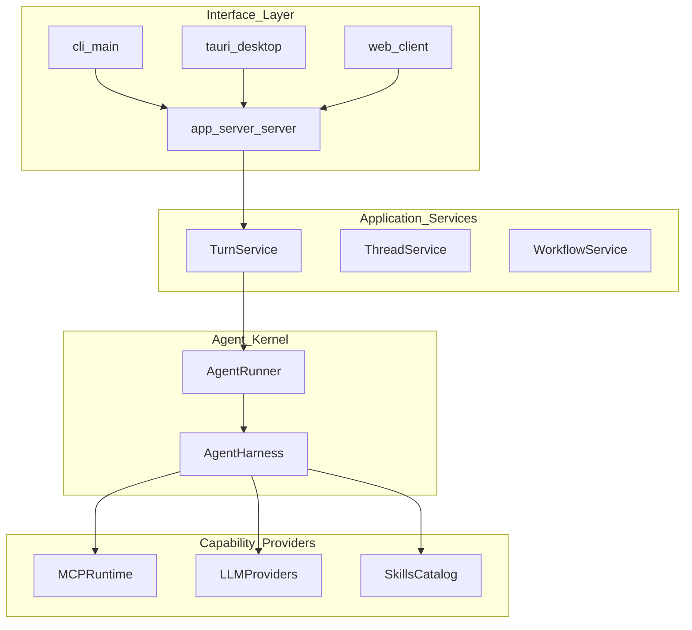
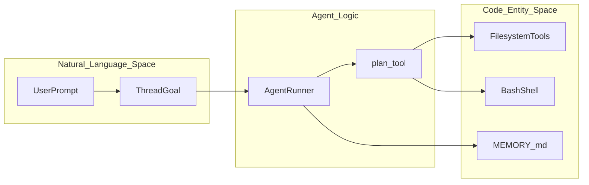

<!-- source: DeepWiki mcp.deepwiki.com · repo HKUDS/DeepCode · page 1 Overview · fetched 2026-11-09 -->

# Overview

Relevant source files

The following files were used as context for generating this wiki page:

- [CONTRIBUTORS.md](CONTRIBUTORS.md)
- [README.md](README.md)
- [README_ZH.md](README_ZH.md)
- [assets/framework2.pdf](assets/framework2.pdf)
- [assets/readme/README.md](assets/readme/README.md)
- [assets/readme/deepcode-overview.png](assets/readme/deepcode-overview.png)
- [assets/readme/framework2.png](assets/readme/framework2.png)
- [assets/readme/verification-loop.png](assets/readme/verification-loop.png)
- [assets/setting_model.png](assets/setting_model.png)
- [core/version.py](core/version.py)
- [docs/archive/README_LEGACY_2026-07-20.md](docs/archive/README_LEGACY_2026-07-20.md)
- [docs/archive/README_ZH_LEGACY_2026-07-20.md](docs/archive/README_ZH_LEGACY_2026-07-20.md)
- [docs/guide/README.md](docs/guide/README.md)

## Purpose and Scope

DeepCode is an open agentic coding system designed to bridge the gap between high-level requirements and functional, verified implementations. It utilizes a multi-agent architecture to automate complex software development tasks, specializing in a "Loop Engineering" philosophy where agents iterate through planning, implementation, and verification until a goal is provably satisfied.

This page serves as the parent entry point for understanding the system's core capabilities, including its interactive interfaces, shared background service, research-to-code pipeline, and underlying agent kernel.

For detailed setup, installation, and configuration, see the child pages:
- [Getting Started](#1.1) — Installing DeepCode via pip/uv/pipx, running `deepcode init`, connecting model providers, trusting workspaces, and launching interactive TUI, Desktop, or Web entry points.
- [Configuration Reference](#1.2) — Detailed reference for `~/.deepcode/deepcode_config.json`, layered user/project configurations, provider profiles, model declarations, MCP entries, permission presets, dictation blocks, and config error reporting.

Sources: [README.md:81-84](), [docs/guide/README.md:1-17]()

---

## Core Capabilities

DeepCode provides a unified agent runtime accessible through multiple interface modalities, ensuring complete parity across terminal and visual workflows over a shared local background service.

*   **Multi-Interface Workbenches**: Interactive CLI/TUI (`deepcode`), Tauri-based Desktop workbench (`deepcode desktop`), and Web workbench (`deepcode web`). All interfaces share the same local Projects, Session history, models, Skills, permissions, Goals, and Automations [README.md:81-85]().
*   **Loop Engineering**: A goal-driven execution model where agents work toward defined objectives (`Goal`), utilizing tools, running test suites, and receiving feedback in an automated loop until verification passes [README_ZH.md:125-126]().
*   **Paper2Code Research Pipeline**: A specialized 7-phase multi-agent orchestration workflow that transforms academic papers (PDF/arXiv) into verified, production-ready algorithm implementations [README.md:102-103]().
*   **Durable Sessions and Memory**: Persistent session management using a JSONL `SessionStore` and SQLite projection, alongside a two-layer memory architecture (`MEMORY.md` pointer index and topic files) enabling long-running continuity [CONTRIBUTORS.md:26]().

Sources: [README.md:70-85](), [README_ZH.md:121-133](), [CONTRIBUTORS.md:26]()

---

## System Architecture

DeepCode is structured around a layered architecture that cleanly separates user-facing clients from the local background service, App Server, application services, and the core agent execution kernel.

### Component Architecture

Sources: [README.md:81-85](), [setup.py:96-101]()

### Bridging Natural Language to Code Entities

DeepCode translates abstract user prompts and research inputs into concrete code modifications by mapping them through typed domain objects and tool invocations.

Sources: [README.md:102-103](), [README_ZH.md:125-127]()

---

## Major Subsystems

DeepCode is organized into several interdependent subsystems spanning client surfaces, background services, application logic, and specialized pipelines:

*   **Agent Runtime and Harness**: The core execution engine centered around `AgentRunner`, managing tool-using loops, `AgentRunSpec`, compaction, token metering, and repeat-call guards.
*   **Application Services Layer**: Durable management of `TurnService`, `ThreadService`, `SessionRuntimeRegistry`, and `WorkflowService`.
*   **Domain Model and Persistence**: Core domain objects (`Thread`, `Turn`, `Item`, `Project`, `Goal`, `Automation`) backed by SQLite projections and JSONL `SessionStore` transcripts.
*   **Security and Permissions Model**: Three-valued permission engine, execution modes, platform sandboxes (`seatbelt`/`bwrap`/Windows Job Object), and command guards.
*   **MCP Integration Layer**: Model Context Protocol client system supporting stdio/SSE/Streamable HTTP servers and lazy connections.
*   **LLM Provider System**: Provider registry, OpenAI-compatible and Anthropic adapters, model catalog service, and egress policy controls.
*   **Background Service and Discovery**: Shared local background service managed via `ServiceFiles` state records, HMAC identity proof, and control RPCs.
*   **Paper2Code Research Pipeline**: 7-phase automated pipeline for acquiring papers, generating YAML implementation plans, indexing code structures, and executing verification loops.

Sources: [README.md:81-85](), [CONTRIBUTORS.md:26]()

---

## Technical Specifications

| Component | Detail | Reference |
|-----------|--------|-----------|
| **Language** | Python 3.12+ | [setup.py:69]() |
| **Interfaces** | Interactive TUI, Tauri Desktop, Web Workbench | [README.md:81-85]() |
| **LLM Support** | OpenAI, Anthropic, Custom Providers | [requirements.txt:4-16]() |
| **Storage** | SQLite (Projections) + JSONL (`SessionStore`) | [CONTRIBUTORS.md:26]() |
| **License** | MIT | [setup.py:49]() |

Sources: [setup.py:44-70](), [requirements.txt:1-24](), [CONTRIBUTORS.md:26]()

---

