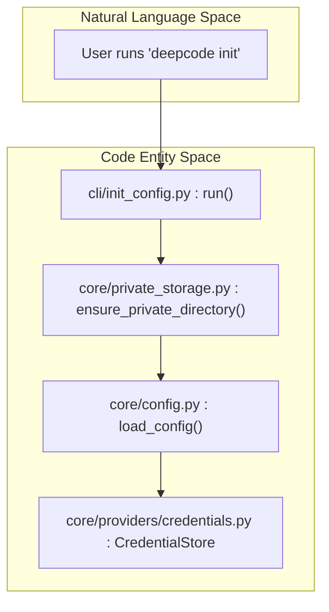
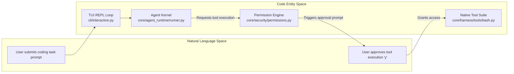

<!-- source: DeepWiki mcp.deepwiki.com · repo HKUDS/DeepCode · page 1.1 Getting Started · fetched 2026-11-09 -->

# Getting Started

<details>
<summary>Relevant source files</summary>

The following files were used as context for generating this wiki page:

- [CONTRIBUTORS.md](CONTRIBUTORS.md)
- [README.md](README.md)
- [README_ZH.md](README_ZH.md)
- [cli/init_config.py](cli/init_config.py)
- [core/schedule/monitor.py](core/schedule/monitor.py)
- [core/version.py](core/version.py)
- [docs/guide/getting-started.md](docs/guide/getting-started.md)
- [docs/guide/goals-and-headless.md](docs/guide/goals-and-headless.md)
- [docs/guide/sessions.md](docs/guide/sessions.md)
- [docs/guide/the-tui.md](docs/guide/the-tui.md)
- [tests/test_init_config.py](tests/test_init_config.py)
- [tests/test_schedule_monitor.py](tests/test_schedule_monitor.py)

</details>


This page details the initial setup, configuration, provider connection, workspace trust verification, and first interactive session execution across DeepCode's CLI, Desktop, and Web entry points.

**Sources:** [docs/guide/getting-started.md:1-10](), [cli/init_config.py:1-12]()

---

## 1. Installation and Entry Points

DeepCode requires **Python 3.12+**. Tool management via `uv` is recommended, though `pip` and `pipx` are fully supported package managers [`README.md:44](), [docs/guide/getting-started.md:11-17]().

### CLI and Package Installation
```bash
# Recommended installation via uv
uv tool install --python 3.12 deepcode-hku

# Alternative installation via pip
pip install deepcode-hku
```
The installation provisions console scripts mapped in the package metadata: `deepcode` (the primary CLI / TUI interface) and `deepcode-app-server` (the JSON-RPC backend server consumed by the Desktop and Web workbenches) [docs/guide/getting-started.md:11-32]().

### Client Interfaces
DeepCode exposes three client interfaces over a shared local background service, unifying Projects, Session history, model registries, Skills, and permissions [`README.md:80-84]()`:
*   **Terminal UI (TUI):** Launched directly via `deepcode`.
*   **Desktop Application:** Launched via `deepcode desktop` (Tauri-based multi-process workbench).
*   **Web Workbench:** Launched via `deepcode web` (browser-facing surface served by `app_server/web_surface.py` and `cli/web_cli.py`) [docs/guide/getting-started.md:25-32]().

**Sources:** [README.md:80-84](), [docs/guide/getting-started.md:11-32]()

---

## 2. Initialization (`deepcode init`)

DeepCode initializes a private user configuration directory located at `$DEEPCODE_HOME` or `~/.deepcode/`. Running `deepcode init` executes the initialization logic defined in `cli/init_config.py` [cli/init_config.py:1-8]().

The initialization sequence sets up safe defaults (`"security": {"accessPreset": "ask"}`), enforces strict file permissions via `core/private_storage.py`, and supports explicit imports (`--from PATH`) with automatic backup creation (`.bak`) when forced [cli/init_config.py:27-40](), [tests/test_init_config.py:39-88]().

### System Data Flow: Configuration and Initialization



**Sources:** [cli/init_config.py:119-172](), [tests/test_init_config.py:39-58]()

---

## 3. Connecting a Model Provider

DeepCode is model-agnostic and interacts with OpenAI, Anthropic, DeepSeek, Gemini, and local endpoints via OpenRouter or vLLM adapters. Credentials are maintained inside `CredentialStore` and managed through connection profiles [docs/guide/getting-started.md:36-62]().

### Configuration Commands
1.  **Define a Connection Profile:**
    ```bash
    deepcode provider set my-openrouter --template openrouter --api-key
    ```
2.  **Synchronize Model Catalogs:**
    ```bash
    deepcode provider models my-openrouter --refresh
    ```
3.  **Run Connectivity Handshake:**
    ```bash
    deepcode provider test my-openrouter --model MODEL_ID
    ```

**Sources:** [docs/guide/getting-started.md:36-55](), [core/providers/credentials.py:1-25]()

---

## 4. Workspace Trust and First Interactive Session

DeepCode enforces a strict **Workspace Trust** model. The first time the agent is executed inside a repository directory, trust must be established via `--trust` or explicitly confirmed [docs/guide/getting-started.md:64-77]().

### Launching the First Session
Navigate to the target workspace and start an interactive session:
```bash
mkdir deepcode-demo
cd deepcode-demo
deepcode --trust --connection my-openrouter --model MODEL_ID
```

Upon invocation, the TUI initializes the conversation loop, managing turns via `AgentRunner` (`core/agent_runtime/runner.py`), evaluating permissions through `PermissionEngine` (`core/security/permissions.py`), and recording session logs to disk via `SessionStore` [docs/guide/getting-started.md:64-85]().

### Interaction Logic to Code Entity Mapping



**Sources:** [docs/guide/getting-started.md:64-115](), [docs/guide/sessions.md:73-78]()

---

## 5. Next Steps

After completing your first successful agentic turn, proceed to explore:
*   **Session Management:** Resume sessions using `deepcode --resume SESSION_ID` or compact context using `/compact` [docs/guide/sessions.md:8-57]().
*   **Goals:** Establish persistent multi-turn objectives using `/goal` [docs/guide/goals-and-headless.md:14-31]().
*   **Skills:** Define project-specific guidelines via `SKILL.md` configurations [docs/guide/getting-started.md:166-171]().

**Sources:** [docs/guide/getting-started.md:166-171](), [docs/guide/sessions.md:8-57]()

---

