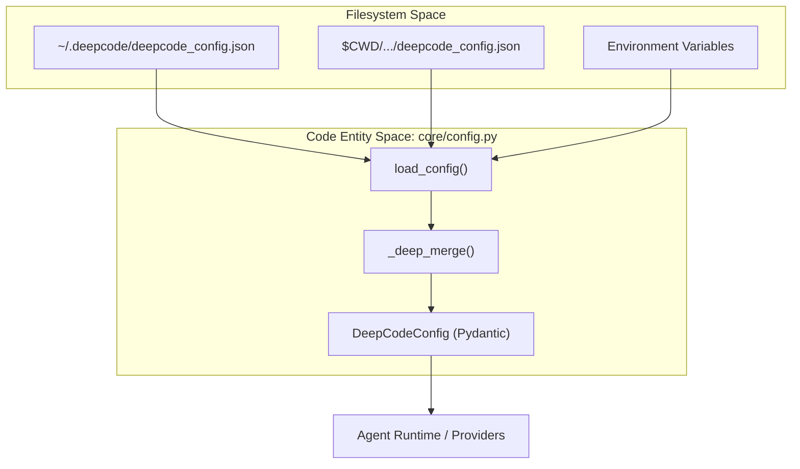
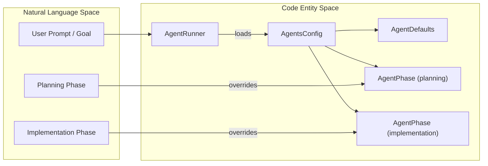
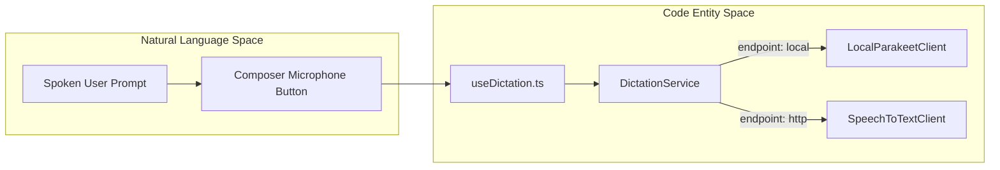

<!-- source: DeepWiki mcp.deepwiki.com · repo HKUDS/DeepCode · page 1.2 Configuration Reference · fetched 2026-11-09 -->

# Configuration Reference

Relevant source files

The following files were used as context for generating this wiki page:

- [.gitleaksignore](.gitleaksignore)
- [cli/config_errors.py](cli/config_errors.py)
- [core/application/diagnostics_service.py](core/application/diagnostics_service.py)
- [core/application/dictation_service.py](core/application/dictation_service.py)
- [core/config.py](core/config.py)
- [core/dictation/__init__.py](core/dictation/__init__.py)
- [core/dictation/client.py](core/dictation/client.py)
- [core/dictation/local_runner.py](core/dictation/local_runner.py)
- [desktop/src/features/execution/useDictation.test.ts](desktop/src/features/execution/useDictation.test.ts)
- [desktop/src/features/execution/useDictation.ts](desktop/src/features/execution/useDictation.ts)
- [docs/guide/dictation.md](docs/guide/dictation.md)
- [schema/mcp-agent.config.schema.json](schema/mcp-agent.config.schema.json)
- [tests/test_config_errors.py](tests/test_config_errors.py)
- [tests/test_config_layers.py](tests/test_config_layers.py)
- [tests/test_dictation_local_runner.py](tests/test_dictation_local_runner.py)
- [tests/test_dictation_service.py](tests/test_dictation_service.py)

This page provides a comprehensive technical reference for DeepCode's configuration system. DeepCode utilizes a layered JSON architecture centered around `deepcode_config.json`, supporting global user settings, project-level overrides, provider profiles, model declarations, Model Context Protocol (MCP) servers, permission presets, and voice dictation settings.

---

## Configuration Architecture and Layering

DeepCode's runtime configuration is managed by `core/config.py` [core/config.py:1-11](). It follows a "home base + project override" pattern designed to allow `deepcode` to run seamlessly in any directory:

1. **User-Level Base**: Located at `deepcode_home()`, defaulting to `~/.deepcode/deepcode_config.json` [core/config.py:7-9](). The location can be relocated using the `DEEPCODE_HOME` environment variable [core/config.py:8](). Provider keys and global defaults reside here.
2. **Project-Level Override**: The loader walks up parent directories from the current working directory (CWD) to locate a project-level `deepcode_config.json` [core/config.py:9-11]().
3. **Deep Merge & Resolution**: Project keys override user keys key-by-key [core/config.py:9-11](). Strings matching `${ENV_VAR}` are evaluated against the environment at load time [core/config.py:24]().

### Configuration Data Flow

Sources: [core/config.py:1-27](), [tests/test_config_layers.py:40-65]()

---

## Provider and Connection Profiles

DeepCode abstracts LLM communication through provider profiles and connection blocks (`ProviderConfig`) [core/config.py:151-164](). 

### Connection Configuration Fields
- `apiKey`: Literal key or a `${ENV_VAR}` reference resolved at load time [core/config.py:154-158]().
- `apiBase`: Custom endpoint URL for OpenAI-compatible or alternative backends [core/config.py:159]().
- `extraHeaders`: Optional dictionary of HTTP headers injected into provider requests [core/config.py:160]().
- `protocol`: Protocol adapter specification (`auto`, `openai_compat`, `anthropic_messages`) [core/config.py:161]().
- `compat`: Compatibility rule flags (`ProviderCompat`) [core/config.py:162]().
- `auth`: Authentication mode (`api_key` or `none`) [core/config.py:163]().

### Manual Model Declarations (`ManualModelConfig`)
For models lacking native auto-discovery or for overriding built-in catalog parameters, models are declared via `ManualModelConfig` [core/config.py:175-188](). Declarations narrow or correct catalog defaults without requiring full restatements [core/config.py:175-182]().

Sources: [core/config.py:151-190]()

---

## Agent and Phase Configuration

Agent generation defaults are structured via `AgentsConfig`, which separates global `defaults` from phase-specific overrides (`planning` and `implementation`) [core/config.py:114-129]().

### Natural Language Space to Code Entity Space: Agent Phases

Sources: [core/config.py:91-132]()

---

## Voice Dictation Block (`dictation`)

The `dictation` configuration block enables push-to-talk speech-to-text transcription directly within the composer interface [docs/guide/dictation.md:1-11](). 

### Operational Modes
1. **Local CLI Runner (`endpoint: "local"`)**: Invokes the `parakeet-mlx` command line utility directly on the host machine (`pip install parakeet-mlx`) without requiring a background HTTP server [docs/guide/dictation.md:9](). Handled by `LocalParakeetClient` in `core/dictation/local_runner.py` [core/application/dictation_service.py:51](), [core/dictation/local_runner.py:54-56]().
2. **OpenAI-Compatible Server (`endpoint: "http://..."`)**: Connects to a remote or local HTTP transcription server (e.g., `mlx_audio.server`) adhering to the OpenAI audio transcription contract (`POST /audio/transcriptions`) [docs/guide/dictation.md:8-10](), [core/dictation/client.py:1-7]().

### Natural Language Space to Code Entity Space: Dictation Flow

### Dictation Configuration Schema
| Field | Type | Default | Description |
|---|---|---|---|
| `endpoint` | string | *required* | Base URL of the OpenAI-compatible server or `"local"` [docs/guide/dictation.md:73](). |
| `model` | string | *required* | Speech-to-text model identifier (e.g. `mlx-community/parakeet-tdt-0.6b-v3`) [docs/guide/dictation.md:74](). |
| `language` | string \| null | `null` | ISO 639-1 language hint [docs/guide/dictation.md:75](). |
| `apiKeyEnv` | string \| null | `null` | Environment variable containing bearer token for authenticated endpoints [docs/guide/dictation.md:76](). |
| `maxAudioSeconds` | integer | `120` | Maximum recording duration in seconds [docs/guide/dictation.md:77](). |
| `timeoutSeconds` | float | `60.0` | Whole-request transcription timeout budget [docs/guide/dictation.md:78](). |

Sources: [docs/guide/dictation.md:1-87](), [core/application/dictation_service.py:1-116](), [core/dictation/local_runner.py:54-80](), [desktop/src/features/execution/useDictation.ts:1-45]()

---

## Security, Redaction, and Effective Config Layers

DeepCode ensures secure provenance tracking via `effective_config_layers` [tests/test_config_layers.py:1-8]().

- **Redaction Rules**: Any leaf value under subtrees named `env`, `headers`, `apiKey`, or `proxy` is automatically replaced with `••• (set)` in diagnostic outputs to prevent credential leaks [tests/test_config_layers.py:76-95]().
- **Project Boundary Enforcement**: Repository-level project configs cannot override sensitive blocks such as `dictation` endpoints or global provider authentication tokens, mitigating risk from malicious workspaces [docs/guide/dictation.md:84](), [core/application/dictation_service.py:169-184]().

Sources: [tests/test_config_layers.py:1-109](), [core/application/dictation_service.py:169-184]()

---

## Configuration Error Reporting

When configuration is missing or malformed, DeepCode provides actionable feedback via `cli/config_errors.py`:
- `is_unconfigured()`: Detects the total absence of user or project-level configuration files.
- `format_config_error()`: Prompts users to run `deepcode init` to establish a base configuration [cli/config_errors.py:13-30]().
- Parsing exceptions raise structured diagnostics, preventing silent failures during agent initialization.

Sources: [cli/config_errors.py:1-30](), [tests/test_config_errors.py:1-59]()

---

