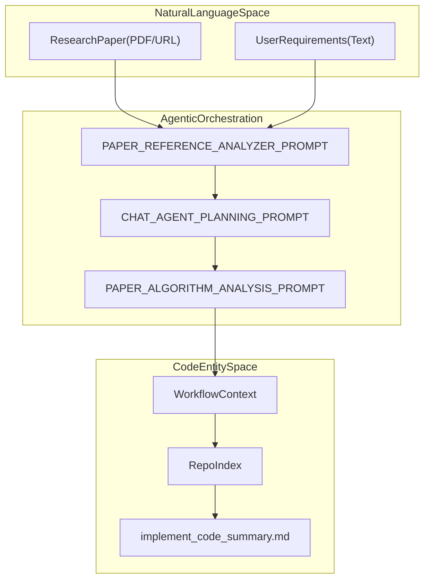
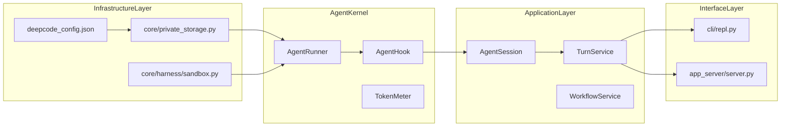

<!-- source: DeepWiki mcp.deepwiki.com · repo HKUDS/DeepCode · page 10 Glossary · fetched 2026-11-09 -->

# Glossary

Relevant source files

The following files were used as context for generating this wiki page:

- [.github/workflows/python-ci.yml](.github/workflows/python-ci.yml)
- [CONTRIBUTORS.md](CONTRIBUTORS.md)
- [README.md](README.md)
- [README_ZH.md](README_ZH.md)
- [app_server/service_client.py](app_server/service_client.py)
- [app_server/service_state.py](app_server/service_state.py)
- [cli/service_cli.py](cli/service_cli.py)
- [core/agent_runtime/runner.py](core/agent_runtime/runner.py)
- [core/agent_runtime/tools/base.py](core/agent_runtime/tools/base.py)
- [core/domain/execution_security.py](core/domain/execution_security.py)
- [core/events/session.py](core/events/session.py)
- [core/harness/hooks/__init__.py](core/harness/hooks/__init__.py)
- [core/harness/hooks/discovery.py](core/harness/hooks/discovery.py)
- [core/harness/hooks/engine.py](core/harness/hooks/engine.py)
- [core/harness/hooks/events.py](core/harness/hooks/events.py)
- [core/harness/memory.py](core/harness/memory.py)
- [core/loop/autodream.py](core/loop/autodream.py)
- [core/mcp/tools.py](core/mcp/tools.py)
- [core/version.py](core/version.py)
- [tests/app_server/test_service.py](tests/app_server/test_service.py)
- [tests/app_server/test_service_discovery.py](tests/app_server/test_service_discovery.py)
- [tests/test_autodream.py](tests/test_autodream.py)
- [tests/test_ci_installation.py](tests/test_ci_installation.py)
- [tests/test_compaction_memory.py](tests/test_compaction_memory.py)
- [tests/test_hooks.py](tests/test_hooks.py)
- [tests/test_memory.py](tests/test_memory.py)
- [tests/test_memory_layers.py](tests/test_memory_layers.py)
- [tests/test_session_end_lifecycle.py](tests/test_session_end_lifecycle.py)
- [tests/test_tool_description_quality.py](tests/test_tool_description_quality.py)

This glossary defines the core technical terms, architectural concepts, and domain-specific jargon used within the DeepCode codebase. It serves as a comprehensive reference for onboarding engineers, mapping high-level research concepts and system nomenclature to specific code implementations and modules.

## Core System Concepts

### Loop Engineering
The philosophy of goal-driven, iterative development where the agent operates in a continuous cycle of execution, tool invocation, and verification until a defined objective is fully met.
*   **Implementation**: Centralized in the `AgentRunner` execution loop [core/agent_runtime/runner.py:1-9]().
*   **Verification**: Driven by the `deepcode loop` command and durable `Goal` domain objects [core/domain/thread_goal.py:1-10]().

### SQ/EQ Protocol
The foundational streaming session protocol (Session Query / Event Queue) that bridges frontends (TUI, Desktop workbench, Web client, or headless runners) to the background execution engine. Frontends submit `Op` messages and consume `Event` items asynchronously without touching the core agent kernel directly.
*   **Implementation**: Defined in `AgentSession` within `core/events/session.py` [core/events/session.py:1-17]().

### Lifetime Lease & Discovery Record
The synchronization mechanism used by DeepCode's background service. A file-system based lock (`ServiceFiles`) secures a lifetime lease via SQLite files, ensuring exclusive singleton execution of the background background daemon, while the discovery record exposes connection coordinates and HMAC instance tokens.
*   **Implementation**: Managed via `ServiceFiles` and `ServiceRecord` [app_server/service_state.py:1-50](), tested in `tests/app_server/test_service.py` [tests/app_server/test_service.py:127-169]().

### Sidecar
The bundled background service executable or Python process launched by the Desktop application (Tauri) to host App Server endpoints, database projections, and agent sessions locally.
*   **Implementation**: Controlled via `ServiceClient` and CLI entry points [app_server/service_client.py:1-30](), [cli/service_cli.py:1-20]().

Sources: [core/agent_runtime/runner.py:1-9](), [core/events/session.py:1-17](), [app_server/service_state.py:1-50](), [tests/app_server/test_service.py:127-169]()

---

## Memory & Context Management

### Pointer Index
The first layer of persistent memory (`MEMORY.md`), permanently injected into the system prompt. It contains concise pointer lines (capped strictly by length and line count) referencing detailed topic files, allowing durable facts to survive across sessions with minimal token overhead.
*   **Implementation**: Parsed and managed in `core/harness/memory.py` [core/harness/memory.py:1-34](), tested in `tests/test_memory_layers.py` [tests/test_memory_layers.py:66-141]().

### Clean-Slate Memory (`ConciseMemoryAgent`)
A memory optimization technique where context is periodically rebuilt from scratch after major file implementation steps, relying on a summary knowledge base file (`implement_code_summary.md`) instead of retaining an unbounded raw conversation transcript.
*   **Implementation**: Handled by the concise memory agent [workflows/agents/memory_agent_concise.py:27-41]().

### Semantic Compaction
A technique where conversation history is condensed into a structured "handoff summary" by the LLM when approaching context window limits, replacing old turns while retaining critical task state.
*   **Implementation**: Managed via `CompactionStrategy` and summarization prompts [core/agent_runtime/runner.py:28-33]().

### PreCompact Checkpoint
A mechanism ensuring critical ephemeral context (such as sub-agent notes or goal modifications) survives a successful compaction event by re-injecting it as a bounded, provider-agnostic user message.
*   **Implementation**: Implemented via `_build_precompact_checkpoint` [core/agent_runtime/runner.py:91-132]().

Sources: [core/harness/memory.py:1-34](), [tests/test_memory_layers.py:66-141](), [workflows/agents/memory_agent_concise.py:27-41](), [core/agent_runtime/runner.py:28-132]()

---

## Agent Roles, Subsystems & Components

| Term | Definition | Code Pointer |
| :--- | :--- | :--- |
| **AgentRunner** | The core kernel executing the tool-using loop, handling token metering, compaction, and error recoveries. | [core/agent_runtime/runner.py:136-172]() |
| **AgentSession** | The SQ/EQ protocol engine managing active turns and streaming real-time tool and message events. | [core/events/session.py:1-17]() |
| **WorktreeManager** | Manages isolated Git worktrees for sub-agents, allowing parallel execution without file conflicts. | [core/team/worktree.py:1-15]() |
| **CodeIndexer** | Builds comprehensive indexes of code directories to identify file relationships and structures. | [tools/code_indexer.py:68-78]() |
| **StructureGeneratorAgent** | Generates initialization commands and directory layouts for research-to-code pipelines. | [workflows/code_implementation_workflow.py:175-180]() |

Sources: [core/agent_runtime/runner.py:136-172](), [core/events/session.py:1-17](), [core/team/worktree.py:1-15](), [tools/code_indexer.py:68-78](), [workflows/code_implementation_workflow.py:175-180]()

---

## Architecture and Entity Mapping Diagrams

The following diagrams illustrate how abstract concepts and natural language inputs map to specific code entities across the DeepCode subsystem.

**Figure 1: Research-to-Code Entity Mapping**

Sources: [workflows/agent_orchestration_engine.py:42-49](), [tools/code_indexer.py:58-67]()

**Figure 2: Architecture Component Mapping**

Sources: [core/agent_runtime/runner.py:1-20](), [core/events/session.py:1-17](), [core/private_storage.py:1-12](), [core/harness/sandbox.py:1-38]()

---

## Technical Abbreviations & Jargon

*   **Adaptive Token Policy**: Dynamically adjusts `max_tokens` and temperature during model request retries when context limits are approached [workflows/agent_orchestration_engine.py:150-191]().
*   **Repeat Call Guard**: A safety mechanism tracking identical consecutive tool invocations to issue escalating warnings or abort infinite tool loops [core/agent_runtime/runner.py:48-51]().
*   **SafeResolver**: A secure DNS resolution wrapper that prevents Server-Side Request Forgery (SSRF) by restricting network downloads to public IP ranges [tools/pdf_downloader.py:72-97]().
*   **SkillKey**: A structured identifier representing a Skill's scope (system, user, or project) and name [core/skills/models.py:1-10]().
*   **Turn**: A discrete single request-response cycle between a user (or automated scheduler) and the active agent runner session [core/events/session.py:11-12]().

Sources: [workflows/agent_orchestration_engine.py:150-191](), [core/agent_runtime/runner.py:48-51](), [tools/pdf_downloader.py:72-97](), [core/skills/models.py:1-10](), [core/events/session.py:11-12]()