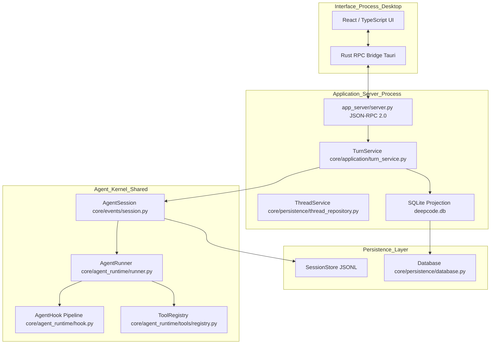
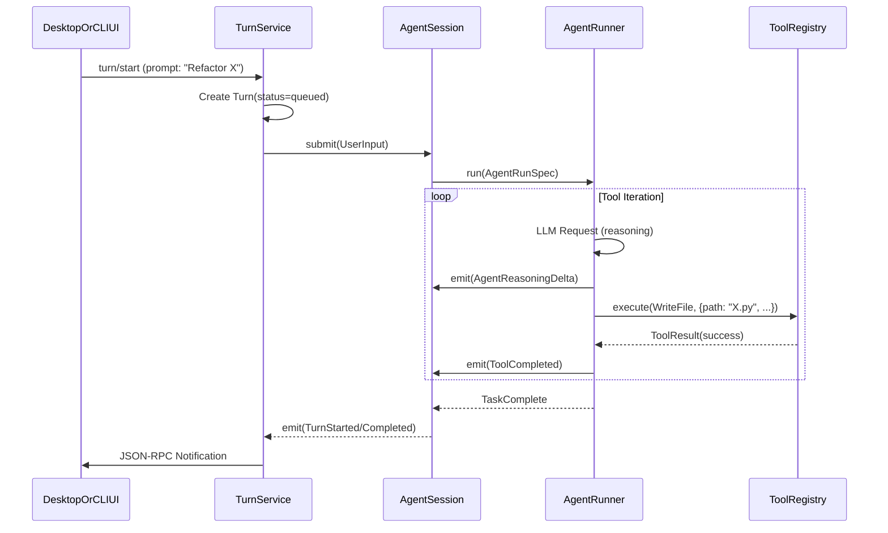

<!-- source: DeepWiki mcp.deepwiki.com · repo HKUDS/DeepCode · page 2 Architecture · fetched 2026-11-09 -->

# Architecture

Relevant source files

The following files were used as context for generating this wiki page:

- [CONTRIBUTORS.md](CONTRIBUTORS.md)
- [README.md](README.md)
- [README_ZH.md](README_ZH.md)
- [core/agent_runtime/runner.py](core/agent_runtime/runner.py)
- [core/application/agent_adapter.py](core/application/agent_adapter.py)
- [core/application/session_runtime.py](core/application/session_runtime.py)
- [core/application/turn_service.py](core/application/turn_service.py)
- [core/events/session.py](core/events/session.py)
- [core/harness/hooks/__init__.py](core/harness/hooks/__init__.py)
- [core/harness/hooks/discovery.py](core/harness/hooks/discovery.py)
- [core/harness/hooks/engine.py](core/harness/hooks/engine.py)
- [core/harness/hooks/events.py](core/harness/hooks/events.py)
- [core/version.py](core/version.py)
- [tests/test_hooks.py](tests/test_hooks.py)
- [tests/test_session_end_lifecycle.py](tests/test_session_end_lifecycle.py)

## Purpose and Scope

DeepCode is built on a layered, multi-process architecture designed to provide a unified agentic coding experience across CLI, Desktop, and Web interfaces. The system decouples the **Agent Kernel** (the tool-using execution loop) from the **Application Services** (which manage durable state like Threads, Turns, and Goals) and the **Interface Layer** (TUI, Desktop, Web, and JSON-RPC App Server).

This page provides a high-level overview of how these layers interact, the process boundaries between them, and the core data models that ensure session durability.

**Related Child Pages:**
- [Agent Runtime and Execution Loop](#2.1) — The `AgentRunner` kernel in `core/agent_runtime/runner.py`: tool-using loop, `AgentRunSpec`, `AgentHook`, compaction, token metering, repeat-call guard, context pruning, semantic hints, termination.
- [Application Services Layer](#2.2) — `core/application/`: TurnService, ThreadService, SessionRuntimeRegistry, ExecutionCoordinator, EventService, SettingsService, WorkflowService, AutomationService and durable Turn/Thread/Goal lifecycles.
- [Domain Model and Persistence](#2.3) — Core domain objects in `core/domain/` (Thread, Turn, Item, Project, Goal, Automation, Approval, Artifact, ExecutionProfile) plus the SQLite database, migrations, locking, JSONL SessionStore, session index and transcripts.
- [Security and Permissions Model](#2.4) — Three-valued permission engine, execution modes, platform sandboxes (seatbelt/bwrap/Windows Job Object), command guard, env sanitizing, approvals, private storage with NTFS ACL hardening.
- [MCP Integration Layer](#2.5) — MCP client system in `core/mcp/`: server lifecycle (stdio/SSE/Streamable HTTP), preset catalog, OAuth, lazy connections, tool adaptation, and the `cli/mcp_server.py` server mode.
- [LLM Provider System](#2.6) — `core/providers/`: registry, OpenAI-compatible and Anthropic adapters, model catalog service, reasoning effort, model compatibility, egress policy, credential management.
- [Background Service and Discovery](#2.7) — The shared local background service: `ServiceFiles` state, lifetime lease and discovery record, HMAC identity proof, `ServiceClient` control RPC, `deepcode service` CLI, platform supervisors (LaunchAgent/systemd/Windows task), drain vs cancel shutdown.
- [Observability and Transparency Log](#2.8) — `core/observability/`: the event bus, records, transparency log verification script, and LLMOps metering/tracing of model calls.

Sources: [core/events/session.py:1-17](), [core/application/turn_service.py:188-203](), [core/agent_runtime/runner.py:1-9]()

---

## High-Level System Architecture

DeepCode operates across distinct process boundaries when running in Desktop/Web mode, while the CLI collapses these into a single process that directly invokes the application services and agent runtimes.

### Process Boundary Diagram

Sources: [core/events/session.py:1-17](), [core/application/turn_service.py:188-203](), [core/agent_runtime/runner.py:1-9](), [app_server/server.py:1-20]()

---

## Core Architectural Components

### 1. The Agent Kernel (`AgentRunner`)
The heart of DeepCode is the `AgentRunner` located in `core/agent_runtime/runner.py`. It implements a tool-using execution loop that manages the interaction between the LLM and the local environment. It handles token metering, repeat-call guards, context pruning, and compaction. The `AgentRunner` is stateless regarding long-term history; it operates on an `AgentRunSpec` for a single turn.

For details, see [Agent Runtime and Execution Loop](#2.1).

Sources: [core/agent_runtime/runner.py:135-172]()

### 2. Event-Sourced Communication (`AgentSession`)
The `AgentSession` in `core/events/session.py` acts as the bridge between the kernel and the outside world. It consumes `Op` submissions (such as `UserInput` or `Shutdown`) and emits `Event` messages (`ToolStarted`, `AgentMessageDelta`, `TurnStarted`). This ensures that TUIs, Desktop apps, and headless runners all receive identical real-time telemetry.

Sources: [core/events/session.py:37-64](), [core/events/session.py:103-136]()

### 3. Application Services and Durability
Above the kernel, the application services layer manages the lifecycle of durable entities:
- **`TurnService`**: Orchestrates the execution of a single turn, ensuring durable writes and coordination [core/application/turn_service.py:188-203]().
- **`SessionRuntimeRegistry`**: Manages live `AgentSession` instances, ensuring exclusive process leases to prevent history corruption [core/application/session_runtime.py:91-118]().

For details, see [Application Services Layer](#2.2).

### 4. Dual-Persistence Strategy
DeepCode uses two distinct storage mechanisms:
1. **SessionStore (JSONL)**: The source of truth for conversation history and transcript logs [core/sessions/__init__.py]() (see [Domain Model and Persistence](#2.3)).
2. **SQLite Projection**: A relational database (`deepcode.db`) used for fast querying of Threads, Turns, Items, Goals, Automations, and Approvals.

For details, see [Domain Model and Persistence](#2.3).

Sources: [core/application/session_runtime.py:173-181](), [core/application/turn_service.py:92-101]()

---

## Request Flow: Natural Language to Code Entity

This diagram bridges natural language inputs to code entity operations across the system layers.

Sources: [core/events/session.py:1-17](), [core/application/turn_service.py:188-203](), [core/agent_runtime/runner.py:1-9]()

---

## Extension and Hook System

DeepCode is designed for extensibility through a robust **Hook System** defined in `core/harness/hooks/`. Hooks allow external command handlers to intercept agent behavior at critical lifecycle points without modifying the core kernel.

| Hook Point | Description | Code Entity |
|------------|-------------|-------------|
| **`SessionStart`** | Fires once when a session begins. | `core/harness/hooks/events.py:33` |
| **`PreToolUse`** | Allows blocking or rewriting a tool call before it executes. | `core/harness/hooks/events.py:28` |
| **`PostToolUse`** | Injects feedback into the agent context after a tool runs. | `core/harness/hooks/events.py:30` |
| **`PreCompact`** | Captures state before conversation history is summarized. | `core/harness/hooks/events.py:31` |
| **`SessionEnd`** | Fires exactly once at session termination. | `core/harness/hooks/events.py:34` |

For details, see [Agent Runtime and Execution Loop](#2.1) and [core/harness/hooks/discovery.py]() [core/harness/hooks/engine.py]().

Sources: [core/harness/hooks/events.py:27-39](), [core/harness/hooks/discovery.py:46-59](), [core/harness/hooks/engine.py:1-100]()

---

