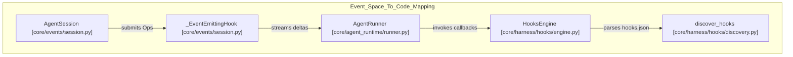
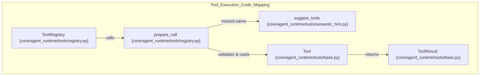

<!-- source: DeepWiki mcp.deepwiki.com · repo HKUDS/DeepCode · page 2.1 Agent Runtime and Execution Loop · fetched 2026-11-09 -->

# Agent Runtime and Execution Loop

Relevant source files

The following files were used as context for generating this wiki page:

- [core/agent_runtime/compaction.py](core/agent_runtime/compaction.py)
- [core/agent_runtime/context.py](core/agent_runtime/context.py)
- [core/agent_runtime/helpers.py](core/agent_runtime/helpers.py)
- [core/agent_runtime/pruner.py](core/agent_runtime/pruner.py)
- [core/agent_runtime/repeat_guard.py](core/agent_runtime/repeat_guard.py)
- [core/agent_runtime/runner.py](core/agent_runtime/runner.py)
- [core/agent_runtime/token_meter.py](core/agent_runtime/token_meter.py)
- [core/agent_runtime/tools/registry.py](core/agent_runtime/tools/registry.py)
- [core/agent_runtime/tools/semantic_hint.py](core/agent_runtime/tools/semantic_hint.py)
- [core/events/session.py](core/events/session.py)
- [core/harness/hooks/__init__.py](core/harness/hooks/__init__.py)
- [core/harness/hooks/discovery.py](core/harness/hooks/discovery.py)
- [core/harness/hooks/engine.py](core/harness/hooks/engine.py)
- [core/harness/hooks/events.py](core/harness/hooks/events.py)
- [tests/test_agent_runner_kernel.py](tests/test_agent_runner_kernel.py)
- [tests/test_compaction_retry_memo.py](tests/test_compaction_retry_memo.py)
- [tests/test_context_note_sink.py](tests/test_context_note_sink.py)
- [tests/test_hooks.py](tests/test_hooks.py)
- [tests/test_loop_detector.py](tests/test_loop_detector.py)
- [tests/test_manual_compact.py](tests/test_manual_compact.py)
- [tests/test_repeat_call_reminder.py](tests/test_repeat_call_reminder.py)
- [tests/test_semantic_hint.py](tests/test_semantic_hint.py)
- [tests/test_session_end_lifecycle.py](tests/test_session_end_lifecycle.py)
- [tests/test_skills_product.py](tests/test_skills_product.py)
- [tests/test_tool_call_timeout.py](tests/test_tool_call_timeout.py)
- [tests/test_tool_result_pruner.py](tests/test_tool_result_pruner.py)
- [utils/loop_detector.py](utils/loop_detector.py)

The `AgentRunner` kernel, located in `core/agent_runtime/runner.py`, serves as the shared execution engine for all DeepCode agent interactions. It provides a standardized, tool-using loop managing model requests, tool execution, context compaction, token metering, and safety guards. Frontends (CLI, Desktop, TUI) attach to this kernel via the `AgentSession` protocol layer in `core/events/session.py`.

Sources: [core/agent_runtime/runner.py:1-9](), [core/events/session.py:1-17]()

---

## 1. Core Execution Loop and `AgentRunSpec`

The `AgentRunner` executes a synchronous or streaming sampling loop that iterates until the model emits a text finish reason, an external stop trigger occurs, or `max_iterations` is exhausted.

### AgentRunSpec Configuration
The `AgentRunSpec` data class defines parameters for a single execution pass:
* `initial_messages`: The baseline conversation history (`list[dict[str, Any]]`) [core/agent_runtime/runner.py:139]().
* `tools`: The active `ToolRegistry` containing available built-in and MCP tool definitions [core/agent_runtime/runner.py:140]().
* `transient_context_messages`: Ephemeral user-priority context injected into requests without persisting in history [core/agent_runtime/runner.py:144-146]().
* `repeat_call_thresholds`: Escalating reminder thresholds for consecutive identical tool calls [core/agent_runtime/runner.py:155-158]().

Sources: [core/agent_runtime/runner.py:136-172]()

---

## 2. Hook System and Event Bridging

The harness hook system combines programmatic hooks (`AgentHook`) with discovered external command hooks (`HooksEngine`, `discover_hooks`).

### Event Emission and Bridging
`_EventEmittingHook` in `core/events/session.py` bridges low-level kernel callbacks onto the event stream [core/events/session.py:103-105]().

Sources: [core/events/session.py:103-137](), [core/harness/hooks/engine.py:85-125](), [core/harness/hooks/discovery.py:77-98]()

Sources: [core/events/session.py:103-200](), [core/harness/hooks/engine.py:85-125]()

---

## 3. Context Management, Compaction, and Token Metering

When conversation history nears the model context window limits, the runner performs compaction.

### Compaction Strategy and PreCompact Checkpoints
Summarization-based compaction (`_COMPACT_TRIGGER_FRACTION`) invokes a background model call to condense old turns into a handoff summary [core/agent_runtime/runner.py:84-88](). Before summarization runs, registered `PreCompact` hooks can inject additional working context via `_build_precompact_checkpoint`, generating a bounded user message (`[PreCompact checkpoint]`) that survives compaction [core/agent_runtime/runner.py:91-132]().

### Token Metering
`ProviderAnchoredTokenMeter` tracks input, output, and reasoning tokens across requests, emitting `ModelUsageRecorded` events [core/agent_runtime/token_meter.py](), [core/events/session.py:48]().

Sources: [core/agent_runtime/runner.py:84-132](), [core/agent_runtime/token_meter.py](), [core/events/session.py:48]()

---

## 4. Execution Guards and Safeguards

To prevent infinite loops, hangs, and runaway resource consumption, the runtime implements multiple guard layers.

### Repeat-Call Tracking and Loop Detection
* `RepeatCallTracker`: Monitors consecutive identical tool calls and injects advisory warnings when usage exceeds `repeat_call_thresholds` [core/agent_runtime/runner.py:155-158](), [core/agent_runtime/repeat_guard.py]().
* `LoopDetector`: Tracks progress stalls, iteration timeouts, and consecutive tool errors [utils/loop_detector.py:12-46](). It offsets LLM waiting time via `note_llm_wait` to avoid false stall triggers during slow model responses [utils/loop_detector.py:133-145]().

Sources: [core/agent_runtime/runner.py:155-158](), [utils/loop_detector.py:12-178]()

---

## 5. Tool Execution and Semantic Hints

Tool dispatch is mediated by `ToolRegistry` [core/agent_runtime/tools/registry.py:12-18](). When the model requests a tool name that is missing or misspelled, `suggest_tools` and `build_miss_message` compute closest-name candidates via token-overlap similarity without invoking an LLM [core/agent_runtime/tools/semantic_hint.py:28-79]().

Sources: [core/agent_runtime/tools/registry.py:69-107](), [core/agent_runtime/tools/semantic_hint.py:39-79](), [core/agent_runtime/tools/base.py:20-41]()

Sources: [core/agent_runtime/tools/registry.py:69-123](), [core/agent_runtime/tools/semantic_hint.py:39-79]()

---

