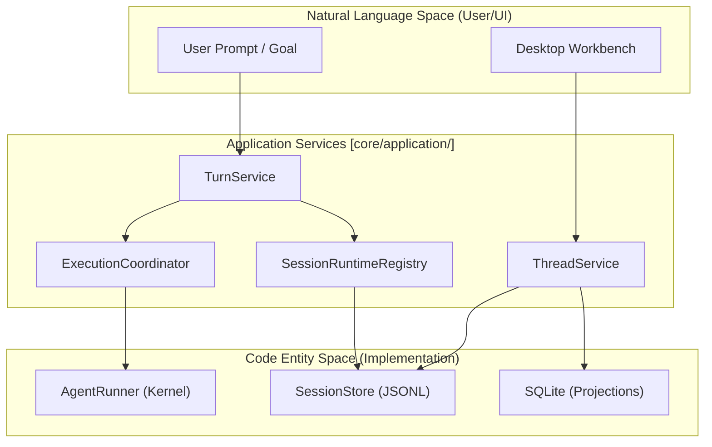

<!-- source: DeepWiki mcp.deepwiki.com · repo HKUDS/DeepCode · page 2.2 Application Services Layer · fetched 2026-11-09 -->

# Application Services Layer

Relevant source files

The following files were used as context for generating this wiki page:

- [app_server/server.py](app_server/server.py)
- [cli/goal_runner.py](cli/goal_runner.py)
- [cli/headless_turn.py](cli/headless_turn.py)
- [core/application/agent_adapter.py](core/application/agent_adapter.py)
- [core/application/event_service.py](core/application/event_service.py)
- [core/application/execution_coordinator.py](core/application/execution_coordinator.py)
- [core/application/session_runtime.py](core/application/session_runtime.py)
- [core/application/settings_service.py](core/application/settings_service.py)
- [core/application/thread_service.py](core/application/thread_service.py)
- [core/application/turn_projection.py](core/application/turn_projection.py)
- [core/application/turn_service.py](core/application/turn_service.py)
- [desktop/src/app/composerBehavior.ts](desktop/src/app/composerBehavior.ts)
- [desktop/src/app/replayThreadHistory.test.ts](desktop/src/app/replayThreadHistory.test.ts)
- [desktop/src/app/replayThreadHistory.ts](desktop/src/app/replayThreadHistory.ts)
- [desktop/src/app/useWorkspaceController.ts](desktop/src/app/useWorkspaceController.ts)
- [desktop/src/app/workspaceState.test.ts](desktop/src/app/workspaceState.test.ts)
- [desktop/src/app/workspaceState.ts](desktop/src/app/workspaceState.ts)
- [desktop/src/features/settings/sections/ComposerBehaviorCard.tsx](desktop/src/features/settings/sections/ComposerBehaviorCard.tsx)
- [desktop/src/features/settings/sections/DefaultPresetCard.tsx](desktop/src/features/settings/sections/DefaultPresetCard.tsx)
- [desktop/src/features/settings/sections/GeneralSection.tsx](desktop/src/features/settings/sections/GeneralSection.tsx)
- [docs/guide/skills-and-memory.md](docs/guide/skills-and-memory.md)
- [tests/application/test_default_agent_preset.py](tests/application/test_default_agent_preset.py)
- [tests/application/test_durable_event_relay.py](tests/application/test_durable_event_relay.py)
- [tests/application/test_one_way_data_flow.py](tests/application/test_one_way_data_flow.py)
- [tests/application/test_turn_service.py](tests/application/test_turn_service.py)
- [tests/test_cross_process_run_lease.py](tests/test_cross_process_run_lease.py)
- [tests/test_stdlib_logging_bridge.py](tests/test_stdlib_logging_bridge.py)

The Application Services Layer (`core/application/`) defines the service boundary of the DeepCode system. It orchestrates the lifecycle of durable entities—**Turns**, **Threads**, **Goals**, and **Automations**—above the low-level agent kernel. This layer ensures that agent sessions are persistent, concurrent access is safely managed via file leases, and domain events are broadcasted to the UI.

## Service Architecture and Orchestration

The Application layer acts as the coordinator between the **Domain Model** (SQLite/JSONL), the **Agent Runtime** (LLM execution), and the **Interfaces** (CLI/Desktop).

### Bridge: Natural Language Space to Code Entity Space

The following diagram maps high-level application concepts to the specific Python classes and database entities that implement them.

Sources: [core/application/turn_service.py:188-203](), [core/application/thread_service.py:97-113](), [core/application/session_runtime.py:91-115]()

---

## Core Services

### ThreadService
The `ThreadService` manages the high-level lifecycle of a conversation. It bridges the **canonical JSONL SessionStore** (the source of truth for LLM history) with the **SQLite projection** used by the Desktop UI.

- **Reconciliation**: The `reconcile()` method [core/application/thread_service.py:149-161]() repairs the SQLite state by scanning JSONL sessions and rebuilding `Turn` and `Item` records.
- **Creation**: `start()` [core/application/thread_service.py:163-176]() initializes new threads, handling project trust, workspace scoping, and agent preset snapshots.
- **Projections**: It converts `SessionMessage` records into `ItemKind` (e.g., `USER_MESSAGE`, `TOOL_CALL`, `FILE_CHANGE`) for UI rendering [core/application/thread_service.py:73-92]().

### TurnService
The `TurnService` is the primary entry point for executing agent logic. It manages the "Turn" lifecycle: from submission and admission to execution and settlement.

- **Turn Admission**: Before a turn runs, it passes through `TurnAdmissionGuard` [core/application/turn_service.py:131]() to check for conflicts or project trust.
- **Execution Coordination**: It uses the `ExecutionCoordinator` to ensure only one process executes a turn for a specific thread at a time [core/application/turn_service.py:41-46]().
- **Event Streaming**: Provides support for event subscriptions and delivery tracking during live execution [core/application/turn_service.py:136-146]().

Sources: [core/application/thread_service.py:1-176](), [core/application/turn_service.py:1-203]()

---

## Runtime Management

### SessionRuntimeRegistry
To maintain high performance, the system keeps a pool of `LiveSessionRuntime` objects. This registry manages the lifecycle of `AgentSessionPort` instances, which are the active wrappers around the agent kernel.

- **Residency**: It maintains an `OrderedDict` of runtimes with a configurable `max_live_sessions` (default 16) [core/application/session_runtime.py:91-113]().
- **Acquisition**: The `acquire()` method [core/application/session_runtime.py:127-140]() retrieves an existing runtime or creates a new one, ensuring the `AgentPresetSnapshot` matches the thread's configuration.
- **Cross-Process Safety**: It enforces the "one live writer" rule using `FileLease` [core/application/session_runtime.py:86-88](). If another process (e.g., a CLI `deepcode exec` vs the Desktop app) tries to access the same session, a `ConflictError` is raised [core/application/session_runtime.py:156-158]().

### ExecutionCoordinator
The `ExecutionCoordinator` manages the scheduling of turns across potentially multiple worker processes.

- **Liveness**: Each worker maintains concurrency control via robust synchronization mechanisms and process identity tracking.
- **Admission Policy**: It coordinates resource claims to prevent a single workspace from saturating system resources.
- **Orphan Recovery**: Handles recovery procedures when processes terminate unexpectedly.

Sources: [core/application/session_runtime.py:70-181](), [core/application/execution_coordinator.py:1-177]()

---

## Event and Observability Infrastructure

DeepCode uses a durable event bus to decouple agent execution from the user interface.

### EventBroker and EventService
- **EventBroker**: Provides a `Condition`-based fan-out mechanism for live event delivery [core/application/event_service.py:74-92]().
- **Durable Replay**: The `EventService` allows clients to `replay()` history from the SQLite `event_log` table [core/application/event_service.py:171-175](), ensuring that a UI can fully reconstruct the state of a thread after a restart.
- **Sequence Watermarks**: The `_SequenceWatermark` class [core/application/event_service.py:47-72]() ensures events are processed in order and handles potential duplicates.

Sources: [core/application/event_service.py:1-194]()

---

## Headless and Goal Execution

For automation, background scheduling, and CI/CD, the application layer provides specialized adapters.

| Component | Role | Source |
| :--- | :--- | :--- |
| `run_headless_turn` | Executes a single prompt and exits, used by `deepcode exec`. | [cli/headless_turn.py:29-63]() |
| `run_goal` | Orchestrates a multi-turn verify loop for a specific objective. | [cli/goal_runner.py:60-72]() |
| `GoalRuntimeRouter` | Routes goal-related tool calls (e.g., `submit`) to the correct persistence handler. | [core/application/session_runtime.py:20-29]() |

Sources: [cli/headless_turn.py:1-171](), [cli/goal_runner.py:1-185](), [core/application/session_runtime.py:1-181]()

---

