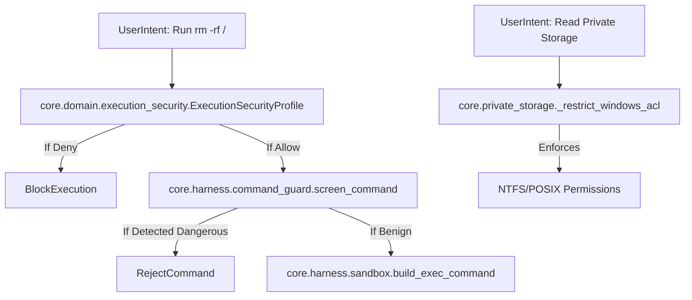
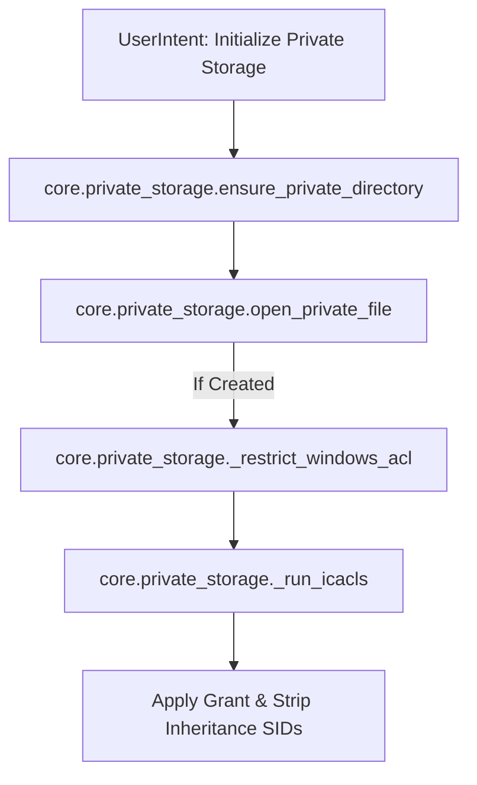
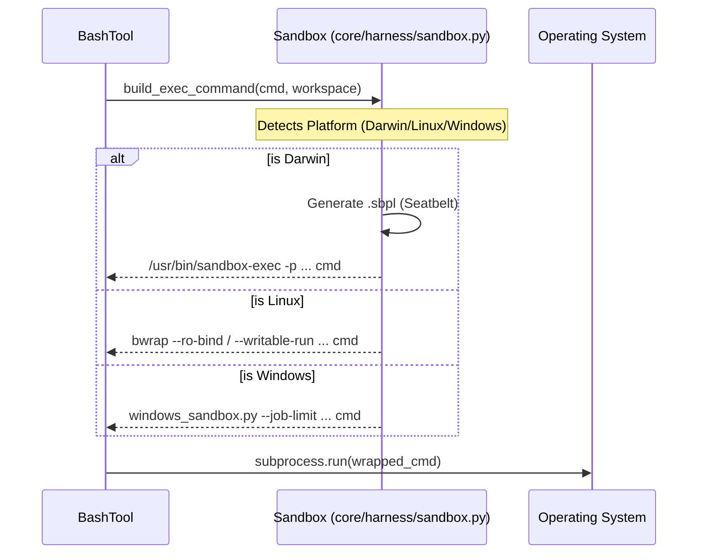

<!-- source: DeepWiki mcp.deepwiki.com · repo HKUDS/DeepCode · page 2.4 Security and Permissions Model · fetched 2026-11-09 -->

# Security and Permissions Model

Relevant source files

The following files were used as context for generating this wiki page:

- [cli/tui/animation.py](cli/tui/animation.py)
- [cli/tui/text.py](cli/tui/text.py)
- [core/harness/__init__.py](core/harness/__init__.py)
- [core/harness/approval.py](core/harness/approval.py)
- [core/harness/collaboration.py](core/harness/collaboration.py)
- [core/harness/command_guard.py](core/harness/command_guard.py)
- [core/harness/permissions.py](core/harness/permissions.py)
- [core/harness/policy.py](core/harness/policy.py)
- [core/harness/sandbox.py](core/harness/sandbox.py)
- [core/harness/tools/__init__.py](core/harness/tools/__init__.py)
- [core/harness/tools/plan.py](core/harness/tools/plan.py)
- [core/harness/tools/user_input.py](core/harness/tools/user_input.py)
- [core/harness/windows_sandbox.py](core/harness/windows_sandbox.py)
- [core/private_storage.py](core/private_storage.py)
- [core/providers/model_compat.py](core/providers/model_compat.py)
- [docs/P1_SECURITY_BASE.md](docs/P1_SECURITY_BASE.md)
- [pyproject.toml](pyproject.toml)
- [tests/application/test_automation_goal_runs.py](tests/application/test_automation_goal_runs.py)
- [tests/persistence/test_database.py](tests/persistence/test_database.py)
- [tests/test_collaboration.py](tests/test_collaboration.py)
- [tests/test_command_executor_native_fence.py](tests/test_command_executor_native_fence.py)
- [tests/test_command_guard.py](tests/test_command_guard.py)
- [tests/test_exec_sandbox_wiring.py](tests/test_exec_sandbox_wiring.py)
- [tests/test_harness_approval.py](tests/test_harness_approval.py)
- [tests/test_harness_permissions.py](tests/test_harness_permissions.py)
- [tests/test_harness_policy.py](tests/test_harness_policy.py)
- [tests/test_harness_sandbox.py](tests/test_harness_sandbox.py)
- [tests/test_native_file_tools.py](tests/test_native_file_tools.py)
- [tests/test_private_storage.py](tests/test_private_storage.py)
- [tests/test_private_storage_acl_once.py](tests/test_private_storage_acl_once.py)
- [tests/test_private_storage_windows.py](tests/test_private_storage_windows.py)
- [tests/test_skills.py](tests/test_skills.py)
- [tests/test_thinking_requires_capable_model.py](tests/test_thinking_requires_capable_model.py)
- [tools/code_implementation_server.py](tools/code_implementation_server.py)
- [tools/command_executor.py](tools/command_executor.py)

DeepCode implements a multi-layered security architecture designed to protect the host system from potentially harmful agent actions while maintaining a productive developer experience. This model spans from fine-grained tool permissions and destructive-command screening to platform-native process isolation, private storage, and NTFS ACL hardening.

## 1. Three-Valued Permission Engine and Execution Modes

The core of DeepCode's security is a three-valued logic engine (`allow`, `ask`, `deny`) that governs tool execution. This engine evaluates every tool call before it reaches the execution environment.

### Permission Modes
The system operates in three primary execution modes defined in `core/domain/execution_security.py`:

| Mode | Key Characteristic | Security Level |
| :--- | :--- | :--- |
| `default` | Interactive approval for sensitive tools. | Balanced |
| `plan` | Read-only access; no modifications allowed. | High |
| `full_auto` | Autonomous execution without approval. | Low (Restricted to trusted environments) |

### Permission Logic and Rule Snapshots
Permission rules are captured in `ExecutionPermissionRuleSnapshot` objects [core/domain/execution_security.py:68-74](). These rules allow for granular control based on tool names and argument patterns. The `normalize_permission_rules` function ensures that specific patterns take precedence over broad wildcards by calculating pattern specificity [core/domain/execution_security.py:104-156]().

Sources: [core/domain/execution_security.py:13-42](), [core/domain/execution_security.py:68-103](), [core/domain/execution_security.py:153-157]()

---

## 2. Platform Sandbox Backends and Execution Gating

DeepCode utilizes native OS primitives to enforce a strict write-fence around the agent's workspace. The `core/harness/sandbox.py` module detects the host platform and selects the appropriate backend [core/harness/sandbox.py:75-87]().

### Sandbox Implementation Matrix

| Platform | Backend | Mechanism |
| :--- | :--- | :--- |
| **macOS** | `seatbelt` | Uses `/usr/bin/sandbox-exec` with a closed-by-default `.sbpl` policy (`(deny default)`) [core/harness/sandbox.py:49-50](), [core/harness/sandbox.py:97-102](). |
| **Linux** | `bwrap` | Uses `bubblewrap` for mount-namespace isolation and `--unshare-net` [core/harness/sandbox.py:13-15](). |
| **Windows** | `job` | Uses Windows Job Objects via `ctypes` with `JOB_OBJECT_LIMIT_KILL_ON_JOB_CLOSE` for process-tree isolation [core/harness/sandbox.py:16-20](). |

The `build_exec_command` function wraps shell commands or raw argv arrays in the active platform sandbox [core/harness/sandbox.py:65-72](), [tests/test_exec_sandbox_wiring.py:36-44]().

Sources: [core/harness/sandbox.py:1-38](), [core/harness/sandbox.py:75-87](), [tests/test_exec_sandbox_wiring.py:36-44]()

---

## 3. Command Guard and Destructive-Command Screening

The `core/harness/command_guard.py` module acts as a fast, best-effort defense-in-depth layer sitting in front of the sandbox [core/harness/command_guard.py:1-7](). 

### Tokenization vs. Substring Matching
Legacy security implementations used raw substring checks (e.g., searching for `"rm -rf"`), which are easily bypassed by extra whitespace (`rm  -rf`), split flags (`rm -r -f`), uppercase commands, or alternate spellings [core/harness/command_guard.py:9-27](). `Command Guard` solves this by:
1. Splitting the raw shell string on control operators (`||`, `&&`, `;`, `|`, `&`, and newlines) [core/harness/command_guard.py:54-58]().
2. Tokenizing each segment using `shlex.split` [core/harness/command_guard.py:135-142]().
3. Inspecting the resulting `argv` to classify destructive patterns such as recursive-force `rm`, world-writable `chmod 777`, raw block-device writes (`dd of=`, `mkfs`), privilege escalation (`sudo`), and host power control [core/harness/command_guard.py:118-130]().

Unparseable commands (e.g., unbalanced quotes) are gracefully passed through to the sandbox boundary rather than failing closed [core/harness/command_guard.py:131-143]().

Sources: [core/harness/command_guard.py:1-34](), [core/harness/command_guard.py:54-58](), [core/harness/command_guard.py:118-143]()

---

## 4. Private Storage and NTFS ACL Hardening

DeepCode protects sensitive user data (credentials, history, session logs) using the `core/private_storage.py` utility. This ensures that application state remains inaccessible to unprivileged users on multi-user systems.

### Implementation Details
*   **POSIX**: Directories are restricted to `0700` and regular files to `0600` [core/private_storage.py:23-24]().
*   **Windows (NTFS ACLs)**: The system utilizes `icacls.exe` to enforce user isolation [core/private_storage.py:70-92]().
*   **Fail-Safe Ordering**: Permissions are applied in a strict order:
    1. Grant the current user Full Control (`/grant:r`) [core/private_storage.py:150-155]().
    2. Strip inherited access entries (`/inheritance:r`) [core/private_storage.py:158-160]().
    3. Remove broad built-in SIDs (`Everyone`, `Authenticated Users`, `BUILTIN\Users`) [core/private_storage.py:31-35](), [core/private_storage.py:164]().
    
    If the initial grant fails (e.g., under restrictive service accounts), the process fails safe by leaving inherited ACLs intact rather than leaving the file unopenable [core/private_storage.py:140-157](). Furthermore, ACL re-evaluation is restricted to file creation time (`open_private_file`), preventing expensive and redundant `icacls` spawns during routine reads [tests/test_private_storage_acl_once.py:1-8]().

Sources: [core/private_storage.py:1-35](), [core/private_storage.py:140-165](), [tests/test_private_storage_acl_once.py:1-8]()

---

## 5. Sensitive Path Protection and Workspace Fencing

Tools like `MemoryTool` and code reproduction servers enforce strict path boundaries to prevent path traversal or unauthorized outside writes. The `validate_path` function guarantees that target file operations resolve strictly within the designated `WORKSPACE_DIR` [tools/code_implementation_server.py:89-97](). Similarly, native tool bindings in `core/harness/tools/__init__.py` honor the execution security profile to scope file modifications [core/harness/tools/__init__.py:48-102]().

Sources: [tools/code_implementation_server.py:89-97](), [core/harness/tools/__init__.py:48-102]()

---

## Technical Diagrams

### Security Decision Flow: Natural Language to Code Entity

Sources: [core/domain/execution_security.py:185-201](), [core/harness/command_guard.py:132-143](), [core/harness/sandbox.py:32-33](), [core/private_storage.py:140-165]()

### Storage Hardening Flow: Natural Language to Code Entity

Sources: [core/private_storage.py:100-165](), [core/private_storage.py:167-175]()

### Sandbox Execution Workflow

Sources: [core/harness/sandbox.py:75-87](), [core/harness/tools/shell.py:99-103](), [core/harness/sandbox.py:49-50]()

### Security Configuration Reference

| Entity | File Path | Role |
| :--- | :--- | :--- |
| `ExecutionPermissionRuleSnapshot` | [core/domain/execution_security.py:68-74]() | Encapsulates pattern-based tool permission rules. |
| `_SEATBELT_BASE_POLICY` | [core/harness/sandbox.py:97-168]() | Chrome-inspired closed-by-default macOS sandbox policy. |
| `_WINDOWS_BROAD_ACCESS_SIDS` | [core/private_storage.py:31-35]() | List of dangerous SIDs removed during NTFS hardening. |
| `screen_command` | [core/harness/command_guard.py:132-143]() | Token-based destructive shell command screen. |

Sources: [core/domain/execution_security.py:68-74](), [core/harness/sandbox.py:97-168](), [core/private_storage.py:31-35](), [core/harness/command_guard.py:132-143]()

---

