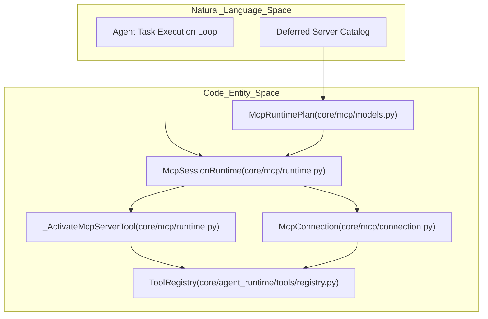
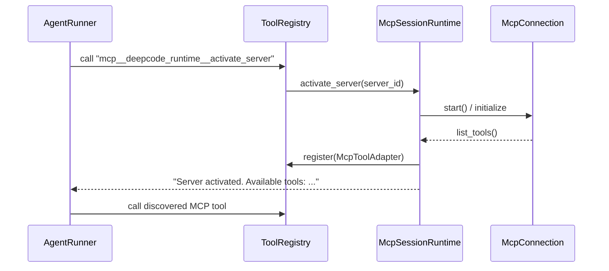
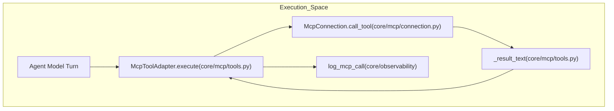

<!-- source: DeepWiki mcp.deepwiki.com · repo HKUDS/DeepCode · page 2.5 MCP Integration Layer · fetched 2026-11-09 -->

# MCP Integration Layer

Relevant source files

The following files were used as context for generating this wiki page:

- [cli/mcp_server.py](cli/mcp_server.py)
- [core/agent_runtime/tools/base.py](core/agent_runtime/tools/base.py)
- [core/domain/execution_security.py](core/domain/execution_security.py)
- [core/harness/code_mode/__init__.py](core/harness/code_mode/__init__.py)
- [core/harness/code_mode/_runner.py](core/harness/code_mode/_runner.py)
- [core/harness/memory.py](core/harness/memory.py)
- [core/loop/autodream.py](core/loop/autodream.py)
- [core/mcp/models.py](core/mcp/models.py)
- [core/mcp/runtime.py](core/mcp/runtime.py)
- [core/mcp/tools.py](core/mcp/tools.py)
- [tests/test_autodream.py](tests/test_autodream.py)
- [tests/test_code_mode.py](tests/test_code_mode.py)
- [tests/test_compaction_memory.py](tests/test_compaction_memory.py)
- [tests/test_mcp_runtime_lazy.py](tests/test_mcp_runtime_lazy.py)
- [tests/test_mcp_server.py](tests/test_mcp_server.py)
- [tests/test_memory.py](tests/test_memory.py)
- [tests/test_memory_layers.py](tests/test_memory_layers.py)
- [tests/test_tool_description_quality.py](tests/test_tool_description_quality.py)

## Purpose and Scope

The MCP (Model Context Protocol) Integration Layer in DeepCode provides a standardized client system for connecting AI agents to external tools and services. Unlike static tool definitions, the MCP layer allows for dynamic tool discovery, multi-transport server lifecycles (stdio, SSE, and Streamable HTTP), preset catalogs, OAuth flows, and lazy connection management. This architecture ensures that agents can extend their capabilities through the vast ecosystem of Model Context Protocol servers while maintaining strict security boundaries, tool description quality bounds, and credential isolation.

Sources: [core/mcp/runtime.py:1-18](), [core/mcp/models.py:1-11]()

---

## MCP Runtime Architecture and Plan Materialization

The core of the MCP client system is the `McpSessionRuntime` class, which materializes an immutable `McpRuntimePlan` into the agent's `ToolRegistry` [core/mcp/runtime.py:98-104](). The runtime manages the lifecycle of multiple `McpConnection` instances, handling connection initialization, tool discovery, capability mapping, and graceful teardown.

### Diagram: MCP Session Materialization (Natural Language to Code Entity Space)

Sources: [core/mcp/runtime.py:98-116](), [core/mcp/runtime.py:30-42]()

---

## Server Lifecycle and Connection Management

DeepCode supports three primary transport types for MCP servers, configured via `McpServerDefinition` [core/mcp/models.py:102-111]():
1.  **stdio**: The server executes as a local subprocess, communicating via structured JSON-RPC over standard input/output streams [core/mcp/models.py:111-114]().
2.  **sse**: The server is accessed via an HTTP endpoint utilizing Server-Sent Events for asynchronous message dispatch [core/mcp/models.py:111]().
3.  **streamableHttp**: A specialized transport for chunked JSON-RPC communication over HTTP [core/mcp/models.py:111]().

### Lazy Connection and Deferred Loading
To optimize session startup overhead, DeepCode implements **Lazy Connection Management**. When a server is marked with `defer_loading: true` in its configuration [core/mcp/models.py:157-160](), initialization is bypassed during the initial `ensure_started()` lifecycle phase [core/mcp/runtime.py:175-197]().

Instead, the runtime registers a model-visible bridge tool named `_ActivateMcpServerTool` [core/mcp/runtime.py:30-42](). When the LLM decides it requires tools from a deferred server, it invokes this bridge tool, triggering connection establishment and dynamic tool registration in the active `ToolRegistry` [core/mcp/runtime.py:75-95]().

### Diagram: Lazy Activation Sequence

Sources: [core/mcp/runtime.py:30-95](), [tests/test_mcp_runtime_lazy.py:81-122]()

---

## Tool Adaptation, Sanitization, and Execution

Discovered remote tools are wrapped by `McpToolAdapter`, which subclasses the native `Tool` interface [core/mcp/tools.py:23-32](). This adapter handles schema normalization for provider compatibility [core/mcp/tools.py:52](), description bounding against prompt token budgets [core/mcp/tools.py:46-50](), execution tracking, result formatting, and observability logging.

### Diagram: Tool Execution and Telemetry Pipeline

Sources: [core/mcp/tools.py:86-123](), [core/mcp/tools.py:126-164]()

---

## Configuration, Credential Isolation, and OAuth

MCP server configurations are validated using Pydantic models in `core/mcp/models.py`. Security and credential management adhere to strict isolation principles:

- **Credential References (`McpCredentialRef`)**: Secrets and API keys are referenced via `provider:<connection-id>` syntax [core/mcp/models.py:65-75](). These values are resolved immediately before a connection initializes and are excluded from serialized plans and diagnostic logs [core/mcp/models.py:68-70]().
- **OAuth Authentication**: HTTP-based transports support OAuth flows (`auth: "oauth"`) alongside explicit bearer token injection via environment variables or secure credential stores [core/mcp/models.py:130-153]().

Sources: [core/mcp/models.py:65-90](), [core/mcp/models.py:124-153]()

---

## DeepCode as an MCP Server (`cli/mcp_server.py`)

In addition to acting as an MCP client, DeepCode provides a server mode (`cli/mcp_server.py`) allowing external agents, IDEs, or client runtimes to drive DeepCode as a sub-agent. 

The server exposes core orchestration endpoints via standard MCP protocols, leveraging `build_agent_session` to ensure sub-agents inherit DeepCode's native tool suite, filesystem sandboxing, security rules, and persistent memory.

Sources: [cli/mcp_server.py:1-43](), [cli/mcp_server.py:111-118]()

---

