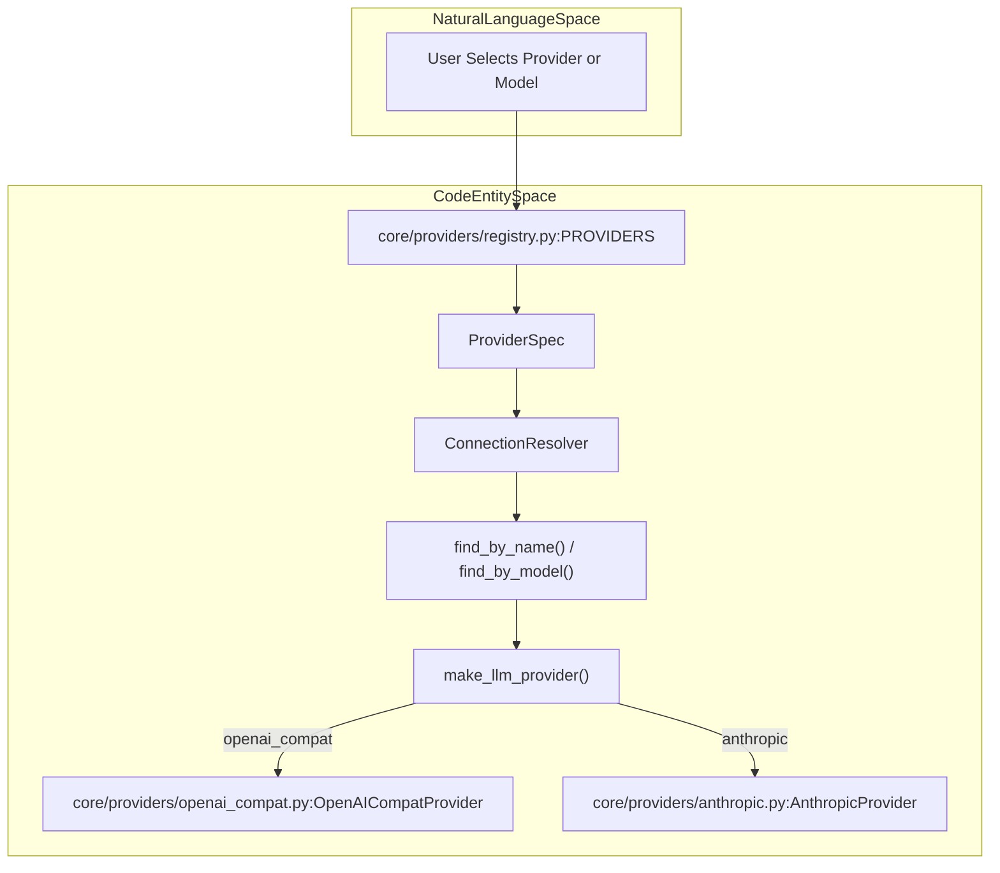
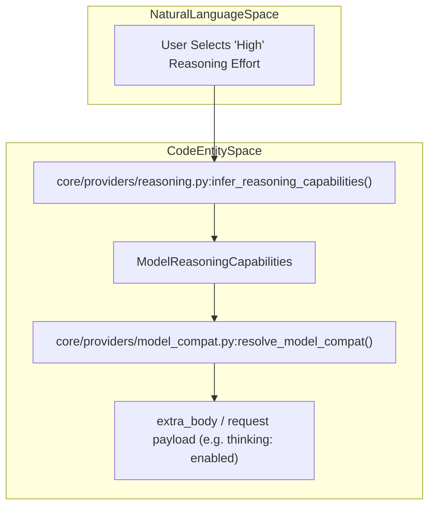

<!-- source: DeepWiki mcp.deepwiki.com · repo HKUDS/DeepCode · page 2.6 LLM Provider System · fetched 2026-11-09 -->

# LLM Provider System

Relevant source files

The following files were used as context for generating this wiki page:

- [core/application/llm_configuration_service.py](core/application/llm_configuration_service.py)
- [core/harness/policy.py](core/harness/policy.py)
- [core/providers/catalog.py](core/providers/catalog.py)
- [core/providers/catalog_service.py](core/providers/catalog_service.py)
- [core/providers/egress.py](core/providers/egress.py)
- [core/providers/model_compat.py](core/providers/model_compat.py)
- [core/providers/openai_compat.py](core/providers/openai_compat.py)
- [core/providers/profiles.py](core/providers/profiles.py)
- [core/providers/reasoning.py](core/providers/reasoning.py)
- [core/providers/registry.py](core/providers/registry.py)
- [desktop/src/features/settings/useConnectionCatalog.ts](desktop/src/features/settings/useConnectionCatalog.ts)
- [docs/guide/models.md](docs/guide/models.md)
- [tests/application/test_llm_configuration_service.py](tests/application/test_llm_configuration_service.py)
- [tests/application/test_manual_model_entries.py](tests/application/test_manual_model_entries.py)
- [tests/conftest.py](tests/conftest.py)
- [tests/minimax_provider_test.py](tests/minimax_provider_test.py)
- [tests/test_bedrock_provider.py](tests/test_bedrock_provider.py)
- [tests/test_catalog.py](tests/test_catalog.py)
- [tests/test_forge_provider.py](tests/test_forge_provider.py)
- [tests/test_harness_policy.py](tests/test_harness_policy.py)
- [tests/test_model_catalog_service.py](tests/test_model_catalog_service.py)
- [tests/test_provider_egress.py](tests/test_provider_egress.py)
- [tests/test_reasoning_catalog_alignment.py](tests/test_reasoning_catalog_alignment.py)
- [tests/test_requesty_provider.py](tests/test_requesty_provider.py)
- [tests/test_session_compaction.py](tests/test_session_compaction.py)
- [tests/test_thinking_requires_capable_model.py](tests/test_thinking_requires_capable_model.py)
- [tests/test_zhipu_thinking_wire.py](tests/test_zhipu_thinking_wire.py)

## Purpose and Scope
The LLM Provider System (`core/providers/`) provides the abstraction layer for multi-provider interactions in DeepCode. It encompasses provider registration and endpoint classification, OpenAI-compatible and Anthropic client adapters, an offline-first model catalog service with context window governance, semantic reasoning effort mapping, a model egress security policy, and isolated credential management.

---

## 1. Provider Registry and Endpoint Classification

The system is anchored by a central registry defined in `core/providers/registry.py`. Every provider is declared using a `ProviderSpec` dataclass that specifies its backend type, environment variable key, and endpoint properties [core/providers/registry.py:102-135]().

### Endpoint Classification (P0-1 Trust Boundary)
Because the endpoint terminates TLS and reads every prompt, tool call, and tool result in plaintext, DeepCode classifies every endpoint using `ENDPOINT_CLASSES` [core/providers/registry.py:30-48](). The classification is determined via `ProviderSpec.resolve_endpoint_class()` [core/providers/registry.py:140-166]() or `host_looks_local()` [core/providers/registry.py:78-95]() when an explicit `apiBase` override is supplied:
* `first_party`: Direct model vendor API surface (`api.deepseek.com`, `api.anthropic.com`) [core/providers/registry.py:30-35]().
* `gateway`: Routers that fan out to multiple vendors (`openrouter`, `requesty`) [core/providers/registry.py:36-40]().
* `aggregator`: Resellers or mirrors (`zhipu`, `dashscope`) [core/providers/registry.py:41-43]().
* `local`: Loopback or LAN endpoints (`localhost`, `127.0.0.1`, Ollama, vLLM) [core/providers/registry.py:44-45, 52-57]().
* `unknown`: Unclassified custom endpoints [core/providers/registry.py:46-47]().

### OpenAI-Compatible and Anthropic Adapters
The `OpenAICompatProvider` (`core/providers/openai_compat.py`) handles all non-Anthropic models. It provides:
* Automatic attribution headers for OpenRouter (`HTTP-Referer`, `X-OpenRouter-Title`) [core/providers/openai_compat.py:80-84]() and Requesty [core/providers/openai_compat.py:85-88]().
* 9-character alphanumeric tool ID generation (`_short_tool_id`) to ensure compatibility with strict schema validators like Mistral [core/providers/openai_compat.py:94-96]().
* Circuit breaking via failure thresholds (`_RESPONSES_FAILURE_THRESHOLD = 3`) [core/providers/openai_compat.py:181-182]().

**Diagram 1: Provider Registry to Adapter Entity Flow**

Sources: [core/providers/registry.py:30-166](), [core/providers/openai_compat.py:1-42]()

---

## Model Catalog and Context Governance

DeepCode implements an offline-first model catalog in `core/providers/catalog.py` to prevent context overflows. Instead of relying on hardcoded global defaults, `AgentRunner` queries the model's exact context window.

### Resolution Cascade
`resolve_model_info` evaluates model metadata through a cascading lookup:
1. **Exact Match**: Checks the built-in `_SEED` dictionary for curated vendor limits [core/providers/catalog.py:146-154]().
2. **Snapshot**: Merges external `models.dev` exports via `load_catalog_snapshot()` [core/providers/catalog.py:16-17]().
3. **Family Fallback**: Pattern-matches model prefixes (e.g., `gpt-5`, `deepseek-r1`) to assign correct family limits to unlisted version strings [core/providers/catalog.py:24-28]().
4. **Conservative Default**: Falls back to a safe 128K context window for entirely unknown identifiers [core/providers/catalog.py:45-48]().

### Model Catalog Service and Declarations
The `ModelCatalogService` (`core/providers/catalog_service.py`) manages dynamic model discovery with a durable last-known-good cache.
* **Cache Invalidation**: `catalog_revision(connection)` fingerprints executable settings, catalog mode, and manual model definitions [core/providers/catalog_service.py:136-160]().
* **Manual Model Declarations**: Users can define custom models in configuration (`manualModels`), supplying explicit labels, context windows, max output tokens, and reasoning capabilities which outrank remote discoveries [tests/application/test_manual_model_entries.py:55-147]().

Sources: [core/providers/catalog.py:1-155](), [core/providers/catalog_service.py:116-160](), [tests/application/test_manual_model_entries.py:55-147]()

---

## Egress Policy and Endpoint Security

To prevent data exfiltration via untrusted LLM endpoints, `core/providers/egress.py` enforces a strict model-egress security policy (P0-1) [core/providers/egress.py:1-44]().

### Evaluation and Modes
* **Pure Evaluation Kernel**: `evaluate_provider_egress(api_base, allowed_domains, blocked_domains)` parses the endpoint host and validates it against configured allow-lists and block-lists without performing network I/O [core/providers/egress.py:70-84]().
* **Fail-Closed Semantics**: An empty allow-list permits all domains *unless* explicitly blocked, preserving historical behavior. However, malformed domain entries cause `is_domain_allowed` to reject the policy outright [tests/test_provider_egress.py:181-189]().
* **Rollout Modes (`DEEPCODE_EGRESS_MODE`)**:
  * `enforce`: Blocks disallowed endpoints by raising a `ConfigError` during provider construction [core/providers/egress.py:57]().
  * `warn`: Logs violations without blocking traffic, aiding operators in discovering all third-party relays in use before strict enforcement [core/providers/egress.py:38-43, 58]().

Sources: [core/providers/egress.py:1-185](), [tests/test_provider_egress.py:1-189]()

---

## 4. Reasoning and Thinking Controls

DeepCode abstracts vendor-specific reasoning mechanisms (OpenAI `reasoning_effort`, Anthropic `extended_thinking`, DeepSeek thinking blocks) into a unified semantic model (`core/providers/reasoning.py`).

### ModelReasoningCapabilities
The `ModelReasoningCapabilities` data class defines supported thinking controls:
* **Effort Ladder**: Exposes `minimal`, `low`, `medium`, `high`, `max` [core/providers/reasoning.py:79-91]().
* **Mandatory Flag**: `mandatory=True` for models like DeepSeek-R1 or Grok-4 where thinking cannot be toggled off [core/providers/reasoning.py:120-124]().
* **Summary Channel**: Indicates whether the model supports a summarized thinking stream vs. raw trace blocks [core/providers/reasoning.py:83-101]().

**Diagram 2: Reasoning Effort and Compatibility Resolution**

Sources: [core/providers/reasoning.py:38-124](), [tests/test_reasoning_catalog_alignment.py:45-123]()

---

## Session Compaction

Context governance is tied directly to the `AgentSession` and `AgentRunner` lifecycle (`core/agent_runtime/runner.py`) [tests/test_session_compaction.py:1-11]() via the model's resolved context window [core/providers/catalog.py:60](). When a session's history approaches the token limit, two mechanisms activate:
1. **Snipping (`_snip_history`)**: Trims older turns from the message history while preserving system instructions and the most recent turn [tests/test_session_compaction.py:58-91]().
2. **Summarization Compaction**: Invokes an LLM pass to replace older conversation history with a structured checkpoint summary while retaining a tool-bearing tail for active tasks [tests/test_session_compaction.py:114-146]().

Sources: [tests/test_session_compaction.py:1-146]()

---

## Credential Management

DeepCode enforces a strict "no ambient credential" policy to prevent keys stored in process environment variables from leaking during multi-tenant operations or App Server execution [tests/test_forge_provider.py:55-64]().

* **Credential Store**: `CredentialStore` manages write-only secret storage in encrypted or private local paths (`~/.deepcode/credentials.json`) [core/providers/catalog_service.py:18-24]().
* **Connection Resolution**: `ConnectionResolver` combines static `deepcode_config.json` definitions with dynamic secrets from `CredentialStore` to yield isolated `ResolvedConnection` objects at execution time, ensuring API keys never touch global state [core/application/llm_configuration_service.py:77-124]().

Sources: [core/application/llm_configuration_service.py:60-124](), [core/providers/catalog_service.py:16-25]()

---

