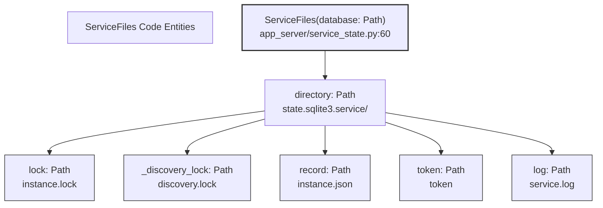
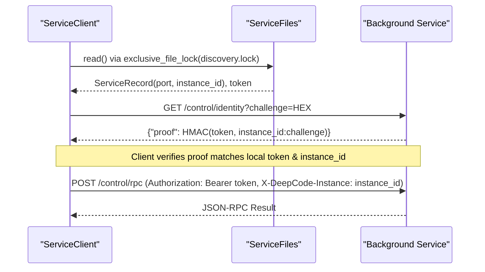
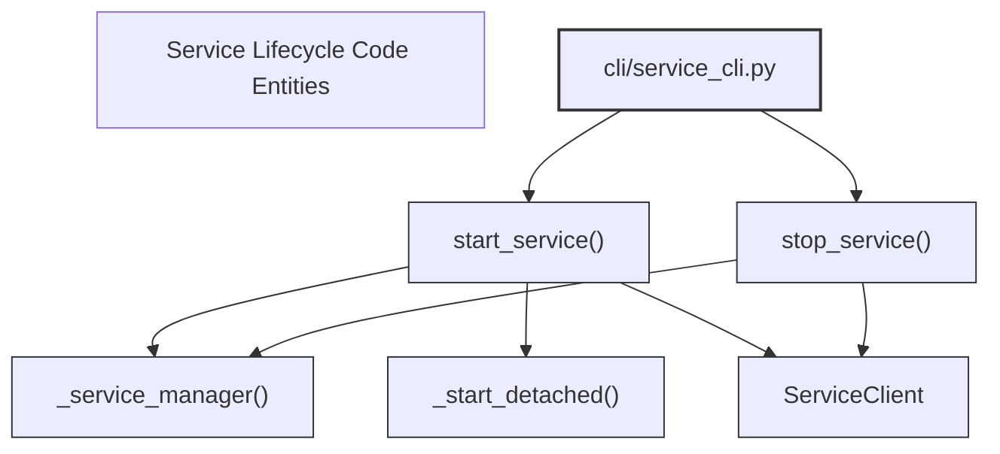

<!-- source: DeepWiki mcp.deepwiki.com · repo HKUDS/DeepCode · page 2.7 Background Service and Discovery · fetched 2026-11-09 -->

# Background Service and Discovery

<details>
<summary>Relevant source files</summary>

The following files were used as context for generating this wiki page:

- [.github/workflows/python-ci.yml](.github/workflows/python-ci.yml)
- [app_server/runtime_probe.py](app_server/runtime_probe.py)
- [app_server/service_client.py](app_server/service_client.py)
- [app_server/service_state.py](app_server/service_state.py)
- [cli/service_cli.py](cli/service_cli.py)
- [core/application/application.py](core/application/application.py)
- [core/application/views.py](core/application/views.py)
- [core/persistence/database.py](core/persistence/database.py)
- [desktop/scripts/verify-release-bundle.py](desktop/scripts/verify-release-bundle.py)
- [tests/app_server/test_preset_methods.py](tests/app_server/test_preset_methods.py)
- [tests/app_server/test_runtime_probe.py](tests/app_server/test_runtime_probe.py)
- [tests/app_server/test_service.py](tests/app_server/test_service.py)
- [tests/app_server/test_service_discovery.py](tests/app_server/test_service_discovery.py)
- [tests/persistence/test_database_locks.py](tests/persistence/test_database_locks.py)
- [tests/test_ci_installation.py](tests/test_ci_installation.py)

</details>


## Purpose and Scope
This page documents DeepCode's shared local background service architecture. The background service acts as a single-instance, local control daemon coordinating application services, background event relays, and automation schedulers across multiple concurrent user interfaces (TUI, Desktop, Web, and CLI commands). We detail the disk-backed state management via `ServiceFiles`, lifetime leases, inter-process discovery records, HMAC-SHA256 identity proof validation, `ServiceClient` RPC control flows, the `deepcode service` CLI interface, platform supervisors (`LaunchAgent`, `systemd`, `WindowsUserTask`), and graceful drain versus immediate cancel shutdown semantics.

---

## 1. State Management and Lifetime Leases (`ServiceFiles`)

The background service manages its state inside the DeepCode home directory next to the primary SQLite database. For a given database path, `ServiceFiles` [app_server/service_state.py:60-68]() initializes a dedicated `.service` sidecar directory containing state files, locks, authentication tokens, and logs.



*Figure 1: `ServiceFiles` directory layout and state file mappings.*

### Core State Files
* **`instance.lock`**: Acquired via `FileLease.acquire(self.lock, shared=False, blocking=False)` [app_server/service_state.py:70-71](). This OS-backed exclusive file lock serves as the service's lifetime lease. Holding this lock guarantees single-instance execution per database.
* **`discovery.lock`**: An exclusive file lock managed by `exclusive_file_lock(self._discovery_lock)` [app_server/service_state.py:84]() ensuring atomic reads and writes to discovery metadata across processes [tests/app_server/test_service_discovery.py:50-57]().
* **`instance.json`**: Contains the JSON serialization of the active `ServiceRecord` [app_server/service_state.py:47-58](), tracking `instance_id`, database path, OS `pid`, assigned loopback `port`, package `version`, and `protocol_version`.
* **`token`**: A 64-character hex-encoded authentication secret used for HMAC identity proofs and Bearer authorization [app_server/service_state.py:108-109]().
* **`service.log`**: Standard output and error stream capture for the background daemon.

Sources: [app_server/service_state.py:46-125](), [tests/app_server/test_service_discovery.py:50-116]()

---

## 2. Discovery Protocol and HMAC Identity Proof

Clients locate and connect to the background service without hardcoded port assumptions by reading the discovery record. Because local filesystem access alone does not prove the reading process is talking to the legitimate HTTP listener bound to that port (mitigating port-hijacking or stale-port races), DeepCode enforces an HMAC identity challenge on control endpoints [app_server/service_client.py:42-61]().



*Figure 2: Discovery read and HMAC challenge-response verification sequence.*

### Identity Proof Verification
The `identity_proof` function computes an HMAC-SHA256 digest over the concatenation of the instance ID and a random hex challenge using the service token as the key [app_server/service_state.py:40-43]():
```python
def identity_proof(token: str, instance_id: str, challenge: str) -> str:
    return hmac.new(
        token.encode(), f"{instance_id}:{challenge}".encode(), hashlib.sha256
    ).hexdigest()
```
When `ServiceClient.call()` executes, it requests `/control/identity` with a random challenge [app_server/service_client.py:49-51](). It compares the returned proof against the locally computed digest using constant-time comparison (`hmac.compare_digest`) before transmitting any management payloads [app_server/service_client.py:55-61]().

Sources: [app_server/service_state.py:40-44](), [app_server/service_client.py:22-100]()

---

## 3. Control RPC and Client Communication (`ServiceClient`)

The `ServiceClient` class acts as the lightweight management client. It never hosts an application runtime or database anchor directly [app_server/service_client.py:1]() but communicates exclusively via HTTP with loopback origin checks.

### Key Validation Checks in `ServiceClient`
1. **Running Check**: Asserts `self.files.running()` is true [app_server/service_client.py:34]().
2. **Instance Consistency**: Rejects requests if `instance_id` changes mid-operation [app_server/service_client.py:40-41]().
3. **Loopback & Origin Enforcement**: The server rejects non-loopback requests, incorrect `X-DeepCode-Instance` headers, or unexpected `Origin`/`Host` headers with `401 Unauthorized` or `403 Forbidden` [tests/app_server/test_service.py:23-56]().
4. **JSON-RPC Envelope**: Control requests follow JSON-RPC 2.0 specifications (`method`, `params`, `id`) over `/control/rpc` [app_server/service_client.py:62-74]().

Sources: [app_server/service_client.py:22-100](), [tests/app_server/test_service.py:23-70]()

---

## 4. Service Lifecycle and Management CLI (`deepcode service`)

The `deepcode service` command suite (`cli/service_cli.py`) orchestrates starting, stopping, inspecting, and resuming the background daemon.



*Figure 3: Service management CLI code entity relationships.*

### Startup & Idempotency
`start_service` uses an exclusive management lock (`files.directory / "management.lock"`) to prevent concurrent race conditions [cli/service_cli.py:44-48](). If a service is already running, it waits for readiness or resumes a drained instance [cli/service_cli.py:52-57](). If not managed by an OS supervisor, it launches a detached background process [cli/service_cli.py:66]() via `_start_detached` with `start_new_session=True` (POSIX) or `DETACHED_PROCESS` (Windows) [cli/service_cli.py:120-136]().

### Drain vs. Cancel Shutdown Semantics
When stopping a service via `stop_service` (`cli/service_cli.py`), operators choose between graceful draining and immediate cancellation:
* **Drain Mode (`cancel_running=False`)**: The client invokes the `drain` RPC method with a timeout [cli/service_cli.py:88-94](). The server stops accepting new turns, finishes executing active agent turns, and enters a `drained` phase. If shutdown is aborted, a `resume` RPC restores the `ready` phase [tests/app_server/test_service.py:72-90]().
* **Cancel Mode (`cancel_running=True`)**: Active agent turns and background tasks are immediately cancelled, followed by server termination and release of the lifetime lease lock.

Sources: [cli/service_cli.py:44-118](), [tests/app_server/test_service.py:72-114]()

---

## 5. Platform Supervisors

To ensure high availability and automatic background recovery, DeepCode integrates with native OS user supervisors depending on the host platform:

| Platform | Supervisor Class | Mechanism | Management Scope |
| :--- | :--- | :--- | :--- |
| **macOS** | `LaunchAgent` [cli/service_cli.py:28-32]() | `launchd` plist configuration | User agent daemon lifecycle |
| **Linux** | `SystemdUserService` [cli/service_cli.py:33-36]() | `systemd --user` units | Persistent background unit |
| **Windows** | `WindowsUserTask` [cli/service_cli.py:37-40]() | Windows Task Scheduler / Job Object | User session task execution |

These adapters inspect supervisor state (`job["loaded"]`, `job["pid"]`), load/unload plist/unit/task definitions, and ensure that if the machine restarts or the service crashes, the background daemon recovers automatically under the user session.

Sources: [cli/service_cli.py:28-41](), [.github/workflows/python-ci.yml:66-122]()

---

